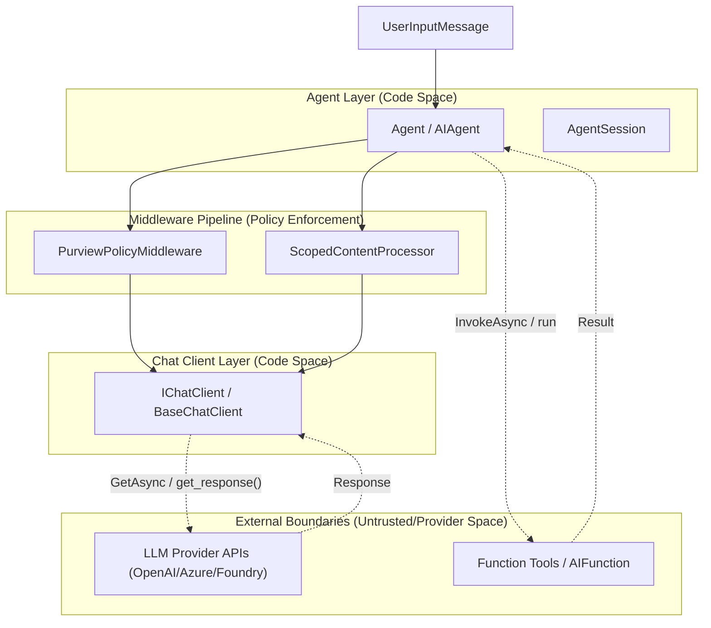
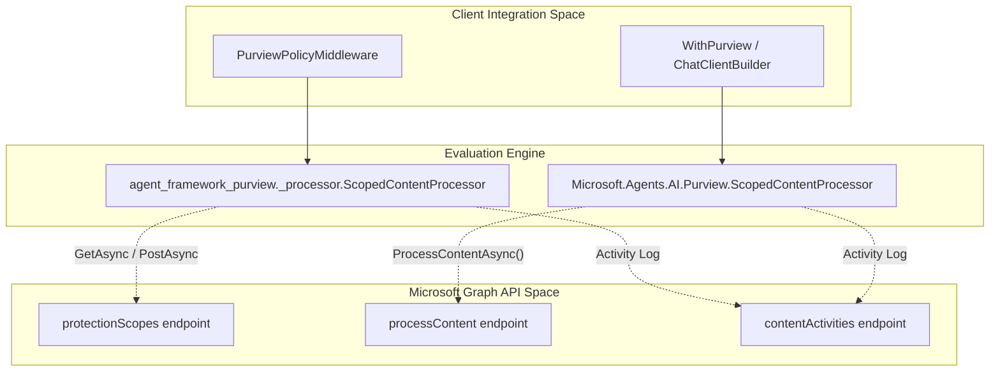
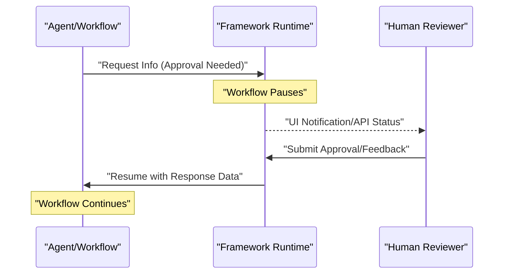

<!-- source: DeepWiki mcp.deepwiki.com · repo microsoft/agent-framework · page 10.1 Responsible AI and Transparency · fetched 2026-10-26 -->

# Responsible AI and Transparency

Relevant source files

The following files were used as context for generating this wiki page:

- [README.md](README.md)
- [SUPPORT.md](SUPPORT.md)
- [TRANSPARENCY_FAQ.md](TRANSPARENCY_FAQ.md)
- [dotnet/README.md](dotnet/README.md)
- [dotnet/samples/02-agents/AGUI/README.md](dotnet/samples/02-agents/AGUI/README.md)
- [dotnet/samples/README.md](dotnet/samples/README.md)
- [dotnet/src/Microsoft.Agents.AI.Purview/BackgroundJobRunner.cs](dotnet/src/Microsoft.Agents.AI.Purview/BackgroundJobRunner.cs)
- [dotnet/src/Microsoft.Agents.AI.Purview/Models/Common/ContentToProcess.cs](dotnet/src/Microsoft.Agents.AI.Purview/Models/Common/ContentToProcess.cs)
- [dotnet/src/Microsoft.Agents.AI.Purview/Models/Common/PaymentRequiredCacheEntry.cs](dotnet/src/Microsoft.Agents.AI.Purview/Models/Common/PaymentRequiredCacheEntry.cs)
- [dotnet/src/Microsoft.Agents.AI.Purview/Models/Common/PaymentRequiredCacheKey.cs](dotnet/src/Microsoft.Agents.AI.Purview/Models/Common/PaymentRequiredCacheKey.cs)
- [dotnet/src/Microsoft.Agents.AI.Purview/Models/Jobs/ScopeRetrievalJob.cs](dotnet/src/Microsoft.Agents.AI.Purview/Models/Jobs/ScopeRetrievalJob.cs)
- [dotnet/src/Microsoft.Agents.AI.Purview/Models/Requests/ProcessContentRequest.cs](dotnet/src/Microsoft.Agents.AI.Purview/Models/Requests/ProcessContentRequest.cs)
- [dotnet/src/Microsoft.Agents.AI.Purview/PurviewClient.cs](dotnet/src/Microsoft.Agents.AI.Purview/PurviewClient.cs)
- [dotnet/src/Microsoft.Agents.AI.Purview/ScopedContentProcessor.cs](dotnet/src/Microsoft.Agents.AI.Purview/ScopedContentProcessor.cs)
- [dotnet/src/Microsoft.Agents.AI.Purview/Serialization/PurviewSerializationUtils.cs](dotnet/src/Microsoft.Agents.AI.Purview/Serialization/PurviewSerializationUtils.cs)
- [dotnet/tests/Microsoft.Agents.AI.Purview.UnitTests/PurviewClientTests.cs](dotnet/tests/Microsoft.Agents.AI.Purview.UnitTests/PurviewClientTests.cs)
- [dotnet/tests/Microsoft.Agents.AI.Purview.UnitTests/ScopedContentProcessorTests.cs](dotnet/tests/Microsoft.Agents.AI.Purview.UnitTests/ScopedContentProcessorTests.cs)
- [dotnet/tests/Microsoft.Agents.AI.Workflows.Declarative.IntegrationTests/MediaInputTest.cs](dotnet/tests/Microsoft.Agents.AI.Workflows.Declarative.IntegrationTests/MediaInputTest.cs)
- [dotnet/tests/Microsoft.Agents.AI.Workflows.Declarative.IntegrationTests/Microsoft.Agents.AI.Workflows.Declarative.IntegrationTests.csproj](dotnet/tests/Microsoft.Agents.AI.Workflows.Declarative.IntegrationTests/Microsoft.Agents.AI.Workflows.Declarative.IntegrationTests.csproj)
- [dotnet/tests/Microsoft.Agents.AI.Workflows.Declarative.IntegrationTests/TestFiles/basic-text.pdf](dotnet/tests/Microsoft.Agents.AI.Workflows.Declarative.IntegrationTests/TestFiles/basic-text.pdf)
- [dotnet/tests/Microsoft.Agents.AI.Workflows.Declarative.IntegrationTests/TestFiles/test-image.jpg](dotnet/tests/Microsoft.Agents.AI.Workflows.Declarative.IntegrationTests/TestFiles/test-image.jpg)
- [go/README.md](go/README.md)
- [python/README.md](python/README.md)
- [python/packages/a2a/README.md](python/packages/a2a/README.md)
- [python/packages/copilotstudio/README.md](python/packages/copilotstudio/README.md)
- [python/packages/core/README.md](python/packages/core/README.md)
- [python/packages/purview/agent_framework_purview/_models.py](python/packages/purview/agent_framework_purview/_models.py)
- [python/packages/purview/agent_framework_purview/_processor.py](python/packages/purview/agent_framework_purview/_processor.py)
- [python/packages/purview/tests/purview/test_processor.py](python/packages/purview/tests/purview/test_processor.py)
- [python/packages/purview/tests/purview/test_purview_models.py](python/packages/purview/tests/purview/test_purview_models.py)
- [python/samples/02-agents/middleware/runtime_context_delegation.py](python/samples/02-agents/middleware/runtime_context_delegation.py)

This page documents the Microsoft Agent Framework's responsible AI features, data governance integration, and transparency mechanisms. It covers the Purview middleware for policy enforcement in both .NET and Python, data handling practices, observability features, and developer responsibilities for building safe AI applications.

Related pages: [3.6 Observability and Monitoring](), [3.8 Data Governance with Purview](), [6.3 Authentication and Configuration](), [3.7 Middleware System]().

Sources: [TRANSPARENCY_FAQ.md:1-5](), [dotnet/src/Microsoft.Agents.AI.Purview/README.md:1-17]()

---

## Framework Scope and Developer Responsibilities

### Framework Purpose
Microsoft Agent Framework (MAF) is a comprehensive multi-language development toolkit for building AI agents and multi-agent workflows across .NET and Python [README.md:12-14](). The framework provides core infrastructure components (`AIAgent`, `Agent`, `IChatClient`, `Workflow`) but does not include pre-trained AI models [TRANSPARENCY_FAQ.md:3-5](). It is designed for teams taking agents from prototype to production with requirements for durability, observability, and governance [README.md:31-38]().

**Key architectural boundaries:**

| Component Layer | Framework Provides | Developer Provides |
|----------------|-------------------|-------------------|
| **Agent Layer** | `AIAgent`, `Agent` base classes | Instructions, tool selection, safety guidelines [TRANSPARENCY_FAQ.md:11-13]() |
| **Chat Layer** | `IChatClient`, middleware pipeline | LLM provider choice, content moderation [TRANSPARENCY_FAQ.md:15-16]() |
| **Tool Layer** | `FunctionTool`, `MCPTool` | Tool implementations, approval logic [TRANSPARENCY_FAQ.md:14-14]() |

Sources: [TRANSPARENCY_FAQ.md:1-28](), [README.md:12-38]()

### Developer Responsibility Model
The framework operates on a shared responsibility model. Developers using the framework must conduct application-specific evaluation including performance, safety, and accuracy testing appropriate to their chosen LLM providers and deployment contexts [TRANSPARENCY_FAQ.md:28-28]().

**Microsoft provides:**
- Framework components with observability hooks [README.md:54-55]().
- Purview middleware for policy enforcement via `PurviewPolicyMiddleware` (Python) and `WithPurview` / `ScopedContentProcessor` (.NET) [python/packages/purview/agent_framework_purview/_processor.py:64-72](), [dotnet/src/Microsoft.Agents.AI.Purview/ScopedContentProcessor.cs:20-22](), [dotnet/src/Microsoft.Agents.AI.Purview/README.md:10-17]().
- OpenTelemetry integration for monitoring [README.md:54-55]().

**Developers must implement:**
- Content moderation and safety guardrails [TRANSPARENCY_FAQ.md:57-57]().
- Human oversight for critical decisions and actions [TRANSPARENCY_FAQ.md:58-58]().
- Secure coding patterns and API key protection [TRANSPARENCY_FAQ.md:54-54]().

Sources: [TRANSPARENCY_FAQ.md:26-58](), [python/packages/purview/agent_framework_purview/_processor.py:64-72](), [dotnet/src/Microsoft.Agents.AI.Purview/ScopedContentProcessor.cs:20-22](), [dotnet/src/Microsoft.Agents.AI.Purview/README.md:10-17](), [README.md:54-55]()

---

## Data Flow and Trust Boundaries

### Data Flow and Code Entity Mapping

Diagram: Agent Framework Data Flow and Code Entity Mapping

Sources: [python/packages/purview/agent_framework_purview/_processor.py:64-141](), [dotnet/src/Microsoft.Agents.AI.Purview/ScopedContentProcessor.cs:45-70](), [TRANSPARENCY_FAQ.md:32-42]()

**Key trust boundaries:**
1. **LLM Provider Boundary**: Data leaves organizational control when calling external LLM APIs [TRANSPARENCY_FAQ.md:32-42]().
2. **Purview Policy Boundary**: Content is intercepted and evaluated against organizational policies by `ScopedContentProcessor` (.NET) or `_processor.py` (Python) before reaching the LLM or user [python/packages/purview/agent_framework_purview/_processor.py:100-141](), [dotnet/src/Microsoft.Agents.AI.Purview/ScopedContentProcessor.cs:45-70]().
3. **Security Considerations**: Production agent hosts should protect entry points with an authentication layer to verify caller identity before accessing state [python/packages/a2a/README.md:34-45]().

Sources: [python/packages/purview/agent_framework_purview/_processor.py:100-141](), [dotnet/src/Microsoft.Agents.AI.Purview/ScopedContentProcessor.cs:45-70](), [TRANSPARENCY_FAQ.md:32-42](), [python/packages/a2a/README.md:34-45]()

---

## Data Governance with Purview

### Overview
The Purview integration (`agent-framework-purview` in Python, `Microsoft.Agents.AI.Purview` in .NET) adds Microsoft Purview (Graph `dataSecurityAndGovernance`) policy evaluation to enforce data security on prompts and model responses [python/README.md:1-4](), [dotnet/README.md:1-5]().

**Key components:**
- **`ScopedContentProcessor` (.NET) / `_processor.py` (Python)**: Combines protection scopes (`protectionScopes`), content processing (`processContent`), and content activities (`contentActivities`) [python/packages/purview/agent_framework_purview/_processor.py:54-57](), [dotnet/src/Microsoft.Agents.AI.Purview/ScopedContentProcessor.cs:18-24]().
- **`PurviewPolicyMiddleware` (Python) / `WithPurview` (.NET)**: Intercepts client calls to evaluate policies at ingress (prompt) and egress (response) [python/packages/purview/README.md:9-10](), [dotnet/src/Microsoft.Agents.AI.Purview/README.md:10-16]().
- **`PurviewClient` (.NET/Python)**: Handles communication with Microsoft Graph APIs for policy computation and token resolution [dotnet/src/Microsoft.Agents.AI.Purview/PurviewClient.cs:1-1]().

### Policy Enforcement Architecture and Code Entities

Diagram: Purview Policy Enforcement Architecture

Sources: [python/packages/purview/agent_framework_purview/_processor.py:54-141](), [dotnet/src/Microsoft.Agents.AI.Purview/ScopedContentProcessor.cs:45-70](), [dotnet/src/Microsoft.Agents.AI.Purview/PurviewClient.cs:1-1]()

### Policy Enforcement Logic
1. **User Resolution**: Attempts to resolve `user_id` from tokens, message properties (`AdditionalProperties["userId"]`), or author names to maintain context throughout the request/response cycle [python/packages/purview/agent_framework_purview/_processor.py:126-143](), [dotnet/src/Microsoft.Agents.AI.Purview/ScopedContentProcessor.cs:151-152]().
2. **Prompt Evaluation**: Maps messages to `ProcessContentRequest` or `_map_messages` / `MapMessageToPCRequestsAsync` using correlation IDs and activity types [python/packages/purview/agent_framework_purview/_processor.py:138-141](), [dotnet/src/Microsoft.Agents.AI.Purview/ScopedContentProcessor.cs:45-48]().
3. **Response Evaluation**: Evaluates LLM output. If a policy violation occurs (e.g., `DlpAction.BlockAccess` or `RestrictionAction.Block`), the middleware blocks the interaction and returns a configurable blocked message [python/packages/purview/agent_framework_purview/_processor.py:143-150](), [dotnet/src/Microsoft.Agents.AI.Purview/ScopedContentProcessor.cs:61-66]().

Sources: [python/packages/purview/agent_framework_purview/_processor.py:54-161](), [dotnet/src/Microsoft.Agents.AI.Purview/ScopedContentProcessor.cs:45-86]()

---

## Human-in-the-Loop (HITL)

The framework explicitly supports patterns where humans must approve or review agent actions to ensure accountability and address potential biases [TRANSPARENCY_FAQ.md:49-50]().

**HITL Workflow Pattern:**
1. **Request**: An executor calls a request mechanism (e.g., `request_info` in workflows) with data and a response type. The workflow pauses and updates its status [TRANSPARENCY_FAQ.md:13-13]().
2. **Response**: The workflow resumes when a human provides a response, which is typically handled by a specific response handler [TRANSPARENCY_FAQ.md:77-78]().

Diagram: HITL Request/Response Loop

Sources: [TRANSPARENCY_FAQ.md:13-78]()

---

## Summary Table: Operational Factors

| Factor | Requirement/Setting | Impact on Responsibility |
|--------|---------------------|--------------------------|
| **API Keys** | Secure environment configuration | Prevents unauthorized provider access [TRANSPARENCY_FAQ.md:63-65]() |
| **Purview Settings** | `blocked_prompt_message` / `BlockedPromptMessage` | Defines user-facing transparency for policy blocks [dotnet/src/Microsoft.Agents.AI.Purview/README.md:133-134]() |
| **Caching** | `cache_ttl_seconds` / `IDistributedCache` | Improves performance of policy checks while ensuring fresh governance data [dotnet/src/Microsoft.Agents.AI.Purview/README.md:15-15]() |
| **Human Review** | HITL Patterns | Ensures accountability for high-stakes actions [TRANSPARENCY_FAQ.md:49-50]() |
| **Telemetry Control** | `AGENT_FRAMEWORK_USER_AGENT_DISABLED` | Allows developers to opt-out of framework version tracking [python/packages/core/README.md:62-65]() |

Sources: [TRANSPARENCY_FAQ.md:49-78](), [dotnet/src/Microsoft.Agents.AI.Purview/README.md:15-134](), [python/packages/core/README.md:62-65]()

---

