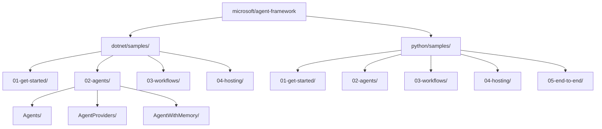
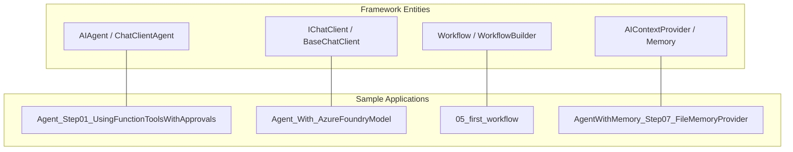

<!-- source: DeepWiki mcp.deepwiki.com · repo microsoft/agent-framework · page 10.2 Sample Applications · fetched 2026-10-26 -->

# Sample Applications

Relevant source files

The following files were used as context for generating this wiki page:

- [dotnet/eng/verify-samples/AgentsSamples.cs](dotnet/eng/verify-samples/AgentsSamples.cs)
- [dotnet/samples/02-agents/AgentWithMemory/AgentWithMemory_Step06_MemoryUsingAgentMemory/ProductCatalog.cs](dotnet/samples/02-agents/AgentWithMemory/AgentWithMemory_Step06_MemoryUsingAgentMemory/ProductCatalog.cs)
- [dotnet/samples/02-agents/AgentWithMemory/AgentWithMemory_Step06_MemoryUsingAgentMemory/Program.cs](dotnet/samples/02-agents/AgentWithMemory/AgentWithMemory_Step06_MemoryUsingAgentMemory/Program.cs)
- [dotnet/samples/02-agents/AgentWithMemory/AgentWithMemory_Step06_MemoryUsingAgentMemory/README.md](dotnet/samples/02-agents/AgentWithMemory/AgentWithMemory_Step06_MemoryUsingAgentMemory/README.md)
- [dotnet/samples/02-agents/AgentWithMemory/AgentWithMemory_Step07_FileMemoryProvider/AgentWithMemory_Step07_FileMemoryProvider.csproj](dotnet/samples/02-agents/AgentWithMemory/AgentWithMemory_Step07_FileMemoryProvider/AgentWithMemory_Step07_FileMemoryProvider.csproj)
- [dotnet/samples/02-agents/AgentWithMemory/AgentWithMemory_Step07_FileMemoryProvider/Program.cs](dotnet/samples/02-agents/AgentWithMemory/AgentWithMemory_Step07_FileMemoryProvider/Program.cs)
- [dotnet/samples/02-agents/AgentWithMemory/AgentWithMemory_Step07_FileMemoryProvider/README.md](dotnet/samples/02-agents/AgentWithMemory/AgentWithMemory_Step07_FileMemoryProvider/README.md)
- [dotnet/samples/02-agents/AgentWithMemory/AgentWithMemory_Step08_MemoryUsingCosmosNoSql/AgentWithMemory_Step08_MemoryUsingCosmosNoSql.csproj](dotnet/samples/02-agents/AgentWithMemory/AgentWithMemory_Step08_MemoryUsingCosmosNoSql/AgentWithMemory_Step08_MemoryUsingCosmosNoSql.csproj)
- [dotnet/samples/02-agents/AgentWithMemory/AgentWithMemory_Step08_MemoryUsingCosmosNoSql/Program.cs](dotnet/samples/02-agents/AgentWithMemory/AgentWithMemory_Step08_MemoryUsingCosmosNoSql/Program.cs)
- [dotnet/samples/02-agents/AgentWithMemory/AgentWithMemory_Step08_MemoryUsingCosmosNoSql/README.md](dotnet/samples/02-agents/AgentWithMemory/AgentWithMemory_Step08_MemoryUsingCosmosNoSql/README.md)
- [dotnet/samples/02-agents/AgentWithMemory/AgentWithMemory_Step09_MemoryUsingMem0Sharp/README.md](dotnet/samples/02-agents/AgentWithMemory/AgentWithMemory_Step09_MemoryUsingMem0Sharp/README.md)
- [dotnet/samples/02-agents/AgentWithMemory/README.md](dotnet/samples/02-agents/AgentWithMemory/README.md)
- [dotnet/samples/AGENTS.md](dotnet/samples/AGENTS.md)
- [python/packages/azure-cosmos-memory/AGENTS.md](python/packages/azure-cosmos-memory/AGENTS.md)
- [python/samples/01-get-started/01_hello_agent.py](python/samples/01-get-started/01_hello_agent.py)
- [python/samples/01-get-started/02_add_tools.py](python/samples/01-get-started/02_add_tools.py)
- [python/samples/01-get-started/03_multi_turn.py](python/samples/01-get-started/03_multi_turn.py)
- [python/samples/01-get-started/04_memory.py](python/samples/01-get-started/04_memory.py)
- [python/samples/01-get-started/05a_functional_workflow_basics.py](python/samples/01-get-started/05a_functional_workflow_basics.py)
- [python/samples/01-get-started/05b_functional_workflow_with_agents.py](python/samples/01-get-started/05b_functional_workflow_with_agents.py)
- [python/samples/01-get-started/05c_first_graph_workflow.py](python/samples/01-get-started/05c_first_graph_workflow.py)
- [python/samples/01-get-started/06_agent_harness.py](python/samples/01-get-started/06_agent_harness.py)
- [python/samples/01-get-started/README.md](python/samples/01-get-started/README.md)
- [python/samples/README.md](python/samples/README.md)

The Microsoft Agent Framework provides a comprehensive suite of sample applications demonstrating framework capabilities across both .NET and Python implementations. These samples serve as blueprints for building AI agents, multi-agent workflows, and provider integrations.

For detailed listings and instructions for specific languages, see:
- **[.NET Sample Catalog](#10.2.1)** — Catalog of .NET sample applications including GettingStarted, HostedAgents, workflow samples, and memory/E2E patterns.
- **[Python Sample Catalog](#10.2.2)** — Catalog of Python sample applications including getting_started, agents, workflow orchestration, and migration samples.

Related documentation: [Agents and Chat Clients](#3.1), [Workflow Fundamentals](#4.1), [.NET Deployment Options](#6.1)

## Sample Directory Structure and Organization

The framework maintains a parallel directory structure between .NET and Python implementations to ensure conceptual parity, organizing samples by progression level (getting started, deep-dive agents, workflows, hosting, and end-to-end applications).

**Directory Structure Diagram**

Sources: [python/samples/README.md:1-14]()

For complete details on the individual paths, consult the respective child catalogs: [.NET Sample Catalog](#10.2.1) and [Python Sample Catalog](#10.2.2).

## Core Framework Mapping in Samples

Samples map directly to core architectural components such as `AIAgent`, `IChatClient`, `BaseChatClient`, `Workflow`, and context/memory providers.

**Architecture to Sample Mapping**

Sources: [dotnet/eng/verify-samples/AgentsSamples.cs:99-135]()

For deeper insights into specific .NET examples, see [.NET Sample Catalog](#10.2.1). For Python-specific patterns, see [Python Sample Catalog](#10.2.2).

## Provider Integration and Memory Samples

Both ecosystems provide robust examples of connecting agents to various LLM providers (Azure AI Foundry, OpenAI, Anthropic, Bedrock, and Google Gemini) and persistence layers (such as Azure Cosmos DB and file stores).

**Provider Integration Overview**
- **AI Foundry & OpenAI:** Showcases `AIProjectClient` [dotnet/eng/verify-samples/AgentsSamples.cs:55-57]() and `FoundryChatClient` [python/samples/01-get-started/01_hello_agent.py:13-13]().
- **Alternative Providers:** Demonstrates third-party chat clients and client configurations [python/samples/README.md:115-116]().
- **Memory & State:** Highlights context and memory integration patterns like `CosmosMemoryContextProvider` [python/packages/azure-cosmos-memory/AGENTS.md:8-9]() and custom memory providers [python/samples/01-get-started/04_memory.py:16-19]().

Sources: [python/samples/README.md:115-119](), [dotnet/eng/verify-samples/AgentsSamples.cs:27-78](), [python/samples/01-get-started/04_memory.py:16-50]()

## Running and Configuring Samples

Sample applications leverage environment variables and standard execution commands (`dotnet run` or `pip install`) to configure clients and endpoints.

### Environment Configuration
Samples automatically load environment configuration via `load_dotenv()` or standard environment variable injection [python/samples/README.md:56-56](). Key variables include `FOUNDRY_PROJECT_ENDPOINT`, `AZURE_OPENAI_ENDPOINT`, and provider-specific keys [python/samples/README.md:69-70](), [dotnet/eng/verify-samples/AgentsSamples.cs:31-31]().

Sources: [python/samples/README.md:54-119](), [dotnet/eng/verify-samples/AgentsSamples.cs:27-78]()

---

