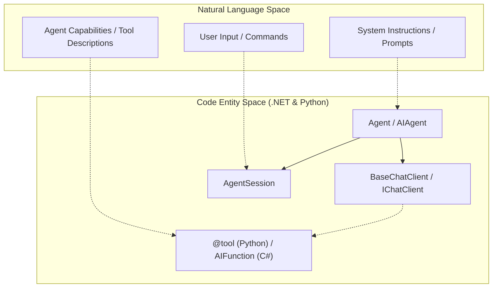
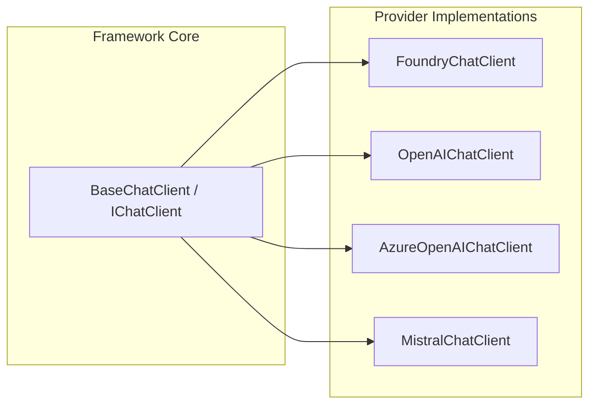

<!-- source: DeepWiki mcp.deepwiki.com · repo microsoft/agent-framework · page 2 Getting Started · fetched 2026-10-26 -->

# Getting Started

<details>
<summary>Relevant source files</summary>

The following files were used as context for generating this wiki page:

- [README.md](README.md)
- [SUPPORT.md](SUPPORT.md)
- [TRANSPARENCY_FAQ.md](TRANSPARENCY_FAQ.md)
- [dotnet/README.md](dotnet/README.md)
- [dotnet/samples/02-agents/AGUI/README.md](dotnet/samples/02-agents/AGUI/README.md)
- [dotnet/samples/README.md](dotnet/samples/README.md)
- [dotnet/tests/Microsoft.Agents.AI.Workflows.Declarative.IntegrationTests/MediaInputTest.cs](dotnet/tests/Microsoft.Agents.AI.Workflows.Declarative.IntegrationTests/MediaInputTest.cs)
- [dotnet/tests/Microsoft.Agents.AI.Workflows.Declarative.IntegrationTests/Microsoft.Agents.AI.Workflows.Declarative.IntegrationTests.csproj](dotnet/tests/Microsoft.Agents.AI.Workflows.Declarative.IntegrationTests/Microsoft.Agents.AI.Workflows.Declarative.IntegrationTests.csproj)
- [dotnet/tests/Microsoft.Agents.AI.Workflows.Declarative.IntegrationTests/TestFiles/basic-text.pdf](dotnet/tests/Microsoft.Agents.AI.Workflows.Declarative.IntegrationTests/TestFiles/basic-text.pdf)
- [dotnet/tests/Microsoft.Agents.AI.Workflows.Declarative.IntegrationTests/TestFiles/test-image.jpg](dotnet/tests/Microsoft.Agents.AI.Workflows.Declarative.IntegrationTests/TestFiles/test-image.jpg)
- [go/README.md](go/README.md)
- [python/README.md](python/README.md)
- [python/packages/a2a/README.md](python/packages/a2a/README.md)
- [python/packages/azure-cosmos-memory/AGENTS.md](python/packages/azure-cosmos-memory/AGENTS.md)
- [python/packages/copilotstudio/README.md](python/packages/copilotstudio/README.md)
- [python/packages/core/README.md](python/packages/core/README.md)
- [python/samples/01-get-started/01_hello_agent.py](python/samples/01-get-started/01_hello_agent.py)
- [python/samples/01-get-started/02_add_tools.py](python/samples/01-get-started/02_add_tools.py)
- [python/samples/01-get-started/03_multi_turn.py](python/samples/01-get-started/03_multi_turn.py)
- [python/samples/01-get-started/04_memory.py](python/samples/01-get-started/04_memory.py)
- [python/samples/01-get-started/05a_functional_workflow_basics.py](python/samples/01-get-started/05a_functional_workflow_basics.py)
- [python/samples/01-get-started/05b_functional_workflow_with_agents.py](python/samples/01-get-started/05b_functional_workflow_with_agents.py)
- [python/samples/01-get-started/05c_first_graph_workflow.py](python/samples/01-get-started/05c_first_graph_workflow.py)
- [python/samples/01-get-started/06_agent_harness.py](python/samples/01-get-started/06_agent_harness.py)
- [python/samples/01-get-started/README.md](python/samples/01-get-started/README.md)
- [python/samples/02-agents/middleware/runtime_context_delegation.py](python/samples/02-agents/middleware/runtime_context_delegation.py)
- [python/samples/README.md](python/samples/README.md)

</details>


This document provides an overview of how to begin using the Microsoft Agent Framework (MAF) for building AI agents and multi-agent workflows. It covers installation, prerequisites, high-level architecture concepts, and recommended learning paths for both Python and .NET implementations.

For detailed, language-specific step-by-step instructions, please consult the child pages:
- **[.NET Quick Start](#2.1)** — Step-by-step guide to creating your first .NET agent, including package installation, basic agent creation, and running a simple conversation.
- **[Python Quick Start](#2.2)** — Step-by-step guide to creating your first Python agent, including package installation using uv, basic agent creation, and running a simple conversation.

For in-depth explanations of framework concepts such as agents, chat clients, tools, memory, and workflows, see **[Core Concepts](#3)**.

---

## Installation Overview

Microsoft Agent Framework is an open, multi-language framework for building production-grade AI agents and multi-agent workflows across both **.NET** and **Python** platforms [README.md:12-14]().

### Python Installation

The Python implementation is modular and managed within a `uv` workspace. Developers may install the meta-package `agent-framework` to get the complete standard set of integrations or selectively install smaller packages for specific needs (e.g., `agent-framework-core` contains the core functionality with default provider support) [python/README.md:5-38]().

```bash
# Install the full standard framework package (recommended for development)
pip install agent-framework

# Alternatively, install only the core framework components and default providers
pip install agent-framework-core
```

The framework requires Python 3.10 or later and supports Windows, macOS, and Linux [python/README.md:42-43]().

### .NET Installation

For .NET, the core agent functionality is provided in the `Microsoft.Agents.AI` NuGet package. Additional packages enable integrations with services like Azure AI Foundry and Azure SDKs [README.md:86-95]().

```bash
# Add the core Agent Framework package to your project
dotnet add package Microsoft.Agents.AI

# Optional: Add integration with Microsoft Foundry AI services
dotnet add package Microsoft.Agents.AI.Foundry

# Add Azure SDK packages for project and identity management
dotnet add package Azure.AI.Projects
dotnet add package Azure.Identity
```

---

## Prerequisites

### API Keys and Authentication

Both Python and .NET implementations rely on environment configuration for your chosen Large Language Model (LLM) providers. Common environment variables include:

- `OPENAI_API_KEY` for OpenAI
- `AZURE_OPENAI_ENDPOINT`, `AZURE_OPENAI_API_KEY` for Azure OpenAI
- `FOUNDRY_PROJECT_ENDPOINT` and `FOUNDRY_MODEL` for Microsoft Foundry projects

The framework supports various Azure authentication methods like `AzureCliCredential` or `DefaultAzureCredential` for seamless authentication in Azure-hosted scenarios [python/README.md:44-83](), [README.md:115-116]().

### Environment Configuration

Environment variables are automatically consumed by framework chat clients. You can also override these in code by passing explicit parameters during client construction, facilitating multi-provider or multi-tenant scenarios.

---

## Core Framework Architecture

Microsoft Agent Framework bridges the gap between high-level natural language instructions and executable code entities that implement agent logic, tool invocation, and session management. This layered architecture is consistent across .NET and Python implementations, supporting cross-language development.

### Natural Language Space to Code Entity Space

Agents transform system instructions and user prompts into structured conversations with AI models, mediated through chat clients, and extended with function tools or plugins.



This diagram illustrates the conceptual bridge from natural language inputs and instructions to software abstractions:
- Agents consume instructions and manage session lifecycles via `AgentSession`.
- Chat clients interact with AI service providers.
- Tools extend agent capabilities, enabling function calls triggered by agent logic.

**Sources:** [python/README.md:89-111](), [dotnet/README.md:16-18](), [python/README.md:145-170]()

### Chat Client Provider Abstraction

The `IChatClient` interface (in .NET) or `BaseChatClient` class (in Python) abstracts different AI provider implementations, ensuring agents interact uniformly regardless of backend LLM service:



This design enables extensibility and provider flexibility for your agents.

**Sources:** [python/README.md:73-81](), [dotnet/README.md:8-11](), [python/packages/core/README.md:48-54]()

---

## Sample Learning Path

The repository contains progressive, curated samples that guide you through creating agents, integrating tools, managing conversation state, and building workflows.

| Step | Topic                      | Python Sample                           | .NET Sample                      |
|-------|----------------------------|---------------------------------------|---------------------------------|
| 1     | Hello Agent                | `01_hello_agent.py`                    | `01_hello_agent/Program.cs`     |
| 2     | Add Function Tools         | `02_add_tools.py`                      | `02_add_tools/Program.cs`       |
| 3     | Multi-turn Conversations   | `03_multi_turn.py`                     | `03_multi_turn/Program.cs`      |
| 4     | Agent Memory               | `04_memory.py`                        | `04_memory/Program.cs`          |
| 5     | Workflow Basics            | `05a_functional_workflow_basics.py`   | `05_first_workflow/Program.cs`  |

These samples demonstrate agent basics, advanced concepts such as session state with context providers, tool usage, and orchestrating multiple agents via workflows [dotnet/samples/README.md:26-31](), [python/README.md:194-222](), [python/samples/01-get-started/README.md:20-31]().

---

## Next Steps

To get started with actual development, choose your preferred language guide:

- **[.NET Quick Start](#2.1)** — Learn how to install packages, create an `AzureOpenAIClient`, build your first agent using `AsAIAgent()`, and run simple conversations [dotnet/README.md:16-24]().

```csharp
var agent = new OpenAIClient(
        new BearerTokenPolicy(new AzureCliCredential(), "https://ai.azure.com/.default"),
        new OpenAIClientOptions { Endpoint = new Uri(Environment.GetEnvironmentVariable("AZURE_OPENAI_ENDPOINT")!) })
    .GetResponsesClient()
    .AsAIAgent(model: Environment.GetEnvironmentVariable("AZURE_OPENAI_DEPLOYMENT_NAME")!, name: "HaikuBot",
      instructions: "You are an upbeat assistant that writes beautifully.");

Console.WriteLine(await agent.RunAsync("Write a haiku about Microsoft Agent Framework."));
```

- **[Python Quick Start](#2.2)** — Learn how to install packages with `pip`/`uv`, instantiate the `Agent` class with an `OpenAIChatClient` or `FoundryChatClient`, and perform asynchronous runs to interact with the agent [python/README.md:89-111]():

```python
import asyncio
from agent_framework import Agent
from agent_framework.openai import OpenAIChatClient

async def main():
    agent = Agent(
        client=OpenAIChatClient(),
        instructions="""
        1) A robot may not injure a human being or, through inaction, allow a human to come to harm.
        2) A robot must obey orders given by humans except where such orders would conflict with the first law.
        3) A robot must protect its own existence as long as such protection does not conflict with the first or second law.
        Give me the TLDR in exactly 5 words.
        """
    )
    result = await agent.run("Summarize the Three Laws of Robotics")
    print(result)

asyncio.run(main())
```

For comprehensive conceptual details behind agents, chat clients, tool integrations, and workflow orchestration, please see **[Core Concepts](#3)** and its child pages.

---

**Sources:**  
[README.md:12-96](),  
[python/README.md:5-83](),  
[dotnet/README.md:1-24](),  
[dotnet/samples/README.md:26-31](),  
[python/README.md:89-111](),  
[python/samples/01-get-started/README.md:20-31]()

---

