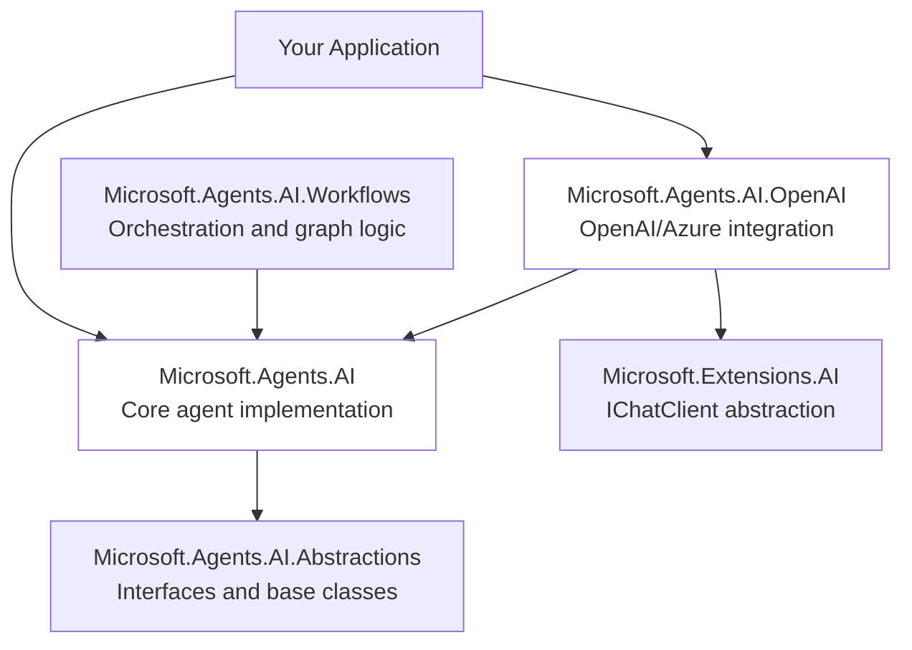
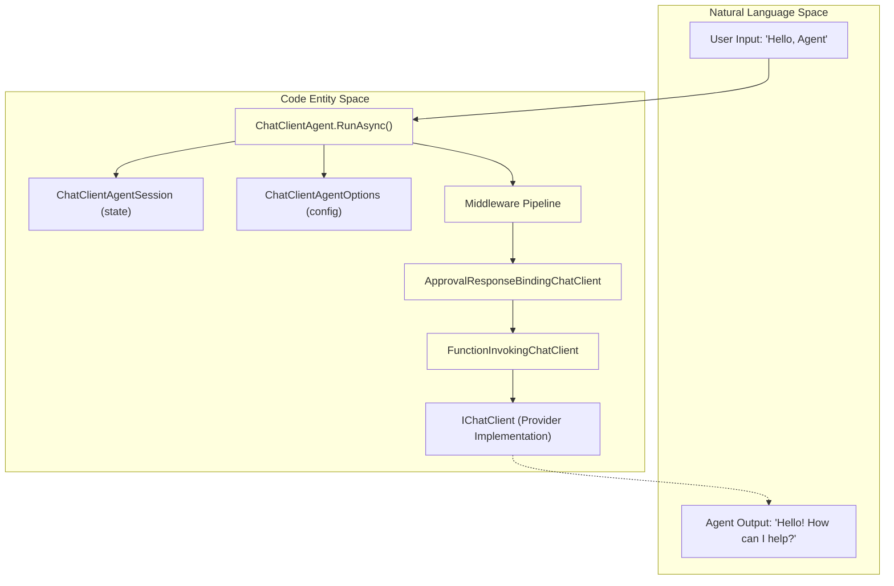

<!-- source: DeepWiki mcp.deepwiki.com · repo microsoft/agent-framework · page 2.1 .NET Quick Start · fetched 2026-10-26 -->

# .NET Quick Start

<details>
<summary>Relevant source files</summary>

The following files were used as context for generating this wiki page:

- [docs/decisions/0022-chat-history-persistence-consistency.md](docs/decisions/0022-chat-history-persistence-consistency.md)
- [dotnet/nuget/nuget-package.props](dotnet/nuget/nuget-package.props)
- [dotnet/samples/02-agents/Agents/Agent_Step19_InFunctionLoopCheckpointing/Program.cs](dotnet/samples/02-agents/Agents/Agent_Step19_InFunctionLoopCheckpointing/Program.cs)
- [dotnet/samples/02-agents/Agents/Agent_Step19_InFunctionLoopCheckpointing/README.md](dotnet/samples/02-agents/Agents/Agent_Step19_InFunctionLoopCheckpointing/README.md)
- [dotnet/src/Microsoft.Agents.AI.Abstractions/AdditionalPropertiesExtensions.cs](dotnet/src/Microsoft.Agents.AI.Abstractions/AdditionalPropertiesExtensions.cs)
- [dotnet/src/Microsoft.Agents.AI.Abstractions/Microsoft.Agents.AI.Abstractions.csproj](dotnet/src/Microsoft.Agents.AI.Abstractions/Microsoft.Agents.AI.Abstractions.csproj)
- [dotnet/src/Microsoft.Agents.AI.OpenAI/Microsoft.Agents.AI.OpenAI.csproj](dotnet/src/Microsoft.Agents.AI.OpenAI/Microsoft.Agents.AI.OpenAI.csproj)
- [dotnet/src/Microsoft.Agents.AI.Workflows.Declarative/Microsoft.Agents.AI.Workflows.Declarative.csproj](dotnet/src/Microsoft.Agents.AI.Workflows.Declarative/Microsoft.Agents.AI.Workflows.Declarative.csproj)
- [dotnet/src/Microsoft.Agents.AI.Workflows.Generators/Microsoft.Agents.AI.Workflows.Generators.csproj](dotnet/src/Microsoft.Agents.AI.Workflows.Generators/Microsoft.Agents.AI.Workflows.Generators.csproj)
- [dotnet/src/Microsoft.Agents.AI.Workflows/Microsoft.Agents.AI.Workflows.csproj](dotnet/src/Microsoft.Agents.AI.Workflows/Microsoft.Agents.AI.Workflows.csproj)
- [dotnet/src/Microsoft.Agents.AI/ChatClient/ChatClientAgent.cs](dotnet/src/Microsoft.Agents.AI/ChatClient/ChatClientAgent.cs)
- [dotnet/src/Microsoft.Agents.AI/ChatClient/ChatClientAgentContinuationToken.cs](dotnet/src/Microsoft.Agents.AI/ChatClient/ChatClientAgentContinuationToken.cs)
- [dotnet/src/Microsoft.Agents.AI/ChatClient/ChatClientAgentLogMessages.cs](dotnet/src/Microsoft.Agents.AI/ChatClient/ChatClientAgentLogMessages.cs)
- [dotnet/src/Microsoft.Agents.AI/ChatClient/ChatClientAgentOptions.cs](dotnet/src/Microsoft.Agents.AI/ChatClient/ChatClientAgentOptions.cs)
- [dotnet/src/Microsoft.Agents.AI/ChatClient/ChatClientBuilderExtensions.cs](dotnet/src/Microsoft.Agents.AI/ChatClient/ChatClientBuilderExtensions.cs)
- [dotnet/src/Microsoft.Agents.AI/ChatClient/ChatClientExtensions.cs](dotnet/src/Microsoft.Agents.AI/ChatClient/ChatClientExtensions.cs)
- [dotnet/src/Microsoft.Agents.AI/Microsoft.Agents.AI.csproj](dotnet/src/Microsoft.Agents.AI/Microsoft.Agents.AI.csproj)
- [dotnet/tests/Microsoft.Agents.AI.Abstractions.UnitTests/AdditionalPropertiesExtensionsTests.cs](dotnet/tests/Microsoft.Agents.AI.Abstractions.UnitTests/AdditionalPropertiesExtensionsTests.cs)
- [dotnet/tests/Microsoft.Agents.AI.UnitTests/ChatClient/ChatClientAgentContinuationTokenTests.cs](dotnet/tests/Microsoft.Agents.AI.UnitTests/ChatClient/ChatClientAgentContinuationTokenTests.cs)
- [dotnet/tests/Microsoft.Agents.AI.UnitTests/ChatClient/ChatClientAgentOptionsTests.cs](dotnet/tests/Microsoft.Agents.AI.UnitTests/ChatClient/ChatClientAgentOptionsTests.cs)
- [dotnet/tests/Microsoft.Agents.AI.UnitTests/ChatClient/ChatClientAgentTestHelper.cs](dotnet/tests/Microsoft.Agents.AI.UnitTests/ChatClient/ChatClientAgentTestHelper.cs)
- [dotnet/tests/Microsoft.Agents.AI.UnitTests/ChatClient/ChatClientAgentTests.cs](dotnet/tests/Microsoft.Agents.AI.UnitTests/ChatClient/ChatClientAgentTests.cs)
- [dotnet/tests/Microsoft.Agents.AI.UnitTests/ChatClient/ChatClientAgent_ApprovalsTests.cs](dotnet/tests/Microsoft.Agents.AI.UnitTests/ChatClient/ChatClientAgent_ApprovalsTests.cs)
- [dotnet/tests/Microsoft.Agents.AI.UnitTests/ChatClient/ChatClientAgent_BackgroundResponsesTests.cs](dotnet/tests/Microsoft.Agents.AI.UnitTests/ChatClient/ChatClientAgent_BackgroundResponsesTests.cs)
- [dotnet/tests/Microsoft.Agents.AI.UnitTests/ChatClient/ChatClientAgent_ChatHistoryManagementTests.cs](dotnet/tests/Microsoft.Agents.AI.UnitTests/ChatClient/ChatClientAgent_ChatHistoryManagementTests.cs)
- [dotnet/tests/Microsoft.Agents.AI.UnitTests/ChatClient/ChatClientAgent_ChatOptionsMergingTests.cs](dotnet/tests/Microsoft.Agents.AI.UnitTests/ChatClient/ChatClientAgent_ChatOptionsMergingTests.cs)
- [dotnet/tests/Microsoft.Agents.AI.UnitTests/ChatClient/ChatClientBuilderExtensionsTests.cs](dotnet/tests/Microsoft.Agents.AI.UnitTests/ChatClient/ChatClientBuilderExtensionsTests.cs)
- [dotnet/tests/Microsoft.Agents.AI.UnitTests/ChatClient/ChatClientExtensionsTests.cs](dotnet/tests/Microsoft.Agents.AI.UnitTests/ChatClient/ChatClientExtensionsTests.cs)
- [dotnet/tests/Microsoft.Agents.AI.UnitTests/Microsoft.Agents.AI.UnitTests.csproj](dotnet/tests/Microsoft.Agents.AI.UnitTests/Microsoft.Agents.AI.UnitTests.csproj)

</details>


This document provides a step-by-step guide to creating your first .NET agent using the Microsoft Agent Framework. You will learn how to install the necessary packages, create a basic agent, and run a simple conversation. For the Python equivalent, see [Python Quick Start](2.2). For a deeper understanding of the framework's architecture, see [Overview](1) and [Architecture at a Glance](1.1).

---

## Prerequisites

Before starting, ensure you have the following installed:

| Requirement          | Version          | Purpose                                         |
|----------------------|------------------|-------------------------------------------------|
| .NET SDK             | 8.0, 9.0, or 10.0| Required for building and running .NET apps     |
| C# IDE               | Visual Studio 2022 or VS Code | Recommended for development          |
| AI Provider Key      | N/A              | OpenAI API Key, Azure OpenAI endpoint, or local like Ollama |

The framework targets multiple .NET versions including `net8.0` and `net9.0` as managed centrally [dotnet/Directory.Packages.props:100-101](). The core library version is centrally pinned and managed in `Directory.Packages.props` with a version around `1.24.0` currently [dotnet/nuget/nuget-package.props:4-9]().

**Sources:** [dotnet/Directory.Packages.props:100-101](), [dotnet/nuget/nuget-package.props:1-93]()

---

## Installation

The Microsoft Agent Framework is distributed as NuGet packages. For a basic agent setup, you need the core package plus a provider-specific package (like OpenAI or Azure Foundry):

```bash
dotnet new console -n MyFirstAgent
cd MyFirstAgent
dotnet add package Microsoft.Agents.AI
# Optionally for OpenAI provider:
dotnet add package Microsoft.Agents.AI.OpenAI
```

### Package Overview

The following diagram shows the key .NET packages and their relationships in your application:



| Package                          | Responsibility                               | Key Types                                            |
|---------------------------------|----------------------------------------------|-----------------------------------------------------|
| `Microsoft.Agents.AI.Abstractions` | Base interfaces and contracts               | `AIAgent`, `AgentSession`, `AgentResponse`          |
| `Microsoft.Agents.AI`            | Core implementation and middleware           | `ChatClientAgent`, `ChatClientAgentOptions`         |
| `Microsoft.Agents.AI.Workflows`  | Multi-agent orchestration                     | `Workflow`, `AgentExecutor`, `MessageMerger`        |
| `Microsoft.Extensions.AI`        | AI client abstraction from Microsoft.Extensions | `IChatClient`, `ChatOptions`, `ChatResponse`       |

**Sources:** [dotnet/Directory.Packages.props:100-101](), [dotnet/src/Microsoft.Agents.AI/Microsoft.Agents.AI.csproj:1-58]()

---

## Creating Your First Agent

### Basic Agent Setup

The primary abstraction to create an agent is the `ChatClientAgent`, which wraps an `IChatClient` (the standard AI chat client abstraction from `Microsoft.Extensions.AI`).

Example usage in C#:

```csharp
using Microsoft.Agents.AI;
using Microsoft.Extensions.AI;
using System.Threading.Tasks;

// 1. Initialize a ChatClient (provider-specific code, e.g., OpenAIClient wrapper)
IChatClient chatClient = /* e.g., new OpenAIClient(...).AsChatClient(...) */;

// 2. Define the agent options with instructions and identity
var options = new ChatClientAgentOptions
{
    Name = "Assistant",
    ChatOptions = new ChatOptions 
    { 
        Instructions = "You are a helpful assistant that answers in rhymes." 
    }
};

// 3. Create the ChatClientAgent instance using chat client and options
var agent = new ChatClientAgent(chatClient, options);

// 4. Run the agent with a prompt
var response = await agent.RunAsync("What is the capital of France?");
Console.WriteLine(response.Text);
```

The `ChatClientAgent` constructor orchestrates creation of the underlying chat client pipeline, injecting a `FunctionInvokingChatClient` decorator to handle automatic tool invocation and function calling if not already present. It supports additional injectables such as tools and logger factories for customization [dotnet/src/Microsoft.Agents.AI/ChatClient/ChatClientAgent.cs:80-116](). The `ChatOptions.Instructions` parameter serves as system prompt to shape the agent's behavior, while `Name` and `Description` help identify the agent during logging and diagnostics.

An extension method `AsAIAgent()` on `IChatClient` is also available for concise construction [dotnet/src/Microsoft.Agents.AI/ChatClient/ChatClientExtensions.cs:18-37]().

**Sources:**  
[dotnet/src/Microsoft.Agents.AI/ChatClient/ChatClientAgent.cs:80-116](),  
[dotnet/src/Microsoft.Agents.AI/ChatClient/ChatClientExtensions.cs:22-38]()

---

## Agent Architecture Flow

This diagram bridges natural language input/output with code entities inside the framework:



### Execution Flow Explanation

1. **Starting point:** Your application calls `ChatClientAgent.RunAsync()` with a set of input messages (e.g., user prompts).

2. **Session Handling:** `ChatClientAgentSession` maintains conversation state including conversation IDs and chat history references.

3. **Options Application:** `ChatClientAgentOptions` configures instructions, tools, history providers, and concurrency behaviors.

4. **Middleware Pipeline:** The agent wraps the `IChatClient` with decorators:
   - `ApprovalResponseBindingChatClient` binds model approval requests to user approvals.
   - `FunctionInvokingChatClient` automatically invokes AI functions (tools) as directed by the model.

5. **Base Provider Call:** The leaf `IChatClient` makes calls to the underlying AI service (e.g., OpenAI, Azure OpenAI).

6. **Response Delivery**: The agent returns the model-generated response as `ChatMessage` or text to the caller.

**Sources:**  
[dotnet/src/Microsoft.Agents.AI/ChatClient/ChatClientAgent.cs:39-128](),  
[dotnet/src/Microsoft.Agents.AI/ChatClient/ChatClientExtensions.cs:50-128]()

---

## Core Types and Relationships

Below is a diagram illustrating key core classes and their relationships involved in agent construction and usage:

```mermaid
graph TB
    subgraph "Abstractions"
        AIAgent["AIAgent (abstract base)"]
        AgentSession["AgentSession (abstract)"]
    end
    
    subgraph "Core Implementation"
        ChatClientAgent["ChatClientAgent (concrete agent)"]
        ChatClientAgentOptions["ChatClientAgentOptions (configuration)"]
        ChatClientAgentSession["ChatClientAgentSession (session state)"]
        ChatHistoryProvider["ChatHistoryProvider (chat persistence)"]
        AIContextProvider["AIContextProvider (dynamic context)"]
    end
    
    ChatClientAgent --|> AIAgent
    ChatClientAgentSession --|> AgentSession
    ChatClientAgent --> ChatClientAgentOptions
    ChatClientAgent ..> ChatClientAgentSession : manages
    ChatClientAgentOptions --> ChatHistoryProvider
    ChatClientAgentOptions --> AIContextProvider
```

| Type                     | Role                                      | Key Members / Notes                                           |
|--------------------------|-------------------------------------------|--------------------------------------------------------------|
| `ChatClientAgent`        | Primary agent implementation for LLM interaction | Entry methods: `RunAsync()`, `CreateSessionAsync()`; handles session and middleware wrapping [dotnet/src/Microsoft.Agents.AI/ChatClient/ChatClientAgent.cs:39-130]() |
| `ChatClientAgentOptions` | Configuration container for agent's identity and behavior | Properties for agent Id, Name, Instructions, and ChatHistoryProvider setup [dotnet/src/Microsoft.Agents.AI/ChatClient/ChatClientAgentOptions.cs:18-105]() |
| `ChatClientAgentSession` | Maintains chat session state and conversation id | Holds ongoing chat state and conversation context              |
| `ChatHistoryProvider`    | Interface enabling long-term chat conversation persistence | Supports multiple backend stores for chat history support      |
| `AIContextProvider`      | Provides enriched context dynamically for the agent run | Adds context segments to augment prompts                       |

**Sources:**  
[dotnet/src/Microsoft.Agents.AI/ChatClient/ChatClientAgent.cs:118-130](),  
[dotnet/src/Microsoft.Agents.AI/ChatClient/ChatClientAgentOptions.cs:18-105]()

---

## Multi-Turn Conversations and State Persistence

To maintain conversation context across multiple user turns, reuse the session object returned from calls to `RunAsync`:

```csharp
// Turn 1: start conversation and get session
var response1 = await agent.RunAsync("My name is Alice.");
var session = response1.Session;

// Turn 2: reuse session to continue conversation
var response2 = await agent.RunAsync("What is my name?", session);
Console.WriteLine(response2.Text); // Outputs: "Your name is Alice."
```

### Chat History Persistence

The framework includes support for persistent chat history via implementation of `ChatHistoryProvider` which your agent can configure in `ChatClientAgentOptions`. When no provider is specified, an in-memory provider is used by default.

Additionally, enabling **per-service-call chat history persistence** allows incremental state saving after each API call during function invocation cycles. This is useful for robustness in multi-step workflows. Set the following flag in options:

```csharp
options.RequirePerServiceCallChatHistoryPersistence = true;
```

This activates the `PerServiceCallChatHistoryPersistingChatClient` decorator in the middleware pipeline to manage per-call history storage, update conversation IDs dynamically, and help simulate both framework-managed and service-stored chat histories effectively [dotnet/src/Microsoft.Agents.AI/ChatClient/ChatClientAgentOptions.cs:90-105]().

Developers can also combine history persistence with AI context providers for enriched context injection and sessions with memory integration [dotnet/samples/02-agents/Agents/Agent_Step19_InFunctionLoopCheckpointing/Program.cs:1-24]().

**Sources:**  
[dotnet/src/Microsoft.Agents.AI/ChatClient/ChatClientAgentOptions.cs:90-105](),  
[dotnet/tests/Microsoft.Agents.AI.UnitTests/ChatClient/ChatClientAgentTests.cs:155-160](),  
[dotnet/samples/02-agents/Agents/Agent_Step19_InFunctionLoopCheckpointing/Program.cs:1-24]()

---

## Advanced: Declarative Workflow Support

For complex multi-agent orchestration, the Microsoft Agent Framework supports declarative workflows. These are graph-based, JSON/YAML-defined workflows that can compose multiple agents, define execution sequences, and merge messages. They leverage the PowerFx expression language for dynamic computation.

The package `Microsoft.Agents.AI.Workflows` implements the execution engine providing classes like `Workflow`, `AgentExecutor`, and `MessageMerger` for running and managing these workflows [dotnet/src/Microsoft.Agents.AI.Workflows/MessageMerger.cs:10-170]().

This feature enables the creation of rich conversational flows and multi-agent collaborations with minimal imperative code, focusing instead on declarative descriptors [dotnet/samples/02-agents/Agents/Agent_Step16_Declarative/README.md:1-2]().

**Sources:**  
[dotnet/src/Microsoft.Agents.AI.Workflows/MessageMerger.cs:10-170](),  
[dotnet/samples/02-agents/Agents/Agent_Step16_Declarative/README.md:1-2]()

---

# Summary

The Microsoft Agent Framework for .NET enables you to:

- Easily create AI agents by wrapping `IChatClient` implementations with `ChatClientAgent`.
- Configure agent behavior and tools with `ChatClientAgentOptions`.
- Maintain conversational context across multiple turns using agent sessions.
- Leverage middleware decorating `IChatClient` for automatic function invocation and approvals.
- Leverage chat history persistence and AI context providers for robust conversations.
- Extend the system into advanced multi-agent orchestration with declarative workflows.

This quick start empowers developers to build powerful AI agents integrated with modern LLM providers with simple API calls, supported by a scalable middleware and session management architecture.

---

## Further Reading

- [Architecture at a Glance (1.1)](1.1)  
- [Python Quick Start (2.2)](2.2)  
- [Core Concepts (3)](3)  
- [Workflows and Orchestration (4)](4)  

---

### File Citation Summary

- `ChatClientAgent` construction and options [dotnet/src/Microsoft.Agents.AI/ChatClient/ChatClientAgent.cs:39-116]()
- Middleware pipeline construction [dotnet/src/Microsoft.Agents.AI/ChatClient/ChatClientExtensions.cs:23-128]()
- Agent session and RunAsync tests [dotnet/tests/Microsoft.Agents.AI.UnitTests/ChatClient/ChatClientAgentTests.cs:155-160]()
- Package versions and dependencies [dotnet/Directory.Packages.props:100-101](), [dotnet/nuget/nuget-package.props:4-9]()
- Declarative workflow basics [dotnet/samples/02-agents/Agents/Agent_Step16_Declarative/README.md:1-2](), [dotnet/src/Microsoft.Agents.AI.Workflows/MessageMerger.cs:10-170]()

**Sources:**  
[dotnet/Directory.Packages.props:100-101](),  
[dotnet/nuget/nuget-package.props:1-93](),  
[dotnet/src/Microsoft.Agents.AI/ChatClient/ChatClientAgent.cs:39-116](),  
[dotnet/src/Microsoft.Agents.AI/ChatClient/ChatClientExtensions.cs:22-128](),  
[dotnet/tests/Microsoft.Agents.AI.UnitTests/ChatClient/ChatClientAgentTests.cs:155-160](),  
[dotnet/samples/02-agents/Agents/Agent_Step16_Declarative/README.md:1-2](),  
[dotnet/src/Microsoft.Agents.AI.Workflows/MessageMerger.cs:10-170]()

---

