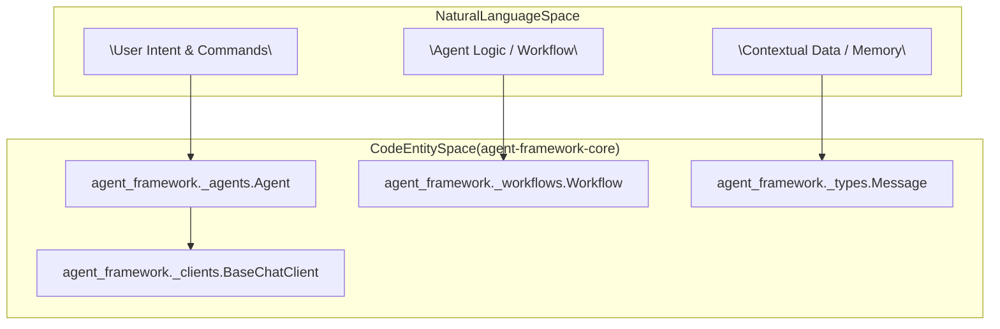
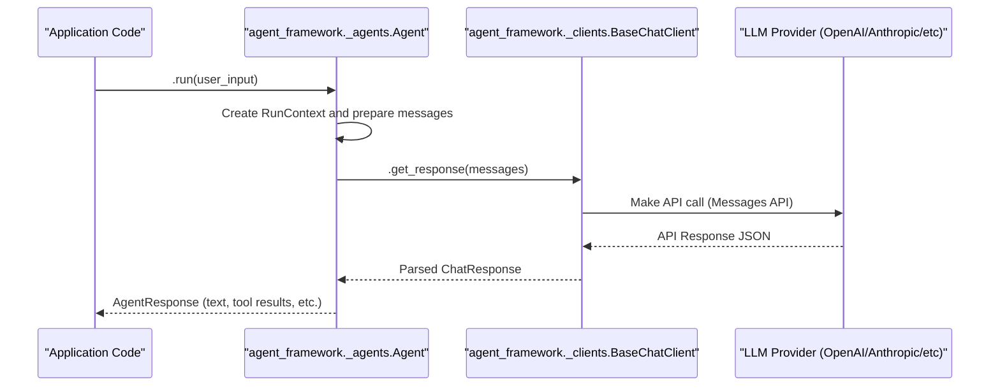
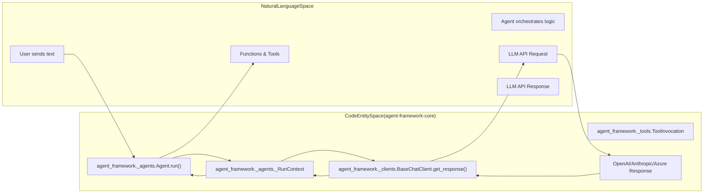
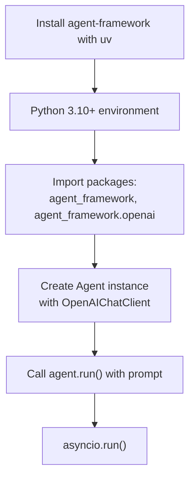

<!-- source: DeepWiki mcp.deepwiki.com · repo microsoft/agent-framework · page 2.2 Python Quick Start · fetched 2026-10-26 -->

# Python Quick Start

<details>
<summary>Relevant source files</summary>

The following files were used as context for generating this wiki page:

- [python/CHANGELOG.md](python/CHANGELOG.md)
- [python/packages/a2a/pyproject.toml](python/packages/a2a/pyproject.toml)
- [python/packages/ag-ui/pyproject.toml](python/packages/ag-ui/pyproject.toml)
- [python/packages/anthropic/pyproject.toml](python/packages/anthropic/pyproject.toml)
- [python/packages/azure-cosmos-memory/AGENTS.md](python/packages/azure-cosmos-memory/AGENTS.md)
- [python/packages/copilotstudio/pyproject.toml](python/packages/copilotstudio/pyproject.toml)
- [python/packages/core/pyproject.toml](python/packages/core/pyproject.toml)
- [python/packages/devui/pyproject.toml](python/packages/devui/pyproject.toml)
- [python/packages/lab/pyproject.toml](python/packages/lab/pyproject.toml)
- [python/packages/lab/uv.lock](python/packages/lab/uv.lock)
- [python/packages/mem0/pyproject.toml](python/packages/mem0/pyproject.toml)
- [python/packages/postgres/README.md](python/packages/postgres/README.md)
- [python/packages/postgres/pyproject.toml](python/packages/postgres/pyproject.toml)
- [python/packages/purview/pyproject.toml](python/packages/purview/pyproject.toml)
- [python/packages/redis/pyproject.toml](python/packages/redis/pyproject.toml)
- [python/pyproject.toml](python/pyproject.toml)
- [python/samples/01-get-started/01_hello_agent.py](python/samples/01-get-started/01_hello_agent.py)
- [python/samples/01-get-started/02_add_tools.py](python/samples/01-get-started/02_add_tools.py)
- [python/samples/01-get-started/03_multi_turn.py](python/samples/01-get-started/03_multi_turn.py)
- [python/samples/01-get-started/04_memory.py](python/samples/01-get-started/04_memory.py)
- [python/samples/01-get-started/05a_functional_workflow_basics.py](python/samples/01-get-started/05a_functional_workflow_basics.py)
- [python/samples/01-get-started/05b_functional_workflow_with_agents.py](python/samples/01-get-started/05b_functional_workflow_with_agents.py)
- [python/samples/01-get-started/05c_first_graph_workflow.py](python/samples/01-get-started/05c_first_graph_workflow.py)
- [python/samples/01-get-started/06_agent_harness.py](python/samples/01-get-started/06_agent_harness.py)
- [python/samples/01-get-started/README.md](python/samples/01-get-started/README.md)
- [python/samples/README.md](python/samples/README.md)
- [python/uv.lock](python/uv.lock)

</details>


This page provides a step-by-step guide for Python developers to install the Microsoft Agent Framework, configure API credentials, create a simple agent, and execute your first conversation. This covers the essential setup and basic agent patterns to get started quickly.

For more advanced agent concepts including tools, middleware, and workflows, see **Core Concepts (3)**. For hosting and deployment options, see **Python Deployment Options (6.2)**.

---

## Prerequisites

Before installing the framework, ensure you have:

**Required:**
- **Python 3.10 or higher**: Supported versions from 3.10 up to 3.14 as per package metadata.  
- **uv (Recommended)**: The recommended Python dependency and workspace management tool used by the framework installation process for fast, reproducible installs and consistent environment resolution.  
- **An API key** from one of the supported LLM providers:  
  - OpenAI API key  
  - Azure OpenAI endpoint and API key  
  - Anthropic, Mistral, Gemini, or Bedrock credentials  

**Supported Platforms:** Windows, macOS, Linux.  

Sources: [python/pyproject.toml:6-22](), [python/uv.lock:19-21](), [python/pyproject.toml:60-61](), [python/packages/core/pyproject.toml:79-85]()

---

## Installation

The framework is distributed as modular Python packages. You can install the meta-package for full access or install selected core packages as needed.

### Using uv (Recommended)

`uv` is the primary tool used for the Python workspace and dependency management across the monorepo and is recommended for installing the framework.

```bash
# Install the full Microsoft Agent Framework with uv pip.
uv pip install agent-framework
```

This installs the main meta-package `agent-framework` which depends on `agent-framework-core` and all optional packages.

### Using pip

If you prefer standard pip installation, you can install the core package or full meta-package:

```bash
# Core foundational package only
pip install agent-framework-core

# Full Microsoft Agent Framework
pip install agent-framework
```

### Package Architecture

The Python implementation is modular. The critical packages are:

| Package                    | Purpose                                                                                               |
|----------------------------|-----------------------------------------------------------------------------------------------------|
| `agent-framework-core`     | Base abstractions and implementations: agents, chat clients, messages, tools, sessions, middleware.  |
| `agent-framework-openai`   | Integration for OpenAI and Azure OpenAI LLM providers.                                              |
| `agent-framework-anthropic`| Integration with Anthropic API and Claude models.                                                   |
| `agent-framework-orchestrations` | High-level workflow and multi-agent orchestration patterns.                                         |

Sources: [python/packages/core/pyproject.toml:2-66](), [python/pyproject.toml:25-27]()

---

## Code Entity Space: Core Abstractions

This diagram bridges natural language concepts to core Python classes and modules in `agent-framework-core`.



This shows:
- `Agent` as the primary abstraction handling user intents.
- `Workflow` for logic orchestration.
- `Message` representing context and conversation data.
- `BaseChatClient` acts as the client interface to LLM providers.

Sources: [python/packages/core/agent_framework/_agents.py:206-213](), [python/packages/core/agent_framework/_types.py:50-75](), [python/packages/core/agent_framework/_clients.py:27-38]()

---

## API Key Configuration

The framework loads configuration from environment variables, optionally supported by `python-dotenv` to load `.env` files automatically. This allows you to configure keys without hardcoding.

### Configuration Precedence (Example: OpenAI)

1. Constructor explicit parameters: e.g. passing `api_key` in `OpenAIChatClient`.  
2. `OPENAI_API_KEY` environment variable.  
3. Azure-specific environment variables fallback: `AZURE_OPENAI_ENDPOINT` and `AZURE_OPENAI_API_KEY`.  

### Environment Variables Summary

| Provider      | Environment Variable          | Example                            |
|---------------|------------------------------|----------------------------------|
| OpenAI        | `OPENAI_API_KEY`              | `sk-xxx...`                      |
| Azure OpenAI  | `AZURE_OPENAI_ENDPOINT`       | `https://<your-resource>.openai.azure.com` |
| Azure OpenAI  | `AZURE_OPENAI_API_KEY`        | Key for the Azure OpenAI endpoint |
| Anthropic     | `ANTHROPIC_API_KEY`           | `sk-ant-...`                     |

Sources: [python/packages/core/pyproject.toml:29-31](), [python/packages/core/agent_framework/observability.py:16-48](), [python/packages/anthropic/tests/test_anthropic_client.py:85-92]()

---

## Creating Your First Agent

### Basic Agent with OpenAI

You create an `Agent` instance by passing a `ChatClient` implementation (e.g. `OpenAIChatClient`) and instructions to define its behavior.

```python
import asyncio
from agent_framework import Agent
from agent_framework.openai import OpenAIChatClient

async def main():
    # OpenAIChatClient reads OPENAI_API_KEY from env by default
    agent = Agent(
        client=OpenAIChatClient(model="gpt-4o"),
        instructions="You are a helpful assistant."
    )
    
    result = await agent.run("What is the capital of France?")
    print(result.text)

if __name__ == "__main__":
    asyncio.run(main())
```

- `Agent.run()` asynchronously processes the input, calls the underlying chat client, and returns the response.  
- `OpenAIChatClient` acts as a bridge to the OpenAI API using `BaseChatClient` abstractions.  

Sources: [python/packages/core/agent_framework/_agents.py:206-250](), [python/packages/core/agent_framework/_types.py:50-75]()

---

## Interaction Flow: Code to Provider

The following sequence diagram shows the data flow when calling `Agent.run()`:



- The `Agent` creates an internal run context with session info.  
- `BaseChatClient` defines the protocol to communicate with providers.  
- The provider returns raw JSON; the client translates it into common response objects.  

Sources: [python/packages/core/agent_framework/_agents.py:206-213](), [python/packages/core/agent_framework/_clients.py:27-46](), [python/packages/anthropic/agent_framework_anthropic/_chat_client.py:178-183]()

---

## Adding Tools

Tools extend agent capabilities by exposing callable functions as tools that can be invoked by the agent during conversations.

### Defining a Simple Tool

Use the `@tool` decorator to expose a function. Function arguments use Python type annotations with Pydantic's `Field` for validation and description.

```python
from typing import Annotated
from pydantic import Field
from agent_framework import Agent, tool
from agent_framework.openai import OpenAIChatClient

@tool
def get_weather(
    location: Annotated[str, Field(description="The city name")]
) -> str:
    """Returns the current weather for a location."""
    return f"The weather in {location} is 22°C and sunny."

async def main():
    agent = Agent(
        client=OpenAIChatClient(model="gpt-4o"),
        tools=[get_weather]
    )
    
    response = await agent.run("What's the weather in Seattle?")
    print(response.text)
```

- The agent automatically detects when to invoke the tool based on the conversation context.  
- The tool's schema is generated from the function signature and docstring.  

Sources: [python/packages/core/agent_framework/_tools.py:205-230](), [python/packages/core/agent_framework/_agents.py:114-120]()

---

## Model Context Protocol (MCP) Support

The Agent Framework supports the Model Context Protocol, allowing external tool servers to be integrated as tools via IPC or network transports like stdio or websockets.

### Example: Connecting to MCP Server over stdio

```python
from agent_framework import Agent, MCPStdioTool
from agent_framework.openai import OpenAIChatClient

async def main():
    mcp_tool = MCPStdioTool(
        name="my-mcp-server",
        command="npx",
        args=["-y", "@modelcontextprotocol/server-everything"]
    )
    
    async with mcp_tool:
        agent = Agent(
            client=OpenAIChatClient(model="gpt-4o"),
            tools=mcp_tool.functions
        )
        response = await agent.run("What tools do you have available?")
        print(response.text)
```

- `MCPStdioTool` manages the lifecycle of the MCP server process and exposes functions to the agent.  
- This enables seamless, dynamic discovery and invocation of external tool functions.  

Sources: [python/packages/core/agent_framework/_tools.py:69-76](), [python/packages/core/pyproject.toml:35-42]()

---

## Next Steps

- **Multi-turn Conversations:** Use `AgentSession` to maintain context and memory across multiple `run()` calls.  
- **Workflows:** Use `Workflow` and related executors to create complex multi-agent or multi-step orchestration.  
- **Observability:** Enable OpenTelemetry integration to trace agents, track tokens, and monitor usage.  
- **Agent Skills System:** Extend agents modularly with skills for enhanced capabilities.

Sources: [python/packages/core/agent_framework/_agents.py:37-43](), [python/packages/core/agent_framework/observability.py:10-58](), [python/CHANGELOG.md:15-17]()

---

# Diagram: Natural Language To Code Entity Mapping for Run Flow



Sources: [python/packages/core/agent_framework/_agents.py:206-213](), [python/packages/core/agent_framework/_tools.py:139-180](), [python/packages/core/agent_framework/_clients.py:27-46]()

---

# Diagram: Package Installation and Agent Creation Process



---

This completes the Python Quick Start guide. Follow this guide to install the framework, define simple agents with tools, and run your first conversations. For deeper concepts, explore Core Concepts (3) and Workflow orchestration (4).

Sources:  
[python/pyproject.toml:1-31](),  
[python/uv.lock:1-25](),  
[python/packages/core/agent_framework/_agents.py:206-250](),  
[python/packages/core/agent_framework/_tools.py:69-76,139-230](),  
[python/packages/core/agent_framework/_clients.py:10-50](),  
[python/packages/core/agent_framework/observability.py:10-50](),  
[python/packages/anthropic/tests/test_anthropic_client.py:85-92]()

---

