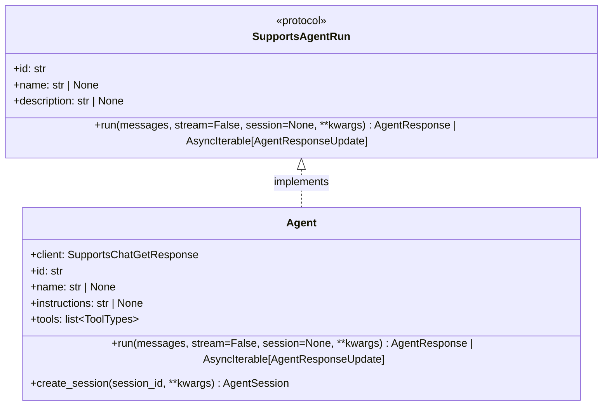
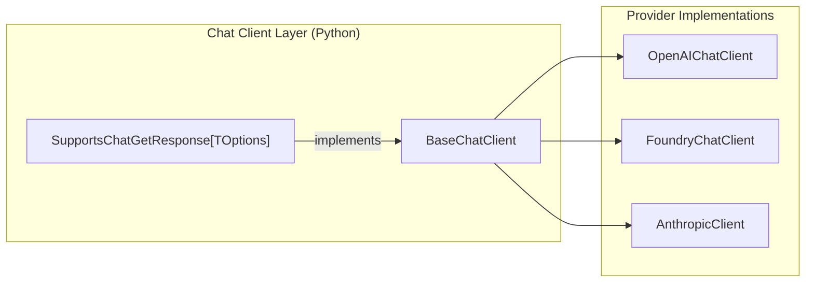
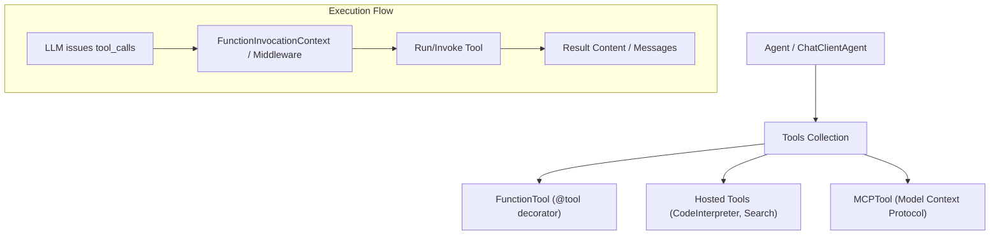
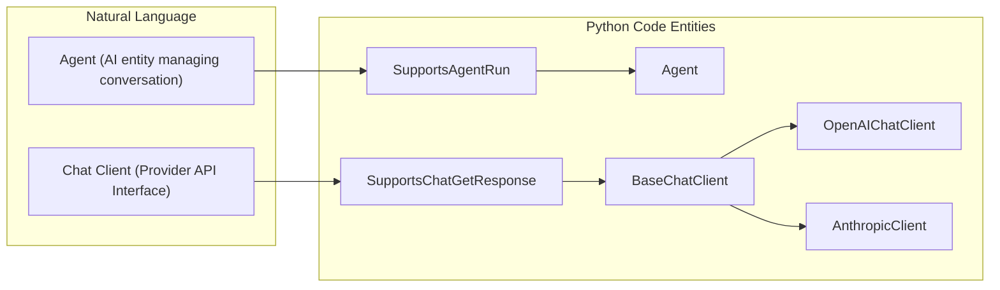
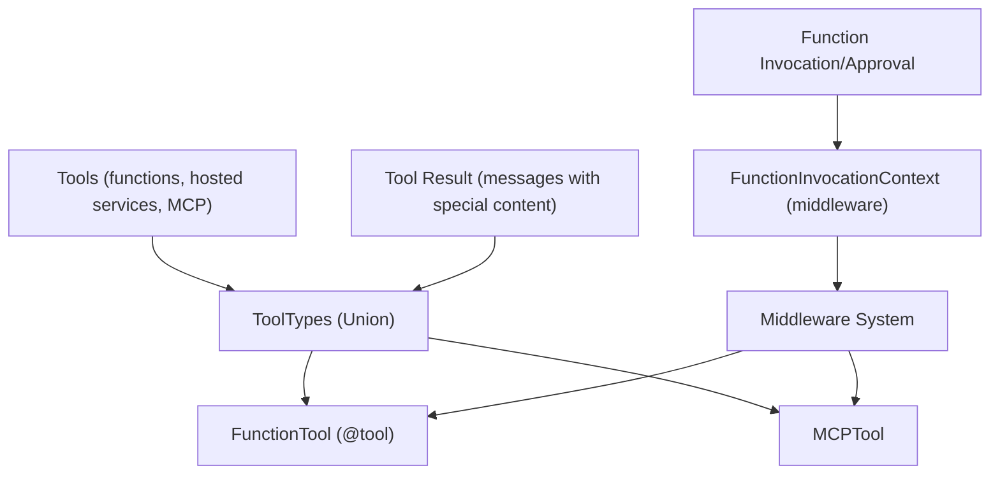

<!-- source: DeepWiki mcp.deepwiki.com · repo microsoft/agent-framework · page 3 Core Concepts · fetched 2026-10-26 -->

# Core Concepts

Relevant source files

The following files were used as context for generating this wiki page:

- [docs/specs/004-python-function-calling-loop.md](docs/specs/004-python-function-calling-loop.md)
- [python/packages/core/AGENTS.md](python/packages/core/AGENTS.md)
- [python/packages/core/agent_framework/__init__.py](python/packages/core/agent_framework/__init__.py)
- [python/packages/core/agent_framework/__init__.pyi](python/packages/core/agent_framework/__init__.pyi)
- [python/packages/core/agent_framework/_agents.py](python/packages/core/agent_framework/_agents.py)
- [python/packages/core/agent_framework/_clients.py](python/packages/core/agent_framework/_clients.py)
- [python/packages/core/agent_framework/_compaction.py](python/packages/core/agent_framework/_compaction.py)
- [python/packages/core/agent_framework/_harness/_tool_approval.py](python/packages/core/agent_framework/_harness/_tool_approval.py)
- [python/packages/core/agent_framework/_middleware.py](python/packages/core/agent_framework/_middleware.py)
- [python/packages/core/agent_framework/_skills.py](python/packages/core/agent_framework/_skills.py)
- [python/packages/core/agent_framework/_tools.py](python/packages/core/agent_framework/_tools.py)
- [python/packages/core/agent_framework/_types.py](python/packages/core/agent_framework/_types.py)
- [python/packages/core/agent_framework/observability.py](python/packages/core/agent_framework/observability.py)
- [python/packages/core/tests/core/test_agent_hooks.py](python/packages/core/tests/core/test_agent_hooks.py)
- [python/packages/core/tests/core/test_agents.py](python/packages/core/tests/core/test_agents.py)
- [python/packages/core/tests/core/test_clients.py](python/packages/core/tests/core/test_clients.py)
- [python/packages/core/tests/core/test_compaction.py](python/packages/core/tests/core/test_compaction.py)
- [python/packages/core/tests/core/test_function_invocation_logic.py](python/packages/core/tests/core/test_function_invocation_logic.py)
- [python/packages/core/tests/core/test_harness_tool_approval.py](python/packages/core/tests/core/test_harness_tool_approval.py)
- [python/packages/core/tests/core/test_middleware_with_agent.py](python/packages/core/tests/core/test_middleware_with_agent.py)
- [python/packages/core/tests/core/test_middleware_with_chat.py](python/packages/core/tests/core/test_middleware_with_chat.py)
- [python/packages/core/tests/core/test_observability.py](python/packages/core/tests/core/test_observability.py)
- [python/packages/core/tests/core/test_skills.py](python/packages/core/tests/core/test_skills.py)
- [python/packages/core/tests/core/test_tools.py](python/packages/core/tests/core/test_tools.py)
- [python/packages/core/tests/core/test_types.py](python/packages/core/tests/core/test_types.py)
- [python/samples/02-agents/context_providers/cross_session_observer.py](python/samples/02-agents/context_providers/cross_session_observer.py)
- [python/samples/02-agents/observability/README.md](python/samples/02-agents/observability/README.md)
- [python/samples/02-agents/observability/microsoft_opentelemetry_distro.py](python/samples/02-agents/observability/microsoft_opentelemetry_distro.py)
- [python/samples/02-agents/skills/README.md](python/samples/02-agents/skills/README.md)
- [python/samples/02-agents/skills/class_based_skill/README.md](python/samples/02-agents/skills/class_based_skill/README.md)
- [python/samples/02-agents/skills/class_based_skill/class_based_skill.py](python/samples/02-agents/skills/class_based_skill/class_based_skill.py)
- [python/samples/02-agents/skills/code_defined_skill/README.md](python/samples/02-agents/skills/code_defined_skill/README.md)
- [python/samples/02-agents/skills/code_defined_skill/code_defined_skill.py](python/samples/02-agents/skills/code_defined_skill/code_defined_skill.py)
- [python/samples/02-agents/skills/file_based_skill/file_based_skill.py](python/samples/02-agents/skills/file_based_skill/file_based_skill.py)
- [python/samples/02-agents/skills/mixed_skills/README.md](python/samples/02-agents/skills/mixed_skills/README.md)
- [python/samples/02-agents/skills/mixed_skills/mixed_skills.py](python/samples/02-agents/skills/mixed_skills/mixed_skills.py)
- [python/samples/02-agents/skills/script_approval/script_approval.py](python/samples/02-agents/skills/script_approval/script_approval.py)
- [python/samples/02-agents/skills/subprocess_script_runner.py](python/samples/02-agents/skills/subprocess_script_runner.py)

This document introduces the fundamental abstractions and systems that form the foundation of the Microsoft Agent Framework. These core concepts are consistent across both Python and .NET implementations, providing a unified mental model for building AI agents.

**Scope**: This page provides conceptual overviews and shows how the main components relate to each other. For detailed implementation specifics, see the child pages linked at the bottom of this document.

## Framework Architecture Overview

The Agent Framework is designed with a layered architecture that distinctly separates responsibilities, enhancing modularity and extensibility. At the top, agents coordinate conversations utilizing chat clients that provide access to LLM providers. Supporting systems like tools, memory, and observability enrich interactions and state management. Middleware and cross-cutting concerns operate throughout these layers.

```mermaid
graph TB
    subgraph "Agent Layer"
        AgentProto["SupportsAgentRun / AIAgent<br/>(Interface/Protocol)"]
        ChatAgent["Agent (Python) / ChatClientAgent (.NET)<br/>(Implementation)"]
    end
    
    subgraph "Chat Client Layer"
        ChatClientProto["SupportsChatGetResponse / IChatClient<br/>(Interface/Protocol)"]
        BaseChatClient["BaseChatClient<br/>(Python base)"]
        OpenAIClient["OpenAIChatClient / OpenAIClient Extensions"]
        FoundryClient["FoundryChatClient / AIProjectClient Extensions"]
        AnthropicClient["AnthropicClient / RawAnthropicClient"]
    end
    
    subgraph "Message Layer"
        ChatMessage["Message / ChatMessage<br/>(role, contents)"]
        ChatResponse["ChatResponse<br/>(messages, usage)"]
        ChatResponseUpdate["ChatResponseUpdate<br/>(streaming chunks)"]
        AgentResponse["AgentResponse<br/>(wrapper)"]
    end
    
    subgraph "Tool System"
        ToolProto["ToolTypes / AITool<br/>(Union/Interface)"]
        FunctionTool["FunctionTool / AIFunction<br/>(@tool decorator)"]
        HostedTool["Hosted Tools<br/>(code interpreter, search)"]
        MCPTool["MCPTool / MCPStdioTool<br/>(Model Context Protocol)"]
    end
    
    subgraph "Memory & State"
        AgentSession["AgentSession / ChatClientAgentSession"]
        HistoryProvider["HistoryProvider / ChatHistoryProvider<br/>(conversation history)"]
        ContextProvider["ContextProvider / AIContextProvider<br/>(dynamic context enrichment)"]
    end
    
    subgraph "Cross-Cutting"
        Middleware["Middleware / ChatMiddleware<br/>(agent & function)"]
        Observability["OpenTelemetry<br/>(traces, metrics, logs)"]
    end
    
    ChatAgent --> AgentProto
    ChatAgent --> ChatClientProto
    BaseChatClient --> ChatClientProto
    OpenAIClient --> BaseChatClient
    FoundryClient --> BaseChatClient
    AnthropicClient --> BaseChatClient
    
    ChatAgent --> ChatMessage
    ChatClientProto --> ChatResponse
    ChatClientProto --> ChatResponseUpdate
    ChatAgent --> AgentResponse
    
    ChatAgent --> ToolProto
    FunctionTool --> ToolProto
    HostedTool --> ToolProto
    MCPTool --> ToolProto
    
    ChatAgent --> AgentSession
    AgentSession --> HistoryProvider
    AgentSession --> ContextProvider
    
    ChatAgent --> Middleware
    ChatAgent --> Observability
    ChatClientProto --> Observability
```

**Diagram: Core Framework Components and Layer Relations**

Sources:  
[python/packages/core/agent_framework/_agents.py:20-24]()  
[python/packages/core/agent_framework/_clients.py:85-128]()  
[python/packages/core/agent_framework/_clients.py:217-221]()  
[python/packages/core/agent_framework/_tools.py:26-40]()  
[python/packages/core/agent_framework/_sessions.py:37-44]()  
[dotnet/src/Microsoft.Agents.AI.Abstractions/AIAgent.cs]()  
[dotnet/src/Microsoft.Agents.AI/ChatClient/ChatClientAgent.cs:39-40]()

---

## Agent Abstraction

Agents are the central abstraction representing AI-powered entities that engage in conversations or workflows. They encapsulate the conversation logic, state management, and orchestration of tools and services.

### Python: Agent and `SupportsAgentRun`

In Python, the agent abstraction is expressed via the `SupportsAgentRun` protocol, which defines an interface compliant with an async `run` method to process inputs and produce agent responses [python/packages/core/agent_framework/_agents.py:20-24](). The primary concrete agent is the `Agent` class that delegates LLM interactions to an underlying chat client (a `SupportsChatGetResponse` object) and manages tooling, instructions, and context.

*Diagram: Python Agent Abstraction - Protocol and implementation*

Sources: [python/packages/core/agent_framework/_agents.py:20-24](), [python/packages/core/agent_framework/_agents.py:27-27]()

### .NET: AIAgent and ChatClientAgent

In .NET, `AIAgent` is the base class defining the essential agent interface, lifecycle, and session concepts [dotnet/src/Microsoft.Agents.AI.Abstractions/AIAgent.cs](). Primary implementations like `ChatClientAgent` delegate LLM interactions via an `IChatClient` interface, integrating middleware layers and managing conversation state [dotnet/src/Microsoft.Agents.AI/ChatClient/ChatClientAgent.cs:39-40](). This abstraction allows uniform handling of diverse chat clients and tooling.

For comprehensive details, see the child page on [Agents and Chat Clients](#3.1).

Sources: [dotnet/src/Microsoft.Agents.AI.Abstractions/AIAgent.cs](), [dotnet/src/Microsoft.Agents.AI/ChatClient/ChatClientAgent.cs:39-40]()

---

## Chat Client Abstraction

Chat clients abstract the language model provider interactions. They define how chat messages are sent, responses are received, and middleware layers are applied.

### Python: SupportsChatGetResponse and BaseChatClient

Python defines a protocol `SupportsChatGetResponse` that standardizes expected methods and type contracts for chat clients [python/packages/core/agent_framework/_clients.py:85-128](). The `BaseChatClient` provides partial base implementations for sharing common functionality across integrations [python/packages/core/agent_framework/_clients.py:217-221]().

Widely used clients like `OpenAIChatClient`, `FoundryChatClient`, and `AnthropicClient` extend `BaseChatClient` and implement provider-specific details [python/packages/anthropic/agent_framework_anthropic/_chat_client.py:76-77]().

*Diagram: Chat Client Abstraction and Provider Implementations (Python)*

Sources: [python/packages/core/agent_framework/_clients.py:85-128](), [python/packages/core/agent_framework/_clients.py:217-221](), [python/packages/anthropic/agent_framework_anthropic/_chat_client.py:76-77]()

For more information, see [Agents and Chat Clients](#3.1) and [Provider Integrations](#3.2).

---

## Message and Content Model

The framework employs a unified, extensible content model to represent conversation messages and their multi-part contents. This model supports a variety of content types such as text, data blobs, function calls, and annotations.

- **Message**: Represents a single conversation turn authored by a role (e.g., user, assistant, system, tool). It contains one or more content items [python/packages/core/agent_framework/_types.py:53-75]().

- **Content**: An item within a message, typed to support diverse payloads like plain text, structured data, function calls, or multimedia [python/packages/core/agent_framework/_types.py:81-173]().

| Component | Description                            | Python Entity                          |
|-----------|------------------------------------|-------------------------------------|
| Message   | Represents a conversation turn       | `Message` class                     |
| Content   | Individual content item within a message | `Content` class                     |
| Role      | Author type indicating source/modality | `Literal["user", "assistant", "system", "tool"]` |

This flexible model enables rich, structured interactions beyond simple text, including tool invocation and media handling.

Sources: [python/packages/core/agent_framework/_types.py:53-75](), [python/packages/core/agent_framework/_types.py:81-173]()

---

## Tools and Function Calling

Tools extend agent capabilities by enabling execution of functions, access to external services, or invoking hosted tools.

- **Function Tools**: Local function wrappers defined typically via the `@tool` decorator (Python) or `AIFunction` (C#). They encapsulate callable code with validated input schemas and metadata [python/packages/core/agent_framework/_tools.py:29-41]().

- **Hosted Tools**: Provider-hosted services such as code interpreters, web/file search, or image generation integrated with the framework.

- **Model Context Protocol (MCP)**: A standard enabling dynamic discovery and execution of tools over stdio, HTTP, or WebSocket transport. Represented by the `MCPTool` class [python/packages/core/agent_framework/_tools.py:69-69]().

The function calling lifecycle involves parsing model instructions, invoking local or remote tools, handling approvals, and streaming or aggregating responses.

*Diagram: Tool System and Function Invocation Cycle*

Sources: [python/packages/core/agent_framework/_tools.py:29-41](), [python/packages/core/agent_framework/_middleware.py:31-31]()

See [Tools and Function Calling](#3.3) for a deeper exploration of the tool architecture and approval mechanics.

---

## Memory and Context Management

Maintaining conversation state and context is critical for agent continuity and relevance.

- **AgentSession**: Represents the agent's conversation session state, including persisted data and context identifiers [python/packages/core/agent_framework/_sessions.py:38-38]().
  
- **HistoryProvider**: Abstracts persistence of conversation messages to various backends including memory stores, Redis, Cosmos DB, or Foundry memory services [python/packages/core/agent_framework/_sessions.py:40-40]().

- **ContextProvider**: Injects dynamic or static context data to enrich the conversation prompt or metadata during agent runs [python/packages/core/agent_framework/_sessions.py:39-39]().

These components mitigate statelessness of LLM calls by persisting and dynamically augmenting conversation data transparently to the agent logic.

Sources: [python/packages/core/agent_framework/_sessions.py:37-44](), [python/packages/core/agent_framework/_agents.py:37-44]()

Refer to [Memory and Context Management](#3.4) for implementation details and supported providers.

---

## Observability and Monitoring

The framework integrates OpenTelemetry for comprehensive observability:

- **Tracing**: Tracks agent invocations, chat client calls, and tool executions. Specialized spans are attributed with semantic conventions defined in `OtelAttr` [python/packages/core/agent_framework/observability.py:121-170]().

- **Metrics**: Captures token usage distributions and operation durations with histogram metrics [python/packages/core/agent_framework/observability.py:157-187]().

- **Logging**: Uses a `MessageListTimestampFilter` to increment log timestamps for ordered event logging, crucial for chat message timeline reconstruction [python/packages/core/agent_framework/observability.py:208-217]().

This instrumentation supports performance analysis, usage accounting, and troubleshooting across the agent lifecycle.

Sources: [python/packages/core/agent_framework/observability.py:121-217](), [python/packages/core/tests/core/test_observability.py:33-160]()

More on this is available in [Observability and Monitoring](#3.6).

---

## Middleware System

Middleware layers provide interception points for augmenting or altering agent and chat client behavior without modifying core logic.

- **Agent Middleware**: Used around agent `run` calls to add hooks for pre/post processing, error handling, or enrichment [python/packages/core/agent_framework/_middleware.py:93-138]().

- **Function Middleware**: Wraps tool invocation lifecycles, enabling approval integration, validation, or telemetry instrumentation [python/packages/core/agent_framework/_middleware.py:31-31]().

- **Chat Middleware**: Intercepts raw chat client calls, useful for logging, telemetry, or response transformations [python/packages/core/agent_framework/_middleware.py:262-271]().

Middleware stacks are composable and extendable, supporting cross-layer concerns elegantly.

Sources: [python/packages/core/agent_framework/_middleware.py:31-31](), [python/packages/core/agent_framework/_middleware.py:93-138](), [python/packages/core/agent_framework/_middleware.py:262-271]()

See [Middleware System](#3.7) for usage patterns and customization guidance.

---

## Summary

The Microsoft Agent Framework revolves around these foundational concepts:

| Concept              | Role                                                                                 | Relevant Entities/Python Classes                      |
|----------------------|--------------------------------------------------------------------------------------|-----------------------------------------------------|
| Agent                | Coordinators of conversation, tooling, and state                                    | `Agent`, `SupportsAgentRun`, `AIAgent` (.NET)       |
| Chat Client          | Interface to LLM provider APIs                                                      | `SupportsChatGetResponse`, `BaseChatClient`          |
| Message & Content    | Unified conversation turn and payload model                                        | `Message`, `Content`                                 |
| Tools & Function Call | Mechanisms to extend LLM interaction with external/local code                      | `FunctionTool`, `MCPTool`, `Hosted Tools`            |
| Memory & Context     | Conversation session and dynamic context management                                | `AgentSession`, `HistoryProvider`, `ContextProvider` |
| Observability         | Instrumentation for telemetry and diagnostics                                     | OpenTelemetry integration (`OtelAttr`, layers)       |
| Middleware            | Interception layers for extensibility and cross-cutting functionality              | Agent, Function, and Chat middleware layers           |

Together, these components enable building robust, extendable AI agents and multi-agent workflows.

---

## Child Pages

For more details on specific components, see the following child pages:

- [Agents and Chat Clients](#3.1) — Explain the agent abstraction and chat client architecture that forms the foundation of the framework  
- [Provider Integrations](#3.2) — Overview of AI provider integrations, showing the breadth of supported platforms and integration patterns  
- [Tools and Function Calling](#3.3) — Explain the tool system including function tools, hosted tools, and MCP integration  
- [Memory and Context Management](#3.4) — Overview of session management, context providers, chat history, and memory service integration  
- [Agent-to-Agent Communication (A2A)](#3.5) — Explain the A2A protocol for agent communication, including protocol specifications and implementation details  
- [Observability and Monitoring](#3.6) — Document OpenTelemetry integration, tracing, metrics, Application Insights, and observability configuration  
- [Middleware System](#3.7) — Explain the middleware architecture, ChatMiddleware, FunctionInvocationLayer, ChatTelemetryLayer, and custom middleware creation  
- [Data Governance with Purview](#3.8) — Document Microsoft Purview integration for policy evaluation, content auditing, and data governance in both .NET and Python  
- [CodeAct and Code Execution](#3.9) — Document the CodeAct pattern for LLM-driven code execution, covering Hyperlight (VM-isolated sandbox), LocalCodeAct (.NET local Python execution), and Monty (Rust-based Python interpreter) backends, plus the LocalShellTool for shell command execution  
- [Security and Prompt Injection Defense](#3.10) — Document the FIDES prompt injection defense system, security.py module, content trust levels, and developer guidance for securing agents against adversarial inputs  

---

# Supplementary Diagrams Bridging Natural Language Concepts and Code Entities

### Diagram 1: Agent and Chat Client Natural Language to Python Code Entities

Sources: [python/packages/core/agent_framework/_agents.py:20-24](), [python/packages/core/agent_framework/_clients.py:85-128](), [python/packages/anthropic/agent_framework_anthropic/_chat_client.py:76-77]()

---

### Diagram 2: Tools and Function Calling - Natural Language to Code

Sources: [python/packages/core/agent_framework/_tools.py:26-40](), [python/packages/core/agent_framework/_middleware.py:31-31]()

---

This completes the overview of core framework concepts in Microsoft Agent Framework. For implementation specifics, usage, and detailed design, users should explore the respective child pages referenced above.

---

