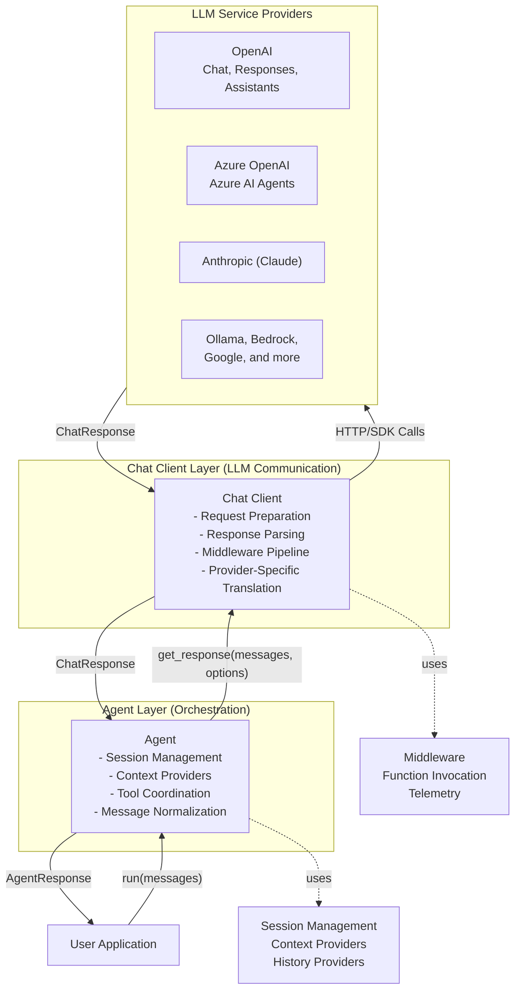
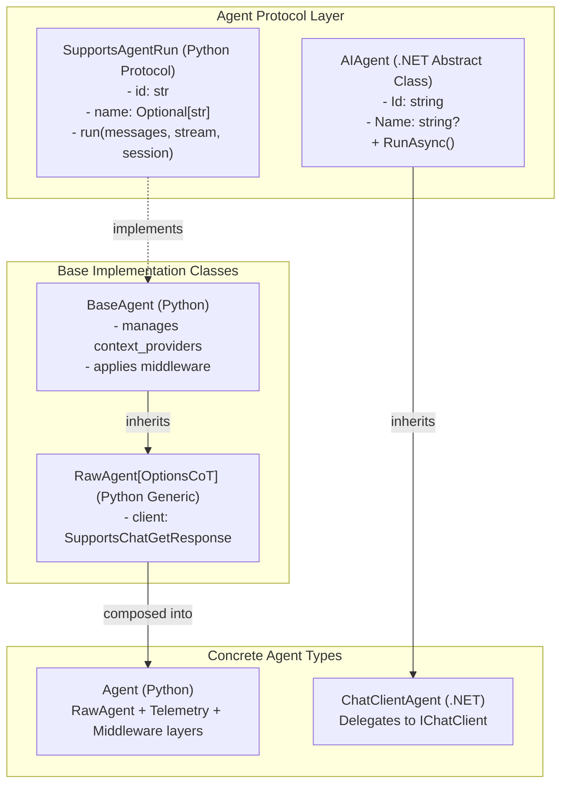
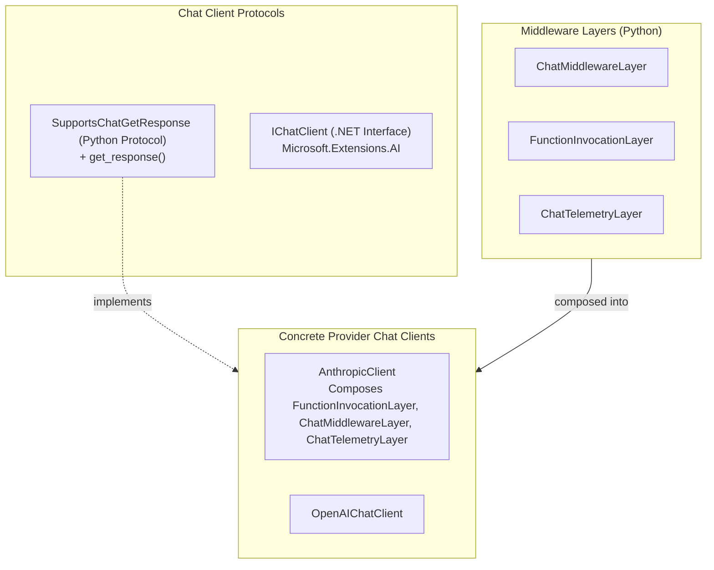

<!-- source: DeepWiki mcp.deepwiki.com · repo microsoft/agent-framework · page 3.1 Agents and Chat Clients · fetched 2026-10-26 -->

# Agents and Chat Clients

Relevant source files

The following files were used as context for generating this wiki page:

- [docs/decisions/0022-chat-history-persistence-consistency.md](docs/decisions/0022-chat-history-persistence-consistency.md)
- [docs/specs/004-python-function-calling-loop.md](docs/specs/004-python-function-calling-loop.md)
- [dotnet/samples/02-agents/Agents/Agent_Step19_InFunctionLoopCheckpointing/Program.cs](dotnet/samples/02-agents/Agents/Agent_Step19_InFunctionLoopCheckpointing/Program.cs)
- [dotnet/samples/02-agents/Agents/Agent_Step19_InFunctionLoopCheckpointing/README.md](dotnet/samples/02-agents/Agents/Agent_Step19_InFunctionLoopCheckpointing/README.md)
- [dotnet/src/Microsoft.Agents.AI.Abstractions/AdditionalPropertiesExtensions.cs](dotnet/src/Microsoft.Agents.AI.Abstractions/AdditionalPropertiesExtensions.cs)
- [dotnet/src/Microsoft.Agents.AI/ChatClient/ChatClientAgent.cs](dotnet/src/Microsoft.Agents.AI/ChatClient/ChatClientAgent.cs)
- [dotnet/src/Microsoft.Agents.AI/ChatClient/ChatClientAgentContinuationToken.cs](dotnet/src/Microsoft.Agents.AI/ChatClient/ChatClientAgentContinuationToken.cs)
- [dotnet/src/Microsoft.Agents.AI/ChatClient/ChatClientAgentLogMessages.cs](dotnet/src/Microsoft.Agents.AI/ChatClient/ChatClientAgentLogMessages.cs)
- [dotnet/src/Microsoft.Agents.AI/ChatClient/ChatClientAgentOptions.cs](dotnet/src/Microsoft.Agents.AI/ChatClient/ChatClientAgentOptions.cs)
- [dotnet/src/Microsoft.Agents.AI/ChatClient/ChatClientBuilderExtensions.cs](dotnet/src/Microsoft.Agents.AI/ChatClient/ChatClientBuilderExtensions.cs)
- [dotnet/src/Microsoft.Agents.AI/ChatClient/ChatClientExtensions.cs](dotnet/src/Microsoft.Agents.AI/ChatClient/ChatClientExtensions.cs)
- [dotnet/tests/Microsoft.Agents.AI.Abstractions.UnitTests/AdditionalPropertiesExtensionsTests.cs](dotnet/tests/Microsoft.Agents.AI.Abstractions.UnitTests/AdditionalPropertiesExtensionsTests.cs)
- [dotnet/tests/Microsoft.Agents.AI.UnitTests/ChatClient/ChatClientAgentContinuationTokenTests.cs](dotnet/tests/Microsoft.Agents.AI.UnitTests/ChatClient/ChatClientAgentContinuationTokenTests.cs)
- [dotnet/tests/Microsoft.Agents.AI.UnitTests/ChatClient/ChatClientAgentOptionsTests.cs](dotnet/tests/Microsoft.Agents.AI.UnitTests/ChatClient/ChatClientAgentOptionsTests.cs)
- [dotnet/tests/Microsoft.Agents.AI.UnitTests/ChatClient/ChatClientAgentTestHelper.cs](dotnet/tests/Microsoft.Agents.AI.UnitTests/ChatClient/ChatClientAgentTestHelper.cs)
- [dotnet/tests/Microsoft.Agents.AI.UnitTests/ChatClient/ChatClientAgentTests.cs](dotnet/tests/Microsoft.Agents.AI.UnitTests/ChatClient/ChatClientAgentTests.cs)
- [dotnet/tests/Microsoft.Agents.AI.UnitTests/ChatClient/ChatClientAgent_ApprovalsTests.cs](dotnet/tests/Microsoft.Agents.AI.UnitTests/ChatClient/ChatClientAgent_ApprovalsTests.cs)
- [dotnet/tests/Microsoft.Agents.AI.UnitTests/ChatClient/ChatClientAgent_BackgroundResponsesTests.cs](dotnet/tests/Microsoft.Agents.AI.UnitTests/ChatClient/ChatClientAgent_BackgroundResponsesTests.cs)
- [dotnet/tests/Microsoft.Agents.AI.UnitTests/ChatClient/ChatClientAgent_ChatHistoryManagementTests.cs](dotnet/tests/Microsoft.Agents.AI.UnitTests/ChatClient/ChatClientAgent_ChatHistoryManagementTests.cs)
- [dotnet/tests/Microsoft.Agents.AI.UnitTests/ChatClient/ChatClientAgent_ChatOptionsMergingTests.cs](dotnet/tests/Microsoft.Agents.AI.UnitTests/ChatClient/ChatClientAgent_ChatOptionsMergingTests.cs)
- [dotnet/tests/Microsoft.Agents.AI.UnitTests/ChatClient/ChatClientBuilderExtensionsTests.cs](dotnet/tests/Microsoft.Agents.AI.UnitTests/ChatClient/ChatClientBuilderExtensionsTests.cs)
- [dotnet/tests/Microsoft.Agents.AI.UnitTests/ChatClient/ChatClientExtensionsTests.cs](dotnet/tests/Microsoft.Agents.AI.UnitTests/ChatClient/ChatClientExtensionsTests.cs)
- [python/packages/core/agent_framework/_agents.py](python/packages/core/agent_framework/_agents.py)
- [python/packages/core/agent_framework/_clients.py](python/packages/core/agent_framework/_clients.py)
- [python/packages/core/agent_framework/_compaction.py](python/packages/core/agent_framework/_compaction.py)
- [python/packages/core/agent_framework/_harness/_tool_approval.py](python/packages/core/agent_framework/_harness/_tool_approval.py)
- [python/packages/core/agent_framework/_middleware.py](python/packages/core/agent_framework/_middleware.py)
- [python/packages/core/agent_framework/_tools.py](python/packages/core/agent_framework/_tools.py)
- [python/packages/core/agent_framework/_types.py](python/packages/core/agent_framework/_types.py)
- [python/packages/core/agent_framework/observability.py](python/packages/core/agent_framework/observability.py)
- [python/packages/core/tests/core/test_agent_hooks.py](python/packages/core/tests/core/test_agent_hooks.py)
- [python/packages/core/tests/core/test_agents.py](python/packages/core/tests/core/test_agents.py)
- [python/packages/core/tests/core/test_clients.py](python/packages/core/tests/core/test_clients.py)
- [python/packages/core/tests/core/test_compaction.py](python/packages/core/tests/core/test_compaction.py)
- [python/packages/core/tests/core/test_function_invocation_logic.py](python/packages/core/tests/core/test_function_invocation_logic.py)
- [python/packages/core/tests/core/test_harness_tool_approval.py](python/packages/core/tests/core/test_harness_tool_approval.py)
- [python/packages/core/tests/core/test_middleware_with_agent.py](python/packages/core/tests/core/test_middleware_with_agent.py)
- [python/packages/core/tests/core/test_middleware_with_chat.py](python/packages/core/tests/core/test_middleware_with_chat.py)
- [python/packages/core/tests/core/test_observability.py](python/packages/core/tests/core/test_observability.py)
- [python/packages/core/tests/core/test_tools.py](python/packages/core/tests/core/test_tools.py)
- [python/packages/core/tests/core/test_types.py](python/packages/core/tests/core/test_types.py)
- [python/samples/02-agents/context_providers/cross_session_observer.py](python/samples/02-agents/context_providers/cross_session_observer.py)
- [python/samples/02-agents/observability/README.md](python/samples/02-agents/observability/README.md)
- [python/samples/02-agents/observability/microsoft_opentelemetry_distro.py](python/samples/02-agents/observability/microsoft_opentelemetry_distro.py)

## Purpose and Scope

This page provides a comprehensive overview of the Agent Framework's two foundational abstractions: **Agents** and **Chat Clients**. Agents orchestrate AI-powered conversations, managing session state, context, and tools; Chat Clients provide the interface to Large Language Model (LLM) services, handling request formatting, response parsing, and provider-specific adaptations. Together, these abstractions enable building conversational AI applications that interoperate with multiple LLM providers through a unified interface.

This page covers the architecture, relationships, and interaction patterns between agents and chat clients. Detailed technical information resides in child pages focusing on:
- Agent lifecycle and protocol: [Agent Abstraction](#3.1.1)  
- Chat client implementation details: [Chat Client Architecture](#3.1.2)  
- Message and content typing: [Message Types and Content](#3.1.3)  
- Streaming and response handling: [Response Processing and Streaming](#3.1.4)  
- Tool integration and invocation: [Tools and Function Calling](#3.3)  
- Session and state management: [Memory and Context Management](#3.4)  

---

## Conceptual Architecture

### The Two-Layer Model: Agent Layer and Chat Client Layer

The Agent Framework uses a **two-layer architecture** to separate AI conversation orchestration from LLM communication:

- The **Agent Layer** handles conversation flow control, session and state management, history, context enrichment, tool coordination, and message normalization.
- The **Chat Client Layer** acts as the interface adapter for LLM service providers, managing request preparation, middleware pipelines, response parsing, and provider-specific transformations.

This separation ensures modularity, extensibility, and provider-agnostic agent development.

**Sources:**  
[python/packages/core/agent_framework/_agents.py:545-1001](),  
[dotnet/src/Microsoft.Agents.AI/ChatClient/ChatClientAgent.cs:39-48]()

---

## Agent Fundamentals

### The Agent Role

An **Agent** is the high-level orchestrator responsible for:

- Managing conversation sessions and state using constructs like `AgentSession` (Python)  
- Employing `ContextProvider` implementations to enrich conversations with memory and contextual data  
- Normalizing incoming messages into standard `Message` objects  
- Delegating the calls to LLMs through an injected Chat Client  
- Producing rich agent responses (`AgentResponse`) that unify text, function calls, structured data, and annotations  

Agents abstract complexity from the application developer by orchestrating tools, applying middleware, tracking usage, and maintaining conversational context.

### Agent Protocol and Implementations

The framework defines a conceptual agent protocol with parallel abstractions in Python and .NET:

Key entities:
- **Python:**  
  `SupportsAgentRun` protocol [python/packages/core/agent_framework/_agents.py:213-234](),  
  `BaseAgent` class [python/packages/core/agent_framework/_agents.py:305-540](),  
  `RawAgent` class [python/packages/core/agent_framework/_agents.py:545-1001]()  
- **.NET:**  
  `AIAgent` abstract base class [dotnet/src/Microsoft.Agents.AI.Abstractions/AIAgent.cs:11-40](),  
  `ChatClientAgent` class that delegates to `IChatClient` [dotnet/src/Microsoft.Agents.AI/ChatClient/ChatClientAgent.cs:39-118]()

**Sources:**  
[python/packages/core/agent_framework/_agents.py:213-1070](),  
[dotnet/src/Microsoft.Agents.AI.Abstractions/AIAgent.cs:11-40](),  
[dotnet/src/Microsoft.Agents.AI/ChatClient/ChatClientAgent.cs:39-118]()

---

## Chat Client Fundamentals

### The Chat Client Role

A **Chat Client** is an adapter that directly communicates with LLM providers. Its responsibilities include:

- Translating framework-agnostic request models into provider-specific API formats  
- Parsing provider responses and normalizing into the framework's unified `ChatResponse` model  
- Implementing middleware for function/tool invocation, telemetry, and request/response lifecycles  
- Providing a consistent interface so agents can operate transparently across LLM providers  

For example, the Python `AnthropicClient` adapts stop sequences and tool invocations to Claude's API [python/packages/anthropic/agent_framework_anthropic/_chat_client.py:179-183](). The .NET side uses the `IChatClient` interface from the Microsoft.Extensions.AI SDK.

### Chat Client Architecture

The Python Chat Client system uses interface protocols and layered middleware to compose capabilities:

- `BaseChatClient` implements the core request/response handling features [python/packages/core/agent_framework/_clients.py:217-362]()  
- Middleware layers add features such as:  
  - `ChatTelemetryLayer` for OpenTelemetry instrumentation [python/packages/core/agent_framework/observability.py:886-1113]()  
  - `FunctionInvocationLayer` for managing tool function call loops and approvals [python/packages/core/agent_framework/_tools.py:1077-1352]()  
  - Additional chat-specific middleware  

Concrete chat clients compose these layers and may implement provider-specific logic.

Key entities:
- **Python:** `SupportsChatGetResponse` protocol [python/packages/core/agent_framework/_clients.py:85-201]()  
- **.NET:** `IChatClient` interface in Microsoft.Extensions.AI [dotnet/src/Microsoft.Agents.AI/ChatClient/ChatClientAgent.cs:18-18]()  
- **Anthropic:** Python Anthropic client layering in agent_framework_anthropic [python/packages/anthropic/agent_framework_anthropic/_chat_client.py:130-141]()

**Sources:**  
[python/packages/core/agent_framework/_clients.py:85-362](),  
[python/packages/anthropic/agent_framework_anthropic/_chat_client.py:130-141](),  
[dotnet/src/Microsoft.Agents.AI/ChatClient/ChatClientAgent.cs:82-118]()

---

## Agent-Client Interaction Patterns

### Session and History Management

Agents manage conversational state and history via `HistoryProvider` implementations like `InMemoryHistoryProvider` [python/packages/core/agent_framework/_agents.py:40-41](). This abstraction supports different persistence backends and conversation scopes.

On the .NET side, the `ChatClientAgent` allows override of history providers and session options per invocation through `AgentRunOptions` [dotnet/tests/Microsoft.Agents.AI.UnitTests/ChatClient/ChatClientAgentTests.cs:160-160]().

### Tool Invocation and Middleware

The tool invocation lifecycle is primarily managed through middleware layers that intercept agent responses and chat client communications.

- `FunctionInvocationLayer` in Python orchestrates function call loops, user approval workflows, argument serialization, and error recovery [python/packages/core/agent_framework/_tools.py:1077-1352]().  
- The .NET `ChatClientAgent` ensures required tool middleware such as `FunctionInvokingChatClient` is present, inserting it if missing, and manages invocation pipelines and approval flows [dotnet/src/Microsoft.Agents.AI/ChatClient/ChatClientAgent.cs:72-80]().

This middleware-based layering enables flexible extension points, interception, and telemetry.

**Sources:**  
[python/packages/core/agent_framework/_agents.py:738-821](),  
[python/packages/core/agent_framework/_tools.py:1077-1352](),  
[dotnet/src/Microsoft.Agents.AI/ChatClient/ChatClientAgent.cs:72-80]()

---

## Summary

The Microsoft Agent Framework defines a modular two-layer architecture enabling conversational AI development:

- **Agents** are responsible for managing conversation logic, sessions, state, context providers, and tool coordination.  
- **Chat Clients** encapsulate provider-specific communication, executing requests, parsing responses, and running middleware for features such as function invocation and telemetry.

This clear separation fosters multi-provider interoperability, unified observability via OpenTelemetry, and extensible invocation patterns.

For detailed technical information, see the child pages:
- [Agent Abstraction](#3.1.1)  
- [Chat Client Architecture](#3.1.2)  
- [Message Types and Content](#3.1.3)  
- [Response Processing and Streaming](#3.1.4)  

---

**Sources:**  
[python/packages/core/agent_framework/_agents.py:1-1070](),  
[python/packages/core/agent_framework/_clients.py:1-633](),  
[dotnet/src/Microsoft.Agents.AI/ChatClient/ChatClientAgent.cs:1-128]()

---

