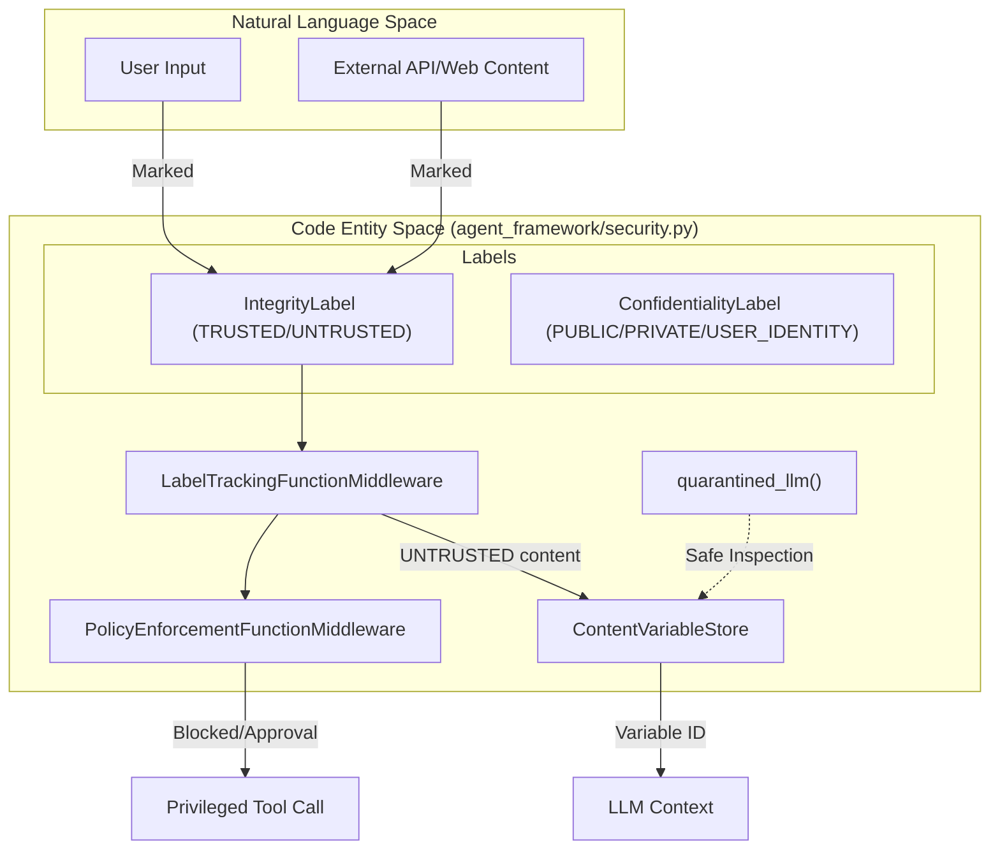
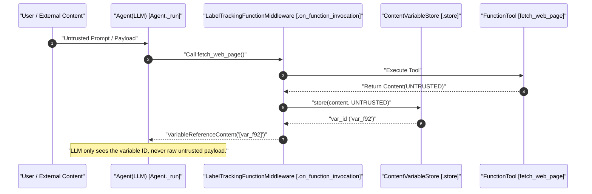

<!-- source: DeepWiki mcp.deepwiki.com · repo microsoft/agent-framework · page 3.10 Security and Prompt Injection Defense · fetched 2026-10-26 -->

# Security and Prompt Injection Defense

<details>
<summary>Relevant source files</summary>

The following files were used as context for generating this wiki page:

- [docs/decisions/0024-prompt-injection-defense.md](docs/decisions/0024-prompt-injection-defense.md)
- [docs/features/FIDES_IMPLEMENTATION_SUMMARY.md](docs/features/FIDES_IMPLEMENTATION_SUMMARY.md)
- [python/packages/core/agent_framework/_mcp.py](python/packages/core/agent_framework/_mcp.py)
- [python/packages/core/agent_framework/security.py](python/packages/core/agent_framework/security.py)
- [python/packages/core/tests/core/test_mcp.py](python/packages/core/tests/core/test_mcp.py)
- [python/packages/core/tests/core/test_mcp_observability.py](python/packages/core/tests/core/test_mcp_observability.py)
- [python/packages/core/tests/test_security.py](python/packages/core/tests/test_security.py)
- [python/samples/02-agents/mcp/README.md](python/samples/02-agents/mcp/README.md)
- [python/samples/02-agents/mcp/agent_as_mcp_server.py](python/samples/02-agents/mcp/agent_as_mcp_server.py)
- [python/samples/02-agents/mcp/mcp_api_key_auth.py](python/samples/02-agents/mcp/mcp_api_key_auth.py)
- [python/samples/02-agents/mcp/mcp_github_pat.py](python/samples/02-agents/mcp/mcp_github_pat.py)
- [python/samples/02-agents/mcp/mcp_long_running_task.py](python/samples/02-agents/mcp/mcp_long_running_task.py)
- [python/samples/02-agents/mcp/mcp_progressive_disclosure.py](python/samples/02-agents/mcp/mcp_progressive_disclosure.py)
- [python/samples/02-agents/mcp/mcp_sampling_approval.py](python/samples/02-agents/mcp/mcp_sampling_approval.py)
- [python/samples/02-agents/security/FIDES_DEVELOPER_GUIDE.md](python/samples/02-agents/security/FIDES_DEVELOPER_GUIDE.md)
- [python/samples/02-agents/security/README.md](python/samples/02-agents/security/README.md)
- [python/samples/02-agents/security/email_security_example.py](python/samples/02-agents/security/email_security_example.py)
- [python/samples/02-agents/security/github_mcp_example.py](python/samples/02-agents/security/github_mcp_example.py)
- [python/samples/02-agents/security/repo_confidentiality_example.py](python/samples/02-agents/security/repo_confidentiality_example.py)
- [python/samples/02-agents/security/user_identity_security_example.py](python/samples/02-agents/security/user_identity_security_example.py)

</details>


This page documents the security infrastructure of the Microsoft Agent Framework, specifically focusing on prompt injection defense, content trust levels, security middleware, and the **FIDES** (Flow Integrity Deterministic Enforcement System) module implemented in `python/packages/core/agent_framework/security.py` [python/packages/core/agent_framework/security.py:3-13]().

The Microsoft Agent Framework includes a robust security infrastructure designed to protect agents against adversarial inputs and prompt injection attacks [docs/features/FIDES_IMPLEMENTATION_SUMMARY.md:3-5](). At its core is FIDES, a deterministic defense system based on information-flow control [docs/features/FIDES_IMPLEMENTATION_SUMMARY.md:3-5](). Unlike heuristic-based defenses, FIDES provides verifiable security guarantees by tracking the integrity and confidentiality of data as it flows through an agent's execution lifecycle [docs/decisions/0024-prompt-injection-defense.md:14-16]().

## FIDES Architecture Overview

The FIDES system implements label-based security mechanisms to prevent untrusted content (e.g., external API responses or injected user instructions) from influencing privileged agent actions [python/packages/core/agent_framework/security.py:5-13]().

### Security Data Flow
The following diagram illustrates how content is labeled, tracked, and isolated within the framework, bridging natural language spaces to code entities.

**Figure 1: FIDES Content Isolation and Labeling Flow**

Sources: [python/packages/core/agent_framework/security.py:91-133](), [docs/features/FIDES_IMPLEMENTATION_SUMMARY.md:19-28](), [docs/decisions/0024-prompt-injection-defense.md:39-44]()

Sources: [python/packages/core/agent_framework/security.py:5-13](), [docs/features/FIDES_IMPLEMENTATION_SUMMARY.md:3-28](), [docs/decisions/0024-prompt-injection-defense.md:14-44]()

## Core Security Primitives

FIDES relies on two primary dimensions for content labeling defined in the `security.py` module:

### 1. Integrity Labels
Represents the trustworthiness of the source.
*   `IntegrityLabel.TRUSTED`: Content originated from trusted sources (e.g., user input, system messages) [python/packages/core/agent_framework/security.py:96-100]().
*   `IntegrityLabel.UNTRUSTED`: Content originated from untrusted sources (e.g., AI-generated, external APIs) [python/packages/core/agent_framework/security.py:97-101]().

### 2. Confidentiality Labels
Represents the sensitivity of the data and its sharing permissions.
*   `ConfidentialityLabel.PUBLIC`: Content can be shared publicly [python/packages/core/agent_framework/security.py:118]().
*   `ConfidentialityLabel.PRIVATE`: Content is private and should not be shared [python/packages/core/agent_framework/security.py:119]().
*   `ConfidentialityLabel.USER_IDENTITY`: Content is restricted to specific user identities only [python/packages/core/agent_framework/security.py:120]().

### Principal Binding for `USER_IDENTITY`
`USER_IDENTITY` labels require a canonical, non-empty principal set using `PRINCIPAL_METADATA_KEY` [python/samples/02-agents/security/FIDES_DEVELOPER_GUIDE.md:60-65](). Each principal entry contains strictly `tenant_id` and `user_id` [python/packages/core/agent_framework/security.py:113-118](). Source tools declare the owner of identity-scoped output, and destination tools validate that the source principals are a subset of authorized destination principals [python/samples/02-agents/security/FIDES_DEVELOPER_GUIDE.md:60-75]().

### Content Label Combination
When multiple pieces of content are merged (e.g., joining tool arguments), FIDES applies a "most restrictive wins" policy via the `combine_labels()` function [python/packages/core/agent_framework/security.py:465-470](). 
*   If any input label is `UNTRUSTED`, the combined result is `UNTRUSTED` [python/packages/core/agent_framework/security.py:488-490]().
*   Confidentiality is merged by selecting the most restrictive level present (e.g., `USER_IDENTITY` > `PRIVATE` > `PUBLIC`) [python/packages/core/agent_framework/security.py:492-495]().

Sources: [python/packages/core/agent_framework/security.py:91-137](), [python/packages/core/agent_framework/security.py:465-500](), [python/samples/02-agents/security/FIDES_DEVELOPER_GUIDE.md:60-75](), [docs/features/FIDES_IMPLEMENTATION_SUMMARY.md:89-94]()

## Implementation: The Middleware Pipeline

Security is enforced through specialized middleware that wraps tool invocations, managed by `LabelTrackingFunctionMiddleware` and `PolicyEnforcementFunctionMiddleware`.

### Label Tracking and Automatic Hiding
The `LabelTrackingFunctionMiddleware` is responsible for propagating labels and isolating untrusted data [python/packages/core/agent_framework/security.py:1145-1150]().
*   **Automatic Variable Hiding**: Any content labeled as `UNTRUSTED` is automatically moved to the `ContentVariableStore` and replaced with a `VariableReferenceContent` (e.g., `[var_123abc]`) before being sent to the LLM [python/packages/core/agent_framework/security.py:1260-1280](). This prevents the LLM from ever seeing or executing instructions hidden within untrusted data [docs/features/FIDES_IMPLEMENTATION_SUMMARY.md:137-140]().
*   **Tiered Propagation**: Labels are determined by a strict 3-tier priority hierarchy [python/samples/02-agents/security/FIDES_DEVELOPER_GUIDE.md:60-65]():
    1.  **Tier 1**: Per-item embedded labels in `additional_properties.security_label` [python/packages/core/agent_framework/security.py:1220-1230]().
    2.  **Tier 2**: Tool-level `source_integrity` declarations [python/packages/core/agent_framework/security.py:1235-1240]().
    3.  **Tier 3**: Joined labels from input arguments via `combine_labels` [python/packages/core/agent_framework/security.py:1245-1250]().

### Policy Enforcement
The `PolicyEnforcementFunctionMiddleware` checks the current context's labels against tool requirements before execution [python/packages/core/agent_framework/security.py:1490-1500]().
*   **Sink Protection**: Tools can be configured with `accepts_untrusted=False`. If the agent's context is "tainted" by untrusted data, the middleware blocks the call or requests approval [python/packages/core/agent_framework/security.py:1550-1570]().
*   **Exfiltration Prevention**: Tools define `max_allowed_confidentiality`. If an agent tries to pass `PRIVATE` data to a `PUBLIC` tool (like `post_to_slack`), the system triggers a security violation [python/packages/core/agent_framework/security.py:1575-1590]().

Sources: [python/packages/core/agent_framework/security.py:1145-1600](), [python/samples/02-agents/security/FIDES_DEVELOPER_GUIDE.md:60-65](), [docs/features/FIDES_IMPLEMENTATION_SUMMARY.md:56-72](), [docs/decisions/0024-prompt-injection-defense.md:41-44]()

## Security Tools and Isolated Execution

To allow agents to safely process untrusted data, FIDES provides specialized tools that handle variable references via `ContentVariableStore`.

| Tool | Purpose | Implementation |
| :--- | :--- | :--- |
| `quarantined_llm` | Executes an isolated LLM call using a separate `quarantine_chat_client` to summarize or analyze hidden variable content. | [python/packages/core/agent_framework/security.py:2285-2300]() |
| `inspect_variable` | Allows an agent to view the metadata or a sanitized version of a hidden variable in the `ContentVariableStore`. | [python/packages/core/agent_framework/security.py:2230-2245]() |

**Figure 2: Secure Tool Invocation Sequence**

Sources: [python/packages/core/agent_framework/security.py:2230-2350](), [docs/features/FIDES_IMPLEMENTATION_SUMMARY.md:137-145]()

Sources: [python/packages/core/agent_framework/security.py:2230-2350](), [docs/features/FIDES_IMPLEMENTATION_SUMMARY.md:137-145]()

## MCP Integration and Secure Proxies

For Model Context Protocol (MCP) integrations, FIDES provides `SecureMCPToolProxy` [python/packages/core/agent_framework/security.py:66]() and `apply_mcp_security_labels` [python/packages/core/agent_framework/security.py:68](). 
*   **Hint-Based Auto-Labeling**: MCP `ToolAnnotations` (such as `readOnlyHint` or `openWorldHint`) are mapped automatically to FIDES tool properties (`source_integrity`, `accepts_untrusted`, `max_allowed_confidentiality`) [docs/decisions/0024-prompt-injection-defense.md:46-48]().
*   **Server `_meta.ifc` Labels**: When servers emit IFC labels via result metadata (e.g., GitHub MCP with `X-MCP-Features: ifc_labels`), `SecureMCPToolProxy` parses these into per-item `security_label` values, ensuring remote provider trust levels are enforced locally [docs/decisions/0024-prompt-injection-defense.md:49-50]().

Sources: [python/packages/core/agent_framework/security.py:66-68](), [python/packages/core/agent_framework/security.py:1750-1850](), [docs/decisions/0024-prompt-injection-defense.md:46-50]()

## General Security Considerations & .NET Decorators

Beyond the Python FIDES framework, developers must account for general AI orchestration risks across languages.

### General Risks
| Risk Type | Description | Mitigation Strategy |
| :--- | :--- | :--- |
| **Hallucination** | LLMs generating factually incorrect but plausible info. | Verification of output; human-in-the-loop for critical data [dotnet/src/Microsoft.Agents.AI/ChatClient/ChatClientAgent.cs:25-26](). |
| **Indirect Injection** | Adversarial content retrieved by tools/context providers. | Use FIDES `UNTRUSTED` labels; sanitize tool inputs [dotnet/src/Microsoft.Agents.AI/ChatClient/ChatClientAgent.cs:27-28](). |
| **Malicious Payloads** | Harmful HTML, SQL, or shell commands in LLM output. | Sanitize output before rendering or execution [dotnet/src/Microsoft.Agents.AI/ChatClient/ChatClientAgent.cs:29-30](). |
| **Tool Invocation** | Automated tool execution without user approval. | Require explicit approval for tools with side effects [dotnet/src/Microsoft.Agents.AI/ChatClient/ChatClientAgent.cs:31-33](). |

### .NET Security Decorators
In the .NET implementation, the `ChatClientAgent` applies a pipeline of decorators to manage tool safety and approval [dotnet/src/Microsoft.Agents.AI/ChatClient/ChatClientExtensions.cs:52-61]():
*   **`ApprovalResponseBindingChatClient`**: Outermost decorator that binds user approvals to specific model-originated requests [dotnet/src/Microsoft.Agents.AI/ChatClient/ChatClientExtensions.cs:64-66]().
*   **`FunctionInvokingChatClient`**: Manages the loop of tool execution and handles `AllowConcurrentInvocation` settings [dotnet/src/Microsoft.Agents.AI/ChatClient/ChatClientExtensions.cs:100-104]().

Sources: [dotnet/src/Microsoft.Agents.AI/ChatClient/ChatClientAgent.cs:22-37](), [dotnet/src/Microsoft.Agents.AI/ChatClient/ChatClientExtensions.cs:52-132]()

## Developer Guidance: Securing an Agent

The simplest way to secure an agent is using `SecureAgentConfig`, which acts as a `ContextProvider` to automatically inject security middleware, tools, and instructions into the agent's lifecycle [python/packages/core/agent_framework/security.py:65]().

### One-Line Configuration
By adding `SecureAgentConfig` to the `context_providers` list, developers enable automatic label tracking and policy enforcement without manual middleware wiring [python/samples/02-agents/security/FIDES_DEVELOPER_GUIDE.md:5-15]().

```python
from agent_framework.security import SecureAgentConfig

# Configure security policy
security_config = SecureAgentConfig(
    auto_hide_untrusted=True,
    enable_policy_enforcement=True,
    approval_on_violation=True,
    quarantine_chat_client=quarantine_client
)

# Apply to agent via context provider pattern
agent = Agent(
    client=client,
    tools=my_tools,
    context_providers=[security_config]
)
```

Sources: [python/packages/core/agent_framework/security.py:65](), [python/packages/core/agent_framework/security.py:2020-2080](), [python/samples/02-agents/security/FIDES_DEVELOPER_GUIDE.md:5-15](), [docs/features/FIDES_IMPLEMENTATION_SUMMARY.md:7-14]()

---

