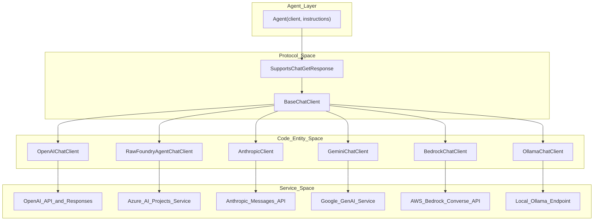
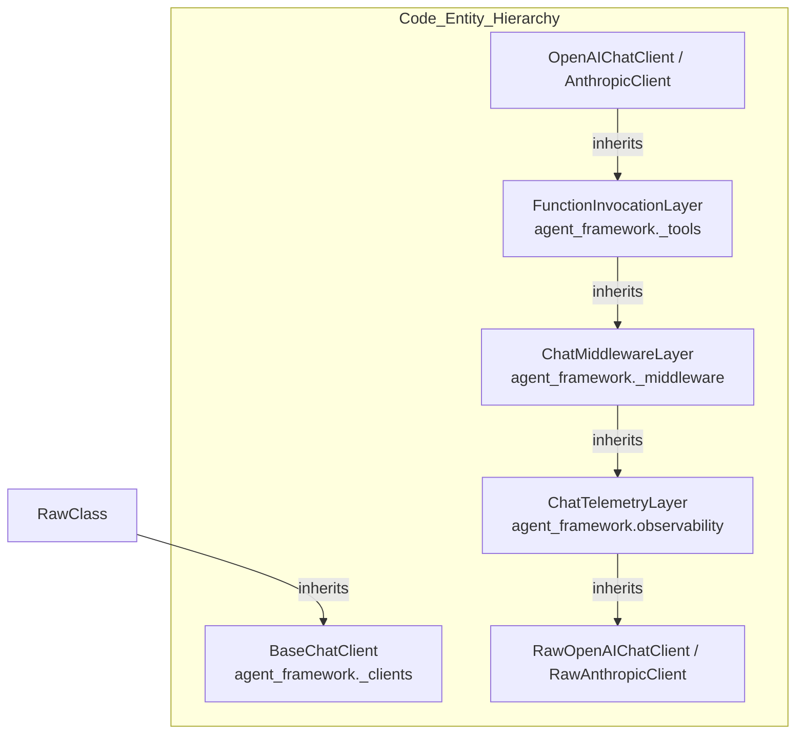

<!-- source: DeepWiki mcp.deepwiki.com · repo microsoft/agent-framework · page 3.2 Provider Integrations · fetched 2026-10-26 -->

# Provider Integrations

Relevant source files

The following files were used as context for generating this wiki page:

- [python/packages/anthropic/agent_framework_anthropic/_chat_client.py](python/packages/anthropic/agent_framework_anthropic/_chat_client.py)
- [python/packages/anthropic/tests/test_anthropic_client.py](python/packages/anthropic/tests/test_anthropic_client.py)
- [python/packages/bedrock/agent_framework_bedrock/_chat_client.py](python/packages/bedrock/agent_framework_bedrock/_chat_client.py)
- [python/packages/bedrock/tests/test_bedrock_client.py](python/packages/bedrock/tests/test_bedrock_client.py)
- [python/packages/bedrock/tests/test_bedrock_settings.py](python/packages/bedrock/tests/test_bedrock_settings.py)
- [python/packages/bedrock/tests/test_bedrock_structured_output.py](python/packages/bedrock/tests/test_bedrock_structured_output.py)
- [python/packages/core/agent_framework/_feature_stage.py](python/packages/core/agent_framework/_feature_stage.py)
- [python/packages/core/tests/core/test_feature_stage.py](python/packages/core/tests/core/test_feature_stage.py)
- [python/packages/foundry/README.md](python/packages/foundry/README.md)
- [python/packages/foundry/agent_framework_foundry/_agent.py](python/packages/foundry/agent_framework_foundry/_agent.py)
- [python/packages/foundry/agent_framework_foundry/_chat_client.py](python/packages/foundry/agent_framework_foundry/_chat_client.py)
- [python/packages/foundry/tests/foundry/test_foundry_agent.py](python/packages/foundry/tests/foundry/test_foundry_agent.py)
- [python/packages/foundry/tests/foundry/test_foundry_chat_client.py](python/packages/foundry/tests/foundry/test_foundry_chat_client.py)
- [python/packages/gemini/AGENTS.md](python/packages/gemini/AGENTS.md)
- [python/packages/gemini/README.md](python/packages/gemini/README.md)
- [python/packages/gemini/agent_framework_gemini/__init__.py](python/packages/gemini/agent_framework_gemini/__init__.py)
- [python/packages/gemini/agent_framework_gemini/_chat_client.py](python/packages/gemini/agent_framework_gemini/_chat_client.py)
- [python/packages/gemini/tests/test_gemini_client.py](python/packages/gemini/tests/test_gemini_client.py)
- [python/packages/ollama/agent_framework_ollama/_chat_client.py](python/packages/ollama/agent_framework_ollama/_chat_client.py)
- [python/packages/ollama/tests/test_ollama_chat_client.py](python/packages/ollama/tests/test_ollama_chat_client.py)
- [python/packages/openai/agent_framework_openai/_chat_client.py](python/packages/openai/agent_framework_openai/_chat_client.py)
- [python/packages/openai/agent_framework_openai/_chat_completion_client.py](python/packages/openai/agent_framework_openai/_chat_completion_client.py)
- [python/packages/openai/tests/openai/test_openai_chat_client.py](python/packages/openai/tests/openai/test_openai_chat_client.py)
- [python/packages/openai/tests/openai/test_openai_chat_completion_client.py](python/packages/openai/tests/openai/test_openai_chat_completion_client.py)
- [python/packages/orchestrations/agent_framework_orchestrations/_participant_output_config.py](python/packages/orchestrations/agent_framework_orchestrations/_participant_output_config.py)

This page provides an overview of how the Microsoft Agent Framework integrates with AI service providers through standardized chat client abstractions. Provider integrations enable agents to communicate with different large language model (LLM) and agentic services while maintaining consistent execution contracts across both .NET and Python implementations.

For details on core framework abstractions, see [Agents and Chat Clients](#3.1). Because this is a parent overview page, detailed discussions of specific provider implementations are delegated to child pages: [OpenAI Integration](#3.2.1), [Azure OpenAI Integration](#3.2.2), [Azure AI Foundry Integration](#3.2.3), and [Other Provider Integrations](#3.2.4).

---

## Architecture Overview

The framework adopts a protocol-based design where provider integrations implement uniform contracts (`IChatClient` in .NET, and `SupportsChatGetResponse` or `BaseChatClient` in Python). This allows agents to operate agnostically across various backend platforms.

### Provider Integration Architecture

The following diagram maps natural language capabilities to concrete code entities across the supported provider packages:

Sources:  
[python/packages/openai/agent_framework_openai/_chat_client.py:31-60](),  
[python/packages/foundry/agent_framework_foundry/_agent.py:158-175](),  
[python/packages/anthropic/agent_framework_anthropic/_chat_client.py:46-51](),  
[python/packages/gemini/agent_framework_gemini/_chat_client.py:13-30](),  
[python/packages/bedrock/agent_framework_bedrock/_chat_client.py:16-35](),  
[python/packages/ollama/agent_framework_ollama/_chat_client.py:19-34]()

---

## Common Implementation Patterns

Provider clients utilize a layered composition pattern separating raw API invocation from cross-cutting concerns like telemetry and function invocation.

### Client Inheritance and Middleware Layering

Sources:  
[python/packages/openai/agent_framework_openai/_chat_client.py:39-82](),  
[python/packages/anthropic/agent_framework_anthropic/_chat_client.py:14-45]()

---

## Provider Integration Categories

### OpenAI Integration
The OpenAI integration supports both the Chat Completions API via `OpenAIChatCompletionClient` and the newer Responses API via `OpenAIChatClient`. It exposes advanced platform features including native tool calling, Code Interpreter, File Search, and Web Search.

For detailed information, see [OpenAI Integration](#3.2.1).

Sources:  
[python/packages/openai/agent_framework_openai/_chat_client.py:197-214](),  
[python/packages/openai/agent_framework_openai/_chat_completion_client.py:35-48]()

### Azure OpenAI Integration
Azure OpenAI builds upon OpenAI support with specific enterprise endpoint configurations, API version management, Azure TokenCredentials, and compliance-oriented tool options.

For details, see [Azure OpenAI Integration](#3.2.2).

Sources:  
[python/packages/openai/agent_framework_openai/_chat_client.py:82-85](),  
[python/packages/openai/agent_framework_openai/_chat_completion_client.py:50-55]()

### Azure AI Foundry Integration
Foundry integration connects agents directly to the Azure AI Agent Service using `AIProjectClient`, providing access to pre-provisioned PromptAgents and HostedAgents with integrated vector stores, memory, and project tools.

For details, see [Azure AI Foundry Integration](#3.2.3).

Sources:  
[python/packages/foundry/agent_framework_foundry/_agent.py:38-40](),  
[python/packages/foundry/agent_framework_foundry/_chat_client.py:25-58]()

### Other Provider Integrations
The framework supports several additional platforms, including Anthropic (`AnthropicClient`), Amazon Bedrock (`BedrockChatClient`), Google Gemini (`GeminiChatClient`), and Ollama (`OllamaChatClient`), standardizing their request payloads and streaming responses.

For details, see [Other Provider Integrations](#3.2.4).

Sources:  
[python/packages/anthropic/agent_framework_anthropic/_chat_client.py:46-51](),  
[python/packages/gemini/agent_framework_gemini/_chat_client.py:26-30](),  
[python/packages/bedrock/agent_framework_bedrock/_chat_client.py:40-45]()

---

