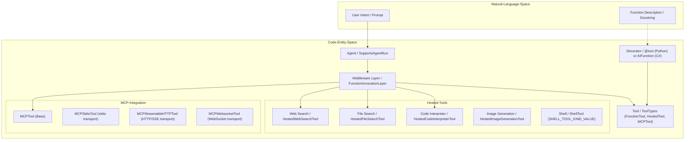
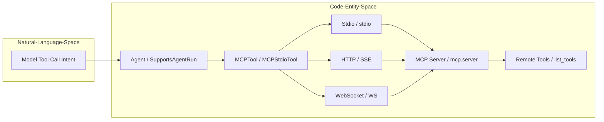

<!-- source: DeepWiki mcp.deepwiki.com · repo microsoft/agent-framework · page 3.3 Tools and Function Calling · fetched 2026-10-26 -->

# Tools and Function Calling

Relevant source files

The following files were used as context for generating this wiki page:

- [docs/specs/004-python-function-calling-loop.md](docs/specs/004-python-function-calling-loop.md)
- [python/packages/core/agent_framework/_agents.py](python/packages/core/agent_framework/_agents.py)
- [python/packages/core/agent_framework/_clients.py](python/packages/core/agent_framework/_clients.py)
- [python/packages/core/agent_framework/_compaction.py](python/packages/core/agent_framework/_compaction.py)
- [python/packages/core/agent_framework/_harness/_tool_approval.py](python/packages/core/agent_framework/_harness/_tool_approval.py)
- [python/packages/core/agent_framework/_middleware.py](python/packages/core/agent_framework/_middleware.py)
- [python/packages/core/agent_framework/_tools.py](python/packages/core/agent_framework/_tools.py)
- [python/packages/core/agent_framework/_types.py](python/packages/core/agent_framework/_types.py)
- [python/packages/core/agent_framework/observability.py](python/packages/core/agent_framework/observability.py)
- [python/packages/core/tests/core/test_agent_hooks.py](python/packages/core/tests/core/test_agent_hooks.py)
- [python/packages/core/tests/core/test_agents.py](python/packages/core/tests/core/test_agents.py)
- [python/packages/core/tests/core/test_clients.py](python/packages/core/tests/core/test_clients.py)
- [python/packages/core/tests/core/test_compaction.py](python/packages/core/tests/core/test_compaction.py)
- [python/packages/core/tests/core/test_function_invocation_logic.py](python/packages/core/tests/core/test_function_invocation_logic.py)
- [python/packages/core/tests/core/test_harness_tool_approval.py](python/packages/core/tests/core/test_harness_tool_approval.py)
- [python/packages/core/tests/core/test_middleware_with_agent.py](python/packages/core/tests/core/test_middleware_with_agent.py)
- [python/packages/core/tests/core/test_middleware_with_chat.py](python/packages/core/tests/core/test_middleware_with_chat.py)
- [python/packages/core/tests/core/test_observability.py](python/packages/core/tests/core/test_observability.py)
- [python/packages/core/tests/core/test_tools.py](python/packages/core/tests/core/test_tools.py)
- [python/packages/core/tests/core/test_types.py](python/packages/core/tests/core/test_types.py)
- [python/packages/tools/LICENSE](python/packages/tools/LICENSE)
- [python/packages/tools/README.md](python/packages/tools/README.md)
- [python/packages/tools/agent_framework_tools/__init__.py](python/packages/tools/agent_framework_tools/__init__.py)
- [python/packages/tools/agent_framework_tools/py.typed](python/packages/tools/agent_framework_tools/py.typed)
- [python/packages/tools/agent_framework_tools/shell/__init__.py](python/packages/tools/agent_framework_tools/shell/__init__.py)
- [python/packages/tools/agent_framework_tools/shell/_docker.py](python/packages/tools/agent_framework_tools/shell/_docker.py)
- [python/packages/tools/agent_framework_tools/shell/_environment.py](python/packages/tools/agent_framework_tools/shell/_environment.py)
- [python/packages/tools/agent_framework_tools/shell/_executor.py](python/packages/tools/agent_framework_tools/shell/_executor.py)
- [python/packages/tools/agent_framework_tools/shell/_executor_base.py](python/packages/tools/agent_framework_tools/shell/_executor_base.py)
- [python/packages/tools/agent_framework_tools/shell/_killtree.py](python/packages/tools/agent_framework_tools/shell/_killtree.py)
- [python/packages/tools/agent_framework_tools/shell/_session.py](python/packages/tools/agent_framework_tools/shell/_session.py)
- [python/packages/tools/agent_framework_tools/shell/_tool.py](python/packages/tools/agent_framework_tools/shell/_tool.py)
- [python/packages/tools/agent_framework_tools/shell/_types.py](python/packages/tools/agent_framework_tools/shell/_types.py)
- [python/packages/tools/tests/test_docker_shell_tool.py](python/packages/tools/tests/test_docker_shell_tool.py)
- [python/packages/tools/tests/test_local_shell_tool.py](python/packages/tools/tests/test_local_shell_tool.py)
- [python/packages/tools/tests/test_shell_resolve.py](python/packages/tools/tests/test_shell_resolve.py)
- [python/samples/02-agents/context_providers/cross_session_observer.py](python/samples/02-agents/context_providers/cross_session_observer.py)
- [python/samples/02-agents/observability/README.md](python/samples/02-agents/observability/README.md)
- [python/samples/02-agents/observability/microsoft_opentelemetry_distro.py](python/samples/02-agents/observability/microsoft_opentelemetry_distro.py)
- [python/samples/02-agents/tools/README.md](python/samples/02-agents/tools/README.md)
- [python/samples/02-agents/tools/local_shell_with_allowlist.py](python/samples/02-agents/tools/local_shell_with_allowlist.py)

This page documents the tool and function calling system in the Microsoft Agent Framework. It explains how agents interact with external capabilities through function tools, hosted tools, and Model Context Protocol (MCP) integrations. The framework provides a unified abstraction for defining, validating, and executing tools across Python and .NET implementations.

For information about orchestration patterns, see [Workflows and Orchestration](#4). For middleware and interception patterns, see [Middleware System](#3.7).

---

## Tool System Overview

The framework supports several tool patterns, each serving different use cases. These range from local code execution to service-side capabilities and standardized protocols for external tool servers.

| Tool Pattern | Description | Python Class | Execution Location |
|---|---|---|---|
| **Function Tools** | Local code functions wrapped with metadata | `FunctionTool` | Client-side |
| **Hosted Tools** | Marker classes for AI service capabilities | `HostedCodeInterpreterTool`, `HostedFileSearchTool`, `HostedWebSearchTool` | Service-side |
| **MCP Tools** | Protocol-based connection to tool servers | `MCPStdioTool`, `MCPStreamableHTTPTool`, `MCPWebsocketTool` | External MCP server |

Function tools represent local executable functions enhanced with schema validation and metadata. Hosted tools are integrated capabilities provided by AI service providers, facilitating functionalities such as code interpretation and document search within the service. MCP tools enable dynamic discovery and invocation of external tool servers through a standardized protocol across various transport layers.

Sources: [python/packages/core/agent_framework/_tools.py:100-130](), [python/packages/core/agent_framework/_mcp.py:30-40](), [python/packages/core/agent_framework/_types.py:160-175]()

---

### Tool Architecture and Space Bridge Diagram

This diagram bridges "Natural Language Space" (where user prompts, tool descriptions, and model intent originate) to "Code Entity Space" (classes and execution pipelines like `FunctionTool`, `FunctionInvocationLayer`, and `MCPTool`).

Title: Tool Architecture and Space Bridge

Sources: [python/packages/core/agent_framework/_tools.py:105-130](), [python/packages/core/agent_framework/_mcp.py:28-40](), [python/packages/core/agent_framework/_agents.py:110-115](), [python/packages/core/agent_framework/observability.py:215-230]()

---

## Function Tools
**Detail page: [Function Tools](#3.3.1)**

Function tools are local code functions enhanced to be callable by AI models, exposing their callable signature and argument schema. In Python, the `@tool` decorator and `FunctionTool` class facilitate creating these tools, automatically generating JSON schemas for argument validation from function signatures and docstrings. This is done using Pydantic's `create_model`, ensuring robust validation of inputs passed from model-generated function calls.

In .NET, a parallel abstraction exists with `AIFunction`. Function tools are an essential mechanism for embedding executable behavior directly into agent workflows, enabling safe and validated interactions.

For details on defining, auto-generating schemas, and parameter validation, see [Function Tools](#3.3.1).

Sources: [python/packages/core/agent_framework/_tools.py:20-50](), [python/packages/core/agent_framework/_tools.py:40-45]()

---

## Function Invocation and Approval
**Detail page: [Function Invocation and Approval](#3.3.2)**

Function invocation is managed through a controlled loop encapsulated in the `FunctionInvocationLayer`. This mechanism allows:

- Multiple sequential or concurrent calls with a configurable maximum number of iterations (default 40) to avoid infinite loops.
- Limiting consecutive errors per user request (default 3), enhancing robustness.
- Dynamic approval workflows where tool invocations can require human-in-the-loop confirmation to enforce security or other policies.
- Support for approval modes such as `always_require` or `never_require` to configure the security posture of tools.
- Pausing execution for required user input or approval, using exceptions like `UserInputRequiredException`.

This lifecycle ensures that function tools are invoked safely and interactions with the agent are controllable for approval and security considerations.

For an in-depth explanation of the invocation lifecycle, approval modes, human-in-the-loop patterns, and limits, see [Function Invocation and Approval](#3.3.2).

Sources: [python/packages/core/agent_framework/_tools.py:95-130](), [docs/specs/004-python-function-calling-loop.md:10-135]()

---

## Hosted Tools
**Detail page: [Hosted Tools](#3.3.3)**

Hosted tools represent capabilities directly provided by AI service providers or via integrated cloud services rather than local client-side execution.

The framework supports several kinds of hosted tools, including but not limited to:

- **Code Interpreter**: Executes arbitrary code in a secure, sandboxed environment remotely, enabling dynamic runtime capabilities.
- **File Search**: Enables Retrieval-Augmented Generation (RAG) capabilities over hosted document collections using vector stores or file-based search abstractions.
- **Web Search**: Provides live web search capabilities through provider APIs.
- **Image Generation**: Allows models to generate images leveraging AI image generation services.
- **Shell Tools**: Specialized shell command execution, referenced with a constant identifier (`SHELL_TOOL_KIND_VALUE`).

Hosted tools are typically markers or specialized classes that interact with the relevant service API or infrastructure to perform the requested capability on behalf of the agent.

For comprehensive documentation of provider-hosted tools such as Code Interpreter, File Search, Web Search, Image Generation, and Shell Tool support, see [Hosted Tools](#3.3.3).

Sources: [python/packages/core/agent_framework/_tools.py:190-195](), [python/packages/anthropic/agent_framework_anthropic/_chat_client.py:95-105](), [python/packages/core/agent_framework/_tools.py:100-110]()

---

## Model Context Protocol (MCP)
**Detail page: [Model Context Protocol (MCP)](#3.3.4)**

The Model Context Protocol (MCP) is a standard enabling dynamic integration of external toolservers with agents. MCP facilitates:

- **Dynamic Tool Discovery**: Agents connect to MCP servers to list available tools dynamically.
- **Tool Invocation**: Calls to MCP-exposed tools are serialized and routed over standard transport mechanisms.
- **Transport Flexibility**: MCP supports multiple transports:
  - `stdio` for local subprocess integration via `MCPStdioTool`.
  - HTTP streaming or SSE via `MCPStreamableHTTPTool`.
  - WebSockets via `MCPWebsocketTool`.
- **Name Prefixing**: Tool names can be prefixed to avoid collisions when multiple MCP servers are connected simultaneously.

`MCPTool` is the base abstraction managing connection lifecycle, tool discovery, and call dispatch, allowing seamless integration with external MCP-compliant tool servers.

### MCP Integration Flow Diagram

Title: MCP Integration Architecture

Sources: [python/packages/core/agent_framework/_mcp.py:180-205](), [python/packages/core/tests/core/test_mcp.py:80-100](), [python/packages/core/agent_framework/_mcp.py:110-130]()

---

This page provides the high-level view of the tool and function calling system. For deep implementation details, usage patterns, and examples, please refer to the linked child pages specific to each aspect of the system.

---

