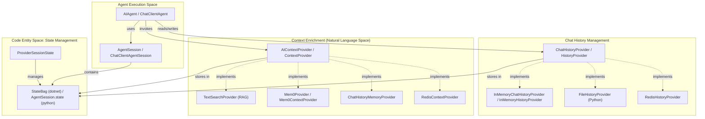
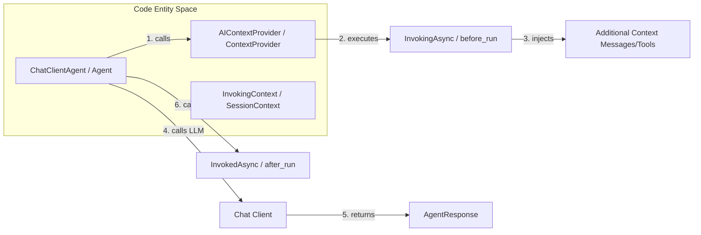
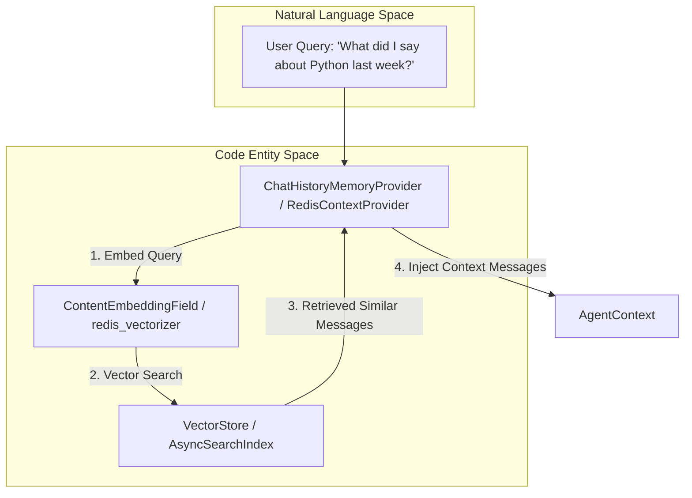

<!-- source: DeepWiki mcp.deepwiki.com · repo microsoft/agent-framework · page 3.4 Memory and Context Management · fetched 2026-10-26 -->

# Memory and Context Management

Relevant source files

The following files were used as context for generating this wiki page:

- [dotnet/src/Microsoft.Agents.AI.Abstractions/AIContextProvider.cs](dotnet/src/Microsoft.Agents.AI.Abstractions/AIContextProvider.cs)
- [dotnet/src/Microsoft.Agents.AI.Abstractions/ChatHistoryProvider.cs](dotnet/src/Microsoft.Agents.AI.Abstractions/ChatHistoryProvider.cs)
- [dotnet/src/Microsoft.Agents.AI.Abstractions/MessageAIContextProvider.cs](dotnet/src/Microsoft.Agents.AI.Abstractions/MessageAIContextProvider.cs)
- [dotnet/src/Microsoft.Agents.AI.Abstractions/ProviderSessionState{TState}.cs](dotnet/src/Microsoft.Agents.AI.Abstractions/ProviderSessionState{TState}.cs)
- [dotnet/src/Microsoft.Agents.AI.Mem0/Mem0Provider.cs](dotnet/src/Microsoft.Agents.AI.Mem0/Mem0Provider.cs)
- [dotnet/src/Microsoft.Agents.AI.Mem0/Mem0ProviderOptions.cs](dotnet/src/Microsoft.Agents.AI.Mem0/Mem0ProviderOptions.cs)
- [dotnet/src/Microsoft.Agents.AI/Memory/ChatHistoryMemoryProvider.cs](dotnet/src/Microsoft.Agents.AI/Memory/ChatHistoryMemoryProvider.cs)
- [dotnet/src/Microsoft.Agents.AI/Memory/ChatHistoryMemoryProviderOptions.cs](dotnet/src/Microsoft.Agents.AI/Memory/ChatHistoryMemoryProviderOptions.cs)
- [dotnet/src/Microsoft.Agents.AI/TextSearchProvider.cs](dotnet/src/Microsoft.Agents.AI/TextSearchProvider.cs)
- [dotnet/src/Microsoft.Agents.AI/TextSearchProviderOptions.cs](dotnet/src/Microsoft.Agents.AI/TextSearchProviderOptions.cs)
- [dotnet/tests/Microsoft.Agents.AI.Abstractions.UnitTests/ProviderSessionStateTests.cs](dotnet/tests/Microsoft.Agents.AI.Abstractions.UnitTests/ProviderSessionStateTests.cs)
- [dotnet/tests/Microsoft.Agents.AI.Mem0.IntegrationTests/Mem0ProviderTests.cs](dotnet/tests/Microsoft.Agents.AI.Mem0.IntegrationTests/Mem0ProviderTests.cs)
- [dotnet/tests/Microsoft.Agents.AI.Mem0.UnitTests/Mem0ProviderTests.cs](dotnet/tests/Microsoft.Agents.AI.Mem0.UnitTests/Mem0ProviderTests.cs)
- [dotnet/tests/Microsoft.Agents.AI.UnitTests/Data/TextSearchProviderTests.cs](dotnet/tests/Microsoft.Agents.AI.UnitTests/Data/TextSearchProviderTests.cs)
- [dotnet/tests/Microsoft.Agents.AI.UnitTests/Memory/ChatHistoryMemoryProviderTests.cs](dotnet/tests/Microsoft.Agents.AI.UnitTests/Memory/ChatHistoryMemoryProviderTests.cs)
- [python/packages/core/agent_framework/_sessions.py](python/packages/core/agent_framework/_sessions.py)
- [python/packages/core/tests/core/test_sessions.py](python/packages/core/tests/core/test_sessions.py)
- [python/packages/mem0/README.md](python/packages/mem0/README.md)
- [python/packages/mem0/agent_framework_mem0/__init__.py](python/packages/mem0/agent_framework_mem0/__init__.py)
- [python/packages/mem0/agent_framework_mem0/_context_provider.py](python/packages/mem0/agent_framework_mem0/_context_provider.py)
- [python/packages/mem0/tests/test_mem0_context_provider.py](python/packages/mem0/tests/test_mem0_context_provider.py)
- [python/packages/redis/AGENTS.md](python/packages/redis/AGENTS.md)
- [python/packages/redis/README.md](python/packages/redis/README.md)
- [python/packages/redis/agent_framework_redis/_context_provider.py](python/packages/redis/agent_framework_redis/_context_provider.py)
- [python/packages/redis/agent_framework_redis/_history_provider.py](python/packages/redis/agent_framework_redis/_history_provider.py)
- [python/packages/redis/tests/test_context_provider_edges.py](python/packages/redis/tests/test_context_provider_edges.py)
- [python/packages/redis/tests/test_providers.py](python/packages/redis/tests/test_providers.py)
- [python/samples/02-agents/conversations/redis_history_provider.py](python/samples/02-agents/conversations/redis_history_provider.py)

This document describes the memory and context management systems in the Microsoft Agent Framework, covering session state storage, chat history providers, context enrichment mechanisms, and semantic memory integration across both .NET and Python languages.

**Scope**: This page focuses on how agents maintain conversational state, manage chat history, and enrich context through pluggable providers. For information about agent-to-agent communication protocols, see [Agent-to-Agent Communication (A2A)](#3.5). For workflow state persistence and checkpointing, see [Workflow Execution and Checkpointing](#4.4). For deep dives into specific subsystems, see the child pages:
- [Agent Sessions and State](#3.4.1)
- [Context Providers](#3.4.2)
- [Chat History Providers](#3.4.3)
- [Memory Services Integration](#3.4.4)

---

## Architecture Overview

The framework provides three complementary systems for memory and context management:

1.  **Agent Sessions** - Stateful containers for conversation state and provider data.
2.  **Chat History Providers** - Manage the persistence and retrieval of conversation message history.
3.  **Context Providers** - Enrich agent context before invocations (e.g., via Retrieval Augmented Generation) and process results afterward.

**Diagram: Memory and Context Management Architecture**

Sources:  
[dotnet/src/Microsoft.Agents.AI.Abstractions/AIContextProvider.cs:42-43](),  
[python/packages/core/agent_framework/_sessions.py:5-13](),  
[dotnet/src/Microsoft.Agents.AI/Memory/ChatHistoryMemoryProvider.cs:19-55](),  
[python/packages/redis/agent_framework_redis/_history_provider.py:53-70](),  
[python/packages/redis/agent_framework_redis/_context_provider.py:45-54]()

---

## Agent Sessions and State

### AgentSession and ChatClientAgentSession

Agent sessions represent the conversational state container carrying information across agent invocations. In .NET, `ChatClientAgentSession` tightly integrates with `ChatClientAgent`, maintaining a type-safe `StateBag` that holds arbitrary key-value data for persistence.  

In Python, the `AgentSession` class serves as a lightweight session state container, exposing the `state` dictionary to hold arbitrary data per conversation. Python also supports session snapshot persistence with the `FileSessionStore` class that serializes state to JSON using `msgspec` for safe and efficient storage [python/packages/core/agent_framework/_sessions.py:9-13]().  

For details, see [Agent Sessions and State](#3.4.1).

Sources:  
[python/packages/core/agent_framework/_sessions.py:9-13]()

### State Management with ProviderSessionState

To enable strongly-typed and scoped state handling per provider within a session, the framework defines `ProviderSessionState<TState>` (in .NET) [dotnet/src/Microsoft.Agents.AI/Memory/ChatHistoryMemoryProvider.cs:75-75](). This class manages the lifecycle of provider-specific state objects serialized into the session's state bag beneath respective keys.  

In Python, providers typically use `AgentSession.state` with their unique source IDs as keys to store and retrieve their state objects [python/packages/core/agent_framework/_sessions.py:120-125]().

Sources:  
[dotnet/src/Microsoft.Agents.AI/Memory/ChatHistoryMemoryProvider.cs:75-75](),  
[python/packages/core/agent_framework/_sessions.py:120-125]()

---

## Context Providers

Context providers enhance the agent's invocation context dynamically by injecting additional messages, instructions, or tools relevant to the conversation state. They follow a two-phase lifecycle:
- **InvokingAsync** (or `before_run` in Python) — Called at the start of the agent invocation to provide additional context (e.g., relevant memory, search results) [dotnet/src/Microsoft.Agents.AI.Abstractions/AIContextProvider.cs:94-96](), [python/packages/redis/agent_framework_redis/_context_provider.py:126-134]().
- **InvokedAsync** (or `after_run` in Python) — Called after the invocation to process results, perform store updates, or trigger learning.

For details, see [Context Providers](#3.4.2).

### AIContextProvider Lifecycle

**Diagram: Context Provider Invocation Lifecycle**

Sources:  
[dotnet/src/Microsoft.Agents.AI.Abstractions/AIContextProvider.cs:94-98](),  
[python/packages/redis/agent_framework_redis/_context_provider.py:126-134]()

---

## Chat History Providers

Chat history providers abstract the storage and retrieval of conversation history. They are especially important for models or agent configurations that do not support built-in conversation context management.

- .NET exposes an abstract `ChatHistoryProvider` base class.
- Python provides a corresponding `HistoryProvider` abstraction [python/packages/core/agent_framework/_sessions.py:8-8]().

### Notable Implementations
- **InMemoryChatHistoryProvider / InMemoryHistoryProvider**: Built-in in-memory providers for ephemeral context [python/packages/core/agent_framework/_sessions.py:12-12]().
- **FileHistoryProvider**: Persists chat history locally as JSON Lines files [python/packages/core/agent_framework/_sessions.py:13-13]().
- **RedisHistoryProvider**: Stores conversation history in Redis lists, supporting session isolation and max message limits [python/packages/redis/agent_framework_redis/_history_provider.py:53-86]().

For details, see [Chat History Providers](#3.4.3).

Sources:  
[python/packages/core/agent_framework/_sessions.py:8-13](),  
[python/packages/redis/agent_framework_redis/_history_provider.py:53-86]()

---

## Memory Services Integration

The framework supports deep integration with external and provider-backed memory services designed for semantic memory and enhanced context retrieval.

- **ChatHistoryMemoryProvider**: Stores chat history in a vector store and retrieves relevant conversations via semantic similarity [dotnet/src/Microsoft.Agents.AI/Memory/ChatHistoryMemoryProvider.cs:18-31]().
- **Mem0Provider / Mem0ContextProvider**: Persists conversation messages as durable memories via an external Mem0 service [dotnet/src/Microsoft.Agents.AI.Mem0/Mem0Provider.cs:19-27](), [python/packages/mem0/tests/test_mem0_context_provider.py:48-69]().
- **TextSearchProvider**: Enables search over external knowledge bases for Retrieval Augmented Generation (RAG) [dotnet/src/Microsoft.Agents.AI.TextSearchProvider.cs:16-20]().
- **RedisContextProvider**: Performs semantic search against a Redis vector index and injects relevant context messages [python/packages/redis/agent_framework_redis/_context_provider.py:45-54]().

For details, see [Memory Services Integration](#3.4.4).

### Semantic Memory Retrieval Flow

**Diagram: Semantic Memory Retrieval Flow**

Sources:  
[dotnet/src/Microsoft.Agents.AI/Memory/ChatHistoryMemoryProvider.cs:24-31](),  
[dotnet/src/Microsoft.Agents.AI.Mem0/Mem0Provider.cs:19-27](),  
[dotnet/src/Microsoft.Agents.AI.TextSearchProvider.cs:16-20](),  
[python/packages/redis/agent_framework_redis/_context_provider.py:45-54]()

---

