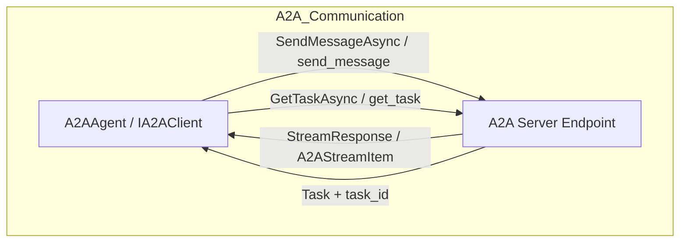
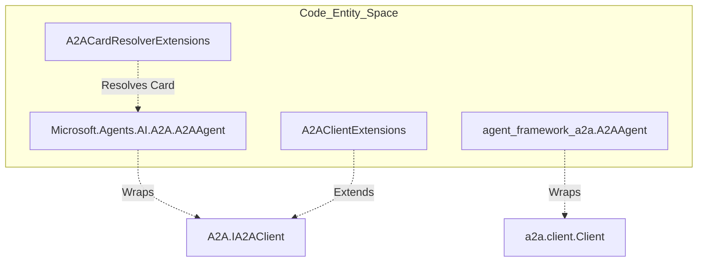

<!-- source: DeepWiki mcp.deepwiki.com · repo microsoft/agent-framework · page 3.5 Agent-to-Agent Communication (A2A) · fetched 2026-10-26 -->

# Agent-to-Agent Communication (A2A)

Relevant source files

The following files were used as context for generating this wiki page:

- [dotnet/src/Microsoft.Agents.AI.A2A/A2AAgent.cs](dotnet/src/Microsoft.Agents.AI.A2A/A2AAgent.cs)
- [dotnet/src/Microsoft.Agents.AI.A2A/A2AAgentOptions.cs](dotnet/src/Microsoft.Agents.AI.A2A/A2AAgentOptions.cs)
- [dotnet/src/Microsoft.Agents.AI.A2A/Extensions/A2AAgentCardExtensions.cs](dotnet/src/Microsoft.Agents.AI.A2A/Extensions/A2AAgentCardExtensions.cs)
- [dotnet/src/Microsoft.Agents.AI.A2A/Extensions/A2ACardResolverExtensions.cs](dotnet/src/Microsoft.Agents.AI.A2A/Extensions/A2ACardResolverExtensions.cs)
- [dotnet/src/Microsoft.Agents.AI.A2A/Extensions/A2AClientExtensions.cs](dotnet/src/Microsoft.Agents.AI.A2A/Extensions/A2AClientExtensions.cs)
- [dotnet/tests/Microsoft.Agents.AI.A2A.UnitTests/A2AAgentTests.cs](dotnet/tests/Microsoft.Agents.AI.A2A.UnitTests/A2AAgentTests.cs)
- [dotnet/tests/Microsoft.Agents.AI.A2A.UnitTests/Extensions/A2AAgentCardExtensionsTests.cs](dotnet/tests/Microsoft.Agents.AI.A2A.UnitTests/Extensions/A2AAgentCardExtensionsTests.cs)
- [dotnet/tests/Microsoft.Agents.AI.A2A.UnitTests/Extensions/A2ACardResolverExtensionsTests.cs](dotnet/tests/Microsoft.Agents.AI.A2A.UnitTests/Extensions/A2ACardResolverExtensionsTests.cs)
- [dotnet/tests/Microsoft.Agents.AI.A2A.UnitTests/Extensions/A2AClientExtensionsTests.cs](dotnet/tests/Microsoft.Agents.AI.A2A.UnitTests/Extensions/A2AClientExtensionsTests.cs)
- [dotnet/tests/Microsoft.Agents.AI.Hosting.AGUI.AspNetCore.IntegrationTests/BasicStreamingTests.cs](dotnet/tests/Microsoft.Agents.AI.Hosting.AGUI.AspNetCore.IntegrationTests/BasicStreamingTests.cs)
- [dotnet/tests/Microsoft.Agents.AI.Hosting.AGUI.AspNetCore.IntegrationTests/ForwardedPropertiesTests.cs](dotnet/tests/Microsoft.Agents.AI.Hosting.AGUI.AspNetCore.IntegrationTests/ForwardedPropertiesTests.cs)
- [dotnet/tests/Microsoft.Agents.AI.Hosting.AGUI.AspNetCore.IntegrationTests/SharedStateTests.cs](dotnet/tests/Microsoft.Agents.AI.Hosting.AGUI.AspNetCore.IntegrationTests/SharedStateTests.cs)
- [dotnet/tests/Microsoft.Agents.AI.Hosting.AGUI.AspNetCore.UnitTests/AGUIEndpointRouteBuilderExtensionsTests.cs](dotnet/tests/Microsoft.Agents.AI.Hosting.AGUI.AspNetCore.UnitTests/AGUIEndpointRouteBuilderExtensionsTests.cs)
- [dotnet/tests/Microsoft.Agents.AI.Workflows.UnitTests/TestEchoAgent.cs](dotnet/tests/Microsoft.Agents.AI.Workflows.UnitTests/TestEchoAgent.cs)
- [python/packages/a2a/agent_framework_a2a/__init__.py](python/packages/a2a/agent_framework_a2a/__init__.py)
- [python/packages/a2a/agent_framework_a2a/_agent.py](python/packages/a2a/agent_framework_a2a/_agent.py)
- [python/packages/a2a/tests/test_a2a_agent.py](python/packages/a2a/tests/test_a2a_agent.py)

The Agent-to-Agent Communication (A2A) protocol enables standardized remote invocation and coordination among agents across different processes, network boundaries, and platforms. This parent wiki page provides a high-level overview of the A2A protocol integration and agent architecture within the Microsoft Agent Framework. 

This page has child pages covering detailed specifications and code-level implementation:
- **[A2A Protocol Overview](#3.5.1)** — Detail the A2A protocol specification, message formats, and communication patterns.
- **[A2A Implementation](#3.5.2)** — Show how to implement A2A communication in both .NET and Python, including ASP.NET Core and FastAPI integration.

For intra-process multi-agent orchestration patterns, see [Multi-Agent Orchestration Patterns](#4.3). For deployment and hosting options, refer to [Deployment and Hosting](#6).

---

## Purpose and Scope

The A2A integration facilitates distributed multi-agent workflows through standardized contracts:

- Exposing agents as network-accessible services using an `AgentCard` metadata structure for discovery and interaction [python/packages/a2a/agent_framework_a2a/_agent.py:16-18]().
- Invoking remote agents conforming to the A2A protocol over HTTP/JSON-RPC, enabling interoperation across language or platform boundaries [python/packages/a2a/agent_framework_a2a/_agent.py:206-210]().
- Maintaining durable session and continuation state using tokens and persisted session IDs with task state awareness [python/packages/a2a/agent_framework_a2a/_agent.py:61-189]().

For deep technical details on the protocol specification, see [A2A Protocol Overview](#3.5.1).

Sources:
- [python/packages/a2a/agent_framework_a2a/_agent.py:16-18]()
- [python/packages/a2a/agent_framework_a2a/_agent.py:61-189]()

---

## A2A Protocol Overview

The A2A protocol standardizes communication between disparate agents via structured message types, task models, and streamable response protocols. 

### Communication and Protocol Architecture

The following diagram illustrates the major communication flows and integration points in the A2A ecosystem between clients and remote agent endpoints:

*Diagram: High-level request and task polling flow between A2A clients and servers.*

For exhaustive protocol specifications, message formats, and payload definitions, refer to [A2A Protocol Overview](#3.5.1).

Sources:
- [python/packages/a2a/agent_framework_a2a/_agent.py:14-29]()
- [dotnet/src/Microsoft.Agents.AI.A2A/A2AAgent.cs:30-42]()

---

## SDK Integration and Implementation

Both .NET and Python packages (`Microsoft.Agents.AI.A2A` and `agent-framework-a2a`) bridge the framework core with the A2A standard. 

### Cross-Language Integration Summary

| Language | Client Class | Core Abstraction | Session Class |
| :--- | :--- | :--- | :--- |
| **Python** | `A2AAgent` [python/packages/a2a/agent_framework_a2a/_agent.py:35-35]() | `BaseAgent` [python/packages/a2a/agent_framework_a2a/_agent.py:35-35]() | `A2AAgentSession` [python/packages/a2a/agent_framework_a2a/_agent.py:69-69]() |
| **.NET** | `A2AAgent` [dotnet/src/Microsoft.Agents.AI.A2A/A2AAgent.cs:26-26]() | `AIAgent` [dotnet/src/Microsoft.Agents.AI.A2A/A2AAgent.cs:26-26]() | `A2AAgentSession` [dotnet/tests/Microsoft.Agents.AI.A2A.UnitTests/A2AAgentTests.cs:37-37]() |

The following diagram maps code entities to the A2A client integration space:

*Diagram: Mapping between framework agent wrappers and underlying A2A client contracts.*

For complete code examples, setup instructions, and server hosting guides (ASP.NET Core and FastAPI), see [A2A Implementation](#3.5.2).

Sources:
- [python/packages/a2a/agent_framework_a2a/_agent.py:35-69]()
- [dotnet/src/Microsoft.Agents.AI.A2A/A2AAgent.cs:26-75]()
- [dotnet/src/Microsoft.Agents.AI.A2A/Extensions/A2ACardResolverExtensions.cs:26-51]()
- [dotnet/src/Microsoft.Agents.AI.A2A/Extensions/A2AClientExtensions.cs:23-41]()

---

