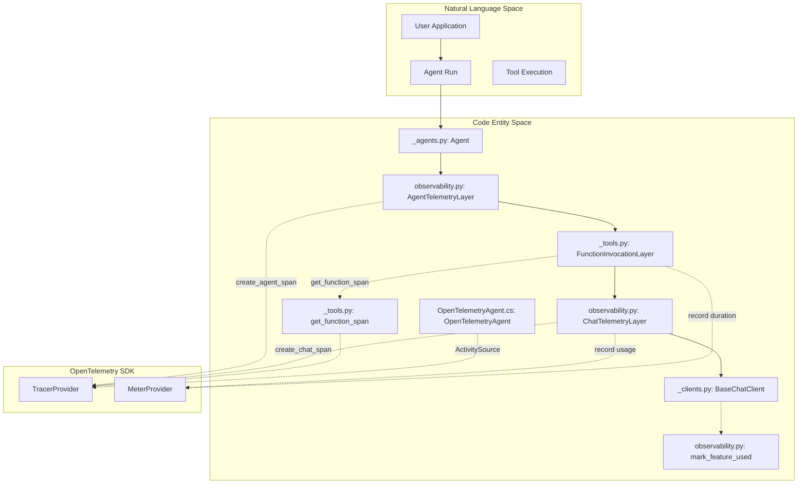
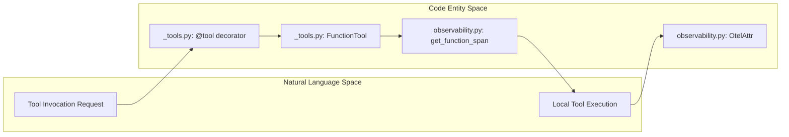

<!-- source: DeepWiki mcp.deepwiki.com · repo microsoft/agent-framework · page 3.6 Observability and Monitoring · fetched 2026-10-26 -->

# Observability and Monitoring

Relevant source files

The following files were used as context for generating this wiki page:

- [docs/decisions/0033-feature-usage-bitmask-user-agent.md](docs/decisions/0033-feature-usage-bitmask-user-agent.md)
- [docs/specs/004-feature-usage-telemetry.md](docs/specs/004-feature-usage-telemetry.md)
- [docs/specs/004-python-function-calling-loop.md](docs/specs/004-python-function-calling-loop.md)
- [docs/specs/feature-usage-bit-registry.md](docs/specs/feature-usage-bit-registry.md)
- [dotnet/src/Microsoft.Agents.AI.Abstractions/AIAgent.cs](dotnet/src/Microsoft.Agents.AI.Abstractions/AIAgent.cs)
- [dotnet/src/Microsoft.Agents.AI.Abstractions/DelegatingAIAgent.cs](dotnet/src/Microsoft.Agents.AI.Abstractions/DelegatingAIAgent.cs)
- [dotnet/src/Microsoft.Agents.AI/ChatClient/DeferredOpenTelemetryChatClient.cs](dotnet/src/Microsoft.Agents.AI/ChatClient/DeferredOpenTelemetryChatClient.cs)
- [dotnet/src/Microsoft.Agents.AI/OpenTelemetryAgent.cs](dotnet/src/Microsoft.Agents.AI/OpenTelemetryAgent.cs)
- [dotnet/src/Microsoft.Agents.AI/OpenTelemetryConsts.cs](dotnet/src/Microsoft.Agents.AI/OpenTelemetryConsts.cs)
- [dotnet/tests/Microsoft.Agents.AI.Abstractions.UnitTests/AIAgentTests.cs](dotnet/tests/Microsoft.Agents.AI.Abstractions.UnitTests/AIAgentTests.cs)
- [dotnet/tests/Microsoft.Agents.AI.Abstractions.UnitTests/DelegatingAIAgentTests.cs](dotnet/tests/Microsoft.Agents.AI.Abstractions.UnitTests/DelegatingAIAgentTests.cs)
- [dotnet/tests/Microsoft.Agents.AI.UnitTests/OpenTelemetryAgentTests.cs](dotnet/tests/Microsoft.Agents.AI.UnitTests/OpenTelemetryAgentTests.cs)
- [python/packages/chatkit/AGENTS.md](python/packages/chatkit/AGENTS.md)
- [python/packages/chatkit/README.md](python/packages/chatkit/README.md)
- [python/packages/chatkit/agent_framework_chatkit/_converter.py](python/packages/chatkit/agent_framework_chatkit/_converter.py)
- [python/packages/chatkit/tests/test_converter.py](python/packages/chatkit/tests/test_converter.py)
- [python/packages/core/agent_framework/_agents.py](python/packages/core/agent_framework/_agents.py)
- [python/packages/core/agent_framework/_clients.py](python/packages/core/agent_framework/_clients.py)
- [python/packages/core/agent_framework/_compaction.py](python/packages/core/agent_framework/_compaction.py)
- [python/packages/core/agent_framework/_harness/_tool_approval.py](python/packages/core/agent_framework/_harness/_tool_approval.py)
- [python/packages/core/agent_framework/_middleware.py](python/packages/core/agent_framework/_middleware.py)
- [python/packages/core/agent_framework/_telemetry.py](python/packages/core/agent_framework/_telemetry.py)
- [python/packages/core/agent_framework/_tools.py](python/packages/core/agent_framework/_tools.py)
- [python/packages/core/agent_framework/_types.py](python/packages/core/agent_framework/_types.py)
- [python/packages/core/agent_framework/observability.py](python/packages/core/agent_framework/observability.py)
- [python/packages/core/tests/core/test_agent_hooks.py](python/packages/core/tests/core/test_agent_hooks.py)
- [python/packages/core/tests/core/test_agents.py](python/packages/core/tests/core/test_agents.py)
- [python/packages/core/tests/core/test_clients.py](python/packages/core/tests/core/test_clients.py)
- [python/packages/core/tests/core/test_compaction.py](python/packages/core/tests/core/test_compaction.py)
- [python/packages/core/tests/core/test_function_invocation_logic.py](python/packages/core/tests/core/test_function_invocation_logic.py)
- [python/packages/core/tests/core/test_harness_tool_approval.py](python/packages/core/tests/core/test_harness_tool_approval.py)
- [python/packages/core/tests/core/test_middleware_with_agent.py](python/packages/core/tests/core/test_middleware_with_agent.py)
- [python/packages/core/tests/core/test_middleware_with_chat.py](python/packages/core/tests/core/test_middleware_with_chat.py)
- [python/packages/core/tests/core/test_observability.py](python/packages/core/tests/core/test_observability.py)
- [python/packages/core/tests/core/test_telemetry.py](python/packages/core/tests/core/test_telemetry.py)
- [python/packages/core/tests/core/test_tools.py](python/packages/core/tests/core/test_tools.py)
- [python/packages/core/tests/core/test_types.py](python/packages/core/tests/core/test_types.py)
- [python/samples/02-agents/context_providers/cross_session_observer.py](python/samples/02-agents/context_providers/cross_session_observer.py)
- [python/samples/02-agents/observability/README.md](python/samples/02-agents/observability/README.md)
- [python/samples/02-agents/observability/microsoft_opentelemetry_distro.py](python/samples/02-agents/observability/microsoft_opentelemetry_distro.py)

This page documents the comprehensive observability system in the Microsoft Agent Framework, which uses OpenTelemetry to provide tracing, metrics, and logging for agent executions, chat operations, tool invocations, and workflow orchestration across both .NET and Python implementations.

Sources: [python/packages/core/agent_framework/observability.py:3-14](), [dotnet/src/Microsoft.Agents.AI/OpenTelemetryAgent.cs:33-54]()

## Overview

The Agent Framework provides production-grade observability through OpenTelemetry instrumentation that captures:

- **Traces**: Distributed tracing across agent runs, chat completions, tool invocations, and workflow executions.
- **Metrics**: Token usage, operation duration, and function invocation performance.
- **Logs**: Structured message events with conversation context and standardized GenAI attributes.
- **Feature Usage**: A specialized bitmask-based telemetry system to track framework feature adoption (e.g., Redis memory, Agent Hooks).

The observability system follows the OpenTelemetry semantic conventions for Generative AI and is designed to be optional, configurable, and extensible.

Sources: [python/packages/core/agent_framework/observability.py:3-14](), [python/packages/core/agent_framework/_agents.py:67-68](), [python/packages/core/agent_framework/_tools.py:51-58]()

## Architecture and Data Flow

The framework utilizes a layered middleware architecture to inject telemetry logic. `AgentTelemetryLayer` wraps the high-level agent execution, while `ChatTelemetryLayer` wraps the underlying chat client operations [python/packages/core/agent_framework/observability.py:93-96](). In .NET, `OpenTelemetryAgent` serves as a delegating wrapper around `AIAgent` [dotnet/src/Microsoft.Agents.AI/OpenTelemetryAgent.cs:33-54]().

Title: Telemetry Data Flow and Code Entity Mapping

Sources: [python/packages/core/agent_framework/observability.py:93-96](), [python/packages/core/agent_framework/_agents.py:67-68](), [python/packages/core/agent_framework/_tools.py:51-58](), [python/packages/core/agent_framework/_clients.py:1-25]()

## Configuration

### Python Configuration
In Python, observability is controlled via settings loaded from environment variables or through the `observability` module functions (`configure_otel_providers`, `enable_instrumentation`, `enable_sensitive_telemetry`) [python/packages/core/agent_framework/observability.py:6-14]().

| Setting | Env Var | Description |
|---------|---------|-------------|
| `ENABLED` | `OBSERVABILITY_ENABLED` | Master switch for all instrumentation. Defaults to `True`. |
| `SENSITIVE_DATA_ENABLED` | `OBSERVABILITY_SENSITIVE_DATA_ENABLED` | Controls if prompts and tool outputs are logged. |

Sources: [python/packages/core/agent_framework/observability.py:6-14](), [python/packages/core/agent_framework/observability.py:101-105]()

### .NET Configuration
In .NET, observability is provided by the `OpenTelemetryAgent` class [dotnet/src/Microsoft.Agents.AI/OpenTelemetryAgent.cs:33-54](). It can automatically wrap the underlying `IChatClient` of a `ChatClientAgent` using `DeferredOpenTelemetryChatClient` to ensure chat-level telemetry flows alongside agent-level telemetry.

- **Sensitive Data**: Controlled via the `EnableSensitiveData` property [dotnet/src/Microsoft.Agents.AI/OpenTelemetryAgent.cs:33-40]().
- **Auto-wiring**: The `autoWireChatClient` constructor parameter determines if the inner chat client is automatically instrumented [dotnet/src/Microsoft.Agents.AI/OpenTelemetryAgent.cs:33-54]().

Sources: [dotnet/src/Microsoft.Agents.AI/OpenTelemetryAgent.cs:33-54]()

## Tracing and Spans

The framework creates hierarchical spans to represent the lifecycle of an AI interaction.

### Standard Attributes (OtelAttr)
The `OtelAttr` enum defines the keys used for GenAI semantic conventions:

- `gen_ai.operation.name`: Set to `chat`, `invoke_agent`, or `execute_tool` [python/packages/core/agent_framework/observability.py:32-38]().
- `gen_ai.provider.name`: The provider name (e.g., `openai`, `anthropic`) [python/packages/core/agent_framework/observability.py:32-38]().
- `gen_ai.request.model`: The model identifier used for the request [python/packages/core/agent_framework/observability.py:32-38]().
- `gen_ai.usage.input_tokens`: Number of tokens in the prompt [python/packages/core/agent_framework/observability.py:32-38]().
- `gen_ai.usage.output_tokens`: Number of tokens in the completion [python/packages/core/agent_framework/observability.py:32-38]().

Sources: [python/packages/core/agent_framework/observability.py:32-38](), [python/packages/core/agent_framework/tests/core/test_observability.py:57-65]()

### Agent and Chat Spans
- **Agent Span**: Created by `AgentTelemetryLayer` (Python) or `OpenTelemetryAgent` (.NET) [python/packages/core/agent_framework/observability.py:93-96](), [dotnet/src/Microsoft.Agents.AI/OpenTelemetryAgent.cs:35-43](). Tracks the high-level `run` call and includes the agent identifier.
- **Chat Span**: Created by `ChatTelemetryLayer` or `DeferredOpenTelemetryChatClient`. Tracks individual LLM calls, capturing token usage, finish reasons, and model metadata.

Sources: [python/packages/core/agent_framework/observability.py:93-96](), [dotnet/src/Microsoft.Agents.AI/OpenTelemetryAgent.cs:35-43]()

### Tool Invocation Spans
Tool executions are wrapped in a span with the operation name `execute_tool`. The framework uses `get_function_span` to encapsulate the logic [python/packages/core/agent_framework/_tools.py:51-58]().

Title: Tool Execution Span Context

Sources: [python/packages/core/agent_framework/_tools.py:51-58](), [python/packages/core/agent_framework/observability.py:51-58]()

## Feature Usage Telemetry

The framework implements a specialized telemetry system to track the usage of specific framework features via a bitmask sent in user-agent headers. Specific features are assigned bits in a registry (`FeatureIndex`), tracking capabilities such as specialized memory providers, storage backends, and agent hooks.

- **Python**: Uses `mark_feature_used(FeatureIndex)` to record bitmask flags within execution contexts [python/packages/core/agent_framework/_agents.py:52-52]().
- **.NET**: Implemented via internal diagnostic helpers to aggregate feature flags into versioned tracking strings.

Sources: [python/packages/core/agent_framework/_agents.py:52-52](), [python/packages/core/agent_framework/_compaction.py:20-20]()

## Metrics

The framework exports performance and usage metrics via OpenTelemetry Meters.

### Token Usage
Token counts are recorded using histograms with predefined bucket boundaries (`TOKEN_USAGE_BUCKET_BOUNDARIES`) ranging from `1` to `67108864` tokens [python/packages/core/agent_framework/observability.py:157-172]().

Sources: [python/packages/core/agent_framework/observability.py:157-172]()

### Operation Duration
Duration metrics are captured for LLM calls and tool executions using `OPERATION_DURATION_BUCKET_BOUNDARIES` ranging from `0.01` to `81.92` seconds [python/packages/core/agent_framework/observability.py:173-188]().

Sources: [python/packages/core/agent_framework/observability.py:173-188]()

## Logging and Message Events

The framework uses a specialized logging filter to handle the high frequency of message events and ensure order.

### Message Timestamp Resolution
Because multiple messages can be generated within nanoseconds, the `MessageListTimestampFilter` increments timestamps by 1 microsecond per message index (`chat_message_index`) to ensure correct ordering in backends like Azure Monitor and Application Insights [python/packages/core/agent_framework/observability.py:208-219]().

Sources: [python/packages/core/agent_framework/observability.py:208-219]()

## Sensitive Data Handling

By default, the framework limits telemetry to metadata (token counts, durations). To include raw message content, prompt text, and tool arguments/results, developers must explicitly enable sensitive telemetry:

- **Python**: Call `enable_sensitive_telemetry()` or set `OBSERVABILITY_SENSITIVE_DATA_ENABLED=true` [python/packages/core/agent_framework/observability.py:8-9]().
- **.NET**: Set `OpenTelemetryAgent.EnableSensitiveData = true` [dotnet/src/Microsoft.Agents.AI/OpenTelemetryAgent.cs:33-40]().

Sources: [python/packages/core/agent_framework/observability.py:8-9](), [dotnet/src/Microsoft.Agents.AI/OpenTelemetryAgent.cs:33-40]()

---

