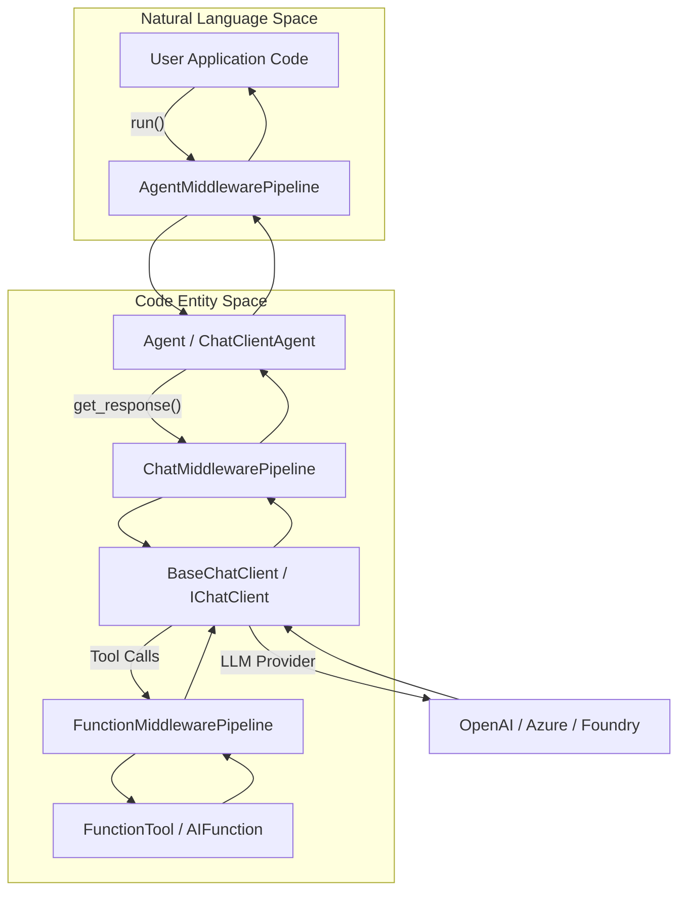
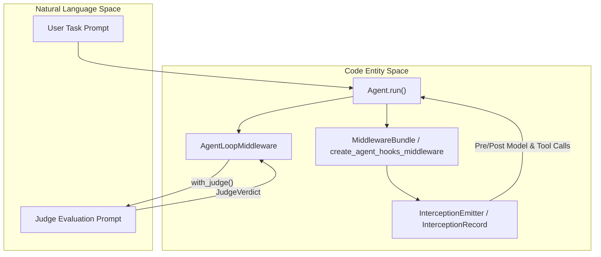

<!-- source: DeepWiki mcp.deepwiki.com · repo microsoft/agent-framework · page 3.7 Middleware System · fetched 2026-10-26 -->

# Middleware System

<details>
<summary>Relevant source files</summary>

The following files were used as context for generating this wiki page:

- [dotnet/src/Microsoft.Agents.AI.Purview/PurviewExtensions.cs](dotnet/src/Microsoft.Agents.AI.Purview/PurviewExtensions.cs)
- [dotnet/src/Microsoft.Agents.AI.Purview/PurviewWrapper.cs](dotnet/src/Microsoft.Agents.AI.Purview/PurviewWrapper.cs)
- [dotnet/src/Microsoft.Agents.AI.Purview/README.md](dotnet/src/Microsoft.Agents.AI.Purview/README.md)
- [dotnet/tests/Microsoft.Agents.AI.Purview.UnitTests/PurviewDurableHistoryTests.cs](dotnet/tests/Microsoft.Agents.AI.Purview.UnitTests/PurviewDurableHistoryTests.cs)
- [dotnet/tests/Microsoft.Agents.AI.Purview.UnitTests/PurviewWrapperTests.cs](dotnet/tests/Microsoft.Agents.AI.Purview.UnitTests/PurviewWrapperTests.cs)
- [python/packages/core/agent_framework/_agent_hooks.py](python/packages/core/agent_framework/_agent_hooks.py)
- [python/packages/core/tests/core/test_as_tool_kwargs_propagation.py](python/packages/core/tests/core/test_as_tool_kwargs_propagation.py)
- [python/packages/core/tests/core/test_middleware.py](python/packages/core/tests/core/test_middleware.py)
- [python/packages/core/tests/core/test_middleware_context_result.py](python/packages/core/tests/core/test_middleware_context_result.py)
- [python/packages/purview/README.md](python/packages/purview/README.md)
- [python/packages/purview/agent_framework_purview/_middleware.py](python/packages/purview/agent_framework_purview/_middleware.py)
- [python/packages/purview/tests/purview/conftest.py](python/packages/purview/tests/purview/conftest.py)
- [python/packages/purview/tests/purview/test_chat_middleware.py](python/packages/purview/tests/purview/test_chat_middleware.py)
- [python/packages/purview/tests/purview/test_middleware.py](python/packages/purview/tests/purview/test_middleware.py)
- [python/samples/02-agents/middleware/README.md](python/samples/02-agents/middleware/README.md)
- [python/samples/02-agents/middleware/override_result_with_middleware.py](python/samples/02-agents/middleware/override_result_with_middleware.py)
- [python/samples/02-agents/middleware/usage_tracking_middleware.py](python/samples/02-agents/middleware/usage_tracking_middleware.py)
- [python/samples/02-agents/response_stream.py](python/samples/02-agents/response_stream.py)

</details>


The middleware system provides a flexible, pipeline-based mechanism for intercepting and processing requests and responses across three distinct layers: agent invocations, chat client operations, and function (tool) executions. This architecture enables cross-cutting concerns such as logging, authentication, rate limiting, error handling, telemetry, data governance, and advanced control loops to be implemented separately from core agent logic.

For details on tools and function calling, see [Tools and Function Calling](#3.3). For observability and tracing integration, see [Observability and Monitoring](#3.6). For data governance integration, see [Data Governance with Purview](#3.8).

## Architecture Overview

The middleware system operates as a chain-of-responsibility pattern where each middleware component can inspect, modify, or short-circuit the execution pipeline. The framework supports three distinct middleware layers aligned with major execution boundaries.

### Execution Layers Diagram



**Middleware Execution Layers**

Sources: [python/packages/core/agent_framework/_middleware.py:143-350](), [dotnet/src/Microsoft.Agents.AI/ChatClient/ChatClientAgent.cs:39-46]()

## Middleware Types and Contexts

The framework defines three primary middleware types, each targeting a specific execution boundary and operating over a dedicated context object.

| Middleware Type | Target Execution Boundary | Context Object | Primary Use Cases |
|----------------|---------------------------|----------------|-------------------|
| `AgentMiddleware` | Agent invocation (`run`/`run_async`) | `AgentContext` | Conversation logging, session management, loop refinement, result transformation, policy governance [python/packages/core/agent_framework/_middleware.py:154-186]() |
| `ChatMiddleware` | Chat client LLM calls | `ChatContext` | Token counting, prompt modification, response filtering, streaming override, usage tracking [python/packages/core/agent_framework/_middleware.py:228-260]() |
| `FunctionMiddleware` | Tool/function execution | `FunctionInvocationContext` | Parameter validation, ATR/security rules, approval workflows, argument interception [python/packages/core/agent_framework/_middleware.py:188-216]() |

Sources: [python/packages/core/agent_framework/_middleware.py:143-260](), [python/packages/core/tests/core/test_middleware.py:10-134]()

### AgentMiddleware
`AgentMiddleware` intercepts agent invocations at the highest level [python/packages/core/agent_framework/_middleware.py:154-165](). An `AgentContext` supplies references to the executing agent, messages, session, stream status, and metadata.

Sources: [python/packages/core/agent_framework/_middleware.py:154-186](), [python/packages/core/tests/core/test_middleware.py:36-90]()

### ChatMiddleware
`ChatMiddleware` operates at the chat client layer, intercepting calls to the LLM provider via `ChatContext`, which tracks options, metadata, and the execution result (including stream responses and buffered stream updates) [python/packages/core/agent_framework/_middleware.py:228-260](), [python/samples/02-agents/middleware/override_result_with_middleware.py:63-91]().

Sources: [python/packages/core/agent_framework/_middleware.py:228-260](), [python/samples/02-agents/middleware/override_result_with_middleware.py:63-92]()

### FunctionMiddleware
`FunctionMiddleware` intercepts individual tool executions via `FunctionInvocationContext`, allowing validation or blocking before function execution [python/packages/core/agent_framework/_middleware.py:188-216]().

Sources: [python/packages/core/agent_framework/_middleware.py:188-216](), [python/packages/core/tests/core/test_middleware.py:91-113]()

## Implementation Patterns and Custom Middleware Creation

Developers can implement custom middleware using class-based inheritance, function definitions, or decorators.

### Class-Based Middleware
Inheriting from `AgentMiddleware`, `ChatMiddleware`, or `FunctionMiddleware` requires implementing the `process` async method, calling `call_next()` to continue the pipeline.

```python
from agent_framework import AgentMiddleware, AgentContext

class LoggingMiddleware(AgentMiddleware):
    async def process(self, context: AgentContext, call_next):
        print(f"Starting agent: {context.agent.name}")
        await call_next()
        print(f"Result received: {context.result}")
```

Sources: [python/packages/core/agent_framework/_middleware.py:330-344](), [python/packages/core/tests/core/test_middleware_with_agent.py:57-65]()

### Function-Based Middleware and Decorators
Lightweight middleware can be written as plain asynchronous functions decorated with `@agent_middleware`, `@chat_middleware`, or `@function_middleware`.

Sources: [python/packages/core/agent_framework/_middleware.py:380-450]()

## Advanced Middleware Layers and Specialized Components

### FunctionInvocationLayer and .NET Decorator System
In .NET, middleware is structured around the `IChatClient` decorator pattern. `ChatClientBuilder` stacks decorators like `FunctionInvokingChatClient` and `PerServiceCallChatHistoryPersistingChatClient` [dotnet/src/Microsoft.Agents.AI/ChatClient/ChatClientExtensions.cs:52-128]().

Sources: [dotnet/src/Microsoft.Agents.AI/ChatClient/ChatClientExtensions.cs:52-128]()

### ChatTelemetryLayer and Feature Usage Tracking
Telemetry layers capture call metrics and integrate with OpenTelemetry. In Python, feature usage tracking sets bits in the process-global feature mask via `mark_feature_used` and embeds versioned feature tokens in the User-Agent header [python/packages/core/agent_framework/_telemetry.py:140-180]().

Sources: [python/packages/core/agent_framework/_telemetry.py:140-180]()

### Agent Hooks (`agent-hooks-sdk`)
The experimental `agent-hooks` integration (`_agent_hooks.py`) maps the control contract onto native middleware seams:
- `agent_startup`, `input`, `output`, `agent_shutdown` on the agent seam.
- `pre_model_call`, `post_model_call` on the chat seam.
- `pre_tool_call`, `post_tool_call` on the function seam.

Sources: [python/packages/core/agent_framework/_agent_hooks.py:1-96]()

### Control Flow and AgentLoopMiddleware
`AgentLoopMiddleware` re-runs an agent in a loop until a criterion is met (such as a `should_continue` predicate, open todos remaining via `TodoProvider`, or a chat-client judge via `AgentLoopMiddleware.with_judge`) [python/packages/core/agent_framework/_harness/_loop.py:3-23]().

Sources: [python/packages/core/agent_framework/_harness/_loop.py:1-26]()

### Data Governance Middleware (Microsoft Purview)
The Purview integration package provides `PurviewPolicyMiddleware` (Python) and `PurviewChatClient` / `PurviewAgent` (.NET) to enforce data loss prevention (DLP) and governance policies on prompts and responses [python/packages/purview/README.md:1-16](), [dotnet/src/Microsoft.Agents.AI.Purview/README.md:1-17](), [python/packages/purview/agent_framework_purview/_middleware.py:70-152](), [dotnet/src/Microsoft.Agents.AI.Purview/PurviewExtensions.cs:51-92]().

Sources: [python/packages/purview/README.md:1-16](), [dotnet/src/Microsoft.Agents.AI.Purview/README.md:1-17](), [python/packages/purview/agent_framework_purview/_middleware.py:70-152](), [dotnet/src/Microsoft.Agents.AI.Purview/PurviewExtensions.cs:51-92]()

### Natural Language to Code Entity Space: Agent Hooks & Control Flow



**Advanced Control and Enforcement Mapping**

Sources: [python/packages/core/agent_framework/_agent_hooks.py:1-96](), [python/packages/core/agent_framework/_harness/_loop.py:1-26]()

## Pipeline Execution and Termination

The middleware pipeline supports two distinct exception types for flow control:
1. **`MiddlewareTermination`**: Gracefully stops the execution pipeline and returns the current response or substituted result [python/packages/core/agent_framework/_middleware.py:75-83]().
2. **`MiddlewareFailure`**: Fails closed, aborting the run entirely and propagating safety or guardrail failures [python/packages/core/agent_framework/_middleware.py:85-110]().

Sources: [python/packages/core/agent_framework/_middleware.py:75-142](), [python/packages/core/tests/core/test_middleware_with_agent.py:156-179]()

## Key Classes and Functions

- `AgentMiddleware`: Base class for agent-level middleware [python/packages/core/agent_framework/_middleware.py:154]()
- `ChatMiddleware`: Base class for chat client middleware [python/packages/core/agent_framework/_middleware.py:228]()
- `FunctionMiddleware`: Base class for tool invocation middleware [python/packages/core/agent_framework/_middleware.py:188]()
- `AgentMiddlewarePipeline`: Manages ordered execution of agent middleware [python/packages/core/agent_framework/_middleware.py:346]()
- `AgentLoopMiddleware`: Re-runs agents iteratively based on predicates or judge evaluations [python/packages/core/agent_framework/_harness/_loop.py:43]()
- `PurviewPolicyMiddleware`: Enforces Microsoft Purview compliance policies on prompts and responses [python/packages/purview/agent_framework_purview/_middleware.py:70]()
- `ChatClientAgent`: .NET primary agent implementation delegating to `IChatClient` pipelines [dotnet/src/Microsoft.Agents.AI/ChatClient/ChatClientAgent.cs:39]()

Sources: [python/packages/core/agent_framework/_middleware.py:154-346](), [python/packages/core/agent_framework/_harness/_loop.py:43-64](), [python/packages/purview/agent_framework_purview/_middleware.py:70-100](), [dotnet/src/Microsoft.Agents.AI/ChatClient/ChatClientAgent.cs:39-46]()

---

