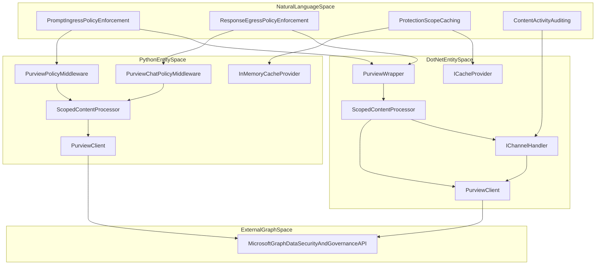
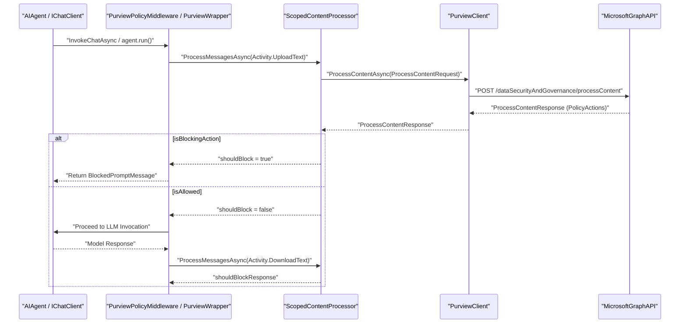

<!-- source: DeepWiki mcp.deepwiki.com · repo microsoft/agent-framework · page 3.8 Data Governance with Purview · fetched 2026-10-26 -->

# Data Governance with Purview

<details>
<summary>Relevant source files</summary>

The following files were used as context for generating this wiki page:

- [dotnet/src/Microsoft.Agents.AI.Purview/BackgroundJobRunner.cs](dotnet/src/Microsoft.Agents.AI.Purview/BackgroundJobRunner.cs)
- [dotnet/src/Microsoft.Agents.AI.Purview/Models/Common/ContentToProcess.cs](dotnet/src/Microsoft.Agents.AI.Purview/Models/Common/ContentToProcess.cs)
- [dotnet/src/Microsoft.Agents.AI.Purview/Models/Common/PaymentRequiredCacheEntry.cs](dotnet/src/Microsoft.Agents.AI.Purview/Models/Common/PaymentRequiredCacheEntry.cs)
- [dotnet/src/Microsoft.Agents.AI.Purview/Models/Common/PaymentRequiredCacheKey.cs](dotnet/src/Microsoft.Agents.AI.Purview/Models/Common/PaymentRequiredCacheKey.cs)
- [dotnet/src/Microsoft.Agents.AI.Purview/Models/Jobs/ScopeRetrievalJob.cs](dotnet/src/Microsoft.Agents.AI.Purview/Models/Jobs/ScopeRetrievalJob.cs)
- [dotnet/src/Microsoft.Agents.AI.Purview/Models/Requests/ProcessContentRequest.cs](dotnet/src/Microsoft.Agents.AI.Purview/Models/Requests/ProcessContentRequest.cs)
- [dotnet/src/Microsoft.Agents.AI.Purview/PurviewClient.cs](dotnet/src/Microsoft.Agents.AI.Purview/PurviewClient.cs)
- [dotnet/src/Microsoft.Agents.AI.Purview/PurviewExtensions.cs](dotnet/src/Microsoft.Agents.AI.Purview/PurviewExtensions.cs)
- [dotnet/src/Microsoft.Agents.AI.Purview/PurviewWrapper.cs](dotnet/src/Microsoft.Agents.AI.Purview/PurviewWrapper.cs)
- [dotnet/src/Microsoft.Agents.AI.Purview/README.md](dotnet/src/Microsoft.Agents.AI.Purview/README.md)
- [dotnet/src/Microsoft.Agents.AI.Purview/ScopedContentProcessor.cs](dotnet/src/Microsoft.Agents.AI.Purview/ScopedContentProcessor.cs)
- [dotnet/src/Microsoft.Agents.AI.Purview/Serialization/PurviewSerializationUtils.cs](dotnet/src/Microsoft.Agents.AI.Purview/Serialization/PurviewSerializationUtils.cs)
- [dotnet/tests/Microsoft.Agents.AI.Purview.UnitTests/PurviewClientTests.cs](dotnet/tests/Microsoft.Agents.AI.Purview.UnitTests/PurviewClientTests.cs)
- [dotnet/tests/Microsoft.Agents.AI.Purview.UnitTests/PurviewDurableHistoryTests.cs](dotnet/tests/Microsoft.Agents.AI.Purview.UnitTests/PurviewDurableHistoryTests.cs)
- [dotnet/tests/Microsoft.Agents.AI.Purview.UnitTests/PurviewWrapperTests.cs](dotnet/tests/Microsoft.Agents.AI.Purview.UnitTests/PurviewWrapperTests.cs)
- [dotnet/tests/Microsoft.Agents.AI.Purview.UnitTests/ScopedContentProcessorTests.cs](dotnet/tests/Microsoft.Agents.AI.Purview.UnitTests/ScopedContentProcessorTests.cs)
- [python/packages/core/agent_framework/_agent_hooks.py](python/packages/core/agent_framework/_agent_hooks.py)
- [python/packages/purview/README.md](python/packages/purview/README.md)
- [python/packages/purview/agent_framework_purview/_middleware.py](python/packages/purview/agent_framework_purview/_middleware.py)
- [python/packages/purview/agent_framework_purview/_models.py](python/packages/purview/agent_framework_purview/_models.py)
- [python/packages/purview/agent_framework_purview/_processor.py](python/packages/purview/agent_framework_purview/_processor.py)
- [python/packages/purview/tests/purview/conftest.py](python/packages/purview/tests/purview/conftest.py)
- [python/packages/purview/tests/purview/test_chat_middleware.py](python/packages/purview/tests/purview/test_chat_middleware.py)
- [python/packages/purview/tests/purview/test_middleware.py](python/packages/purview/tests/purview/test_middleware.py)
- [python/packages/purview/tests/purview/test_processor.py](python/packages/purview/tests/purview/test_processor.py)
- [python/packages/purview/tests/purview/test_purview_models.py](python/packages/purview/tests/purview/test_purview_models.py)

</details>


This page documents the Microsoft Purview integration for the Agent Framework (`agent-framework-purview` in Python and `Microsoft.Agents.AI.Purview` in .NET), which provides data security and governance policy enforcement through middleware that evaluates both user prompts and model responses against organizational policies via Microsoft Graph `dataSecurityAndGovernance` APIs.

For information about other middleware patterns in the framework, see [Middleware System](#3.7). For observability and monitoring of agent interactions, see [Observability and Monitoring](#3.6).

---

## Overview

The Purview integration enables organizations to enforce data loss prevention (DLP) and data governance policies on AI agent interactions. The middleware intercepts content at two critical evaluation points:

| **Evaluation Point** | **Content Evaluated** | **Action on Block** |
|---------------------|---------------------|-------------------|
| **Ingress (Prompt)** | User input + conversation history | Returns blocked message, prevents LLM invocation |
| **Egress (Response)** | Model-generated output | Returns blocked message, suppresses model response |

The integration works with both `IChatClient` (.NET) / `ChatClientProtocol` (Python) and `AIAgent` / `BaseAgent` abstractions through a standardized middleware pipeline.

**Key Capabilities:**
- Middleware-based policy enforcement at agent or chat client level. [python/packages/purview/README.md:9-11](), [dotnet/src/Microsoft.Agents.AI.Purview/README.md:10-12]()
- Blocks or allows content at both ingress (prompt) and egress (response). [python/packages/purview/README.md:10-11](), [dotnet/src/Microsoft.Agents.AI.Purview/README.md:10-11]()
- Authentication via Azure `TokenCredential` / `AsyncTokenCredential` with Microsoft Graph API integration (`dataSecurityAndGovernance`). [python/packages/purview/README.md:12-12](), [dotnet/src/Microsoft.Agents.AI.Purview/README.md:13-13]()
- Configurable response caching with customizable TTL and size limits for protection scopes. [python/packages/purview/README.md:14-14](), [dotnet/src/Microsoft.Agents.AI.Purview/README.md:15-15]()
- Asynchronous background processing for non-blocking policy evaluation and content activities. [python/packages/purview/README.md:15-15](), [dotnet/src/Microsoft.Agents.AI.Purview/ScopedContentProcessor.cs:20-25]()
- Customizable blocked content messages via `PurviewSettings`. [python/packages/purview/README.md:96-97](), [dotnet/src/Microsoft.Agents.AI.Purview/README.md:133-134]()

Sources: [python/packages/purview/README.md:9-15](), [dotnet/src/Microsoft.Agents.AI.Purview/README.md:10-16](), [dotnet/src/Microsoft.Agents.AI.Purview/ScopedContentProcessor.cs:20-25]()

---

## Architecture Components

### Middleware and Processor Integration

The Purview integration maps natural language governance requirements onto specific code entities across Python and .NET implementations.

#### Diagram 1: Natural Language to Code Entity Mapping for Governance Architecture
This diagram bridges the natural language concepts of policy enforcement, content processing, and client communication to the concrete code entities (`PurviewPolicyMiddleware`, `ScopedContentProcessor`, `PurviewClient`, `IPurviewClient`, `IChannelHandler`, and `BackgroundJobRunner`) defined in the codebase.


Sources: [python/packages/purview/README.md:9-15](), [python/packages/purview/agent_framework_purview/_processor.py:17-45](), [dotnet/src/Microsoft.Agents.AI.Purview/ScopedContentProcessor.cs:20-42](), [dotnet/tests/Microsoft.Agents.AI.Purview.UnitTests/PurviewClientTests.cs:24-39]()

---

## Configuration System

### PurviewSettings

The configuration object controls middleware behavior, including error handling, custom messaging, and caching parameters.

| **Property** | **Type (Python / .NET)** | **Purpose** |
|-------------|--------------------------|-------------|
| `app_name` / `AppName` | `str` | Publicly visible application name |
| `app_version` / `AppVersion` | `str \| None` | Optional version string for the application |
| `tenant_id` / `TenantId` | `str \| None` | Azure AD tenant identifier (GUID) |
| `purview_app_location` / `PurviewAppLocation` | `PurviewAppLocation \| None` | Policy evaluation location context (App/URL/Domain) |
| `ignore_exceptions` / `IgnoreExceptions` | `bool` | Whether to log and suppress exceptions in middleware |
| `blocked_prompt_message` / `BlockedPromptMessage` | `str` | Message returned when prompt is blocked |
| `blocked_response_message` / `BlockedResponseMessage` | `str` | Message returned when response is blocked |
| `cache_ttl_seconds` / `CacheTTL` | `int` / `TimeSpan` | TTL for protection scope cache |
| `max_cache_size_bytes` | `int` (Python) | Max cache size in bytes (default 200MB) |

Sources: [python/packages/purview/README.md:90-102](), [dotnet/src/Microsoft.Agents.AI.Purview/README.md:123-134]()

### Session and User Resolution

The middleware must resolve a session ID and user identity to perform accurate policy lookups. Purview policies are user-centric, requiring a valid Entra Object ID.

**Resolution Logic in Python (`ScopedContentProcessor`):**
1. Extracts `tenant_id` and `user_id` from the authentication token via `get_user_info_from_token` [python/packages/purview/tests/purview/test_processor.py:51-58]().
2. Fallback: Searches message properties or author metadata if it represents a valid GUID `_is_valid_guid` [python/packages/purview/agent_framework_purview/_processor.py:50-58]().

**Resolution Logic in .NET (`ScopedContentProcessor`):**
1. Searches `ChatMessage.AdditionalProperties` for user identifiers [dotnet/src/Microsoft.Agents.AI.Purview/ScopedContentProcessor.cs:151-152]().
2. Fallback: Attempts to parse `ChatMessage.AuthorName` as a GUID.

Sources: [python/packages/purview/agent_framework_purview/_processor.py:50-58](), [dotnet/src/Microsoft.Agents.AI.Purview/ScopedContentProcessor.cs:151-152](), [python/packages/purview/tests/purview/test_processor.py:51-58]()

---

## Policy Evaluation Lifecycle

### Data Flow Diagram
#### Diagram 2: Natural Language to Code Entity Sequence for Policy Evaluation
This diagram bridges natural language prompt/response flows to concrete methods like `ProcessMessagesAsync` (.NET) / `process_messages` (Python) and `ProcessContentAsync` (.NET) / `process_content` (Python).


Sources: [python/packages/purview/agent_framework_purview/_processor.py:100-141](), [dotnet/src/Microsoft.Agents.AI.Purview/ScopedContentProcessor.cs:45-70](), [dotnet/tests/Microsoft.Agents.AI.Purview.UnitTests/PurviewClientTests.cs:43-75]()

---

## Implementation Details

### Content Processing (`ScopedContentProcessor`)

The `ScopedContentProcessor` orchestrates the translation of Framework messages into Purview-compatible data structures (`ContentToProcess`, `ProcessContentRequest`, `PurviewTextContent`, `PurviewBinaryContent`) [python/packages/purview/agent_framework_purview/_processor.py:20-45](), [dotnet/src/Microsoft.Agents.AI.Purview/Models/Common/ContentToProcess.cs:12-34]().

1. **Mapping:** `_map_content` / `MapMessageToPCRequestsAsync` inspects content types (`text`, `data`, `function_call`, `function_result`). Data URIs are decoded via `_decode_data_uri` [python/packages/purview/agent_framework_purview/_processor.py:87-98](); other types are serialized via `_serialize_for_evaluation` [python/packages/purview/agent_framework_purview/_processor.py:75-85]() to prevent policy bypasses.
2. **Policy Enforcement:** Evaluates `PolicyActions`. An action is blocking if `action == DlpAction.BLOCK_ACCESS` or `restriction_action == RestrictionAction.BLOCK` [python/packages/purview/agent_framework_purview/_processor.py:143-150](), [dotnet/src/Microsoft.Agents.AI.Purview/ScopedContentProcessor.cs:84-86]().
3. **Activity Translation:** Translates activities using `Activity.UPLOAD_TEXT` for prompts and `Activity.DOWNLOAD_TEXT` for responses [python/packages/purview/agent_framework_purview/_models.py:21-29](), [dotnet/tests/Microsoft.Agents.AI.Purview.UnitTests/ScopedContentProcessorTests.cs:61-66]().

Sources: [python/packages/purview/agent_framework_purview/_processor.py:20-150](), [dotnet/src/Microsoft.Agents.AI.Purview/ScopedContentProcessor.cs:45-86](), [python/packages/purview/agent_framework_purview/_models.py:21-29]()

### Caching Strategy

To minimize the latency of policy evaluation, the framework implements a caching layer for "Protection Scopes" (the set of active policies applicable to a specific user/tenant).

- **Python:** Uses `CacheProvider` / `InMemoryCacheProvider` with configurable `cache_ttl_seconds` (default 4 hours) and `max_cache_size_bytes` [python/packages/purview/README.md:100-113]().
- **.NET:** Uses `ICacheProvider` within `ScopedContentProcessor` supporting distributed cache integration [dotnet/src/Microsoft.Agents.AI.Purview/README.md:15-15]().

Sources: [python/packages/purview/README.md:100-113](), [dotnet/src/Microsoft.Agents.AI.Purview/README.md:15-15](), [dotnet/src/Microsoft.Agents.AI.Purview/ScopedContentProcessor.cs:20-25]()

---

## Usage and Integration

### .NET Quick Start & Extension Methods

In .NET, the `WithPurview` extension methods apply the middleware to an `IChatClient` or `AIAgent` builder [dotnet/src/Microsoft.Agents.AI.Purview/README.md:50-58]().

```csharp
IChatClient client = new OpenAIClient(credential, new OpenAIClientOptions { Endpoint = endpoint })
    .GetResponsesClient()
    .AsIChatClient(deploymentName)
    .AsBuilder()
    .WithPurview(browserCredential, new PurviewSettings("My Sample App"))
    .Build();
```
Sources: [dotnet/src/Microsoft.Agents.AI.Purview/README.md:45-58]()

### Python Quick Start

In Python, instantiate `PurviewPolicyMiddleware` and pass it to the `Agent` [python/packages/purview/README.md:64-73]():

```python
purview_middleware = PurviewPolicyMiddleware(
    credential=InteractiveBrowserCredential(),
    settings=PurviewSettings(app_name="My Sample App")
)

agent = Agent(
    client=client,
    instructions="You are a helpful assistant.",
    middleware=[purview_middleware]
)
```
Sources: [python/packages/purview/README.md:60-73]()

### Error Handling and Resilience

- **Payment Required:** `PurviewPaymentRequiredError` (Python) or `PurviewPaymentRequiredException` (.NET) is raised when HTTP 402 is returned due to tenant licensing requirements [dotnet/tests/Microsoft.Agents.AI.Purview.UnitTests/PurviewClientTests.cs:173-176]().
- **Rate Limiting:** `PurviewRateLimitException` handles HTTP 429 rate limits [dotnet/tests/Microsoft.Agents.AI.Purview.UnitTests/PurviewClientTests.cs:137-146]().
- **Exception Suppression:** When `ignore_exceptions` is enabled, non-payment errors are logged and suppressed to fail open [python/packages/purview/README.md:98-99](), [dotnet/src/Microsoft.Agents.AI.Purview/README.md:131-131]().

Sources: [python/packages/purview/README.md:98-99](), [dotnet/src/Microsoft.Agents.AI.Purview/README.md:131-131](), [dotnet/tests/Microsoft.Agents.AI.Purview.UnitTests/PurviewClientTests.cs:137-176]()

---

