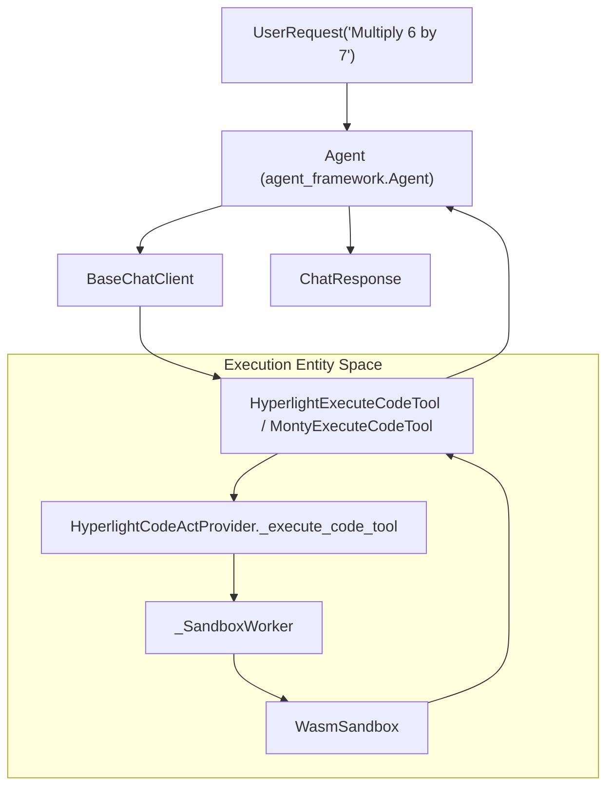
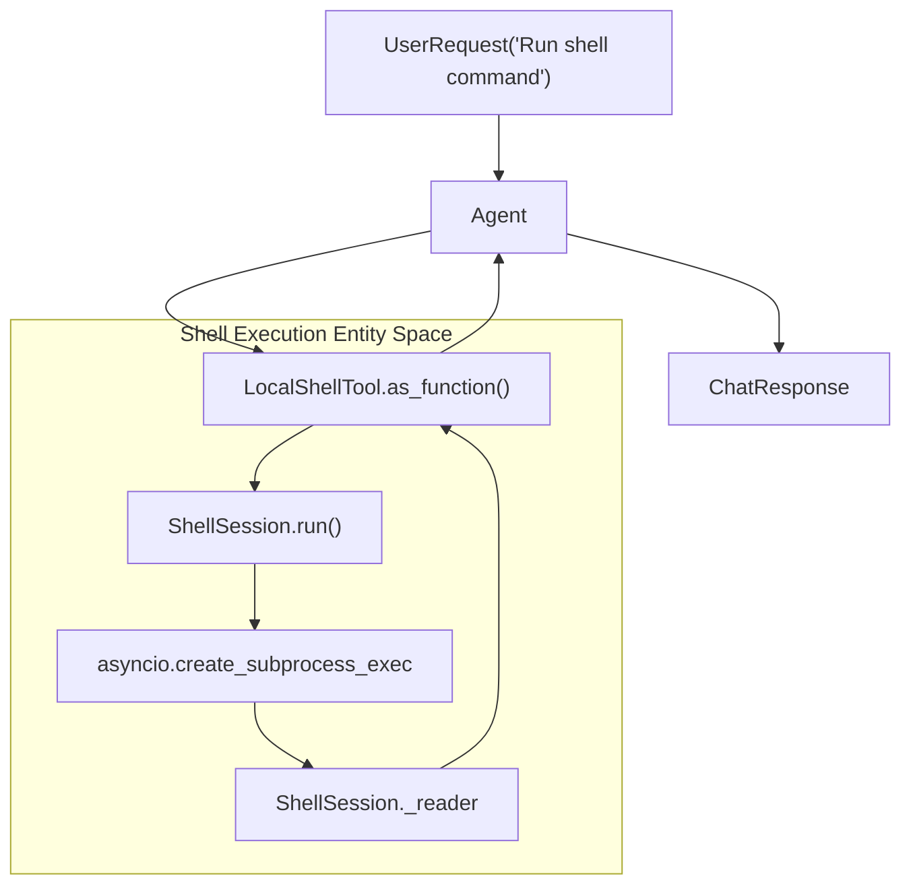

<!-- source: DeepWiki mcp.deepwiki.com · repo microsoft/agent-framework · page 3.9 CodeAct and Code Execution · fetched 2026-10-26 -->

# CodeAct and Code Execution

Relevant source files

The following files were used as context for generating this wiki page:

- [dotnet/src/Microsoft.Agents.AI.LocalCodeAct/Internal/ProcessBridge.cs](dotnet/src/Microsoft.Agents.AI.LocalCodeAct/Internal/ProcessBridge.cs)
- [dotnet/src/Microsoft.Agents.AI.LocalCodeAct/LocalCodeActApprovalMode.cs](dotnet/src/Microsoft.Agents.AI.LocalCodeAct/LocalCodeActApprovalMode.cs)
- [dotnet/src/Microsoft.Agents.AI.LocalCodeAct/LocalCodeActProvider.cs](dotnet/src/Microsoft.Agents.AI.LocalCodeAct/LocalCodeActProvider.cs)
- [dotnet/src/Microsoft.Agents.AI.LocalCodeAct/LocalCodeActProviderOptions.cs](dotnet/src/Microsoft.Agents.AI.LocalCodeAct/LocalCodeActProviderOptions.cs)
- [dotnet/src/Microsoft.Agents.AI.LocalCodeAct/LocalExecuteCodeFunction.cs](dotnet/src/Microsoft.Agents.AI.LocalCodeAct/LocalExecuteCodeFunction.cs)
- [dotnet/src/Microsoft.Agents.AI.LocalCodeAct/README.md](dotnet/src/Microsoft.Agents.AI.LocalCodeAct/README.md)
- [dotnet/src/Microsoft.Agents.AI.LocalCodeAct/Resources/validator.py](dotnet/src/Microsoft.Agents.AI.LocalCodeAct/Resources/validator.py)
- [dotnet/tests/Microsoft.Agents.AI.LocalCodeAct.UnitTests/ApprovalPropagationTests.cs](dotnet/tests/Microsoft.Agents.AI.LocalCodeAct.UnitTests/ApprovalPropagationTests.cs)
- [dotnet/tests/Microsoft.Agents.AI.LocalCodeAct.UnitTests/LocalExecuteCodeFunctionIntegrationTests.cs](dotnet/tests/Microsoft.Agents.AI.LocalCodeAct.UnitTests/LocalExecuteCodeFunctionIntegrationTests.cs)
- [python/packages/hyperlight/README.md](python/packages/hyperlight/README.md)
- [python/packages/hyperlight/agent_framework_hyperlight/_execute_code_tool.py](python/packages/hyperlight/agent_framework_hyperlight/_execute_code_tool.py)
- [python/packages/hyperlight/agent_framework_hyperlight/_instructions.py](python/packages/hyperlight/agent_framework_hyperlight/_instructions.py)
- [python/packages/hyperlight/agent_framework_hyperlight/_provider.py](python/packages/hyperlight/agent_framework_hyperlight/_provider.py)
- [python/packages/hyperlight/tests/hyperlight/test_hyperlight_codeact.py](python/packages/hyperlight/tests/hyperlight/test_hyperlight_codeact.py)
- [python/packages/monty/AGENTS.md](python/packages/monty/AGENTS.md)
- [python/packages/monty/LICENSE](python/packages/monty/LICENSE)
- [python/packages/monty/README.md](python/packages/monty/README.md)
- [python/packages/monty/agent_framework_monty/__init__.py](python/packages/monty/agent_framework_monty/__init__.py)
- [python/packages/monty/agent_framework_monty/_execute_code_tool.py](python/packages/monty/agent_framework_monty/_execute_code_tool.py)
- [python/packages/monty/agent_framework_monty/_instructions.py](python/packages/monty/agent_framework_monty/_instructions.py)
- [python/packages/monty/agent_framework_monty/_monty_bridge.py](python/packages/monty/agent_framework_monty/_monty_bridge.py)
- [python/packages/monty/agent_framework_monty/_provider.py](python/packages/monty/agent_framework_monty/_provider.py)
- [python/packages/monty/agent_framework_monty/_types.py](python/packages/monty/agent_framework_monty/_types.py)
- [python/packages/monty/tests/monty/test_monty_codeact.py](python/packages/monty/tests/monty/test_monty_codeact.py)
- [python/packages/monty/tests/monty/test_monty_codeact_integration.py](python/packages/monty/tests/monty/test_monty_codeact_integration.py)
- [python/packages/tools/LICENSE](python/packages/tools/LICENSE)
- [python/packages/tools/README.md](python/packages/tools/README.md)
- [python/packages/tools/agent_framework_tools/__init__.py](python/packages/tools/agent_framework_tools/__init__.py)
- [python/packages/tools/agent_framework_tools/py.typed](python/packages/tools/agent_framework_tools/py.typed)
- [python/packages/tools/agent_framework_tools/shell/__init__.py](python/packages/tools/agent_framework_tools/shell/__init__.py)
- [python/packages/tools/agent_framework_tools/shell/_docker.py](python/packages/tools/agent_framework_tools/shell/_docker.py)
- [python/packages/tools/agent_framework_tools/shell/_environment.py](python/packages/tools/agent_framework_tools/shell/_environment.py)
- [python/packages/tools/agent_framework_tools/shell/_executor.py](python/packages/tools/agent_framework_tools/shell/_executor.py)
- [python/packages/tools/agent_framework_tools/shell/_executor_base.py](python/packages/tools/agent_framework_tools/shell/_executor_base.py)
- [python/packages/tools/agent_framework_tools/shell/_killtree.py](python/packages/tools/agent_framework_tools/shell/_killtree.py)
- [python/packages/tools/agent_framework_tools/shell/_session.py](python/packages/tools/agent_framework_tools/shell/_session.py)
- [python/packages/tools/agent_framework_tools/shell/_tool.py](python/packages/tools/agent_framework_tools/shell/_tool.py)
- [python/packages/tools/agent_framework_tools/shell/_types.py](python/packages/tools/agent_framework_tools/shell/_types.py)
- [python/packages/tools/tests/test_docker_shell_tool.py](python/packages/tools/tests/test_docker_shell_tool.py)
- [python/packages/tools/tests/test_local_shell_tool.py](python/packages/tools/tests/test_local_shell_tool.py)
- [python/packages/tools/tests/test_shell_resolve.py](python/packages/tools/tests/test_shell_resolve.py)
- [python/samples/02-agents/tools/README.md](python/samples/02-agents/tools/README.md)
- [python/samples/02-agents/tools/local_shell_with_allowlist.py](python/samples/02-agents/tools/local_shell_with_allowlist.py)

The CodeAct pattern enables Large Language Models (LLMs) to interact with their environment by generating and executing code (typically Python) or shell commands rather than relying solely on traditional direct tool calls. This framework provides multiple execution backends—Hyperlight, Monty, LocalCodeAct, and local/containerized shell tools—allowing agents to perform complex data analysis, file manipulation, and system interactions securely or locally.

---

## 1. Overview of CodeAct Implementation

The framework implements CodeAct through specialized tools and context providers that bridge natural language reasoning with concrete execution runtimes. In Python, this is surfaced via `HyperlightExecuteCodeTool` and `HyperlightCodeActProvider` [python/packages/hyperlight/agent_framework_hyperlight/_execute_code_tool.py:31-37](), as well as Monty equivalents [python/packages/monty/README.md:21-28](). In .NET, it is provided through `LocalCodeActProvider` and `LocalExecuteCodeFunction` [dotnet/src/Microsoft.Agents.AI.LocalCodeAct/README.md:10-14](). Additionally, cross-OS shell tools (`LocalShellTool`, `DockerShellTool`) provide persistent or stateless shell execution [python/packages/tools/agent_framework_tools/shell/_tool.py:71-146](), [python/packages/tools/agent_framework_tools/shell/_docker.py:3-40]().

**Diagram: Natural Language to Code Entity Execution Bridge**

Sources: [python/packages/hyperlight/agent_framework_hyperlight/_execute_code_tool.py:31-131](), [python/packages/hyperlight/README.md:21-49]()

---

## 2. Execution Backends

The framework supports multiple isolation tiers and runtimes to balance security, performance, and host environment compatibility.

### 2.1. Hyperlight (VM-Isolated Sandbox)
Hyperlight provides hardware-isolated sandboxes using micro-VMs or WebAssembly (Wasm) [python/packages/hyperlight/README.md:11-15](). It is designed for executing untrusted model-generated code securely.

*   **Implementation**: Managed via `_SandboxWorker`, a thread-confined actor that owns a sandbox and a snapshot [python/packages/hyperlight/agent_framework_hyperlight/_execute_code_tool.py:139-164](). The underlying `WasmSandbox` is PyO3-unsendable, meaning it must be accessed and dropped exclusively on the OS thread that created it [python/packages/hyperlight/agent_framework_hyperlight/_execute_code_tool.py:139-147]().
*   **Safety**: `_SandboxWorker._run_on_worker` isolates and sanitizes exception tracebacks [python/packages/hyperlight/agent_framework_hyperlight/_execute_code_tool.py:176-179](). This drops tracebacks containing unsendable PyO3 references on the worker thread, preventing cross-thread garbage collection panics [python/packages/hyperlight/agent_framework_hyperlight/_execute_code_tool.py:155-164]().
*   **Isolation**: Supports `FileMount` path mappings and `AllowedDomain` network rules [python/packages/hyperlight/agent_framework_hyperlight/_execute_code_tool.py:97-98]().
*   **Platform Support**: Requires Linux or Windows runners with a functional Hyperlight hypervisor and packages such as `hyperlight-sandbox-backend-wasm` [python/packages/hyperlight/tests/hyperlight/test_hyperlight_codeact.py:52-66]().

Sources: [python/packages/hyperlight/agent_framework_hyperlight/_execute_code_tool.py:132-179](), [python/packages/hyperlight/tests/hyperlight/test_hyperlight_codeact.py:52-91]()

### 2.2. Monty (Rust-Based Python Interpreter)
Monty uses `pydantic-monty`, a Rust-implemented Python interpreter, providing a lightweight cross-platform sandboxed environment without full hypervisor overhead [python/packages/monty/README.md:15-18]().

*   **Context Provider**: `MontyCodeActProvider` injects the `execute_code` tool and CodeAct system instructions into agent sessions [python/packages/monty/README.md:21-28]().
*   **Type Stubs and DSL Primitives**: Registered host tools are exposed inside the Monty interpreter as typed async functions, supporting DSL primitives like `await call_tool(...)`, `await tool_name(...)`, and `asyncio.gather(...)` [python/packages/monty/README.md:21-28]().
*   **Resource Limits**: Forwards limits directly via the `ResourceLimits` typed dictionary (e.g. `max_duration_secs`, `max_memory`) [python/packages/monty/README.md:166-170]().

Sources: [python/packages/monty/README.md:15-184]()

### 2.3. LocalCodeAct (.NET Subprocess & AST Validation)
For hosted environments that already provide container, VM, or process-level isolation, `Microsoft.Agents.AI.LocalCodeAct` executes generated Python code locally via a child process [dotnet/src/Microsoft.Agents.AI.LocalCodeAct/README.md:6-14]().

*   **AST Validation**: Pre-screens generated code against strict import and builtin allow/block lists in a short-lived subprocess using `validator.py` [dotnet/src/Microsoft.Agents.AI.LocalCodeAct/README.md:42-43](), [dotnet/src/Microsoft.Agents.AI.LocalCodeAct/Resources/validator.py:14-256]().
*   **Defense-in-Depth**: Blocks dangerous capabilities (`eval`, `exec`, `subprocess`, attribute access for `os.system`, `__class__`, frame payload attributes like `f_globals`, and string format traversal methods) [dotnet/src/Microsoft.Agents.AI.LocalCodeAct/README.md:55-58](), [dotnet/src/Microsoft.Agents.AI.LocalCodeAct/Resources/validator.py:117-170]().
*   **Tool Gating**: Registered host tools are reached through `await call_tool("<name>", ...)` inside the executed script [dotnet/src/Microsoft.Agents.AI.LocalCodeAct/README.md:50-51]().

Sources: [dotnet/src/Microsoft.Agents.AI.LocalCodeAct/README.md:6-161](), [dotnet/src/Microsoft.Agents.AI.LocalCodeAct/Resources/validator.py:1-256]()

---

## 3. Shell Tools and Persistent Sessions

Beyond Python-based code execution, the framework offers `LocalShellTool` and `DockerShellTool` for raw shell command execution [python/packages/tools/agent_framework_tools/shell/_tool.py:71-146](), [python/packages/tools/agent_framework_tools/shell/_docker.py:3-40]().

*   **Modes**: Operates in `persistent` mode (retaining working directory and environment variables across calls via a long-lived shell process) or `stateless` mode (spawning a fresh subprocess per invocation) [python/packages/tools/agent_framework_tools/shell/_tool.py:101-104]().
*   **ShellSession Sentinel Protocol**: `ShellSession` executes commands sequentially by writing them to stdin followed by a unique sentinel probe. Persistent reader background tasks consume stdout and stderr, separating output streams reliably without requiring a PTY [python/packages/tools/agent_framework_tools/shell/_session.py:3-38]().

**Diagram: Shell Tool Natural Language to Execution Bridge**

Sources: [python/packages/tools/agent_framework_tools/shell/_tool.py:71-87](), [python/packages/tools/agent_framework_tools/shell/_session.py:63-142]()

---

## 4. Technical Implementation Details & Data Flow

The configuration for execution tools is encapsulated in structures such as `_RunConfig` (Python Hyperlight/Monty) and `LocalCodeActProviderOptions` (.NET) [python/packages/hyperlight/agent_framework_hyperlight/_execute_code_tool.py:89-102](), [dotnet/src/Microsoft.Agents.AI.LocalCodeAct/LocalCodeActProviderOptions.cs]().

### Run Configuration Parameters

| Property / Option | Type | Description |
| :--- | :--- | :--- |
| `code` | `string` | The Python code snippet generated by the LLM. |
| `backend` / `module` | `string` | Hyperlight backend configuration (defaulting to `wasm` and `python_guest.path`) [python/packages/hyperlight/agent_framework_hyperlight/_execute_code_tool.py:35-36](). |
| `workspace_root` | `Path` / `string` | Base directory mounted for file operations [python/packages/hyperlight/agent_framework_hyperlight/_execute_code_tool.py:95](). |
| `file_mounts` | Sequence | Host-to-sandbox path mappings with read/write modes [python/packages/hyperlight/agent_framework_hyperlight/_execute_code_tool.py:97](). |
| `allowed_domains` | Sequence | Allowed outbound network domains [python/packages/hyperlight/agent_framework_hyperlight/_execute_code_tool.py:98](). |

Sources: [python/packages/hyperlight/agent_framework_hyperlight/_execute_code_tool.py:89-125]()

---

## 5. Tool Approval, Security, and Validation

Code execution tools handle powerful capabilities and require strict governance:

*   **Approval Gating**: In `LocalCodeAct`, if any registered tool is an `ApprovalRequiredAIFunction`, or if `LocalCodeActApprovalMode.AlwaysRequire` is configured, `execute_code` requires explicit user approval before execution begins [dotnet/src/Microsoft.Agents.AI.LocalCodeAct/README.md:99-106]().
*   **Shell Policies**: `LocalShellTool` supports `ShellPolicy` with allowlists and denylists, though security relies fundamentally on user approval and proper host container/VM isolation [python/packages/tools/agent_framework_tools/shell/_tool.py:125-143]().
*   **Security Disclaimer**: Local process execution packages are explicitly **not** security sandboxes; untrusted code requires external containerization, micro-VMs, or hardened virtual machines [dotnet/src/Microsoft.Agents.AI.LocalCodeAct/README.md:5-9]().

Sources: [dotnet/src/Microsoft.Agents.AI.LocalCodeAct/README.md:5-116](), [python/packages/tools/agent_framework_tools/shell/_tool.py:125-143]()

---

