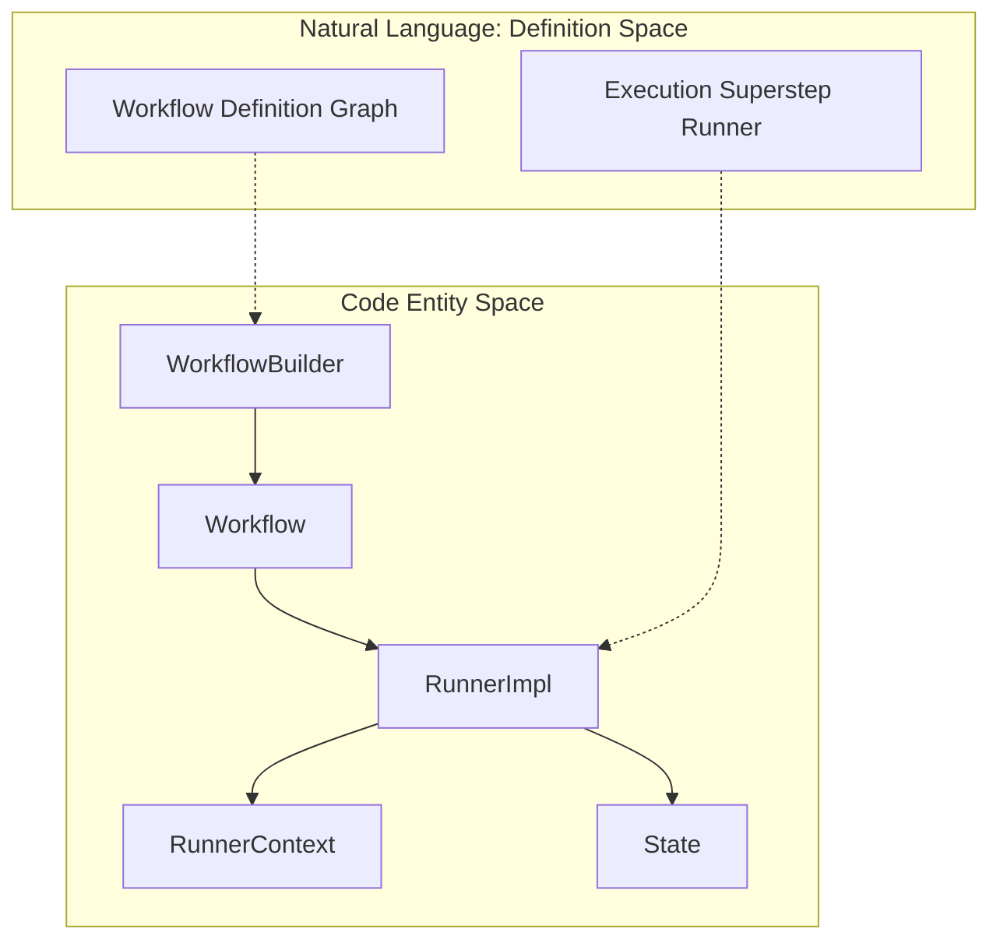
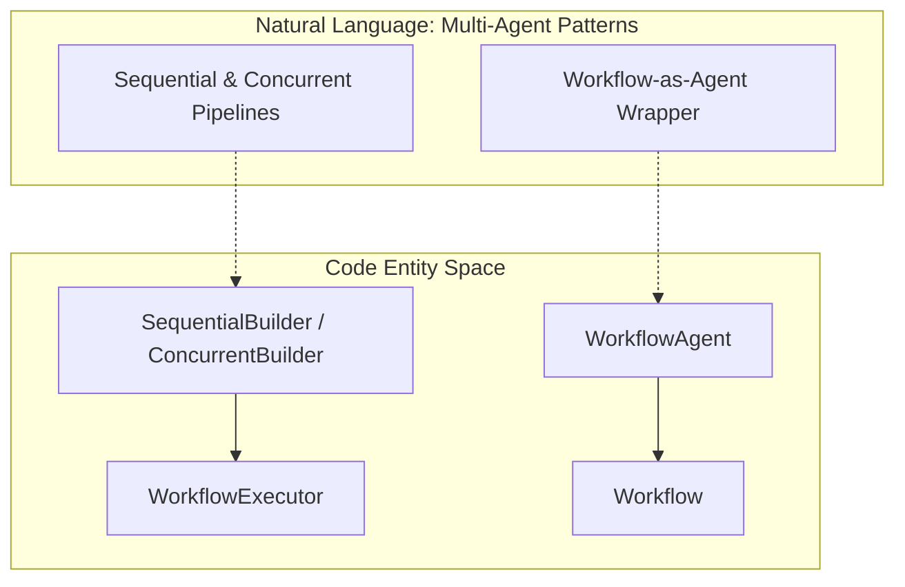

<!-- source: DeepWiki mcp.deepwiki.com · repo microsoft/agent-framework · page 4 Workflows and Orchestration · fetched 2026-10-26 -->

# Workflows and Orchestration

Relevant source files

The following files were used as context for generating this wiki page:

- [dotnet/src/Microsoft.Agents.AI.Workflows/AIAgentBinding.cs](dotnet/src/Microsoft.Agents.AI.Workflows/AIAgentBinding.cs)
- [dotnet/src/Microsoft.Agents.AI.Workflows/AIAgentHostOptions.cs](dotnet/src/Microsoft.Agents.AI.Workflows/AIAgentHostOptions.cs)
- [dotnet/src/Microsoft.Agents.AI.Workflows/Specialized/AIAgentHostExecutor.cs](dotnet/src/Microsoft.Agents.AI.Workflows/Specialized/AIAgentHostExecutor.cs)
- [dotnet/src/Microsoft.Agents.AI.Workflows/Specialized/ConcurrentEndExecutor.cs](dotnet/src/Microsoft.Agents.AI.Workflows/Specialized/ConcurrentEndExecutor.cs)
- [dotnet/src/Microsoft.Agents.AI.Workflows/Specialized/OutputMessagesExecutor.cs](dotnet/src/Microsoft.Agents.AI.Workflows/Specialized/OutputMessagesExecutor.cs)
- [dotnet/src/Microsoft.Agents.AI.Workflows/Workflow.cs](dotnet/src/Microsoft.Agents.AI.Workflows/Workflow.cs)
- [dotnet/src/Microsoft.Agents.AI.Workflows/WorkflowHostAgent.cs](dotnet/src/Microsoft.Agents.AI.Workflows/WorkflowHostAgent.cs)
- [dotnet/src/Microsoft.Agents.AI.Workflows/WorkflowSession.cs](dotnet/src/Microsoft.Agents.AI.Workflows/WorkflowSession.cs)
- [dotnet/tests/Microsoft.Agents.AI.Workflows.UnitTests/AIAgentHostExecutorTests.cs](dotnet/tests/Microsoft.Agents.AI.Workflows.UnitTests/AIAgentHostExecutorTests.cs)
- [dotnet/tests/Microsoft.Agents.AI.Workflows.UnitTests/AIAgentHostingExecutorTestsBase.cs](dotnet/tests/Microsoft.Agents.AI.Workflows.UnitTests/AIAgentHostingExecutorTestsBase.cs)
- [dotnet/tests/Microsoft.Agents.AI.Workflows.UnitTests/SpecializedExecutorSmokeTests.cs](dotnet/tests/Microsoft.Agents.AI.Workflows.UnitTests/SpecializedExecutorSmokeTests.cs)
- [dotnet/tests/Microsoft.Agents.AI.Workflows.UnitTests/WorkflowHostSmokeTests.cs](dotnet/tests/Microsoft.Agents.AI.Workflows.UnitTests/WorkflowHostSmokeTests.cs)
- [dotnet/tests/Microsoft.Agents.AI.Workflows.UnitTests/WorkflowSessionTests.cs](dotnet/tests/Microsoft.Agents.AI.Workflows.UnitTests/WorkflowSessionTests.cs)
- [python/packages/core/agent_framework/_workflows/_agent.py](python/packages/core/agent_framework/_workflows/_agent.py)
- [python/packages/core/agent_framework/_workflows/_agent_executor.py](python/packages/core/agent_framework/_workflows/_agent_executor.py)
- [python/packages/core/agent_framework/_workflows/_checkpoint.py](python/packages/core/agent_framework/_workflows/_checkpoint.py)
- [python/packages/core/agent_framework/_workflows/_checkpoint_encoding.py](python/packages/core/agent_framework/_workflows/_checkpoint_encoding.py)
- [python/packages/core/agent_framework/_workflows/_const.py](python/packages/core/agent_framework/_workflows/_const.py)
- [python/packages/core/agent_framework/_workflows/_events.py](python/packages/core/agent_framework/_workflows/_events.py)
- [python/packages/core/agent_framework/_workflows/_runner.py](python/packages/core/agent_framework/_workflows/_runner.py)
- [python/packages/core/agent_framework/_workflows/_runner_context.py](python/packages/core/agent_framework/_workflows/_runner_context.py)
- [python/packages/core/agent_framework/_workflows/_workflow.py](python/packages/core/agent_framework/_workflows/_workflow.py)
- [python/packages/core/agent_framework/_workflows/_workflow_executor.py](python/packages/core/agent_framework/_workflows/_workflow_executor.py)
- [python/packages/core/tests/workflow/test_agent_executor.py](python/packages/core/tests/workflow/test_agent_executor.py)
- [python/packages/core/tests/workflow/test_agent_executor_tool_calls.py](python/packages/core/tests/workflow/test_agent_executor_tool_calls.py)
- [python/packages/core/tests/workflow/test_checkpoint.py](python/packages/core/tests/workflow/test_checkpoint.py)
- [python/packages/core/tests/workflow/test_checkpoint_decode.py](python/packages/core/tests/workflow/test_checkpoint_decode.py)
- [python/packages/core/tests/workflow/test_checkpoint_encode.py](python/packages/core/tests/workflow/test_checkpoint_encode.py)
- [python/packages/core/tests/workflow/test_checkpoint_orchestrations_deserialization.py](python/packages/core/tests/workflow/test_checkpoint_orchestrations_deserialization.py)
- [python/packages/core/tests/workflow/test_checkpoint_unrestricted_pickle.py](python/packages/core/tests/workflow/test_checkpoint_unrestricted_pickle.py)
- [python/packages/core/tests/workflow/test_checkpoint_validation.py](python/packages/core/tests/workflow/test_checkpoint_validation.py)
- [python/packages/core/tests/workflow/test_executor_future.py](python/packages/core/tests/workflow/test_executor_future.py)
- [python/packages/core/tests/workflow/test_request_info_event_rehydrate.py](python/packages/core/tests/workflow/test_request_info_event_rehydrate.py)
- [python/packages/core/tests/workflow/test_runner.py](python/packages/core/tests/workflow/test_runner.py)
- [python/packages/core/tests/workflow/test_sub_workflow.py](python/packages/core/tests/workflow/test_sub_workflow.py)
- [python/packages/core/tests/workflow/test_workflow.py](python/packages/core/tests/workflow/test_workflow.py)
- [python/packages/core/tests/workflow/test_workflow_agent.py](python/packages/core/tests/workflow/test_workflow_agent.py)
- [python/packages/core/tests/workflow/test_workflow_kwargs.py](python/packages/core/tests/workflow/test_workflow_kwargs.py)

This page serves as the parent overview of the workflow and orchestration system in the Microsoft Agent Framework. The workflow system enables graph-based execution of connected executors—including agents, functions, and nested sub-workflows—coordinating complex multi-agent interactions using a Pregel-like superstep execution model.

For deep technical dives, refer to the child sections linked throughout this page.

---

## Architecture at a Glance

Workflows orchestrate processing units called executors along directed edges. The execution engine manages message passing, state persistence, and event streaming across synchronized iterations. The following diagram bridges high-level architectural concepts (Natural Language Space) to their concrete implementations in the codebase (Code Entity Space).

### Workflow Engine Core Architecture

Sources: [python/packages/core/agent_framework/_workflows/_workflow.py:172-230](), [python/packages/core/agent_framework/_workflows/_runner.py:45-85]()

---

### Orchestration and Agent Wrapping Patterns

Sources: [python/packages/core/agent_framework/_workflows/_agent.py:55-154](), [python/packages/core/agent_framework/_workflows/_workflow_executor.py:152-173]()

---

## 4.1 Workflow Fundamentals

Workflows are modeled as directed graphs where nodes represent `Executor` instances and edges define message routing pathways. The `WorkflowBuilder` class provides a fluent API to construct these graphs, specify entry points, configure timeout limits, and bind state storage.

For detailed information on graph topologies, builder methods, and the run lifecycle, see [Workflow Fundamentals](#4.1).

Sources: [python/packages/core/agent_framework/_workflows/_workflow.py:172-230]()

---

## 4.2 Executors and Handlers

Executors are the fundamental processing units within a workflow graph. Using the `@handler` and `@response_handler` decorators in Python, developers define how messages are processed. Built-in executors like `AgentExecutor` and `WorkflowExecutor` bridge agents and sub-workflows into the graph [python/packages/core/agent_framework/_workflows/_agent_executor.py:129-163](), [python/packages/core/agent_framework/_workflows/_workflow_executor.py:112-173]().

For details on custom executors, handler methods, functional workflows, and the `ExecutionContext` pattern, see [Executors and Handlers](#4.2).

Sources: [python/packages/core/agent_framework/_workflows/_agent_executor.py:129-163](), [python/packages/core/agent_framework/_workflows/_workflow_executor.py:112-173]()

---

## 4.3 Multi-Agent Orchestration Patterns

Complex multi-agent applications require structured collaboration patterns. The framework provides high-level orchestration builders for common patterns including sequential pipelines, concurrent execution, agent handoffs, and group chat discussions.

For comprehensive coverage of pattern builders and execution topologies, see [Multi-Agent Orchestration Patterns](#4.3).

Sources: [python/packages/core/agent_framework/_workflows/_workflow.py:103-184]()

---

## 4.4 Workflow Execution and Checkpointing

Workflows execute in discrete supersteps managed by the `RunnerImpl` engine [python/packages/core/agent_framework/_workflows/_runner.py:45-85](). At the end of each superstep, state changes are committed and checkpoints can be persisted via `CheckpointStorage` to enable durable execution and fault recovery.

For details on supersteps, runner loops, and state persistence, see [Workflow Execution and Checkpointing](#4.4).

Sources: [python/packages/core/agent_framework/_workflows/_runner.py:45-167]()

---

## 4.5 Human-in-the-Loop Workflows

Workflows frequently need to pause execution to request human approval or external input. Executors invoke `ctx.request_info()`, emitting `request_info` events and placing the workflow into a pending state until resumed with external responses.

For information on request events, approval workflows, and resumption patterns, see [Human-in-the-Loop Workflows](#4.5).

Sources: [python/packages/core/agent_framework/_workflows/_workflow.py:66-75]()

---

## 4.6 Workflow as Agent Pattern

To facilitate hierarchical composition, workflows can be wrapped as standard agents using `WorkflowAgent` [python/packages/core/agent_framework/_workflows/_agent.py:55-144](). This allows a complex multi-agent workflow to be exposed through the standard agent interface and consumed anywhere an agent is expected.

For details on exposing workflows as agents, see [Workflow as Agent Pattern](#4.6).

Sources: [python/packages/core/agent_framework/_workflows/_agent.py:55-144]()

---

## 4.7 Workflow Visualization and Debugging

Debugging distributed multi-agent workflows requires tracking events across data and control planes. The workflow engine emits `WorkflowEvent` objects representing status transitions, superstep boundaries, and executor outputs.

For debugging techniques, status timelines, and event inspection, see [Workflow Visualization and Debugging](#4.7).

Sources: [python/packages/core/agent_framework/_workflows/_workflow.py:129-150]()

---

## 4.8 Declarative Workflows (.NET)

In .NET, workflows can be defined declaratively using YAML or JSON configurations, leveraging PowerFx expressions and source generators to construct execution graphs without manual code wiring.

For .NET declarative workflow specifications and samples, see [Declarative Workflows (.NET)](#4.8).

Sources: [python/packages/core/agent_framework/_workflows/_workflow.py:172-230]()

---

## 4.9 Declarative Agents (Python)

Python developers can define agents and workflows declaratively using YAML configuration files and PowerFx expressions, streamlining the creation of reusable agent definitions.

For Python declarative schemas and sample definitions, see [Declarative Agents (Python)](#4.9).

Sources: [python/packages/core/agent_framework/_workflows/_workflow.py:172-230]()

---

