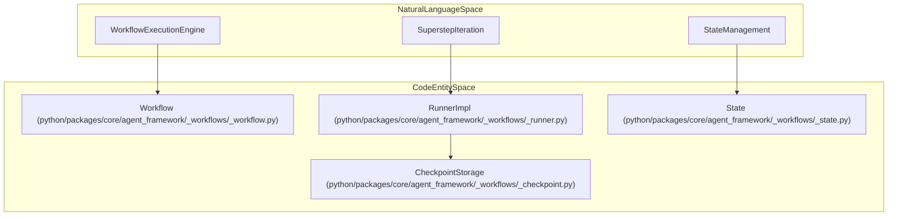
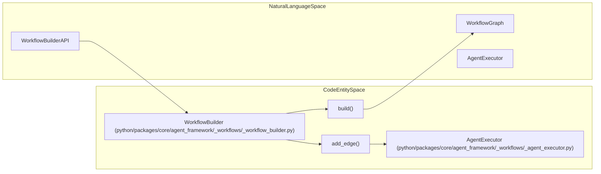

<!-- source: DeepWiki mcp.deepwiki.com · repo microsoft/agent-framework · page 4.1 Workflow Fundamentals · fetched 2026-10-26 -->

# Workflow Fundamentals

Relevant source files

The following files were used as context for generating this wiki page:

- [python/packages/core/agent_framework/_workflows/_agent.py](python/packages/core/agent_framework/_workflows/_agent.py)
- [python/packages/core/agent_framework/_workflows/_agent_executor.py](python/packages/core/agent_framework/_workflows/_agent_executor.py)
- [python/packages/core/agent_framework/_workflows/_checkpoint.py](python/packages/core/agent_framework/_workflows/_checkpoint.py)
- [python/packages/core/agent_framework/_workflows/_checkpoint_encoding.py](python/packages/core/agent_framework/_workflows/_checkpoint_encoding.py)
- [python/packages/core/agent_framework/_workflows/_const.py](python/packages/core/agent_framework/_workflows/_const.py)
- [python/packages/core/agent_framework/_workflows/_edge.py](python/packages/core/agent_framework/_workflows/_edge.py)
- [python/packages/core/agent_framework/_workflows/_edge_runner.py](python/packages/core/agent_framework/_workflows/_edge_runner.py)
- [python/packages/core/agent_framework/_workflows/_events.py](python/packages/core/agent_framework/_workflows/_events.py)
- [python/packages/core/agent_framework/_workflows/_runner.py](python/packages/core/agent_framework/_workflows/_runner.py)
- [python/packages/core/agent_framework/_workflows/_runner_context.py](python/packages/core/agent_framework/_workflows/_runner_context.py)
- [python/packages/core/agent_framework/_workflows/_workflow.py](python/packages/core/agent_framework/_workflows/_workflow.py)
- [python/packages/core/agent_framework/_workflows/_workflow_builder.py](python/packages/core/agent_framework/_workflows/_workflow_builder.py)
- [python/packages/core/agent_framework/_workflows/_workflow_executor.py](python/packages/core/agent_framework/_workflows/_workflow_executor.py)
- [python/packages/core/tests/workflow/test_agent_executor.py](python/packages/core/tests/workflow/test_agent_executor.py)
- [python/packages/core/tests/workflow/test_agent_executor_tool_calls.py](python/packages/core/tests/workflow/test_agent_executor_tool_calls.py)
- [python/packages/core/tests/workflow/test_checkpoint.py](python/packages/core/tests/workflow/test_checkpoint.py)
- [python/packages/core/tests/workflow/test_checkpoint_decode.py](python/packages/core/tests/workflow/test_checkpoint_decode.py)
- [python/packages/core/tests/workflow/test_checkpoint_encode.py](python/packages/core/tests/workflow/test_checkpoint_encode.py)
- [python/packages/core/tests/workflow/test_checkpoint_orchestrations_deserialization.py](python/packages/core/tests/workflow/test_checkpoint_orchestrations_deserialization.py)
- [python/packages/core/tests/workflow/test_checkpoint_unrestricted_pickle.py](python/packages/core/tests/workflow/test_checkpoint_unrestricted_pickle.py)
- [python/packages/core/tests/workflow/test_checkpoint_validation.py](python/packages/core/tests/workflow/test_checkpoint_validation.py)
- [python/packages/core/tests/workflow/test_edge.py](python/packages/core/tests/workflow/test_edge.py)
- [python/packages/core/tests/workflow/test_executor_future.py](python/packages/core/tests/workflow/test_executor_future.py)
- [python/packages/core/tests/workflow/test_full_conversation.py](python/packages/core/tests/workflow/test_full_conversation.py)
- [python/packages/core/tests/workflow/test_request_info_event_rehydrate.py](python/packages/core/tests/workflow/test_request_info_event_rehydrate.py)
- [python/packages/core/tests/workflow/test_runner.py](python/packages/core/tests/workflow/test_runner.py)
- [python/packages/core/tests/workflow/test_sub_workflow.py](python/packages/core/tests/workflow/test_sub_workflow.py)
- [python/packages/core/tests/workflow/test_workflow.py](python/packages/core/tests/workflow/test_workflow.py)
- [python/packages/core/tests/workflow/test_workflow_agent.py](python/packages/core/tests/workflow/test_workflow_agent.py)
- [python/packages/core/tests/workflow/test_workflow_builder.py](python/packages/core/tests/workflow/test_workflow_builder.py)
- [python/packages/core/tests/workflow/test_workflow_kwargs.py](python/packages/core/tests/workflow/test_workflow_kwargs.py)
- [python/packages/core/tests/workflow/test_workflow_observability.py](python/packages/core/tests/workflow/test_workflow_observability.py)
- [python/packages/core/tests/workflow/test_workflow_states.py](python/packages/core/tests/workflow/test_workflow_states.py)

## Purpose and Scope

This page introduces the workflow system's core architecture, execution model, and fundamental components. Workflows enable graph-based orchestration of executors (processing units) connected via edges, executing in synchronized supersteps until convergence. For specific multi-agent orchestration patterns see [Multi-Agent Orchestration Patterns](#4.3), for checkpointing and state persistence see [Workflow Execution and Checkpointing](#4.4), for detailed executor implementation see [Executors and Handlers](#4.2), and for human-in-the-loop patterns see [Human-in-the-Loop Workflows](#4.5).

Sources:
- [python/packages/core/agent_framework/_workflows/_workflow.py:1-60]()
- [python/packages/core/agent_framework/_workflows/_runner.py:44-56]()

---

## What is a Workflow?

A `Workflow` is a graph-based execution engine that orchestrates connected `Executor` instances. Each workflow consists of:

- **Executors**: Processing units that handle messages and perform computations [python/packages/core/agent_framework/_workflows/_executor.py:31-35]().
- **Edges**: Connections between executors that define message routing [python/packages/core/agent_framework/_workflows/_edge.py:17-18]().
- **State**: Shared key-value storage accessible across all executors via `State` objects [python/packages/core/agent_framework/_workflows/_workflow.py:55-55]().
- **Execution model**: Pregel-like superstep iteration managed by `RunnerImpl` until the graph becomes idle [python/packages/core/agent_framework/_workflows/_runner.py:44-46]().

Workflows are created using the `WorkflowBuilder` class and execute until no executors have pending messages (convergence) or until a maximum iteration count is reached [python/packages/core/agent_framework/_workflows/_workflow.py:103-111]().

**Key Classes:**
- `Workflow`: Main execution engine.
- `WorkflowBuilder`: Fluent API for constructing workflows.
- `WorkflowRunResult`: Container for execution results, maintaining separation between data-plane (outputs) and control-plane (status timeline) events [python/packages/core/agent_framework/_workflows/_workflow.py:131-154]().

Sources:
- [python/packages/core/agent_framework/_workflows/_workflow.py:103-183]()
- [python/packages/core/agent_framework/_workflows/_executor.py:31-35]()
- [python/packages/core/agent_framework/_workflows/_edge.py:17-18]()
- [python/packages/core/agent_framework/_workflows/_runner.py:44-46]()

---

## Execution Model: Pregel-Like Supersteps

### Superstep Iteration

Workflows execute in synchronized **supersteps** managed by the `RunnerImpl` class, inspired by the Pregel model [python/packages/core/agent_framework/_workflows/_runner.py:44-46](). The `RunnerImpl.run_until_convergence` method drives the loop [python/packages/core/agent_framework/_workflows/_runner.py:108-167]().

1. **Message Distribution**: Pending messages are delivered to target executors via `EdgeRunner` instances [python/packages/core/agent_framework/_workflows/_runner.py:69-72]().
2. **Parallel Execution**: Executors process messages concurrently. The `RunnerImpl` polls for new events while the iteration progresses [python/packages/core/agent_framework/_workflows/_runner.py:127-136]().
3. **Message Collection**: Executors send new messages via `ctx.send_message()` which are queued in the runner context for the next superstep.
4. **Event Emission**: Outputs via `ctx.yield_output()` and custom events are emitted immediately through the workflow context to the runner event queue.
5. **Checkpoint Creation**: Checkpoints are created at the end of each superstep by `RunnerImpl`, capturing executor states, messages in transit, and shared state [python/packages/core/agent_framework/_workflows/_runner.py:166-167]().
6. **Convergence Check**: If no messages remain, the workflow has converged and stops.

### Convergence Criteria

A workflow converges when no executors have pending messages to process. External request handling (human-in-the-loop) may keep the workflow in `IDLE_WITH_PENDING_REQUESTS` state if `request_info` events were emitted [python/packages/core/agent_framework/_workflows/_workflow.py:179-185]().

The maximum iteration count (`max_iterations`, default 100) prevents infinite loops and raises a `WorkflowConvergenceException` if exceeded [python/packages/core/agent_framework/_workflows/_runner.py:80-81]().

Sources:
- [python/packages/core/agent_framework/_workflows/_runner.py:44-167]()
- [python/packages/core/agent_framework/_workflows/_workflow.py:131-185]()

---

## Core Components

### Executors

An `Executor` is the fundamental processing unit. Each executor:
- Has a unique identifier (`id`).
- Declares logic via `@handler` methods [python/packages/core/agent_framework/_workflows/_executor.py:27-27]().

**Specialized Executors:**
- `AgentExecutor`: Wraps agents. It manages conversation context and handles streaming by concatenating updates into a final response for downstream executors [python/packages/core/agent_framework/_workflows/_agent_executor.py:52-84]().
- `WorkflowExecutor`: Enables hierarchical composition by wrapping a sub-workflow [python/packages/core/agent_framework/_workflows/_workflow_executor.py:152-160]().

### Edges and Edge Groups

Edges define how messages flow between executors. `EdgeGroup` implementations handle different routing logic [python/packages/core/agent_framework/_workflows/_edge.py:41-43]().

| Edge Group | Pattern | Implementation |
|------------|---------|----------------|
| `SingleEdgeGroup` | One-to-one | [python/packages/core/agent_framework/_workflows/_edge.py:41-43]() |
| `FanOutEdgeGroup` | One-to-many | [python/packages/core/agent_framework/_workflows/_edge.py:42-42]() |
| `FanInEdgeGroup` | Many-to-one | [python/packages/core/agent_framework/_workflows/_edge.py:41-43]() |

### WorkflowContext

`WorkflowContext` is the interface executors use to interact with the engine. It is typed with message and output types [python/packages/core/agent_framework/_workflows/_workflow_context.py:1-40]().

**Core API:**
- `send_message(data)`: Queues messages for downstream executors.
- `yield_output(data)`: Emits workflow-level outputs.
- `request_info(request, response_type)`: Requests external input.

Sources:
- [python/packages/core/agent_framework/_workflows/_executor.py:27-27]()
- [python/packages/core/agent_framework/_workflows/_agent_executor.py:52-84]()
- [python/packages/core/agent_framework/_workflows/_workflow_executor.py:152-160]()
- [python/packages/core/agent_framework/_workflows/_edge.py:41-43]()

---

## Workflow Visualization and Graph Execution

The framework provides utilities to inspect and visualize the execution graph and states.

### Code-to-Entity Bridge: Execution Engine & Runner

Sources:
- [python/packages/core/agent_framework/_workflows/_workflow.py:172-185]()
- [python/packages/core/agent_framework/_workflows/_runner.py:44-167]()
- [python/packages/core/agent_framework/_workflows/_state.py:1-50]()
- [python/packages/core/agent_framework/_workflows/_checkpoint.py:134-162]()

---

## Workflow Lifecycle and Building

The `WorkflowBuilder` provides a fluent API to construct the execution graph. It handles automatic wrapping of agents via `AgentExecutor` and ensures graph validation during the build process.

### Code-to-Entity Bridge: Workflow Construction & Builders

Sources:
- [python/packages/core/agent_framework/_workflows/_workflow_builder.py:1-50]()
- [python/packages/core/agent_framework/_workflows/_agent_executor.py:152-176]()

---

## Workflow as Agent Pattern

A `Workflow` can be exposed as a standard agent using `WorkflowAgent`. This enables hierarchical composition where workflows can be participants in other workflows [python/packages/core/agent_framework/_workflows/_agent.py:55-56]().

**Implementation Details:**
- **WorkflowAgent**: (Python) Agent subclass that wraps a workflow. It validates that the workflow's start executor can handle `list[Message]` [python/packages/core/agent_framework/_workflows/_agent.py:135-142]().
- **Event Conversion**: Workflow output events and request info events are converted into agent responses during execution [python/packages/core/agent_framework/_workflows/_agent.py:125-130]().

Sources:
- [python/packages/core/agent_framework/_workflows/_agent.py:55-150]()

---

