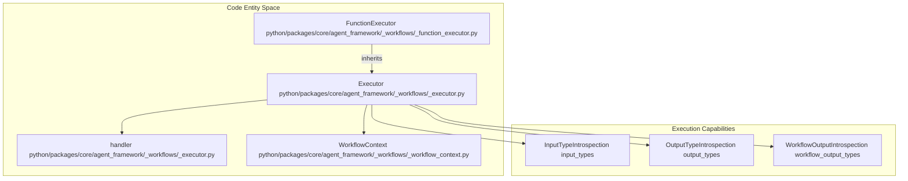
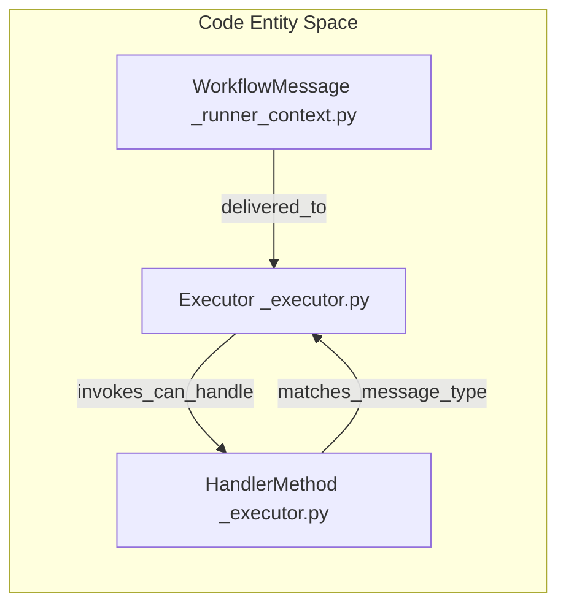
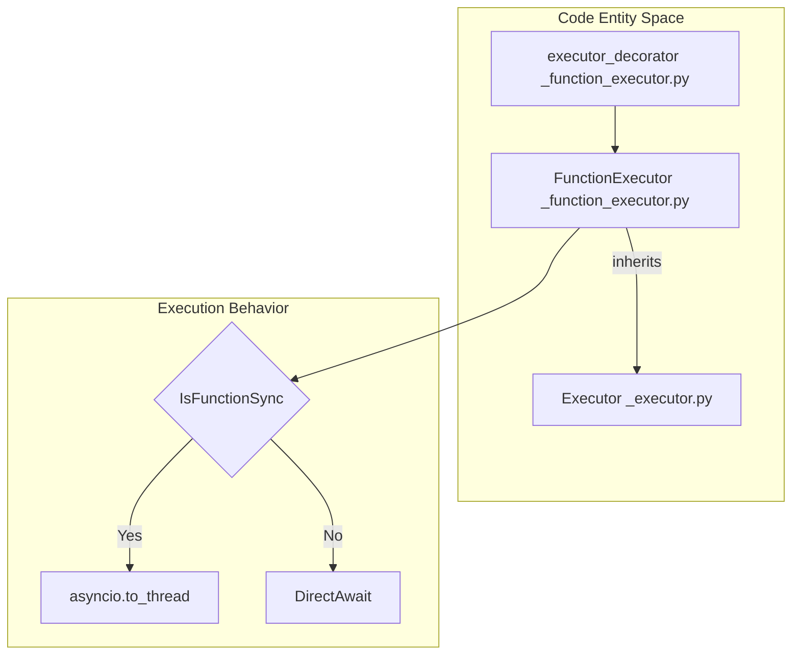

<!-- source: DeepWiki mcp.deepwiki.com · repo microsoft/agent-framework · page 4.2 Executors and Handlers · fetched 2026-10-26 -->

# Executors and Handlers

Relevant source files

The following files were used as context for generating this wiki page:

- [python/packages/core/agent_framework/_workflows/__init__.py](python/packages/core/agent_framework/_workflows/__init__.py)
- [python/packages/core/agent_framework/_workflows/_executor.py](python/packages/core/agent_framework/_workflows/_executor.py)
- [python/packages/core/agent_framework/_workflows/_function_executor.py](python/packages/core/agent_framework/_workflows/_function_executor.py)
- [python/packages/core/agent_framework/_workflows/_functional.py](python/packages/core/agent_framework/_workflows/_functional.py)
- [python/packages/core/agent_framework/_workflows/_request_info_mixin.py](python/packages/core/agent_framework/_workflows/_request_info_mixin.py)
- [python/packages/core/agent_framework/_workflows/_typing_utils.py](python/packages/core/agent_framework/_workflows/_typing_utils.py)
- [python/packages/core/agent_framework/_workflows/_validation.py](python/packages/core/agent_framework/_workflows/_validation.py)
- [python/packages/core/agent_framework/_workflows/_workflow_context.py](python/packages/core/agent_framework/_workflows/_workflow_context.py)
- [python/packages/core/tests/workflow/test_executor.py](python/packages/core/tests/workflow/test_executor.py)
- [python/packages/core/tests/workflow/test_function_executor.py](python/packages/core/tests/workflow/test_function_executor.py)
- [python/packages/core/tests/workflow/test_function_executor_future.py](python/packages/core/tests/workflow/test_function_executor_future.py)
- [python/packages/core/tests/workflow/test_functional_workflow.py](python/packages/core/tests/workflow/test_functional_workflow.py)
- [python/packages/core/tests/workflow/test_request_info_mixin.py](python/packages/core/tests/workflow/test_request_info_mixin.py)
- [python/packages/core/tests/workflow/test_typing_utils.py](python/packages/core/tests/workflow/test_typing_utils.py)
- [python/packages/core/tests/workflow/test_validation.py](python/packages/core/tests/workflow/test_validation.py)
- [python/packages/core/tests/workflow/test_workflow_context.py](python/packages/core/tests/workflow/test_workflow_context.py)
- [python/packages/foundry_hosting/agent_framework_foundry_hosting/_agent_source.py](python/packages/foundry_hosting/agent_framework_foundry_hosting/_agent_source.py)
- [python/samples/03-workflows/functional/agent_integration.py](python/samples/03-workflows/functional/agent_integration.py)
- [python/samples/03-workflows/functional/basic_pipeline.py](python/samples/03-workflows/functional/basic_pipeline.py)
- [python/samples/03-workflows/functional/basic_streaming_pipeline.py](python/samples/03-workflows/functional/basic_streaming_pipeline.py)
- [python/samples/03-workflows/functional/hitl_review.py](python/samples/03-workflows/functional/hitl_review.py)
- [python/samples/03-workflows/functional/naive_group_chat.py](python/samples/03-workflows/functional/naive_group_chat.py)
- [python/samples/03-workflows/functional/parallel_pipeline.py](python/samples/03-workflows/functional/parallel_pipeline.py)

## Purpose and Scope

This page details the executor system, handler methods, functional workflows, built-in executors (`AgentExecutor`, `WorkflowExecutor`), and the `ExecutionContext` pattern that form the computational core of multi-agent orchestration in the Microsoft Agent Framework. Executors act as nodes in workflow graphs, receiving messages, dispatching them to decorated handler methods, and emitting state modifications or downstream messages.

---

## 1. Executor Architecture and Base Class

The `Executor` base class (`python/packages/core/agent_framework/_workflows/_executor.py`) serves as the root abstraction for all computational units within a workflow [python/packages/core/agent_framework/_workflows/_executor.py:36-40](). It governs capability introspection, state management, and message routing.

### Core Capabilities and Type System
Executors maintain a robust type system inferred from method signatures and context annotations:
- **Input Types**: Discovered from the message parameter annotations of `@handler` decorated methods [python/packages/core/agent_framework/_workflows/_executor.py:47-56](). Accessible via `input_types`.
- **Output Types**: Extracted from the first generic parameter (`OutT`) of `WorkflowContext` [python/packages/core/agent_framework/_workflows/_executor.py:58-67](). Accessible via `output_types`.
- **Workflow Output Types**: Extracted from the second generic parameter (`W_OutT`) of `WorkflowContext` [python/packages/core/agent_framework/_workflows/_executor.py:69-78](). Accessible via `workflow_output_types`.

Title: "Executor Hierarchy and Capabilities"

Sources: [python/packages/core/agent_framework/_workflows/_executor.py:36-78](), [python/packages/core/agent_framework/_workflows/_function_executor.py:40-60]()

---

## 2. Handler Methods and Dispatch

Handler methods define how an executor processes incoming data. The `@handler` decorator marks instance methods as message receivers.

### Dispatch and Validation
During initialization, the executor inspects all methods decorated with `@handler`, validating their parameter structures and type annotations [python/packages/core/agent_framework/_workflows/_executor.py:78-110](). At runtime, incoming messages (`WorkflowMessage`) are evaluated against `can_handle()` to find the matching handler.

Title: "Handler Dispatch Data Flow"

Sources: [python/packages/core/agent_framework/_workflows/_executor.py:78-140](), [python/packages/core/agent_framework/_workflows/_runner_context.py:21-25]()

---

## 3. WorkflowContext Pattern and Types

The `WorkflowContext` class (`python/packages/core/agent_framework/_workflows/_workflow_context.py`) provides scoped operations for executors [python/packages/core/agent_framework/_workflows/_workflow_context.py:30-34](). Handlers declare their capabilities via generic typing parameters:

- **`WorkflowContext`**: Side-effect only handlers (no message sending or output yielding) [python/packages/core/agent_framework/_workflows/_executor.py:112-123]().
- **`WorkflowContext[OutT]`**: Enables sending messages of type `OutT` via `ctx.send_message()` [python/packages/core/agent_framework/_workflows/_executor.py:124-133]().
- **`WorkflowContext[OutT, W_OutT]`**: Enables sending messages (`OutT`) and yielding workflow-level outputs (`W_OutT` via `ctx.yield_output()`) [python/packages/core/agent_framework/_workflows/_executor.py:134-144]().

Validation of these annotations is handled by `validate_workflow_context_annotation()` and `infer_output_types_from_ctx_annotation()` [python/packages/core/agent_framework/_workflows/_workflow_context.py:37-156]().

Sources: [python/packages/core/agent_framework/_workflows/_executor.py:112-144](), [python/packages/core/agent_framework/_workflows/_workflow_context.py:30-156]()

---

## 4. Function Executors and the `@executor` Decorator

Instead of subclassing `Executor`, simple synchronous or asynchronous functions can be wrapped into executable nodes using the `@executor` decorator (`python/packages/core/agent_framework/_workflows/_function_executor.py`) [python/packages/core/agent_framework/_workflows/_function_executor.py:40-60]().

- **Sync/Async Execution**: Synchronous functions are automatically offloaded to a thread pool via `asyncio.to_thread()` to prevent blocking the event loop [python/packages/core/agent_framework/_workflows/_function_executor.py:45-48]().
- **Explicit Type Overrides**: Developers can pass explicit `input`, `output`, and `workflow_output` parameters to the decorator to override runtime signature introspection [python/packages/core/agent_framework/_workflows/_function_executor.py:50-58]().

Title: "FunctionExecutor Integration"

Sources: [python/packages/core/agent_framework/_workflows/_function_executor.py:40-145]()

---

## 5. Functional Workflows and RunContext

The functional workflow API (`python/packages/core/agent_framework/_workflows/_functional.py`) allows defining workflows using native Python control flow rather than rigid graph structures, via the `@workflow` and `@step` decorators [python/packages/core/agent_framework/_workflows/_functional.py:10-35]().

- **`RunContext`**: An opt-in handle injected into workflow or step functions to access human-in-the-loop (`request_info`), custom event emission (`add_event`), and state persistence (`get_state`, `set_state`) [python/packages/core/agent_framework/_workflows/_functional.py:116-130]().
- **`get_run_context()`**: Retrieves the active run context from within nested asynchronous tasks or step functions [python/packages/core/agent_framework/_workflows/_functional.py:79-87]().
- **Concurrency**: Integrates natively with `asyncio.gather` for fan-out/fan-in patterns without requiring explicit graph edges [python/samples/03-workflows/functional/parallel_pipeline.py:10-60]().

Sources: [python/packages/core/agent_framework/_workflows/_functional.py:10-177](), [python/samples/03-workflows/functional/parallel_pipeline.py:10-60]()

---

## 6. Built-in Executors (`AgentExecutor` & `WorkflowExecutor`)

- **`AgentExecutor`**: Bridges the agent abstraction with the workflow graph, managing session state and streaming updates.
- **`WorkflowExecutor`**: Wraps an inner `Workflow` instance, enabling hierarchical sub-workflow composition where requests for information (`SubWorkflowRequestMessage`) and responses (`SubWorkflowResponseMessage`) flow across hierarchy boundaries.

Sources: [python/packages/core/agent_framework/_workflows/_agent_executor.py:119-165](), [python/packages/core/agent_framework/_workflows/_workflow_executor.py:35-114]()

---

## 7. Checkpointing and Checkpoint Encoding

Workflows persist their operational state via the `WorkflowCheckpoint` dataclass (`python/packages/core/agent_framework/_workflows/_checkpoint.py`) and storage backends implementing `CheckpointStorage` [python/packages/core/agent_framework/_workflows/_checkpoint.py:35-162]().

### Hybrid Serialization and Security Model
Checkpoint encoding (`python/packages/core/agent_framework/_workflows/_checkpoint_encoding.py`) utilizes a hybrid approach:
- Human-readable JSON structure for primitives and collections.
- Full Python object fidelity via `pickle` combined with Base64 encoding for complex objects.
- **`_RestrictedUnpickler`**: A defense-in-depth unpickler that restricts class instantiation during deserialization to an explicit allowlist (built-in safe types, framework internals, OpenAI types, and registered application types) [python/packages/core/agent_framework/_workflows/_checkpoint_encoding.py:17-45]().

Sources: [python/packages/core/agent_framework/_workflows/_checkpoint.py:35-162](), [python/packages/core/agent_framework/_workflows/_checkpoint_encoding.py:17-174]()

---

