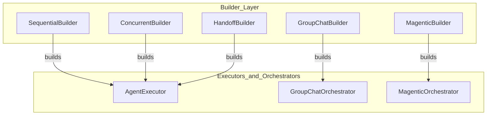
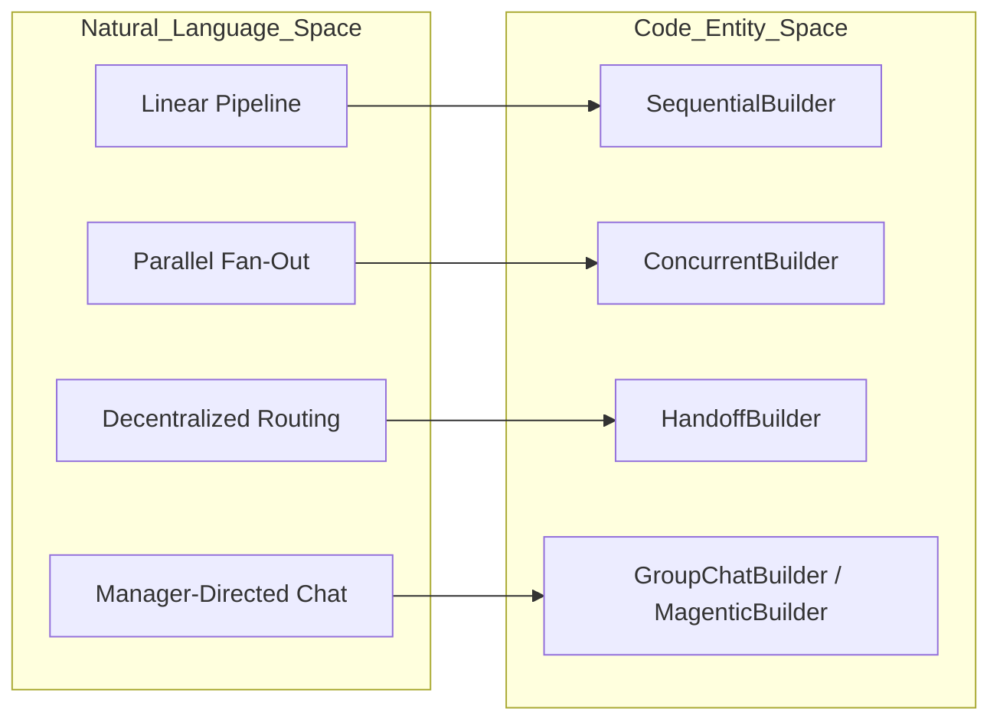

<!-- source: DeepWiki mcp.deepwiki.com · repo microsoft/agent-framework · page 4.3 Multi-Agent Orchestration Patterns · fetched 2026-10-26 -->

# Multi-Agent Orchestration Patterns

Relevant source files

The following files were used as context for generating this wiki page:

- [python/packages/core/agent_framework/_workflows/_agent_utils.py](python/packages/core/agent_framework/_workflows/_agent_utils.py)
- [python/packages/orchestrations/README.md](python/packages/orchestrations/README.md)
- [python/packages/orchestrations/agent_framework_orchestrations/_concurrent.py](python/packages/orchestrations/agent_framework_orchestrations/_concurrent.py)
- [python/packages/orchestrations/agent_framework_orchestrations/_group_chat.py](python/packages/orchestrations/agent_framework_orchestrations/_group_chat.py)
- [python/packages/orchestrations/agent_framework_orchestrations/_handoff.py](python/packages/orchestrations/agent_framework_orchestrations/_handoff.py)
- [python/packages/orchestrations/agent_framework_orchestrations/_magentic.py](python/packages/orchestrations/agent_framework_orchestrations/_magentic.py)
- [python/packages/orchestrations/agent_framework_orchestrations/_orchestration_request_info.py](python/packages/orchestrations/agent_framework_orchestrations/_orchestration_request_info.py)
- [python/packages/orchestrations/agent_framework_orchestrations/_orchestrator_helpers.py](python/packages/orchestrations/agent_framework_orchestrations/_orchestrator_helpers.py)
- [python/packages/orchestrations/agent_framework_orchestrations/_sequential.py](python/packages/orchestrations/agent_framework_orchestrations/_sequential.py)
- [python/packages/orchestrations/tests/test_concurrent.py](python/packages/orchestrations/tests/test_concurrent.py)
- [python/packages/orchestrations/tests/test_group_chat.py](python/packages/orchestrations/tests/test_group_chat.py)
- [python/packages/orchestrations/tests/test_handoff.py](python/packages/orchestrations/tests/test_handoff.py)
- [python/packages/orchestrations/tests/test_magentic.py](python/packages/orchestrations/tests/test_magentic.py)
- [python/packages/orchestrations/tests/test_orchestration_request_info.py](python/packages/orchestrations/tests/test_orchestration_request_info.py)
- [python/packages/orchestrations/tests/test_sequential.py](python/packages/orchestrations/tests/test_sequential.py)
- [python/samples/03-workflows/README.md](python/samples/03-workflows/README.md)
- [python/samples/03-workflows/agents/handoff_workflow_as_agent.py](python/samples/03-workflows/agents/handoff_workflow_as_agent.py)
- [python/samples/03-workflows/declarative/agent_to_function_tool/main.py](python/samples/03-workflows/declarative/agent_to_function_tool/main.py)
- [python/samples/03-workflows/declarative/customer_support/main.py](python/samples/03-workflows/declarative/customer_support/main.py)
- [python/samples/03-workflows/orchestrations/README.md](python/samples/03-workflows/orchestrations/README.md)
- [python/samples/03-workflows/orchestrations/concurrent_agents.py](python/samples/03-workflows/orchestrations/concurrent_agents.py)
- [python/samples/03-workflows/orchestrations/concurrent_custom_agent_executors.py](python/samples/03-workflows/orchestrations/concurrent_custom_agent_executors.py)
- [python/samples/03-workflows/orchestrations/concurrent_custom_aggregator.py](python/samples/03-workflows/orchestrations/concurrent_custom_aggregator.py)
- [python/samples/03-workflows/orchestrations/group_chat_agent_manager.py](python/samples/03-workflows/orchestrations/group_chat_agent_manager.py)
- [python/samples/03-workflows/orchestrations/group_chat_message_filtering.py](python/samples/03-workflows/orchestrations/group_chat_message_filtering.py)
- [python/samples/03-workflows/orchestrations/group_chat_philosophical_debate.py](python/samples/03-workflows/orchestrations/group_chat_philosophical_debate.py)
- [python/samples/03-workflows/orchestrations/group_chat_simple_selector.py](python/samples/03-workflows/orchestrations/group_chat_simple_selector.py)
- [python/samples/03-workflows/orchestrations/handoff_autonomous.py](python/samples/03-workflows/orchestrations/handoff_autonomous.py)
- [python/samples/03-workflows/orchestrations/handoff_simple.py](python/samples/03-workflows/orchestrations/handoff_simple.py)
- [python/samples/03-workflows/orchestrations/handoff_with_code_interpreter_file.py](python/samples/03-workflows/orchestrations/handoff_with_code_interpreter_file.py)
- [python/samples/03-workflows/orchestrations/handoff_with_tool_approval_checkpoint_resume.py](python/samples/03-workflows/orchestrations/handoff_with_tool_approval_checkpoint_resume.py)
- [python/samples/03-workflows/orchestrations/magentic.py](python/samples/03-workflows/orchestrations/magentic.py)
- [python/samples/03-workflows/orchestrations/magentic_custom_prompts.py](python/samples/03-workflows/orchestrations/magentic_custom_prompts.py)
- [python/samples/03-workflows/orchestrations/magentic_human_plan_review.py](python/samples/03-workflows/orchestrations/magentic_human_plan_review.py)
- [python/samples/03-workflows/orchestrations/sequential_chain_only_agent_responses.py](python/samples/03-workflows/orchestrations/sequential_chain_only_agent_responses.py)
- [python/samples/03-workflows/tool-approval/agent_as_tool_vs_workflow_approval.py](python/samples/03-workflows/tool-approval/agent_as_tool_vs_workflow_approval.py)

## Purpose and Scope

This page provides an overview of high-level orchestration patterns for coordinating multiple agents in workflows using the Microsoft Agent Framework. These patterns abstract common multi-agent collaboration structures into reusable builders in both .NET and Python [python/packages/orchestrations/agent_framework_orchestrations/_sequential.py:3-15](), [python/packages/orchestrations/agent_framework_orchestrations/_concurrent.py:35-53](), [python/packages/orchestrations/agent_framework_orchestrations/_handoff.py:3-30](). 

As a parent page, this section offers a high-level architectural view. For detailed information and usage guides, see the child pages:
- [Sequential and Concurrent Patterns](#4.3.1) for linear pipelines and parallel fan-out/fan-in execution.
- [Handoff Pattern](#4.3.2) for decentralized agent delegation via tool calls.
- [Group Chat and Advanced Patterns](#4.3.3) for orchestrated group chats, selector strategies, and magentic workflows.

Sources: [python/packages/orchestrations/agent_framework_orchestrations/_sequential.py:3-15](), [python/packages/orchestrations/agent_framework_orchestrations/_concurrent.py:35-53](), [python/packages/orchestrations/agent_framework_orchestrations/_handoff.py:3-30]()

## What Are Orchestration Patterns?

Orchestration patterns are pre-built workflow architectures that coordinate multiple agents. Rather than manually wiring `Executor` instances and edges using workflow builders, orchestration patterns provide specialized builders like `SequentialBuilder` [python/packages/orchestrations/agent_framework_orchestrations/_sequential.py:66-75](), `ConcurrentBuilder` [python/packages/orchestrations/agent_framework_orchestrations/_concurrent.py:35-53](), and `HandoffBuilder` [python/packages/orchestrations/agent_framework_orchestrations/_handoff.py:3-30]() that encapsulate message routing, conversation management, result aggregation, and control flow.

Sources: [python/packages/orchestrations/agent_framework_orchestrations/_sequential.py:66-75](), [python/packages/orchestrations/agent_framework_orchestrations/_concurrent.py:35-53](), [python/packages/orchestrations/agent_framework_orchestrations/_handoff.py:3-30]()

## High-Level Orchestration Architecture

The following diagram maps high-level architectural concepts to their underlying code entities within the orchestration package.

**Orchestration Component Mapping**

Sources: [python/packages/orchestrations/agent_framework_orchestrations/_sequential.py:100-110](), [python/packages/orchestrations/agent_framework_orchestrations/_concurrent.py:56-62](), [python/packages/orchestrations/agent_framework_orchestrations/_group_chat.py:100-118]()

### Natural Language to Code Entity Mapping

To bridge natural language descriptions of multi-agent topologies to the codebase, the following diagram maps conceptual orchestration workflows directly to their Python class and builder implementations.

**Conceptual to Code Entity Bridge**

Sources: [python/packages/orchestrations/agent_framework_orchestrations/_sequential.py:66-75](), [python/packages/orchestrations/agent_framework_orchestrations/_concurrent.py:35-53](), [python/packages/orchestrations/agent_framework_orchestrations/_handoff.py:3-30](), [python/packages/orchestrations/agent_framework_orchestrations/_group_chat.py:64-79]()

## Core Patterns Overview

### Sequential and Concurrent Patterns
Sequential workflows execute participants in a linear order, passing shared conversation context down the chain. Concurrent workflows execute multiple agents in parallel using a fan-out/fan-in topology, aggregating their replies into a unified response. 

For details, see [Sequential and Concurrent Patterns](#4.3.1).

Sources: [python/packages/orchestrations/agent_framework_orchestrations/_sequential.py:3-15](), [python/packages/orchestrations/agent_framework_orchestrations/_concurrent.py:35-53]()

### Handoff Pattern
The handoff pattern enables decentralized routing where agents dynamically decide which peer to invoke next by calling standardized tool functions like `handoff_to_{target_id}`. The framework maintains session state and manages conversation cleanup across hops.

For details, see [Handoff Pattern](#4.3.2).

Sources: [python/packages/orchestrations/agent_framework_orchestrations/_handoff.py:15-30](), [python/packages/orchestrations/agent_framework_orchestrations/_handoff.py:125-128]()

### Group Chat and Advanced Patterns
Group chat orchestration coordinates multi-agent conversations through a centralized manager or pluggable `GroupChatSelectionFunction`. Advanced patterns like Magentic workflows introduce dynamic task planning, a progress ledger, and adaptive replanning loops.

For details, see [Group Chat and Advanced Patterns](#4.3.3).

Sources: [python/packages/orchestrations/agent_framework_orchestrations/_group_chat.py:5-18](), [python/packages/orchestrations/agent_framework_orchestrations/_magentic.py:109-137]()

---

