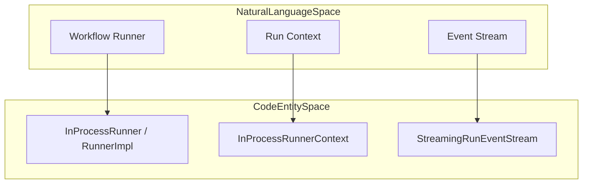
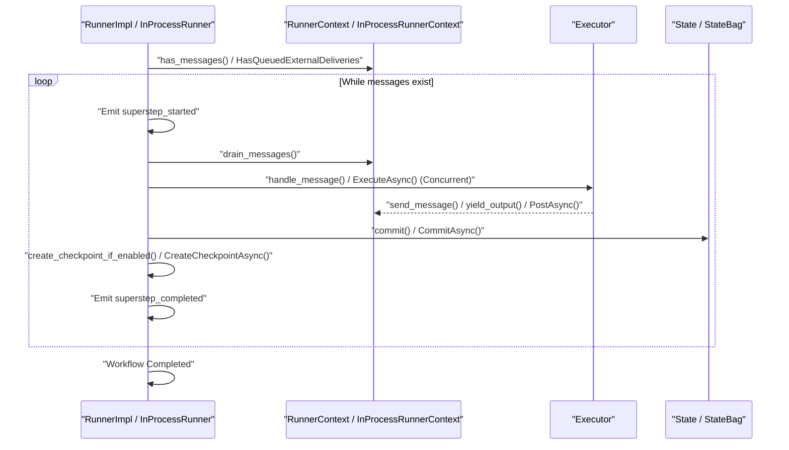
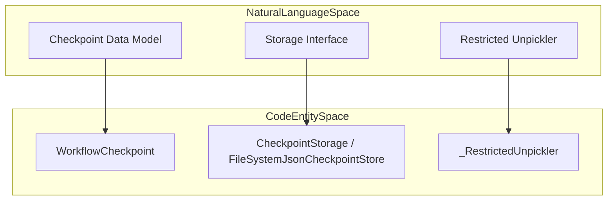

<!-- source: DeepWiki mcp.deepwiki.com · repo microsoft/agent-framework · page 4.4 Workflow Execution and Checkpointing · fetched 2026-10-26 -->

# Workflow Execution and Checkpointing

Relevant source files

The following files were used as context for generating this wiki page:

- [dotnet/samples/03-workflows/_StartHere/03_AgentWorkflowPatterns/Program.cs](dotnet/samples/03-workflows/_StartHere/03_AgentWorkflowPatterns/Program.cs)
- [dotnet/src/Microsoft.Agents.AI.Workflows/Checkpointing/CheckpointInfoConverter.cs](dotnet/src/Microsoft.Agents.AI.Workflows/Checkpointing/CheckpointInfoConverter.cs)
- [dotnet/src/Microsoft.Agents.AI.Workflows/Checkpointing/FileSystemJsonCheckpointStore.cs](dotnet/src/Microsoft.Agents.AI.Workflows/Checkpointing/FileSystemJsonCheckpointStore.cs)
- [dotnet/src/Microsoft.Agents.AI.Workflows/Checkpointing/InMemoryCheckpointManager.cs](dotnet/src/Microsoft.Agents.AI.Workflows/Checkpointing/InMemoryCheckpointManager.cs)
- [dotnet/src/Microsoft.Agents.AI.Workflows/Checkpointing/JsonConverterDictionarySupportBase.cs](dotnet/src/Microsoft.Agents.AI.Workflows/Checkpointing/JsonConverterDictionarySupportBase.cs)
- [dotnet/src/Microsoft.Agents.AI.Workflows/Checkpointing/JsonMarshaller.cs](dotnet/src/Microsoft.Agents.AI.Workflows/Checkpointing/JsonMarshaller.cs)
- [dotnet/src/Microsoft.Agents.AI.Workflows/Checkpointing/RepresentationExtensions.cs](dotnet/src/Microsoft.Agents.AI.Workflows/Checkpointing/RepresentationExtensions.cs)
- [dotnet/src/Microsoft.Agents.AI.Workflows/Checkpointing/ScopeKeyConverter.cs](dotnet/src/Microsoft.Agents.AI.Workflows/Checkpointing/ScopeKeyConverter.cs)
- [dotnet/src/Microsoft.Agents.AI.Workflows/Checkpointing/WorkflowInfo.cs](dotnet/src/Microsoft.Agents.AI.Workflows/Checkpointing/WorkflowInfo.cs)
- [dotnet/src/Microsoft.Agents.AI.Workflows/Execution/DirectEdgeRunner.cs](dotnet/src/Microsoft.Agents.AI.Workflows/Execution/DirectEdgeRunner.cs)
- [dotnet/src/Microsoft.Agents.AI.Workflows/Execution/EdgeConnection.cs](dotnet/src/Microsoft.Agents.AI.Workflows/Execution/EdgeConnection.cs)
- [dotnet/src/Microsoft.Agents.AI.Workflows/Execution/EdgeMap.cs](dotnet/src/Microsoft.Agents.AI.Workflows/Execution/EdgeMap.cs)
- [dotnet/src/Microsoft.Agents.AI.Workflows/Execution/EdgeRunner.cs](dotnet/src/Microsoft.Agents.AI.Workflows/Execution/EdgeRunner.cs)
- [dotnet/src/Microsoft.Agents.AI.Workflows/Execution/FanInEdgeRunner.cs](dotnet/src/Microsoft.Agents.AI.Workflows/Execution/FanInEdgeRunner.cs)
- [dotnet/src/Microsoft.Agents.AI.Workflows/Execution/FanOutEdgeRunner.cs](dotnet/src/Microsoft.Agents.AI.Workflows/Execution/FanOutEdgeRunner.cs)
- [dotnet/src/Microsoft.Agents.AI.Workflows/GroupChatManager.cs](dotnet/src/Microsoft.Agents.AI.Workflows/GroupChatManager.cs)
- [dotnet/src/Microsoft.Agents.AI.Workflows/GroupChatWorkflowBuilder.cs](dotnet/src/Microsoft.Agents.AI.Workflows/GroupChatWorkflowBuilder.cs)
- [dotnet/src/Microsoft.Agents.AI.Workflows/InProc/InProcessRunner.cs](dotnet/src/Microsoft.Agents.AI.Workflows/InProc/InProcessRunner.cs)
- [dotnet/src/Microsoft.Agents.AI.Workflows/InProc/InProcessRunnerContext.cs](dotnet/src/Microsoft.Agents.AI.Workflows/InProc/InProcessRunnerContext.cs)
- [dotnet/src/Microsoft.Agents.AI.Workflows/PortableValue.cs](dotnet/src/Microsoft.Agents.AI.Workflows/PortableValue.cs)
- [dotnet/src/Microsoft.Agents.AI.Workflows/RoundRobinGroupChatManager.cs](dotnet/src/Microsoft.Agents.AI.Workflows/RoundRobinGroupChatManager.cs)
- [dotnet/src/Microsoft.Agents.AI.Workflows/SequentialWorkflowBuilder.cs](dotnet/src/Microsoft.Agents.AI.Workflows/SequentialWorkflowBuilder.cs)
- [dotnet/src/Microsoft.Agents.AI.Workflows/Specialized/AIContentExternalHandler.cs](dotnet/src/Microsoft.Agents.AI.Workflows/Specialized/AIContentExternalHandler.cs)
- [dotnet/src/Microsoft.Agents.AI.Workflows/Specialized/GroupChatHost.cs](dotnet/src/Microsoft.Agents.AI.Workflows/Specialized/GroupChatHost.cs)
- [dotnet/src/Microsoft.Agents.AI.Workflows/WorkflowsJsonUtilities.cs](dotnet/src/Microsoft.Agents.AI.Workflows/WorkflowsJsonUtilities.cs)
- [dotnet/tests/Microsoft.Agents.AI.Workflows.UnitTests/AggregatingExecutorTests.cs](dotnet/tests/Microsoft.Agents.AI.Workflows.UnitTests/AggregatingExecutorTests.cs)
- [dotnet/tests/Microsoft.Agents.AI.Workflows.UnitTests/CheckpointManagerLatestTests.cs](dotnet/tests/Microsoft.Agents.AI.Workflows.UnitTests/CheckpointManagerLatestTests.cs)
- [dotnet/tests/Microsoft.Agents.AI.Workflows.UnitTests/CheckpointParentTests.cs](dotnet/tests/Microsoft.Agents.AI.Workflows.UnitTests/CheckpointParentTests.cs)
- [dotnet/tests/Microsoft.Agents.AI.Workflows.UnitTests/CheckpointResumeTests.cs](dotnet/tests/Microsoft.Agents.AI.Workflows.UnitTests/CheckpointResumeTests.cs)
- [dotnet/tests/Microsoft.Agents.AI.Workflows.UnitTests/FileSystemJsonCheckpointStoreTests.cs](dotnet/tests/Microsoft.Agents.AI.Workflows.UnitTests/FileSystemJsonCheckpointStoreTests.cs)
- [dotnet/tests/Microsoft.Agents.AI.Workflows.UnitTests/GroupChatOrchestrationTests.cs](dotnet/tests/Microsoft.Agents.AI.Workflows.UnitTests/GroupChatOrchestrationTests.cs)
- [dotnet/tests/Microsoft.Agents.AI.Workflows.UnitTests/JsonSerializationTests.cs](dotnet/tests/Microsoft.Agents.AI.Workflows.UnitTests/JsonSerializationTests.cs)
- [dotnet/tests/Microsoft.Agents.AI.Workflows.UnitTests/RepresentationTests.cs](dotnet/tests/Microsoft.Agents.AI.Workflows.UnitTests/RepresentationTests.cs)
- [dotnet/tests/Microsoft.Agents.AI.Workflows.UnitTests/RoundRobinGroupChatManagerTests.cs](dotnet/tests/Microsoft.Agents.AI.Workflows.UnitTests/RoundRobinGroupChatManagerTests.cs)
- [dotnet/tests/Microsoft.Agents.AI.Workflows.UnitTests/Sample/14_Subworkflow_SharedState.cs](dotnet/tests/Microsoft.Agents.AI.Workflows.UnitTests/Sample/14_Subworkflow_SharedState.cs)
- [dotnet/tests/Microsoft.Agents.AI.Workflows.UnitTests/SampleSmokeTest.cs](dotnet/tests/Microsoft.Agents.AI.Workflows.UnitTests/SampleSmokeTest.cs)
- [dotnet/tests/Microsoft.Agents.AI.Workflows.UnitTests/SequentialWorkflowBuilderTests.cs](dotnet/tests/Microsoft.Agents.AI.Workflows.UnitTests/SequentialWorkflowBuilderTests.cs)
- [python/packages/core/agent_framework/_workflows/_agent.py](python/packages/core/agent_framework/_workflows/_agent.py)
- [python/packages/core/agent_framework/_workflows/_agent_executor.py](python/packages/core/agent_framework/_workflows/_agent_executor.py)
- [python/packages/core/agent_framework/_workflows/_checkpoint.py](python/packages/core/agent_framework/_workflows/_checkpoint.py)
- [python/packages/core/agent_framework/_workflows/_checkpoint_encoding.py](python/packages/core/agent_framework/_workflows/_checkpoint_encoding.py)
- [python/packages/core/agent_framework/_workflows/_const.py](python/packages/core/agent_framework/_workflows/_const.py)
- [python/packages/core/agent_framework/_workflows/_events.py](python/packages/core/agent_framework/_workflows/_events.py)
- [python/packages/core/agent_framework/_workflows/_runner.py](python/packages/core/agent_framework/_workflows/_runner.py)
- [python/packages/core/agent_framework/_workflows/_runner_context.py](python/packages/core/agent_framework/_workflows/_runner_context.py)
- [python/packages/core/agent_framework/_workflows/_workflow.py](python/packages/core/agent_framework/_workflows/_workflow.py)
- [python/packages/core/agent_framework/_workflows/_workflow_executor.py](python/packages/core/agent_framework/_workflows/_workflow_executor.py)
- [python/packages/core/tests/workflow/test_agent_executor.py](python/packages/core/tests/workflow/test_agent_executor.py)
- [python/packages/core/tests/workflow/test_agent_executor_tool_calls.py](python/packages/core/tests/workflow/test_agent_executor_tool_calls.py)
- [python/packages/core/tests/workflow/test_checkpoint.py](python/packages/core/tests/workflow/test_checkpoint.py)
- [python/packages/core/tests/workflow/test_checkpoint_decode.py](python/packages/core/tests/workflow/test_checkpoint_decode.py)
- [python/packages/core/tests/workflow/test_checkpoint_encode.py](python/packages/core/tests/workflow/test_checkpoint_encode.py)
- [python/packages/core/tests/workflow/test_checkpoint_orchestrations_deserialization.py](python/packages/core/tests/workflow/test_checkpoint_orchestrations_deserialization.py)
- [python/packages/core/tests/workflow/test_checkpoint_unrestricted_pickle.py](python/packages/core/tests/workflow/test_checkpoint_unrestricted_pickle.py)
- [python/packages/core/tests/workflow/test_checkpoint_validation.py](python/packages/core/tests/workflow/test_checkpoint_validation.py)
- [python/packages/core/tests/workflow/test_executor_future.py](python/packages/core/tests/workflow/test_executor_future.py)
- [python/packages/core/tests/workflow/test_request_info_event_rehydrate.py](python/packages/core/tests/workflow/test_request_info_event_rehydrate.py)
- [python/packages/core/tests/workflow/test_runner.py](python/packages/core/tests/workflow/test_runner.py)
- [python/packages/core/tests/workflow/test_sub_workflow.py](python/packages/core/tests/workflow/test_sub_workflow.py)
- [python/packages/core/tests/workflow/test_workflow.py](python/packages/core/tests/workflow/test_workflow.py)
- [python/packages/core/tests/workflow/test_workflow_agent.py](python/packages/core/tests/workflow/test_workflow_agent.py)
- [python/packages/core/tests/workflow/test_workflow_kwargs.py](python/packages/core/tests/workflow/test_workflow_kwargs.py)

This page documents the workflow execution lifecycle, superstep mechanics, the Runner implementation, and state persistence through checkpointing. It covers how workflows move from Natural Language Space (intent) to Code Entity Space (execution), how state is captured, and how interrupted runs are resumed.

---

## Workflow Execution Lifecycle

Workflows in the Microsoft Agent Framework execute using a synchronized **superstep** model based on Pregel. This architecture ensures that message delivery and processing happen in discrete, predictable rounds, facilitating consistency and deterministic checkpointing.

### Execution Environments and Runners

The execution of a workflow is managed by a `Runner` which orchestrates the graph topology.

- **`RunnerImpl` (Python)**: Implements the Pregel-like superstep loop. It maintains a `RunnerContext` and manages `EdgeRunner` instances to deliver messages between `Executor` nodes [python/packages/core/agent_framework/_workflows/_runner.py:44-84]().
- **`InProcessRunner` (.NET)**: Orchestrates the movement of messages through the workflow graph within a single process [dotnet/src/Microsoft.Agents.AI.Workflows/InProc/InProcessRunner.cs:23-43]().
- **`InProcessRunnerContext`**: Manages the runtime state for a specific run, including the message queue, event sink, and executor instances [dotnet/src/Microsoft.Agents.AI.Workflows/InProc/InProcessRunnerContext.cs:22-50]().
- **`StreamingRunEventStream` (.NET)**: Streams workflow events using `System.Threading.Channels` and coordinates the background run loop [dotnet/src/Microsoft.Agents.AI.Workflows/Execution/StreamingRunEventStream.cs:18-45]().

### Superstep Mechanics

Execution proceeds in rounds called **Supersteps**. A superstep consists of delivering all pending messages to their target executors and allowing those executors to run concurrently until they produce new messages or halt.

1. **Iteration Loop**: The `RunnerImpl` executes a loop until convergence (no more messages) or until `max_iterations` is reached [python/packages/core/agent_framework/_workflows/_runner.py:108-167]().
2. **Concurrent Execution**: Within `_run_iteration`, all messages are drained from the context and delivered to their respective `EdgeRunner` instances concurrently [python/packages/core/agent_framework/_workflows/_runner.py:128-145]().
3. **State Commitment**: At the end of each superstep, the workflow `State` is committed, and a checkpoint is created if storage is configured [python/packages/core/agent_framework/_workflows/_runner.py:163-167]().
4. **Convergence**: The workflow converges when no executor sends a message to a downstream neighbor during the iteration round [python/packages/core/agent_framework/_workflows/_runner.py:108-122]().

**Diagram: Execution Space Mapping (Natural Language to Code Entities)**

**Execution Flow: Runner Superstep Loop**

Sources: [python/packages/core/agent_framework/_workflows/_runner.py:44-167](), [dotnet/src/Microsoft.Agents.AI.Workflows/InProc/InProcessRunnerContext.cs:22-50](), [dotnet/src/Microsoft.Agents.AI.Workflows/InProc/InProcessRunner.cs:23-43](), [dotnet/src/Microsoft.Agents.AI.Workflows/Execution/StreamingRunEventStream.cs:18-45]()

---

## Checkpointing and State Persistence

Checkpointing allows a workflow to save its entire execution state (including pending messages, executor internal variables, and the shared state) to persistent storage.

### Checkpoint Storage Architecture

State persistence is handled by specialized storage providers. The framework provides implementations for both local development and cloud-scale production.

- **`WorkflowCheckpoint`**: A Python dataclass representing the complete execution state, including `workflow_name`, `graph_signature_hash`, `messages`, and `state` [python/packages/core/agent_framework/_workflows/_checkpoint.py:34-104]().
- **`CheckpointStorage`**: A protocol defining asynchronous save, load, and listing contracts for checkpoint persistence [python/packages/core/agent_framework/_workflows/_checkpoint.py:134-162]().
- **`FileSystemJsonCheckpointStore`**: A .NET implementation that persists checkpoint data to a specified directory, maintaining indices for efficient retrieval [dotnet/src/Microsoft.Agents.AI.Workflows/Checkpointing/FileSystemJsonCheckpointStore.cs:30-96]().

### Security and Serialization

The Python implementation uses a hybrid JSON/Pickle approach with a restricted unpickler to mitigate risks associated with serializing complex Python objects.

- **`encode_checkpoint_value`**: Passes JSON-native types through while pickling and base64-encoding custom objects using a `__pickled__` marker [python/packages/core/agent_framework/_workflows/_checkpoint_encoding.py:83-91]().
- **`_RestrictedUnpickler`**: Limits which classes can be instantiated during unpickling to a safe-list of primitives and framework types to prevent arbitrary code execution [python/packages/core/agent_framework/_workflows/_checkpoint_encoding.py:162-178]().
- **`register_checkpoint_type`**: Allows developers to explicitly add application-defined types to the allow-list [python/packages/core/agent_framework/_workflows/_checkpoint_encoding.py:65-81]().

**Diagram: Persistence Space Mapping (Natural Language to Code Entities)**

Sources: [python/packages/core/agent_framework/_workflows/_checkpoint.py:34-162](), [python/packages/core/agent_framework/_workflows/_checkpoint_encoding.py:65-178](), [dotnet/src/Microsoft.Agents.AI.Workflows/Checkpointing/FileSystemJsonCheckpointStore.cs:30-96]()

---

## Resuming Workflows and Human-in-the-Loop

Resumption is the process of re-hydrating a `Runner` from a saved checkpoint. This is critical for **Human-in-the-Loop (HIL)** scenarios where a workflow must pause while waiting for an external response.

### Human-in-the-Loop Resumption

When an executor needs external input, it invokes request tracking mechanisms:

1. **Request**: Executor signals a wait state via the `WorkflowContext` [python/packages/core/agent_framework/_workflows/_workflow.py:143-149]().
2. **Pause**: The workflow emits a request info event, and the `Runner` enters an idle state waiting for responses.
3. **Checkpoint**: A checkpoint is saved automatically at the superstep boundary, capturing pending request metadata and executor state [python/packages/core/agent_framework/_workflows/_checkpoint.py:59-77]().
4. **Republishing**: Upon resumption, runners re-emit pending request events to notify hosting environments [dotnet/src/Microsoft.Agents.AI.Workflows/InProc/InProcessRunner.cs:255-274]().
5. **Response Delivery**: The caller provides a response via `AddExternalResponseAsync` (.NET) or runner delivery methods (Python) [dotnet/src/Microsoft.Agents.AI.Workflows/InProc/InProcessRunnerContext.cs:147-182]().

**HIL Resumption Logic**

```mermaid
graph TD
    subgraph "Phase 1: Interruption"
        A["Executor"] -- "request_info()" --> B["WorkflowEvent(type='request_info')"]
        B --> C["Runner Loop Convergence"]
        C --> D["IDLE State with Pending Requests"]
    end

    subgraph "Phase 2: Resumption"
        E["User Response"] --> F["AddExternalResponseAsync()"]
        F --> G["InProcessRunner.ResumeStreamAsync()"]
        G --> H["RunnerContext.AddExternalResponseAsync()"]
        H --> I["Executor Response Handler"]
        I --> J["Superstep Loop Continues"]
    end
```

Sources: [dotnet/src/Microsoft.Agents.AI.Workflows/InProc/InProcessRunner.cs:255-274](), [dotnet/src/Microsoft.Agents.AI.Workflows/InProc/InProcessRunnerContext.cs:147-182](), [python/packages/core/agent_framework/_workflows/_checkpoint.py:34-104]()

---

## Hierarchical Composition (Sub-workflows)

A workflow can be embedded within another workflow using specialized executor proxies. This enables complex nested architectures while maintaining isolated state and checkpointing.

- **`WorkflowExecutor`**: Acts as a proxy between a parent workflow and a child workflow, forwarding messages and coordinating requests [python/packages/core/agent_framework/_workflows/_workflow_executor.py:152-169]().
- **`WorkflowHostExecutor`**: The .NET equivalent that hosts a sub-workflow within a parent executor node [dotnet/src/Microsoft.Agents.AI.Workflows/Specialized/WorkflowHostExecutor.cs:15-30]().
- **State Embedding**: Checkpoints recursively capture child workflow states within the parent's execution payload [python/packages/core/agent_framework/_workflows/_checkpoint.py:59-63]().

Sources: [python/packages/core/agent_framework/_workflows/_workflow_executor.py:152-169](), [dotnet/src/Microsoft.Agents.AI.Workflows/Specialized/WorkflowHostExecutor.cs:15-30](), [python/packages/core/agent_framework/_workflows/_checkpoint.py:59-63]()

---

