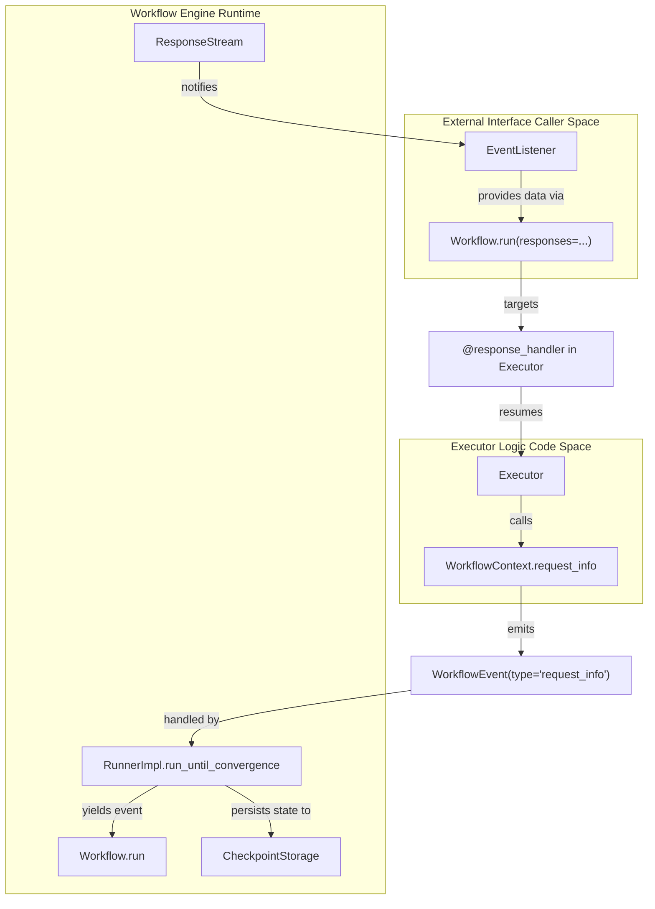
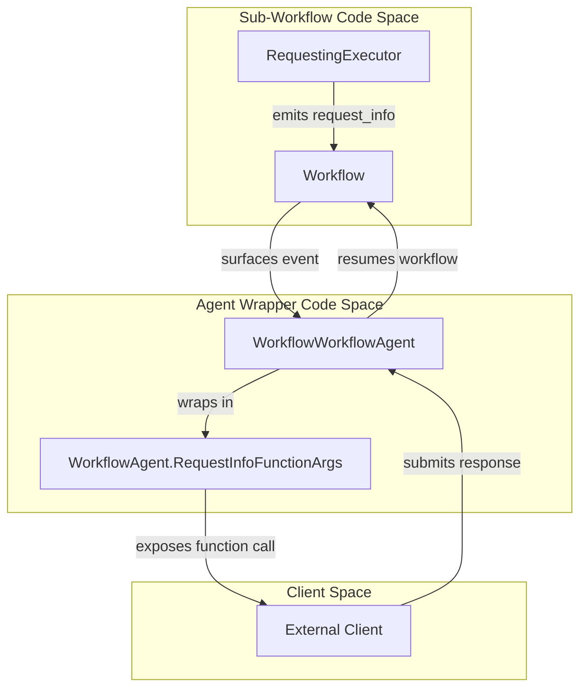
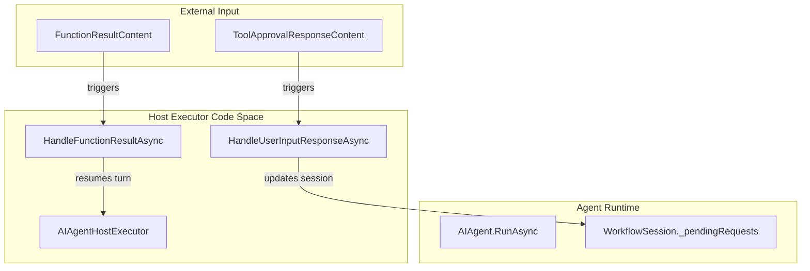

<!-- source: DeepWiki mcp.deepwiki.com · repo microsoft/agent-framework · page 4.5 Human-in-the-Loop Workflows · fetched 2026-10-26 -->

# Human-in-the-Loop Workflows

Relevant source files

The following files were used as context for generating this wiki page:

- [dotnet/src/Microsoft.Agents.AI.Workflows.Declarative/DeclarativeWorkflowBuilder.cs](dotnet/src/Microsoft.Agents.AI.Workflows.Declarative/DeclarativeWorkflowBuilder.cs)
- [dotnet/src/Microsoft.Agents.AI.Workflows.Declarative/Extensions/AgentProviderExtensions.cs](dotnet/src/Microsoft.Agents.AI.Workflows.Declarative/Extensions/AgentProviderExtensions.cs)
- [dotnet/src/Microsoft.Agents.AI.Workflows.Declarative/Extensions/IWorkflowContextExtensions.cs](dotnet/src/Microsoft.Agents.AI.Workflows.Declarative/Extensions/IWorkflowContextExtensions.cs)
- [dotnet/src/Microsoft.Agents.AI.Workflows.Declarative/Interpreter/DeclarativeWorkflowContext.cs](dotnet/src/Microsoft.Agents.AI.Workflows.Declarative/Interpreter/DeclarativeWorkflowContext.cs)
- [dotnet/src/Microsoft.Agents.AI.Workflows.Declarative/Interpreter/DeclarativeWorkflowExecutor.cs](dotnet/src/Microsoft.Agents.AI.Workflows.Declarative/Interpreter/DeclarativeWorkflowExecutor.cs)
- [dotnet/src/Microsoft.Agents.AI.Workflows.Declarative/Interpreter/DelegateActionExecutor.cs](dotnet/src/Microsoft.Agents.AI.Workflows.Declarative/Interpreter/DelegateActionExecutor.cs)
- [dotnet/src/Microsoft.Agents.AI.Workflows.Declarative/Kit/ActionExecutor.cs](dotnet/src/Microsoft.Agents.AI.Workflows.Declarative/Kit/ActionExecutor.cs)
- [dotnet/src/Microsoft.Agents.AI.Workflows.Declarative/Kit/AgentExecutor.cs](dotnet/src/Microsoft.Agents.AI.Workflows.Declarative/Kit/AgentExecutor.cs)
- [dotnet/src/Microsoft.Agents.AI.Workflows.Declarative/Kit/IWorkflowContextExtensions.cs](dotnet/src/Microsoft.Agents.AI.Workflows.Declarative/Kit/IWorkflowContextExtensions.cs)
- [dotnet/src/Microsoft.Agents.AI.Workflows.Declarative/Kit/RootExecutor.cs](dotnet/src/Microsoft.Agents.AI.Workflows.Declarative/Kit/RootExecutor.cs)
- [dotnet/src/Microsoft.Agents.AI.Workflows.Declarative/ObjectModel/CreateConversationExecutor.cs](dotnet/src/Microsoft.Agents.AI.Workflows.Declarative/ObjectModel/CreateConversationExecutor.cs)
- [dotnet/src/Microsoft.Agents.AI.Workflows.Declarative/ObjectModel/QuestionExecutor.cs](dotnet/src/Microsoft.Agents.AI.Workflows.Declarative/ObjectModel/QuestionExecutor.cs)
- [dotnet/src/Microsoft.Agents.AI.Workflows.Declarative/ObjectModel/SendActivityExecutor.cs](dotnet/src/Microsoft.Agents.AI.Workflows.Declarative/ObjectModel/SendActivityExecutor.cs)
- [dotnet/src/Microsoft.Agents.AI.Workflows.Declarative/PowerFx/WorkflowDiagnostics.cs](dotnet/src/Microsoft.Agents.AI.Workflows.Declarative/PowerFx/WorkflowDiagnostics.cs)
- [dotnet/src/Microsoft.Agents.AI.Workflows.Declarative/PowerFx/WorkflowFormulaState.cs](dotnet/src/Microsoft.Agents.AI.Workflows.Declarative/PowerFx/WorkflowFormulaState.cs)
- [dotnet/src/Microsoft.Agents.AI.Workflows/IWorkflowContext.cs](dotnet/src/Microsoft.Agents.AI.Workflows/IWorkflowContext.cs)
- [dotnet/src/Microsoft.Agents.AI.Workflows/IWorkflowContextExtensions.cs](dotnet/src/Microsoft.Agents.AI.Workflows/IWorkflowContextExtensions.cs)
- [dotnet/tests/Microsoft.Agents.AI.Workflows.Declarative.IntegrationTests/Testcases/ConfirmInput.json](dotnet/tests/Microsoft.Agents.AI.Workflows.Declarative.IntegrationTests/Testcases/ConfirmInput.json)
- [dotnet/tests/Microsoft.Agents.AI.Workflows.Declarative.IntegrationTests/Testcases/RequestExternalInput.json](dotnet/tests/Microsoft.Agents.AI.Workflows.Declarative.IntegrationTests/Testcases/RequestExternalInput.json)
- [dotnet/tests/Microsoft.Agents.AI.Workflows.Declarative.UnitTests/Extensions/AgentProviderExtensionsTest.cs](dotnet/tests/Microsoft.Agents.AI.Workflows.Declarative.UnitTests/Extensions/AgentProviderExtensionsTest.cs)
- [dotnet/tests/Microsoft.Agents.AI.Workflows.Declarative.UnitTests/ObjectModel/QuestionExecutorTest.cs](dotnet/tests/Microsoft.Agents.AI.Workflows.Declarative.UnitTests/ObjectModel/QuestionExecutorTest.cs)
- [dotnet/tests/Microsoft.Agents.AI.Workflows.Declarative.UnitTests/ObjectModel/SendActivityExecutorTest.cs](dotnet/tests/Microsoft.Agents.AI.Workflows.Declarative.UnitTests/ObjectModel/SendActivityExecutorTest.cs)
- [python/samples/03-workflows/README.md](python/samples/03-workflows/README.md)
- [python/samples/03-workflows/agents/handoff_workflow_as_agent.py](python/samples/03-workflows/agents/handoff_workflow_as_agent.py)
- [python/samples/03-workflows/declarative/agent_to_function_tool/main.py](python/samples/03-workflows/declarative/agent_to_function_tool/main.py)
- [python/samples/03-workflows/declarative/customer_support/main.py](python/samples/03-workflows/declarative/customer_support/main.py)
- [python/samples/03-workflows/orchestrations/README.md](python/samples/03-workflows/orchestrations/README.md)
- [python/samples/03-workflows/orchestrations/concurrent_agents.py](python/samples/03-workflows/orchestrations/concurrent_agents.py)
- [python/samples/03-workflows/orchestrations/concurrent_custom_agent_executors.py](python/samples/03-workflows/orchestrations/concurrent_custom_agent_executors.py)
- [python/samples/03-workflows/orchestrations/concurrent_custom_aggregator.py](python/samples/03-workflows/orchestrations/concurrent_custom_aggregator.py)
- [python/samples/03-workflows/orchestrations/group_chat_agent_manager.py](python/samples/03-workflows/orchestrations/group_chat_agent_manager.py)
- [python/samples/03-workflows/orchestrations/group_chat_message_filtering.py](python/samples/03-workflows/orchestrations/group_chat_message_filtering.py)
- [python/samples/03-workflows/orchestrations/group_chat_philosophical_debate.py](python/samples/03-workflows/orchestrations/group_chat_philosophical_debate.py)
- [python/samples/03-workflows/orchestrations/group_chat_simple_selector.py](python/samples/03-workflows/orchestrations/group_chat_simple_selector.py)
- [python/samples/03-workflows/orchestrations/handoff_autonomous.py](python/samples/03-workflows/orchestrations/handoff_autonomous.py)
- [python/samples/03-workflows/orchestrations/handoff_simple.py](python/samples/03-workflows/orchestrations/handoff_simple.py)
- [python/samples/03-workflows/orchestrations/handoff_with_code_interpreter_file.py](python/samples/03-workflows/orchestrations/handoff_with_code_interpreter_file.py)
- [python/samples/03-workflows/orchestrations/handoff_with_tool_approval_checkpoint_resume.py](python/samples/03-workflows/orchestrations/handoff_with_tool_approval_checkpoint_resume.py)
- [python/samples/03-workflows/orchestrations/magentic.py](python/samples/03-workflows/orchestrations/magentic.py)
- [python/samples/03-workflows/orchestrations/magentic_custom_prompts.py](python/samples/03-workflows/orchestrations/magentic_custom_prompts.py)
- [python/samples/03-workflows/orchestrations/magentic_human_plan_review.py](python/samples/03-workflows/orchestrations/magentic_human_plan_review.py)
- [python/samples/03-workflows/tool-approval/agent_as_tool_vs_workflow_approval.py](python/samples/03-workflows/tool-approval/agent_as_tool_vs_workflow_approval.py)

## Purpose and Scope

This document explains the human-in-the-loop (HITL) capabilities in Microsoft Agent Framework workflows across Python and .NET implementations. Human-in-the-loop enables workflows to pause execution, request information or approval from external systems or human operators, and resume once responses are provided. This pattern is essential for approval workflows, interactive applications, and scenarios requiring human oversight.

The framework provides HITL support at multiple levels:
- **Low-level API**: `ctx.request_info()` in custom executors allows pausing execution for external input `[python/packages/core/agent_framework/_workflows/_workflow_context.py:17-22]()`.
- **Declarative Questions**: `QuestionExecutor` in declarative workflows manages prompts, entity extraction, and external input request flows `[dotnet/src/Microsoft.Agents.AI.Workflows.Declarative.ObjectModel:QuestionExecutor.cs:45-90]()`.
- **Workflow-as-agent**: Automatic exposure of HITL requests as function approvals via `WorkflowAgent`, which uses a specialized `REQUEST_INFO_FUNCTION_NAME` to signal external needs to callers `[python/packages/core/agent_framework/_workflows/_agent.py:52-60]()`.
- **Session Management**: `WorkflowSession` (.NET) tracks pending external requests in an internal dictionary to enable state recovery and response conversion `[dotnet/src/Microsoft.Agents.AI.Workflows/WorkflowSession.cs:37-54]()`.
- **Agent Hosting**: `AIAgentHostExecutor` (.NET) intercepts tool approvals and function calls to facilitate human-in-the-loop validation before tool execution `[dotnet/src/Microsoft.Agents.AI.Workflows/Specialized/AIAgentHostExecutor.cs:53-68]()`.

Sources: `[python/packages/core/agent_framework/_workflows/_agent.py:52-60]`, `[dotnet/src/Microsoft.Agents.AI.Workflows/WorkflowSession.cs:37-54]`, `[dotnet/src/Microsoft.Agents.AI.Workflows/Specialized/AIAgentHostExecutor.cs:53-68]`, `[dotnet/src/Microsoft.Agents.AI.Workflows.Declarative.ObjectModel:QuestionExecutor.cs:45-90]()`

---

## Core Request/Response Pattern

The fundamental HITL pattern uses `request_info` events to pause execution and `@response_handler` methods to resume with the provided response. When a response is supplied, `_coerce_request_info_response` converts and validates it against the expected type `[python/packages/core/agent_framework/_workflows/_workflow.py:66-75]()`. In declarative workflows, `QuestionExecutor` handles state tracking and external input requests using `ExternalInputRequest` and `ExternalInputResponse` `[dotnet/src/Microsoft.Agents.AI.Workflows.Declarative.ObjectModel:QuestionExecutor.cs:86-98]()`.

### Request/Response Data Flow

The following diagram illustrates how a request for information travels from an internal executor to the external caller and back, bridging the natural language/caller space to core framework entities.

**Natural Language Space to Code Entity Space: Request/Response Flow**

Sources: `[python/packages/core/agent_framework/_workflows/_workflow.py:66-75]`, `[python/packages/core/agent_framework/_workflows/_runner.py:108-122]`, `[python/packages/core/tests/workflow/test_workflow_agent.py:93-135]()`

### Basic Request/Response Implementation

In Python, the pattern requires an executor to implement a `@handler` that initiates the request and a `@response_handler` to process the reply. The framework uses type hints and helper utilities to ensure the response matches the expected data type. If a fresh message arrives while a request is pending, the runner advances executor state while keeping the original request answerable `[python/packages/core/tests/workflow/test_workflow.py:133-163]()`. In declarative workflows, questions are evaluated via `QuestionExecutor.ExecuteAsync` and responses captured through `CaptureResponseAsync` `[dotnet/src/Microsoft.Agents.AI.Workflows.Declarative.ObjectModel:QuestionExecutor.cs:45-98]()`.

Sources: `[python/packages/core/tests/workflow/test_workflow.py:133-163]`, `[python/packages/core/tests/workflow/test_workflow_agent.py:93-135]`, `[dotnet/src/Microsoft.Agents.AI.Workflows.Declarative.ObjectModel:QuestionExecutor.cs:45-98]()`

---

## Workflow as Agent Pattern & HITL Integration

A complex workflow can be wrapped and exposed as a single agent using the `WorkflowAgent` class `[python/packages/core/agent_framework/_workflows/_agent.py:55-57]()`. This enables hierarchical composition where a parent agent treats a sub-workflow as an agent-like entity.

### Event Conversion and Structured Args

When a sub-workflow inside a `WorkflowAgent` emits a `request_info` event, the `WorkflowAgent` converts it into an agent response update. It uses `REQUEST_INFO_FUNCTION_NAME` (`"request_info"`) to represent the request to the caller `[python/packages/core/agent_framework/_workflows/_agent.py:58-60]()`. The payload is encapsulated via `WorkflowAgent.RequestInfoFunctionArgs`, which handles serialization and rehydration through `from_dict` `[python/packages/core/agent_framework/_workflows/_agent.py:61-95]()`.

**Natural Language Space to Code Entity Space: WorkflowAgent and HITL Translation**

Sources: `[python/packages/core/agent_framework/_workflows/_agent.py:55-95]`, `[python/packages/core/agent_framework/_workflows/_workflow.py:66-75]()`

---

## .NET Implementation Details

In .NET, human-in-the-loop is primarily managed through `WorkflowSession` and specialized executors like `AIAgentHostExecutor`.

### Data Flow in .NET

`WorkflowSession` maintains an internal pending requests mapping. When a response is received, message content is converted back into external response objects for the workflow execution context `[dotnet/src/Microsoft.Agents.AI.Workflows/WorkflowSession.cs:37-54]()`.

**Code Entity Mapping: .NET HITL Delivery**

Sources: `[dotnet/src/Microsoft.Agents.AI.Workflows/WorkflowSession.cs:37-54]()`

### Specialized Interceptors
The `AIAgentHostExecutor` provides options to intercept specific HITL scenarios:
- `InterceptUserInputRequests`: Captures `ToolApprovalRequestContent` to pause for human confirmation before an agent proceeds with tool usage `[dotnet/src/Microsoft.Agents.AI.Workflows/Specialized/AIAgentHostExecutor.cs:58-59]()`.
- `InterceptUnterminatedFunctionCalls`: Intercepts function calls that require external execution or approval `[dotnet/src/Microsoft.Agents.AI.Workflows/Specialized/AIAgentHostExecutor.cs:64-65]()`.

Sources: `[dotnet/src/Microsoft.Agents.AI.Workflows/WorkflowSession.cs:37-54]`, `[dotnet/src/Microsoft.Agents.AI.Workflows/Specialized/AIAgentHostExecutor.cs:53-135]`, `[dotnet/tests/Microsoft.Agents.AI.Workflows.UnitTests/WorkflowHostSmokeTests.cs:35-54]()`

---

