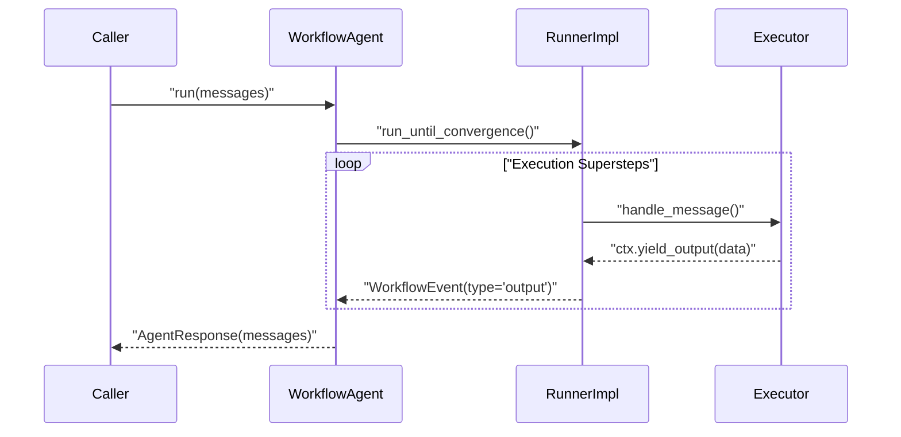

<!-- source: DeepWiki mcp.deepwiki.com · repo microsoft/agent-framework · page 4.6 Workflow as Agent Pattern · fetched 2026-10-26 -->

# Workflow as Agent Pattern

<details>
<summary>Relevant source files</summary>

The following files were used as context for generating this wiki page:

- [dotnet/src/Microsoft.Agents.AI.Workflows/AIAgentBinding.cs](dotnet/src/Microsoft.Agents.AI.Workflows/AIAgentBinding.cs)
- [dotnet/src/Microsoft.Agents.AI.Workflows/AIAgentHostOptions.cs](dotnet/src/Microsoft.Agents.AI.Workflows/AIAgentHostOptions.cs)
- [dotnet/src/Microsoft.Agents.AI.Workflows/Specialized/AIAgentHostExecutor.cs](dotnet/src/Microsoft.Agents.AI.Workflows/Specialized/AIAgentHostExecutor.cs)
- [dotnet/src/Microsoft.Agents.AI.Workflows/Specialized/ConcurrentEndExecutor.cs](dotnet/src/Microsoft.Agents.AI.Workflows/Specialized/ConcurrentEndExecutor.cs)
- [dotnet/src/Microsoft.Agents.AI.Workflows/Specialized/OutputMessagesExecutor.cs](dotnet/src/Microsoft.Agents.AI.Workflows/Specialized/OutputMessagesExecutor.cs)
- [dotnet/src/Microsoft.Agents.AI.Workflows/Workflow.cs](dotnet/src/Microsoft.Agents.AI.Workflows/Workflow.cs)
- [dotnet/src/Microsoft.Agents.AI.Workflows/WorkflowHostAgent.cs](dotnet/src/Microsoft.Agents.AI.Workflows/WorkflowHostAgent.cs)
- [dotnet/src/Microsoft.Agents.AI.Workflows/WorkflowSession.cs](dotnet/src/Microsoft.Agents.AI.Workflows/WorkflowSession.cs)
- [dotnet/tests/Microsoft.Agents.AI.Workflows.UnitTests/AIAgentHostExecutorTests.cs](dotnet/tests/Microsoft.Agents.AI.Workflows.UnitTests/AIAgentHostExecutorTests.cs)
- [dotnet/tests/Microsoft.Agents.AI.Workflows.UnitTests/AIAgentHostingExecutorTestsBase.cs](dotnet/tests/Microsoft.Agents.AI.Workflows.UnitTests/AIAgentHostingExecutorTestsBase.cs)
- [dotnet/tests/Microsoft.Agents.AI.Workflows.UnitTests/SpecializedExecutorSmokeTests.cs](dotnet/tests/Microsoft.Agents.AI.Workflows.UnitTests/SpecializedExecutorSmokeTests.cs)
- [dotnet/tests/Microsoft.Agents.AI.Workflows.UnitTests/WorkflowHostSmokeTests.cs](dotnet/tests/Microsoft.Agents.AI.Workflows.UnitTests/WorkflowHostSmokeTests.cs)
- [dotnet/tests/Microsoft.Agents.AI.Workflows.UnitTests/WorkflowSessionTests.cs](dotnet/tests/Microsoft.Agents.AI.Workflows.UnitTests/WorkflowSessionTests.cs)
- [python/packages/core/agent_framework/_workflows/_agent.py](python/packages/core/agent_framework/_workflows/_agent.py)
- [python/packages/core/agent_framework/_workflows/_agent_executor.py](python/packages/core/agent_framework/_workflows/_agent_executor.py)
- [python/packages/core/agent_framework/_workflows/_checkpoint.py](python/packages/core/agent_framework/_workflows/_checkpoint.py)
- [python/packages/core/agent_framework/_workflows/_checkpoint_encoding.py](python/packages/core/agent_framework/_workflows/_checkpoint_encoding.py)
- [python/packages/core/agent_framework/_workflows/_const.py](python/packages/core/agent_framework/_workflows/_const.py)
- [python/packages/core/agent_framework/_workflows/_events.py](python/packages/core/agent_framework/_workflows/_events.py)
- [python/packages/core/agent_framework/_workflows/_runner.py](python/packages/core/agent_framework/_workflows/_runner.py)
- [python/packages/core/agent_framework/_workflows/_runner_context.py](python/packages/core/agent_framework/_workflows/_runner_context.py)
- [python/packages/core/agent_framework/_workflows/_workflow.py](python/packages/core/agent_framework/_workflows/_workflow.py)
- [python/packages/core/agent_framework/_workflows/_workflow_executor.py](python/packages/core/agent_framework/_workflows/_workflow_executor.py)
- [python/packages/core/tests/workflow/test_agent_executor.py](python/packages/core/tests/workflow/test_agent_executor.py)
- [python/packages/core/tests/workflow/test_agent_executor_tool_calls.py](python/packages/core/tests/workflow/test_agent_executor_tool_calls.py)
- [python/packages/core/tests/workflow/test_checkpoint.py](python/packages/core/tests/workflow/test_checkpoint.py)
- [python/packages/core/tests/workflow/test_checkpoint_decode.py](python/packages/core/tests/workflow/test_checkpoint_decode.py)
- [python/packages/core/tests/workflow/test_checkpoint_encode.py](python/packages/core/tests/workflow/test_checkpoint_encode.py)
- [python/packages/core/tests/workflow/test_checkpoint_orchestrations_deserialization.py](python/packages/core/tests/workflow/test_checkpoint_orchestrations_deserialization.py)
- [python/packages/core/tests/workflow/test_checkpoint_unrestricted_pickle.py](python/packages/core/tests/workflow/test_checkpoint_unrestricted_pickle.py)
- [python/packages/core/tests/workflow/test_checkpoint_validation.py](python/packages/core/tests/workflow/test_checkpoint_validation.py)
- [python/packages/core/tests/workflow/test_executor_future.py](python/packages/core/tests/workflow/test_executor_future.py)
- [python/packages/core/tests/workflow/test_request_info_event_rehydrate.py](python/packages/core/tests/workflow/test_request_info_event_rehydrate.py)
- [python/packages/core/tests/workflow/test_runner.py](python/packages/core/tests/workflow/test_runner.py)
- [python/packages/core/tests/workflow/test_sub_workflow.py](python/packages/core/tests/workflow/test_sub_workflow.py)
- [python/packages/core/tests/workflow/test_workflow.py](python/packages/core/tests/workflow/test_workflow.py)
- [python/packages/core/tests/workflow/test_workflow_agent.py](python/packages/core/tests/workflow/test_workflow_agent.py)
- [python/packages/core/tests/workflow/test_workflow_kwargs.py](python/packages/core/tests/workflow/test_workflow_kwargs.py)

</details>


## Purpose and Scope

The Workflow as Agent Pattern enables workflows to be exposed as agents using the `WorkflowAgent` class [python/packages/core/agent_framework/_workflows/_agent.py:55]() (Python) or `WorkflowHostAgent` [dotnet/src/Microsoft.Agents.AI.Workflows/WorkflowHostAgent.cs:27]() (.NET). This enables hierarchical composition, where complex multi-agent orchestrations are encapsulated as individual components that can be used anywhere a single agent is expected.

For information about workflows in general, see [Workflow Fundamentals](4.1). For nested workflows using `WorkflowExecutor`, see [Executors and Handlers](4.2).

Sources: [python/packages/core/agent_framework/_workflows/_agent.py:55-56](), [dotnet/src/Microsoft.Agents.AI.Workflows/WorkflowHostAgent.cs:27-29]()

## Overview

The pattern transforms a `Workflow` instance into an agent entity that implements the framework's base agent abstractions. This allows workflows to be:
- Used as participants in other workflows [python/packages/core/agent_framework/_workflows/_agent.py:97-106]().
- Integrated with agent-based APIs and hosting infrastructure.
- Exposed via communication protocols like A2A.

In Python, this is achieved through `WorkflowAgent` [python/packages/core/agent_framework/_workflows/_agent.py:55](). In .NET, `WorkflowHostAgent` provides the implementation [dotnet/src/Microsoft.Agents.AI.Workflows/WorkflowHostAgent.cs:27]().

### Workflow to Agent Mapping

The following diagram shows how the conceptual entities of "Workflows" and "Agents" map to specific code entities in the framework.

**Diagram: Entity Mapping for Workflow as Agent**
```mermaid
graph TD
    subgraph "Natural_Language_Space"
        W_NL["Workflow"]
        A_NL["Agent"]
    end

    subgraph "Code_Entity_Space"
        W_CE["Workflow"]
        WA_CE["WorkflowAgent"]
        WHA_CE["WorkflowHostAgent"]
        BA_CE["BaseAgent"]
        AIA_CE["AIAgent"]
    end

    W_NL -.-> W_CE
    A_NL -.-> BA_CE
    A_NL -.-> AIA_CE
    
    W_CE -->|"wrapped by (Python)"| WA_CE
    W_CE -->|"wrapped by (.NET)"| WHA_CE
    WA_CE --|> BA_CE
    WHA_CE --|> AIA_CE
```
Sources: [python/packages/core/agent_framework/_workflows/_agent.py:55-56](), [dotnet/src/Microsoft.Agents.AI.Workflows/WorkflowHostAgent.cs:27-29](), [python/packages/core/agent_framework/_workflows/_workflow_executor.py:152-156]()

## Implementation Details

### Python: WorkflowAgent
The `WorkflowAgent` validates that the workflow's start executor is compatible with agent-facing inputs (specifically `list[Message]`) during initialization [python/packages/core/agent_framework/_workflows/_agent.py:134-142]().

| Component | Role |
|-----------|------|
| `_workflow` | The underlying `Workflow` instance being executed [python/packages/core/agent_framework/_workflows/_agent.py:150](). |
| `run()` | The primary entry point that triggers the workflow run, supporting both streaming and non-streaming modes [python/packages/core/agent_framework/_workflows/_agent.py:158-183](). |
| `REQUEST_INFO_FUNCTION_NAME` | A class constant (`"request_info"`) used to expose workflow-level requests as tool calls to the caller [python/packages/core/agent_framework/_workflows/_agent.py:59-60](). |

### .NET: WorkflowHostAgent
In .NET, `WorkflowHostAgent` wraps a `Workflow` and manages execution state using `WorkflowSession` [dotnet/src/Microsoft.Agents.AI.Workflows/WorkflowHostAgent.cs:27-29](). It ensures that the workflow is compatible with chat protocols by validating its descriptor [dotnet/src/Microsoft.Agents.AI.Workflows/WorkflowHostAgent.cs:27-41]().

| Component | Role |
|-----------|------|
| `_workflow` | The internal `Workflow` definition [dotnet/src/Microsoft.Agents.AI.Workflows/WorkflowHostAgent.cs:27](). |
| `CreateSessionCoreAsync` | Instantiates a `WorkflowSession` which manages the specific execution environment [dotnet/src/Microsoft.Agents.AI.Workflows/WorkflowSession.cs:72-93](). |
| `RunCoreAsync` | Orchestrates the execution by invoking workflow stages and merging updates into an `AgentResponse`. |

Sources: [python/packages/core/agent_framework/_workflows/_agent.py:55-150](), [dotnet/src/Microsoft.Agents.AI.Workflows/WorkflowHostAgent.cs:27-51](), [dotnet/src/Microsoft.Agents.AI.Workflows/WorkflowSession.cs:72-93]()

## Data Flow: From Workflow Events to Agent Responses

The `WorkflowAgent` acts as a translator between the workflow's event-based execution and the agent's response-based execution.

1. **Input**: The agent's `run()` method receives messages and converts them into workflow inputs. In .NET, this involves updating the `WorkflowSession` chat history.
2. **Execution**: The workflow engine runs the graph. In Python, this is managed by the `RunnerImpl` which executes supersteps until convergence [python/packages/core/agent_framework/_workflows/_runner.py:44-108](). In .NET, this is handled via workflow execution environments.
3. **Event Handling**: 
    - `output` events are collected and transformed into `AgentResponse` messages [python/packages/core/agent_framework/_workflows/_workflow.py:155-161]().
    - `request_info` events are converted into special tool-call messages (using the `request_info` function name) so the caller can provide the missing data [python/packages/core/agent_framework/_workflows/_agent.py:59-67]().

**Diagram: Workflow Agent Execution Flow**

Sources: [python/packages/core/agent_framework/_workflows/_workflow.py:155-161](), [python/packages/core/agent_framework/_workflows/_workflow_executor.py:152-168](), [python/packages/core/agent_framework/_workflows/_runner.py:108-122]()

## Hierarchical Composition Patterns

### Pattern 1: Workflow as a Participant
A `WorkflowAgent` can be passed as a participant to other orchestrators. The parent orchestrator treats the entire sub-workflow as a single agent, interacting through the standard `run` interface.

### Pattern 2: WorkflowExecutor (Graph Nesting)
For deeper graph integration, `WorkflowExecutor` (in Python) allows a workflow to be embedded directly as a node within another workflow [python/packages/core/agent_framework/_workflows/_workflow_executor.py:152-159](). This allows the parent workflow to intercept sub-workflow requests using `@handler` methods [python/packages/core/agent_framework/_workflows/_workflow_executor.py:27-28](). It uses `SubWorkflowRequestMessage` and `SubWorkflowResponseMessage` to coordinate data between levels [python/packages/core/agent_framework/_workflows/_workflow_executor.py:107-149]().

### Pattern 3: AIAgentHostExecutor (.NET)
The `AIAgentHostExecutor` allows a standard `AIAgent` to be hosted as an executor within a workflow [dotnet/src/Microsoft.Agents.AI.Workflows/Specialized/AIAgentHostExecutor.cs:27-29](). This enables the reverse pattern: putting an agent inside a workflow, which could then be exposed as an agent again. It specifically handles turn state and can intercept user input or function call requests [dotnet/src/Microsoft.Agents.AI.Workflows/Specialized/AIAgentHostExecutor.cs:53-68]().

Sources: [python/packages/core/agent_framework/_workflows/_workflow_executor.py:27-149](), [dotnet/src/Microsoft.Agents.AI.Workflows/Specialized/AIAgentHostExecutor.cs:27-68]()

## State and Context Management

### Checkpointing and Serialization
When a workflow exposed as an agent is checkpointed, the session state is preserved.
- **Python**: `WorkflowAgent` supports `checkpoint_id` and `checkpoint_storage` in its `run` method to resume execution. The `RunnerImpl` creates checkpoints at the end of each superstep boundary [python/packages/core/agent_framework/_workflows/_runner.py:108-165]().
- **.NET**: `WorkflowSession` handles serialization of the last checkpoint, state bags, and pending requests [dotnet/src/Microsoft.Agents.AI.Workflows/WorkflowSession.cs:130-133](). It supports an `InMemoryCheckpointManager` for state persistence [dotnet/src/Microsoft.Agents.AI.Workflows/WorkflowSession.cs:33]().

### Request Interception
When a workflow needs external information, it emits a `request_info` event. `WorkflowSession` tracks these as pending requests. This allows the workflow to suspend, be serialized, and later resume once the caller provides the requested data via the agent interface.

Sources: [dotnet/src/Microsoft.Agents.AI.Workflows/WorkflowSession.cs:33-54](), [python/packages/core/agent_framework/_workflows/_runner.py:108-165]()

---

