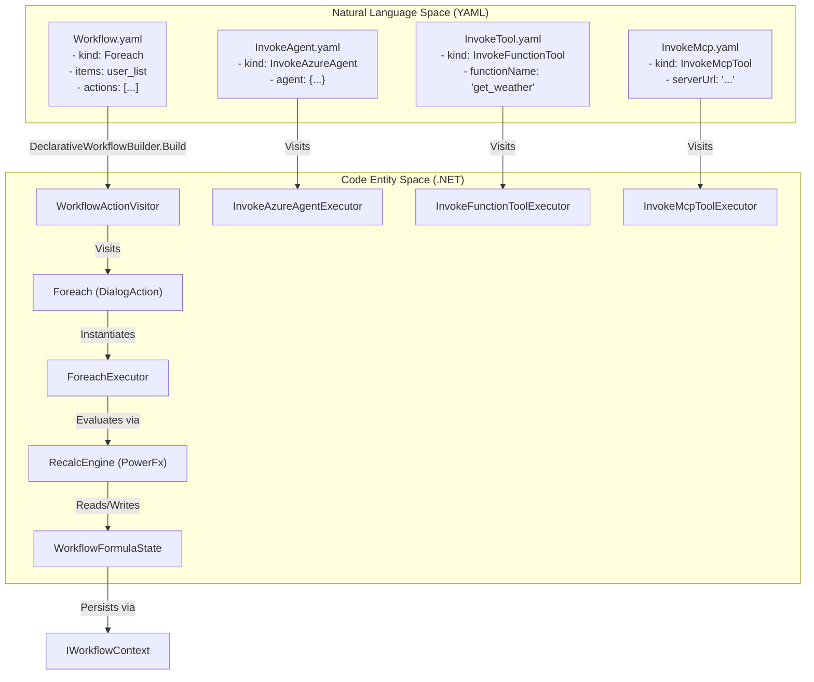
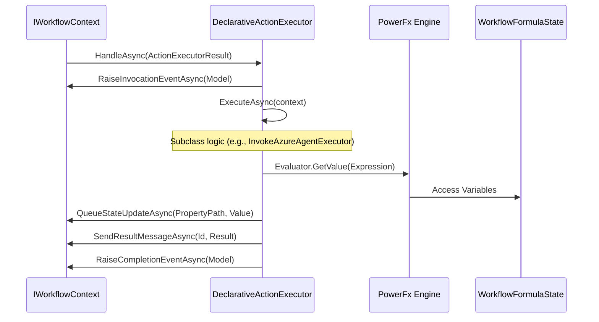

<!-- source: DeepWiki mcp.deepwiki.com · repo microsoft/agent-framework · page 4.8 Declarative Workflows (.NET) · fetched 2026-10-26 -->

# Declarative Workflows (.NET)

Relevant source files

The following files were used as context for generating this wiki page:

- [dotnet/src/Microsoft.Agents.AI.Workflows.Declarative/DeclarativeWorkflowOptions.cs](dotnet/src/Microsoft.Agents.AI.Workflows.Declarative/DeclarativeWorkflowOptions.cs)
- [dotnet/src/Microsoft.Agents.AI.Workflows.Declarative/IHttpRequestHandler.cs](dotnet/src/Microsoft.Agents.AI.Workflows.Declarative/IHttpRequestHandler.cs)
- [dotnet/src/Microsoft.Agents.AI.Workflows.Declarative/Interpreter/DeclarativeActionExecutor.cs](dotnet/src/Microsoft.Agents.AI.Workflows.Declarative/Interpreter/DeclarativeActionExecutor.cs)
- [dotnet/src/Microsoft.Agents.AI.Workflows.Declarative/Interpreter/WorkflowActionVisitor.cs](dotnet/src/Microsoft.Agents.AI.Workflows.Declarative/Interpreter/WorkflowActionVisitor.cs)
- [dotnet/src/Microsoft.Agents.AI.Workflows.Declarative/ObjectModel/AddConversationMessageExecutor.cs](dotnet/src/Microsoft.Agents.AI.Workflows.Declarative/ObjectModel/AddConversationMessageExecutor.cs)
- [dotnet/src/Microsoft.Agents.AI.Workflows.Declarative/ObjectModel/ConditionGroupExecutor.cs](dotnet/src/Microsoft.Agents.AI.Workflows.Declarative/ObjectModel/ConditionGroupExecutor.cs)
- [dotnet/src/Microsoft.Agents.AI.Workflows.Declarative/ObjectModel/CopyConversationMessagesExecutor.cs](dotnet/src/Microsoft.Agents.AI.Workflows.Declarative/ObjectModel/CopyConversationMessagesExecutor.cs)
- [dotnet/src/Microsoft.Agents.AI.Workflows.Declarative/ObjectModel/ForeachExecutor.cs](dotnet/src/Microsoft.Agents.AI.Workflows.Declarative/ObjectModel/ForeachExecutor.cs)
- [dotnet/src/Microsoft.Agents.AI.Workflows.Declarative/ObjectModel/HttpRequestExecutor.cs](dotnet/src/Microsoft.Agents.AI.Workflows.Declarative/ObjectModel/HttpRequestExecutor.cs)
- [dotnet/src/Microsoft.Agents.AI.Workflows.Declarative/ObjectModel/InvokeAzureAgentExecutor.cs](dotnet/src/Microsoft.Agents.AI.Workflows.Declarative/ObjectModel/InvokeAzureAgentExecutor.cs)
- [dotnet/src/Microsoft.Agents.AI.Workflows.Declarative/ObjectModel/InvokeFunctionToolExecutor.cs](dotnet/src/Microsoft.Agents.AI.Workflows.Declarative/ObjectModel/InvokeFunctionToolExecutor.cs)
- [dotnet/src/Microsoft.Agents.AI.Workflows.Declarative/ObjectModel/InvokeMcpToolExecutor.cs](dotnet/src/Microsoft.Agents.AI.Workflows.Declarative/ObjectModel/InvokeMcpToolExecutor.cs)
- [dotnet/src/Microsoft.Agents.AI.Workflows.Declarative/ObjectModel/RetrieveConversationMessageExecutor.cs](dotnet/src/Microsoft.Agents.AI.Workflows.Declarative/ObjectModel/RetrieveConversationMessageExecutor.cs)
- [dotnet/src/Microsoft.Agents.AI.Workflows.Declarative/ObjectModel/RetrieveConversationMessagesExecutor.cs](dotnet/src/Microsoft.Agents.AI.Workflows.Declarative/ObjectModel/RetrieveConversationMessagesExecutor.cs)
- [dotnet/tests/Microsoft.Agents.AI.Workflows.Declarative.IntegrationTests/AzureAgentProviderTest.cs](dotnet/tests/Microsoft.Agents.AI.Workflows.Declarative.IntegrationTests/AzureAgentProviderTest.cs)
- [dotnet/tests/Microsoft.Agents.AI.Workflows.Declarative.IntegrationTests/DeclarativeWorkflowTest.cs](dotnet/tests/Microsoft.Agents.AI.Workflows.Declarative.IntegrationTests/DeclarativeWorkflowTest.cs)
- [dotnet/tests/Microsoft.Agents.AI.Workflows.Declarative.IntegrationTests/Framework/IntegrationTest.cs](dotnet/tests/Microsoft.Agents.AI.Workflows.Declarative.IntegrationTests/Framework/IntegrationTest.cs)
- [dotnet/tests/Microsoft.Agents.AI.Workflows.Declarative.IntegrationTests/Framework/Testcase.cs](dotnet/tests/Microsoft.Agents.AI.Workflows.Declarative.IntegrationTests/Framework/Testcase.cs)
- [dotnet/tests/Microsoft.Agents.AI.Workflows.Declarative.IntegrationTests/Framework/WorkflowEvents.cs](dotnet/tests/Microsoft.Agents.AI.Workflows.Declarative.IntegrationTests/Framework/WorkflowEvents.cs)
- [dotnet/tests/Microsoft.Agents.AI.Workflows.Declarative.IntegrationTests/Framework/WorkflowHarness.cs](dotnet/tests/Microsoft.Agents.AI.Workflows.Declarative.IntegrationTests/Framework/WorkflowHarness.cs)
- [dotnet/tests/Microsoft.Agents.AI.Workflows.Declarative.IntegrationTests/Framework/WorkflowTest.cs](dotnet/tests/Microsoft.Agents.AI.Workflows.Declarative.IntegrationTests/Framework/WorkflowTest.cs)
- [dotnet/tests/Microsoft.Agents.AI.Workflows.Declarative.IntegrationTests/Testcases/HumanInLoop.json](dotnet/tests/Microsoft.Agents.AI.Workflows.Declarative.IntegrationTests/Testcases/HumanInLoop.json)
- [dotnet/tests/Microsoft.Agents.AI.Workflows.Declarative.UnitTests/DeclarativeWorkflowTest.cs](dotnet/tests/Microsoft.Agents.AI.Workflows.Declarative.UnitTests/DeclarativeWorkflowTest.cs)
- [dotnet/tests/Microsoft.Agents.AI.Workflows.Declarative.UnitTests/ObjectModel/AddConversationMessageExecutorTest.cs](dotnet/tests/Microsoft.Agents.AI.Workflows.Declarative.UnitTests/ObjectModel/AddConversationMessageExecutorTest.cs)
- [dotnet/tests/Microsoft.Agents.AI.Workflows.Declarative.UnitTests/ObjectModel/ConditionGroupExecutorTest.cs](dotnet/tests/Microsoft.Agents.AI.Workflows.Declarative.UnitTests/ObjectModel/ConditionGroupExecutorTest.cs)
- [dotnet/tests/Microsoft.Agents.AI.Workflows.Declarative.UnitTests/ObjectModel/CopyConversationMessagesExecutorTest.cs](dotnet/tests/Microsoft.Agents.AI.Workflows.Declarative.UnitTests/ObjectModel/CopyConversationMessagesExecutorTest.cs)
- [dotnet/tests/Microsoft.Agents.AI.Workflows.Declarative.UnitTests/ObjectModel/ForeachExecutorTest.cs](dotnet/tests/Microsoft.Agents.AI.Workflows.Declarative.UnitTests/ObjectModel/ForeachExecutorTest.cs)
- [dotnet/tests/Microsoft.Agents.AI.Workflows.Declarative.UnitTests/ObjectModel/HttpRequestExecutorTest.cs](dotnet/tests/Microsoft.Agents.AI.Workflows.Declarative.UnitTests/ObjectModel/HttpRequestExecutorTest.cs)
- [dotnet/tests/Microsoft.Agents.AI.Workflows.Declarative.UnitTests/ObjectModel/InvokeAzureAgentExecutorTest.cs](dotnet/tests/Microsoft.Agents.AI.Workflows.Declarative.UnitTests/ObjectModel/InvokeAzureAgentExecutorTest.cs)
- [dotnet/tests/Microsoft.Agents.AI.Workflows.Declarative.UnitTests/ObjectModel/InvokeFunctionToolExecutorTest.cs](dotnet/tests/Microsoft.Agents.AI.Workflows.Declarative.UnitTests/ObjectModel/InvokeFunctionToolExecutorTest.cs)
- [dotnet/tests/Microsoft.Agents.AI.Workflows.Declarative.UnitTests/ObjectModel/InvokeMcpToolExecutorTest.cs](dotnet/tests/Microsoft.Agents.AI.Workflows.Declarative.UnitTests/ObjectModel/InvokeMcpToolExecutorTest.cs)
- [dotnet/tests/Microsoft.Agents.AI.Workflows.Declarative.UnitTests/ObjectModel/WorkflowActionExecutorTest.cs](dotnet/tests/Microsoft.Agents.AI.Workflows.Declarative.UnitTests/ObjectModel/WorkflowActionExecutorTest.cs)
- [dotnet/tests/Microsoft.Agents.AI.Workflows.Declarative.UnitTests/Workflows/LoopBreak.cs](dotnet/tests/Microsoft.Agents.AI.Workflows.Declarative.UnitTests/Workflows/LoopBreak.cs)
- [dotnet/tests/Microsoft.Agents.AI.Workflows.Declarative.UnitTests/Workflows/LoopContinue.cs](dotnet/tests/Microsoft.Agents.AI.Workflows.Declarative.UnitTests/Workflows/LoopContinue.cs)
- [dotnet/tests/Microsoft.Agents.AI.Workflows.Declarative.UnitTests/Workflows/LoopEach.cs](dotnet/tests/Microsoft.Agents.AI.Workflows.Declarative.UnitTests/Workflows/LoopEach.cs)

## Purpose and Scope

This document describes the declarative workflow system available in the .NET implementation of the Microsoft Agent Framework. Declarative workflows enable developers to define multi-agent orchestrations using YAML or JSON configuration files with Microsoft PowerFx expressions, rather than writing programmatic C# code.

This feature resides in the `Microsoft.Agents.AI.Workflows.Declarative` package. It leverages a specialized interpreter to map declarative definitions to the underlying workflow engine, supporting dynamic HTTP requests via `HttpRequestExecutor`, agent invocations via `InvokeAzureAgentExecutor`, tool/MCP interactions via `InvokeFunctionToolExecutor` and `InvokeMcpToolExecutor`, iterative constructs via `ForeachExecutor`, and state management via `WorkflowFormulaState`.

---

## Overview

Declarative workflows separate workflow definition from implementation by allowing orchestration logic to be specified in YAML files. The framework supports execution modes such as loading YAML at runtime and executing it via `DeclarativeWorkflowBuilder.Build<TInput>` [dotnet/tests/Microsoft.Agents.AI.Workflows.Declarative.IntegrationTests/DeclarativeWorkflowTest.cs:52-52]().

### Key Technologies
- **YAML/JSON Definitions**: Human-readable workflow structures defined in the `declarative-agents` sample folder [dotnet/tests/Microsoft.Agents.AI.Workflows.Declarative.IntegrationTests/DeclarativeWorkflowTest.cs:42-45]().
- **Microsoft PowerFx**: A formula language used for logic, conditions, and variable assignments within the workflow [dotnet/src/Microsoft.Agents.AI.Workflows.Declarative/Interpreter/DeclarativeActionExecutor.cs:55-56]().
- **Graph-Based Execution**: Definitions are parsed into a directed graph of `Executor` nodes via `WorkflowActionVisitor` [dotnet/src/Microsoft.Agents.AI.Workflows.Declarative/Interpreter/WorkflowActionVisitor.cs:48-64]().
- **Action Executors**: Specialized executors like `InvokeAzureAgentExecutor`, `InvokeFunctionToolExecutor`, `InvokeMcpToolExecutor`, and `HttpRequestExecutor` that handle agentic loops, approvals, tool calls, and remote calls [dotnet/src/Microsoft.Agents.AI.Workflows.Declarative/ObjectModel/InvokeAzureAgentExecutor.cs:23-26](), [dotnet/src/Microsoft.Agents.AI.Workflows.Declarative/ObjectModel/InvokeFunctionToolExecutor.cs:26-31](), [dotnet/src/Microsoft.Agents.AI.Workflows.Declarative/ObjectModel/InvokeMcpToolExecutor.cs:26-31](), [dotnet/src/Microsoft.Agents.AI.Workflows.Declarative/ObjectModel/HttpRequestExecutor.cs:24-29]().

**Sources:**
- [dotnet/tests/Microsoft.Agents.AI.Workflows.Declarative.IntegrationTests/DeclarativeWorkflowTest.cs:42-52]()
- [dotnet/src/Microsoft.Agents.AI.Workflows.Declarative/Interpreter/DeclarativeActionExecutor.cs:55-56]()
- [dotnet/src/Microsoft.Agents.AI.Workflows.Declarative/Interpreter/WorkflowActionVisitor.cs:48-64]()
- [dotnet/src/Microsoft.Agents.AI.Workflows.Declarative/ObjectModel/InvokeAzureAgentExecutor.cs:23-26]()
- [dotnet/src/Microsoft.Agents.AI.Workflows.Declarative/ObjectModel/InvokeFunctionToolExecutor.cs:26-31]()
- [dotnet/src/Microsoft.Agents.AI.Workflows.Declarative/ObjectModel/InvokeMcpToolExecutor.cs:26-31]()
- [dotnet/src/Microsoft.Agents.AI.Workflows.Declarative/ObjectModel/HttpRequestExecutor.cs:24-29]()

---

## Architecture: From Declaration to Execution

The system uses a visitor pattern (`WorkflowActionVisitor`) to traverse the declarative model and build the workflow graph.

### Natural Language Space to Code Entity Space

The following diagram bridges the YAML definitions to the internal .NET class structure.

Title: Mapping Declarative YAML to .NET Entities

**Sources:**
- [dotnet/src/Microsoft.Agents.AI.Workflows.Declarative/Interpreter/WorkflowActionVisitor.cs:15-44]()
- [dotnet/src/Microsoft.Agents.AI.Workflows.Declarative/Interpreter/DeclarativeActionExecutor.cs:25-40]()
- [dotnet/src/Microsoft.Agents.AI.Workflows.Declarative/ObjectModel/InvokeAzureAgentExecutor.cs:23-26]()
- [dotnet/src/Microsoft.Agents.AI.Workflows.Declarative/ObjectModel/InvokeFunctionToolExecutor.cs:26-31]()
- [dotnet/src/Microsoft.Agents.AI.Workflows.Declarative/ObjectModel/InvokeMcpToolExecutor.cs:26-31]()

---

## Core Execution Logic

The system uses `DeclarativeActionExecutor` as the base class for all declarative steps. It bridges the `DialogAction` model with the framework's `Executor<T>` pattern.

### The Declarative Action Lifecycle

Title: Declarative Action Execution Lifecycle

**Sources:**
- [dotnet/src/Microsoft.Agents.AI.Workflows.Declarative/Interpreter/DeclarativeActionExecutor.cs:72-124]()

### Key Classes and Roles

| Class | Role |
| :--- | :--- |
| `DeclarativeActionExecutor<T>` | Base class for executing a specific `DialogAction` model. Handles invocation/completion events [dotnet/src/Microsoft.Agents.AI.Workflows.Declarative/Interpreter/DeclarativeActionExecutor.cs:18-23](). |
| `WorkflowActionVisitor` | Orchestrates the conversion of a declarative model into a `Workflow` graph [dotnet/src/Microsoft.Agents.AI.Workflows.Declarative/Interpreter/WorkflowActionVisitor.cs:15-44](). |
| `InvokeAzureAgentExecutor` | Executes Azure agent invocations, managing input parameters, auto-send flags, conversation IDs, and yielding for external input via `ExternalInputRequest` [dotnet/src/Microsoft.Agents.AI.Workflows.Declarative/ObjectModel/InvokeAzureAgentExecutor.cs:23-26, 46-91](). |
| `InvokeFunctionToolExecutor` | Manages function tool invocations, argument evaluation, and human-in-the-loop tool approvals using approval snapshots and request IDs [dotnet/src/Microsoft.Agents.AI.Workflows.Declarative/ObjectModel/InvokeFunctionToolExecutor.cs:26-44, 76-116](). |
| `InvokeMcpToolExecutor` | Dispatches Model Context Protocol (MCP) tool requests to remote servers, handling headers, transport payloads, and tool approval flows [dotnet/src/Microsoft.Agents.AI.Workflows.Declarative/ObjectModel/InvokeMcpToolExecutor.cs:26-47, 84-126](). |
| `HttpRequestExecutor` | Dispatches HTTP requests through `IHttpRequestHandler`, assigns responses/headers to property paths, and logs diagnostics [dotnet/src/Microsoft.Agents.AI.Workflows.Declarative/ObjectModel/HttpRequestExecutor.cs:24-32, 43-75](). |
| `ForeachExecutor` | Implements iterative logic, managing collection state and index via PowerFx. Supports checkpointing of `_index` and `_values` [dotnet/src/Microsoft.Agents.AI.Workflows.Declarative/ObjectModel/ForeachExecutor.cs:30-31]() |
| `ConditionGroupExecutor` | Manages branching logic. It evaluates conditions via PowerFx to determine the next node in the graph [dotnet/src/Microsoft.Agents.AI.Workflows.Declarative/ObjectModel/ConditionGroupExecutor.cs:21-25](). |
| `WorkflowFormulaState` | Maintains the PowerFx symbol table and manages synchronization with `IWorkflowContext` [dotnet/src/Microsoft.Agents.AI.Workflows.Declarative/PowerFx/WorkflowFormulaState.cs:16-20](). |

**Sources:**
- [dotnet/src/Microsoft.Agents.AI.Workflows.Declarative/Interpreter/DeclarativeActionExecutor.cs:18-23]()
- [dotnet/src/Microsoft.Agents.AI.Workflows.Declarative/Interpreter/WorkflowActionVisitor.cs:15-44]()
- [dotnet/src/Microsoft.Agents.AI.Workflows.Declarative/ObjectModel/InvokeAzureAgentExecutor.cs:23-26]()
- [dotnet/src/Microsoft.Agents.AI.Workflows.Declarative/ObjectModel/InvokeFunctionToolExecutor.cs:26-44]()
- [dotnet/src/Microsoft.Agents.AI.Workflows.Declarative/ObjectModel/InvokeMcpToolExecutor.cs:26-47]()
- [dotnet/src/Microsoft.Agents.AI.Workflows.Declarative/ObjectModel/HttpRequestExecutor.cs:24-32]()

---

## Data Flow and Variable Management

Declarative workflows rely on `WorkflowFormulaState` to manage data. Variables are accessed using PowerFx expressions and persisted through the `IWorkflowContext`.

### Multi-Turn Execution and Checkpointing

Interactive executors support resuming from checkpoints by overriding `OnCheckpointRestoredAsync` and managing transient state snapshots.

- **Tool Approval Snapshots**: `InvokeFunctionToolExecutor` and `InvokeMcpToolExecutor` maintain concurrent dictionaries of approval snapshots and header snapshots (`_approvalSnapshots`, `_approvalHeaderSnapshots`) keyed by per-invocation request IDs to secure transport credentials and restore context upon approval [dotnet/src/Microsoft.Agents.AI.Workflows.Declarative/ObjectModel/InvokeFunctionToolExecutor.cs:37-51](), [dotnet/src/Microsoft.Agents.AI.Workflows.Declarative/ObjectModel/InvokeMcpToolExecutor.cs:36-47]().
- **Foreach Checkpointing**: The `ForeachExecutor` persists the current iteration cursor and collection items to ensure consistency across restarts.

### Variable Assignment
The `AssignAsync` method in `DeclarativeActionExecutor` queues state updates to the workflow context, allowing PowerFx results to be stored in specified property paths with strict sensitivity tracking [dotnet/src/Microsoft.Agents.AI.Workflows.Declarative/Interpreter/DeclarativeActionExecutor.cs:135-156]().

**Sources:**
- [dotnet/src/Microsoft.Agents.AI.Workflows.Declarative/ObjectModel/InvokeFunctionToolExecutor.cs:37-51]()
- [dotnet/src/Microsoft.Agents.AI.Workflows.Declarative/ObjectModel/InvokeMcpToolExecutor.cs:36-47]()
- [dotnet/src/Microsoft.Agents.AI.Workflows.Declarative/Interpreter/DeclarativeActionExecutor.cs:135-156]()

---

## Testing and Validation

The framework includes a robust integration and unit testing suite (`DeclarativeWorkflowTest`) that validates declarative workflows against YAML definitions and JSON-based test cases [dotnet/tests/Microsoft.Agents.AI.Workflows.Declarative.IntegrationTests/DeclarativeWorkflowTest.cs:15-26](), [dotnet/tests/Microsoft.Agents.AI.Workflows.Declarative.UnitTests/DeclarativeWorkflowTest.cs:25-39]().

The `WorkflowHarness` manages the workflow run lifecycle, including:
- **Execution**: Starting the workflow via test execution harness runners [dotnet/tests/Microsoft.Agents.AI.Workflows.Declarative.IntegrationTests/Framework/WorkflowHarness.cs:46-56]().
- **Resumption**: Handling external input and resume events across multi-turn scenarios [dotnet/tests/Microsoft.Agents.AI.Workflows.Declarative.IntegrationTests/Framework/WorkflowHarness.cs:56-60]().
- **Verification**: Validating executor invocation events, conversation records, agent responses, and action event sequences [dotnet/tests/Microsoft.Agents.AI.Workflows.Declarative.IntegrationTests/DeclarativeWorkflowTest.cs:47-74]().

**Sources:**
- [dotnet/tests/Microsoft.Agents.AI.Workflows.Declarative.IntegrationTests/DeclarativeWorkflowTest.cs:15-74]()
- [dotnet/tests/Microsoft.Agents.AI.Workflows.Declarative.UnitTests/DeclarativeWorkflowTest.cs:25-39]()

---

