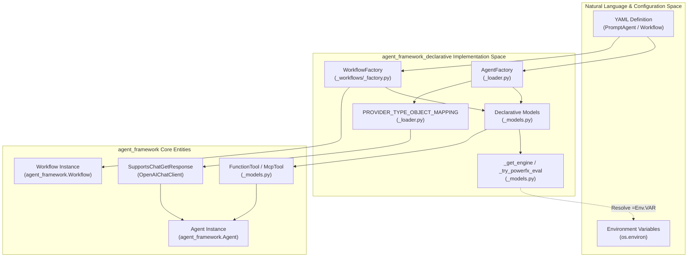
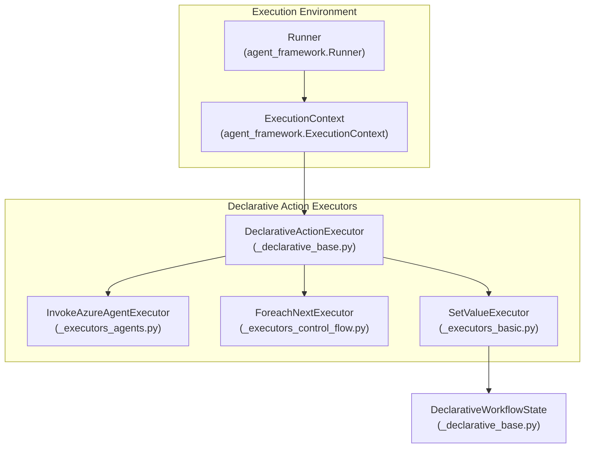
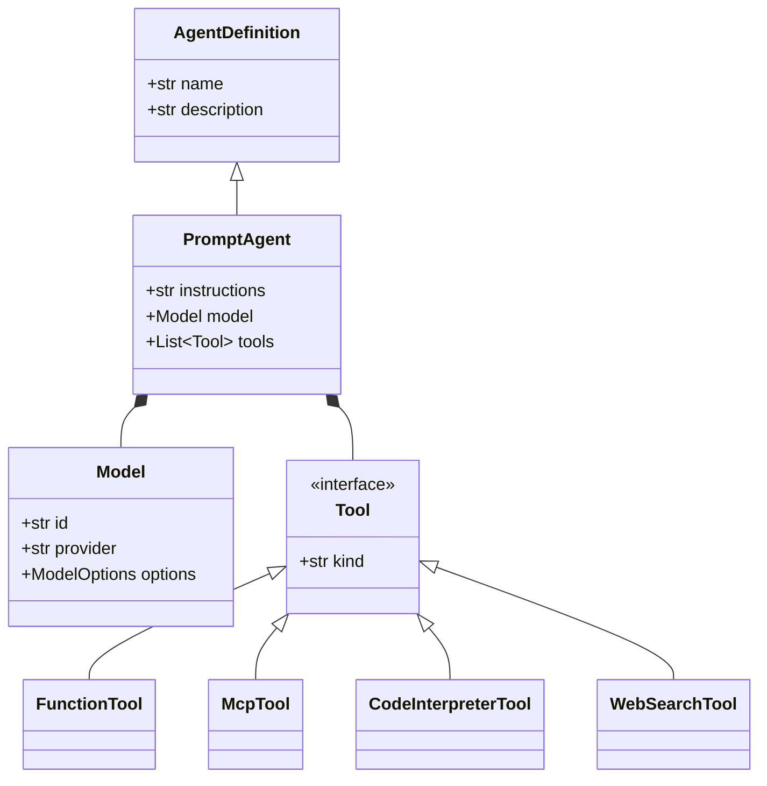

<!-- source: DeepWiki mcp.deepwiki.com · repo microsoft/agent-framework · page 4.9 Declarative Agents (Python) · fetched 2026-10-26 -->

# Declarative Agents (Python)

<details>
<summary>Relevant source files</summary>

The following files were used as context for generating this wiki page:

- [docs/decisions/0043-python-mcp-runtime-context.md](docs/decisions/0043-python-mcp-runtime-context.md)
- [python/packages/core/agent_framework/declarative/__init__.py](python/packages/core/agent_framework/declarative/__init__.py)
- [python/packages/core/agent_framework/declarative/__init__.pyi](python/packages/core/agent_framework/declarative/__init__.pyi)
- [python/packages/declarative/AGENTS.md](python/packages/declarative/AGENTS.md)
- [python/packages/declarative/agent_framework_declarative/__init__.py](python/packages/declarative/agent_framework_declarative/__init__.py)
- [python/packages/declarative/agent_framework_declarative/_loader.py](python/packages/declarative/agent_framework_declarative/_loader.py)
- [python/packages/declarative/agent_framework_declarative/_models.py](python/packages/declarative/agent_framework_declarative/_models.py)
- [python/packages/declarative/agent_framework_declarative/_workflows/__init__.py](python/packages/declarative/agent_framework_declarative/_workflows/__init__.py)
- [python/packages/declarative/agent_framework_declarative/_workflows/_declarative_base.py](python/packages/declarative/agent_framework_declarative/_workflows/_declarative_base.py)
- [python/packages/declarative/agent_framework_declarative/_workflows/_declarative_builder.py](python/packages/declarative/agent_framework_declarative/_workflows/_declarative_builder.py)
- [python/packages/declarative/agent_framework_declarative/_workflows/_executors_agents.py](python/packages/declarative/agent_framework_declarative/_workflows/_executors_agents.py)
- [python/packages/declarative/agent_framework_declarative/_workflows/_executors_basic.py](python/packages/declarative/agent_framework_declarative/_workflows/_executors_basic.py)
- [python/packages/declarative/agent_framework_declarative/_workflows/_executors_control_flow.py](python/packages/declarative/agent_framework_declarative/_workflows/_executors_control_flow.py)
- [python/packages/declarative/agent_framework_declarative/_workflows/_executors_external_input.py](python/packages/declarative/agent_framework_declarative/_workflows/_executors_external_input.py)
- [python/packages/declarative/agent_framework_declarative/_workflows/_executors_mcp.py](python/packages/declarative/agent_framework_declarative/_workflows/_executors_mcp.py)
- [python/packages/declarative/agent_framework_declarative/_workflows/_executors_tools.py](python/packages/declarative/agent_framework_declarative/_workflows/_executors_tools.py)
- [python/packages/declarative/agent_framework_declarative/_workflows/_factory.py](python/packages/declarative/agent_framework_declarative/_workflows/_factory.py)
- [python/packages/declarative/agent_framework_declarative/_workflows/_state.py](python/packages/declarative/agent_framework_declarative/_workflows/_state.py)
- [python/packages/declarative/agent_framework_declarative/_workflows/_state_path.py](python/packages/declarative/agent_framework_declarative/_workflows/_state_path.py)
- [python/packages/declarative/pyproject.toml](python/packages/declarative/pyproject.toml)
- [python/packages/declarative/tests/test_declarative_approval_binding.py](python/packages/declarative/tests/test_declarative_approval_binding.py)
- [python/packages/declarative/tests/test_declarative_loader.py](python/packages/declarative/tests/test_declarative_loader.py)
- [python/packages/declarative/tests/test_declarative_models.py](python/packages/declarative/tests/test_declarative_models.py)
- [python/packages/declarative/tests/test_declarative_state_path_safety.py](python/packages/declarative/tests/test_declarative_state_path_safety.py)
- [python/packages/declarative/tests/test_function_tool_executor.py](python/packages/declarative/tests/test_function_tool_executor.py)
- [python/packages/declarative/tests/test_graph_coverage.py](python/packages/declarative/tests/test_graph_coverage.py)
- [python/packages/declarative/tests/test_graph_executors.py](python/packages/declarative/tests/test_graph_executors.py)
- [python/packages/declarative/tests/test_graph_workflow_integration.py](python/packages/declarative/tests/test_graph_workflow_integration.py)
- [python/packages/declarative/tests/test_invoke_mcp_tool_executor.py](python/packages/declarative/tests/test_invoke_mcp_tool_executor.py)
- [python/packages/declarative/tests/test_workflow_factory.py](python/packages/declarative/tests/test_workflow_factory.py)
- [python/packages/declarative/tests/test_workflow_samples_integration.py](python/packages/declarative/tests/test_workflow_samples_integration.py)
- [python/packages/declarative/tests/test_workflow_state.py](python/packages/declarative/tests/test_workflow_state.py)
- [python/samples/02-agents/declarative/README.md](python/samples/02-agents/declarative/README.md)
- [python/samples/02-agents/declarative/get_weather_agent.py](python/samples/02-agents/declarative/get_weather_agent.py)
- [python/samples/02-agents/declarative/inline_yaml.py](python/samples/02-agents/declarative/inline_yaml.py)
- [python/samples/02-agents/declarative/mcp_tool_yaml.py](python/samples/02-agents/declarative/mcp_tool_yaml.py)
- [python/samples/02-agents/declarative/microsoft_learn_agent.py](python/samples/02-agents/declarative/microsoft_learn_agent.py)
- [python/samples/02-agents/declarative/openai_agent.py](python/samples/02-agents/declarative/openai_agent.py)
- [python/samples/03-workflows/declarative/README.md](python/samples/03-workflows/declarative/README.md)
- [python/samples/03-workflows/declarative/agent_to_function_tool/workflow.yaml](python/samples/03-workflows/declarative/agent_to_function_tool/workflow.yaml)
- [python/samples/03-workflows/declarative/invoke_mcp_tool/main.py](python/samples/03-workflows/declarative/invoke_mcp_tool/main.py)

</details>


This page documents the Python declarative agent and workflow system, which allows defining agents, workflows, and resources using YAML configuration files. The framework supports PowerFx expressions for dynamic behavior, environment variable resolution, and automated instantiation of complex structures including tools, model configurations, and graph-based workflows.

## Overview

The declarative system is provided by the `agent_framework_declarative` package [python/packages/declarative/pyproject.toml:1-7](). It bridges the gap between static YAML definitions and the live Python objects used by the framework (e.g., `Agent`, `BaseChatClient`, and graph `Workflow` executors).

### System Architecture

The following diagram illustrates the data flow and boundary between natural language/YAML specifications and core code entities in the Python implementation.

**Declarative Agent and Workflow Instantiation Flow**


Sources: [python/packages/declarative/agent_framework_declarative/_models.py:19-32](), [python/packages/declarative/agent_framework_declarative/_loader.py:61-125](), [python/packages/declarative/agent_framework_declarative/_loader.py:143-189](), [python/packages/declarative/agent_framework_declarative/_workflows/_factory.py:41-82]()

---

## AgentFactory

The `AgentFactory` is the primary entry point for loading declarative agent definitions. It handles the resolution of model providers, tool bindings, and connection references [python/packages/declarative/agent_framework_declarative/_loader.py:143-189]().

### Key Functions and Classes
- `AgentFactory`: Main factory class for parsing agent YAML manifests [python/packages/declarative/agent_framework_declarative/_loader.py:144-190]().
- `PROVIDER_TYPE_OBJECT_MAPPING`: Maps string provider descriptors (e.g. `"AzureOpenAI"`, `"OpenAI.Chat"`, `"Foundry"`) to client target classes and packages [python/packages/declarative/agent_framework_declarative/_loader.py:62-126]().

### Provider Mappings
The factory uses a lookup table (`PROVIDER_TYPE_OBJECT_MAPPING`) to instantiate the correct chat client based on the `provider` field in YAML:

| Provider Key | Target Class | Package |
|--------------|--------------|---------|
| `AzureOpenAI` | `OpenAIChatClient` | `agent_framework.openai` |
| `OpenAI.Chat` | `OpenAIChatCompletionClient` | `agent_framework.openai` |
| `Foundry` | `FoundryChatClient` | `agent_framework.foundry` |
| `Anthropic.Chat`| `AnthropicChatClient` | `agent_framework.anthropic` |

Sources: [python/packages/declarative/agent_framework_declarative/_loader.py:61-125](), [python/packages/declarative/agent_framework_declarative/_loader.py:143-203]()

---

## Declarative Workflows and State Management

The Python implementation supports graph-based declarative workflows that maintain parity with the .NET implementation. These are managed via `WorkflowFactory` and constructed using `DeclarativeWorkflowBuilder` [python/packages/declarative/agent_framework_declarative/_workflows/_declarative_builder.py:111-130]().

### Workflow State (`DeclarativeWorkflowState`)
`DeclarativeWorkflowState` manages workflow variables stored in the framework's `State` object, enabling persistence and checkpointing [python/packages/declarative/agent_framework_declarative/_workflows/_declarative_base.py:6-7](). It organizes data into isolated namespaces:
- `Inputs`: Initial workflow inputs [python/packages/declarative/agent_framework_declarative/_workflows/_declarative_base.py:182]().
- `Outputs`: Values to return from the workflow [python/packages/declarative/agent_framework_declarative/_workflows/_declarative_base.py:183]().
- `Local`: Turn-based mutable variables [python/packages/declarative/agent_framework_declarative/_workflows/_declarative_base.py:184]().
- `System`: System-level metadata (e.g., `ConversationId`, `LastMessage`) [python/packages/declarative/agent_framework_declarative/_workflows/_declarative_base.py:185]().
- `Agent`: Results from the most recent agent invocation [python/packages/declarative/agent_framework_declarative/_workflows/_declarative_base.py:186]().
- `Conversation`: Active conversation messages and history [python/packages/declarative/agent_framework_declarative/_workflows/_declarative_base.py:187]().

**Workflow Execution Model**


Sources: [python/packages/declarative/agent_framework_declarative/_workflows/_declarative_base.py:6-8](), [python/packages/declarative/agent_framework_declarative/_workflows/_declarative_base.py:175-184](), [python/packages/declarative/agent_framework_declarative/_workflows/_executors_agents.py:37-38]()

### Action Executors
Workflows are composed of actions defined in YAML. The `DeclarativeWorkflowBuilder` transforms these actions into a graph of `Executor` nodes [python/packages/declarative/agent_framework_declarative/_workflows/_declarative_builder.py:111-130](). Key executors mapped in `ALL_ACTION_EXECUTORS` include:
- `SetValue`: Updates a path in workflow state [python/packages/declarative/agent_framework_declarative/_workflows/_declarative_builder.py:53-61]().
- `SendActivity`: Yields output messages [python/packages/declarative/agent_framework_declarative/_workflows/_declarative_builder.py:53-61]().
- `Foreach`: Iterates over collections using `ForeachInitExecutor` and `ForeachNextExecutor` [python/packages/declarative/agent_framework_declarative/_workflows/_executors_control_flow.py:33-41]().
- `InvokeAzureAgent`: Invokes an AI agent and processes responses via `InvokeAzureAgentExecutor` [python/packages/declarative/agent_framework_declarative/_workflows/_executors_agents.py:3-13]().
- `HttpRequestAction`: Dispatches HTTP requests via a pluggable `HttpRequestHandler` [python/packages/declarative/agent_framework_declarative/_workflows/_http_handler.py:34-35]().
- `InvokeMcpTool`: Executes MCP tool calls via `InvokeMcpToolActionExecutor` [python/packages/declarative/agent_framework_declarative/_workflows/_executors_mcp.py:44-45]().

Sources: [python/packages/declarative/agent_framework_declarative/_workflows/_declarative_builder.py:53-61](), [python/packages/declarative/agent_framework_declarative/_workflows/_factory.py:43-50]()

---

## PowerFx Integration and Configuration

The framework supports PowerFx expressions for dynamic configuration. Any string value in YAML starting with `=` is evaluated as a PowerFx expression [python/packages/declarative/agent_framework_declarative/_models.py:60-61]().

### Evaluation and `DeclarativeEnvConfig`
Evaluation is handled by `_try_powerfx_eval` and `DeclarativeEnvConfig` [python/packages/declarative/agent_framework_declarative/_models.py:51-80](), [python/packages/declarative/agent_framework_declarative/_workflows/_declarative_base.py:138-164](). 
- `DeclarativeEnvConfig`: Populates the `Env` symbol for workflows [python/packages/declarative/agent_framework_declarative/_workflows/_declarative_base.py:138-144](). When `restrict_to_configuration` is `True` (default), the `Env` symbol is populated exclusively from configured values; otherwise, it can consult `os.environ` for explicitly referenced keys [python/packages/declarative/agent_framework_declarative/_workflows/_declarative_base.py:146-160]().
- `_safe_mode_context`: A `ContextVar` that governs whether environment variables are accessible in PowerFx expressions [python/packages/declarative/agent_framework_declarative/_models.py:37-41]().

Sources: [python/packages/declarative/agent_framework_declarative/_models.py:37-80](), [python/packages/declarative/agent_framework_declarative/_workflows/_declarative_base.py:138-181]()

---

## YAML Schema, Models, and Tool Binding

Declarative definitions are deserialized into internal models before being converted into live framework entities [python/packages/declarative/agent_framework_declarative/_models.py:83-138]().

### PromptAgent and Models
- `PromptAgent`: Represents the core agent prompt definition, containing instructions, model specifications, and tool lists [python/packages/declarative/agent_framework_declarative/_loader.py:147-150]().
- `Model`: Encapsulates `id`, `provider`, and `options` [python/packages/declarative/agent_framework_declarative/_loader.py:36-37]().

### Tool Definitions and Polymorphic Dispatch
Tool resources use a polymorphic dispatch mechanism via `Property.from_dict` and `agent_schema_dispatch` [python/packages/declarative/agent_framework_declarative/_models.py:117-138]():
- `function`: Maps to `FunctionTool`, requiring `bindings` in `AgentFactory` to connect YAML names to Python functions [python/packages/declarative/agent_framework_declarative/_loader.py:196-198]().
- `mcp`: Model Context Protocol tools (`McpTool`) supporting `serverName`, `serverUrl`, and approval modes [python/packages/declarative/agent_framework_declarative/_loader.py:35-35]().
- Hosted tools: `CodeInterpreterTool`, `WebSearchTool`, `FileSearchTool` [python/packages/declarative/agent_framework_declarative/_loader.py:31-42]().

**Entity Mapping Diagram**


Sources: [python/packages/declarative/agent_framework_declarative/_models.py:83-205](), [python/packages/declarative/agent_framework_declarative/_loader.py:31-45]()

---

## Practical Samples and Usage

The framework includes top-level samples in `python/samples/02-agents/declarative/` and `python/samples/03-workflows/declarative/` demonstrating inline YAML, MCP tools, and HTTP integrations [python/samples/02-agents/declarative/README.md:1-10]().

### Loading an Agent with Tool Bindings
```python
def get_weather(location: str) -> str:
    return f"Sunny in {location}"

factory = AgentFactory(
    bindings={"get_weather": get_weather}
)
agent = factory.create_agent_from_yaml(yaml_str)
```
Sources: [python/packages/declarative/agent_framework_declarative/_loader.py:192-203]()

### Creating and Running a Declarative Workflow
```python
from agent_framework_declarative import WorkflowFactory

factory = WorkflowFactory()
workflow = factory.create_workflow_from_yaml("""
name: hello-workflow
actions:
  - kind: SendActivity
    activity:
      text: ="Hello, " & inputs.name
""")

result = await workflow.run({"name": "User"})
```
Sources: [python/packages/declarative/agent_framework_declarative/_workflows/_factory.py:43-84]()

---

## Limitations and Runtime Considerations

1. **Python Version Compatibility:** PowerFx evaluation relies on the `powerfx` package, which is constrained on Python versions `< 3.14` [python/packages/declarative/pyproject.toml:27]().
2. **Safe Mode Configuration:** `safe_mode` is enabled by default (`True`), restricting PowerFx expressions from accessing `os.environ` unless explicitly configured via `DeclarativeEnvConfig` or by setting `safe_mode=False` [python/packages/declarative/agent_framework_declarative/_models.py:37-41](), [python/packages/declarative/agent_framework_declarative/_loader.py:200-201]().
3. **HTTP Security Note:** `DefaultHttpRequestHandler` performs no URL filtering or SSRF protection; production deployments should supply a custom `HttpRequestHandler` [python/packages/declarative/agent_framework_declarative/_workflows/_factory.py:114-119]().

Sources: [python/packages/declarative/pyproject.toml:27](), [python/packages/declarative/agent_framework_declarative/_models.py:37-41](), [python/packages/declarative/agent_framework_declarative/_workflows/_factory.py:114-119]()

---

