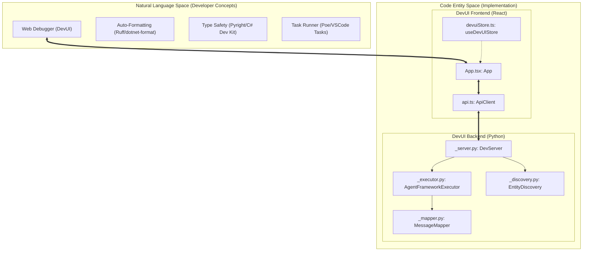
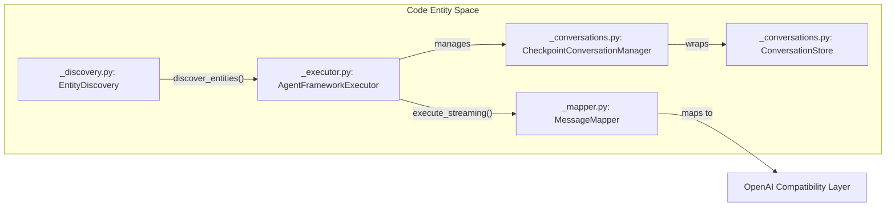

<!-- source: DeepWiki mcp.deepwiki.com · repo microsoft/agent-framework · page 5 Developer Tools · fetched 2026-10-26 -->

# Developer Tools

Relevant source files

The following files were used as context for generating this wiki page:

- [docs/decisions/0039-python-refusal-content.md](docs/decisions/0039-python-refusal-content.md)
- [python/packages/devui/AGENTS.md](python/packages/devui/AGENTS.md)
- [python/packages/devui/README.md](python/packages/devui/README.md)
- [python/packages/devui/agent_framework_devui/__init__.py](python/packages/devui/agent_framework_devui/__init__.py)
- [python/packages/devui/agent_framework_devui/_cli.py](python/packages/devui/agent_framework_devui/_cli.py)
- [python/packages/devui/agent_framework_devui/_conversations.py](python/packages/devui/agent_framework_devui/_conversations.py)
- [python/packages/devui/agent_framework_devui/_discovery.py](python/packages/devui/agent_framework_devui/_discovery.py)
- [python/packages/devui/agent_framework_devui/_executor.py](python/packages/devui/agent_framework_devui/_executor.py)
- [python/packages/devui/agent_framework_devui/_mapper.py](python/packages/devui/agent_framework_devui/_mapper.py)
- [python/packages/devui/agent_framework_devui/_server.py](python/packages/devui/agent_framework_devui/_server.py)
- [python/packages/devui/agent_framework_devui/_utils.py](python/packages/devui/agent_framework_devui/_utils.py)
- [python/packages/devui/agent_framework_devui/models/_openai_custom.py](python/packages/devui/agent_framework_devui/models/_openai_custom.py)
- [python/packages/devui/agent_framework_devui/ui/assets/index.css](python/packages/devui/agent_framework_devui/ui/assets/index.css)
- [python/packages/devui/agent_framework_devui/ui/assets/index.js](python/packages/devui/agent_framework_devui/ui/assets/index.js)
- [python/packages/devui/dev.md](python/packages/devui/dev.md)
- [python/packages/devui/frontend/src/App.tsx](python/packages/devui/frontend/src/App.tsx)
- [python/packages/devui/frontend/src/components/features/agent/agent-view.tsx](python/packages/devui/frontend/src/components/features/agent/agent-view.tsx)
- [python/packages/devui/frontend/src/components/features/agent/message-renderers/OpenAIContentRenderer.tsx](python/packages/devui/frontend/src/components/features/agent/message-renderers/OpenAIContentRenderer.tsx)
- [python/packages/devui/frontend/src/components/features/workflow/execution-timeline.tsx](python/packages/devui/frontend/src/components/features/workflow/execution-timeline.tsx)
- [python/packages/devui/frontend/src/components/features/workflow/index.ts](python/packages/devui/frontend/src/components/features/workflow/index.ts)
- [python/packages/devui/frontend/src/components/features/workflow/schema-form-renderer.tsx](python/packages/devui/frontend/src/components/features/workflow/schema-form-renderer.tsx)
- [python/packages/devui/frontend/src/components/features/workflow/workflow-input-form.tsx](python/packages/devui/frontend/src/components/features/workflow/workflow-input-form.tsx)
- [python/packages/devui/frontend/src/components/features/workflow/workflow-view.tsx](python/packages/devui/frontend/src/components/features/workflow/workflow-view.tsx)
- [python/packages/devui/frontend/src/components/layout/debug-panel.tsx](python/packages/devui/frontend/src/components/layout/debug-panel.tsx)
- [python/packages/devui/frontend/src/components/layout/settings-modal.tsx](python/packages/devui/frontend/src/components/layout/settings-modal.tsx)
- [python/packages/devui/frontend/src/services/api.ts](python/packages/devui/frontend/src/services/api.ts)
- [python/packages/devui/frontend/src/services/streaming-state.ts](python/packages/devui/frontend/src/services/streaming-state.ts)
- [python/packages/devui/frontend/src/stores/devuiStore.ts](python/packages/devui/frontend/src/stores/devuiStore.ts)
- [python/packages/devui/frontend/src/types/index.ts](python/packages/devui/frontend/src/types/index.ts)
- [python/packages/devui/frontend/src/types/openai.ts](python/packages/devui/frontend/src/types/openai.ts)
- [python/packages/devui/frontend/src/utils/workflow-utils.ts](python/packages/devui/frontend/src/utils/workflow-utils.ts)
- [python/packages/devui/tests/devui/test_approval_validation.py](python/packages/devui/tests/devui/test_approval_validation.py)
- [python/packages/devui/tests/devui/test_conversations.py](python/packages/devui/tests/devui/test_conversations.py)
- [python/packages/devui/tests/devui/test_mapper.py](python/packages/devui/tests/devui/test_mapper.py)
- [python/packages/devui/tests/devui/test_multimodal_workflow.py](python/packages/devui/tests/devui/test_multimodal_workflow.py)
- [python/packages/devui/tests/devui/test_schema_generation.py](python/packages/devui/tests/devui/test_schema_generation.py)
- [python/packages/devui/tests/devui/test_server.py](python/packages/devui/tests/devui/test_server.py)
- [python/packages/devui/tests/devui/test_ui_memory_regression.py](python/packages/devui/tests/devui/test_ui_memory_regression.py)

The Microsoft Agent Framework provides comprehensive tooling to streamline agent and workflow development, testing, and debugging across both .NET and Python implementations. This page serves as a high-level overview of the available developer tools and how they integrate into the development lifecycle.

## Overview

The framework includes several developer-focused tooling categories designed to accelerate inner-loop iteration, maintain code quality, and simplify debugging:

| Tool Category | Purpose | Detailed Coverage |
|---------------|---------|-------------------|
| **DevUI** | Interactive web-based interface for testing and debugging agents and workflows | [DevUI Developer Interface](#5.1) |
| **VS Code Configuration** | Preconfigured settings, tasks, and devcontainers for Python and .NET | [VS Code Configuration](#5.2) |
| **Package Management** | Workspace and dependency management with `uv` (Python) and NuGet (.NET) | Section 7.1.1, Section 7.2.1 |
| **Task Automation** | `poethepoet` task orchestration for formatting, linting, and testing | Section 7.2.4 |
| **Code Quality & Testing** | Ruff, Pyright, Mypy (Python) and dotnet-format/analyzers (.NET) | Section 9.3 |

Sources: [python/packages/devui/agent_framework_devui/_server.py:67-113](), [python/packages/devui/agent_framework_devui/_executor.py:45-77]()

## Developer Tools Architecture

The following diagrams illustrate how abstract development concepts map to the concrete code entities implementing developer tooling within the codebase.

Title: "DevUI Bridge: Natural Language to Code Entity Space"

Sources: [python/packages/devui/agent_framework_devui/_server.py:67-113](), [python/packages/devui/agent_framework_devui/_executor.py:45-77](), [python/packages/devui/frontend/src/App.tsx:26-125](), [python/packages/devui/frontend/src/services/api.ts:132-170]()

Title: "Execution Flow: Agent Interface to Internal Logic"

Sources: [python/packages/devui/agent_framework_devui/_executor.py:45-77](), [python/packages/devui/agent_framework_devui/_discovery.py:23-51](), [python/packages/devui/agent_framework_devui/_mapper.py:175-184]()

## DevUI Developer Interface

DevUI is a web-based developer interface designed to facilitate local inspection, testing, and debugging of agents and workflows. It provides an OpenAI-compatible API backend (`DevServer`) paired with a React frontend (`App`) that handles real-time streaming, conversation session tracking, and tool execution approval flows [python/packages/devui/agent_framework_devui/_server.py:67-113](), [python/packages/devui/frontend/src/App.tsx:26-125]().

The backend uses `EntityDiscovery` to locate and lazily load agent definitions from directories [python/packages/devui/agent_framework_devui/_discovery.py:23-105](), while `AgentFrameworkExecutor` manages run execution, instrumentation setup, and tool safety checks (`_pending_approvals`) [python/packages/devui/agent_framework_devui/_executor.py:45-77](). For enhanced security when bound to non-loopback hosts, authentication tokens are strictly enforced [python/packages/devui/agent_framework_devui/_server.py:141-165]().

For details, see [DevUI Developer Interface](#5.1).

Sources: [python/packages/devui/agent_framework_devui/_server.py:67-165](), [python/packages/devui/agent_framework_devui/_executor.py:45-77](), [python/packages/devui/agent_framework_devui/_discovery.py:23-105]()

## VS Code Configuration

The framework includes workspace-level configurations to standardize editor behavior across development environments. These configurations enable strict type checking, consistent code formatting, and streamlined integration with task runners.

Settings provide preconfigured support for tools such as Ruff and Pyright in Python, along with automated code analysis and spell-checking configurations to maintain high code quality standards across the monorepo [python/packages/devui/agent_framework_devui/_server.py:67-80]().

For details, see [VS Code Configuration](#5.2).

Sources: [python/packages/devui/agent_framework_devui/_server.py:67-80]()

---

