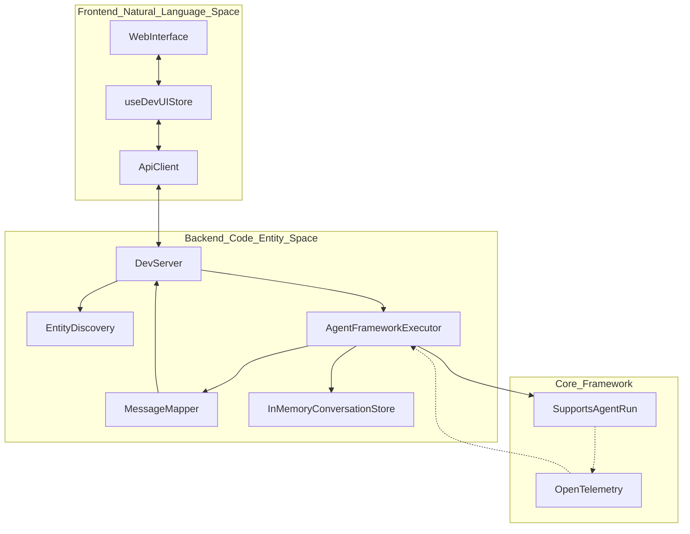
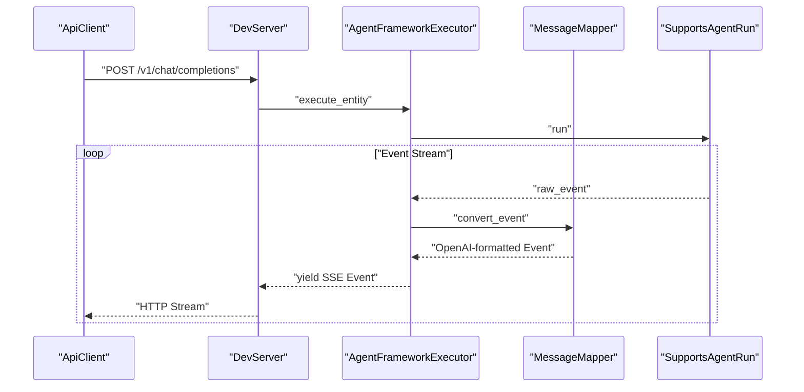

<!-- source: DeepWiki mcp.deepwiki.com · repo microsoft/agent-framework · page 5.1 DevUI Developer Interface · fetched 2026-10-26 -->

# DevUI Developer Interface

Relevant source files

The following files were used as context for generating this wiki page:

- [docs/decisions/0039-python-refusal-content.md](docs/decisions/0039-python-refusal-content.md)
- [python/packages/devui/AGENTS.md](python/packages/devui/AGENTS.md)
- [python/packages/devui/README.md](python/packages/devui/README.md)
- [python/packages/devui/agent_framework_devui/__init__.py](python/packages/devui/agent_framework_devui/__init__.py)
- [python/packages/devui/agent_framework_devui/_cli.py](python/packages/devui/agent_framework_devui/_cli.py)
- [python/packages/devui/agent_framework_devui/_conversations.py](python/packages/devui/agent_framework_devui/_conversations.py)
- [python/packages/devui/agent_framework_devui/_discovery.py](python/packages/devui/agent_framework_devui/_discovery.py)
- [python/packages/devui/agent_framework_devui/_executor.py](python/packages/devui/agent_framework_devui/_executor.py)
- [python/packages/devui/agent_framework_devui/_mapper.py](python/packages/devui/agent_framework_devui/_mapper.py)
- [python/packages/devui/agent_framework_devui/_server.py](python/packages/devui/agent_framework_devui/_server.py)
- [python/packages/devui/agent_framework_devui/_utils.py](python/packages/devui/agent_framework_devui/_utils.py)
- [python/packages/devui/agent_framework_devui/models/_openai_custom.py](python/packages/devui/agent_framework_devui/models/_openai_custom.py)
- [python/packages/devui/agent_framework_devui/ui/assets/index.css](python/packages/devui/agent_framework_devui/ui/assets/index.css)
- [python/packages/devui/agent_framework_devui/ui/assets/index.js](python/packages/devui/agent_framework_devui/ui/assets/index.js)
- [python/packages/devui/dev.md](python/packages/devui/dev.md)
- [python/packages/devui/frontend/package-lock.json](python/packages/devui/frontend/package-lock.json)
- [python/packages/devui/frontend/package.json](python/packages/devui/frontend/package.json)
- [python/packages/devui/frontend/src/App.tsx](python/packages/devui/frontend/src/App.tsx)
- [python/packages/devui/frontend/src/components/features/agent/agent-view.tsx](python/packages/devui/frontend/src/components/features/agent/agent-view.tsx)
- [python/packages/devui/frontend/src/components/features/agent/message-renderers/OpenAIContentRenderer.tsx](python/packages/devui/frontend/src/components/features/agent/message-renderers/OpenAIContentRenderer.tsx)
- [python/packages/devui/frontend/src/components/features/workflow/execution-timeline.tsx](python/packages/devui/frontend/src/components/features/workflow/execution-timeline.tsx)
- [python/packages/devui/frontend/src/components/features/workflow/index.ts](python/packages/devui/frontend/src/components/features/workflow/index.ts)
- [python/packages/devui/frontend/src/components/features/workflow/schema-form-renderer.tsx](python/packages/devui/frontend/src/components/features/workflow/schema-form-renderer.tsx)
- [python/packages/devui/frontend/src/components/features/workflow/workflow-input-form.tsx](python/packages/devui/frontend/src/components/features/workflow/workflow-input-form.tsx)
- [python/packages/devui/frontend/src/components/features/workflow/workflow-view.tsx](python/packages/devui/frontend/src/components/features/workflow/workflow-view.tsx)
- [python/packages/devui/frontend/src/components/layout/debug-panel.tsx](python/packages/devui/frontend/src/components/layout/debug-panel.tsx)
- [python/packages/devui/frontend/src/components/layout/settings-modal.tsx](python/packages/devui/frontend/src/components/layout/settings-modal.tsx)
- [python/packages/devui/frontend/src/services/api.ts](python/packages/devui/frontend/src/services/api.ts)
- [python/packages/devui/frontend/src/services/streaming-state.ts](python/packages/devui/frontend/src/services/streaming-state.ts)
- [python/packages/devui/frontend/src/stores/devuiStore.ts](python/packages/devui/frontend/src/stores/devuiStore.ts)
- [python/packages/devui/frontend/src/types/index.ts](python/packages/devui/frontend/src/types/index.ts)
- [python/packages/devui/frontend/src/types/openai.ts](python/packages/devui/frontend/src/types/openai.ts)
- [python/packages/devui/frontend/src/utils/workflow-utils.ts](python/packages/devui/frontend/src/utils/workflow-utils.ts)
- [python/packages/devui/frontend/yarn.lock](python/packages/devui/frontend/yarn.lock)
- [python/packages/devui/tests/devui/test_approval_validation.py](python/packages/devui/tests/devui/test_approval_validation.py)
- [python/packages/devui/tests/devui/test_conversations.py](python/packages/devui/tests/devui/test_conversations.py)
- [python/packages/devui/tests/devui/test_mapper.py](python/packages/devui/tests/devui/test_mapper.py)
- [python/packages/devui/tests/devui/test_multimodal_workflow.py](python/packages/devui/tests/devui/test_multimodal_workflow.py)
- [python/packages/devui/tests/devui/test_schema_generation.py](python/packages/devui/tests/devui/test_schema_generation.py)
- [python/packages/devui/tests/devui/test_server.py](python/packages/devui/tests/devui/test_server.py)
- [python/packages/devui/tests/devui/test_ui_memory_regression.py](python/packages/devui/tests/devui/test_ui_memory_regression.py)
- [python/samples/05-end-to-end/ag_ui_single_agent/frontend/package-lock.json](python/samples/05-end-to-end/ag_ui_single_agent/frontend/package-lock.json)
- [python/samples/05-end-to-end/ag_ui_single_agent/frontend/package.json](python/samples/05-end-to-end/ag_ui_single_agent/frontend/package.json)
- [python/samples/05-end-to-end/ag_ui_workflow_handoff/frontend/package-lock.json](python/samples/05-end-to-end/ag_ui_workflow_handoff/frontend/package-lock.json)
- [python/samples/05-end-to-end/ag_ui_workflow_handoff/frontend/package.json](python/samples/05-end-to-end/ag_ui_workflow_handoff/frontend/package.json)
- [python/samples/05-end-to-end/chatkit-integration/frontend/package-lock.json](python/samples/05-end-to-end/chatkit-integration/frontend/package-lock.json)
- [python/samples/05-end-to-end/chatkit-integration/frontend/package.json](python/samples/05-end-to-end/chatkit-integration/frontend/package.json)

## Purpose and Scope

The `agent-framework-devui` package provides a web-based developer interface and a FastAPI debug server for testing and debugging agents and workflows. It implements an OpenAI-compatible API, allowing developers to use standard tools and SDKs to interact with their local Agent Framework entities. DevUI enables real-time interaction, execution tracing, and state inspection during the development lifecycle. Additionally, the `.NET` ecosystem provides the `Microsoft.Agents.AI.DevUI` package alongside Aspire integration for orchestrating agent services.

Sources: [python/packages/devui/agent_framework_devui/_server.py:68-78](), [python/packages/devui/README.md:1-10](), [dotnet/src/Microsoft.Agents.AI.DevUI/Microsoft.Agents.AI.DevUI.csproj:1-39]()

## Architecture and Data Flow

DevUI bridges the React-based frontend web interface and the Agent Framework core execution engine. The FastAPI backend orchestrates entity discovery, run dispatching, and OpenTelemetry trace capture.

The `DevServer` class initializes `EntityDiscovery` to scan for agents and workflows [python/packages/devui/agent_framework_devui/_server.py:81-94](). When execution is triggered, `AgentFrameworkExecutor` manages the agent or workflow run lifecycle, maintaining conversation state via `InMemoryConversationStore` and capturing traces through OpenTelemetry [python/packages/devui/agent_framework_devui/_executor.py:45-70]().

Sources: [python/packages/devui/agent_framework_devui/_server.py:68-113](), [python/packages/devui/agent_framework_devui/_executor.py:45-70](), [python/packages/devui/frontend/src/services/api.ts:132-180]()

### Entity Discovery and Lazy Loading

DevUI employs a lazy-loading strategy. It performs a sparse directory scan to identify potential agents or workflows without importing their modules immediately, loading modules on-demand upon first interaction.

| Code Entity | File Path | Role |
| :--- | :--- | :--- |
| `EntityDiscovery` | `_discovery.py` | Scans directories and registers discovered entities |
| `discover_entities` | `_discovery.py` | Executes the initial directory scan |
| `load_entity` | `_discovery.py` | Dynamically imports modules and enriches entity metadata |

Sources: [python/packages/devui/agent_framework_devui/_discovery.py:23-155]()

## Implementation Details

### Request Execution Flow

Incoming chat requests sent to `/v1/chat/completions` are handled by `DevServer` and processed via `AgentFrameworkExecutor`.

The `MessageMapper` class converts Agent Framework `Content` items (such as function calls and usage details) into OpenAI-compatible JSON responses [python/packages/devui/agent_framework_devui/_mapper.py:101-117](). It recursively serializes nested content objects via `_serialize_content_recursive` [python/packages/devui/agent_framework_devui/_mapper.py:120-173]().

Sources: [python/packages/devui/agent_framework_devui/_executor.py:45-70](), [python/packages/devui/agent_framework_devui/_mapper.py:101-173]()

### Trace and Instrumentation Capture

DevUI implements instrumentation to intercept OpenTelemetry spans generated during execution:
- **`_setup_instrumentation_provider`**: Sets up a local `TracerProvider` if none exists [python/packages/devui/agent_framework_devui/_executor.py:78-95]().
- **`_setup_agent_framework_instrumentation`**: Configures built-in Agent Framework observability settings [python/packages/devui/agent_framework_devui/_executor.py:103-120]().

Sources: [python/packages/devui/agent_framework_devui/_executor.py:78-120]()

### Authentication and Access Control

DevServer implements Bearer token authentication to protect endpoints on non-loopback bindings [python/packages/devui/agent_framework_devui/_server.py:141-165]().
- **Token Resolution**: Resolved from `DEVUI_AUTH_TOKEN` environment variables or explicit parameters [python/packages/devui/agent_framework_devui/_server.py:153-156]().
- **Automatic Generation**: When bound to loopback without an explicit token, a secure token is auto-generated and logged to the console [python/packages/devui/agent_framework_devui/_server.py:159-165]().

Sources: [python/packages/devui/agent_framework_devui/_server.py:141-166]()

## Frontend Implementation

The frontend is a React application built with Vite and Tailwind CSS [python/packages/devui/frontend/package.json:1-50]().

### State Management and Services

| Component | File Path | Role |
| :--- | :--- | :--- |
| `ApiClient` | `services/api.ts` | Encapsulates API requests, authentication headers, and stream reconnections [python/packages/devui/frontend/src/services/api.ts:132-221]() |

Sources: [python/packages/devui/frontend/src/services/api.ts:132-221](), [python/packages/devui/frontend/package.json:1-50]()

## .NET DevUI and Aspire Integration

The .NET ecosystem provides developer support through the `Microsoft.Agents.AI.DevUI` package and .NET Aspire integration. Aspire allows orchestrating DevUI alongside multi-agent applications, providing standardized endpoints for monitoring and debugging .NET agents.

Sources: [dotnet/src/Microsoft.Agents.AI.DevUI/Microsoft.Agents.AI.DevUI.csproj:1-39]()

---

