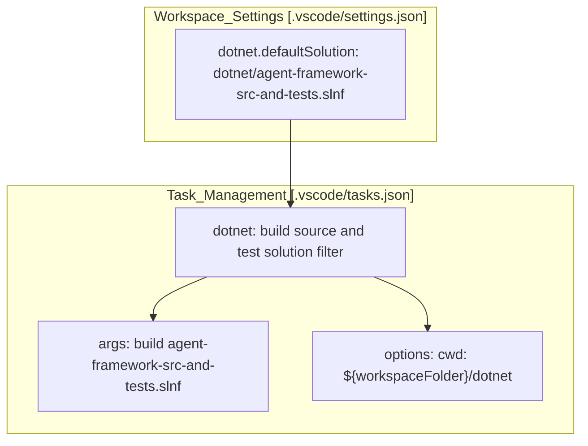
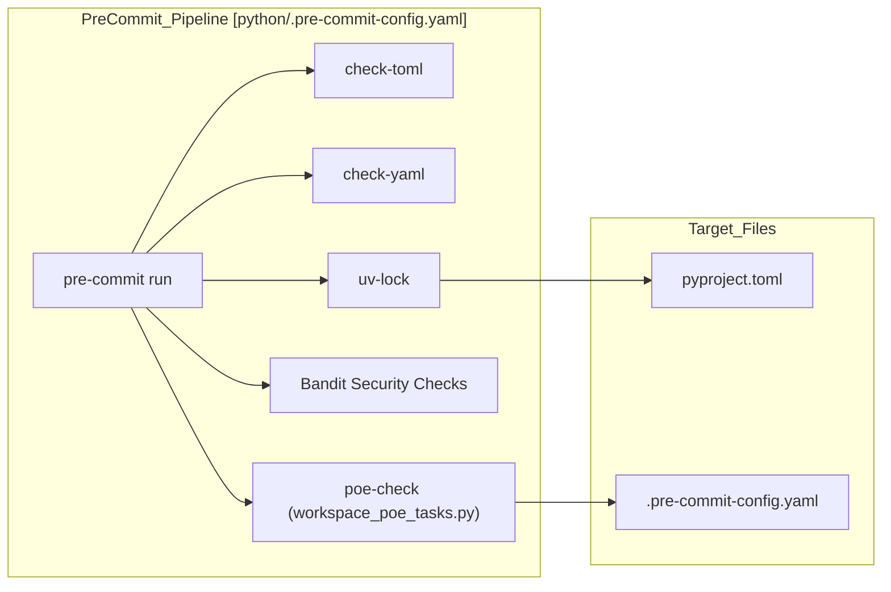
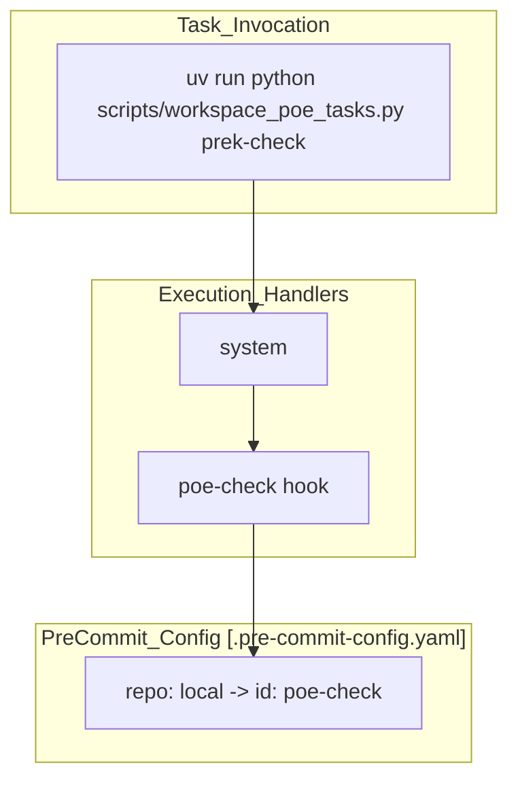

<!-- source: DeepWiki mcp.deepwiki.com · repo microsoft/agent-framework · page 5.2 VS Code Configuration · fetched 2026-10-26 -->

# VS Code Configuration

<details>
<summary>Relevant source files</summary>

The following files were used as context for generating this wiki page:

- [.github/scripts/check_python_api_compatibility.py](.github/scripts/check_python_api_compatibility.py)
- [.github/skills/pull-requests/SKILL.md](.github/skills/pull-requests/SKILL.md)
- [.github/tests/test_python_api_compatibility.py](.github/tests/test_python_api_compatibility.py)
- [.gitignore](.gitignore)
- [.vscode/settings.json](.vscode/settings.json)
- [.vscode/tasks.json](.vscode/tasks.json)
- [CONTRIBUTING.md](CONTRIBUTING.md)
- [docs/assets/readme-banner.png](docs/assets/readme-banner.png)
- [dotnet/.github/skills/pull-requests/SKILL.md](dotnet/.github/skills/pull-requests/SKILL.md)
- [dotnet/.gitignore](dotnet/.gitignore)
- [dotnet/agent-framework-release.slnf](dotnet/agent-framework-release.slnf)
- [dotnet/agent-framework-src-and-tests.slnf](dotnet/agent-framework-src-and-tests.slnf)
- [dotnet/nuget/NUGET.md](dotnet/nuget/NUGET.md)
- [dotnet/nuget/icon.png](dotnet/nuget/icon.png)
- [python/.github/skills/pull-requests/SKILL.md](python/.github/skills/pull-requests/SKILL.md)
- [python/.pre-commit-config.yaml](python/.pre-commit-config.yaml)
- [python/packages/devui/frontend/src/lib/utils.ts](python/packages/devui/frontend/src/lib/utils.ts)

</details>


## Purpose and Scope

This document details the Visual Studio Code workspace settings, tasks, extensions, and Dev Container configurations used for developing the Microsoft Agent Framework across both Python and .NET ecosystems. It covers integration with code quality and formatting engines such as **Ruff**, static type analyzers like **Pyright**, build orchestration tools, and automated linting tasks.

For related development resources, see [5.1 DevUI Developer Interface]() and [9 Development Guide]().

Sources: [.vscode/settings.json:1-3](), [.vscode/tasks.json:1-16]()

---

## Workspace Settings and Solution Filtering

The workspace root contains configurations tailored to load specific solution filters and enforce editor behaviors. For .NET development, VS Code is pre-configured to default to specific solution filter files rather than loading entire multi-project structures directly.

### Solution Configuration

The default solution filter for .NET projects is configured in the global workspace settings via `dotnet.defaultSolution`, pointing to the source and test solution filter.

```json
{
	"dotnet.defaultSolution": "dotnet/agent-framework-src-and-tests.slnf"
}
```

VS Code tasks are similarly configured to operate against the `dotnet` directory using standard build processes.



**Title: .NET Workspace Setting and Task Mapping**

Sources: [.vscode/settings.json:1-3](), [.vscode/tasks.json:1-16]()

---

## Python Workspace and Quality Tooling

The Python workspace relies on strict enforcement of style and typing standards. Development is structured around `uv` for package management and `poe` for task execution, mirrored in editor extension configurations.

### Code Quality Integration

Workspace validation relies on pre-commit hooks and local task runners defined in `python/.pre-commit-config.yaml`. These components enforce formatting rules, security checks, and lockfile synchronization.



**Title: Python Pre-commit and Quality Pipeline**

Sources: [python/.pre-commit-config.yaml:1-70]()

### Code Quality Tools Reference

| Tool | Purpose | Configuration Scope | Source Reference |
| :--- | :--- | :--- | :--- |
| `ruff` | Linting, Formatting, Import Sorting | Python Source Files | [python/.pre-commit-config.yaml:63-70]() |
| `bandit` | Security Static Analysis | Python Source Files | [python/.pre-commit-config.yaml:56-62]() |
| `pyupgrade` | Python Syntax Modernization | Python Source Files | [python/.pre-commit-config.yaml:43-49]() |
| `pre-commit` | Hook Orchestration | Repository Root | [python/.pre-commit-config.yaml:1-55]() |

Sources: [python/.pre-commit-config.yaml:1-70]()

---

## Development Environment Setup and Task Execution

Local automation is exposed through VS Code task definitions and Python task runners. Developers can execute pre-configured tasks for building, testing, and linting.

### Python Poe Tasks Integration
Local checks and tests are orchestrated through `uv run python scripts/workspace_poe_tasks.py prek-check` as registered in pre-commit hooks.



**Title: Poe Task Integration Flow**

Sources: [python/.pre-commit-config.yaml:50-55]()

Sources: [.vscode/settings.json:1-3](), [.vscode/tasks.json:1-16](), [python/.pre-commit-config.yaml:1-70]()

---

