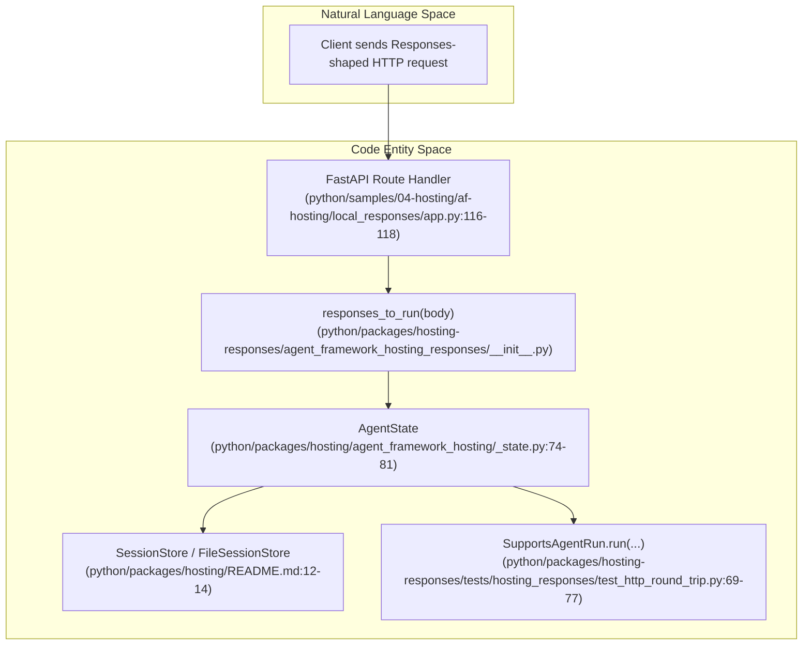
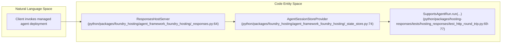

<!-- source: DeepWiki mcp.deepwiki.com · repo microsoft/agent-framework · page 6 Deployment and Hosting · fetched 2026-10-26 -->

# Deployment and Hosting

Relevant source files

The following files were used as context for generating this wiki page:

- [docs/decisions/0027-hosting-channels.md](docs/decisions/0027-hosting-channels.md)
- [docs/decisions/0028-hosting-linking-multicast-enhancements.md](docs/decisions/0028-hosting-linking-multicast-enhancements.md)
- [docs/specs/002-python-hosting-channels.md](docs/specs/002-python-hosting-channels.md)
- [dotnet/src/Microsoft.Agents.AI.Hosting/AIHostAgent.cs](dotnet/src/Microsoft.Agents.AI.Hosting/AIHostAgent.cs)
- [dotnet/src/Microsoft.Agents.AI.Hosting/AgentHostingServiceCollectionExtensions.cs](dotnet/src/Microsoft.Agents.AI.Hosting/AgentHostingServiceCollectionExtensions.cs)
- [dotnet/src/Microsoft.Agents.AI.Hosting/HostApplicationBuilderAgentExtensions.cs](dotnet/src/Microsoft.Agents.AI.Hosting/HostApplicationBuilderAgentExtensions.cs)
- [dotnet/src/Microsoft.Agents.AI.Hosting/HostApplicationBuilderWorkflowExtensions.cs](dotnet/src/Microsoft.Agents.AI.Hosting/HostApplicationBuilderWorkflowExtensions.cs)
- [dotnet/src/Microsoft.Agents.AI.Hosting/HostedAgentBuilder.cs](dotnet/src/Microsoft.Agents.AI.Hosting/HostedAgentBuilder.cs)
- [dotnet/src/Microsoft.Agents.AI.Hosting/HostedAgentBuilderExtensions.cs](dotnet/src/Microsoft.Agents.AI.Hosting/HostedAgentBuilderExtensions.cs)
- [dotnet/src/Microsoft.Agents.AI.Hosting/HostedWorkflowBuilderExtensions.cs](dotnet/src/Microsoft.Agents.AI.Hosting/HostedWorkflowBuilderExtensions.cs)
- [dotnet/src/Microsoft.Agents.AI.Hosting/IHostedAgentBuilder.cs](dotnet/src/Microsoft.Agents.AI.Hosting/IHostedAgentBuilder.cs)
- [dotnet/tests/Microsoft.Agents.AI.Hosting.UnitTests/AgentHostingServiceCollectionExtensionsTests.cs](dotnet/tests/Microsoft.Agents.AI.Hosting.UnitTests/AgentHostingServiceCollectionExtensionsTests.cs)
- [dotnet/tests/Microsoft.Agents.AI.Hosting.UnitTests/HostApplicationBuilderAgentExtensionsTests.cs](dotnet/tests/Microsoft.Agents.AI.Hosting.UnitTests/HostApplicationBuilderAgentExtensionsTests.cs)
- [dotnet/tests/Microsoft.Agents.AI.Hosting.UnitTests/HostApplicationBuilderWorkflowExtensionsTests.cs](dotnet/tests/Microsoft.Agents.AI.Hosting.UnitTests/HostApplicationBuilderWorkflowExtensionsTests.cs)
- [dotnet/tests/Microsoft.Agents.AI.Hosting.UnitTests/HostedAgentBuilderToolsExtensionsTests.cs](dotnet/tests/Microsoft.Agents.AI.Hosting.UnitTests/HostedAgentBuilderToolsExtensionsTests.cs)
- [python/packages/hosting-responses/README.md](python/packages/hosting-responses/README.md)
- [python/packages/hosting-responses/agent_framework_hosting_responses/__init__.py](python/packages/hosting-responses/agent_framework_hosting_responses/__init__.py)
- [python/packages/hosting-responses/agent_framework_hosting_responses/_parsing.py](python/packages/hosting-responses/agent_framework_hosting_responses/_parsing.py)
- [python/packages/hosting-responses/tests/hosting_responses/test_http_round_trip.py](python/packages/hosting-responses/tests/hosting_responses/test_http_round_trip.py)
- [python/packages/hosting-responses/tests/hosting_responses/test_parsing.py](python/packages/hosting-responses/tests/hosting_responses/test_parsing.py)
- [python/packages/hosting/README.md](python/packages/hosting/README.md)
- [python/packages/hosting/agent_framework_hosting/_state.py](python/packages/hosting/agent_framework_hosting/_state.py)
- [python/packages/hosting/tests/hosting/test_state.py](python/packages/hosting/tests/hosting/test_state.py)
- [python/samples/04-hosting/af-hosting/local_responses/README.md](python/samples/04-hosting/af-hosting/local_responses/README.md)
- [python/samples/04-hosting/af-hosting/local_responses/app.py](python/samples/04-hosting/af-hosting/local_responses/app.py)
- [python/samples/04-hosting/af-hosting/local_responses_workflow/README.md](python/samples/04-hosting/af-hosting/local_responses_workflow/README.md)
- [python/samples/04-hosting/af-hosting/local_responses_workflow/app.py](python/samples/04-hosting/af-hosting/local_responses_workflow/app.py)
- [python/samples/04-hosting/af-hosting/local_responses_workflow/call_server.py](python/samples/04-hosting/af-hosting/local_responses_workflow/call_server.py)

This page provides an overview of deployment and hosting options for agents and workflows built with the Microsoft Agent Framework across both .NET and Python implementations. The framework decouples core agent execution logic from network transport layers, allowing developers to host AI capabilities in standard web frameworks, serverless environments, and containerized architectures.

For detailed technical specifications, refer to the following child pages:
- [.NET Deployment Options](#6.1) — Overview of .NET deployment strategies including Azure Functions, ASP.NET Core, and containers
- [Python Deployment Options](#6.2) — Cover Python deployment including FastAPI hosting, Azure Functions, Durable Task, Telegram hosting, the hosting/hosting-responses packages, and containerized deployments
- [Authentication and Configuration](#6.3) — Document authentication patterns including TokenCredential, API keys, managed identity, and environment configuration
- [Foundry Hosted Agents](#6.4) — Document the Foundry Hosted Agents pattern for deploying agents as managed services, including the Responses API hosting protocol, toolbox integration, session isolation, and the .NET Foundry.Hosting package

---

## Hosting Architecture Overview

The Microsoft Agent Framework uses a decoupled hosting architecture. In .NET, hosting integrates natively with `Microsoft.Extensions.Hosting` and dependency injection via extension methods [dotnet/src/Microsoft.Agents.AI.Hosting/AgentHostingServiceCollectionExtensions.cs:25-35](). In Python, the framework follows a "helper-first" hosting philosophy [docs/decisions/0027-hosting-channels.md:16-34](), where web frameworks like FastAPI own routing, authentication, and client lifecycles, while lightweight protocol helpers translate external requests into framework run values.

### Natural Language to Code Entity Space: Python Helper-First Hosting

The following diagram maps external API requests to the Python components that parse requests, manage execution state, and invoke agents.

Sources: `[python/samples/04-hosting/af-hosting/local_responses/app.py:116-118]()`, `[python/packages/hosting/agent_framework_hosting/_state.py:74-81]()`, `[python/packages/hosting/README.md:12-14]()`, `[python/packages/hosting-responses/tests/hosting_responses/test_http_round_trip.py:69-77]()`

---

## .NET Deployment Options

The .NET implementation relies on service collection extensions [dotnet/src/Microsoft.Agents.AI.Hosting/AgentHostingServiceCollectionExtensions.cs:25-35]() and hosted agent builders [dotnet/src/Microsoft.Agents.AI.Hosting/HostedAgentBuilderExtensions.cs:27-28]() to integrate agents and workflows into standard ASP.NET Core pipelines and background services. 

For detailed implementation strategies covering Azure Functions, ASP.NET Core hosting, and containerized Aspire topologies, see [.NET Deployment Options](#6.1).

Sources: `[dotnet/src/Microsoft.Agents.AI.Hosting/AgentHostingServiceCollectionExtensions.cs:25-35]()`, `[dotnet/src/Microsoft.Agents.AI.Hosting/HostedAgentBuilderExtensions.cs:27-28]()`

---

## Python Deployment Options

Python deployment utilizes application-owned web frameworks combined with the `agent-framework-hosting` and protocol-specific packages [docs/decisions/0027-hosting-channels.md:16-34](). Classes like `AgentState` and `WorkflowState` manage targets and session stores independently of the network layer [python/packages/hosting/README.md:5-11](), while wire formats are handled by dedicated helpers [python/packages/hosting-responses/README.md:5-18]().

For deep dives into FastAPI integration, Telegram bot hosting, and Durable Task runners, see [Python Deployment Options](#6.2).

Sources: `[docs/decisions/0027-hosting-channels.md:16-34]()`, `[python/packages/hosting/README.md:5-11]()`, `[python/packages/hosting-responses/README.md:5-18]()`

---

## Authentication and Configuration

Production deployments require secure handling of credentials, endpoint URLs, and tenant configurations. The framework supports environment-based settings, API keys, and Azure identity credentials (`TokenCredential`) across providers.

For comprehensive documentation on authentication providers, configuration merging, and secure environment setups, see [Authentication and Configuration](#6.3).

Sources: `[python/samples/04-hosting/af-hosting/local_responses/app.py:68-68]()`

---

## Foundry Hosted Agents

Deploying agents as managed services on Azure AI Foundry involves the Responses API protocol, managed session isolation, and integrated toolboxes. 

### Code Entity Bridge: Foundry Hosting Protocol

The following diagram illustrates how incoming requests are processed by Foundry hosting server components and routed to execution targets.

Sources: `[python/packages/foundry_hosting/agent_framework_foundry_hosting/_responses.py:64]`, `[python/packages/foundry_hosting/agent_framework_foundry_hosting/_state_store.py:74]()`, `[python/packages/hosting-responses/tests/hosting_responses/test_http_round_trip.py:69-77]()`

For complete details on managed agent hosting configurations, see [Foundry Hosted Agents](#6.4).

---

