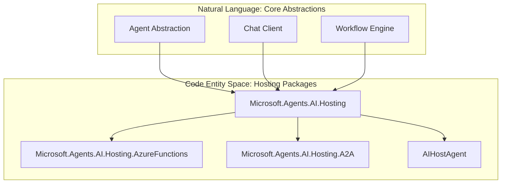
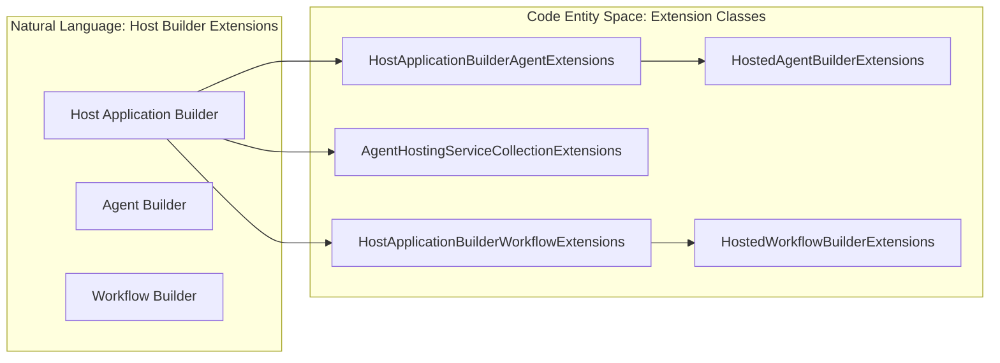

<!-- source: DeepWiki mcp.deepwiki.com · repo microsoft/agent-framework · page 6.1 .NET Deployment Options · fetched 2026-10-26 -->

# .NET Deployment Options

Relevant source files

The following files were used as context for generating this wiki page:

- [dotnet/src/Microsoft.Agents.AI.Hosting/AIHostAgent.cs](dotnet/src/Microsoft.Agents.AI.Hosting/AIHostAgent.cs)
- [dotnet/src/Microsoft.Agents.AI.Hosting/AgentHostingServiceCollectionExtensions.cs](dotnet/src/Microsoft.Agents.AI.Hosting/AgentHostingServiceCollectionExtensions.cs)
- [dotnet/src/Microsoft.Agents.AI.Hosting/HostApplicationBuilderAgentExtensions.cs](dotnet/src/Microsoft.Agents.AI.Hosting/HostApplicationBuilderAgentExtensions.cs)
- [dotnet/src/Microsoft.Agents.AI.Hosting/HostApplicationBuilderWorkflowExtensions.cs](dotnet/src/Microsoft.Agents.AI.Hosting/HostApplicationBuilderWorkflowExtensions.cs)
- [dotnet/src/Microsoft.Agents.AI.Hosting/HostedAgentBuilder.cs](dotnet/src/Microsoft.Agents.AI.Hosting/HostedAgentBuilder.cs)
- [dotnet/src/Microsoft.Agents.AI.Hosting/HostedAgentBuilderExtensions.cs](dotnet/src/Microsoft.Agents.AI.Hosting/HostedAgentBuilderExtensions.cs)
- [dotnet/src/Microsoft.Agents.AI.Hosting/HostedWorkflowBuilderExtensions.cs](dotnet/src/Microsoft.Agents.AI.Hosting/HostedWorkflowBuilderExtensions.cs)
- [dotnet/src/Microsoft.Agents.AI.Hosting/IHostedAgentBuilder.cs](dotnet/src/Microsoft.Agents.AI.Hosting/IHostedAgentBuilder.cs)
- [dotnet/tests/Microsoft.Agents.AI.Hosting.UnitTests/AgentHostingServiceCollectionExtensionsTests.cs](dotnet/tests/Microsoft.Agents.AI.Hosting.UnitTests/AgentHostingServiceCollectionExtensionsTests.cs)
- [dotnet/tests/Microsoft.Agents.AI.Hosting.UnitTests/HostApplicationBuilderAgentExtensionsTests.cs](dotnet/tests/Microsoft.Agents.AI.Hosting.UnitTests/HostApplicationBuilderAgentExtensionsTests.cs)
- [dotnet/tests/Microsoft.Agents.AI.Hosting.UnitTests/HostApplicationBuilderWorkflowExtensionsTests.cs](dotnet/tests/Microsoft.Agents.AI.Hosting.UnitTests/HostApplicationBuilderWorkflowExtensionsTests.cs)
- [dotnet/tests/Microsoft.Agents.AI.Hosting.UnitTests/HostedAgentBuilderToolsExtensionsTests.cs](dotnet/tests/Microsoft.Agents.AI.Hosting.UnitTests/HostedAgentBuilderToolsExtensionsTests.cs)

The Microsoft Agent Framework .NET implementation supports multiple deployment targets through specialized hosting packages. This page provides a high-level overview of .NET deployment strategies, including Azure Functions (serverless), ASP.NET Core (web hosting and A2A/OpenAI Responses integration), and containerized deployments (Docker and .NET Aspire).

For Python deployment options, see page 6.2. For authentication configuration, see page 6.3. For deep-dive implementation details, refer to the child pages:
- [Azure Functions Integration](#6.1.1)
- [ASP.NET Core Hosting](#6.1.2)
- [Containerized Deployment](#6.1.3)

## Hosting Package Architecture

The framework provides modular hosting packages that bridge core agent abstractions to specific runtime environments. The base `Microsoft.Agents.AI.Hosting` package manages dependency injection (DI) registrations and host-level configurations via extension methods on `IHostApplicationBuilder` and `IServiceCollection`.

### Hosting Package Architecture Map

**Sources:** [dotnet/src/Microsoft.Agents.AI.Hosting/AgentHostingServiceCollectionExtensions.cs:25-35](), [dotnet/src/Microsoft.Agents.AI.Hosting/HostApplicationBuilderWorkflowExtensions.cs:29-50](), [dotnet/src/Microsoft.Agents.AI.Hosting/AIHostAgent.cs:27-54]()

## Deployment Target Overview

| Deployment Target | Primary Package | Use Case | Key Code Entities |
|-------------------|----------------|----------|-----------------|
| **Azure Functions** | `Microsoft.Agents.AI.Hosting.AzureFunctions` | Serverless, event-driven execution, long-running durable workflows | `DurableWorkflowsFunctionMetadataTransformer` |
| **ASP.NET Core** | `Microsoft.Agents.AI.Hosting.A2A`, `Microsoft.Agents.AI.DevUI` | Web APIs, Agent-to-Agent (A2A) protocol servers, OpenAI Responses API, DevUI | `MapA2AHttpJson`, `MapA2AJsonRpc`, `AddA2AServer`, `MapOpenAIResponses`, `MapDevUI` |
| **Generic Host / Aspire** | `Microsoft.Agents.AI.Hosting` | Background workers, microservices with .NET Aspire orchestration | `IHostApplicationBuilder`, `AddAIAgent`, `AddWorkflow`, `AIHostAgent`, `HostedAgentBuilderExtensions` |

**Sources:** [dotnet/src/Microsoft.Agents.AI.Hosting/AgentHostingServiceCollectionExtensions.cs:25-35](), [dotnet/src/Microsoft.Agents.AI.Hosting/HostApplicationBuilderWorkflowExtensions.cs:29-50](), [dotnet/src/Microsoft.Agents.AI.Hosting/AIHostAgent.cs:27-54]()

## Dependency Injection and Hosting Extensions

The framework provides fluent registration extensions to configure agents, workflows, tools, and session stores directly within the .NET dependency injection container.

### Hosting Extensions Code Entity Mapping

Agents are registered as keyed services using `AddAIAgent()`, allowing multiple distinct named agents to coexist within the same container [dotnet/src/Microsoft.Agents.AI.Hosting/AgentHostingServiceCollectionExtensions.cs:25-35](). Tools are attached via `WithAITool()` [dotnet/src/Microsoft.Agents.AI.Hosting/HostedAgentBuilderExtensions.cs:101-109](), and workflows can be exposed as agents using `AddAsAIAgent()` to enable hierarchical composition [dotnet/src/Microsoft.Agents.AI.Hosting/HostedWorkflowBuilderExtensions.cs:34-47]().

**Sources:** [dotnet/src/Microsoft.Agents.AI.Hosting/HostApplicationBuilderAgentExtensions.cs:25-96](), [dotnet/src/Microsoft.Agents.AI.Hosting/AgentHostingServiceCollectionExtensions.cs:25-104](), [dotnet/src/Microsoft.Agents.AI.Hosting/HostedAgentBuilderExtensions.cs:27-92](), [dotnet/src/Microsoft.Agents.AI.Hosting/HostApplicationBuilderWorkflowExtensions.cs:29-50](), [dotnet/src/Microsoft.Agents.AI.Hosting/HostedWorkflowBuilderExtensions.cs:34-47]()

## Azure Functions Deployment

Azure Functions offers serverless agent execution using the isolated worker model. The framework leverages Durable Functions integration to handle long-running operations and maintain persistent state across distributed triggers.

- **Durable Task Integration**: Hosting agents and workflows as durable entities.
- **HTTP and Event Triggers**: Exposing endpoints for agent execution workflows.

For detailed setup, configuration, and MCP hosting on Azure Functions, see [Azure Functions Integration](#6.1.1).

**Sources:** [dotnet/src/Microsoft.Agents.AI.Hosting/AgentHostingServiceCollectionExtensions.cs:25-35]()

## ASP.NET Core Hosting

ASP.NET Core applications serve as robust web backends for hosting agents, exposing A2A protocol servers, and integrating middleware like the OpenAI Responses API and DevUI.

- **A2A Protocol Server**: Use `AddA2AServer()` and mapping extensions to expose agents over standard HTTP JSON and JSON-RPC protocols.
- **OpenAI Responses API**: Map dynamic endpoints (`MapOpenAIResponses()`) to route requests to agents based on the request model parameter.
- **Developer Interface (DevUI)**: Integrate `MapDevUI()` in development environments for real-time inspection, testing, and debugging.

For complete implementation instructions, see [ASP.NET Core Hosting](#6.1.2).

**Sources:** [dotnet/src/Microsoft.Agents.AI.Hosting/AIHostAgent.cs:27-89]()

## Containerized Deployment

Containerized deployment patterns enable cloud-native scaling, multi-tenant session isolation, and orchestration with .NET Aspire.

- **Aspire Integration**: Register chat clients and service defaults across distributed microservices.
- **Persistent State Stores**: Transition from in-memory session stores (`WithInMemorySessionStore()`) to durable storage providers via `WithSessionStore()` [dotnet/src/Microsoft.Agents.AI.Hosting/HostedAgentBuilderExtensions.cs:27-63]().
- **Multi-Tenant Isolation**: Utilize isolation wrappers like `IsolationKeyScopedAgentSessionStore` to partition runtime state per user or tenant [dotnet/src/Microsoft.Agents.AI.Hosting/HostedAgentBuilderExtensions.cs:63-92]().

For containerization patterns and Aspire configuration details, see [Containerized Deployment](#6.1.3).

**Sources:** [dotnet/src/Microsoft.Agents.AI.Hosting/HostedAgentBuilderExtensions.cs:27-92]()

---

