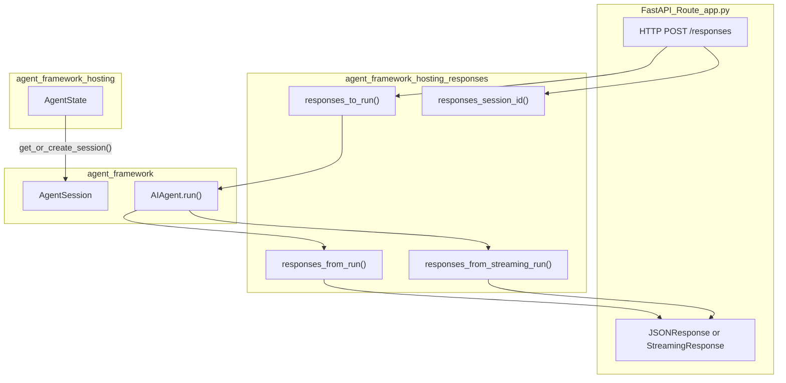
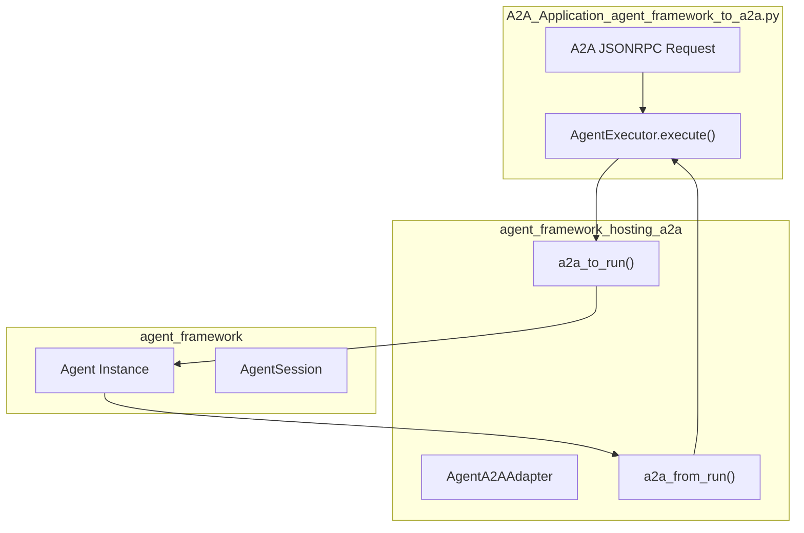

<!-- source: DeepWiki mcp.deepwiki.com · repo microsoft/agent-framework · page 6.2 Python Deployment Options · fetched 2026-10-26 -->

# Python Deployment Options

Relevant source files

The following files were used as context for generating this wiki page:

- [docs/decisions/0027-hosting-channels.md](docs/decisions/0027-hosting-channels.md)
- [docs/decisions/0028-hosting-linking-multicast-enhancements.md](docs/decisions/0028-hosting-linking-multicast-enhancements.md)
- [docs/specs/002-python-hosting-channels.md](docs/specs/002-python-hosting-channels.md)
- [python/packages/a2a/AGENTS.md](python/packages/a2a/AGENTS.md)
- [python/packages/a2a/agent_framework_a2a/_a2a_executor.py](python/packages/a2a/agent_framework_a2a/_a2a_executor.py)
- [python/packages/a2a/tests/test_a2a_executor.py](python/packages/a2a/tests/test_a2a_executor.py)
- [python/packages/hosting-a2a/AGENTS.md](python/packages/hosting-a2a/AGENTS.md)
- [python/packages/hosting-a2a/README.md](python/packages/hosting-a2a/README.md)
- [python/packages/hosting-a2a/agent_framework_hosting_a2a/__init__.py](python/packages/hosting-a2a/agent_framework_hosting_a2a/__init__.py)
- [python/packages/hosting-a2a/agent_framework_hosting_a2a/_adapters.py](python/packages/hosting-a2a/agent_framework_hosting_a2a/_adapters.py)
- [python/packages/hosting-a2a/agent_framework_hosting_a2a/_conversion.py](python/packages/hosting-a2a/agent_framework_hosting_a2a/_conversion.py)
- [python/packages/hosting-a2a/tests/hosting_a2a/test_adapters.py](python/packages/hosting-a2a/tests/hosting_a2a/test_adapters.py)
- [python/packages/hosting-a2a/tests/hosting_a2a/test_conversion.py](python/packages/hosting-a2a/tests/hosting_a2a/test_conversion.py)
- [python/packages/hosting-responses/README.md](python/packages/hosting-responses/README.md)
- [python/packages/hosting-responses/agent_framework_hosting_responses/__init__.py](python/packages/hosting-responses/agent_framework_hosting_responses/__init__.py)
- [python/packages/hosting-responses/agent_framework_hosting_responses/_parsing.py](python/packages/hosting-responses/agent_framework_hosting_responses/_parsing.py)
- [python/packages/hosting-responses/tests/hosting_responses/test_http_round_trip.py](python/packages/hosting-responses/tests/hosting_responses/test_http_round_trip.py)
- [python/packages/hosting-responses/tests/hosting_responses/test_parsing.py](python/packages/hosting-responses/tests/hosting_responses/test_parsing.py)
- [python/packages/hosting/README.md](python/packages/hosting/README.md)
- [python/packages/hosting/agent_framework_hosting/_state.py](python/packages/hosting/agent_framework_hosting/_state.py)
- [python/packages/hosting/tests/hosting/test_state.py](python/packages/hosting/tests/hosting/test_state.py)
- [python/samples/04-hosting/a2a/README.md](python/samples/04-hosting/a2a/README.md)
- [python/samples/04-hosting/a2a/a2a_server.http](python/samples/04-hosting/a2a/a2a_server.http)
- [python/samples/04-hosting/a2a/a2a_server.py](python/samples/04-hosting/a2a/a2a_server.py)
- [python/samples/04-hosting/a2a/agent_definitions.py](python/samples/04-hosting/a2a/agent_definitions.py)
- [python/samples/04-hosting/a2a/agent_framework_to_a2a.py](python/samples/04-hosting/a2a/agent_framework_to_a2a.py)
- [python/samples/04-hosting/a2a/invoice_data.py](python/samples/04-hosting/a2a/invoice_data.py)
- [python/samples/04-hosting/a2a/requirements.txt](python/samples/04-hosting/a2a/requirements.txt)
- [python/samples/04-hosting/af-hosting/local_responses/README.md](python/samples/04-hosting/af-hosting/local_responses/README.md)
- [python/samples/04-hosting/af-hosting/local_responses/app.py](python/samples/04-hosting/af-hosting/local_responses/app.py)
- [python/samples/04-hosting/af-hosting/local_responses_workflow/README.md](python/samples/04-hosting/af-hosting/local_responses_workflow/README.md)
- [python/samples/04-hosting/af-hosting/local_responses_workflow/app.py](python/samples/04-hosting/af-hosting/local_responses_workflow/app.py)
- [python/samples/04-hosting/af-hosting/local_responses_workflow/call_server.py](python/samples/04-hosting/af-hosting/local_responses_workflow/call_server.py)

This document covers deployment patterns, packaging, and distribution strategies for Python applications built with Microsoft Agent Framework. It explains how to package agents for production deployment, configure dependencies, and deploy to various hosting environments including FastAPI, Azure Functions, Durable Task, Telegram, containerized deployments, and Azure AI Foundry.

For .NET deployment options, see [.NET Deployment Options](#6.1). For authentication and runtime configuration, see [Authentication and Configuration](#6.3).

---

## Package Distribution Model

Microsoft Agent Framework Python packages are distributed via PyPI using a multi-package architecture. The framework consists of specialized packages in a monorepo workspace managed by `uv` [docs/specs/002-python-hosting-channels.md:12-16]().

### Package Status and Lifecycle

The framework uses a staged lifecycle for its packages, ranging from initial development to stable release [python/PACKAGE_STATUS.md:5-11]().

| Stage | Description | Key Packages |
| :--- | :--- | :--- |
| `released` | Stable packages without breaking changes | `agent-framework-core`, `agent-framework-openai`, `agent-framework-orchestrations` [python/PACKAGE_STATUS.md:29-47]() |
| `rc` | Release candidate, close to stable | `agent-framework-ag-ui`, `agent-framework-github-copilot` [python/PACKAGE_STATUS.md:19-36]() |
| `beta` | Prerelease development | `agent-framework-azurefunctions`, `agent-framework-durabletask`, `agent-framework-anthropic` [python/PACKAGE_STATUS.md:20-32]() |
| `alpha` | Early development / Experimental | `agent-framework-hosting`, `agent-framework-hosting-responses`, `agent-framework-hosting-telegram`, `agent-framework-hosting-a2a` [python/PACKAGE_STATUS.md:37-39]() |

Sources: [python/PACKAGE_STATUS.md:1-50](), [docs/specs/002-python-hosting-channels.md:12-16]()

---

## Hosting Protocol Helpers

Following **ADR-0027**, the Python implementation uses a "helper-first" hosting model [docs/decisions/0027-hosting-channels.md:62-64](). Rather than providing a monolithic host framework, the framework provides protocol-specific conversion functions. This allows developers to use native web frameworks like FastAPI, Starlette, or Django while the framework handles protocol parsing and rendering [docs/specs/002-python-hosting-channels.md:15-23]().

### OpenAI Responses Protocol

The `agent-framework-hosting-responses` package provides helpers to expose agents via the OpenAI Responses API [python/packages/hosting-responses/README.md:1-5]().

Title: "Responses Hosting Protocol Integration Architecture"

Sources: [docs/decisions/0027-hosting-channels.md:50-60](), [docs/specs/002-python-hosting-channels.md:78-90](), [python/packages/hosting-responses/README.md:1-65]()

**Key Helpers:**
- `responses_to_run(body)`: Converts a Responses request body into framework run values (messages and options) [python/packages/hosting-responses/README.md:7-8]().
- `responses_session_id(body)`: Extracts the `session_id` and determines if it is a `conversation_id` or `response_id` [python/packages/hosting-responses/README.md:9-11]().
- `responses_from_run(result, ...)`: Renders an `AgentResponse` into a Responses-compatible JSON payload [python/packages/hosting-responses/README.md:14-15]().
- `responses_from_streaming_run(stream, ...)`: Renders a `ResponseStream` into SSE events [python/packages/hosting-responses/README.md:16-17]().

Sources: [python/packages/hosting-responses/README.md:1-65](), [docs/specs/002-python-hosting-channels.md:78-90]()

---

## Agent2Agent (A2A) Hosting

The `agent-framework-hosting-a2a` package enables hosting agents as A2A-compliant servers [python/samples/04-hosting/a2a/README.md:3-8](). It provides adapters that convert between native A2A `Message` types and Agent Framework run values [python/packages/hosting-a2a/AGENTS.md:8-12]().

Title: "A2A Server Protocol Mapping Architecture"

Sources: [python/samples/04-hosting/a2a/README.md:1-17](), [python/samples/04-hosting/a2a/agent_framework_to_a2a.py:33-100](), [python/packages/hosting-a2a/AGENTS.md:1-64]()

**Key Entities:**
- `AgentA2AAdapter`: High-level adapter that re-exposes conversion helpers and generates `AgentCard` metadata from agent skills [python/packages/hosting-a2a/AGENTS.md:13-17]().
- `a2a_to_run(message)`: Converts A2A `Message` to `AgentRunArgs` [python/packages/hosting-a2a/AGENTS.md:8-9]().
- `a2a_from_run(result)`: Converts framework output into A2A `Part` values [python/packages/hosting-a2a/AGENTS.md:10-12]().

Sources: [python/samples/04-hosting/a2a/README.md:1-17](), [python/packages/hosting-a2a/AGENTS.md:1-64]()

---

## Azure AI Foundry Hosted Agents

Agents can be deployed as managed services on Azure AI Foundry using the `agent-framework-foundry-hosting` package [python/packages/foundry_hosting/README.md:1-7](). This hosting pattern uses the `ResponsesHostServer` to expose agents via the **Responses API** [python/packages/foundry_hosting/agent_framework_foundry_hosting/_responses.py:41-60]().

### ResponsesHostServer
The `ResponsesHostServer` class implements the `ResponseProviderProtocol` and manages the lifecycle of a hosted agent run [python/packages/foundry_hosting/agent_framework_foundry_hosting/_responses.py:34-41](). It handles:
- **Streaming Conversion**: Translates `AgentResponseUpdate` chunks into `ResponseStreamEvent` SSE events [python/packages/foundry_hosting/agent_framework_foundry_hosting/_responses.py:55-67]().
- **State Management**: Uses `StoreProvider` to persist `AgentSession` and `CheckpointStorage` across requests [python/packages/foundry_hosting/agent_framework_foundry_hosting/_state_store.py:73-80]().
- **Human-in-the-Loop**: Detects `function_approval_request` content and generates `FunctionShellAction` for client approval [python/packages/foundry_hosting/agent_framework_foundry_hosting/_responses.py:42-50]().

Sources: [python/packages/foundry_hosting/README.md:1-20](), [python/packages/foundry_hosting/agent_framework_foundry_hosting/_responses.py:1-120]()

---

## Azure Functions and Durable Task

The `agent-framework-azurefunctions` package provides serverless deployment using Azure Durable Functions for orchestration and state persistence across activity boundaries.

> [!NOTE]
> Python Azure Functions samples have moved to the [Durable Agent Framework extension repository](https://github.com/microsoft/agent-framework-durable-extension) [python/samples/04-hosting/azure_functions/README.md:1-3]().

Sources: [python/samples/04-hosting/azure_functions/README.md:1-3](), [python/samples/04-hosting/durabletask/README.md:1-3]()

---

## Shared Execution State

The `agent-framework-hosting` package provides small, optional state holders to manage session continuity in multi-request environments [docs/specs/002-python-hosting-channels.md:111-112]().

### SessionStore
`SessionStore` is an async lookup interface for `AgentSession` objects [docs/specs/002-python-hosting-channels.md:115-122]().
- **In-Memory:** Default store for local development [docs/specs/002-python-hosting-channels.md:126-128]().
- **File-Backed:** `FileSessionStore` persists session state to disk using msgspec JSON or MessagePack [python/packages/hosting/README.md:24-58]().

### AgentState and WorkflowState
`AgentState` pairs a `SupportsAgentRun` target with a `SessionStore` [docs/specs/002-python-hosting-channels.md:130-132](). It provides a `get_or_create_session(session_id)` helper that resolves the session from the store or initializes a new one [docs/specs/002-python-hosting-channels.md:137-140](). `WorkflowState` provides a parallel state container for workflow targets, integrating with `CheckpointStorage` [python/packages/hosting/README.md:116-126]().

Sources: [docs/specs/002-python-hosting-channels.md:111-140](), [python/packages/hosting/README.md:1-146]()

---

## Telegram Hosting

The `agent-framework-hosting-telegram` package provides helpers for parsing Telegram Bot API updates into framework run values [docs/specs/002-python-hosting-channels.md:72-73]().

**Key Helpers:**
- `telegram_to_run(update)`: Parses chat, session, and command data from Telegram updates [docs/specs/002-python-hosting-channels.md:72]().
- `telegram_session_id(update)`: Extracts the Telegram chat ID as the framework session ID [docs/specs/002-python-hosting-channels.md:97-98]().

Sources: [docs/specs/002-python-hosting-channels.md:72-73](), [docs/specs/002-python-hosting-channels.md:97-98]()

---

## Containerized Deployments

Python agent services packaged with FastAPI, Starlette, or custom servers can be containerized using standard `Dockerfile` patterns and orchestrated via tools like Docker Compose or Azure Developer CLI (`azd`) [python/samples/04-hosting/a2a/README.md:1-38](). The app-owned hosting model ensures that container entrypoints maintain full control over uvicorn/gunicorn server configuration, environment variable validation, and signal handling without framework interference.

Sources: [python/samples/04-hosting/a2a/README.md:1-38](), [docs/decisions/0027-hosting-channels.md:74-85]()

---

