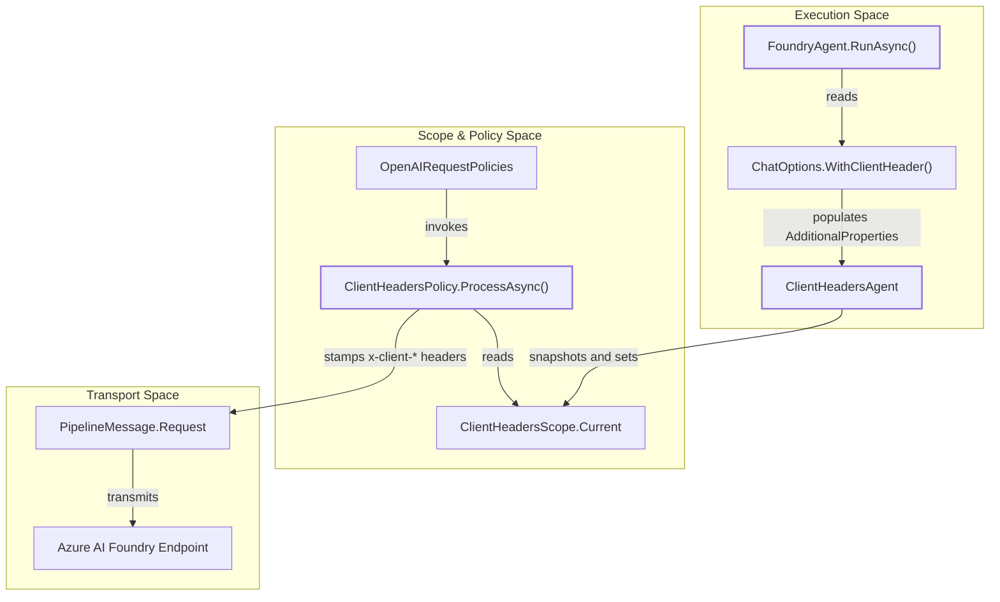
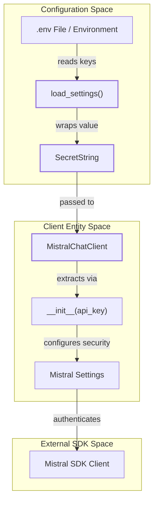

<!-- source: DeepWiki mcp.deepwiki.com · repo microsoft/agent-framework · page 6.3 Authentication and Configuration · fetched 2026-10-26 -->

# Authentication and Configuration

Relevant source files

The following files were used as context for generating this wiki page:

- [dotnet/global.json](dotnet/global.json)
- [dotnet/samples/04-hosting/FoundryHostedAgents/responses/Using-Samples/SessionFilesClient/SessionFilesClient.csproj](dotnet/samples/04-hosting/FoundryHostedAgents/responses/Using-Samples/SessionFilesClient/SessionFilesClient.csproj)
- [dotnet/samples/04-hosting/FoundryHostedAgents/responses/Using-Samples/SimpleAgent/SimpleAgent.csproj](dotnet/samples/04-hosting/FoundryHostedAgents/responses/Using-Samples/SimpleAgent/SimpleAgent.csproj)
- [dotnet/samples/04-hosting/FoundryHostedAgents/responses/Using-Samples/UserIsolationAgent/Program.cs](dotnet/samples/04-hosting/FoundryHostedAgents/responses/Using-Samples/UserIsolationAgent/Program.cs)
- [dotnet/samples/04-hosting/FoundryHostedAgents/responses/Using-Samples/UserIsolationAgent/README.md](dotnet/samples/04-hosting/FoundryHostedAgents/responses/Using-Samples/UserIsolationAgent/README.md)
- [dotnet/src/Microsoft.Agents.AI.Foundry.Hosting/HostedAgentUserAgentPolicy.cs](dotnet/src/Microsoft.Agents.AI.Foundry.Hosting/HostedAgentUserAgentPolicy.cs)
- [dotnet/src/Microsoft.Agents.AI.Foundry/ClientHeadersAgent.cs](dotnet/src/Microsoft.Agents.AI.Foundry/ClientHeadersAgent.cs)
- [dotnet/src/Microsoft.Agents.AI.Foundry/ClientHeadersExtensions.cs](dotnet/src/Microsoft.Agents.AI.Foundry/ClientHeadersExtensions.cs)
- [dotnet/src/Microsoft.Agents.AI.Foundry/ClientHeadersPolicy.cs](dotnet/src/Microsoft.Agents.AI.Foundry/ClientHeadersPolicy.cs)
- [dotnet/src/Microsoft.Agents.AI.Foundry/ClientHeadersScope.cs](dotnet/src/Microsoft.Agents.AI.Foundry/ClientHeadersScope.cs)
- [dotnet/src/Microsoft.Agents.AI.Foundry/FoundryAgent.cs](dotnet/src/Microsoft.Agents.AI.Foundry/FoundryAgent.cs)
- [dotnet/src/Microsoft.Agents.AI.Foundry/FoundryChatOptionsExtensions.cs](dotnet/src/Microsoft.Agents.AI.Foundry/FoundryChatOptionsExtensions.cs)
- [dotnet/src/Microsoft.Agents.AI.Foundry/FoundryHostedRequestAgent.cs](dotnet/src/Microsoft.Agents.AI.Foundry/FoundryHostedRequestAgent.cs)
- [dotnet/src/Microsoft.Agents.AI.Foundry/UserIdentityScope.cs](dotnet/src/Microsoft.Agents.AI.Foundry/UserIdentityScope.cs)
- [dotnet/tests/Foundry.Hosting.IntegrationTests/HostedSessionAndUserIdentityTests.cs](dotnet/tests/Foundry.Hosting.IntegrationTests/HostedSessionAndUserIdentityTests.cs)
- [dotnet/tests/Microsoft.Agents.AI.Foundry.Hosting.UnitTests/HostedOutboundUserAgentTests.cs](dotnet/tests/Microsoft.Agents.AI.Foundry.Hosting.UnitTests/HostedOutboundUserAgentTests.cs)
- [dotnet/tests/Microsoft.Agents.AI.Foundry.UnitTests/ClientHeadersExtensionsTests.cs](dotnet/tests/Microsoft.Agents.AI.Foundry.UnitTests/ClientHeadersExtensionsTests.cs)
- [dotnet/tests/Microsoft.Agents.AI.Foundry.UnitTests/FoundryAgentTests.cs](dotnet/tests/Microsoft.Agents.AI.Foundry.UnitTests/FoundryAgentTests.cs)
- [dotnet/tests/Microsoft.Agents.AI.Foundry.UnitTests/Microsoft.Agents.AI.Foundry.UnitTests.csproj](dotnet/tests/Microsoft.Agents.AI.Foundry.UnitTests/Microsoft.Agents.AI.Foundry.UnitTests.csproj)
- [python/.env.example](python/.env.example)
- [python/packages/core/agent_framework/mistral/__init__.py](python/packages/core/agent_framework/mistral/__init__.py)
- [python/packages/core/agent_framework/mistral/__init__.pyi](python/packages/core/agent_framework/mistral/__init__.pyi)
- [python/packages/core/tests/core/test_mistral_namespace.py](python/packages/core/tests/core/test_mistral_namespace.py)
- [python/packages/mistral/AGENTS.md](python/packages/mistral/AGENTS.md)
- [python/packages/mistral/README.md](python/packages/mistral/README.md)
- [python/packages/mistral/agent_framework_mistral/__init__.py](python/packages/mistral/agent_framework_mistral/__init__.py)
- [python/packages/mistral/agent_framework_mistral/_chat_client.py](python/packages/mistral/agent_framework_mistral/_chat_client.py)
- [python/packages/mistral/agent_framework_mistral/_embedding_client.py](python/packages/mistral/agent_framework_mistral/_embedding_client.py)
- [python/packages/mistral/agent_framework_mistral/_http_client.py](python/packages/mistral/agent_framework_mistral/_http_client.py)
- [python/packages/mistral/pyproject.toml](python/packages/mistral/pyproject.toml)
- [python/packages/mistral/tests/mistral/test_mistral_chat_client.py](python/packages/mistral/tests/mistral/test_mistral_chat_client.py)
- [python/packages/mistral/tests/mistral/test_mistral_embedding_client.py](python/packages/mistral/tests/mistral/test_mistral_embedding_client.py)

This page documents authentication patterns and configuration mechanisms for deploying and hosting agents in the Microsoft Agent Framework. It covers credential management, environment configuration, secret handling via `SecretString`, client initialization patterns, per-call headers (such as `x-client-*` header propagation in .NET), and tool-level authentication (such as Model Context Protocol headers) for both Python and .NET implementations.

For information about deploying agents to specific hosting platforms, see [6.1 .NET Deployment Options]() and [6.2 Python Deployment Options](). For framework-level observability configuration, see [3.6 Observability and Monitoring]().

---

## Authentication Methods

The framework supports multiple authentication patterns depending on the deployment target and provider integration.

### TokenCredential Pattern (Azure)

Azure-based integrations use the `TokenCredential` pattern from the Azure SDK, providing a unified authentication interface across services. In .NET, classes like `FoundryAgent` accept authentication providers or credentials such as `AuthenticationTokenProvider` [dotnet/src/Microsoft.Agents.AI.Foundry/FoundryAgent.cs:55-55](). In Python, clients accept `TokenCredential` or `AsyncTokenCredential` for authenticating requests.

**Sources:** [dotnet/src/Microsoft.Agents.AI.Foundry/FoundryAgent.cs:53-70]()

---

### Managed Identity and Platform Headers

When hosting agents in Azure AI Foundry, the platform manages context and security via injected credentials and specific protocol headers. The `FoundryAgent` uses an `AIProjectClient` [dotnet/src/Microsoft.Agents.AI.Foundry/FoundryAgent.cs:66-66]() which can be initialized with these credentials. 

To propagate per-call user context securely across tenant boundaries, the .NET implementation provides `ClientHeadersExtensions.WithClientHeader` [dotnet/src/Microsoft.Agents.AI.Foundry/ClientHeadersExtensions.cs:50-58]() and `ClientHeadersAgent` [dotnet/src/Microsoft.Agents.AI.Foundry/ClientHeadersAgent.cs:30-31](). These components capture `x-client-*` headers stored on `ChatClientAgentRunOptions.ChatOptions` and push them onto an `AsyncLocal` `ClientHeadersScope` [dotnet/src/Microsoft.Agents.AI.Foundry/ClientHeadersAgent.cs:12-17](). The underlying `ClientHeadersPolicy` [dotnet/src/Microsoft.Agents.AI.Foundry/ClientHeadersPolicy.cs:27-28]() reads this scope during the transport pipeline execution and stamps the outbound HTTP request headers via `PipelineRequestHeaders.Set` [dotnet/src/Microsoft.Agents.AI.Foundry/ClientHeadersPolicy.cs:64-66]().

**Natural Language to Code Entity Space: Azure Client Headers and Authentication Pipeline**

**Sources:** [dotnet/src/Microsoft.Agents.AI.Foundry/FoundryAgent.cs:37-70](), [dotnet/src/Microsoft.Agents.AI.Foundry/ClientHeadersAgent.cs:30-58](), [dotnet/src/Microsoft.Agents.AI.Foundry/ClientHeadersExtensions.cs:35-58](), [dotnet/src/Microsoft.Agents.AI.Foundry/ClientHeadersPolicy.cs:27-68]()

---

### API Key Authentication and Secret Management

For OpenAI, Anthropic, Mistral, and compatible providers, API key authentication is standard. Clients resolve these keys from environment variables, `.env` files, or explicit constructor parameters.

To prevent accidental exposure in logs or trace output, the core framework implements a `SecretString` wrapper class. String conversion, representation, formatting, and concatenation automatically apply a mask, and callers must explicitly unwrap credentials when passing them to provider SDKs. The setting loader `load_settings` wraps plain string overrides automatically.

For example, the Mistral integration (`MistralChatClient`) resolves `api_key` values through `load_settings` from the `MISTRAL_API_KEY` environment variable or explicit `SecretString` constructor arguments [python/packages/mistral/agent_framework_mistral/_chat_client.py:139-166]().

**Natural Language to Code Entity Space: Python Configuration and Secret Resolution**

**Sources:** [python/packages/mistral/agent_framework_mistral/_chat_client.py:139-166](), [python/.env.example:1-56]()

---

### MCP Tool Authentication

When connecting to remote Model Context Protocol (MCP) servers via HTTP, tools like `MCPStreamableHTTPTool` support dynamic authentication headers through a `header_provider` callback. This enables per-request token derivation or API key injection without hardcoding credentials into a shared `httpx.AsyncClient`.

**Sources:** [python/packages/core/tests/core/test_mcp_http_auth.py:131-138]()

---

## Configuration Patterns

The framework provides a layered configuration system with multiple resolution strategies across .NET and Python environments.

### Environment Variables

Standard environment variables used across the framework for discovery, endpoints, and runtime behavior are defined in template files such as `python/.env.example` [python/.env.example:1-56]() and consumed via configuration binders.

| Variable | Purpose | Provider / System |
|----------|---------|-------------------|
| `OPENAI_API_KEY` | API Key for OpenAI services | OpenAI [python/.env.example:26-26]() |
| `MISTRAL_API_KEY` | API Key for Mistral AI | Mistral [python/.env.example:50-50]() |
| `ANTHROPIC_API_KEY` | API Key for Anthropic | Anthropic [python/.env.example:41-41]() |
| `GOOGLE_API_KEY` | API Key for Google Gemini | Gemini [python/.env.example:44-44]() |
| `FOUNDRY_PROJECT_ENDPOINT` | Foundry project endpoint URL | Azure Foundry [python/.env.example:3-3]() |
| `OTEL_EXPORTER_OTLP_ENDPOINT`| OpenTelemetry OTLP endpoint | Observability [python/.env.example:56-56]() |

**Sources:** [python/.env.example:1-56]()

### .NET Project Configuration

In .NET implementations, global project properties, compiler settings, and SDK versions are governed centrally by configuration files such as `dotnet/global.json` [dotnet/global.json:1-10](). Projects referencing Azure Foundry services also configure package references and target frameworks explicitly within their project files [dotnet/tests/Microsoft.Agents.AI.Foundry.UnitTests/Microsoft.Agents.AI.Foundry.UnitTests.csproj:1-21]().

**Sources:** [dotnet/global.json:1-10](), [dotnet/tests/Microsoft.Agents.AI.Foundry.UnitTests/Microsoft.Agents.AI.Foundry.UnitTests.csproj:1-21]()

---

## Provider-Specific Options

### Mistral AI Options
`MistralChatOptions` extends base `ChatOptions` with provider-specific parameters such as `safe_prompt`, `prompt_mode`, `prediction`, `guardrails`, `prompt_cache_key`, `service_tier`, and `reasoning_effort` [python/packages/mistral/agent_framework_mistral/_chat_client.py:84-136](). It explicitly flags unsupported base options (such as `logit_bias`, `store`, `user`, and `conversation_id`) as `None` to prevent invalid API dispatches [python/packages/mistral/agent_framework_mistral/_chat_client.py:137-148]().

**Sources:** [python/packages/mistral/agent_framework_mistral/_chat_client.py:84-148]()

### Foundry Agent Configuration
The `FoundryAgent` class supports configuration via project endpoints or agent-specific URIs, integrating request policies like `FoundryUserAgentPolicies` to track feature usage and ensure compliance with hosting requirements [dotnet/src/Microsoft.Agents.AI.Foundry/FoundryAgent.cs:37-111](), [dotnet/tests/Microsoft.Agents.AI.Foundry.UnitTests/FoundryAgentTests.cs:101-146]().

**Sources:** [dotnet/src/Microsoft.Agents.AI.Foundry/FoundryAgent.cs:37-111](), [dotnet/tests/Microsoft.Agents.AI.Foundry.UnitTests/FoundryAgentTests.cs:101-146]()

---

## Security and Best Practices

1. **Secret Masking**: Always wrap sensitive credentials in `SecretString` within Python configuration handlers to prevent accidental output in logs.
2. **Environment Isolation**: Utilize `.env` files locally based on `.env.example` templates to segregate deployment endpoints from source code [python/.env.example:1-56]().
3. **Per-Call Context Stamping**: Use `ClientHeadersExtensions.WithClientHeader` in .NET pipelines to securely pass user and session context through multi-tenant proxies without leaking state across concurrent runs [dotnet/src/Microsoft.Agents.AI.Foundry/ClientHeadersExtensions.cs:35-58]().

**Sources:** [python/.env.example:1-56](), [dotnet/src/Microsoft.Agents.AI.Foundry/ClientHeadersExtensions.cs:35-58]()

---

