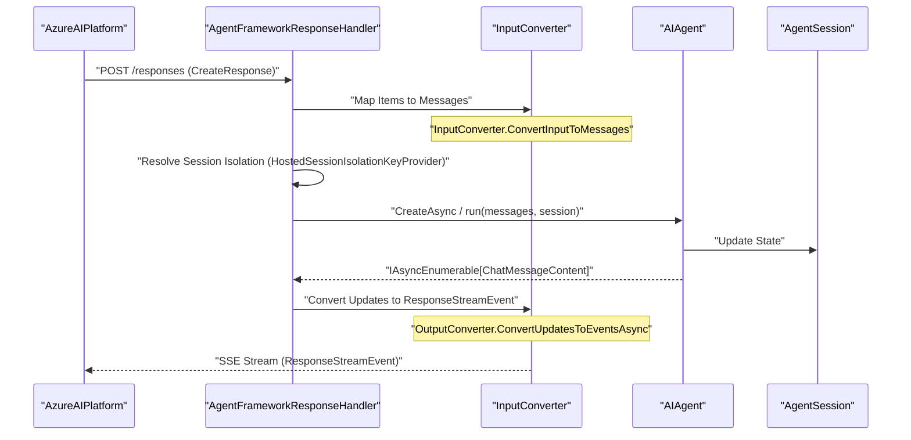
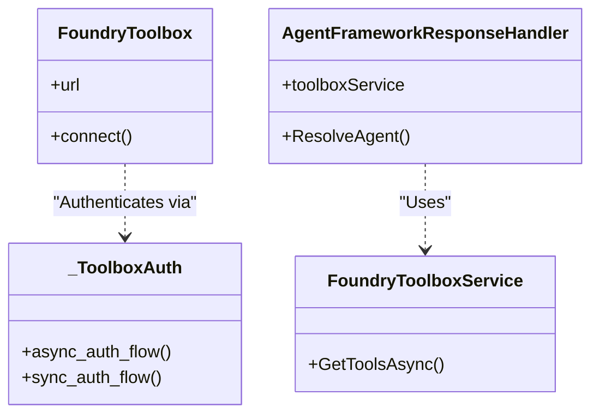

<!-- source: DeepWiki mcp.deepwiki.com · repo microsoft/agent-framework · page 6.4 Foundry Hosted Agents · fetched 2026-10-26 -->

# Foundry Hosted Agents

Relevant source files

The following files were used as context for generating this wiki page:

- [.github/actions/free-runner-disk-space/action.yml](.github/actions/free-runner-disk-space/action.yml)
- [dotnet/src/Microsoft.Agents.AI.Foundry.Hosting/AgentFrameworkResponseHandler.cs](dotnet/src/Microsoft.Agents.AI.Foundry.Hosting/AgentFrameworkResponseHandler.cs)
- [dotnet/src/Microsoft.Agents.AI.Foundry.Hosting/FileSystemAgentSessionStore.cs](dotnet/src/Microsoft.Agents.AI.Foundry.Hosting/FileSystemAgentSessionStore.cs)
- [dotnet/src/Microsoft.Agents.AI.Foundry.Hosting/FoundryResponsesOptions.cs](dotnet/src/Microsoft.Agents.AI.Foundry.Hosting/FoundryResponsesOptions.cs)
- [dotnet/src/Microsoft.Agents.AI.Foundry.Hosting/FoundryToolboxOptions.cs](dotnet/src/Microsoft.Agents.AI.Foundry.Hosting/FoundryToolboxOptions.cs)
- [dotnet/src/Microsoft.Agents.AI.Foundry.Hosting/FoundryToolboxService.cs](dotnet/src/Microsoft.Agents.AI.Foundry.Hosting/FoundryToolboxService.cs)
- [dotnet/src/Microsoft.Agents.AI.Foundry.Hosting/HostedStoredOutputCompatibility.cs](dotnet/src/Microsoft.Agents.AI.Foundry.Hosting/HostedStoredOutputCompatibility.cs)
- [dotnet/src/Microsoft.Agents.AI.Foundry.Hosting/HostedStoredOutputHealthCheck.cs](dotnet/src/Microsoft.Agents.AI.Foundry.Hosting/HostedStoredOutputHealthCheck.cs)
- [dotnet/src/Microsoft.Agents.AI.Foundry.Hosting/InMemoryAgentSessionStore.cs](dotnet/src/Microsoft.Agents.AI.Foundry.Hosting/InMemoryAgentSessionStore.cs)
- [dotnet/src/Microsoft.Agents.AI.Foundry.Hosting/InputConverter.cs](dotnet/src/Microsoft.Agents.AI.Foundry.Hosting/InputConverter.cs)
- [dotnet/src/Microsoft.Agents.AI.Foundry.Hosting/OAuthConsentLinkPolicy.cs](dotnet/src/Microsoft.Agents.AI.Foundry.Hosting/OAuthConsentLinkPolicy.cs)
- [dotnet/src/Microsoft.Agents.AI.Foundry.Hosting/OutputConverter.cs](dotnet/src/Microsoft.Agents.AI.Foundry.Hosting/OutputConverter.cs)
- [dotnet/src/Microsoft.Agents.AI.Foundry.Hosting/ServiceCollectionExtensions.cs](dotnet/src/Microsoft.Agents.AI.Foundry.Hosting/ServiceCollectionExtensions.cs)
- [dotnet/src/Microsoft.Agents.AI.Foundry.Hosting/StoredOutputProbeChatClient.cs](dotnet/src/Microsoft.Agents.AI.Foundry.Hosting/StoredOutputProbeChatClient.cs)
- [dotnet/src/Microsoft.Agents.AI.Foundry.Hosting/ToolApprovalIdMap.cs](dotnet/src/Microsoft.Agents.AI.Foundry.Hosting/ToolApprovalIdMap.cs)
- [dotnet/src/Microsoft.Agents.AI.Foundry.Hosting/VolatileChatHistoryProvider.cs](dotnet/src/Microsoft.Agents.AI.Foundry.Hosting/VolatileChatHistoryProvider.cs)
- [dotnet/tests/Foundry.Hosting.IntegrationTests/ToolCallingHostedAgentTests.cs](dotnet/tests/Foundry.Hosting.IntegrationTests/ToolCallingHostedAgentTests.cs)
- [dotnet/tests/Microsoft.Agents.AI.Foundry.Hosting.UnitTests/FileSystemAgentSessionStoreTests.cs](dotnet/tests/Microsoft.Agents.AI.Foundry.Hosting.UnitTests/FileSystemAgentSessionStoreTests.cs)
- [dotnet/tests/Microsoft.Agents.AI.Foundry.Hosting.UnitTests/FoundryToolboxServiceTests.cs](dotnet/tests/Microsoft.Agents.AI.Foundry.Hosting.UnitTests/FoundryToolboxServiceTests.cs)
- [dotnet/tests/Microsoft.Agents.AI.Foundry.Hosting.UnitTests/HostedStoredOutputHealthCheckTests.cs](dotnet/tests/Microsoft.Agents.AI.Foundry.Hosting.UnitTests/HostedStoredOutputHealthCheckTests.cs)
- [dotnet/tests/Microsoft.Agents.AI.Foundry.Hosting.UnitTests/InputConverterTests.cs](dotnet/tests/Microsoft.Agents.AI.Foundry.Hosting.UnitTests/InputConverterTests.cs)
- [dotnet/tests/Microsoft.Agents.AI.Foundry.Hosting.UnitTests/Microsoft.Agents.AI.Foundry.Hosting.UnitTests.csproj](dotnet/tests/Microsoft.Agents.AI.Foundry.Hosting.UnitTests/Microsoft.Agents.AI.Foundry.Hosting.UnitTests.csproj)
- [dotnet/tests/Microsoft.Agents.AI.Foundry.Hosting.UnitTests/OAuthConsentEmissionTests.cs](dotnet/tests/Microsoft.Agents.AI.Foundry.Hosting.UnitTests/OAuthConsentEmissionTests.cs)
- [dotnet/tests/Microsoft.Agents.AI.Foundry.Hosting.UnitTests/OAuthConsentLinkPolicyTests.cs](dotnet/tests/Microsoft.Agents.AI.Foundry.Hosting.UnitTests/OAuthConsentLinkPolicyTests.cs)
- [dotnet/tests/Microsoft.Agents.AI.Foundry.Hosting.UnitTests/OAuthConsentPolicyHandlerTests.cs](dotnet/tests/Microsoft.Agents.AI.Foundry.Hosting.UnitTests/OAuthConsentPolicyHandlerTests.cs)
- [dotnet/tests/Microsoft.Agents.AI.Foundry.Hosting.UnitTests/OutputConverterTests.cs](dotnet/tests/Microsoft.Agents.AI.Foundry.Hosting.UnitTests/OutputConverterTests.cs)
- [dotnet/tests/Microsoft.Agents.AI.Foundry.Hosting.UnitTests/OutputConverterWorkflowTests.cs](dotnet/tests/Microsoft.Agents.AI.Foundry.Hosting.UnitTests/OutputConverterWorkflowTests.cs)
- [dotnet/tests/Microsoft.Agents.AI.Foundry.Hosting.UnitTests/ServiceCollectionExtensionsTests.cs](dotnet/tests/Microsoft.Agents.AI.Foundry.Hosting.UnitTests/ServiceCollectionExtensionsTests.cs)
- [python/packages/core/agent_framework/foundry/__init__.py](python/packages/core/agent_framework/foundry/__init__.py)
- [python/packages/core/agent_framework/foundry/__init__.pyi](python/packages/core/agent_framework/foundry/__init__.pyi)
- [python/packages/core/tests/core/test_foundry_namespace.py](python/packages/core/tests/core/test_foundry_namespace.py)
- [python/packages/foundry/agent_framework_foundry/__init__.py](python/packages/foundry/agent_framework_foundry/__init__.py)
- [python/packages/foundry_hosting/README.md](python/packages/foundry_hosting/README.md)
- [python/packages/foundry_hosting/agent_framework_foundry_hosting/__init__.py](python/packages/foundry_hosting/agent_framework_foundry_hosting/__init__.py)
- [python/packages/foundry_hosting/agent_framework_foundry_hosting/_invocations.py](python/packages/foundry_hosting/agent_framework_foundry_hosting/_invocations.py)
- [python/packages/foundry_hosting/agent_framework_foundry_hosting/_request.py](python/packages/foundry_hosting/agent_framework_foundry_hosting/_request.py)
- [python/packages/foundry_hosting/agent_framework_foundry_hosting/_responses.py](python/packages/foundry_hosting/agent_framework_foundry_hosting/_responses.py)
- [python/packages/foundry_hosting/agent_framework_foundry_hosting/_scope.py](python/packages/foundry_hosting/agent_framework_foundry_hosting/_scope.py)
- [python/packages/foundry_hosting/agent_framework_foundry_hosting/_state_store.py](python/packages/foundry_hosting/agent_framework_foundry_hosting/_state_store.py)
- [python/packages/foundry_hosting/agent_framework_foundry_hosting/_toolbox.py](python/packages/foundry_hosting/agent_framework_foundry_hosting/_toolbox.py)
- [python/packages/foundry_hosting/agent_framework_foundry_hosting/_workflow_state.py](python/packages/foundry_hosting/agent_framework_foundry_hosting/_workflow_state.py)
- [python/packages/foundry_hosting/tests/conftest.py](python/packages/foundry_hosting/tests/conftest.py)
- [python/packages/foundry_hosting/tests/foundry_hosting/test_conftest.py](python/packages/foundry_hosting/tests/foundry_hosting/test_conftest.py)
- [python/packages/foundry_hosting/tests/foundry_hosting/test_invocations_workflow.py](python/packages/foundry_hosting/tests/foundry_hosting/test_invocations_workflow.py)
- [python/packages/foundry_hosting/tests/foundry_hosting/test_native_responses.py](python/packages/foundry_hosting/tests/foundry_hosting/test_native_responses.py)
- [python/packages/foundry_hosting/tests/foundry_hosting/test_workflow_state.py](python/packages/foundry_hosting/tests/foundry_hosting/test_workflow_state.py)
- [python/packages/foundry_hosting/tests/test_foundry_hosting_imports.py](python/packages/foundry_hosting/tests/test_foundry_hosting_imports.py)
- [python/packages/foundry_hosting/tests/test_invocations.py](python/packages/foundry_hosting/tests/test_invocations.py)
- [python/packages/foundry_hosting/tests/test_invocations_int.py](python/packages/foundry_hosting/tests/test_invocations_int.py)
- [python/packages/foundry_hosting/tests/test_request.py](python/packages/foundry_hosting/tests/test_request.py)
- [python/packages/foundry_hosting/tests/test_responses.py](python/packages/foundry_hosting/tests/test_responses.py)
- [python/packages/foundry_hosting/tests/test_responses_int.py](python/packages/foundry_hosting/tests/test_responses_int.py)
- [python/packages/foundry_hosting/tests/test_state_store.py](python/packages/foundry_hosting/tests/test_state_store.py)
- [python/packages/foundry_hosting/tests/test_toolbox.py](python/packages/foundry_hosting/tests/test_toolbox.py)
- [python/samples/04-hosting/foundry-hosted-agents/README.md](python/samples/04-hosting/foundry-hosted-agents/README.md)
- [python/samples/04-hosting/foundry-hosted-agents/invocations/basic/README.md](python/samples/04-hosting/foundry-hosted-agents/invocations/basic/README.md)
- [python/samples/04-hosting/foundry-hosted-agents/invocations/basic/main.py](python/samples/04-hosting/foundry-hosted-agents/invocations/basic/main.py)
- [python/samples/04-hosting/foundry-hosted-agents/invocations/basic/workflow.py](python/samples/04-hosting/foundry-hosted-agents/invocations/basic/workflow.py)
- [python/samples/04-hosting/foundry-hosted-agents/responses/files/README.md](python/samples/04-hosting/foundry-hosted-agents/responses/files/README.md)
- [python/samples/04-hosting/foundry-hosted-agents/responses/files/main.py](python/samples/04-hosting/foundry-hosted-agents/responses/files/main.py)
- [python/samples/04-hosting/foundry-hosted-agents/responses/foundry_toolbox/README.md](python/samples/04-hosting/foundry-hosted-agents/responses/foundry_toolbox/README.md)
- [python/samples/04-hosting/foundry-hosted-agents/responses/foundry_toolbox/main.py](python/samples/04-hosting/foundry-hosted-agents/responses/foundry_toolbox/main.py)
- [python/samples/04-hosting/foundry-hosted-agents/responses/foundry_toolbox_mcp_skills/README.md](python/samples/04-hosting/foundry-hosted-agents/responses/foundry_toolbox_mcp_skills/README.md)
- [python/samples/04-hosting/foundry-hosted-agents/responses/foundry_toolbox_mcp_skills/main.py](python/samples/04-hosting/foundry-hosted-agents/responses/foundry_toolbox_mcp_skills/main.py)
- [python/samples/04-hosting/foundry-hosted-agents/responses/using_deployed_agent.py](python/samples/04-hosting/foundry-hosted-agents/responses/using_deployed_agent.py)

Foundry Hosted Agents are agents deployed as managed services on Azure AI Foundry. This pattern allows developers to package agents and workflows into containers that communicate with the platform via the **Responses API** (based on the OpenAI Responses protocol). The framework provides specialized hosting packages for both .NET (`Microsoft.Agents.AI.Foundry.Hosting`) and Python (`agent-framework-foundry-hosting`) to handle protocol conversion, session isolation, and integration with Foundry-native features like Toolboxes and Memory.

Sources: [python/samples/04-hosting/foundry-hosted-agents/README.md:1-5](), [dotnet/src/Microsoft.Agents.AI.Foundry.Hosting/AgentFrameworkResponseHandler.cs:30-34]()

## Architecture and Data Flow

The hosting architecture bridges the Azure AI Responses protocol with the Agent Framework's internal agent and workflow abstractions.

### Responses API Hosting Protocol
The host server listens for `POST /responses` requests. It converts the incoming `CreateResponse` payload into `Message` objects (Python) or `ChatMessage` objects (.NET) for the agent and streams back `ResponseStreamEvent` sequences [python/packages/foundry_hosting/agent_framework_foundry_hosting/_responses.py:42-59](). In .NET, this is implemented via `AgentFrameworkResponseHandler`, which inherits from the SDK's `ResponseHandler` [dotnet/src/Microsoft.Agents.AI.Foundry.Hosting/AgentFrameworkResponseHandler.cs:36-37]().

Sources: [python/packages/foundry_hosting/agent_framework_foundry_hosting/_responses.py:42-59](), [dotnet/src/Microsoft.Agents.AI.Foundry.Hosting/AgentFrameworkResponseHandler.cs:30-37]()

### Hosting Data Flow Diagram
This diagram bridges Natural Language Space to Code Entity Space by associating platform concepts with code entities like `AgentFrameworkResponseHandler`, `InputConverter`, `OutputConverter`, and `AgentSession`.

**Request Processing and Conversion**

Sources: [python/packages/foundry_hosting/agent_framework_foundry_hosting/_responses.py:113-120](), [dotnet/src/Microsoft.Agents.AI.Foundry.Hosting/AgentFrameworkResponseHandler.cs:104-118](), [dotnet/src/Microsoft.Agents.AI.Foundry.Hosting/InputConverter.cs:28-42](), [dotnet/src/Microsoft.Agents.AI.Foundry.Hosting/OutputConverter.cs:39-54]()

## Session Isolation and Persistence

In a hosted environment, multiple users may interact with the same agent container. The framework ensures strict session isolation using platform-provided metadata.

### User Isolation
The hosting layer uses a `HostedSessionIsolationKeyProvider` (.NET) or internal context logic (Python) to extract session identifiers from the request context. In .NET, the `PlatformHostedSessionIsolationKeyProvider` extracts the `x-agent-user-id` header to ensure one user cannot observe another user's session [dotnet/src/Microsoft.Agents.AI.Foundry.Hosting/AgentFrameworkResponseHandler.cs:116-128](). Python's `_responses.py` utilizes `azure.ai.agentserver.core.get_request_context` to retrieve platform headers like `x-agent-foundry-call-id` [python/packages/foundry_hosting/agent_framework_foundry_hosting/_responses.py:33-55]().

### Session Identifiers
Foundry hosted agents use multiple session-related values stored on the `AgentSession`:
- `AgentSession`: A lightweight application-side container keeping identifiers and mutable state together across agent runs [python/samples/04-hosting/foundry-hosted-agents/README.md:43-50]().
- `AgentSession.session_id`: Identifies the local session and lookup in the session store [python/samples/04-hosting/foundry-hosted-agents/README.md:51-51]().
- `AgentSession.service_session_id`: Continues the model-side response or conversation chain [python/samples/04-hosting/foundry-hosted-agents/README.md:52-52]().
- Foundry `agent_session_id`: Identifies the hosted-agent runtime session used by the deployed agent [python/samples/04-hosting/foundry-hosted-agents/README.md:53-53]().

### Resilient Background Responses
The framework supports durable long-running background responses via the `ResilientBackground` option [dotnet/src/Microsoft.Agents.AI.Foundry.Hosting/AgentFrameworkResponseHandler.cs:46-51](). When enabled, the handler can perform mid-turn session saves and recovery exits, allowing workflows to survive container restarts or long-running tool executions [dotnet/src/Microsoft.Agents.AI.Foundry.Hosting/AgentFrameworkResponseHandler.cs:46-51]().

Sources: [python/packages/foundry_hosting/agent_framework_foundry_hosting/_responses.py:33-55](), [dotnet/src/Microsoft.Agents.AI.Foundry.Hosting/AgentFrameworkResponseHandler.cs:46-51](), [dotnet/src/Microsoft.Agents.AI.Foundry.Hosting/AgentFrameworkResponseHandler.cs:116-128](), [python/samples/04-hosting/foundry-hosted-agents/README.md:43-53]()

## Foundry Toolbox Integration

Foundry Toolboxes allow agents to consume tools managed by the platform via the Model Context Protocol (MCP).

### Python FoundryToolbox
The `FoundryToolbox` class (inheriting from `MCPStreamableHTTPTool`) provides a convenience wrapper for toolbox consumption [python/packages/foundry_hosting/agent_framework_foundry_hosting/_toolbox.py:161-165](). It automatically:
- Resolves endpoints from `TOOLBOX_ENDPOINT` or `FOUNDRY_PROJECT_ENDPOINT` [python/packages/foundry_hosting/agent_framework_foundry_hosting/_toolbox.py:73-91]().
- Authenticates requests with Entra ID bearer tokens using `_ToolboxAuth` [python/packages/foundry_hosting/agent_framework_foundry_hosting/_toolbox.py:109-124]().
- Forwards the `x-agent-foundry-call-id` header to the platform [python/packages/foundry_hosting/agent_framework_foundry_hosting/_toolbox.py:121-123]().

### .NET FoundryToolbox Integration
The hosting layer supports discovering toolboxes via the `FoundryToolboxService`. It integrates with the `AgentFrameworkResponseHandler` to resolve MCP tools provided by the platform [dotnet/src/Microsoft.Agents.AI.Foundry.Hosting/AgentFrameworkResponseHandler.cs:64-75]().

### Toolbox Component Mapping Diagram
This diagram bridges Natural Language Space to Code Entity Space by mapping toolbox hosting abstractions to `FoundryToolboxService`, `FoundryToolbox`, `AgentFrameworkResponseHandler`, and `_ToolboxAuth`.

**Toolbox Component Mapping**

Sources: [python/packages/foundry_hosting/agent_framework_foundry_hosting/_toolbox.py:73-134](), [dotnet/src/Microsoft.Agents.AI.Foundry.Hosting/AgentFrameworkResponseHandler.cs:64-75]()

## Implementation Details

### Protocol Compatibility
The framework enforces specific protocol versions. In .NET, if `FoundryEnvironment.IsHosted` is true, the `AgentFrameworkResponseHandler` requires a valid user identity from the `HostedSessionIsolationKeyProvider`, otherwise it rejects the request to prevent cross-user session leaks [dotnet/src/Microsoft.Agents.AI.Foundry.Hosting/AgentFrameworkResponseHandler.cs:118-131]().

### Output Conversion
The `OutputConverter` (.NET) and builders in `_responses.py` (Python) transform internal framework updates into protocol-compliant events.

| Internal Content Type | Response API Event(s) |
| :--- | :--- |
| `TextContent` | `ResponseOutputItemAddedEvent` -> `TextDelta` -> `TextDone` |
| `FunctionCallContent` | `OutputItemFunctionCall` -> `ArgumentsDelta` -> `ArgumentsDone` |
| `UsageDetails` | `ResponseCompletedEvent` (includes `ResponseUsage`) |

Sources: [dotnet/src/Microsoft.Agents.AI.Foundry.Hosting/AgentFrameworkResponseHandler.cs:118-131](), [dotnet/src/Microsoft.Agents.AI.Foundry.Hosting/OutputConverter.cs:39-74]()

## Configuration and Environment Variables

The hosting environment relies on platform-injected variables:

| Variable | Purpose |
| :--- | :--- |
| `FOUNDRY_PROJECT_ENDPOINT` | The base URL for the Azure AI Foundry project services [python/packages/foundry_hosting/agent_framework_foundry_hosting/_toolbox.py:84-86]() |
| `TOOLBOX_ENDPOINT` | Explicit URL for the toolbox MCP endpoint [python/packages/foundry_hosting/agent_framework_foundry_hosting/_toolbox.py:79-83]() |
| `TOOLBOX_NAME` | Used to build the toolbox URL if `TOOLBOX_ENDPOINT` is missing [python/packages/foundry_hosting/agent_framework_foundry_hosting/_toolbox.py:85-91]() |
| `AGENTSERVER_STATE_ROOT` | Root directory for local agent server state storage [python/packages/foundry_hosting/tests/test_responses.py:124-125]() |

Sources: [python/packages/foundry_hosting/agent_framework_foundry_hosting/_toolbox.py:79-91](), [python/packages/foundry_hosting/tests/test_responses.py:124-125]()

---

