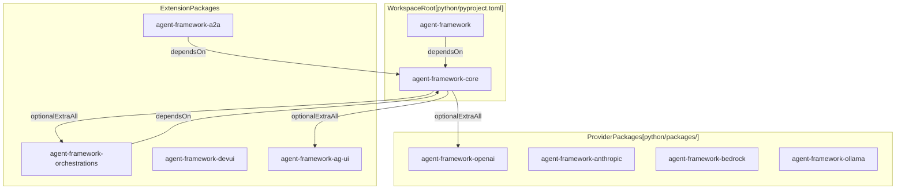
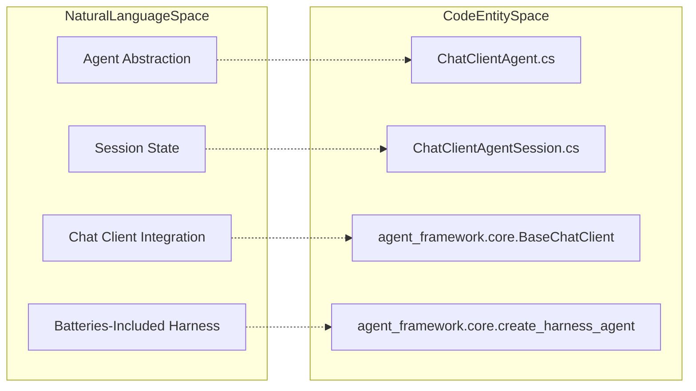

<!-- source: DeepWiki mcp.deepwiki.com · repo microsoft/agent-framework · page 7 Implementation Architecture · fetched 2026-10-26 -->

# Implementation Architecture

Relevant source files

The following files were used as context for generating this wiki page:

- [dotnet/Directory.Packages.props](dotnet/Directory.Packages.props)
- [dotnet/agent-framework-dotnet.slnx](dotnet/agent-framework-dotnet.slnx)
- [dotnet/samples/02-agents/AgentProviders/anthropic/Agent_Anthropic_Step04_UsingSkills/Program.cs](dotnet/samples/02-agents/AgentProviders/anthropic/Agent_Anthropic_Step04_UsingSkills/Program.cs)
- [dotnet/src/Microsoft.Agents.AI.Anthropic/AnthropicBetaServiceExtensions.cs](dotnet/src/Microsoft.Agents.AI.Anthropic/AnthropicBetaServiceExtensions.cs)
- [dotnet/src/Microsoft.Agents.AI.Anthropic/Microsoft.Agents.AI.Anthropic.csproj](dotnet/src/Microsoft.Agents.AI.Anthropic/Microsoft.Agents.AI.Anthropic.csproj)
- [dotnet/src/Microsoft.Agents.AI.Anthropic/PublicAPI/net10.0/PublicAPI.Shipped.txt](dotnet/src/Microsoft.Agents.AI.Anthropic/PublicAPI/net10.0/PublicAPI.Shipped.txt)
- [dotnet/src/Microsoft.Agents.AI.Anthropic/PublicAPI/net10.0/PublicAPI.Unshipped.txt](dotnet/src/Microsoft.Agents.AI.Anthropic/PublicAPI/net10.0/PublicAPI.Unshipped.txt)
- [dotnet/src/Microsoft.Agents.AI.Anthropic/PublicAPI/net472/PublicAPI.Shipped.txt](dotnet/src/Microsoft.Agents.AI.Anthropic/PublicAPI/net472/PublicAPI.Shipped.txt)
- [dotnet/src/Microsoft.Agents.AI.Anthropic/PublicAPI/net472/PublicAPI.Unshipped.txt](dotnet/src/Microsoft.Agents.AI.Anthropic/PublicAPI/net472/PublicAPI.Unshipped.txt)
- [dotnet/src/Microsoft.Agents.AI.Anthropic/PublicAPI/net8.0/PublicAPI.Shipped.txt](dotnet/src/Microsoft.Agents.AI.Anthropic/PublicAPI/net8.0/PublicAPI.Shipped.txt)
- [dotnet/src/Microsoft.Agents.AI.Anthropic/PublicAPI/net8.0/PublicAPI.Unshipped.txt](dotnet/src/Microsoft.Agents.AI.Anthropic/PublicAPI/net8.0/PublicAPI.Unshipped.txt)
- [dotnet/src/Microsoft.Agents.AI.Anthropic/PublicAPI/net9.0/PublicAPI.Shipped.txt](dotnet/src/Microsoft.Agents.AI.Anthropic/PublicAPI/net9.0/PublicAPI.Shipped.txt)
- [dotnet/tests/AnthropicChatCompletion.IntegrationTests/AnthropicSkillsIntegrationTests.cs](dotnet/tests/AnthropicChatCompletion.IntegrationTests/AnthropicSkillsIntegrationTests.cs)
- [dotnet/tests/Microsoft.Agents.AI.Anthropic.UnitTests/Extensions/AnthropicBetaServiceExtensionsTests.cs](dotnet/tests/Microsoft.Agents.AI.Anthropic.UnitTests/Extensions/AnthropicBetaServiceExtensionsTests.cs)
- [dotnet/tests/Microsoft.Agents.AI.Anthropic.UnitTests/Extensions/AnthropicClientExtensionsTests.cs](dotnet/tests/Microsoft.Agents.AI.Anthropic.UnitTests/Extensions/AnthropicClientExtensionsTests.cs)
- [python/CHANGELOG.md](python/CHANGELOG.md)
- [python/packages/a2a/pyproject.toml](python/packages/a2a/pyproject.toml)
- [python/packages/ag-ui/pyproject.toml](python/packages/ag-ui/pyproject.toml)
- [python/packages/anthropic/pyproject.toml](python/packages/anthropic/pyproject.toml)
- [python/packages/copilotstudio/pyproject.toml](python/packages/copilotstudio/pyproject.toml)
- [python/packages/core/pyproject.toml](python/packages/core/pyproject.toml)
- [python/packages/devui/pyproject.toml](python/packages/devui/pyproject.toml)
- [python/packages/lab/pyproject.toml](python/packages/lab/pyproject.toml)
- [python/packages/lab/uv.lock](python/packages/lab/uv.lock)
- [python/packages/mem0/pyproject.toml](python/packages/mem0/pyproject.toml)
- [python/packages/postgres/README.md](python/packages/postgres/README.md)
- [python/packages/postgres/pyproject.toml](python/packages/postgres/pyproject.toml)
- [python/packages/purview/pyproject.toml](python/packages/purview/pyproject.toml)
- [python/packages/redis/pyproject.toml](python/packages/redis/pyproject.toml)
- [python/pyproject.toml](python/pyproject.toml)
- [python/uv.lock](python/uv.lock)

This page provides a high-level overview of the implementation architecture for both the .NET and Python ecosystems of the Microsoft Agent Framework. It serves as a parent reference page detailing package organization, build systems, multi-targeting strategies, and core component mapping.

For detailed framework concepts, see [Core Concepts](#3). For platform-specific implementations and design decisions, see [.NET Implementation](#7.1) and [Python Implementation](#7.2). For deployment strategies, see [Deployment and Hosting](#6).

## Overview

The Microsoft Agent Framework maintains parallel implementations in .NET and Python, each adhering to language-specific idioms while ensuring architectural parity. Both ecosystems follow a layered structure separating core abstractions, concrete client implementations, provider integrations, and modular extension packages.

Sources: [python/pyproject.toml:1-27](), [python/packages/core/pyproject.toml:1-33]()

## Package Organization Architecture

### .NET Package Structure

The .NET framework is distributed as a set of modular NuGet packages coordinated via centralized package versioning in `Directory.Packages.props`. The core abstractions are anchored by `Microsoft.Agents.AI.Abstractions`, while runtime agent behavior is implemented in `Microsoft.Agents.AI` through `ChatClientAgent`.

| Package | Role / Purpose | Primary Dependency |
| :--- | :--- | :--- |
| `Microsoft.Agents.AI.Abstractions` | Defines interfaces (`IAgent`, `AgentSession`) and contracts | `Microsoft.Extensions.AI` |
| `Microsoft.Agents.AI` | Core agent logic, state management, and middleware execution | `Microsoft.Agents.AI.Abstractions` |
| `Microsoft.Agents.AI.OpenAI` | OpenAI and Azure OpenAI chat completion and response providers | `Microsoft.Agents.AI` |
| `Microsoft.Agents.AI.Workflows` | Graph-based orchestration, runners, and execution executors | `Microsoft.Agents.AI` |
| `Microsoft.Agents.AI.Foundry` | Azure AI Foundry project and agent service integration | `Microsoft.Agents.AI` |

Sources: [dotnet/Directory.Packages.props:1-100]()

### Python Package Structure

The Python implementation is organized as a `uv`-managed monorepo under `python/` with specialized packages grouped in `python/packages/`. The root `agent-framework` package acts as a meta-package that aggregates core functionality and optional integrations via the `all` dependency extra.

Title: Python Workspace Entity Mapping

Sources: [python/pyproject.toml:1-92](), [python/packages/core/pyproject.toml:1-71](), [python/uv.lock:27-65]()

## Build and Release Systems

### .NET Build System

The .NET build pipeline uses MSBuild with centralized package management (`Directory.Packages.props`) to enforce consistent dependency versions and enable transitive pinning. Package validation rules and audit mechanisms are integrated to monitor supply chain security and API surface changes.

Sources: [dotnet/Directory.Packages.props:1-100]()

### Python Build System

Python workspace management is handled via `uv`, with task orchestration standardized across workspace members using `poethepoet` tasks defined in `shared_tasks.toml`. Strict type checking is enforced using `pyright` and `mypy` targeting Python `>=3.10`.

Sources: [python/pyproject.toml:29-53](), [python/packages/core/pyproject.toml:133-148](), [python/packages/lab/pyproject.toml:143-161]()

## Core Implementation Components

The following diagram bridges abstract natural language system concepts to their exact implementations in code across both .NET and Python.

Title: Natural Language to Code Entity Space Mapping

Sources: [python/packages/core/pyproject.toml:1-7](), [python/CHANGELOG.md:13-18]()

## Implementation Detail Links

For deep dives into specific architectural domains, refer to the child pages:

- **.NET Implementation**: See [.NET Implementation](#7.1) for details on `ChatClientAgent`, middleware execution pipelines, and MSBuild configurations.
- **Python Implementation**: See [Python Implementation](#7.2) for workspace dependency resolution, `BaseChatClient`, and workflow runner architectures.
- **Cross-Language Design Patterns**: See [Cross-Language Design Patterns](#7.3) for common patterns including middleware, context providers, and tool systems.
- **HarnessAgent Pattern**: See [HarnessAgent Pattern](#7.4) for pre-configured agent setups covering file access, tool approval, and background loops.
- **Agent Skills System**: See [Agent Skills System](#7.5) for modular capability extensions via `SkillsProvider` and MCP integration.
- **AG-UI Protocol Integration**: See [AG-UI Protocol Integration](#7.6) for connecting agents to frontend UIs using FastAPI and SSE adapters.

Sources: [.NET Implementation](#7.1), [Python Implementation](#7.2), [Cross-Language Design Patterns](#7.3), [HarnessAgent Pattern](#7.4), [Agent Skills System](#7.5), [AG-UI Protocol Integration](#7.6)

## Experimental Features (AF Labs)

The `agent-framework-lab` package houses experimental research modules, evaluation benchmarks (GAIA, TAU2), and reinforcement learning integrations via `agentlightning`.

Sources: [python/packages/lab/pyproject.toml:1-105]()

---

