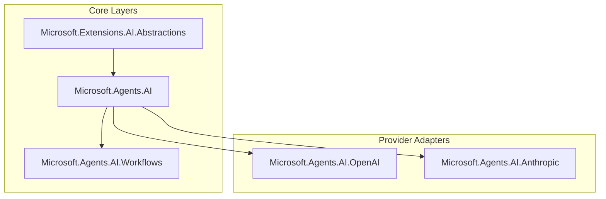
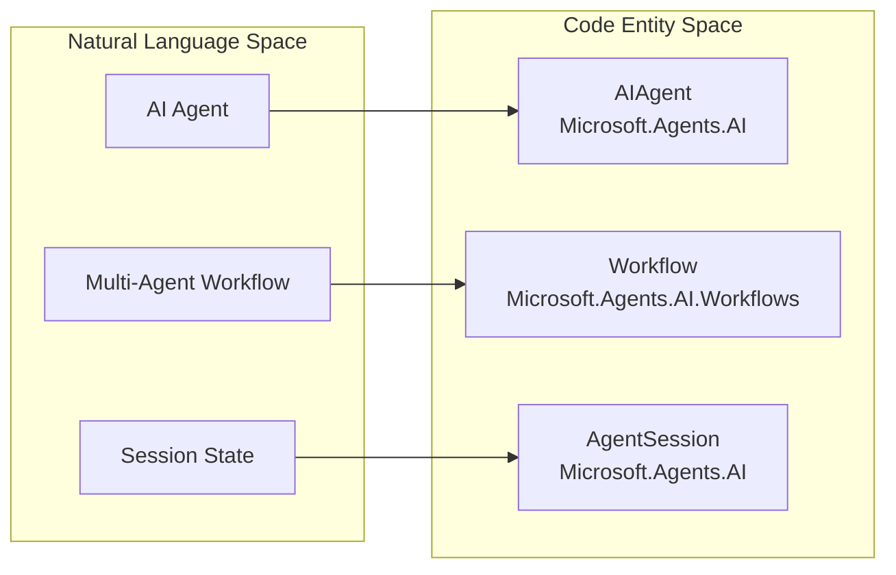
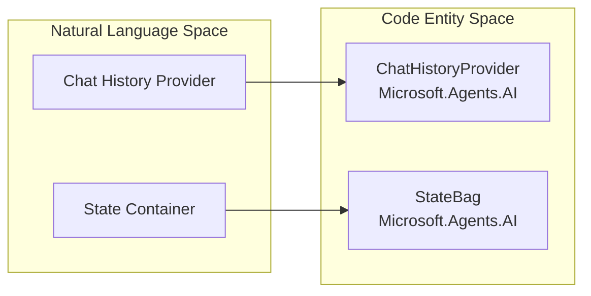

<!-- source: DeepWiki mcp.deepwiki.com · repo microsoft/agent-framework · page 7.1 .NET Implementation · fetched 2026-10-26 -->

# .NET Implementation

Relevant source files

The following files were used as context for generating this wiki page:

- [docs/decisions/0022-chat-history-persistence-consistency.md](docs/decisions/0022-chat-history-persistence-consistency.md)
- [dotnet/Directory.Packages.props](dotnet/Directory.Packages.props)
- [dotnet/agent-framework-dotnet.slnx](dotnet/agent-framework-dotnet.slnx)
- [dotnet/samples/02-agents/AgentProviders/anthropic/Agent_Anthropic_Step04_UsingSkills/Program.cs](dotnet/samples/02-agents/AgentProviders/anthropic/Agent_Anthropic_Step04_UsingSkills/Program.cs)
- [dotnet/samples/02-agents/Agents/Agent_Step19_InFunctionLoopCheckpointing/Program.cs](dotnet/samples/02-agents/Agents/Agent_Step19_InFunctionLoopCheckpointing/Program.cs)
- [dotnet/samples/02-agents/Agents/Agent_Step19_InFunctionLoopCheckpointing/README.md](dotnet/samples/02-agents/Agents/Agent_Step19_InFunctionLoopCheckpointing/README.md)
- [dotnet/src/Microsoft.Agents.AI.Abstractions/AdditionalPropertiesExtensions.cs](dotnet/src/Microsoft.Agents.AI.Abstractions/AdditionalPropertiesExtensions.cs)
- [dotnet/src/Microsoft.Agents.AI.Anthropic/AnthropicBetaServiceExtensions.cs](dotnet/src/Microsoft.Agents.AI.Anthropic/AnthropicBetaServiceExtensions.cs)
- [dotnet/src/Microsoft.Agents.AI.Anthropic/Microsoft.Agents.AI.Anthropic.csproj](dotnet/src/Microsoft.Agents.AI.Anthropic/Microsoft.Agents.AI.Anthropic.csproj)
- [dotnet/src/Microsoft.Agents.AI.Anthropic/PublicAPI/net10.0/PublicAPI.Shipped.txt](dotnet/src/Microsoft.Agents.AI.Anthropic/PublicAPI/net10.0/PublicAPI.Shipped.txt)
- [dotnet/src/Microsoft.Agents.AI.Anthropic/PublicAPI/net10.0/PublicAPI.Unshipped.txt](dotnet/src/Microsoft.Agents.AI.Anthropic/PublicAPI/net10.0/PublicAPI.Unshipped.txt)
- [dotnet/src/Microsoft.Agents.AI.Anthropic/PublicAPI/net472/PublicAPI.Shipped.txt](dotnet/src/Microsoft.Agents.AI.Anthropic/PublicAPI/net472/PublicAPI.Shipped.txt)
- [dotnet/src/Microsoft.Agents.AI.Anthropic/PublicAPI/net472/PublicAPI.Unshipped.txt](dotnet/src/Microsoft.Agents.AI.Anthropic/PublicAPI/net472/PublicAPI.Unshipped.txt)
- [dotnet/src/Microsoft.Agents.AI.Anthropic/PublicAPI/net8.0/PublicAPI.Shipped.txt](dotnet/src/Microsoft.Agents.AI.Anthropic/PublicAPI/net8.0/PublicAPI.Shipped.txt)
- [dotnet/src/Microsoft.Agents.AI.Anthropic/PublicAPI/net8.0/PublicAPI.Unshipped.txt](dotnet/src/Microsoft.Agents.AI.Anthropic/PublicAPI/net8.0/PublicAPI.Unshipped.txt)
- [dotnet/src/Microsoft.Agents.AI.Anthropic/PublicAPI/net9.0/PublicAPI.Shipped.txt](dotnet/src/Microsoft.Agents.AI.Anthropic/PublicAPI/net9.0/PublicAPI.Shipped.txt)
- [dotnet/src/Microsoft.Agents.AI/ChatClient/ChatClientAgent.cs](dotnet/src/Microsoft.Agents.AI/ChatClient/ChatClientAgent.cs)
- [dotnet/src/Microsoft.Agents.AI/ChatClient/ChatClientAgentContinuationToken.cs](dotnet/src/Microsoft.Agents.AI/ChatClient/ChatClientAgentContinuationToken.cs)
- [dotnet/src/Microsoft.Agents.AI/ChatClient/ChatClientAgentLogMessages.cs](dotnet/src/Microsoft.Agents.AI/ChatClient/ChatClientAgentLogMessages.cs)
- [dotnet/src/Microsoft.Agents.AI/ChatClient/ChatClientAgentOptions.cs](dotnet/src/Microsoft.Agents.AI/ChatClient/ChatClientAgentOptions.cs)
- [dotnet/src/Microsoft.Agents.AI/ChatClient/ChatClientBuilderExtensions.cs](dotnet/src/Microsoft.Agents.AI/ChatClient/ChatClientBuilderExtensions.cs)
- [dotnet/src/Microsoft.Agents.AI/ChatClient/ChatClientExtensions.cs](dotnet/src/Microsoft.Agents.AI/ChatClient/ChatClientExtensions.cs)
- [dotnet/tests/AnthropicChatCompletion.IntegrationTests/AnthropicSkillsIntegrationTests.cs](dotnet/tests/AnthropicChatCompletion.IntegrationTests/AnthropicSkillsIntegrationTests.cs)
- [dotnet/tests/Microsoft.Agents.AI.Abstractions.UnitTests/AdditionalPropertiesExtensionsTests.cs](dotnet/tests/Microsoft.Agents.AI.Abstractions.UnitTests/AdditionalPropertiesExtensionsTests.cs)
- [dotnet/tests/Microsoft.Agents.AI.Anthropic.UnitTests/Extensions/AnthropicBetaServiceExtensionsTests.cs](dotnet/tests/Microsoft.Agents.AI.Anthropic.UnitTests/Extensions/AnthropicBetaServiceExtensionsTests.cs)
- [dotnet/tests/Microsoft.Agents.AI.Anthropic.UnitTests/Extensions/AnthropicClientExtensionsTests.cs](dotnet/tests/Microsoft.Agents.AI.Anthropic.UnitTests/Extensions/AnthropicClientExtensionsTests.cs)
- [dotnet/tests/Microsoft.Agents.AI.UnitTests/ChatClient/ChatClientAgentContinuationTokenTests.cs](dotnet/tests/Microsoft.Agents.AI.UnitTests/ChatClient/ChatClientAgentContinuationTokenTests.cs)
- [dotnet/tests/Microsoft.Agents.AI.UnitTests/ChatClient/ChatClientAgentOptionsTests.cs](dotnet/tests/Microsoft.Agents.AI.UnitTests/ChatClient/ChatClientAgentOptionsTests.cs)
- [dotnet/tests/Microsoft.Agents.AI.UnitTests/ChatClient/ChatClientAgentTestHelper.cs](dotnet/tests/Microsoft.Agents.AI.UnitTests/ChatClient/ChatClientAgentTestHelper.cs)
- [dotnet/tests/Microsoft.Agents.AI.UnitTests/ChatClient/ChatClientAgentTests.cs](dotnet/tests/Microsoft.Agents.AI.UnitTests/ChatClient/ChatClientAgentTests.cs)
- [dotnet/tests/Microsoft.Agents.AI.UnitTests/ChatClient/ChatClientAgent_ApprovalsTests.cs](dotnet/tests/Microsoft.Agents.AI.UnitTests/ChatClient/ChatClientAgent_ApprovalsTests.cs)
- [dotnet/tests/Microsoft.Agents.AI.UnitTests/ChatClient/ChatClientAgent_BackgroundResponsesTests.cs](dotnet/tests/Microsoft.Agents.AI.UnitTests/ChatClient/ChatClientAgent_BackgroundResponsesTests.cs)
- [dotnet/tests/Microsoft.Agents.AI.UnitTests/ChatClient/ChatClientAgent_ChatHistoryManagementTests.cs](dotnet/tests/Microsoft.Agents.AI.UnitTests/ChatClient/ChatClientAgent_ChatHistoryManagementTests.cs)
- [dotnet/tests/Microsoft.Agents.AI.UnitTests/ChatClient/ChatClientAgent_ChatOptionsMergingTests.cs](dotnet/tests/Microsoft.Agents.AI.UnitTests/ChatClient/ChatClientAgent_ChatOptionsMergingTests.cs)
- [dotnet/tests/Microsoft.Agents.AI.UnitTests/ChatClient/ChatClientBuilderExtensionsTests.cs](dotnet/tests/Microsoft.Agents.AI.UnitTests/ChatClient/ChatClientBuilderExtensionsTests.cs)
- [dotnet/tests/Microsoft.Agents.AI.UnitTests/ChatClient/ChatClientExtensionsTests.cs](dotnet/tests/Microsoft.Agents.AI.UnitTests/ChatClient/ChatClientExtensionsTests.cs)

This document provides a high-level overview of the .NET implementation architecture for the Microsoft Agent Framework. It outlines the core architectural principles, package organization, session handling, configuration merging strategies, and build systems designed to deliver scalable AI agent solutions.

For deep technical details, refer to the child pages:
- [Package Structure and Dependencies](#7.1.1) — Document .NET package organization, `Directory.Packages.props`, multi-targeting strategy, and dependency management.
- [Agent and Chat Client Implementation](#7.1.2) — Detailed explanation of `ChatClientAgent` implementation, middleware layers, and `IChatClient` delegation.
- [Session and State Management](#7.1.3) — Explain `AgentSession` serialization (ADR 0018), `StateBag` patterns, and state key validation.
- [Options Merging and Configuration](#7.1.4) — Detail the configuration merging strategy for `ChatClientAgentOptions`, `AgentRunOptions`, and `ChatOptions`.
- [NuGet Build System](#7.1.5) — Document NuGet packaging, versioning (RC vs preview), package validation, and release automation.

---

## Architecture Overview

The .NET framework implementation relies on a modular, layered structure built directly on top of `Microsoft.Extensions.AI`. Abstractions are decoupled from specific provider implementations to allow developers to swap underlying chat clients, memory providers, and workflow executors seamlessly [dotnet/Directory.Packages.props:87-88]().

The package hierarchy separates core abstractions from implementation details and provider adapters. For comprehensive details on package organization and dependency resolution, see [Package Structure and Dependencies](#7.1.1).

**Core Package Dependency Graph**

Sources: [dotnet/Directory.Packages.props:87-88]()

---

## Core Code Entities

The framework maps conceptual agentic terms to specific .NET classes and interfaces. The following diagram illustrates how natural language concepts align with concrete code entities.

**Natural Language to Code Entity Mapping**

Sources: [dotnet/src/Microsoft.Agents.AI/ChatClient/ChatClientAgent.cs:57-64]()

---

## Agent and Chat Client Implementation

The framework defines agents through the abstract base class `AIAgent`, which manages execution lifecycles and concurrency [dotnet/src/Microsoft.Agents.AI/ChatClient/ChatClientAgent.cs:57-64](). Concrete implementations like `ChatClientAgent` bridge standard `IChatClient` instances from `Microsoft.Extensions.AI` into autonomous agents capable of tool execution, streaming responses, and middleware injection [dotnet/src/Microsoft.Agents.AI/ChatClient/ChatClientAgent.cs:17-19]().

For full implementation details, middleware layering, and client delegation patterns, see [Agent and Chat Client Implementation](#7.1.2).

Sources: [dotnet/src/Microsoft.Agents.AI/ChatClient/ChatClientAgent.cs:17-64]()

---

## Session and State Management

State persistence across conversation turns is managed via `AgentSession` and underlying state dictionaries known as `StateBag`. To support distributed hosting and state migration, the framework implements robust serialization strategies compliant with ADR 0018, validating state keys to prevent collision in multi-agent pipelines [dotnet/src/Microsoft.Agents.AI/ChatClient/ChatClientAgentOptions.cs:41-49]().

For detailed serialization patterns and state key validation rules, see [Session and State Management](#7.1.3).

Sources: [dotnet/src/Microsoft.Agents.AI/ChatClient/ChatClientAgentOptions.cs:41-49]()

---

## Options Merging and Configuration

Configuring agent runs requires harmonizing parameters across multiple layers: `ChatClientAgentOptions`, `AgentRunOptions`, and `ChatOptions`. The .NET implementation uses a cascading options-merging strategy to ensure runtime settings, tool collections, and model parameters propagate correctly from agent initialization down to individual service calls [dotnet/src/Microsoft.Agents.AI/ChatClient/ChatClientAgentOptions.cs:18-38]().

For a deep dive into configuration precedence and custom factories, see [Options Merging and Configuration](#7.1.4).

Sources: [dotnet/src/Microsoft.Agents.AI/ChatClient/ChatClientAgentOptions.cs:18-38]()

---

## Memory and Persistence Architecture

Memory providers and context enrichment layers integrate with agents to supply chat history and relevant background data. The following diagram maps memory concepts to their corresponding code constructs.

**Memory and Context Code Mapping**

Sources: [dotnet/src/Microsoft.Agents.AI/ChatClient/ChatClientAgentOptions.cs:41-49]()

---

## NuGet Build System

The .NET codebase relies on Central Package Management (`Directory.Packages.props`) to enforce consistent versions of external dependencies like `Microsoft.Extensions.AI` (version `10.10.0`) [dotnet/Directory.Packages.props:87-88](). The build pipeline automatically handles package validation, automated auditing for vulnerabilities, and conditional preview vs. RC versioning suffixes [dotnet/Directory.Packages.props:5-6]().

For complete information on packaging workflows and release automation, see [NuGet Build System](#7.1.5).

Sources: [dotnet/Directory.Packages.props:1-100]()

---

