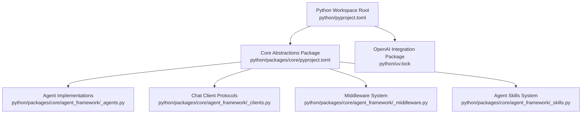
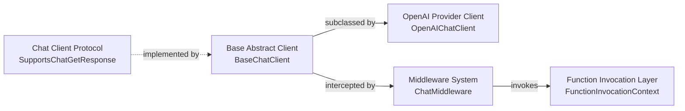

<!-- source: DeepWiki mcp.deepwiki.com · repo microsoft/agent-framework · page 7.2 Python Implementation · fetched 2026-10-26 -->

# Python Implementation

Relevant source files

The following files were used as context for generating this wiki page:

- [python/CHANGELOG.md](python/CHANGELOG.md)
- [python/packages/a2a/pyproject.toml](python/packages/a2a/pyproject.toml)
- [python/packages/ag-ui/pyproject.toml](python/packages/ag-ui/pyproject.toml)
- [python/packages/anthropic/pyproject.toml](python/packages/anthropic/pyproject.toml)
- [python/packages/copilotstudio/pyproject.toml](python/packages/copilotstudio/pyproject.toml)
- [python/packages/core/AGENTS.md](python/packages/core/AGENTS.md)
- [python/packages/core/agent_framework/__init__.py](python/packages/core/agent_framework/__init__.py)
- [python/packages/core/agent_framework/__init__.pyi](python/packages/core/agent_framework/__init__.pyi)
- [python/packages/core/agent_framework/_skills.py](python/packages/core/agent_framework/_skills.py)
- [python/packages/core/pyproject.toml](python/packages/core/pyproject.toml)
- [python/packages/core/tests/core/test_skills.py](python/packages/core/tests/core/test_skills.py)
- [python/packages/devui/pyproject.toml](python/packages/devui/pyproject.toml)
- [python/packages/lab/pyproject.toml](python/packages/lab/pyproject.toml)
- [python/packages/lab/uv.lock](python/packages/lab/uv.lock)
- [python/packages/mem0/pyproject.toml](python/packages/mem0/pyproject.toml)
- [python/packages/postgres/README.md](python/packages/postgres/README.md)
- [python/packages/postgres/pyproject.toml](python/packages/postgres/pyproject.toml)
- [python/packages/purview/pyproject.toml](python/packages/purview/pyproject.toml)
- [python/packages/redis/pyproject.toml](python/packages/redis/pyproject.toml)
- [python/pyproject.toml](python/pyproject.toml)
- [python/samples/02-agents/skills/README.md](python/samples/02-agents/skills/README.md)
- [python/samples/02-agents/skills/class_based_skill/README.md](python/samples/02-agents/skills/class_based_skill/README.md)
- [python/samples/02-agents/skills/class_based_skill/class_based_skill.py](python/samples/02-agents/skills/class_based_skill/class_based_skill.py)
- [python/samples/02-agents/skills/code_defined_skill/README.md](python/samples/02-agents/skills/code_defined_skill/README.md)
- [python/samples/02-agents/skills/code_defined_skill/code_defined_skill.py](python/samples/02-agents/skills/code_defined_skill/code_defined_skill.py)
- [python/samples/02-agents/skills/file_based_skill/file_based_skill.py](python/samples/02-agents/skills/file_based_skill/file_based_skill.py)
- [python/samples/02-agents/skills/mixed_skills/README.md](python/samples/02-agents/skills/mixed_skills/README.md)
- [python/samples/02-agents/skills/mixed_skills/mixed_skills.py](python/samples/02-agents/skills/mixed_skills/mixed_skills.py)
- [python/samples/02-agents/skills/script_approval/script_approval.py](python/samples/02-agents/skills/script_approval/script_approval.py)
- [python/samples/02-agents/skills/subprocess_script_runner.py](python/samples/02-agents/skills/subprocess_script_runner.py)
- [python/uv.lock](python/uv.lock)

This page provides a high-level architectural overview of the Python implementation of the Microsoft Agent Framework. The Python ecosystem is designed around modern, asynchronous programming paradigms, structural subtyping, and deterministic dependency management. For details on the .NET implementation, see [.NET Implementation](#7.1).

For deep dives into specific sub-topics, refer to the following child pages:
- [Monorepo Structure and Package Management](#7.2.1)
- [Chat Client Implementations](#7.2.2)
- [Workflow Engine Architecture](#7.2.3)
- [Python Build System](#7.2.4)

---

## Monorepo Structure and Package Management

The Python implementation is organized as a unified `uv`-managed workspace located under the `python/` directory [python/pyproject.toml:71-74](). It separates core abstractions from provider integrations, utility packages, and experimental lab modules to minimize unnecessary transitive dependencies and speed up import times [python/CHANGELOG.md:25-34]().

The workspace root coordinates dependency locks and shared tool configurations across over 35 sub-packages [python/pyproject.toml:71-111](), [python/uv.lock:28-71]().

Title: Monorepo Workspace and Core Package Layout

Sources: [python/pyproject.toml:71-111](), [python/packages/core/pyproject.toml:1-33](), [python/packages/core/AGENTS.md:8-27]()

For full details on workspace management, pyproject structures, and cross-package dependency resolution, see [Monorepo Structure and Package Management](#7.2.1).

---

## Chat Client Implementations

The chat client architecture uses protocol-based structural subtyping (`typing.Protocol`) rather than rigid inheritance hierarchies [python/packages/core/agent_framework/_agents.py:42-44](). The base abstractions define standard interfaces that provider-specific packages implement [python/packages/core/agent_framework/_clients.py:49-70]().

Title: Chat Client Protocols and Middleware Layering

Sources: [python/packages/core/agent_framework/_clients.py:49-70](), [python/packages/core/agent_framework/_middleware.py:181-185](), [python/packages/core/AGENTS.md:54-71]()

For comprehensive details on protocol definitions, middleware chaining, and provider client layers, see [Chat Client Implementations](#7.2.2).

---

## Workflow Engine Architecture

The framework features an asynchronous workflow engine built around a structured execution context and event-driven runner pattern. Workflows allow developers to orchestrate multi-agent collaboration, handoffs, and checkpointed state machines natively in Python [python/packages/core/AGENTS.md:23]().

The execution engine manages message passing, superstep evaluation, and state persistence across distributed execution boundaries.

For detailed documentation on the `Runner`, `ExecutionContext`, and event processing pipelines, see [Workflow Engine Architecture](#7.2.3).

Sources: [python/packages/core/AGENTS.md:23]()

---

## Python Build System

Task orchestration, code quality enforcement, and testing infrastructure are standardized across all Python packages using `poethepoet`, `ruff`, `mypy`, `pyright`, and `pytest` [python/pyproject.toml:31-52](), [python/packages/core/pyproject.toml:132-147]().

Dependency bounds validation and release workflows are governed by shared task definitions integrated into local and CI environments.

For information on Poe tasks, test execution matrices, and release automation, see [Python Build System](#7.2.4).

Sources: [python/pyproject.toml:31-52](), [python/packages/core/pyproject.toml:132-147]()

---

