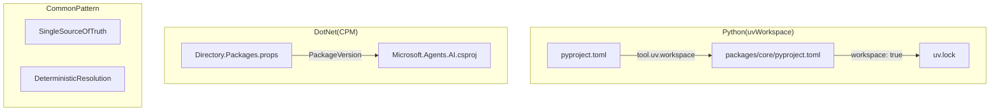
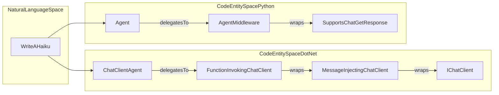
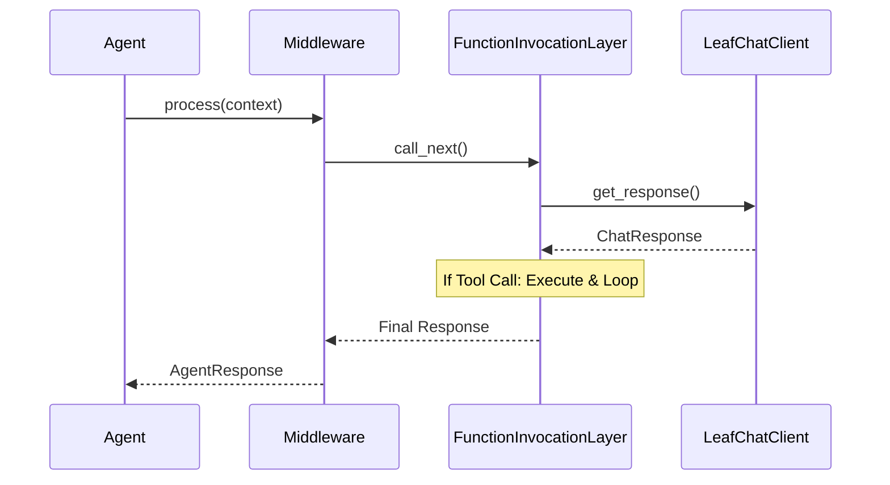
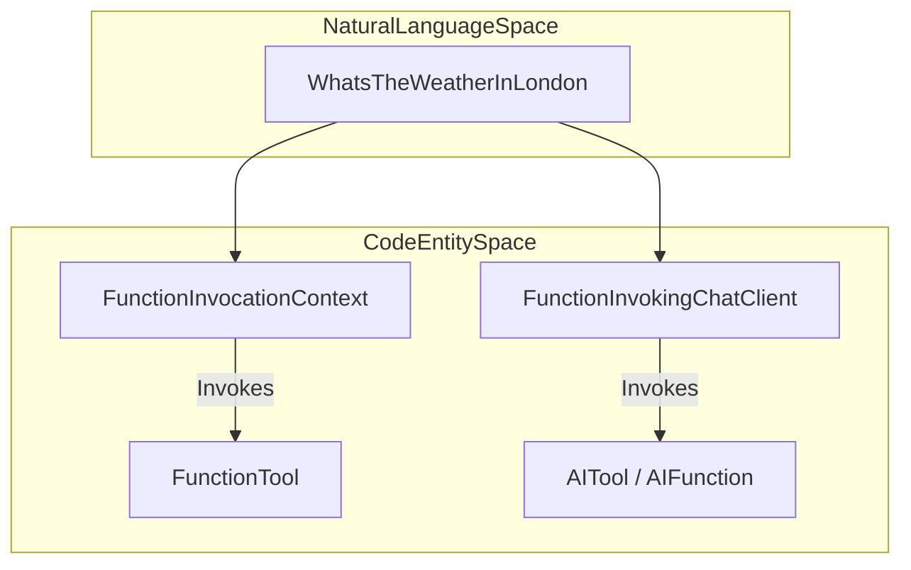
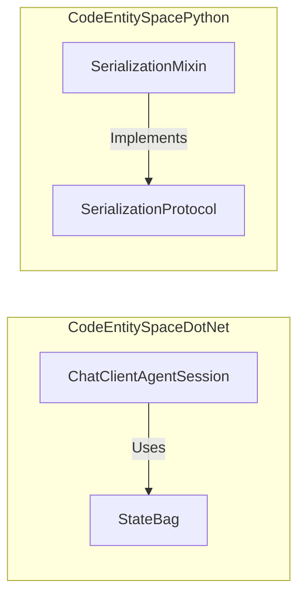

<!-- source: DeepWiki mcp.deepwiki.com · repo microsoft/agent-framework · page 7.3 Cross-Language Design Patterns · fetched 2026-10-26 -->

# Cross-Language Design Patterns

Relevant source files

The following files were used as context for generating this wiki page:

- [docs/decisions/0001-agent-run-response.md](docs/decisions/0001-agent-run-response.md)
- [docs/decisions/0006-userapproval.md](docs/decisions/0006-userapproval.md)
- [docs/decisions/0008-python-subpackages.md](docs/decisions/0008-python-subpackages.md)
- [docs/decisions/0009-support-long-running-operations.md](docs/decisions/0009-support-long-running-operations.md)
- [docs/design/python-package-setup.md](docs/design/python-package-setup.md)
- [dotnet/src/Microsoft.Agents.AI.Anthropic/AnthropicClientExtensions.cs](dotnet/src/Microsoft.Agents.AI.Anthropic/AnthropicClientExtensions.cs)
- [dotnet/src/Microsoft.Agents.AI.Purview/IScopedContentProcessor.cs](dotnet/src/Microsoft.Agents.AI.Purview/IScopedContentProcessor.cs)
- [dotnet/src/Microsoft.Agents.AI.Purview/PurviewExtensions.cs](dotnet/src/Microsoft.Agents.AI.Purview/PurviewExtensions.cs)
- [dotnet/src/Microsoft.Agents.AI.Purview/PurviewWrapper.cs](dotnet/src/Microsoft.Agents.AI.Purview/PurviewWrapper.cs)
- [dotnet/src/Microsoft.Agents.AI.Purview/README.md](dotnet/src/Microsoft.Agents.AI.Purview/README.md)
- [dotnet/tests/Microsoft.Agents.AI.Purview.UnitTests/PurviewDurableHistoryTests.cs](dotnet/tests/Microsoft.Agents.AI.Purview.UnitTests/PurviewDurableHistoryTests.cs)
- [dotnet/tests/Microsoft.Agents.AI.Purview.UnitTests/PurviewWrapperTests.cs](dotnet/tests/Microsoft.Agents.AI.Purview.UnitTests/PurviewWrapperTests.cs)
- [python/packages/core/agent_framework/_agent_hooks.py](python/packages/core/agent_framework/_agent_hooks.py)
- [python/packages/purview/README.md](python/packages/purview/README.md)
- [python/packages/purview/agent_framework_purview/_middleware.py](python/packages/purview/agent_framework_purview/_middleware.py)
- [python/packages/purview/tests/purview/conftest.py](python/packages/purview/tests/purview/conftest.py)
- [python/packages/purview/tests/purview/test_chat_middleware.py](python/packages/purview/tests/purview/test_chat_middleware.py)
- [python/packages/purview/tests/purview/test_middleware.py](python/packages/purview/tests/purview/test_middleware.py)
- [python/samples/03-workflows/declarative/function_tools/README.md](python/samples/03-workflows/declarative/function_tools/README.md)

## Purpose and Scope

This document analyzes the common architectural patterns shared across the Python and .NET implementations of the Microsoft Agent Framework. While each implementation respects language-specific idioms (e.g., protocols in Python vs. explicit interfaces in .NET), they follow consistent conceptual models for middleware, context providers, and tool systems to ensure developer portability and behavioral parity.

For implementation-specific details, see [7.1 .NET Implementation]() and [7.2 Python Implementation]().

Sources: [dotnet/src/Microsoft.Agents.AI/ChatClient/ChatClientAgent.cs:17-39](), [python/packages/core/agent_framework/_middleware.py:143-153]()

---

## Core Design Philosophy

Both implementations adhere to three guiding principles:

1.  **Conceptual Parity**: The same high-level abstractions exist in both languages (Agents, Chat Clients, History Providers, Context Providers, and Tools).
2.  **Idiomatic Expression**: Python leverages structural typing via Protocols (e.g., `SupportsChatGetResponse` [python/packages/core/agent_framework/_middleware.py:14]()) and `uv` for package management, while .NET uses explicit interfaces (`IChatClient` [dotnet/src/Microsoft.Agents.AI/ChatClient/ChatClientAgent.cs:18]()) and Central Package Management via `Directory.Packages.props`.
3.  **Layered Middleware**: Both frameworks utilize a decorator or interceptor pattern to inject cross-cutting concerns like telemetry, tool invocation, and history persistence.

Sources: [dotnet/src/Microsoft.Agents.AI/ChatClient/ChatClientAgent.cs:116-126](), [python/packages/core/agent_framework/_middleware.py:143-153](), [dotnet/src/Microsoft.Agents.AI/ChatClient/ChatClientExtensions.cs:52-128]()

---

## Package and Dependency Management

### Centralized Versioning Patterns

Both implementations use centralized version control to ensure consistency across monorepo sub-packages.

#### Dependency Management Architecture

Sources: [docs/design/python-package-setup.md:1-50](), [dotnet/src/Microsoft.Agents.AI/ChatClient/ChatClientAgent.cs:1-15]()

| Aspect | Python Implementation | .NET Implementation |
| :--- | :--- | :--- |
| **Tooling** | `uv` | `dotnet` |
| **Installation** | `pip install agent-framework` | `dotnet add package Microsoft.Agents.AI` |
| **Monorepo Strategy** | Flat structure, functional grouping | Namespace-based projects |

Sources: [docs/design/python-package-setup.md:1-50](), [dotnet/src/Microsoft.Agents.AI/ChatClient/ChatClientAgent.cs:1-15]()

---

## Agent and Chat Client Abstractions

The framework bridges the gap between raw LLM clients and autonomous agents using a delegation pattern.

### Bridge: Natural Language Space to Code Entity Space
This diagram maps how a conceptual "Agent" request flows through specific code entities in both languages.

Sources: [dotnet/src/Microsoft.Agents.AI/ChatClient/ChatClientAgent.cs:17-80](), [python/packages/core/agent_framework/_middleware.py:14-46]()

### Implementation Parity Table

| Feature | Python Entity | .NET Entity |
| :--- | :--- | :--- |
| **Base Agent** | `Agent` [python/packages/core/agent_framework/_agents.py:1]() | `ChatClientAgent` [dotnet/src/Microsoft.Agents.AI/ChatClient/ChatClientAgent.cs:39]() |
| **LLM Interface** | `SupportsChatGetResponse` [python/packages/core/agent_framework/_middleware.py:14]() | `IChatClient` [dotnet/src/Microsoft.Agents.AI/ChatClient/ChatClientAgent.cs:18]() |
| **Options Class** | `ChatOptions` [python/packages/core/agent_framework/_middleware.py:46]() | `ChatClientAgentOptions` [dotnet/src/Microsoft.Agents.AI/ChatClient/ChatClientAgentOptions.cs:18]() |

Sources: [dotnet/src/Microsoft.Agents.AI/ChatClient/ChatClientAgent.cs:17-80](), [python/packages/core/agent_framework/_middleware.py:14-46](), [dotnet/src/Microsoft.Agents.AI/ChatClient/ChatClientAgentOptions.cs:18-48]()

---

## Middleware and Interception Patterns

Both implementations use a pipeline of decorators or middleware to handle cross-cutting concerns like tool invocation, auditing (e.g., Purview governance), and chat history.

### Middleware Execution Flow

Sources: [python/packages/core/agent_framework/_middleware.py:184-285](), [dotnet/src/Microsoft.Agents.AI/ChatClient/ChatClientExtensions.cs:52-128]()

### Key Classes
- **Python**: `AgentMiddleware` [python/packages/core/agent_framework/_middleware.py:184](), `ChatMiddleware` [python/packages/core/agent_framework/_middleware.py:228](), and `PurviewPolicyMiddleware` [python/packages/purview/agent_framework_purview/_middleware.py:70]() define base types for interception and policy enforcement.
- **.NET**: `ChatClientExtensions.WithDefaultAgentMiddleware` [dotnet/src/Microsoft.Agents.AI/ChatClient/ChatClientExtensions.cs:52-128]() constructs the pipeline using `ApprovalResponseBindingChatClient`, `FunctionInvokingChatClient`, and `PurviewChatClient` via `PurviewExtensions` [dotnet/src/Microsoft.Agents.AI.Purview/PurviewExtensions.cs:88]().

Sources: [python/packages/core/agent_framework/_middleware.py:184-285](), [dotnet/src/Microsoft.Agents.AI/ChatClient/ChatClientExtensions.cs:52-128](), [dotnet/src/Microsoft.Agents.AI.Purview/PurviewExtensions.cs:88-92]()

---

## Context and History Management

The framework distinguishes between **Context Providers** (short-term/injected info) and **History Providers** (long-term/conversation state).

### Context Provider Lifecycle
Both implementations follow an "Invoking/Invoked" lifecycle to enrich prompts prior to model execution.

| Pattern | Python | .NET |
| :--- | :--- | :--- |
| **History Provider** | `HistoryProvider` [python/packages/core/agent_framework/_history.py:1]() | `ChatHistoryProvider` [dotnet/src/Microsoft.Agents.AI/ChatClient/ChatClientAgentOptions.cs:43]() |
| **Context Provider** | `ContextProvider` [python/packages/core/agent_framework/_context.py:1]() | `AIContextProvider` [dotnet/src/Microsoft.Agents.AI/ChatClient/ChatClientAgentOptions.cs:48]() |
| **Conflict Handling** | Handled in Agent logic | `ThrowOnChatHistoryProviderConflict` [dotnet/src/Microsoft.Agents.AI/ChatClient/ChatClientAgentOptions.cs:105]() |

Sources: [dotnet/src/Microsoft.Agents.AI/ChatClient/ChatClientAgentOptions.cs:39-105](), [dotnet/tests/Microsoft.Agents.AI.UnitTests/ChatClient/ChatClientAgent_ChatHistoryManagementTests.cs:146-168]()

---

## Tool and Function Calling System

Tools are abstracted as executable entities that the LLM can discover via schema and invoke via arguments.

### Tool Invocation Bridge

Sources: [dotnet/src/Microsoft.Agents.AI/ChatClient/ChatClientAgent.cs:64-82](), [python/packages/core/agent_framework/_middleware.py:251-267]()

### Implementation Details
- **Python**: Uses `FunctionTool` and `FunctionInvocationContext` [python/packages/core/agent_framework/_middleware.py:251]() to manage the execution lifecycle.
- **.NET**: Uses `AITool` [dotnet/src/Microsoft.Agents.AI/ChatClient/ChatClientAgent.cs:80](). The `FunctionInvokingChatClient` manages the loop, including `AllowConcurrentInvocation` settings [dotnet/src/Microsoft.Agents.AI/ChatClient/ChatClientAgentOptions.cs:75]().

Sources: [dotnet/src/Microsoft.Agents.AI/ChatClient/ChatClientAgent.cs:64-82](), [dotnet/src/Microsoft.Agents.AI/ChatClient/ChatClientExtensions.cs:93-105](), [python/packages/core/agent_framework/_middleware.py:251-267]()

---

## Serialization and State Management

Both implementations provide a system for persisting agent and session state, ensuring that complex objects can be round-tripped.

### Serialization Bridge

Sources: [python/packages/core/agent_framework/_serialization.py:28-154](), [dotnet/src/Microsoft.Agents.AI/ChatClient/ChatClientAgentOptions.cs:108-141]()

- **Python**: The `SerializationMixin` [python/packages/core/agent_framework/_serialization.py:154]() provides `to_dict()` and `from_dict()` methods, supporting dependency injection for non-serializable fields.
- **.NET**: `ChatClientAgentSession` [dotnet/src/Microsoft.Agents.AI/ChatClient/ChatClientAgent.cs:155]() manages the `ConversationId` and state via `StateBag`.

Sources: [python/packages/core/agent_framework/_serialization.py:28-154](), [dotnet/src/Microsoft.Agents.AI/ChatClient/ChatClientAgentOptions.cs:108-141]()

---

## Options Merging Pattern

Both frameworks implement a robust options merging strategy to allow defaults at the Agent level to be overridden at the Run level.

### Options Hierarchy
1. **Agent Level**: Set during construction via `ChatClientAgentOptions` [dotnet/src/Microsoft.Agents.AI/ChatClient/ChatClientAgentOptions.cs:18]().
2. **Run Level**: Passed during a specific run call (e.g., `AgentRunOptions` in .NET).

In .NET, `ChatClientAgent` clones initial options to prevent side effects [dotnet/src/Microsoft.Agents.AI/ChatClient/ChatClientAgent.cs:121](). This ensures immutable configuration for the agent's lifetime while permitting per-request overrides.

Sources: [dotnet/src/Microsoft.Agents.AI/ChatClient/ChatClientAgent.cs:121-126](), [dotnet/src/Microsoft.Agents.AI/ChatClient/ChatClientAgentOptions.cs:116-165]()

---

