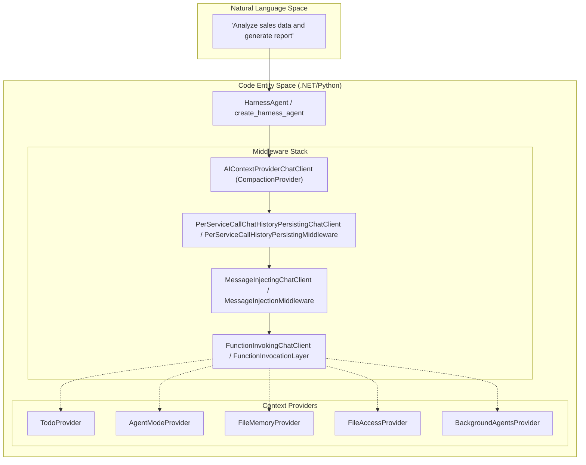
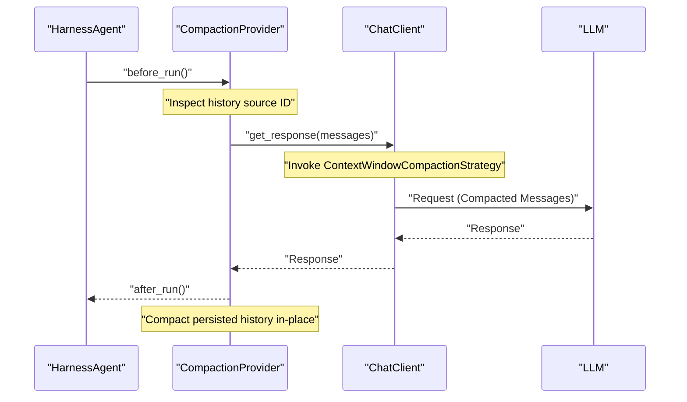

<!-- source: DeepWiki mcp.deepwiki.com · repo microsoft/agent-framework · page 7.4 HarnessAgent Pattern · fetched 2026-10-26 -->

# HarnessAgent Pattern

<details>
<summary>Relevant source files</summary>

The following files were used as context for generating this wiki page:

- [dotnet/samples/02-agents/AgentSkills/Agent_Step06_McpBasedSkills/README.md](dotnet/samples/02-agents/AgentSkills/Agent_Step06_McpBasedSkills/README.md)
- [dotnet/samples/02-agents/Agents/Agent_Step18_CompactionPipeline/README.md](dotnet/samples/02-agents/Agents/Agent_Step18_CompactionPipeline/README.md)
- [dotnet/samples/02-agents/Harness/BuildYourOwnClaw/Claw_Step02_WorkingWithData/Claw_Step02_WorkingWithData.csproj](dotnet/samples/02-agents/Harness/BuildYourOwnClaw/Claw_Step02_WorkingWithData/Claw_Step02_WorkingWithData.csproj)
- [dotnet/samples/02-agents/Harness/BuildYourOwnClaw/Claw_Step02_WorkingWithData/Program.cs](dotnet/samples/02-agents/Harness/BuildYourOwnClaw/Claw_Step02_WorkingWithData/Program.cs)
- [dotnet/samples/02-agents/Harness/BuildYourOwnClaw/Claw_Step02_WorkingWithData/StockTools.cs](dotnet/samples/02-agents/Harness/BuildYourOwnClaw/Claw_Step02_WorkingWithData/StockTools.cs)
- [dotnet/samples/02-agents/Harness/BuildYourOwnClaw/Claw_Step02_WorkingWithData/TradingTools.cs](dotnet/samples/02-agents/Harness/BuildYourOwnClaw/Claw_Step02_WorkingWithData/TradingTools.cs)
- [dotnet/samples/02-agents/Harness/BuildYourOwnClaw/Claw_Step02_WorkingWithData/working/portfolio.csv](dotnet/samples/02-agents/Harness/BuildYourOwnClaw/Claw_Step02_WorkingWithData/working/portfolio.csv)
- [dotnet/samples/02-agents/Harness/BuildYourOwnClaw/Claw_Step03_ScalingCapabilities/Program.cs](dotnet/samples/02-agents/Harness/BuildYourOwnClaw/Claw_Step03_ScalingCapabilities/Program.cs)
- [dotnet/samples/02-agents/Harness/Harness_Shared_Console/Commands/ModeCommandHandler.cs](dotnet/samples/02-agents/Harness/Harness_Shared_Console/Commands/ModeCommandHandler.cs)
- [dotnet/samples/02-agents/Harness/Harness_Shared_Console/Commands/SessionCommandHandler.cs](dotnet/samples/02-agents/Harness/Harness_Shared_Console/Commands/SessionCommandHandler.cs)
- [dotnet/samples/02-agents/Harness/Harness_Shared_Console/Commands/TodoCommandHandler.cs](dotnet/samples/02-agents/Harness/Harness_Shared_Console/Commands/TodoCommandHandler.cs)
- [dotnet/samples/02-agents/Harness/Harness_Shared_Console/FileSpanExporter.cs](dotnet/samples/02-agents/Harness/Harness_Shared_Console/FileSpanExporter.cs)
- [dotnet/samples/02-agents/Harness/Harness_Shared_Console/HarnessAgentRunner.cs](dotnet/samples/02-agents/Harness/Harness_Shared_Console/HarnessAgentRunner.cs)
- [dotnet/samples/02-agents/Harness/Harness_Shared_Console/HarnessConsole.cs](dotnet/samples/02-agents/Harness/Harness_Shared_Console/HarnessConsole.cs)
- [dotnet/samples/02-agents/Harness/Harness_Shared_Console/HarnessConsoleOptions.cs](dotnet/samples/02-agents/Harness/Harness_Shared_Console/HarnessConsoleOptions.cs)
- [dotnet/samples/02-agents/Harness/Harness_Shared_Console/HarnessConsoleUXStateDriver.cs](dotnet/samples/02-agents/Harness/Harness_Shared_Console/HarnessConsoleUXStateDriver.cs)
- [dotnet/samples/02-agents/Harness/Harness_Shared_Console/HarnessTracing.cs](dotnet/samples/02-agents/Harness/Harness_Shared_Console/HarnessTracing.cs)
- [dotnet/samples/02-agents/Harness/Harness_Shared_Console/Harness_Shared_Console.csproj](dotnet/samples/02-agents/Harness/Harness_Shared_Console/Harness_Shared_Console.csproj)
- [dotnet/samples/02-agents/Harness/Harness_Shared_Console/IUXStateDriver.cs](dotnet/samples/02-agents/Harness/Harness_Shared_Console/IUXStateDriver.cs)
- [dotnet/samples/02-agents/Harness/Harness_Shared_Console/Observers/ConsoleObserver.cs](dotnet/samples/02-agents/Harness/Harness_Shared_Console/Observers/ConsoleObserver.cs)
- [dotnet/samples/02-agents/Harness/Harness_Shared_Console/ToolFormatters/BackgroundAgentToolFormatter.cs](dotnet/samples/02-agents/Harness/Harness_Shared_Console/ToolFormatters/BackgroundAgentToolFormatter.cs)
- [dotnet/samples/02-agents/Harness/Harness_Shared_Console/ToolFormatters/FileMemoryToolFormatter.cs](dotnet/samples/02-agents/Harness/Harness_Shared_Console/ToolFormatters/FileMemoryToolFormatter.cs)
- [dotnet/samples/02-agents/Harness/Harness_Shared_Console/ToolFormatters/TodoToolFormatter.cs](dotnet/samples/02-agents/Harness/Harness_Shared_Console/ToolFormatters/TodoToolFormatter.cs)
- [dotnet/samples/02-agents/Harness/Harness_Shared_Console/ToolFormatters/ToolCallFormatter.cs](dotnet/samples/02-agents/Harness/Harness_Shared_Console/ToolFormatters/ToolCallFormatter.cs)
- [dotnet/samples/02-agents/Harness/Harness_Shared_Console_OpenAI/Harness_Shared_Console_OpenAI.csproj](dotnet/samples/02-agents/Harness/Harness_Shared_Console_OpenAI/Harness_Shared_Console_OpenAI.csproj)
- [dotnet/samples/02-agents/Harness/Harness_Shared_Console_OpenAI/OpenAIResponsesErrorObserver.cs](dotnet/samples/02-agents/Harness/Harness_Shared_Console_OpenAI/OpenAIResponsesErrorObserver.cs)
- [dotnet/samples/02-agents/Harness/Harness_Shared_Console_OpenAI/OpenAIResponsesWebSearchDisplayObserver.cs](dotnet/samples/02-agents/Harness/Harness_Shared_Console_OpenAI/OpenAIResponsesWebSearchDisplayObserver.cs)
- [dotnet/samples/02-agents/Harness/Harness_Step01_Research/Harness_Step01_Research.csproj](dotnet/samples/02-agents/Harness/Harness_Step01_Research/Harness_Step01_Research.csproj)
- [dotnet/samples/02-agents/Harness/Harness_Step01_Research/Program.cs](dotnet/samples/02-agents/Harness/Harness_Step01_Research/Program.cs)
- [dotnet/samples/02-agents/Harness/Harness_Step02_Research_WithBackgroundAgents/Harness_Step02_Research_WithBackgroundAgents.csproj](dotnet/samples/02-agents/Harness/Harness_Step02_Research_WithBackgroundAgents/Harness_Step02_Research_WithBackgroundAgents.csproj)
- [dotnet/samples/02-agents/Harness/Harness_Step02_Research_WithBackgroundAgents/Program.cs](dotnet/samples/02-agents/Harness/Harness_Step02_Research_WithBackgroundAgents/Program.cs)
- [dotnet/samples/02-agents/Harness/Harness_Step02_Research_WithBackgroundAgents/README.md](dotnet/samples/02-agents/Harness/Harness_Step02_Research_WithBackgroundAgents/README.md)
- [dotnet/samples/02-agents/Harness/Harness_Step03_DataProcessing/Harness_Step03_DataProcessing.csproj](dotnet/samples/02-agents/Harness/Harness_Step03_DataProcessing/Harness_Step03_DataProcessing.csproj)
- [dotnet/samples/02-agents/Harness/Harness_Step03_DataProcessing/Program.cs](dotnet/samples/02-agents/Harness/Harness_Step03_DataProcessing/Program.cs)
- [dotnet/samples/02-agents/Harness/Harness_Step03_DataProcessing/README.md](dotnet/samples/02-agents/Harness/Harness_Step03_DataProcessing/README.md)
- [dotnet/samples/02-agents/Harness/Harness_Step04_CodeExecution/Program.cs](dotnet/samples/02-agents/Harness/Harness_Step04_CodeExecution/Program.cs)
- [dotnet/samples/02-agents/Harness/Harness_Step05_Loop/README.md](dotnet/samples/02-agents/Harness/Harness_Step05_Loop/README.md)
- [dotnet/samples/02-agents/Harness/README.md](dotnet/samples/02-agents/Harness/README.md)
- [dotnet/src/Microsoft.Agents.AI.Harness/ChatClientHarnessExtensions.cs](dotnet/src/Microsoft.Agents.AI.Harness/ChatClientHarnessExtensions.cs)
- [dotnet/src/Microsoft.Agents.AI.Harness/HarnessAgent.cs](dotnet/src/Microsoft.Agents.AI.Harness/HarnessAgent.cs)
- [dotnet/src/Microsoft.Agents.AI.Harness/HarnessAgentOptions.cs](dotnet/src/Microsoft.Agents.AI.Harness/HarnessAgentOptions.cs)
- [dotnet/src/Microsoft.Agents.AI.Harness/Microsoft.Agents.AI.Harness.csproj](dotnet/src/Microsoft.Agents.AI.Harness/Microsoft.Agents.AI.Harness.csproj)
- [dotnet/src/Microsoft.Agents.AI.Harness/PublicAPI/net10.0/PublicAPI.Unshipped.txt](dotnet/src/Microsoft.Agents.AI.Harness/PublicAPI/net10.0/PublicAPI.Unshipped.txt)
- [dotnet/src/Microsoft.Agents.AI.Harness/PublicAPI/net472/PublicAPI.Unshipped.txt](dotnet/src/Microsoft.Agents.AI.Harness/PublicAPI/net472/PublicAPI.Unshipped.txt)
- [dotnet/src/Microsoft.Agents.AI.Harness/PublicAPI/net8.0/PublicAPI.Unshipped.txt](dotnet/src/Microsoft.Agents.AI.Harness/PublicAPI/net8.0/PublicAPI.Unshipped.txt)
- [dotnet/src/Microsoft.Agents.AI.Harness/PublicAPI/net9.0/PublicAPI.Unshipped.txt](dotnet/src/Microsoft.Agents.AI.Harness/PublicAPI/net9.0/PublicAPI.Unshipped.txt)
- [dotnet/src/Microsoft.Agents.AI.Harness/PublicAPI/netstandard2.0/PublicAPI.Unshipped.txt](dotnet/src/Microsoft.Agents.AI.Harness/PublicAPI/netstandard2.0/PublicAPI.Unshipped.txt)
- [dotnet/src/Microsoft.Agents.AI.Mcp/Skills/AgentMcpSkillsSourceOptions.cs](dotnet/src/Microsoft.Agents.AI.Mcp/Skills/AgentMcpSkillsSourceOptions.cs)
- [dotnet/src/Microsoft.Agents.AI.Mcp/Skills/AgentSkillsProviderBuilderMcpExtensions.cs](dotnet/src/Microsoft.Agents.AI.Mcp/Skills/AgentSkillsProviderBuilderMcpExtensions.cs)
- [dotnet/src/Microsoft.Agents.AI/Compaction/ChatReducerCompactionStrategy.cs](dotnet/src/Microsoft.Agents.AI/Compaction/ChatReducerCompactionStrategy.cs)
- [dotnet/src/Microsoft.Agents.AI/Compaction/CompactionProvider.cs](dotnet/src/Microsoft.Agents.AI/Compaction/CompactionProvider.cs)
- [dotnet/src/Microsoft.Agents.AI/Compaction/SummarizationCompactionStrategy.cs](dotnet/src/Microsoft.Agents.AI/Compaction/SummarizationCompactionStrategy.cs)
- [dotnet/src/Microsoft.Agents.AI/Harness/AgentMode/AgentModeProvider.cs](dotnet/src/Microsoft.Agents.AI/Harness/AgentMode/AgentModeProvider.cs)
- [dotnet/src/Microsoft.Agents.AI/Harness/AgentMode/AgentModeProviderOptions.cs](dotnet/src/Microsoft.Agents.AI/Harness/AgentMode/AgentModeProviderOptions.cs)
- [dotnet/src/Microsoft.Agents.AI/Harness/AgentMode/AgentModeState.cs](dotnet/src/Microsoft.Agents.AI/Harness/AgentMode/AgentModeState.cs)
- [dotnet/src/Microsoft.Agents.AI/Harness/BackgroundAgents/BackgroundAgentRuntimeState.cs](dotnet/src/Microsoft.Agents.AI/Harness/BackgroundAgents/BackgroundAgentRuntimeState.cs)
- [dotnet/src/Microsoft.Agents.AI/Harness/BackgroundAgents/BackgroundAgentState.cs](dotnet/src/Microsoft.Agents.AI/Harness/BackgroundAgents/BackgroundAgentState.cs)
- [dotnet/src/Microsoft.Agents.AI/Harness/BackgroundAgents/BackgroundAgentsProvider.cs](dotnet/src/Microsoft.Agents.AI/Harness/BackgroundAgents/BackgroundAgentsProvider.cs)
- [dotnet/src/Microsoft.Agents.AI/Harness/BackgroundAgents/BackgroundAgentsProviderOptions.cs](dotnet/src/Microsoft.Agents.AI/Harness/BackgroundAgents/BackgroundAgentsProviderOptions.cs)
- [dotnet/src/Microsoft.Agents.AI/Harness/FileAccess/FileAccessProvider.cs](dotnet/src/Microsoft.Agents.AI/Harness/FileAccess/FileAccessProvider.cs)
- [dotnet/src/Microsoft.Agents.AI/Harness/FileAccess/FileAccessProviderOptions.cs](dotnet/src/Microsoft.Agents.AI/Harness/FileAccess/FileAccessProviderOptions.cs)
- [dotnet/src/Microsoft.Agents.AI/Harness/FileMemory/FileListEntry.cs](dotnet/src/Microsoft.Agents.AI/Harness/FileMemory/FileListEntry.cs)
- [dotnet/src/Microsoft.Agents.AI/Harness/FileMemory/FileMemoryProvider.cs](dotnet/src/Microsoft.Agents.AI/Harness/FileMemory/FileMemoryProvider.cs)
- [dotnet/src/Microsoft.Agents.AI/Harness/FileMemory/FileMemoryProviderOptions.cs](dotnet/src/Microsoft.Agents.AI/Harness/FileMemory/FileMemoryProviderOptions.cs)
- [dotnet/src/Microsoft.Agents.AI/Harness/FileMemory/FileMemoryState.cs](dotnet/src/Microsoft.Agents.AI/Harness/FileMemory/FileMemoryState.cs)
- [dotnet/src/Microsoft.Agents.AI/Harness/FileStore/AgentFileStore.cs](dotnet/src/Microsoft.Agents.AI/Harness/FileStore/AgentFileStore.cs)
- [dotnet/src/Microsoft.Agents.AI/Harness/FileStore/FileSystemAgentFileStore.cs](dotnet/src/Microsoft.Agents.AI/Harness/FileStore/FileSystemAgentFileStore.cs)
- [dotnet/src/Microsoft.Agents.AI/Harness/FileStore/InMemoryAgentFileStore.cs](dotnet/src/Microsoft.Agents.AI/Harness/FileStore/InMemoryAgentFileStore.cs)
- [dotnet/src/Microsoft.Agents.AI/Harness/Loop/AIJudgeLoopEvaluator.cs](dotnet/src/Microsoft.Agents.AI/Harness/Loop/AIJudgeLoopEvaluator.cs)
- [dotnet/src/Microsoft.Agents.AI/Harness/Loop/BackgroundTaskCompletionLoopEvaluator.cs](dotnet/src/Microsoft.Agents.AI/Harness/Loop/BackgroundTaskCompletionLoopEvaluator.cs)
- [dotnet/src/Microsoft.Agents.AI/Harness/Loop/BackgroundTaskCompletionLoopEvaluatorOptions.cs](dotnet/src/Microsoft.Agents.AI/Harness/Loop/BackgroundTaskCompletionLoopEvaluatorOptions.cs)
- [dotnet/src/Microsoft.Agents.AI/Harness/Loop/TodoCompletionLoopEvaluator.cs](dotnet/src/Microsoft.Agents.AI/Harness/Loop/TodoCompletionLoopEvaluator.cs)
- [dotnet/src/Microsoft.Agents.AI/Harness/Todo/TodoItem.cs](dotnet/src/Microsoft.Agents.AI/Harness/Todo/TodoItem.cs)
- [dotnet/src/Microsoft.Agents.AI/Harness/Todo/TodoItemInput.cs](dotnet/src/Microsoft.Agents.AI/Harness/Todo/TodoItemInput.cs)
- [dotnet/src/Microsoft.Agents.AI/Harness/Todo/TodoProvider.cs](dotnet/src/Microsoft.Agents.AI/Harness/Todo/TodoProvider.cs)
- [dotnet/src/Microsoft.Agents.AI/Harness/Todo/TodoProviderOptions.cs](dotnet/src/Microsoft.Agents.AI/Harness/Todo/TodoProviderOptions.cs)
- [dotnet/tests/Microsoft.Agents.AI.Harness.UnitTests/HarnessAgentOptionsTests.cs](dotnet/tests/Microsoft.Agents.AI.Harness.UnitTests/HarnessAgentOptionsTests.cs)
- [dotnet/tests/Microsoft.Agents.AI.Harness.UnitTests/HarnessAgentTests.cs](dotnet/tests/Microsoft.Agents.AI.Harness.UnitTests/HarnessAgentTests.cs)
- [dotnet/tests/Microsoft.Agents.AI.UnitTests/Compaction/CompactionProviderTests.cs](dotnet/tests/Microsoft.Agents.AI.UnitTests/Compaction/CompactionProviderTests.cs)
- [dotnet/tests/Microsoft.Agents.AI.UnitTests/Harness/AgentMode/AgentModeProviderTests.cs](dotnet/tests/Microsoft.Agents.AI.UnitTests/Harness/AgentMode/AgentModeProviderTests.cs)
- [dotnet/tests/Microsoft.Agents.AI.UnitTests/Harness/BackgroundAgents/BackgroundAgentsProviderTests.cs](dotnet/tests/Microsoft.Agents.AI.UnitTests/Harness/BackgroundAgents/BackgroundAgentsProviderTests.cs)
- [dotnet/tests/Microsoft.Agents.AI.UnitTests/Harness/FileAccess/FileAccessProviderTests.cs](dotnet/tests/Microsoft.Agents.AI.UnitTests/Harness/FileAccess/FileAccessProviderTests.cs)
- [dotnet/tests/Microsoft.Agents.AI.UnitTests/Harness/FileMemory/FileMemoryProviderTests.cs](dotnet/tests/Microsoft.Agents.AI.UnitTests/Harness/FileMemory/FileMemoryProviderTests.cs)
- [dotnet/tests/Microsoft.Agents.AI.UnitTests/Harness/FileStore/FileSystemAgentFileStoreTests.cs](dotnet/tests/Microsoft.Agents.AI.UnitTests/Harness/FileStore/FileSystemAgentFileStoreTests.cs)
- [dotnet/tests/Microsoft.Agents.AI.UnitTests/Harness/FileStore/InMemoryAgentFileStoreTests.cs](dotnet/tests/Microsoft.Agents.AI.UnitTests/Harness/FileStore/InMemoryAgentFileStoreTests.cs)
- [dotnet/tests/Microsoft.Agents.AI.UnitTests/Harness/Loop/BackgroundTaskCompletionLoopEvaluatorTests.cs](dotnet/tests/Microsoft.Agents.AI.UnitTests/Harness/Loop/BackgroundTaskCompletionLoopEvaluatorTests.cs)
- [dotnet/tests/Microsoft.Agents.AI.UnitTests/Harness/Loop/TodoCompletionLoopEvaluatorTests.cs](dotnet/tests/Microsoft.Agents.AI.UnitTests/Harness/Loop/TodoCompletionLoopEvaluatorTests.cs)
- [dotnet/tests/Microsoft.Agents.AI.UnitTests/Harness/Todo/TodoProviderTests.cs](dotnet/tests/Microsoft.Agents.AI.UnitTests/Harness/Todo/TodoProviderTests.cs)
- [python/packages/core/agent_framework/_filesystem.py](python/packages/core/agent_framework/_filesystem.py)
- [python/packages/core/agent_framework/_harness/_agent.py](python/packages/core/agent_framework/_harness/_agent.py)
- [python/packages/core/agent_framework/_harness/_agent.pyi](python/packages/core/agent_framework/_harness/_agent.pyi)
- [python/packages/core/agent_framework/_harness/_file_access.py](python/packages/core/agent_framework/_harness/_file_access.py)
- [python/packages/core/agent_framework/_harness/_file_memory.py](python/packages/core/agent_framework/_harness/_file_memory.py)
- [python/packages/core/agent_framework/_harness/_memory.py](python/packages/core/agent_framework/_harness/_memory.py)
- [python/packages/core/agent_framework/_harness/_mode.py](python/packages/core/agent_framework/_harness/_mode.py)
- [python/packages/core/agent_framework/_harness/_todo.py](python/packages/core/agent_framework/_harness/_todo.py)
- [python/packages/core/tests/core/test_filesystem.py](python/packages/core/tests/core/test_filesystem.py)
- [python/packages/core/tests/core/test_harness_agent.py](python/packages/core/tests/core/test_harness_agent.py)
- [python/packages/core/tests/core/test_harness_file_access.py](python/packages/core/tests/core/test_harness_file_access.py)
- [python/packages/core/tests/core/test_harness_file_memory.py](python/packages/core/tests/core/test_harness_file_memory.py)
- [python/packages/core/tests/core/test_harness_memory.py](python/packages/core/tests/core/test_harness_memory.py)
- [python/packages/core/tests/core/test_harness_mode.py](python/packages/core/tests/core/test_harness_mode.py)
- [python/packages/core/tests/core/test_harness_todo.py](python/packages/core/tests/core/test_harness_todo.py)
- [python/samples/02-agents/context_providers/README.md](python/samples/02-agents/context_providers/README.md)
- [python/samples/02-agents/context_providers/agent_mode_provider.py](python/samples/02-agents/context_providers/agent_mode_provider.py)
- [python/samples/02-agents/context_providers/file_access_data_processing/README.md](python/samples/02-agents/context_providers/file_access_data_processing/README.md)
- [python/samples/02-agents/context_providers/file_access_data_processing/data_processing.py](python/samples/02-agents/context_providers/file_access_data_processing/data_processing.py)
- [python/samples/02-agents/context_providers/file_memory_provider.py](python/samples/02-agents/context_providers/file_memory_provider.py)
- [python/samples/02-agents/context_providers/todo_provider.py](python/samples/02-agents/context_providers/todo_provider.py)
- [python/samples/02-agents/harness/README.md](python/samples/02-agents/harness/README.md)
- [python/samples/02-agents/harness/build_your_own_claw/README.md](python/samples/02-agents/harness/build_your_own_claw/README.md)
- [python/samples/02-agents/harness/console/formatters.py](python/samples/02-agents/harness/console/formatters.py)
- [python/samples/02-agents/harness/console/observers/tool_approval.py](python/samples/02-agents/harness/console/observers/tool_approval.py)
- [python/samples/02-agents/harness/harness_data_processing.py](python/samples/02-agents/harness/harness_data_processing.py)

</details>


The `HarnessAgent` is a batteries-included agent pattern designed for complex, interactive, and autonomous tasks. It provides a pre-configured pipeline that integrates tool invocation, memory management, planning, file access, background execution, and observability into a single, cohesive unit. This pattern is implemented as `HarnessAgent` in .NET (`dotnet/src/Microsoft.Agents.AI.Harness/HarnessAgent.cs`) [dotnet/src/Microsoft.Agents.AI.Harness/HarnessAgent.cs:17-80]() and via the `create_harness_agent` factory function in Python (`python/packages/core/agent_framework/_harness/_agent.py`) [python/packages/core/agent_framework/_harness/_agent.py:3-9]().

## Overview and Purpose

The primary goal of the `HarnessAgent` is to reduce boilerplate required to build production-grade agents by assembling a sophisticated stack of middleware, context providers, and agent decorators:
*   **Planning:** Tracking multi-step tasks via a persistent TODO list using `TodoProvider` [dotnet/src/Microsoft.Agents.AI.Harness/HarnessAgent.cs:41-41]().
*   **Mode Management:** Switching between operational modes (e.g., plan vs. execute) via `AgentModeProvider` [dotnet/src/Microsoft.Agents.AI.Harness/HarnessAgent.cs:42-42]().
*   **Context Management:** Automatic sliding-window compaction to prevent token overflow using `CompactionProvider` [dotnet/src/Microsoft.Agents.AI.Harness/HarnessAgent.cs:35-35]().
*   **Persistence:** Per-service-call history saving to ensure progress is not lost during long tool-calling loops [dotnet/src/Microsoft.Agents.AI.Harness/HarnessAgent.cs:34-34]().
*   **Safety & Governance:** Built-in tool auto-approval mechanisms (`ToolApprovalAgent`) and sandboxed file access [dotnet/src/Microsoft.Agents.AI.Harness/HarnessAgent.cs:50-57]().

Sources:
* [dotnet/src/Microsoft.Agents.AI.Harness/HarnessAgent.cs:17-80]()
* [python/packages/core/agent_framework/_harness/_agent.py:3-9]()

## Architecture and Pipeline

The `HarnessAgent` wraps a standard `ChatClientAgent` with a specific sequence of chat client wrappers, middleware, and context providers.

### Chat Client Pipeline (Inner to Outer)
1.  **Function Invocation:** Handles the recursive loop of model calls and tool executions using `FunctionInvokingChatClient` (.NET) or `FunctionInvocationLayer` (Python) [dotnet/src/Microsoft.Agents.AI.Harness/HarnessAgent.cs:32-32]().
2.  **Message Injection:** Allows external code to inject messages mid-stream (e.g., for user interrupts) via `MessageInjectingChatClient` (.NET) or `MessageInjectionMiddleware` (Python) [dotnet/src/Microsoft.Agents.AI.Harness/HarnessAgent.cs:33-33]().
3.  **History Persistence:** Saves conversation state after every individual service call via `PerServiceCallChatHistoryPersistingChatClient` (.NET) or `PerServiceCallHistoryPersistingMiddleware` (Python) [dotnet/src/Microsoft.Agents.AI.Harness/HarnessAgent.cs:34-34]().
4.  **Compaction:** Applies context window compaction before each call via `AIContextProviderChatClient` wrapping a `CompactionProvider` [dotnet/src/Microsoft.Agents.AI.Harness/HarnessAgent.cs:35-35]().

### Code Entity Mapping: Harness Pipeline



Sources:
* [dotnet/src/Microsoft.Agents.AI.Harness/HarnessAgent.cs:27-60]()
* [python/packages/core/agent_framework/_harness/_agent.py:91-142]()

## Core Components

### Planning and Mode Tracking
*   **TodoProvider:** Manages a persistent todo list allowing the agent to plan and track multi-step work [dotnet/src/Microsoft.Agents.AI.Harness/HarnessAgent.cs:41-41](), [python/packages/core/agent_framework/_harness/_agent.py:33-33]().
*   **AgentModeProvider:** Tracks the current operating mode (e.g., plan vs. execute) to structure agent behavior [dotnet/src/Microsoft.Agents.AI.Harness/HarnessAgent.cs:42-42](), [python/packages/core/agent_framework/_harness/_mode.py:1-20]().

### File Access and Memory
*   **FileMemoryProvider:** Provides session-scoped durable memory for notes and artifacts [dotnet/src/Microsoft.Agents.AI.Harness/HarnessAgent.cs:43-43](), [python/packages/core/agent_framework/_harness/_file_memory.py:1-20]().
*   **FileAccessProvider:** Exposes a shared persistent storage area across sessions/agents via `AgentFileStore` (`file_access_read`, `file_access_write`, `file_access_grep`, `file_access_ls`, etc.) [dotnet/src/Microsoft.Agents.AI.Harness/HarnessAgent.cs:50-50](), [python/packages/core/agent_framework/_harness/_file_access.py:3-20]().

### Background Agents
*   **BackgroundAgentsProvider:** Enables a parent agent to delegate tasks asynchronously to background child agents using tools like `background_agents_start_task` and `background_agents_wait_for_first_completion` [dotnet/src/Microsoft.Agents.AI.Harness/HarnessAgent.cs:51-51](), [dotnet/src/Microsoft.Agents.AI/Harness/BackgroundAgents/BackgroundAgentsProvider.cs:17-36]().

### Loop Evaluation
*   **LoopAgent:** Re-invokes the agent until configured evaluators (`LoopEvaluators` in .NET or custom loop evaluators in Python) indicate completion [dotnet/src/Microsoft.Agents.AI.Harness/HarnessAgent.cs:59-60]().

Sources:
* [dotnet/src/Microsoft.Agents.AI.Harness/HarnessAgent.cs:41-60]()
* [dotnet/src/Microsoft.Agents.AI/Harness/BackgroundAgents/BackgroundAgentsProvider.cs:17-36]()
* [python/packages/core/agent_framework/_harness/_file_access.py:3-20]()

## Implementation Details and Configuration

### Configuration Options
Configuring the `HarnessAgent` is performed using `HarnessAgentOptions` in .NET [dotnet/src/Microsoft.Agents.AI.Harness/HarnessAgentOptions.cs:14-14]() or parameter arguments in Python (`python/packages/core/agent_framework/_harness/_agent.py`).

| Option | Description |
| :--- | :--- |
| `MaxContextWindowTokens` | Total token capacity of the model's context window [dotnet/src/Microsoft.Agents.AI.Harness/HarnessAgentOptions.cs:46-46](). |
| `MaxOutputTokens` | Limit for individual model output generation [dotnet/src/Microsoft.Agents.AI.Harness/HarnessAgentOptions.cs:63-63](). |
| `FileAccessStore` | Enables `FileAccessProvider` for shared storage operations [dotnet/src/Microsoft.Agents.AI.Harness/HarnessAgentOptions.cs:40-40](). |
| `BackgroundAgents` | Collection of child agents available for asynchronous delegation [dotnet/src/Microsoft.Agents.AI.Harness/HarnessAgentOptions.cs:44-44](). |
| `LoopEvaluators` | Rules determining whether the agent should continue looping autonomously [dotnet/src/Microsoft.Agents.AI.Harness/HarnessAgentOptions.cs:27-27](). |

### Tool Approval Logic
The `ToolApprovalAgent` (.NET) and `ToolApprovalMiddleware` (Python) implement "don't ask again" tool approval rules, allowing safe unattended execution using `AutoApprovalRules` [dotnet/src/Microsoft.Agents.AI.Harness/HarnessAgent.cs:57-57](), [dotnet/samples/02-agents/Harness/Harness_Step03_DataProcessing/Program.cs:82-87]().

### Data Flow: Context Compaction



Sources:
* [dotnet/src/Microsoft.Agents.AI.Harness/HarnessAgentOptions.cs:14-128]()
* [dotnet/src/Microsoft.Agents.AI.Harness/HarnessAgent.cs:34-60]()
* [dotnet/samples/02-agents/Harness/Harness_Step03_DataProcessing/Program.cs:80-88]()

## Usage Examples

### .NET: Data Processing with FileAccessStore
```csharp
// [dotnet/samples/02-agents/Harness/Harness_Step03_DataProcessing/Program.cs:74-98]
AIAgent agent = chatClient
    .AsHarnessAgent(new HarnessAgentOptions
    {
        MaxContextWindowTokens = MaxContextWindowTokens,
        MaxOutputTokens = MaxOutputTokens,
        Name = "DataAnalyst",
        FileAccessStore = new FileSystemAgentFileStore(Path.Combine(AppContext.BaseDirectory, "working")),
        ToolApprovalAgentOptions = new ToolApprovalAgentOptions
        {
            AutoApprovalRules = [FileAccessProvider.ReadOnlyToolsAutoApprovalRule]
        },
        DisableTodoProvider = true,
        DisableAgentModeProvider = true,
        DisableFileMemory = true,
        DisableWebSearch = true,
    });
```

### Python: Harness Agent Creation
```python
# [python/packages/core/tests/core/test_harness_agent.py:87-93]
agent = create_harness_agent(
    client=_FakeChatClient(),
    max_context_window_tokens=128_000,
    max_output_tokens=16_384,
)
```

Sources:
* [dotnet/samples/02-agents/Harness/Harness_Step03_DataProcessing/Program.cs:74-98]()
* [python/packages/core/tests/core/test_harness_agent.py:87-93]()

---

