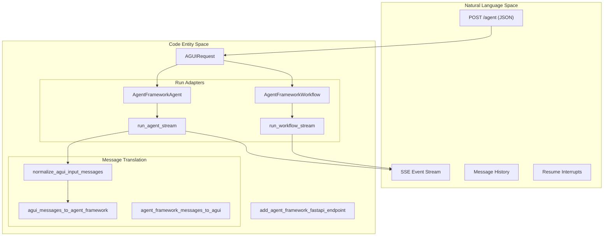
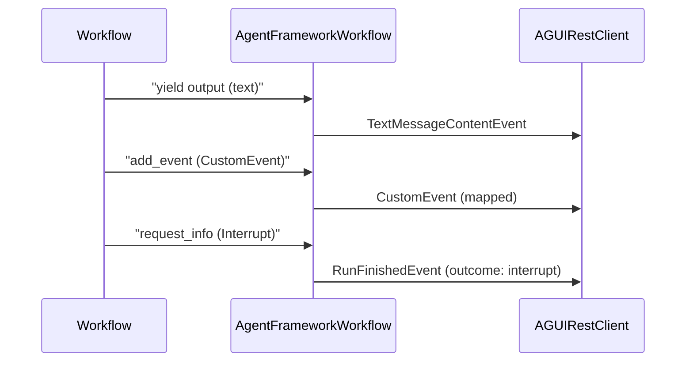
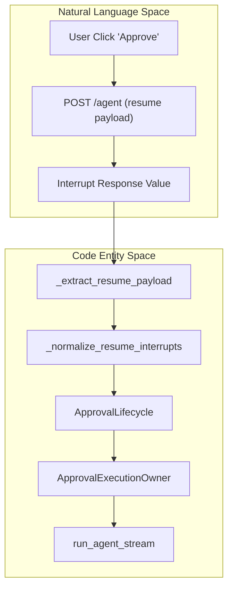

<!-- source: DeepWiki mcp.deepwiki.com · repo microsoft/agent-framework · page 7.6 AG-UI Protocol Integration · fetched 2026-10-26 -->

# AG-UI Protocol Integration

Relevant source files

The following files were used as context for generating this wiki page:

- [python/packages/ag-ui/AGENTS.md](python/packages/ag-ui/AGENTS.md)
- [python/packages/ag-ui/README.md](python/packages/ag-ui/README.md)
- [python/packages/ag-ui/agent_framework_ag_ui/__init__.py](python/packages/ag-ui/agent_framework_ag_ui/__init__.py)
- [python/packages/ag-ui/agent_framework_ag_ui/_agent.py](python/packages/ag-ui/agent_framework_ag_ui/_agent.py)
- [python/packages/ag-ui/agent_framework_ag_ui/_agent_run.py](python/packages/ag-ui/agent_framework_ag_ui/_agent_run.py)
- [python/packages/ag-ui/agent_framework_ag_ui/_client.py](python/packages/ag-ui/agent_framework_ag_ui/_client.py)
- [python/packages/ag-ui/agent_framework_ag_ui/_endpoint.py](python/packages/ag-ui/agent_framework_ag_ui/_endpoint.py)
- [python/packages/ag-ui/agent_framework_ag_ui/_event_converters.py](python/packages/ag-ui/agent_framework_ag_ui/_event_converters.py)
- [python/packages/ag-ui/agent_framework_ag_ui/_http_service.py](python/packages/ag-ui/agent_framework_ag_ui/_http_service.py)
- [python/packages/ag-ui/agent_framework_ag_ui/_message_adapters.py](python/packages/ag-ui/agent_framework_ag_ui/_message_adapters.py)
- [python/packages/ag-ui/agent_framework_ag_ui/_run_common.py](python/packages/ag-ui/agent_framework_ag_ui/_run_common.py)
- [python/packages/ag-ui/agent_framework_ag_ui/_snapshot_session.py](python/packages/ag-ui/agent_framework_ag_ui/_snapshot_session.py)
- [python/packages/ag-ui/agent_framework_ag_ui/_snapshots.py](python/packages/ag-ui/agent_framework_ag_ui/_snapshots.py)
- [python/packages/ag-ui/agent_framework_ag_ui/_state.py](python/packages/ag-ui/agent_framework_ag_ui/_state.py)
- [python/packages/ag-ui/agent_framework_ag_ui/_types.py](python/packages/ag-ui/agent_framework_ag_ui/_types.py)
- [python/packages/ag-ui/agent_framework_ag_ui/_utils.py](python/packages/ag-ui/agent_framework_ag_ui/_utils.py)
- [python/packages/ag-ui/agent_framework_ag_ui/_workflow.py](python/packages/ag-ui/agent_framework_ag_ui/_workflow.py)
- [python/packages/ag-ui/agent_framework_ag_ui/_workflow_run.py](python/packages/ag-ui/agent_framework_ag_ui/_workflow_run.py)
- [python/packages/ag-ui/agent_framework_ag_ui_examples/agents/weather_state_agent.py](python/packages/ag-ui/agent_framework_ag_ui_examples/agents/weather_state_agent.py)
- [python/packages/ag-ui/tests/ag_ui/golden/test_scenario_deterministic_state.py](python/packages/ag-ui/tests/ag_ui/golden/test_scenario_deterministic_state.py)
- [python/packages/ag-ui/tests/ag_ui/test_ag_ui_client.py](python/packages/ag-ui/tests/ag_ui/test_ag_ui_client.py)
- [python/packages/ag-ui/tests/ag_ui/test_agent_wrapper_comprehensive.py](python/packages/ag-ui/tests/ag_ui/test_agent_wrapper_comprehensive.py)
- [python/packages/ag-ui/tests/ag_ui/test_approval_result_event.py](python/packages/ag-ui/tests/ag_ui/test_approval_result_event.py)
- [python/packages/ag-ui/tests/ag_ui/test_endpoint.py](python/packages/ag-ui/tests/ag_ui/test_endpoint.py)
- [python/packages/ag-ui/tests/ag_ui/test_event_converters.py](python/packages/ag-ui/tests/ag_ui/test_event_converters.py)
- [python/packages/ag-ui/tests/ag_ui/test_message_adapters.py](python/packages/ag-ui/tests/ag_ui/test_message_adapters.py)
- [python/packages/ag-ui/tests/ag_ui/test_public_exports.py](python/packages/ag-ui/tests/ag_ui/test_public_exports.py)
- [python/packages/ag-ui/tests/ag_ui/test_run.py](python/packages/ag-ui/tests/ag_ui/test_run.py)
- [python/packages/ag-ui/tests/ag_ui/test_run_common.py](python/packages/ag-ui/tests/ag_ui/test_run_common.py)
- [python/packages/ag-ui/tests/ag_ui/test_snapshot_session.py](python/packages/ag-ui/tests/ag_ui/test_snapshot_session.py)
- [python/packages/ag-ui/tests/ag_ui/test_snapshots.py](python/packages/ag-ui/tests/ag_ui/test_snapshots.py)
- [python/packages/ag-ui/tests/ag_ui/test_workflow_agent.py](python/packages/ag-ui/tests/ag_ui/test_workflow_agent.py)
- [python/packages/ag-ui/tests/ag_ui/test_workflow_run.py](python/packages/ag-ui/tests/ag_ui/test_workflow_run.py)
- [python/packages/core/agent_framework/ag_ui/__init__.py](python/packages/core/agent_framework/ag_ui/__init__.py)
- [python/packages/core/agent_framework/ag_ui/__init__.pyi](python/packages/core/agent_framework/ag_ui/__init__.pyi)
- [python/packages/openai/AGENTS.md](python/packages/openai/AGENTS.md)
- [python/packages/openai/README.md](python/packages/openai/README.md)

The AG-UI (Agent-UI) protocol integration package (`agent-framework-ag-ui`) provides a bridge between Microsoft Agent Framework entities (`SupportsAgentRun`, `Workflow`) and frontend user interfaces using the AG-UI streaming protocol. It handles real-time Server-Sent Events (SSE) streaming of text, tool calls, and state updates, while orchestrating human-in-the-loop approvals and workflow interruptions [python/packages/ag-ui/README.md:1-4]().

## Architecture Overview

The integration layer sits between core Agent Framework agents/workflows and the web transport layer, translating internal framework events and message formats into the standardized AG-UI event stream.

### Data Flow and Entity Mapping

The following diagram bridges the natural language space (client requests and events) to the code entity space in `agent-framework-ag-ui`.

Sources: `python/packages/ag-ui/agent_framework_ag_ui/_endpoint.py:93-111`(), `python/packages/ag-ui/agent_framework_ag_ui/_agent_run.py:38-48`(), `python/packages/ag-ui/agent_framework_ag_ui/_message_adapters.py:18-22`()

## Endpoint Configuration

The primary entry point for hosting agents or workflows via FastAPI is `add_agent_framework_fastapi_endpoint`. This function registers a POST route that accepts `AGUIRequest` payloads and returns a `StreamingResponse` using Server-Sent Events (SSE) [python/packages/ag-ui/agent_framework_ag_ui/_endpoint.py:93-111]().

### Key Configuration Parameters

| Parameter | Description |
| :--- | :--- |
| `agent` | The `SupportsAgentRun` or `Workflow` instance to expose [python/packages/ag-ui/agent_framework_ag_ui/_endpoint.py:93-96](). |
| `state_schema` | Optional Pydantic model or dict defining the shared state structure [python/packages/ag-ui/agent_framework_ag_ui/_endpoint.py:97-98](). |
| `predict_state_config` | Configures tools to optimistically update UI state before execution finishes [python/packages/ag-ui/agent_framework_ag_ui/_endpoint.py:98-99](). |
| `snapshot_store` | An `AGUIThreadSnapshotStore` implementation for persisting conversation state [python/packages/ag-ui/agent_framework_ag_ui/_endpoint.py:103-104](). |
| `keepalive_seconds` | Frequency of SSE keepalive comments to prevent connection timeouts. Defaults to 15s [python/packages/ag-ui/agent_framework_ag_ui/_endpoint.py:106-107](). |
| `checkpoint_storage` | Optional workflow checkpoint storage for persistent workflow runs [python/packages/ag-ui/agent_framework_ag_ui/_endpoint.py:105-105](). |

Sources: `python/packages/ag-ui/agent_framework_ag_ui/_endpoint.py:93-111`(), `python/packages/ag-ui/agent_framework_ag_ui/_agent.py:16-45`()

## Run Adapters

The framework provides two primary adapters to wrap core execution logic for the AG-UI protocol: `AgentFrameworkAgent` and `AgentFrameworkWorkflow` [python/packages/ag-ui/AGENTS.md:7-8]().

### Agent Run Adapter

The `AgentFrameworkAgent` wraps any object implementing `SupportsAgentRun`. It manages a linear flow of events: `RunStartedEvent` -> content events (text, tools) -> `RunFinishedEvent`.

Inside `run_agent_stream`, the adapter:
1. Normalizes incoming AG-UI messages to the internal `Message` format [python/packages/ag-ui/agent_framework_ag_ui/_message_adapters.py:18-21]().
2. Handles tool execution and result formatting [python/packages/ag-ui/agent_framework_ag_ui/_agent_run.py:38-48]().
3. Manages `confirm_changes` tool calls for human-in-the-loop approvals [python/packages/ag-ui/agent_framework_ag_ui/_message_adapters.py:114-122]().

Sources: `python/packages/ag-ui/agent_framework_ag_ui/_agent.py:95-137`(), `python/packages/ag-ui/agent_framework_ag_ui/_agent_run.py:38-62`()

### Workflow Run Adapter

The `AgentFrameworkWorkflow` (or `run_workflow_stream`) handles the execution of `Workflow` instances. Unlike agents, workflows can emit custom events and yield multiple output turns [python/packages/ag-ui/agent_framework_ag_ui/_workflow_run.py:3-4](). It supports `workflow_factory(thread_id)` for thread-scoped isolation [python/packages/ag-ui/AGENTS.md:8-8]().

Sources: `python/packages/ag-ui/agent_framework_ag_ui/_workflow_run.py:16-28`(), `python/packages/ag-ui/tests/ag_ui/test_workflow_run.py:93-117`(), `python/packages/ag-ui/AGENTS.md:8-8`()

## Message and State Adapters

### Message Normalization

The `normalize_agui_input_messages` function handles the conversion of UI-formatted messages into the framework's internal `Message` and `Content` objects. This includes:
* Mapping roles between AG-UI and internal structures [python/packages/ag-ui/agent_framework_ag_ui/_message_adapters.py:26-27]().
* Injecting synthetic tool results if the assistant continues before a tool execution completes [python/packages/ag-ui/agent_framework_ag_ui/_message_adapters.py:49-73]().
* Filtering out UI-specific tools like `confirm_changes` before sending history to the LLM [python/packages/ag-ui/agent_framework_ag_ui/_message_adapters.py:134-142]().

Sources: `python/packages/ag-ui/agent_framework_ag_ui/_message_adapters.py:49-171`()

### Tool Return Helpers

The `state_update` helper allows tools to return structured data that updates the UI and internal state simultaneously [python/packages/ag-ui/README.md:163-180]().
* `text`: The result sent to the LLM.
* `tool_result`: The data sent to the UI for rendering (e.g., `ToolCallResultEvent.content`).
* `state`: Data merged into the session's durable state.

Sources: `python/packages/ag-ui/README.md:163-180`()

## Interrupts and Resumption

The integration uses a canonical interrupt protocol defined in `ag_ui.core` to handle pauses in execution [python/packages/ag-ui/AGENTS.md:36-37]().

### Approval Lifecycle

The `ApprovalLifecycle` class is the sole owner of approval occurrence registration, authority validation, and retry deduplication [python/packages/ag-ui/AGENTS.md:41-42](). It manages `ApprovalStatus` transitions (e.g., `PENDING`, `AUTHORIZED`, `EXECUTED`) [python/packages/ag-ui/agent_framework_ag_ui/_approval_lifecycle.py:70-84]().

### Resumption Flow

When a run is interrupted, it terminates with a `RunFinishedEvent` where `outcome.type == "interrupt"` [python/packages/ag-ui/AGENTS.md:36-36](). To resume, the client sends a `resume` payload containing `interruptId` and the user's `value` [python/packages/ag-ui/AGENTS.md:22-22]().

The following diagram illustrates the mapping from natural language user approvals/inputs to code entities handling resumption in the framework.

Sources: `python/packages/ag-ui/agent_framework_ag_ui/_run_common.py:88-142`(), `python/packages/ag-ui/agent_framework_ag_ui/_approval_lifecycle.py:70-84`(), `python/packages/ag-ui/agent_framework_ag_ui/_agent_run.py:70-84`()

## Snapshot Persistence

State persistence is managed via `AGUIThreadSnapshotStore`. Snapshots capture the current message history, state, and any pending interrupts [python/packages/ag-ui/agent_framework_ag_ui/_snapshots.py:120-120]().

Persistence is opt-in and requires a `SnapshotScopeResolver` to ensure that `thread_id` access is authorized [python/packages/ag-ui/agent_framework_ag_ui/_endpoint.py:73-78](). The `InMemoryAGUIThreadSnapshotStore` is provided for local development and testing [python/packages/ag-ui/AGENTS.md:15-15]().

Sources: `python/packages/ag-ui/agent_framework_ag_ui/_endpoint.py:41-78`(), `python/packages/ag-ui/agent_framework_ag_ui/_snapshots.py:120-120`(), `python/packages/ag-ui/AGENTS.md:15-15`()

---

