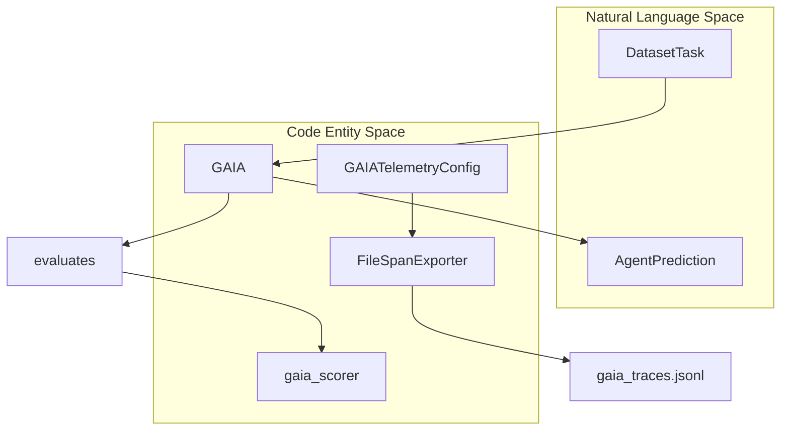
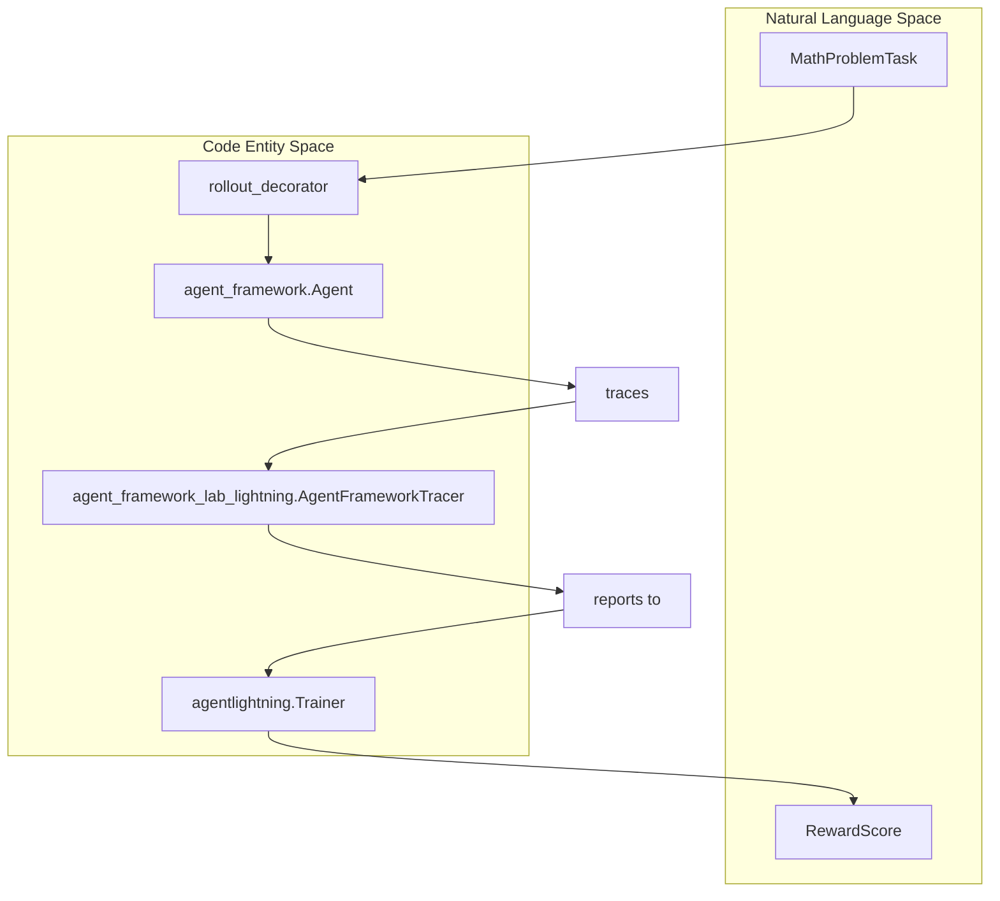

<!-- source: DeepWiki mcp.deepwiki.com · repo microsoft/agent-framework · page 8 Experimental Features (AF Labs) · fetched 2026-10-26 -->

# Experimental Features (AF Labs)

Relevant source files

The following files were used as context for generating this wiki page:

- [python/packages/lab/.gitignore](python/packages/lab/.gitignore)
- [python/packages/lab/README.md](python/packages/lab/README.md)
- [python/packages/lab/gaia/README.md](python/packages/lab/gaia/README.md)
- [python/packages/lab/gaia/agent_framework_lab_gaia/gaia.py](python/packages/lab/gaia/agent_framework_lab_gaia/gaia.py)
- [python/packages/lab/gaia/samples/gaia_sample.py](python/packages/lab/gaia/samples/gaia_sample.py)
- [python/packages/lab/gaia/samples/openai_agent.py](python/packages/lab/gaia/samples/openai_agent.py)
- [python/packages/lab/lightning/README.md](python/packages/lab/lightning/README.md)
- [python/packages/lab/lightning/agent_framework_lab_lightning/__init__.py](python/packages/lab/lightning/agent_framework_lab_lightning/__init__.py)
- [python/packages/lab/lightning/samples/train_math_agent.py](python/packages/lab/lightning/samples/train_math_agent.py)
- [python/packages/lab/lightning/samples/train_tau2_agent.py](python/packages/lab/lightning/samples/train_tau2_agent.py)
- [python/packages/lab/lightning/tests/test_lightning.py](python/packages/lab/lightning/tests/test_lightning.py)
- [python/packages/lab/tau2/README.md](python/packages/lab/tau2/README.md)
- [python/packages/lab/tau2/agent_framework_lab_tau2/__init__.py](python/packages/lab/tau2/agent_framework_lab_tau2/__init__.py)
- [python/packages/lab/tau2/agent_framework_lab_tau2/runner.py](python/packages/lab/tau2/agent_framework_lab_tau2/runner.py)
- [python/packages/lab/tau2/samples/run_benchmark.py](python/packages/lab/tau2/samples/run_benchmark.py)

This document describes the experimental features available in the `agent-framework-lab` package. AF Labs contains cutting-edge research implementations, benchmarking tools, and training utilities that are not part of the core stable API. These features enable advanced experimentation with agent evaluation and reinforcement learning.

For details on the lab package's scope and installation, see [Lab Package Overview](#8.1). For details on measuring agent performance, see [Evaluation Framework](#8.2).

## Purpose and Scope

The lab modules are extensions to the core Agent Framework that fall into one of three categories:
1. **Incubation**: New features that may eventually be incorporated into the core framework [python/packages/lab/README.md:12-12]().
2. **Research**: Prototypes built on top of the core framework for academic or industrial research [python/packages/lab/README.md:13-13]().
3. **Benchmarks**: Tools for evaluating agent performance across standardized datasets [python/packages/lab/README.md:14-14]().

Sources: [python/packages/lab/README.md:7-15]()

---

## 8.1 Lab Package Overview

The `agent-framework-lab` package provides an isolated experimental environment built on top of the core Microsoft Agent Framework [python/packages/lab/README.md:3-4](). It delivers specialized modules such as GAIA for general assistant benchmarking, tau2 for customer support simulations, and Lightning for reinforcement learning training [python/packages/lab/README.md:18-20](). Because these are experimental extensions, they may undergo breaking changes or deprecations independently of the core framework [python/packages/lab/README.md:5-5]().

For a comprehensive guide on package structure, installation extras, and development workflows, see [Lab Package Overview](#8.1).

Sources: [python/packages/lab/README.md:3-21]()

---

## 8.2 Evaluation Framework

The evaluation framework provides the foundation for assessing agent behavior and performance across standard benchmarks and custom tasks. It supports local evaluation routines as well as cloud-integrated evaluators through Azure AI Foundry [python/packages/core/agent_framework/_evaluation.py:255-255](), [python/packages/foundry/agent_framework_foundry/_foundry_evals.py:33-33]().

For detailed documentation on local evaluation, rubric-based scoring, conversation splitting strategies, and self-reflection patterns, see [Evaluation Framework](#8.2).

Sources: [python/packages/core/agent_framework/_evaluation.py:3-131](), [python/packages/foundry/agent_framework_foundry/_foundry_evals.py:3-168]()

---

## Benchmark and Training Modules

### GAIA: General AI Assistants Benchmark
The GAIA module integrates with the GAIA benchmark dataset to evaluate general-purpose assistant agents [python/packages/lab/README.md:18-18](). It orchestrates tasks across multiple difficulty levels, records telemetry via `GAIATelemetryConfig`, and scores predictions using `gaia_scorer` [python/packages/lab/gaia/agent_framework_lab_gaia/gaia.py:26-56]().

Title: "GAIA Execution and Telemetry Flow"

Sources: [python/packages/lab/gaia/agent_framework_lab_gaia/gaia.py:26-159](), [python/packages/lab/gaia/README.md:27-52]()

### Tau2: Customer Support Simulation
The `tau2` module provides a simulation framework for evaluating customer service agents in domains like airline booking [python/packages/lab/tau2/README.md:1-18](). It manages a multi-turn conversation loop between a trainable assistant agent and a fixed user simulator using `TaskRunner`, scoring results via tau2 evaluation metrics [python/packages/lab/tau2/README.md:7-13](), [python/packages/lab/tau2/agent_framework_lab_tau2/runner.py:72-107]().

Sources: [python/packages/lab/tau2/README.md:3-190](), [python/packages/lab/tau2/agent_framework_lab_tau2/runner.py:72-107]()

### Lightning: RL Training for Agents
The Lightning module bridges the Agent Framework with `agent-lightning` to support reinforcement learning training using algorithms from VERL (such as GRPO and PPO) [python/packages/lab/lightning/README.md:3-5](). The integration uses `AgentFrameworkTracer` to export agent execution telemetry into the training environment [python/packages/lab/lightning/agent_framework_lab_lightning/__init__.py:22-38]().

Title: "RL Training Architecture and Telemetry Bridge"

Sources: [python/packages/lab/lightning/README.md:3-80](), [python/packages/lab/lightning/agent_framework_lab_lightning/__init__.py:22-38](), [python/packages/lab/lightning/tests/test_lightning.py:118-163]()

---

