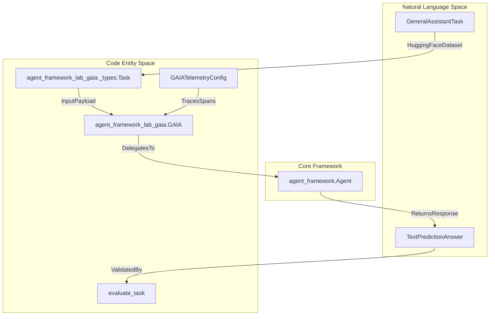

<!-- source: DeepWiki mcp.deepwiki.com · repo microsoft/agent-framework · page 8.1 Lab Package Overview · fetched 2026-10-26 -->

# Lab Package Overview

<details>
<summary>Relevant source files</summary>

The following files were used as context for generating this wiki page:

- [python/packages/lab/.gitignore](python/packages/lab/.gitignore)
- [python/packages/lab/README.md](python/packages/lab/README.md)
- [python/packages/lab/gaia/README.md](python/packages/lab/gaia/README.md)
- [python/packages/lab/gaia/agent_framework_lab_gaia/gaia.py](python/packages/lab/gaia/agent_framework_lab_gaia/gaia.py)
- [python/packages/lab/gaia/samples/gaia_sample.py](python/packages/lab/gaia/samples/gaia_sample.py)
- [python/packages/lab/gaia/samples/openai_agent.py](python/packages/lab/gaia/samples/openai_agent.py)
- [python/packages/lab/lightning/README.md](python/packages/lab/lightning/README.md)
- [python/packages/lab/lightning/agent_framework_lab_lightning/__init__.py](python/packages/lab/lightning/agent_framework_lab_lightning/__init__.py)
- [python/packages/lab/lightning/samples/train_math_agent.py](python/packages/lab/lightning/samples/train_math_agent.py)
- [python/packages/lab/lightning/samples/train_tau2_agent.py](python/packages/lab/lightning/samples/train_tau2_agent.py)
- [python/packages/lab/lightning/tests/test_lightning.py](python/packages/lab/lightning/tests/test_lightning.py)
- [python/packages/lab/tau2/README.md](python/packages/lab/tau2/README.md)
- [python/packages/lab/tau2/agent_framework_lab_tau2/__init__.py](python/packages/lab/tau2/agent_framework_lab_tau2/__init__.py)
- [python/packages/lab/tau2/agent_framework_lab_tau2/runner.py](python/packages/lab/tau2/agent_framework_lab_tau2/runner.py)
- [python/packages/lab/tau2/samples/run_benchmark.py](python/packages/lab/tau2/samples/run_benchmark.py)

</details>


The `agent-framework-lab` package is a specialized, experimental extension of the Microsoft Agent Framework. It serves as a dedicated environment for research prototypes, benchmarking tools, and the incubation of advanced features that are not yet part of the stable core framework [python/packages/lab/README.md:1-15]().

## Experimental Nature and Scope

Lab modules are distinct from the core framework and are subject to breaking changes or deprecation. They are intended for developers and researchers who require:
1. **Incubation**: New features that may eventually migrate to the core framework [python/packages/lab/README.md:12-12]().
2. **Research Prototypes**: Experimental systems built using core abstractions [python/packages/lab/README.md:13-13]().
3. **Benchmarks**: Standardized tools for evaluating agent performance (e.g., GAIA, τ²-bench) [python/packages/lab/README.md:14-14]().

### Package Structure
The package uses a single PyPI distribution `agent-framework-lab` but utilizes a namespace mechanism (`agent_framework.lab`) to organize its various modules [python/packages/lab/README.md:25-43]().

| Module | Purpose | Key Components |
| :--- | :--- | :--- |
| **GAIA** | General AI Assistant Benchmark | `GAIA`, `Task`, `Prediction`, `GAIATelemetryConfig` |
| **τ²-bench** | Customer Support Simulation | `TaskRunner`, `ASSISTANT_AGENT_ID`, `patch_env_set_state` |
| **Lightning** | Reinforcement Learning Training | `AgentFrameworkTracer`, `rollout`, `LitAgent` |

Sources: [python/packages/lab/README.md:1-60]()

---

## Reinforcement Learning with Lightning

The `lightning` module integrates the Microsoft Agent Framework with [Agent-lightning](https://github.com/microsoft/agent-lightning) to enable Reinforcement Learning (RL) training for agents. It supports distributed training using algorithms such as GRPO, PPO, and Reinforce++ via the VERL framework [python/packages/lab/lightning/README.md:1-5]().

### RL Training Data Flow
The training process bridges standard text interactions with underlying code execution components through a telemetry and rollout pattern.

**Diagram: RL Training Architecture Mapping**
```mermaid
graph TD
    subgraph "Natural Language Space"
        Task[""MathProblemQuestion""]
        Goal[""EvaluationRewardScore""]
    end

    subgraph "Code Entity Space"
        Dataset[""Dataset[MathProblem]""]
        RolloutFn[""math_agent""]
        Tracer[""AgentFrameworkTracer""]
        Trainer[""agentlightning.Trainer""]
    end

    subgraph "Core Framework"
        Agent[""agent_framework.Agent""]
        Client[""OpenAIChatClient""]
    end

    Task -->|InputSample| Dataset
    Dataset -->|TaskSample| RolloutFn
    RolloutFn -->|Instantiates| Agent
    Agent -->|Configures| Client
    Client -->|InferenceCalls| Trainer
    Tracer -->|TelemetryExport| Trainer
    RolloutFn -->|ReturnsFloat| Goal
```
Sources: [python/packages/lab/lightning/README.md:30-80](), [python/packages/lab/lightning/samples/train_math_agent.py:150-188]()

### Key Training Components
*   **`@rollout`**: A decorator that identifies a function as a trainable agent rollout. The function must accept a task and an `LLM` object, returning a float reward [python/packages/lab/lightning/samples/train_math_agent.py:150-165]().
*   **`AgentFrameworkTracer`**: A specialized tracer inheriting from `AgentOpsTracer` that enables OpenTelemetry observability, allowing agent traces to be consumed by the Agent-lightning backend [python/packages/lab/lightning/agent_framework_lab_lightning/__init__.py:22-33]().
*   **`LitAgent`**: A class-based alternative to `@rollout` for advanced scenarios requiring resource management (e.g., multiple LLMs) or agent filtering in multi-agent setups [python/packages/lab/lightning/samples/train_tau2_agent.py:78-85]().

Sources: [python/packages/lab/lightning/agent_framework_lab_lightning/__init__.py:22-40](), [python/packages/lab/lightning/samples/train_math_agent.py:150-190](), [python/packages/lab/lightning/samples/train_tau2_agent.py:78-134]()

---

## Benchmarking Modules

### GAIA (General AI Assistant)
The `gaia` module provides tools to evaluate agents on the GAIA benchmark. It includes automated dataset retrieval from Hugging Face and a structured evaluation pipeline [python/packages/lab/gaia/README.md:1-5]().

**Diagram: GAIA Benchmark Architecture Mapping**

Sources: [python/packages/lab/gaia/agent_framework_lab_gaia/gaia.py:26-83](), [python/packages/lab/gaia/samples/gaia_sample.py:49-160]()

*   **`GAIA` Class**: The main runner that orchestrates task execution and scoring [python/packages/lab/gaia/agent_framework_lab_gaia/gaia.py:26-26]().
*   **`GAIATelemetryConfig`**: Configures OpenTelemetry for benchmark runs, supporting export to OTLP endpoints or local JSONL files [python/packages/lab/gaia/agent_framework_lab_gaia/gaia.py:56-83]().
*   **`gaia_scorer`**: Provides mathematical and string normalization for comparing agent predictions against ground truth [python/packages/lab/gaia/agent_framework_lab_gaia/gaia.py:170-185]().

Sources: [python/packages/lab/gaia/agent_framework_lab_gaia/gaia.py:1-165](), [python/packages/lab/gaia/README.md:1-52]()

### τ²-bench (Tau-Squared)
τ²-bench implements a simulation framework for customer service agents. It orchestrates a conversation between a **Customer Service Agent** and a **User Simulator** [python/packages/lab/tau2/README.md:1-12]().

*   **`TaskRunner`**: Manages the conversation loop, enforcing `max_steps`, checking termination reasons, and orchestrating execution via `Workflow` executors [python/packages/lab/tau2/agent_framework_lab_tau2/runner.py:72-118]().
*   **Domain Support**: Currently focuses on the **airline** domain, involving booking changes and database tools [python/packages/lab/tau2/README.md:14-23]().
*   **`patch_env_set_state`**: A utility function to ensure compatibility with τ²-bench environment states [python/packages/lab/tau2/README.md:183-190]().

Sources: [python/packages/lab/tau2/README.md:1-190](), [python/packages/lab/tau2/agent_framework_lab_tau2/runner.py:72-173]()

---

## Installation and Testing

Lab modules are installed using Python extras to manage heavy dependencies like PyTorch, Ray, or benchmark datasets:

```bash
# Install GAIA extra
pip install "agent-framework-lab[gaia]"

# Install Lightning extra
pip install "agent-framework-lab[lightning]"

# Install τ² extra
pip install "agent-framework-lab[tau2]"
```
[python/packages/lab/README.md:47-54]()

### Local Execution
Lab is isolated from the root workspace lock file to prevent heavy experimental packages from impacting core dependencies [python/packages/lab/README.md:67-70]().

```bash
cd python/packages/lab
uv sync --all-extras --all-groups
uv run poe test
uv run poe pyright
```
[python/packages/lab/README.md:72-77]()

Resource-intensive observability tests can be run selectively:
```bash
uv run pytest lightning/tests/test_lightning.py -m "resource_intensive" -q
```
[python/packages/lab/README.md:79-83]()

Sources: [python/packages/lab/README.md:45-107](), [python/packages/lab/lightning/README.md:9-25]()

---

