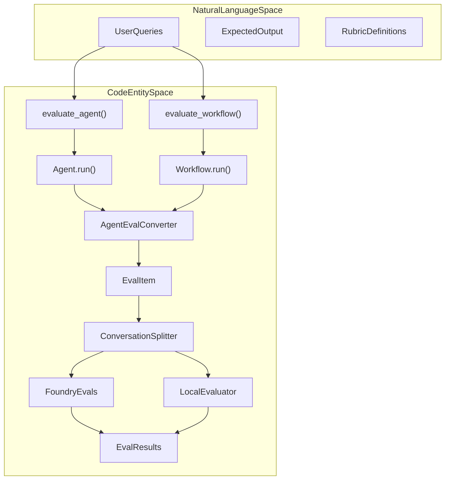
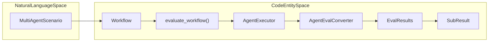

<!-- source: DeepWiki mcp.deepwiki.com · repo microsoft/agent-framework · page 8.2 Evaluation Framework · fetched 2026-10-26 -->

# Evaluation Framework

Relevant source files

The following files were used as context for generating this wiki page:

- [python/packages/core/agent_framework/_evaluation.py](python/packages/core/agent_framework/_evaluation.py)
- [python/packages/core/tests/core/test_evaluation.py](python/packages/core/tests/core/test_evaluation.py)
- [python/packages/core/tests/core/test_local_eval.py](python/packages/core/tests/core/test_local_eval.py)
- [python/packages/foundry/agent_framework_foundry/_foundry_evals.py](python/packages/foundry/agent_framework_foundry/_foundry_evals.py)
- [python/packages/foundry/tests/test_foundry_evals.py](python/packages/foundry/tests/test_foundry_evals.py)
- [python/samples/05-end-to-end/evaluation/foundry_evals/.env.example](python/samples/05-end-to-end/evaluation/foundry_evals/.env.example)
- [python/samples/05-end-to-end/evaluation/foundry_evals/README.md](python/samples/05-end-to-end/evaluation/foundry_evals/README.md)
- [python/samples/05-end-to-end/evaluation/foundry_evals/evaluate_tool_calls_sample.py](python/samples/05-end-to-end/evaluation/foundry_evals/evaluate_tool_calls_sample.py)
- [python/samples/05-end-to-end/evaluation/foundry_evals/evaluate_with_rubric_sample.py](python/samples/05-end-to-end/evaluation/foundry_evals/evaluate_with_rubric_sample.py)

The Microsoft Agent Framework provides a provider-agnostic evaluation system designed for both inner-loop development and production quality gating. It supports local rule-based checks, LLM-as-a-judge patterns, and deep integration with Azure AI Foundry for large-scale evaluation and rubric-based scoring [python/packages/core/agent_framework/_evaluation.py:3-10]().

## Core Evaluation Concepts

The framework abstracts evaluation into a pipeline where agents or workflows are executed against a set of queries, and the resulting conversations are processed by one or more evaluators [python/packages/core/agent_framework/_evaluation.py:3-10]().

### Data Flow and Transformation
Evaluation centers around the `EvalItem` class, which serves as the single source of truth for a single query/response interaction [python/packages/core/agent_framework/_evaluation.py:183-193](). 

The evaluation subsystem transforms framework-specific `Message` objects into the schemas required by evaluation providers, such as converting `assistant` tool calls and `tool` results into the specific JSON structures expected by Azure AI Foundry [python/packages/foundry/agent_framework_foundry/_foundry_evals.py:36-47](), [python/packages/foundry/tests/test_foundry_evals.py:116-202]().

### Conversation Splitting
Because evaluation often focuses on a specific turn in a long dialogue, the framework uses `ConversationSplitter` strategies to isolate the query and response portions of a `Message` list [python/packages/core/agent_framework/_evaluation.py:78-105]().

| Strategy | Logic | Use Case |
| :--- | :--- | :--- |
| `LAST_TURN` | Splits at the final user message. | Evaluating the agent's most recent response [python/packages/core/agent_framework/_evaluation.py:118-121](). |
| `FULL` | Splits after the first user message. | Evaluating the entire trajectory of the conversation [python/packages/core/agent_framework/_evaluation.py:122-126](). |

Sources: [python/packages/core/agent_framework/_evaluation.py:78-137](), [python/packages/core/agent_framework/_evaluation.py:157-179]()

## Evaluation Pipeline Architecture

The following diagram bridges the Natural Language Space (user requirements, test queries, and rubric definitions) to the Code Entity Space (framework classes and functions).

### Title: Agent Evaluation Flow

Sources: [python/packages/core/agent_framework/_evaluation.py:3-33](), [python/packages/foundry/agent_framework_foundry/_foundry_evals.py:15-24]()

## Local Evaluation

`LocalEvaluator` allows for fast, API-free checks during development or CI smoke tests [python/packages/core/agent_framework/_evaluation.py:7-10](). It uses a decorator-based approach (`@evaluator`) to wrap simple functions into formal evaluators [python/packages/core/tests/core/test_local_eval.py:61-65]().

### Built-in Local Checks
The framework provides several pre-defined check functions:
*   `keyword_check(*keywords)`: Asserts that specific strings are present in the response [python/packages/core/agent_framework/_evaluation.py:28-31]().
*   `tool_called_check(tool_name)`: Verifies the agent invoked a specific tool [python/packages/core/agent_framework/_evaluation.py:28-31]().
*   `tool_calls_present()`: Asserts that at least one tool call was made [python/packages/core/tests/core/test_local_eval.py:26-26]().
*   `tool_call_args_match(name, arguments)`: Performs deep equality checks on tool arguments [python/packages/core/tests/core/test_local_eval.py:24-24]().

Sources: [python/packages/core/agent_framework/_evaluation.py:28-33](), [python/packages/core/tests/core/test_local_eval.py:11-27]()

## Azure AI Foundry Evaluation

The `FoundryEvals` class integrates with Azure AI Foundry's evaluation service. It supports built-in evaluators for agent behavior, tool usage, quality, and safety [python/packages/foundry/agent_framework_foundry/_foundry_evals.py:5-24]().

### Supported Evaluator Categories

| Category | Evaluator Names (Short Form) |
| :--- | :--- |
| **Agent Behavior** | `intent_resolution`, `task_adherence`, `task_completion`, `task_navigation_efficiency` [python/packages/foundry/agent_framework_foundry/_foundry_evals.py:147-151]() |
| **Tool Usage** | `tool_call_accuracy`, `tool_selection`, `tool_input_accuracy`, `tool_output_utilization`, `tool_call_success` [python/packages/foundry/agent_framework_foundry/_foundry_evals.py:152-157]() |
| **Quality** | `coherence`, `fluency`, `relevance`, `groundedness`, `response_completeness`, `similarity` [python/packages/foundry/agent_framework_foundry/_foundry_evals.py:158-164]() |
| **Safety** | `violence`, `sexual`, `self_harm`, `hate_unfairness` [python/packages/foundry/agent_framework_foundry/_foundry_evals.py:165-170]() |

Sources: [python/packages/foundry/agent_framework_foundry/_foundry_evals.py:146-170](), [python/samples/05-end-to-end/evaluation/foundry_evals/README.md:7-12]()

### Rubric Evaluation
Users can reference custom rubrics authored in the Foundry portal using the `GeneratedEvaluatorRef` class [python/packages/foundry/agent_framework_foundry/_foundry_evals.py:64-89](). This allows for domain-specific scoring with pinned versions for reproducible CI runs [python/samples/05-end-to-end/evaluation/foundry_evals/README.md:47-65]().

### Quality Gates
The `EvalResults` object provides helper methods to enforce quality thresholds in automated pipelines:
*   `all_passed`: Boolean indicating if all checks met their criteria.
*   `assert_dimension_score_at_least(dimension_id, min_score)`: Specifically for rubric evaluators to gate on individual scoring dimensions [python/samples/05-end-to-end/evaluation/foundry_evals/README.md:67-73]().

Sources: [python/packages/foundry/agent_framework_foundry/_foundry_evals.py:64-95](), [python/samples/05-end-to-end/evaluation/foundry_evals/README.md:47-74]()

## Workflow Evaluation

Evaluating multi-agent workflows involves assessing both the final output and the performance of individual participants. `evaluate_workflow` provides sub-results breakdown, mapping evaluation metrics to specific agents within sequential or concurrent executions [python/samples/05-end-to-end/evaluation/foundry_evals/README.md:16-34]().

### Title: Workflow Evaluation Mapping

Sources: [python/packages/foundry/tests/test_foundry_evals.py:20-22](), [python/packages/foundry/agent_framework_foundry/_foundry_evals.py:36-47]()

## Implementation Details

### Key Classes and Functions

*   **`evaluate_agent(...)`**: The primary entry point. Orchestrates running the agent against queries and passing results to evaluators [python/packages/core/agent_framework/_evaluation.py:15-20]().
*   **`FoundryEvals`**: The bridge to Azure AI Foundry. Handles polling for evaluation run completion and result extraction [python/packages/foundry/agent_framework_foundry/_foundry_evals.py:31-47]().
*   **`_convert_message(...)`**: Helper function that maps framework `Message` roles and `Content` types to the specific JSON structure required by the Foundry Evaluation API [python/packages/foundry/tests/test_foundry_evals.py:116-121]().
*   **`EvalResults`**: Container for evaluation output, including status, total passed/failed counts, and the report URL for the Foundry portal [python/packages/core/agent_framework/_evaluation.py:15-20]().

Sources: [python/packages/core/agent_framework/_evaluation.py:15-33](), [python/packages/foundry/agent_framework_foundry/_foundry_evals.py:31-47](), [python/packages/foundry/tests/test_foundry_evals.py:116-202]()

---

