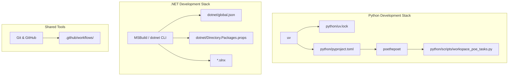
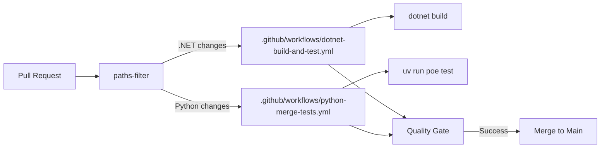

<!-- source: DeepWiki mcp.deepwiki.com · repo microsoft/agent-framework · page 9 Development Guide · fetched 2026-10-26 -->

# Development Guide

Relevant source files

The following files were used as context for generating this wiki page:

- [.github/scripts/check_python_api_compatibility.py](.github/scripts/check_python_api_compatibility.py)
- [.github/scripts/set_missing_issue_type.js](.github/scripts/set_missing_issue_type.js)
- [.github/scripts/stale_issue_pr_ping.py](.github/scripts/stale_issue_pr_ping.py)
- [.github/skills/pull-requests/SKILL.md](.github/skills/pull-requests/SKILL.md)
- [.github/tests/test_python_api_compatibility.py](.github/tests/test_python_api_compatibility.py)
- [.github/tests/test_set_missing_issue_type.js](.github/tests/test_set_missing_issue_type.js)
- [.github/tests/test_stale_issue_pr_ping.py](.github/tests/test_stale_issue_pr_ping.py)
- [.github/workflows/codeql-analysis.yml](.github/workflows/codeql-analysis.yml)
- [.github/workflows/devflow-pr-review.yml](.github/workflows/devflow-pr-review.yml)
- [.github/workflows/dotnet-build-and-test.yml](.github/workflows/dotnet-build-and-test.yml)
- [.github/workflows/dotnet-format.yml](.github/workflows/dotnet-format.yml)
- [.github/workflows/dotnet-integration-tests.yml](.github/workflows/dotnet-integration-tests.yml)
- [.github/workflows/github-automation-tests.yml](.github/workflows/github-automation-tests.yml)
- [.github/workflows/integration-tests-manual.yml](.github/workflows/integration-tests-manual.yml)
- [.github/workflows/issue-triage.yml](.github/workflows/issue-triage.yml)
- [.github/workflows/label-issues.yml](.github/workflows/label-issues.yml)
- [.github/workflows/label-pr.yml](.github/workflows/label-pr.yml)
- [.github/workflows/label-title-prefix.yml](.github/workflows/label-title-prefix.yml)
- [.github/workflows/python-api-compatibility.yml](.github/workflows/python-api-compatibility.yml)
- [.github/workflows/python-code-quality.yml](.github/workflows/python-code-quality.yml)
- [.github/workflows/python-docs.yml](.github/workflows/python-docs.yml)
- [.github/workflows/python-integration-tests.yml](.github/workflows/python-integration-tests.yml)
- [.github/workflows/python-lab-tests.yml](.github/workflows/python-lab-tests.yml)
- [.github/workflows/python-merge-tests.yml](.github/workflows/python-merge-tests.yml)
- [.github/workflows/python-release.yml](.github/workflows/python-release.yml)
- [.github/workflows/python-test-coverage.yml](.github/workflows/python-test-coverage.yml)
- [.github/workflows/python-tests.yml](.github/workflows/python-tests.yml)
- [.github/workflows/stale-issue-pr-ping.yml](.github/workflows/stale-issue-pr-ping.yml)
- [.gitignore](.gitignore)
- [CONTRIBUTING.md](CONTRIBUTING.md)
- [docs/assets/readme-banner.png](docs/assets/readme-banner.png)
- [dotnet/.github/skills/pull-requests/SKILL.md](dotnet/.github/skills/pull-requests/SKILL.md)
- [dotnet/.gitignore](dotnet/.gitignore)
- [dotnet/nuget/NUGET.md](dotnet/nuget/NUGET.md)
- [dotnet/nuget/icon.png](dotnet/nuget/icon.png)
- [python/.github/skills/pull-requests/SKILL.md](python/.github/skills/pull-requests/SKILL.md)
- [python/.pre-commit-config.yaml](python/.pre-commit-config.yaml)
- [python/PACKAGE_STATUS.md](python/PACKAGE_STATUS.md)
- [python/packages/devui/frontend/src/lib/utils.ts](python/packages/devui/frontend/src/lib/utils.ts)

This guide is for contributors and developers working on the Microsoft Agent Framework codebase itself. It covers local development setup, testing procedures, CI/CD infrastructure, code quality standards, and release processes for both the Python and .NET implementations.

For information about using the framework to build agents and workflows, see [Getting Started](#2). For deep dives into internal implementation details, see [Implementation Architecture](#7).

---

## Development Environment Overview

The framework maintains dual implementations with separate but parallel tooling chains. Python uses `uv` for package management and workspace orchestration across its subpackages (`python/pyproject.toml`), while .NET uses MSBuild with centralized package management via `Directory.Packages.props`.

Title: "Development Stack Architecture"

Sources: [.github/workflows/python-tests.yml:12-14](), [.github/workflows/dotnet-build-and-test.yml:126-130](), [.github/workflows/python-code-quality.yml:14-16]()

---

## Building and Testing

Instructions for building and testing the framework locally in both .NET and Python are detailed in [Building and Testing](#9.1).

Python development relies on `uv` for managing the monorepo workspace. The environment supports Python versions 3.10 through 3.15 [.github/workflows/python-tests.yml:23-25](). The framework uses `poethepoet` via task orchestration to run unit and integration tests across packages. 

.NET development targets multiple target frameworks (TFMs), including `net8.0`, `net9.0`, `net10.0`, and `net472` [.github/workflows/dotnet-build-and-test.yml:105-108](). It utilizes solution files (`.slnx`) and centralized package properties for building core components and samples.

For details, see [Building and Testing](#9.1).

Sources: [.github/workflows/python-tests.yml:23-25](), [.github/workflows/dotnet-build-and-test.yml:105-108]()

---

## CI/CD Infrastructure

An overview of the GitHub Actions-based CI/CD system, including pipelines, testing, release automation, and repository automation bots, is available in [CI/CD Infrastructure](#9.2).

The framework utilizes GitHub Actions for automated validation, leveraging path-based filtering configurations defined in `.github/workflows/dotnet-build-and-test.yml` and `.github/workflows/python-merge-tests.yml` to optimize runner usage across .NET and Python changes. 

Title: "CI/CD Validation Pipeline"

Sources: [.github/workflows/dotnet-build-and-test.yml:31-84](), [.github/workflows/python-merge-tests.yml:28-58]()

For details on the pipeline topology, integration test matrices, and automated bots, see [CI/CD Infrastructure](#9.2).

Sources: [.github/workflows/dotnet-build-and-test.yml:31-84](), [.github/workflows/python-merge-tests.yml:28-58]()

---

## Code Quality and Standards

Documentation regarding code quality standards and enforcement mechanisms for both languages can be found in [Code Quality and Standards](#9.3).

Both implementations enforce strict quality standards through automated linting, formatting, and type checking. Python pull requests run non-blocking public API compatibility checks using `.github/scripts/check_python_api_compatibility.py` and Griffe [CONTRIBUTING.md:98-110](). Similarly, .NET projects use package validation during `dotnet pack` and release builds to detect breaking changes against published NuGet baselines [CONTRIBUTING.md:129-132]().

For details on code formatters, static analyzers, and coverage thresholds, see [Code Quality and Standards](#9.3).

Sources: [CONTRIBUTING.md:98-132](), [.github/scripts/check_python_api_compatibility.py:1-26]()

---

## Contributing Guidelines

Guidelines for contributing to the repository, including the PR process, code review expectations, and testing requirements, are outlined in [Contributing Guidelines](#9.4).

Contributors are expected to follow code conventions, maintain API signature compatibility, and include tests for bug fixes and new features [CONTRIBUTING.md:63-76](). Automated PR reviews and labeling workflows assist maintainers in evaluating contributions [CONTRIBUTING.md:60-61]().

For detailed contribution steps, issue reporting tips, and PR expectations, see [Contributing Guidelines](#9.4).

Sources: [CONTRIBUTING.md:60-76]()

---

