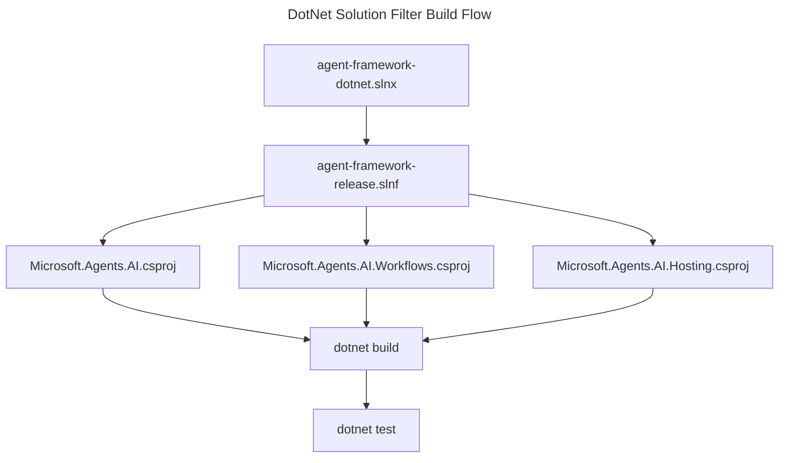
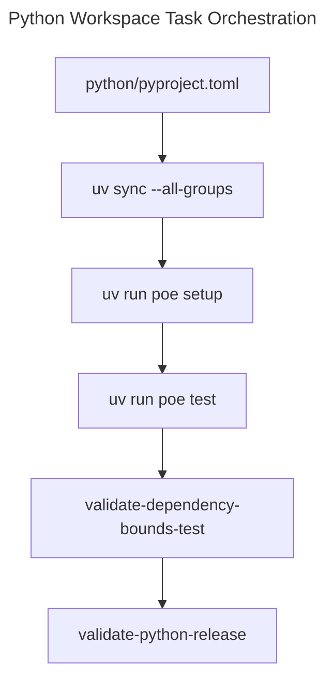

<!-- source: DeepWiki mcp.deepwiki.com · repo microsoft/agent-framework · page 9.1 Building and Testing · fetched 2026-10-26 -->

# Building and Testing

Relevant source files

The following files were used as context for generating this wiki page:

- [.github/workflows/python-dependency-maintenance.yml](.github/workflows/python-dependency-maintenance.yml)
- [.vscode/settings.json](.vscode/settings.json)
- [.vscode/tasks.json](.vscode/tasks.json)
- [dotnet/agent-framework-release.slnf](dotnet/agent-framework-release.slnf)
- [dotnet/agent-framework-src-and-tests.slnf](dotnet/agent-framework-src-and-tests.slnf)
- [python/.github/instructions/python.instructions.md](python/.github/instructions/python.instructions.md)
- [python/.github/skills/agent-framework-py-release/SKILL.md](python/.github/skills/agent-framework-py-release/SKILL.md)
- [python/.github/skills/python-development/SKILL.md](python/.github/skills/python-development/SKILL.md)
- [python/.github/skills/python-package-management/SKILL.md](python/.github/skills/python-package-management/SKILL.md)
- [python/AGENTS.md](python/AGENTS.md)
- [python/CODING_STANDARD.md](python/CODING_STANDARD.md)
- [python/DEV_SETUP.md](python/DEV_SETUP.md)
- [python/packages/ollama/LICENSE](python/packages/ollama/LICENSE)
- [python/packages/ollama/README.md](python/packages/ollama/README.md)
- [python/packages/ollama/agent_framework_ollama/__init__.py](python/packages/ollama/agent_framework_ollama/__init__.py)
- [python/packages/ollama/agent_framework_ollama/py.typed](python/packages/ollama/agent_framework_ollama/py.typed)
- [python/scripts/dependencies/README.md](python/scripts/dependencies/README.md)
- [python/scripts/dependencies/_dependency_bounds_lower_impl.py](python/scripts/dependencies/_dependency_bounds_lower_impl.py)
- [python/scripts/dependencies/_dependency_bounds_release_impl.py](python/scripts/dependencies/_dependency_bounds_release_impl.py)
- [python/scripts/dependencies/_dependency_bounds_runtime.py](python/scripts/dependencies/_dependency_bounds_runtime.py)
- [python/scripts/dependencies/_dependency_bounds_upper_impl.py](python/scripts/dependencies/_dependency_bounds_upper_impl.py)
- [python/scripts/dependencies/tests/test_dependency_bounds_release.py](python/scripts/dependencies/tests/test_dependency_bounds_release.py)
- [python/scripts/dependencies/validate_dependency_bounds.py](python/scripts/dependencies/validate_dependency_bounds.py)

This page provides an overview of building and testing the Microsoft Agent Framework locally across both .NET and Python environments. Because this is a bilingual monorepo, both language ecosystems maintain parallel build systems, solution definitions, task orchestrators, test suites, and code quality workflows [dotnet/agent-framework-release.slnf:1-43](), [python/DEV_SETUP.md:10-77]().

For deep technical instructions, SDK requirements, dependency management, and step-by-step setup guides, refer to the child pages:
- [.NET Development Setup](#9.1.1) — Covers .NET SDK requirements, solution build commands, NuGet package configuration, and unit/integration testing.
- [Python Development Setup](#9.1.2) — Covers `uv` workspace setup, `poethepoet` task orchestration, environment configuration, dependency bounds validation, and `pytest` execution.

Sources: [dotnet/agent-framework-release.slnf:1-43](), [python/DEV_SETUP.md:10-77]()

## 9.1.1 .NET Development Setup

The .NET implementation of the Microsoft Agent Framework is structured around solutions and solution filters targeting multiple projects such as abstractions, core clients, provider integrations, workflows, and developer tools [dotnet/agent-framework-release.slnf:1-43](). Build processes utilize standard `dotnet` CLI commands, centralized package versioning (`Directory.Packages.props`), and NuGet dependency auditing [dotnet/agent-framework-release.slnf:1-43]().

The following diagram illustrates the .NET build and release solution filter structure mapped to execution tasks:

Sources: [dotnet/agent-framework-release.slnf:1-43]()

Testing in .NET is divided into unit and integration test suites, with continuous integration workflows ensuring cross-platform compatibility across Linux and Windows runners. Code formatting and style enforcement are maintained using `dotnet format`.

For detailed instructions on prerequisites, SDK configuration, solution building, and running .NET tests, see [.NET Development Setup](#9.1.1).

Sources: [dotnet/agent-framework-release.slnf:1-43]()

## 9.1.2 Python Development Setup

The Python implementation relies on a modern `uv`-managed monorepo workspace spanning core packages (`agent-framework-core`), provider integrations, extensions, and the standalone experimental lab project [python/AGENTS.md:73-89](), [python/.github/skills/python-package-management/SKILL.md:11-35](). Task orchestration and environment management are driven by `poethepoet` tasks configured across workspace packages [python/DEV_SETUP.md:10-77]().

The following diagram details the Python workspace layout, dependency synchronization, and task orchestration flow:

Sources: [python/DEV_SETUP.md:60-75](), [python/.github/skills/python-package-management/SKILL.md:41-79](), [python/scripts/dependencies/README.md:60-79]()

Python quality assurance encompasses aggregate unit testing via `pytest`, strict type checking with `pyright` and `mypy`, linting with `ruff`, and test coverage enforcement [python/DEV_SETUP.md:130-156](), [python/CODING_STANDARD.md:5-12](). Dedicated dependency maintenance scripts handle validation of lower and upper bounds across requirements [python/scripts/dependencies/README.md:1-57]().

For comprehensive setup guides, `uv` installation, environment variables, and Poe task definitions, see [Python Development Setup](#9.1.2).

Sources: [python/AGENTS.md:73-89](), [python/DEV_SETUP.md:10-175](), [python/CODING_STANDARD.md:5-12](), [python/scripts/dependencies/README.md:1-57]()

---

