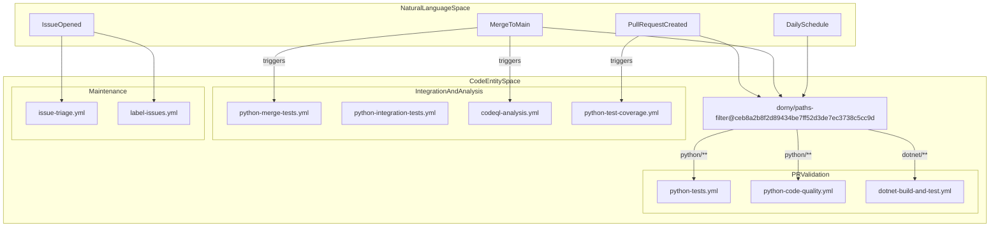
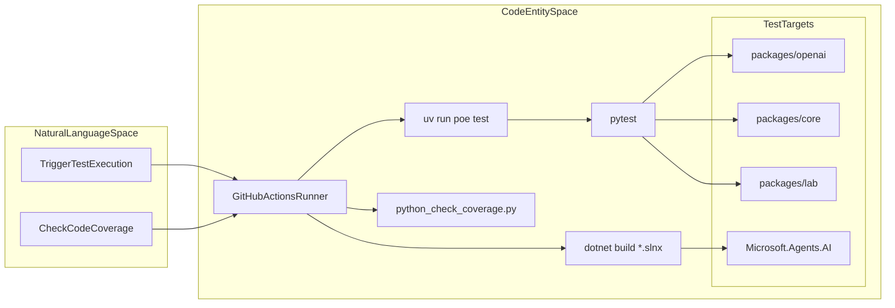

<!-- source: DeepWiki mcp.deepwiki.com · repo microsoft/agent-framework · page 9.2 CI/CD Infrastructure · fetched 2026-10-26 -->

# CI/CD Infrastructure

Relevant source files

The following files were used as context for generating this wiki page:

- [.github/actions/github-app-token/action.yml](.github/actions/github-app-token/action.yml)
- [.github/actions/github-app-token/create-token.js](.github/actions/github-app-token/create-token.js)
- [.github/scripts/set_missing_issue_type.js](.github/scripts/set_missing_issue_type.js)
- [.github/scripts/stale_issue_pr_ping.py](.github/scripts/stale_issue_pr_ping.py)
- [.github/tests/test_create_github_app_token.js](.github/tests/test_create_github_app_token.js)
- [.github/tests/test_devflow_fix_ci_workflow.js](.github/tests/test_devflow_fix_ci_workflow.js)
- [.github/tests/test_set_missing_issue_type.js](.github/tests/test_set_missing_issue_type.js)
- [.github/tests/test_stale_issue_pr_ping.py](.github/tests/test_stale_issue_pr_ping.py)
- [.github/workflows/codeql-analysis.yml](.github/workflows/codeql-analysis.yml)
- [.github/workflows/devflow-fix-ci.yml](.github/workflows/devflow-fix-ci.yml)
- [.github/workflows/devflow-pr-review.yml](.github/workflows/devflow-pr-review.yml)
- [.github/workflows/dotnet-build-and-test.yml](.github/workflows/dotnet-build-and-test.yml)
- [.github/workflows/dotnet-format.yml](.github/workflows/dotnet-format.yml)
- [.github/workflows/dotnet-integration-tests.yml](.github/workflows/dotnet-integration-tests.yml)
- [.github/workflows/github-automation-tests.yml](.github/workflows/github-automation-tests.yml)
- [.github/workflows/integration-tests-manual.yml](.github/workflows/integration-tests-manual.yml)
- [.github/workflows/issue-triage.yml](.github/workflows/issue-triage.yml)
- [.github/workflows/label-issues.yml](.github/workflows/label-issues.yml)
- [.github/workflows/label-pr.yml](.github/workflows/label-pr.yml)
- [.github/workflows/label-title-prefix.yml](.github/workflows/label-title-prefix.yml)
- [.github/workflows/python-api-compatibility.yml](.github/workflows/python-api-compatibility.yml)
- [.github/workflows/python-code-quality.yml](.github/workflows/python-code-quality.yml)
- [.github/workflows/python-docs.yml](.github/workflows/python-docs.yml)
- [.github/workflows/python-integration-tests.yml](.github/workflows/python-integration-tests.yml)
- [.github/workflows/python-lab-tests.yml](.github/workflows/python-lab-tests.yml)
- [.github/workflows/python-merge-tests.yml](.github/workflows/python-merge-tests.yml)
- [.github/workflows/python-release.yml](.github/workflows/python-release.yml)
- [.github/workflows/python-test-coverage.yml](.github/workflows/python-test-coverage.yml)
- [.github/workflows/python-tests.yml](.github/workflows/python-tests.yml)
- [.github/workflows/stale-issue-pr-ping.yml](.github/workflows/stale-issue-pr-ping.yml)
- [python/PACKAGE_STATUS.md](python/PACKAGE_STATUS.md)

This page provides an overview of the GitHub Actions-based CI/CD infrastructure for the Microsoft Agent Framework. It covers workflow organization, multi-tiered quality gates, testing strategies, and release automation for both Python and .NET implementations.

For local build and test commands, see [Building and Testing](#9.1). For code quality standards and tools, see [Code Quality and Standards](#9.3). For detailed pipeline structures, testing configurations, and release mechanics, see the child pages:
- [Pipeline Architecture](#9.2.1)
- [Testing Strategy](#9.2.2)
- [Release Process](#9.2.3)

## Overview

The CI/CD infrastructure is built entirely on GitHub Actions and implements a multi-stage quality gate system:

1. **Pull Request Validation**: Runs unit tests, code quality checks (linting, formatting, type checking), and coverage validation on PR events `[.github/workflows/python-tests.yml:4-7]`, `[.github/workflows/dotnet-build-and-test.yml:10-11]`, `[.github/workflows/python-code-quality.yml:5-6]`, `[.github/workflows/python-test-coverage.yml:4-11]()`.
2. **Merge/Main Branch Validation**: Runs comprehensive integration tests with live AI services and security scanning via CodeQL `[.github/workflows/python-merge-tests.yml:10-13]`, `[.github/workflows/codeql-analysis.yml:9-11]()`.
3. **Scheduled Validation**: Executes daily midnight UTC builds to detect regressions in external dependencies or AI provider APIs `[.github/workflows/dotnet-build-and-test.yml:16-17]`, `[.github/workflows/python-merge-tests.yml:14-15]()`.
4. **Release Automation**: Builds distribution packages (NuGet/Wheels) and generates documentation on release tag events `[.github/workflows/python-release.yml:1-16]()`.
5. **Automated Triage**: Employs specialized workflows for issue classification, team checks, and DevFlow automation `[.github/workflows/issue-triage.yml:1-24]`, `[.github/workflows/label-issues.yml:1-7]`, `[.github/workflows/devflow-pr-review.yml:1-18]()`.

The system uses path filtering via `dorny/paths-filter` to optimize CI resource usage by only running workflows affected by changed files `[.github/workflows/dotnet-build-and-test.yml:44-46]`, `[.github/workflows/python-merge-tests.yml:49-51]()`. Matrix strategies enable parallel execution across Python versions 3.10–3.15 `[.github/workflows/python-tests.yml:23-26]` and .NET frameworks including `net8.0`, `net9.0`, and `net10.0` `[.github/workflows/dotnet-build-and-test.yml:101-109]()`.

Sources: `[.github/workflows/dotnet-build-and-test.yml:8-68]`, `[.github/workflows/python-merge-tests.yml:8-91]`, `[.github/workflows/python-tests.yml:3-26]`, `[.github/workflows/python-code-quality.yml:1-13]`, `[.github/workflows/issue-triage.yml:1-24]`, `[.github/workflows/label-issues.yml:1-7]`, `[.github/workflows/devflow-pr-review.yml:1-18]`, `[.github/workflows/python-test-coverage.yml:1-11]()`

## Workflow Architecture

The framework utilizes a tiered pipeline architecture designed to provide fast feedback on PRs while maintaining rigorous validation on the main branch. Path filters isolate changes to specific packages or languages, triggering targeted validation jobs.

Workflow Pipeline Architecture Bridge

For details, see [Pipeline Architecture](#9.2.1).

Sources: `[.github/workflows/dotnet-build-and-test.yml:32-86]`, `[.github/workflows/python-merge-tests.yml:28-91]`, `[.github/workflows/python-tests.yml:3-11]`, `[.github/workflows/python-test-coverage.yml:3-8]`, `[.github/workflows/issue-triage.yml:3-6]`, `[.github/workflows/label-issues.yml:2-7]()`

## Testing Strategy

The framework employs a layered testing strategy to ensure reliability across diverse AI providers and language runtimes. Unit tests isolate core business logic, while integration tests validate interactions with live AI providers (OpenAI, Azure OpenAI, Qdrant, MongoDB, etc.) `[.github/workflows/python-integration-tests.yml:41-105]`, `[.github/workflows/python-merge-tests.yml:118-172]()`. Code coverage is strictly enforced with thresholds of 85% for Python `[.github/workflows/python-test-coverage.yml:24]` and 80% for .NET `[.github/workflows/dotnet-build-and-test.yml:20]()`.

Testing Execution and Coverage Bridge

For details, see [Testing Strategy](#9.2.2).

Sources: `[.github/workflows/python-test-coverage.yml:16-46]`, `[.github/workflows/dotnet-build-and-test.yml:19-21]`, `[.github/workflows/python-tests.yml:47]`, `[.github/workflows/dotnet-build-and-test.yml:131-137]`, `[.github/workflows/python-integration-tests.yml:95-102]`, `[.github/workflows/python-lab-tests.yml:80-84]()`

## Release Process

The release process is automated via GitHub Actions, building distribution packages and validating compatibility before publication. .NET packages undergo installation verification by spinning up temporary console applications to test local package sources `[.github/workflows/dotnet-build-and-test.yml:143-162]()`, while Python releases utilize `uv` and `poe` to build wheels and source distributions.

| Implementation | Trigger Pattern | Primary Tool | Artifacts |
| :--- | :--- | :--- | :--- |
| **Python** | Release tags | `uv`, `poe` | Wheels, sdist (`python/packages/**`) |
| **.NET** | Manual / Release | `dotnet pack` | NuGet Packages (`dotnet/src/**`) |

For details, see [Release Process](#9.2.3).

Sources: `[.github/workflows/dotnet-build-and-test.yml:143-162]`, `[.github/workflows/python-lab-tests.yml:79-94]()`

---

