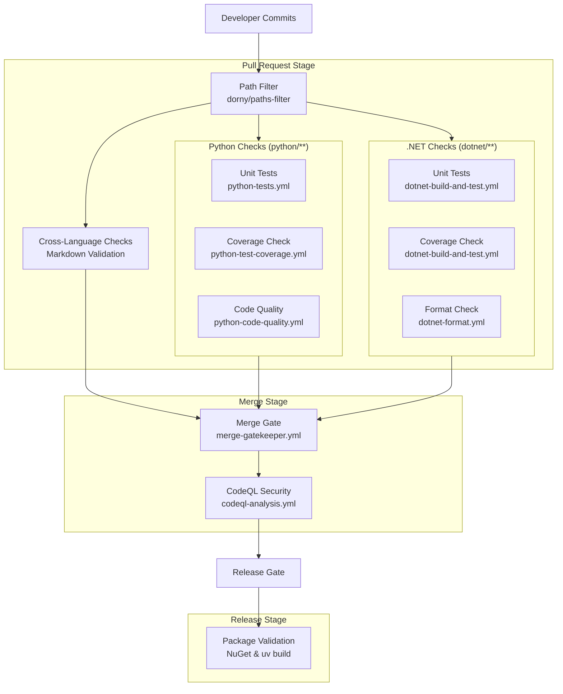
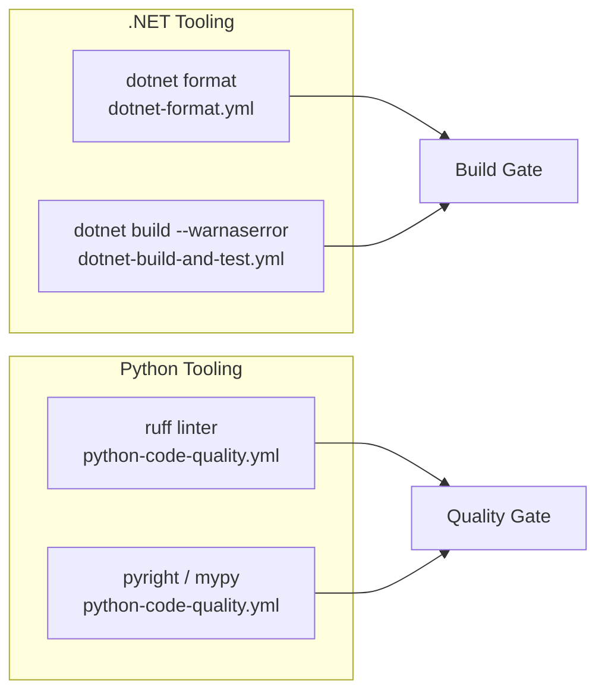

<!-- source: DeepWiki mcp.deepwiki.com · repo microsoft/agent-framework · page 9.3 Code Quality and Standards · fetched 2026-10-26 -->

# Code Quality and Standards

Relevant source files

The following files were used as context for generating this wiki page:

- [.github/scripts/check_python_api_compatibility.py](.github/scripts/check_python_api_compatibility.py)
- [.github/skills/pull-requests/SKILL.md](.github/skills/pull-requests/SKILL.md)
- [.github/tests/test_python_api_compatibility.py](.github/tests/test_python_api_compatibility.py)
- [.gitignore](.gitignore)
- [CONTRIBUTING.md](CONTRIBUTING.md)
- [docs/assets/readme-banner.png](docs/assets/readme-banner.png)
- [dotnet/.github/skills/pull-requests/SKILL.md](dotnet/.github/skills/pull-requests/SKILL.md)
- [dotnet/.gitignore](dotnet/.gitignore)
- [dotnet/nuget/NUGET.md](dotnet/nuget/NUGET.md)
- [dotnet/nuget/icon.png](dotnet/nuget/icon.png)
- [python/.github/skills/pull-requests/SKILL.md](python/.github/skills/pull-requests/SKILL.md)
- [python/.pre-commit-config.yaml](python/.pre-commit-config.yaml)
- [python/packages/devui/frontend/src/lib/utils.ts](python/packages/devui/frontend/src/lib/utils.ts)

This page documents the high-level code quality standards, automated quality gates, and enforcement mechanisms applied across both .NET and Python implementations of the Microsoft Agent Framework [CONTRIBUTING.md:7-11](). 

For detailed language-specific rules, configuration files, and commands, see [.NET Code Standards](#9.3.1) and [Python Code Standards](#9.3.2). For broader repository CI/CD infrastructure and pipeline stages, see [CI/CD Infrastructure](#9.2).

---

## Quality Gate Architecture

The framework enforces code standards using a multi-stage validation pipeline defined in GitHub Actions workflows. Changes pass through path filtering, language-specific checks, merge gates, and release validations to ensure robustness and prevent regressions.

Title: Quality Gate Pipeline

Sources: [.github/workflows/dotnet-build-and-test.yml:32-86](), [.github/workflows/python-code-quality.yml:1-111](), [.github/workflows/merge-gatekeeper.yml:1-118]()

---

## Coverage Requirements

Code coverage thresholds are strictly enforced during pull request validation for both languages to maintain test adequacy across core modules and workflow engines. 

For deep details on how coverage is collected, aggregated, and reported, refer to the child pages [.NET Code Standards](#9.3.1) and [Python Code Standards](#9.3.2).

| Language | Threshold | Enforcement Point | Configuration |
|----------|-----------|-------------------|---------------|
| .NET | 80% | Pull Request + CI | [`COVERAGE_THRESHOLD` env var](.github/workflows/dotnet-build-and-test.yml:20)() |
| Python | 85% | Pull Request | [`COVERAGE_THRESHOLD` env var](.github/workflows/python-test-coverage.yml:16)() |

Sources: [.github/workflows/dotnet-build-and-test.yml:19-22](), [.github/workflows/python-test-coverage.yml:1-56]()

---

## Language-Specific Code Standards Overview

Each language implementation utilizes distinct toolchains and compliance rules to maintain high code health, consistent formatting, and static type safety:

- **.NET Implementation**: Relies on Roslyn analyzers, `dotnet format`, strict warning enforcement where all build warnings are treated as errors [.github/workflows/dotnet-build-and-test.yml:136](), and package validation for API compatibility [CONTRIBUTING.md:129-132](). For complete details, see [.NET Code Standards](#9.3.1).
- **Python Implementation**: Relies on `ruff` for linting and formatting, `pyright` and `mypy` for static type checking, `bandit` for security checks, and `pre-commit` hooks [python/.pre-commit-config.yaml:1-70](), [.github/workflows/python-code-quality.yml:19-143](). For complete details, see [Python Code Standards](#9.3.2).

Title: Tooling and Language Ecosystem

Sources: [.github/workflows/dotnet-format.yml:93-102](), [.github/workflows/python-code-quality.yml:19-143](), [python/.pre-commit-config.yaml:1-70]()

---

## Cross-Language Standards and API Compatibility

### Public API Tracking and Breaking Changes

To prevent unintended API breakages across releases, both language ecosystems employ automated checks:
- **Python API Compatibility**: Pull requests run an automated analysis using `Griffe` via `.github/scripts/check_python_api_compatibility.py` to compare published package signatures against the base commit, respecting experimental markers and package release status [CONTRIBUTING.md:98-128](), [.github/scripts/check_python_api_compatibility.py:1-47]().
- **.NET Package Validation**: Projects utilize built-in .NET Package Validation tools during `dotnet build` to detect binary and source breaking changes automatically [CONTRIBUTING.md:129-132]().

### CodeQL Security Scanning

The framework uses **GitHub CodeQL** for automated security vulnerability detection across both language repositories:
- Languages analyzed: `csharp`, `python` [.github/workflows/codeql-analysis.yml:27]().
- Schedule: Weekly executions on Tuesdays alongside on-demand `workflow_dispatch` triggers [.github/workflows/codeql-analysis.yml:8-13]().

Sources: [CONTRIBUTING.md:92-132](), [.github/workflows/codeql-analysis.yml:1-69](), [.github/scripts/check_python_api_compatibility.py:1-47]()

---

