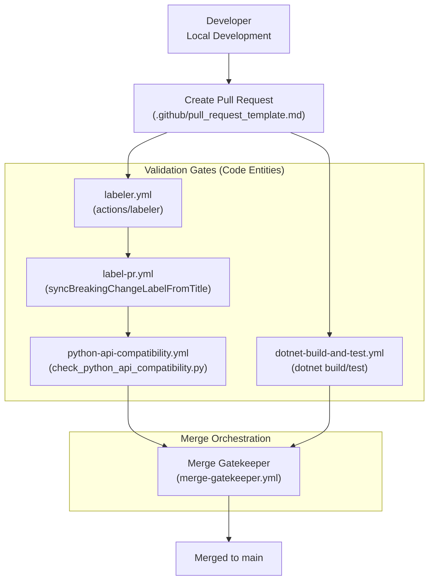
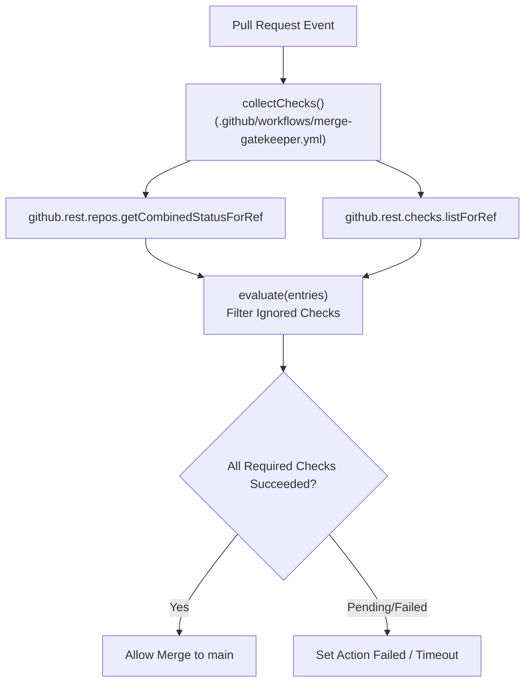

<!-- source: DeepWiki mcp.deepwiki.com · repo microsoft/agent-framework · page 9.4 Contributing Guidelines · fetched 2026-10-26 -->

# Contributing Guidelines

<details>
<summary>Relevant source files</summary>

The following files were used as context for generating this wiki page:

- [.github/CODEOWNERS](.github/CODEOWNERS)
- [.github/scripts/check_python_api_compatibility.py](.github/scripts/check_python_api_compatibility.py)
- [.github/skills/pull-requests/SKILL.md](.github/skills/pull-requests/SKILL.md)
- [.github/tests/test_python_api_compatibility.py](.github/tests/test_python_api_compatibility.py)
- [.gitignore](.gitignore)
- [CONTRIBUTING.md](CONTRIBUTING.md)
- [docs/assets/readme-banner.png](docs/assets/readme-banner.png)
- [docs/features/vector-stores-and-embeddings/README.md](docs/features/vector-stores-and-embeddings/README.md)
- [dotnet/.github/skills/pull-requests/SKILL.md](dotnet/.github/skills/pull-requests/SKILL.md)
- [dotnet/.gitignore](dotnet/.gitignore)
- [dotnet/nuget/NUGET.md](dotnet/nuget/NUGET.md)
- [dotnet/nuget/icon.png](dotnet/nuget/icon.png)
- [python/.github/skills/pull-requests/SKILL.md](python/.github/skills/pull-requests/SKILL.md)
- [python/.pre-commit-config.yaml](python/.pre-commit-config.yaml)
- [python/packages/core/agent_framework/_in_memory.py](python/packages/core/agent_framework/_in_memory.py)
- [python/packages/core/agent_framework/_vector_filters.py](python/packages/core/agent_framework/_vector_filters.py)
- [python/packages/core/agent_framework/_vectors.py](python/packages/core/agent_framework/_vectors.py)
- [python/packages/core/tests/core/test_in_memory.py](python/packages/core/tests/core/test_in_memory.py)
- [python/packages/core/tests/core/test_vectors.py](python/packages/core/tests/core/test_vectors.py)
- [python/packages/devui/frontend/src/lib/utils.ts](python/packages/devui/frontend/src/lib/utils.ts)
- [python/packages/mongodb/LICENSE](python/packages/mongodb/LICENSE)
- [python/packages/mongodb/README.md](python/packages/mongodb/README.md)
- [python/packages/mongodb/agent_framework_mongodb/__init__.py](python/packages/mongodb/agent_framework_mongodb/__init__.py)
- [python/packages/mongodb/agent_framework_mongodb/_vector_store.py](python/packages/mongodb/agent_framework_mongodb/_vector_store.py)
- [python/packages/mongodb/agent_framework_mongodb/py.typed](python/packages/mongodb/agent_framework_mongodb/py.typed)
- [python/packages/mongodb/pyproject.toml](python/packages/mongodb/pyproject.toml)
- [python/packages/mongodb/samples/README.md](python/packages/mongodb/samples/README.md)
- [python/packages/mongodb/samples/mongodb_agent_rag.py](python/packages/mongodb/samples/mongodb_agent_rag.py)
- [python/packages/mongodb/samples/mongodb_vectors.py](python/packages/mongodb/samples/mongodb_vectors.py)
- [python/packages/mongodb/tests/mongodb/test_vector_store.py](python/packages/mongodb/tests/mongodb/test_vector_store.py)
- [python/samples/02-agents/vector_stores/README.md](python/samples/02-agents/vector_stores/README.md)

</details>


## Purpose and Scope

This page details the contribution guidelines, pull request processes, code review protocols, and validation requirements for the Microsoft Agent Framework repository. It covers both .NET and Python implementation standards, automated API compatibility checks, breaking change protocols, and CI/CD gating mechanisms.

For developer environment setup, see [Building and Testing](#9.1). For CI/CD architecture, see [CI/CD Infrastructure](#9.2). For language-specific code quality rules, see [Code Quality and Standards](#9.3).

Sources: [CONTRIBUTING.md:1-5]()

---

## Contribution Workflow Overview

The contribution workflow spans from local feature development and pre-commit checks through automated PR validation, API compatibility verification, and final merge gating.

### Natural Language to Code Entity Mapping: Contribution Pipeline


Sources: [.github/workflows/python-api-compatibility.yml:1-131](), [.github/workflows/merge-gatekeeper.yml:1-118](), [.github/labeler.yml:1-34](), [.github/workflows/label-pr.yml:1-40](), [.github/pull_request_template.md:1-43]()

---

## Pull Request Submission Process

Contributors must adhere to structured pull request protocols to ensure maintainability and compatibility across the codebase.

### Prerequisites and Template Compliance
Every pull request must be linked to an open issue using closing keywords (e.g., `Fixes #123`) [dotnet/.github/skills/pull-requests/SKILL.md:35-39](). Pull requests must be opened as drafts (`--draft`) using the GitHub CLI until ready for review [dotnet/.github/skills/pull-requests/SKILL.md:55-62]().

The PR description must strictly follow the repository template [.github/pull_request_template.md:1-43]() without removing or reordering headings [dotnet/.github/skills/pull-requests/SKILL.md:50-53]():
- **Motivation & Context**: Explains why the change is needed and the problem it solves [dotnet/.github/skills/pull-requests/SKILL.md:21-24]().
- **Description & Review Guide**: Details major changes, overall approach, design, and specific prompts (What are major changes? What is the impact? What should human reviewers focus on?) [dotnet/.github/skills/pull-requests/SKILL.md:26-34]().
- **Related Issue**: Links the associated issue via closing keywords [dotnet/.github/skills/pull-requests/SKILL.md:35-39]().
- **Contribution Checklist**: Validates build success, test coverage, and breaking change status [dotnet/.github/skills/pull-requests/SKILL.md:41-49]().

Sources: [.github/pull_request_template.md:1-43](), [dotnet/.github/skills/pull-requests/SKILL.md:10-62]()

---

## API Compatibility and Breaking Changes

Contributions must maintain API signature and behavioral compatibility [CONTRIBUTING.md:73-75](). Unannounced breaking changes will be rejected [CONTRIBUTING.md:73-75]().

### Python Public API Compatibility (Griffe)
Python pull requests execute an automated, non-blocking compatibility check using `.github/scripts/check_python_api_compatibility.py` within `.github/workflows/python-api-compatibility.yml` [CONTRIBUTING.md:77-82](). 
- Only packages marked as `released` in `python/PACKAGE_STATUS.md` are evaluated; pre-release packages and `@experimental` or `@release_candidate` decorators are excluded [CONTRIBUTING.md:90-93]().
- If an intentional breaking change is introduced, contributors must add the `breaking change` label to the pull request or include `[BREAKING]` in the title [CONTRIBUTING.md:100-106](). Shared automation synchronizes the label and title prefix [.github/skills/pull-requests/SKILL.md:44-48]().

### .NET Package Validation
.NET projects utilize built-in Package Validation (`dotnet build -c Release` and `dotnet pack`) to detect API breaking changes against the latest published NuGet baseline [CONTRIBUTING.md:108-113]().
- If build errors occur (e.g., `CP0001`, `CP0002`) due to approved breaking changes, developers must generate a suppression file [CONTRIBUTING.md:121-128]():
  ```bash
  dotnet build <project>.csproj -c Release /p:ApiCompatGenerateSuppressionFile=true
  ```
- This updates `CompatibilitySuppressions.xml`, which must be included in the PR with proper justification [CONTRIBUTING.md:124-129]().

Sources: [CONTRIBUTING.md:71-130](), [.github/workflows/python-api-compatibility.yml:1-131](), [.github/scripts/check_python_api_compatibility.py:1-225]()

---

## Quality Gates and Merge Gatekeeper

Automated validation pipelines ensure that all commits meet quality standards prior to integration.

### Natural Language to Code Entity Mapping: Merge Validation


Sources: [.github/workflows/merge-gatekeeper.yml:46-118]()

---

## Code Review and Comment Handling

When a pull request undergoes code review, contributors must follow a strict process defined in the pull-request skill guidelines [dotnet/.github/skills/pull-requests/SKILL.md:64-83]():
1. **Review Comments**: Read every review comment and thread thoroughly [dotnet/.github/skills/pull-requests/SKILL.md:69-70]().
2. **Make a Plan**: Produce a concrete plan outlining how each comment will be addressed and present it to the reviewer [dotnet/.github/skills/pull-requests/SKILL.md:71-74]().
3. **Implement**: Execute agreed changes only after user approval [dotnet/.github/skills/pull-requests/SKILL.md:75-75]().
4. **Reply and Resolve**: Reply to every comment explaining the fix (citing commits where applicable) and resolve completed review threads directly via GitHub CLI or API [dotnet/.github/skills/pull-requests/SKILL.md:76-82]().

Sources: [dotnet/.github/skills/pull-requests/SKILL.md:64-119]()

---

