# Page: Overview

# Overview

<details>
<summary>Relevant source files</summary>

The following files were used as context for generating this wiki page:

- [README.md](README.md)
- [SUPPORT.md](SUPPORT.md)
- [TRANSPARENCY_FAQ.md](TRANSPARENCY_FAQ.md)
- [dotnet/Directory.Packages.props](dotnet/Directory.Packages.props)
- [dotnet/README.md](dotnet/README.md)
- [dotnet/agent-framework-dotnet.slnx](dotnet/agent-framework-dotnet.slnx)
- [dotnet/samples/02-agents/AGUI/README.md](dotnet/samples/02-agents/AGUI/README.md)
- [dotnet/samples/02-agents/AgentProviders/anthropic/Agent_Anthropic_Step04_UsingSkills/Program.cs](dotnet/samples/02-agents/AgentProviders/anthropic/Agent_Anthropic_Step04_UsingSkills/Program.cs)
- [dotnet/samples/README.md](dotnet/samples/README.md)
- [dotnet/src/Microsoft.Agents.AI.Anthropic/AnthropicBetaServiceExtensions.cs](dotnet/src/Microsoft.Agents.AI.Anthropic/AnthropicBetaServiceExtensions.cs)
- [dotnet/src/Microsoft.Agents.AI.Anthropic/Microsoft.Agents.AI.Anthropic.csproj](dotnet/src/Microsoft.Agents.AI.Anthropic/Microsoft.Agents.AI.Anthropic.csproj)
- [dotnet/src/Microsoft.Agents.AI.Anthropic/PublicAPI/net10.0/PublicAPI.Shipped.txt](dotnet/src/Microsoft.Agents.AI.Anthropic/PublicAPI/net10.0/PublicAPI.Shipped.txt)
- [dotnet/src/Microsoft.Agents.AI.Anthropic/PublicAPI/net10.0/PublicAPI.Unshipped.txt](dotnet/src/Microsoft.Agents.AI.Anthropic/PublicAPI/net10.0/PublicAPI.Unshipped.txt)
- [dotnet/src/Microsoft.Agents.AI.Anthropic/PublicAPI/net472/PublicAPI.Shipped.txt](dotnet/src/Microsoft.Agents.AI.Anthropic/PublicAPI/net472/PublicAPI.Shipped.txt)
- [dotnet/src/Microsoft.Agents.AI.Anthropic/PublicAPI/net472/PublicAPI.Unshipped.txt](dotnet/src/Microsoft.Agents.AI.Anthropic/PublicAPI/net472/PublicAPI.Unshipped.txt)
- [dotnet/src/Microsoft.Agents.AI.Anthropic/PublicAPI/net8.0/PublicAPI.Shipped.txt](dotnet/src/Microsoft.Agents.AI.Anthropic/PublicAPI/net8.0/PublicAPI.Shipped.txt)
- [dotnet/src/Microsoft.Agents.AI.Anthropic/PublicAPI/net8.0/PublicAPI.Unshipped.txt](dotnet/src/Microsoft.Agents.AI.Anthropic/PublicAPI/net8.0/PublicAPI.Unshipped.txt)
- [dotnet/src/Microsoft.Agents.AI.Anthropic/PublicAPI/net9.0/PublicAPI.Shipped.txt](dotnet/src/Microsoft.Agents.AI.Anthropic/PublicAPI/net9.0/PublicAPI.Shipped.txt)
- [dotnet/tests/AnthropicChatCompletion.IntegrationTests/AnthropicSkillsIntegrationTests.cs](dotnet/tests/AnthropicChatCompletion.IntegrationTests/AnthropicSkillsIntegrationTests.cs)
- [dotnet/tests/Microsoft.Agents.AI.Anthropic.UnitTests/Extensions/AnthropicBetaServiceExtensionsTests.cs](dotnet/tests/Microsoft.Agents.AI.Anthropic.UnitTests/Extensions/AnthropicBetaServiceExtensionsTests.cs)
- [dotnet/tests/Microsoft.Agents.AI.Anthropic.UnitTests/Extensions/AnthropicClientExtensionsTests.cs](dotnet/tests/Microsoft.Agents.AI.Anthropic.UnitTests/Extensions/AnthropicClientExtensionsTests.cs)
- [dotnet/tests/Microsoft.Agents.AI.Workflows.Declarative.IntegrationTests/MediaInputTest.cs](dotnet/tests/Microsoft.Agents.AI.Workflows.Declarative.IntegrationTests/MediaInputTest.cs)
- [dotnet/tests/Microsoft.Agents.AI.Workflows.Declarative.IntegrationTests/Microsoft.Agents.AI.Workflows.Declarative.IntegrationTests.csproj](dotnet/tests/Microsoft.Agents.AI.Workflows.Declarative.IntegrationTests/Microsoft.Agents.AI.Workflows.Declarative.IntegrationTests.csproj)
- [dotnet/tests/Microsoft.Agents.AI.Workflows.Declarative.IntegrationTests/TestFiles/basic-text.pdf](dotnet/tests/Microsoft.Agents.AI.Workflows.Declarative.IntegrationTests/TestFiles/basic-text.pdf)
- [dotnet/tests/Microsoft.Agents.AI.Workflows.Declarative.IntegrationTests/TestFiles/test-image.jpg](dotnet/tests/Microsoft.Agents.AI.Workflows.Declarative.IntegrationTests/TestFiles/test-image.jpg)
- [go/README.md](go/README.md)
- [python/CHANGELOG.md](python/CHANGELOG.md)
- [python/README.md](python/README.md)
- [python/packages/a2a/README.md](python/packages/a2a/README.md)
- [python/packages/a2a/pyproject.toml](python/packages/a2a/pyproject.toml)
- [python/packages/ag-ui/pyproject.toml](python/packages/ag-ui/pyproject.toml)
- [python/packages/anthropic/pyproject.toml](python/packages/anthropic/pyproject.toml)
- [python/packages/copilotstudio/README.md](python/packages/copilotstudio/README.md)
- [python/packages/copilotstudio/pyproject.toml](python/packages/copilotstudio/pyproject.toml)
- [python/packages/core/README.md](python/packages/core/README.md)
- [python/packages/core/pyproject.toml](python/packages/core/pyproject.toml)
- [python/packages/devui/pyproject.toml](python/packages/devui/pyproject.toml)
- [python/packages/lab/pyproject.toml](python/packages/lab/pyproject.toml)
- [python/packages/lab/uv.lock](python/packages/lab/uv.lock)
- [python/packages/mem0/pyproject.toml](python/packages/mem0/pyproject.toml)
- [python/packages/postgres/README.md](python/packages/postgres/README.md)
- [python/packages/postgres/pyproject.toml](python/packages/postgres/pyproject.toml)
- [python/packages/purview/pyproject.toml](python/packages/purview/pyproject.toml)
- [python/packages/redis/pyproject.toml](python/packages/redis/pyproject.toml)
- [python/pyproject.toml](python/pyproject.toml)
- [python/samples/02-agents/middleware/runtime_context_delegation.py](python/samples/02-agents/middleware/runtime_context_delegation.py)
- [python/uv.lock](python/uv.lock)

</details>


## Purpose and Scope

This document provides a high-level introduction to the Microsoft Agent Framework (MAF), a comprehensive multi-language framework for building, orchestrating, and deploying AI agents and multi-agent workflows. It covers the framework's architecture, core capabilities, repository organization, and supported platforms.

For step-by-step tutorials on creating your first agent, see [Getting Started](#2). For in-depth explanations of core concepts like agents, tools, and workflows, see [Core Concepts](#3). For implementation details and internal architecture, see [Implementation Architecture](#7).

**Sources:** [README.md:1-182](), [python/pyproject.toml:1-27](), [dotnet/Directory.Packages.props:1-78]()

## What is the Microsoft Agent Framework

The Microsoft Agent Framework is an open-source, multi-language (.NET and Python) framework designed to enable developers to build production-grade AI agents and orchestrate complex multi-agent workflows. It provides robust abstractions and components that enable integration with a wide variety of large language model (LLM) providers, workflow orchestration, extensibility through tools, observability, and deployment capabilities.

Key capabilities include:

- Support for AI agents compatible with diverse LLM providers such as OpenAI, Azure OpenAI, Azure AI Foundry, Anthropic, Claude, Ollama, AWS Bedrock, GitHub Copilot, Gemini, Mistral, and others.  
- Designing and executing orchestrations of multiple agents using workflow patterns including sequential, concurrent, handoff, group chat, and magentic workflows.  
- Graph-based functional workflows with features for streaming outputs, durable checkpointing, and human-in-the-loop approval or augmentation mechanisms.  
- Extensibility via tools that support function calling and Model Context Protocol (MCP) integrations, including hosted tools like code interpreters and web search.  
- Observability through native OpenTelemetry support with integration to Application Insights and Aspire dashboards.  
- Data governance with Microsoft Purview for policy enforcement and content auditing.  
- Flexible deployment options including containerized environments, ASP.NET Core, Azure Functions, and agent-to-agent communication (A2A) protocols.

The framework is designed to provide a consistent developer experience across .NET and Python by preserving conceptual parity while respecting language-specific idioms and ecosystems.

**Sources:** [README.md:12-60](), [python/packages/core/pyproject.toml:1-66](), [python/uv.lock:27-67]()

---

## Repository Structure

### Repository Organization Diagram

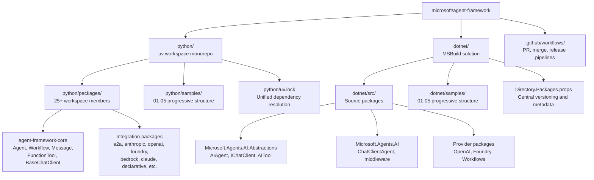

### Description

The repository is structured as a monorepo supporting two major language ecosystems and their tooling systems:

| Directory                     | Description                                                                                                    |
|------------------------------|---------------------------------------------------------------------------------------------------------------|
| `python/`                    | Python implementation managed via the `uv` monorepo workspace system with 25+ packages.                        |
| `python/pyproject.toml`      | Python workspace and package metadata, including dependency and linting configuration.                         |
| `python/uv.lock`             | Centralized lock file for consistent Python dependency resolution spanning supported Python versions (3.10 - 3.14).  |
| `python/packages/core/`      | Core abstractions and implementations shared by all Python packages including Agents, Workflows, Messages, and Tools. |
| `python/packages/*/`         | Integration packages for various LLM providers, developer tools, data stores, and additional features.          |
| `python/samples/`            | Sample applications illustrating progressive usage from basics to advanced orchestration and hosting.           |
| `dotnet/`                   | .NET implementation managed with MSBuild and central package versioning.                                       |
| `dotnet/src/`               | Source code for .NET framework libraries including abstractions, core runtime, and provider integrations.       |
| `dotnet/samples/`           | Sample .NET applications mirroring Python samples for agent and workflow scenarios.                            |
| `.github/workflows/`         | CI/CD pipeline definitions, validating builds, releases, and repository automation workflows.                   |

**Sources:** [python/pyproject.toml:70-71](), [python/uv.lock:1-20](), [dotnet/Directory.Packages.props:1-78]()

---

## Python Package Ecosystem

### Python Package Dependency Graph

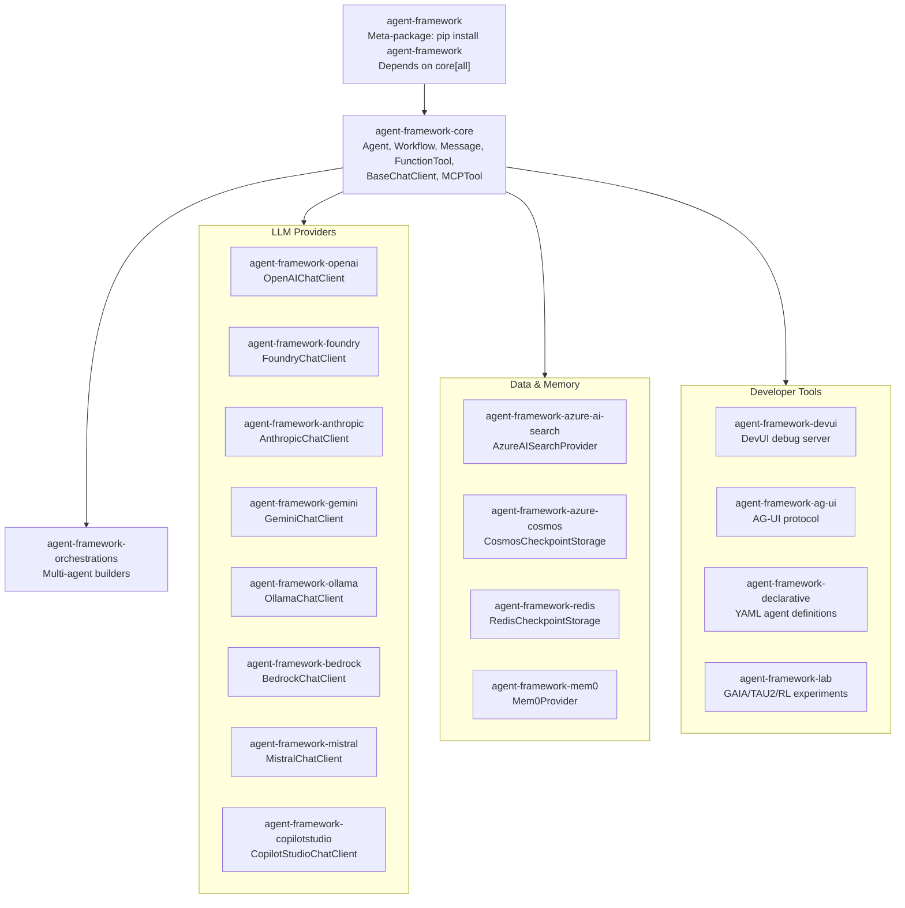

### Description

The Python implementation is modular and extensible, with `agent-framework-core` providing foundational abstractions such as:

- **Agents:** The base `Agent` class encapsulating run lifecycles that support chat interaction and streaming.  
- **Workflows:** Functional APIs for graph-based workflow execution to orchestrate multi-agent scenarios.  
- **Messages and Content:** Unified message and content models handling multimodal inputs, outputs, and function call semantics.  
- **Tools:** Mechanism for defining function tools via decorators, schema generation, and Model Context Protocol (MCP) tool integration.  
- **Chat Clients:** Abstract `BaseChatClient` enabling LLM provider-specific transport and streaming with middleware layering.

Provider-specific packages like `agent-framework-openai`, `agent-framework-foundry`, and `agent-framework-anthropic` each implement integrations with particular LLM services. Experimental features are organized under the `agent-framework-lab` package, which is separately versioned and installed. Additional packages support developer tooling, data services, and advanced orchestration builders.

This modular design allows users to install only the needed packages and provider integrations for their scenarios.

**Sources:** [python/pyproject.toml:25-27](), [python/packages/core/pyproject.toml:1-66](), [python/uv.lock:27-67](), [python/CHANGELOG.md:10-75]()

---

## .NET Package Architecture

### .NET Package Dependency Graph

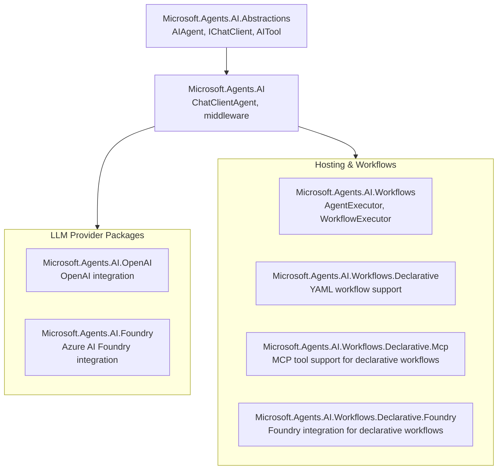

### Description

The .NET implementation is organized into layers with clear separation of responsibilities:

- **Abstractions Layer:** Defines core interfaces and base classes including `AIAgent`, `IChatClient`, and `AITool`, specifying contracts for agents, chat clients, and tools [dotnet/src/Microsoft.Agents.AI.Abstractions/].  
- **Core Runtime Layer:** Provides runtime implementations such as `ChatClientAgent` and a flexible middleware system enabling request/response pipeline extensions.  
- **Provider Integration Packages:** Host client implementations for LLM providers like OpenAI and Azure AI Foundry, encapsulating their specific features and APIs.  
- **Workflows and Hosting:** Supports multi-agent workflow orchestration with executors and declarative YAML workflows, backed by hosting models such as ASP.NET Core and Azure Functions.

Central package versioning and dependency management is maintained via MSBuild and NuGet with `Directory.Packages.props` ensuring coherent version pins and transitive dependency control for security and stability. The solution file includes numerous sample projects illustrating key framework features.

**Sources:** [dotnet/Directory.Packages.props:1-78](), [README.md:12-60]()

---

## Core Abstractions and Concepts

### Key Abstract Layers

| Concept           | Python Code Symbol / Package             | .NET Code Symbol / Namespace                        | Description                                                                                         |
|-------------------|----------------------------------------|----------------------------------------------------|-------------------------------------------------------------------------------------------------|
| Agent Layer       | `Agent` class in `agent_framework.core` | `AIAgent` base class, `ChatClientAgent`             | Encapsulates AI agent operations including chat runs, tool use, memory management, and context.  |
| Chat Client Layer  | `BaseChatClient` protocol and implementations | `IChatClient` interface and provider-specific clients | Abstracts communication with LLM backends, supporting middleware, streaming, and response processing. |
| Workflow Layer     | `Workflow` class enabling graph execution  | `Workflow`, `AgentExecutor`, `WorkflowExecutor`     | Orchestrates multi-agent interactions via functional or graph-based workflows with checkpoints. |

These abstractions define consistent patterns for agent logic, LLM integration, and complex orchestration across .NET and Python ecosystems.

**Sources:** [python/packages/core/pyproject.toml:1-149](), [python/CHANGELOG.md:1-75](), [README.md:46-47]()

---

## Package Management and Build Systems

### Python Build System Overview

| Component         | Role                                         |
|-------------------|----------------------------------------------|
| `python/uv.lock`              | Central lockfile ensuring reproducible, unified dependency versions across Python 3.10 to 3.14 environments. |
| `uv` Workspace               | Manages the Python monorepo workspace with 25+ packages in `python/packages/*`. |
| Task Automation             | `poethepoet` orchestrates build tasks like linting, testing, typing checks, and release automation. |
| Build Backend              | Uses `flit-core` for core packages and `hatchling` for some packages like `ag-ui`. |
| Code Quality              | Enforced using `ruff` (linting), `pyright` and `mypy` (type checking), and `pytest` (testing). |

### .NET Build System Overview

- MSBuild orchestrates the build with central package management and versioning through `Directory.Packages.props`.  
- NuGet packaging formalizes releases with semantic versioning and support for release candidates.  
- Multi-targeting and dependency transitive pinning ensure security, compatibility, and clear dependency chains.

**Sources:** [python/pyproject.toml:1-183](), [python/uv.lock:1-60](), [dotnet/Directory.Packages.props:1-78](), [python/packages/core/pyproject.toml:113-130]()

---

## Bridging Natural Language Space to Code Entity Space

### Diagram 1: Natural Language Concepts to Python Core Code Entities

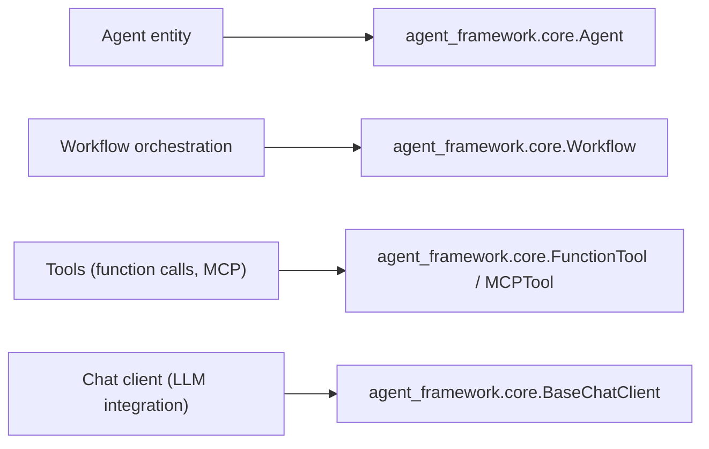

### Diagram 2: Natural Language Concepts to .NET Core Code Entities

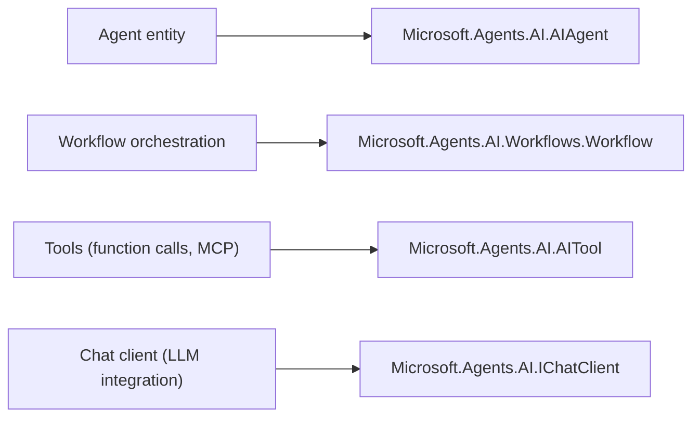

---

## Sub-Topics

For detailed information, consult these pages:

- **[Architecture at a Glance](#1.1)** — High-level overview of the layered architecture for both .NET and Python.  
- **[Multi-Language Design Philosophy](#1.2)** — How parallel .NET and Python implementations maintain conceptual parity while respecting language idioms.

**Sources:** [README.md:1-182](), [python/README.md:1-252]()

---

# Page: Architecture at a Glance

# Architecture at a Glance

<details>
<summary>Relevant source files</summary>

The following files were used as context for generating this wiki page:

- [docs/decisions/0022-chat-history-persistence-consistency.md](docs/decisions/0022-chat-history-persistence-consistency.md)
- [docs/specs/004-python-function-calling-loop.md](docs/specs/004-python-function-calling-loop.md)
- [dotnet/samples/02-agents/Agents/Agent_Step19_InFunctionLoopCheckpointing/Program.cs](dotnet/samples/02-agents/Agents/Agent_Step19_InFunctionLoopCheckpointing/Program.cs)
- [dotnet/samples/02-agents/Agents/Agent_Step19_InFunctionLoopCheckpointing/README.md](dotnet/samples/02-agents/Agents/Agent_Step19_InFunctionLoopCheckpointing/README.md)
- [dotnet/src/Microsoft.Agents.AI.Abstractions/AdditionalPropertiesExtensions.cs](dotnet/src/Microsoft.Agents.AI.Abstractions/AdditionalPropertiesExtensions.cs)
- [dotnet/src/Microsoft.Agents.AI/ChatClient/ChatClientAgent.cs](dotnet/src/Microsoft.Agents.AI/ChatClient/ChatClientAgent.cs)
- [dotnet/src/Microsoft.Agents.AI/ChatClient/ChatClientAgentContinuationToken.cs](dotnet/src/Microsoft.Agents.AI/ChatClient/ChatClientAgentContinuationToken.cs)
- [dotnet/src/Microsoft.Agents.AI/ChatClient/ChatClientAgentLogMessages.cs](dotnet/src/Microsoft.Agents.AI/ChatClient/ChatClientAgentLogMessages.cs)
- [dotnet/src/Microsoft.Agents.AI/ChatClient/ChatClientAgentOptions.cs](dotnet/src/Microsoft.Agents.AI/ChatClient/ChatClientAgentOptions.cs)
- [dotnet/src/Microsoft.Agents.AI/ChatClient/ChatClientBuilderExtensions.cs](dotnet/src/Microsoft.Agents.AI/ChatClient/ChatClientBuilderExtensions.cs)
- [dotnet/src/Microsoft.Agents.AI/ChatClient/ChatClientExtensions.cs](dotnet/src/Microsoft.Agents.AI/ChatClient/ChatClientExtensions.cs)
- [dotnet/tests/Microsoft.Agents.AI.Abstractions.UnitTests/AdditionalPropertiesExtensionsTests.cs](dotnet/tests/Microsoft.Agents.AI.Abstractions.UnitTests/AdditionalPropertiesExtensionsTests.cs)
- [dotnet/tests/Microsoft.Agents.AI.UnitTests/ChatClient/ChatClientAgentContinuationTokenTests.cs](dotnet/tests/Microsoft.Agents.AI.UnitTests/ChatClient/ChatClientAgentContinuationTokenTests.cs)
- [dotnet/tests/Microsoft.Agents.AI.UnitTests/ChatClient/ChatClientAgentOptionsTests.cs](dotnet/tests/Microsoft.Agents.AI.UnitTests/ChatClient/ChatClientAgentOptionsTests.cs)
- [dotnet/tests/Microsoft.Agents.AI.UnitTests/ChatClient/ChatClientAgentTestHelper.cs](dotnet/tests/Microsoft.Agents.AI.UnitTests/ChatClient/ChatClientAgentTestHelper.cs)
- [dotnet/tests/Microsoft.Agents.AI.UnitTests/ChatClient/ChatClientAgentTests.cs](dotnet/tests/Microsoft.Agents.AI.UnitTests/ChatClient/ChatClientAgentTests.cs)
- [dotnet/tests/Microsoft.Agents.AI.UnitTests/ChatClient/ChatClientAgent_ApprovalsTests.cs](dotnet/tests/Microsoft.Agents.AI.UnitTests/ChatClient/ChatClientAgent_ApprovalsTests.cs)
- [dotnet/tests/Microsoft.Agents.AI.UnitTests/ChatClient/ChatClientAgent_BackgroundResponsesTests.cs](dotnet/tests/Microsoft.Agents.AI.UnitTests/ChatClient/ChatClientAgent_BackgroundResponsesTests.cs)
- [dotnet/tests/Microsoft.Agents.AI.UnitTests/ChatClient/ChatClientAgent_ChatHistoryManagementTests.cs](dotnet/tests/Microsoft.Agents.AI.UnitTests/ChatClient/ChatClientAgent_ChatHistoryManagementTests.cs)
- [dotnet/tests/Microsoft.Agents.AI.UnitTests/ChatClient/ChatClientAgent_ChatOptionsMergingTests.cs](dotnet/tests/Microsoft.Agents.AI.UnitTests/ChatClient/ChatClientAgent_ChatOptionsMergingTests.cs)
- [dotnet/tests/Microsoft.Agents.AI.UnitTests/ChatClient/ChatClientBuilderExtensionsTests.cs](dotnet/tests/Microsoft.Agents.AI.UnitTests/ChatClient/ChatClientBuilderExtensionsTests.cs)
- [dotnet/tests/Microsoft.Agents.AI.UnitTests/ChatClient/ChatClientExtensionsTests.cs](dotnet/tests/Microsoft.Agents.AI.UnitTests/ChatClient/ChatClientExtensionsTests.cs)
- [python/packages/core/agent_framework/_agents.py](python/packages/core/agent_framework/_agents.py)
- [python/packages/core/agent_framework/_clients.py](python/packages/core/agent_framework/_clients.py)
- [python/packages/core/agent_framework/_compaction.py](python/packages/core/agent_framework/_compaction.py)
- [python/packages/core/agent_framework/_harness/_tool_approval.py](python/packages/core/agent_framework/_harness/_tool_approval.py)
- [python/packages/core/agent_framework/_middleware.py](python/packages/core/agent_framework/_middleware.py)
- [python/packages/core/agent_framework/_tools.py](python/packages/core/agent_framework/_tools.py)
- [python/packages/core/agent_framework/_types.py](python/packages/core/agent_framework/_types.py)
- [python/packages/core/agent_framework/observability.py](python/packages/core/agent_framework/observability.py)
- [python/packages/core/tests/core/test_agent_hooks.py](python/packages/core/tests/core/test_agent_hooks.py)
- [python/packages/core/tests/core/test_agents.py](python/packages/core/tests/core/test_agents.py)
- [python/packages/core/tests/core/test_clients.py](python/packages/core/tests/core/test_clients.py)
- [python/packages/core/tests/core/test_compaction.py](python/packages/core/tests/core/test_compaction.py)
- [python/packages/core/tests/core/test_function_invocation_logic.py](python/packages/core/tests/core/test_function_invocation_logic.py)
- [python/packages/core/tests/core/test_harness_tool_approval.py](python/packages/core/tests/core/test_harness_tool_approval.py)
- [python/packages/core/tests/core/test_middleware_with_agent.py](python/packages/core/tests/core/test_middleware_with_agent.py)
- [python/packages/core/tests/core/test_middleware_with_chat.py](python/packages/core/tests/core/test_middleware_with_chat.py)
- [python/packages/core/tests/core/test_observability.py](python/packages/core/tests/core/test_observability.py)
- [python/packages/core/tests/core/test_tools.py](python/packages/core/tests/core/test_tools.py)
- [python/packages/core/tests/core/test_types.py](python/packages/core/tests/core/test_types.py)
- [python/samples/02-agents/context_providers/cross_session_observer.py](python/samples/02-agents/context_providers/cross_session_observer.py)
- [python/samples/02-agents/observability/README.md](python/samples/02-agents/observability/README.md)
- [python/samples/02-agents/observability/microsoft_opentelemetry_distro.py](python/samples/02-agents/observability/microsoft_opentelemetry_distro.py)

</details>


This document provides a high-level overview of the Microsoft Agent Framework architecture, covering both .NET and Python implementations. It explains the core abstractions, layered middleware design, provider integrations, and package organization that enable building AI agents and multi-agent workflows across multiple platforms.

---

## Dual-Platform Architecture

The Microsoft Agent Framework maintains parallel implementations in .NET and Python, each following language-specific idioms while preserving conceptual alignment. Both implementations share the same core abstractions and communicate via consistent patterns but are expressed idiomatically for their respective ecosystems.

### Repository Structure

The repository is structured to separate .NET and Python implementations clearly, each with its own organization and tools, while remaining part of the unified project.

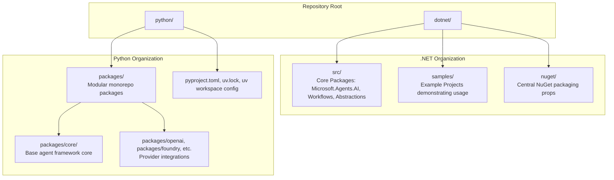

This organization supports clean separation of concerns and independent lifecycle management of components while enabling composition for agent workflows.

**Sources:** [python/pyproject.toml:1-113](), [dotnet/nuget/nuget-package.props:1-93]()

### Package Organization Strategy

The framework uses modularity extensively to allow enabling only needed capabilities. The .NET side centralizes versioning and metadata in a `nuget-package.props` file for uniformity and uses multiple projects for abstractions, core logic, workflows, and provider integrations. On the Python side, the entire ecosystem is managed as a `uv` workspace monorepo with multiple interconnected packages:

| Package Type          | .NET Example                          | Python Example                     | Purpose                                                        |
|-----------------------|-------------------------------------|----------------------------------|----------------------------------------------------------------|
| Core Framework         | `Microsoft.Agents.AI`                | `agent-framework`                | Base abstractions, chat clients, tool definitions              |
| Abstractions          | `Microsoft.Agents.AI.Abstractions`   | `agent-framework-core`           | Shared interfaces and protocols                                |
| Workflows             | `Microsoft.Agents.AI.Workflows`       | `agent-framework-orchestrations` | Multi-agent orchestration and complex workflow execution       |
| OpenAI Provider       | `Microsoft.Agents.AI.OpenAI`           | `agent-framework-openai`         | OpenAI and Azure OpenAI integrations                            |
| Experimental Features | N/A                                  | `agent-framework-lab`            | Experimental modules including benchmarking and RL training   |

The Python workspace uses `pyproject.toml` to declare package dependencies and workspace membership, ensuring version alignment and coherent dependency resolution.

**Sources:** [python/pyproject.toml:20-80](), [dotnet/nuget/nuget-package.props:3-11](), [python/packages/core/pyproject.toml:2-27](), [python/packages/lab/pyproject.toml:2-55]()

---

## Core Abstractions Layer

The framework defines protocol-based abstractions that implementations can satisfy. This enables flexibility and composability, allowing agents and chat clients to be implemented in multiple ways without strictly coupling to base classes.

### Agent and Chat Client Protocols

In Python, core abstractions such as the agent and chat client follow `typing.Protocol` interfaces to define expected behaviors:

- `SupportsAgentRun`: Defines the method `run()` which agents implement to execute a conversation or command lifecycle.
- `SupportsChatGetResponse`: Defines the asynchronous method `get_response()` which chat clients implement to interact with underlying AI providers.

The `.NET` implementation centers around the `ChatClientAgent` class, which delegates async calls to an underlying `IChatClient` interface implementation, maintaining separation of agent logic from provider invocation.

```mermaid
graph TB
    subgraph "Protocol / Interface Layer"
        SupportsAgentRun["SupportsAgentRun (Protocol)"]
        SupportsChatGetResponse["SupportsChatGetResponse (Protocol)"]
    end
    
    subgraph "Implementation Entities"
        Agent["Agent (agent_framework.Agent)"]
        BaseChatClient["BaseChatClient (agent_framework._clients.BaseChatClient)"]
        ChatTelemetryLayer["ChatTelemetryLayer (agent_framework.observability.ChatTelemetryLayer)"]
    end
    
    subgraph "Execution Logic"
        RunMethod["run(input, stream, ...) (agent_framework._agents)"]
        GetResponseMethod["get_response(messages, options, ...) (agent_framework._clients)"]
    end
    
    Agent -.->|implements| SupportsAgentRun
    BaseChatClient -.->|implements| SupportsChatGetResponse
    ChatTelemetryLayer --wraps--> BaseChatClient
    
    SupportsAgentRun --> RunMethod
    SupportsChatGetResponse --> GetResponseMethod
    Agent o-- SupportsChatGetResponse
```

This layering allows middleware to wrap chat clients transparently (e.g., telemetry, function invocation middleware), while agents rely on consistent protocol contracts.

**Sources:** [python/packages/core/agent_framework/_agents.py:15-65](), [python/packages/core/agent_framework/_clients.py:1-50](), [python/packages/core/agent_framework/observability.py:110-120]()

### Core Type System and Content Model

The message model uses a unified `Content` class to encapsulate different parts of a message (text, data, function calls, etc.). Each message is composed of multiple `Content` pieces, enabling compatibility across providers and extensibility.

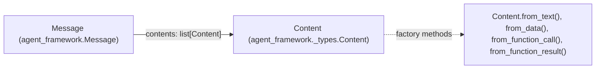

This abstraction allows standardized handling of chat messages regardless of provider-level differences.

**Sources:** [python/packages/core/agent_framework/_types.py:50-180](), [python/packages/core/agent_framework/_tools.py:150-205]()

---

## Layered Middleware Architecture

A fundamental architectural pattern in the framework is the use of layered middleware stacks wrapping chat clients and agents. This allows cross-cutting concerns like telemetry, function invocation, and response processing to be modularly composed.

### Standard Middleware Layers Stack

The typical stack layers are:

- **Agent/ChatClientAgent**: Entry point agent object managing the run lifecycle.
- **ChatTelemetryLayer**: OpenTelemetry-based layer for instrumentation and tracing.
- **FunctionInvocationLayer**: Middleware that handles tool/function call invocation on responses.
- **BaseChatClient**: Concrete chat client implementations for OpenAI, Anthropic, Azure, etc.

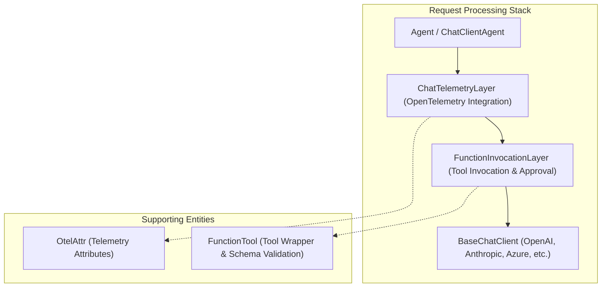

Middleware entities wrap the next layer transparently while enhancing or instrumenting functionality.

**Sources:** [python/packages/core/agent_framework/_middleware.py:1-50](), [python/packages/core/agent_framework/observability.py:90-115]()

---

## Tool and Function Calling System

Tool invocation is first-class in the framework. Tools expose functions callable by AI agents with automated schema validation, human-in-the-loop approval, and lifecycle management.

| Concept               | Code Entity                    | Responsibility                                               |
|-----------------------|--------------------------------|--------------------------------------------------------------|
| Tool Definition        | `FunctionTool` / `MCPTool`      | Wraps function metadata, parameters, and validation          |
| Tool Discovery         | `@tool` decorator (Python)      | Registers function tools with schemas usable by LLMs         |
| Skills System          | `SkillsProvider`                 | Modular extensions for capabilities (e.g., file access, MCP) |
| Invocation Approval    | `ApprovalMode` enum              | Controls whether function calls require user approval        |

The framework infrastructure supports automatic function call response analysis, invocation limits, and human approval modes.

**Sources:** [python/packages/core/agent_framework/_tools.py:40-140](), [python/packages/core/agent_framework/_agents.py:90-130]()

---

## Observability and Monitoring

OpenTelemetry integration is built into the middleware stack, capturing detailed telemetry for each interaction and tool call.

- **Usage Reporting:** Token count and usage details are accumulated in structured `UsageDetails` types.
- **Telemetry Attributes:** The `OtelAttr` class defines semantic keys like `gen_ai.operation.name` used consistently for tracing.
- **Message Timing:** A `MessageListTimestampFilter` ensures ordered microsecond resolution timestamps on messages for correlated observability.

This allows insight into agent runtimes, provider performance, and function call latencies with standard instrumentation.

**Sources:** [python/packages/core/agent_framework/_types.py:20-50](), [python/packages/core/agent_framework/observability.py:170-190, 200-240]()

---

# Bridging Natural Language to Code Entities

To help developers relate conceptual system components (like "Agent", "Tools", "Middleware") to actual code entities, here are two diagrams that map these concepts to their primary implementation classes and protocols.

### Diagram 1: Natural Language Concepts to Python Code Entities

```mermaid
graph TD
    "Natural Language" -->|Defines| "Agent"
    "Natural Language" -->|Defines| "Chat Client"
    "Natural Language" -->|Defines| "Middleware Layers"
    "Natural Language" -->|Defines| "Tools"

    "Agent" -->|Implements| "SupportsAgentRun (Protocol)"
    "Agent" -->|Implemented by| "agent_framework.Agent (class)"
    "Chat Client" -->|Implements| "SupportsChatGetResponse (Protocol)"
    "Chat Client" -->|Implemented by| "BaseChatClient (class)"

    "Middleware Layers" -->|Example| "ChatTelemetryLayer"
    "Middleware Layers" -->|Example| "FunctionInvocationLayer"

    "Tools" -->|Wrapped by| "FunctionTool (class)"
    "Tools" -->|Declared by| "@tool decorator (Python)"
```

### Diagram 2: Natural Language Concepts to .NET Code Entities

```mermaid
graph TD
    "Natural Language" -->|Defines| "Agent"
    "Natural Language" -->|Defines| "Chat Client"
    "Natural Language" -->|Defines| "Middleware Layers"
    "Natural Language" -->|Defines| "Tools"

    "Agent" -->|Implemented by| "ChatClientAgent (class)"
    "Agent" -->|Delegates to| "IChatClient (interface)"

    "Chat Client" -->|Implements| "IChatClient"
    "Middleware Layers" -->|Composed with| "Middleware Layer Classes"
    "Tools" -->|Represented as| "AIFunction"
```

These diagrams aid developers in quickly connecting architectural concepts to concrete implementation locations for exploration and extension.

---

# Summary

The Microsoft Agent Framework offers a robust, multi-language SDK for building AI agents with a layered architecture that cleanly separates concerns:

- Parallel .NET and Python implementations with aligned abstract protocols/interfaces
- Modular package organization enabling feature selection for workflows, providers, and tools
- Layered middleware approach supporting instrumentation, function invocation, and context management
- Unified message and content typing for cross-provider compatibility
- Integrated observability via OpenTelemetry for comprehensive runtime insight

This architecture enables scalable development of intelligent applications involving conversational agents, multi-agent workflows, and complex AI orchestration.

---

**Sources:**  
- [python/pyproject.toml:1-113]()  
- [dotnet/nuget/nuget-package.props:1-93]()  
- [python/packages/core/agent_framework/_agents.py:15-65]()  
- [python/packages/core/agent_framework/_clients.py:1-50]()  
- [python/packages/core/agent_framework/observability.py:90-120, 170-190, 200-240]()  
- [python/packages/core/agent_framework/_types.py:20-50, 50-180]()  
- [python/packages/core/agent_framework/_middleware.py:1-50]()  
- [python/packages/core/agent_framework/_tools.py:40-140]()

---

# Page: Multi-Language Design Philosophy

# Multi-Language Design Philosophy

<details>
<summary>Relevant source files</summary>

The following files were used as context for generating this wiki page:

- [docs/decisions/0001-agent-run-response.md](docs/decisions/0001-agent-run-response.md)
- [docs/decisions/0006-userapproval.md](docs/decisions/0006-userapproval.md)
- [docs/decisions/0008-python-subpackages.md](docs/decisions/0008-python-subpackages.md)
- [docs/decisions/0009-support-long-running-operations.md](docs/decisions/0009-support-long-running-operations.md)
- [docs/design/python-package-setup.md](docs/design/python-package-setup.md)
- [dotnet/src/Microsoft.Agents.AI.Anthropic/AnthropicClientExtensions.cs](dotnet/src/Microsoft.Agents.AI.Anthropic/AnthropicClientExtensions.cs)
- [dotnet/src/Microsoft.Agents.AI.Purview/IScopedContentProcessor.cs](dotnet/src/Microsoft.Agents.AI.Purview/IScopedContentProcessor.cs)
- [python/packages/core/AGENTS.md](python/packages/core/AGENTS.md)
- [python/packages/core/agent_framework/__init__.py](python/packages/core/agent_framework/__init__.py)
- [python/packages/core/agent_framework/__init__.pyi](python/packages/core/agent_framework/__init__.pyi)
- [python/packages/core/agent_framework/_skills.py](python/packages/core/agent_framework/_skills.py)
- [python/packages/core/tests/core/test_skills.py](python/packages/core/tests/core/test_skills.py)
- [python/samples/02-agents/skills/README.md](python/samples/02-agents/skills/README.md)
- [python/samples/02-agents/skills/class_based_skill/README.md](python/samples/02-agents/skills/class_based_skill/README.md)
- [python/samples/02-agents/skills/class_based_skill/class_based_skill.py](python/samples/02-agents/skills/class_based_skill/class_based_skill.py)
- [python/samples/02-agents/skills/code_defined_skill/README.md](python/samples/02-agents/skills/code_defined_skill/README.md)
- [python/samples/02-agents/skills/code_defined_skill/code_defined_skill.py](python/samples/02-agents/skills/code_defined_skill/code_defined_skill.py)
- [python/samples/02-agents/skills/file_based_skill/file_based_skill.py](python/samples/02-agents/skills/file_based_skill/file_based_skill.py)
- [python/samples/02-agents/skills/mixed_skills/README.md](python/samples/02-agents/skills/mixed_skills/README.md)
- [python/samples/02-agents/skills/mixed_skills/mixed_skills.py](python/samples/02-agents/skills/mixed_skills/mixed_skills.py)
- [python/samples/02-agents/skills/script_approval/script_approval.py](python/samples/02-agents/skills/script_approval/script_approval.py)
- [python/samples/02-agents/skills/subprocess_script_runner.py](python/samples/02-agents/skills/subprocess_script_runner.py)
- [python/samples/03-workflows/declarative/function_tools/README.md](python/samples/03-workflows/declarative/function_tools/README.md)

</details>


## Purpose and Scope

This document explains the architectural philosophy behind the Microsoft Agent Framework's dual implementations in Python and .NET. It details the shared design principles ensuring consistent conceptual models and developer experiences while embracing language-specific idioms such as Python's protocols and dynamic typing and .NET's interface-driven static typing. This page provides a technical deep-dive into the rationale and implementation patterns that maintain feature and abstraction parity across both languages.

## Overview: Dual-Language Strategy

Microsoft Agent Framework (MAF) employs a **bilingual implementation** approach with native, parallel implementations in Python and .NET (C#) [python/packages/core/AGENTS.md:3-15](), [python/packages/core/agent_framework/__init__.py:3-9]().

This approach avoids a shared codebase with language bindings or transpilation. Instead, it maintains two full-featured SDKs designed to:

- Offer idiomatic developer experiences per language;
- Encourage idiomatic patterns (e.g., protocols in Python, interfaces in .NET);
- Achieve conceptual and behavioral parity;
- Support independent release cycles and packaging.

### Framework Multi-Language Architecture

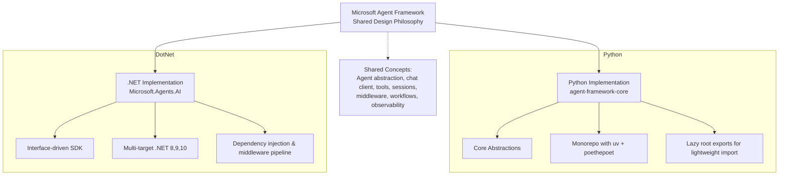

Sources: [python/packages/core/AGENTS.md:3-15](), [python/packages/core/agent_framework/__init__.py:1-50](), [docs/design/python-package-setup.md:1-80](), [dotnet/tests/Microsoft.Agents.AI.Workflows.Declarative.IntegrationTests/Microsoft.Agents.AI.Workflows.Declarative.IntegrationTests.csproj:1-2]()

## Design Principles: Consistency Across Languages

### Core Abstractions Parity

Both implementations provide equivalent **core abstractions**:

| Concept            | Python Entity                                   | .NET Entity                                       | Sources                                         |
|--------------------|------------------------------------------------|--------------------------------------------------|------------------------------------------------|
| Agent abstraction   | `Agent` (class)                                | `AIAgent` (abstract class)                        | [python/packages/core/AGENTS.md:53-66](), [dotnet/src/Microsoft.Agents.AI.Abstractions]() |
| Chat client        | `BaseChatClient` (abstract base class)        | `IChatClient` (interface)                        | [python/packages/core/AGENTS.md:68-72](), [.NET source]                          |
| Message system      | `Message` (class)                              | `ChatMessage` (class)                            | [python/packages/core/AGENTS.md:73-74](), [.NET tests]                          |
| Tooling             | `FunctionTool` (class & `@tool` decorator)   | `AIFunction` / `AITool`                          | [python/packages/core/AGENTS.md:85-90](), [.NET source]                         |
| Sessions / State    | `AgentSession` (class managing context)       | `AgentSession` (class with StateBag storage)    | [python/packages/core/AGENTS.md:198-210](), [python/packages/core/agent_framework/_serialization.py:153-180]() |

The Python SDK exploits Python's dynamic typing and protocols to enable flexible extension and composition, e.g., `SupportsChatGetResponse` protocol [python/packages/core/AGENTS.md:69-71](). The .NET SDK builds around formal interfaces and inheritance, offering strong static type guarantees and ecosystem integration.

### Cross-Language Entity Mapping

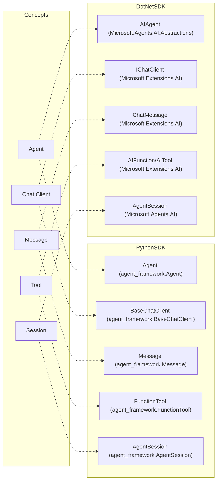

This mapping helps developers apprehend feature parity and locate equivalent concepts across the two languages.

Sources: [python/packages/core/AGENTS.md:50-75](), [python/packages/core/agent_framework/_serialization.py:153-180](), [.NET source]()

### Protocol-Based & Interface-Driven Design

- **Python** embraces **protocols** (`typing.Protocol`) enabling structural, duck-typed interfaces without explicit inheritance. The framework defines protocols like `SerializationProtocol` for serialization [python/packages/core/agent_framework/_serialization.py:27-33]() and leverages abstract base classes like `BaseChatClient` to specify required behavior [python/packages/core/AGENTS.md:69-71]().

- The **Python API surface** is designed to be **flat and organized** by functional tiers and components for user-friendly developer experience and dependency isolation [docs/design/python-package-setup.md:3-50]().

- **.NET** uses traditional explicit **interface definitions** (`IChatClient`, `IAgentRun`) aligned with the `Microsoft.Extensions.AI` ecosystem, allowing tight integration into dependency injection and middleware patterns familiar to C# developers.

Both approaches enforce clear contracts for custom implementations but respect language idioms to maximize productivity.

Sources: [python/packages/core/agent_framework/_serialization.py:27-115](), [docs/design/python-package-setup.md:3-50](), [.NET Interface source]()

## Language-Specific Package Architectures

### Python: Monorepo with uv Workspace & Lazy Loading

The Python implementation uses a **monorepo** structure managed by the `uv` dependency and task orchestration framework [docs/design/python-package-setup.md:85-116]().

- **Tiered Exports**:

  - **Tier 0:** Core abstractions exported from `agent_framework`, including `Agent`, `FunctionTool`, `BaseChatClient` for quickstart and basic agent builds [python/packages/core/agent_framework/__init__.py:1-50]().

  - **Tier 1:** Advanced components such as workflows, vector stores, middleware, and telemetry are available from submodules (`agent_framework.vector_data`, `agent_framework.workflow`).

  - **Tier 2:** Vendor-specific SDKs and connectors by namespace, e.g., `agent_framework.azure`, `agent_framework.openai`, are independently versioned and optionally installed.

- **Lazy Loading:** The root package uses Python 3.7+'s `__getattr__` in `__init__.py` to lazily import submodules on demand, reducing startup time and isolating heavy dependencies.

- **Serialization Support:** Python's `SerializationMixin` enables `.to_dict()` and `.from_dict()` methods for sessions and state objects to allow persistence, transport, and replay scenarios [python/packages/core/agent_framework/_serialization.py:160-180]().

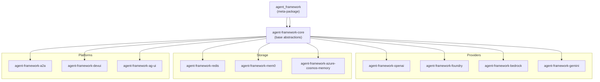

Sources: [docs/design/python-package-setup.md:52-82](), [python/packages/core/agent_framework/_serialization.py:153-180](), [python/packages/core/agent_framework/__init__.py:1-50](), [python/PACKAGE_STATUS.md:10-55]()

### .NET: Unified Architecture & Azure Integration

The .NET SDK is implemented with:

- **Targeting Modern .NET Versions:** Multi-targeting .NET 8, 9, 10 with SDK version locking via `global.json` to standardize build environments [dotnet/tests/Microsoft.Agents.AI.Workflows.Declarative.IntegrationTests/Microsoft.Agents.AI.Workflows.Declarative.IntegrationTests.csproj:1-2]().

- **Extensible Middleware Pipeline:** Interfaces like `IChatClient` and `IAgentRun` enable plugging in implementations and middleware layers for observability, security, and user approval workflows.

- **Integration with Microsoft Extensions:** Uses `Microsoft.Extensions.AI` for chat client abstractions, dependency injection, configuration, telemetry, and hosting patterns [README.md:87-92]().

- **Cloud Native & Foundry Support:** Packages such as `Microsoft.Agents.AI.Foundry` offer Azure AI integration, hosted agents, and MCP support for advanced Cloud AI tooling.

Sources: [dotnet/tests/Microsoft.Agents.AI.Workflows.Declarative.IntegrationTests/Microsoft.Agents.AI.Workflows.Declarative.IntegrationTests.csproj:1-2](), [README.md:87-92]()

## Build and Quality Standards

### Python Development Practices

- **Static Code Analysis:** Uses `ruff` for linting, `black` for formatting, and `pyright` for static type checks to enforce code quality and consistency [python/README.md:40-42]().

- **Automated Builds and Testing:** Utilizes `uv` for dependency management and `poethepoet` for orchestrating build, test, and release tasks [python/README.md:11-12]().

- **Explicit Serialization Protocols:** Implements `SerializationProtocol` with `.to_dict()` and `.from_dict()` methods used for state persistence and runtime state management [python/packages/core/agent_framework/_serialization.py:27-115]().

### .NET Development Practices

- **Unified Testing Platform:** Uses `Microsoft.Testing.Platform` across all projects, ensuring integrated testing for core and extensions [dotnet/tests/Microsoft.Agents.AI.Workflows.Declarative.IntegrationTests/Microsoft.Agents.AI.Workflows.Declarative.IntegrationTests.csproj:1-2]().

- **Stable Version Targeting:** Targets modern .NET versions with pinning via `global.json` and systematic version bumping to keep dependency consistency.

Sources: [python/README.md:40-42](), [python/packages/core/agent_framework/_serialization.py:153-180](), [dotnet/tests/Microsoft.Agents.AI.Workflows.Declarative.IntegrationTests/Microsoft.Agents.AI.Workflows.Declarative.IntegrationTests.csproj:1-2]()

---

This **multi-language design philosophy** ensures that both Python and .NET developers can leverage the Microsoft Agent Framework with idiomatic, powerful, and consistent tools. The parallel implementations encourage innovation per language while maintaining conceptual coherence for cross-team collaboration, shared learning, and multi-agent ecosystem integration.

# End of 1.2 Multi-Language Design Philosophy

---

# Page: Getting Started

# Getting Started

<details>
<summary>Relevant source files</summary>

The following files were used as context for generating this wiki page:

- [README.md](README.md)
- [SUPPORT.md](SUPPORT.md)
- [TRANSPARENCY_FAQ.md](TRANSPARENCY_FAQ.md)
- [dotnet/README.md](dotnet/README.md)
- [dotnet/samples/02-agents/AGUI/README.md](dotnet/samples/02-agents/AGUI/README.md)
- [dotnet/samples/README.md](dotnet/samples/README.md)
- [dotnet/tests/Microsoft.Agents.AI.Workflows.Declarative.IntegrationTests/MediaInputTest.cs](dotnet/tests/Microsoft.Agents.AI.Workflows.Declarative.IntegrationTests/MediaInputTest.cs)
- [dotnet/tests/Microsoft.Agents.AI.Workflows.Declarative.IntegrationTests/Microsoft.Agents.AI.Workflows.Declarative.IntegrationTests.csproj](dotnet/tests/Microsoft.Agents.AI.Workflows.Declarative.IntegrationTests/Microsoft.Agents.AI.Workflows.Declarative.IntegrationTests.csproj)
- [dotnet/tests/Microsoft.Agents.AI.Workflows.Declarative.IntegrationTests/TestFiles/basic-text.pdf](dotnet/tests/Microsoft.Agents.AI.Workflows.Declarative.IntegrationTests/TestFiles/basic-text.pdf)
- [dotnet/tests/Microsoft.Agents.AI.Workflows.Declarative.IntegrationTests/TestFiles/test-image.jpg](dotnet/tests/Microsoft.Agents.AI.Workflows.Declarative.IntegrationTests/TestFiles/test-image.jpg)
- [go/README.md](go/README.md)
- [python/README.md](python/README.md)
- [python/packages/a2a/README.md](python/packages/a2a/README.md)
- [python/packages/azure-cosmos-memory/AGENTS.md](python/packages/azure-cosmos-memory/AGENTS.md)
- [python/packages/copilotstudio/README.md](python/packages/copilotstudio/README.md)
- [python/packages/core/README.md](python/packages/core/README.md)
- [python/samples/01-get-started/01_hello_agent.py](python/samples/01-get-started/01_hello_agent.py)
- [python/samples/01-get-started/02_add_tools.py](python/samples/01-get-started/02_add_tools.py)
- [python/samples/01-get-started/03_multi_turn.py](python/samples/01-get-started/03_multi_turn.py)
- [python/samples/01-get-started/04_memory.py](python/samples/01-get-started/04_memory.py)
- [python/samples/01-get-started/05a_functional_workflow_basics.py](python/samples/01-get-started/05a_functional_workflow_basics.py)
- [python/samples/01-get-started/05b_functional_workflow_with_agents.py](python/samples/01-get-started/05b_functional_workflow_with_agents.py)
- [python/samples/01-get-started/05c_first_graph_workflow.py](python/samples/01-get-started/05c_first_graph_workflow.py)
- [python/samples/01-get-started/06_agent_harness.py](python/samples/01-get-started/06_agent_harness.py)
- [python/samples/01-get-started/README.md](python/samples/01-get-started/README.md)
- [python/samples/02-agents/middleware/runtime_context_delegation.py](python/samples/02-agents/middleware/runtime_context_delegation.py)
- [python/samples/README.md](python/samples/README.md)

</details>


This document provides an overview of how to begin using the Microsoft Agent Framework (MAF) for building AI agents and multi-agent workflows. It covers installation, prerequisites, high-level architecture concepts, and recommended learning paths for both Python and .NET implementations.

For detailed, language-specific step-by-step instructions, please consult the child pages:
- **[.NET Quick Start](#2.1)** — Step-by-step guide to creating your first .NET agent, including package installation, basic agent creation, and running a simple conversation.
- **[Python Quick Start](#2.2)** — Step-by-step guide to creating your first Python agent, including package installation using uv, basic agent creation, and running a simple conversation.

For in-depth explanations of framework concepts such as agents, chat clients, tools, memory, and workflows, see **[Core Concepts](#3)**.

---

## Installation Overview

Microsoft Agent Framework is an open, multi-language framework for building production-grade AI agents and multi-agent workflows across both **.NET** and **Python** platforms [README.md:12-14]().

### Python Installation

The Python implementation is modular and managed within a `uv` workspace. Developers may install the meta-package `agent-framework` to get the complete standard set of integrations or selectively install smaller packages for specific needs (e.g., `agent-framework-core` contains the core functionality with default provider support) [python/README.md:5-38]().

```bash
# Install the full standard framework package (recommended for development)
pip install agent-framework

# Alternatively, install only the core framework components and default providers
pip install agent-framework-core
```

The framework requires Python 3.10 or later and supports Windows, macOS, and Linux [python/README.md:42-43]().

### .NET Installation

For .NET, the core agent functionality is provided in the `Microsoft.Agents.AI` NuGet package. Additional packages enable integrations with services like Azure AI Foundry and Azure SDKs [README.md:86-95]().

```bash
# Add the core Agent Framework package to your project
dotnet add package Microsoft.Agents.AI

# Optional: Add integration with Microsoft Foundry AI services
dotnet add package Microsoft.Agents.AI.Foundry

# Add Azure SDK packages for project and identity management
dotnet add package Azure.AI.Projects
dotnet add package Azure.Identity
```

---

## Prerequisites

### API Keys and Authentication

Both Python and .NET implementations rely on environment configuration for your chosen Large Language Model (LLM) providers. Common environment variables include:

- `OPENAI_API_KEY` for OpenAI
- `AZURE_OPENAI_ENDPOINT`, `AZURE_OPENAI_API_KEY` for Azure OpenAI
- `FOUNDRY_PROJECT_ENDPOINT` and `FOUNDRY_MODEL` for Microsoft Foundry projects

The framework supports various Azure authentication methods like `AzureCliCredential` or `DefaultAzureCredential` for seamless authentication in Azure-hosted scenarios [python/README.md:44-83](), [README.md:115-116]().

### Environment Configuration

Environment variables are automatically consumed by framework chat clients. You can also override these in code by passing explicit parameters during client construction, facilitating multi-provider or multi-tenant scenarios.

---

## Core Framework Architecture

Microsoft Agent Framework bridges the gap between high-level natural language instructions and executable code entities that implement agent logic, tool invocation, and session management. This layered architecture is consistent across .NET and Python implementations, supporting cross-language development.

### Natural Language Space to Code Entity Space

Agents transform system instructions and user prompts into structured conversations with AI models, mediated through chat clients, and extended with function tools or plugins.

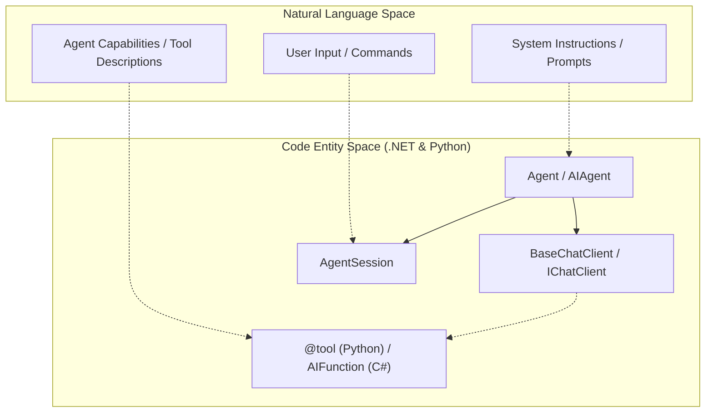

This diagram illustrates the conceptual bridge from natural language inputs and instructions to software abstractions:
- Agents consume instructions and manage session lifecycles via `AgentSession`.
- Chat clients interact with AI service providers.
- Tools extend agent capabilities, enabling function calls triggered by agent logic.

**Sources:** [python/README.md:89-111](), [dotnet/README.md:16-18](), [python/README.md:145-170]()

### Chat Client Provider Abstraction

The `IChatClient` interface (in .NET) or `BaseChatClient` class (in Python) abstracts different AI provider implementations, ensuring agents interact uniformly regardless of backend LLM service:

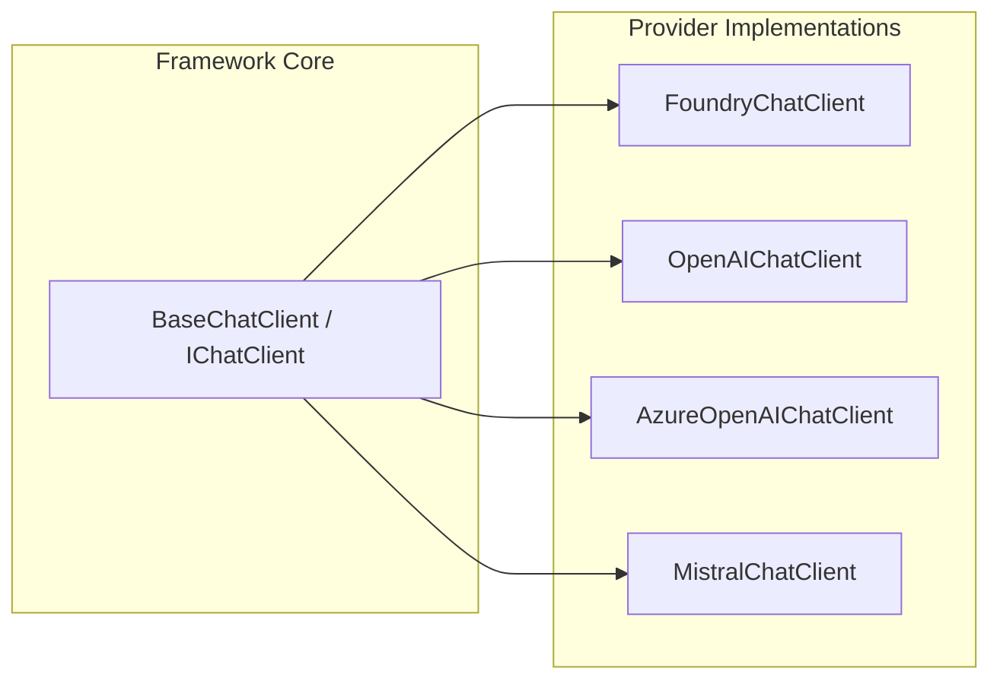

This design enables extensibility and provider flexibility for your agents.

**Sources:** [python/README.md:73-81](), [dotnet/README.md:8-11](), [python/packages/core/README.md:48-54]()

---

## Sample Learning Path

The repository contains progressive, curated samples that guide you through creating agents, integrating tools, managing conversation state, and building workflows.

| Step | Topic                      | Python Sample                           | .NET Sample                      |
|-------|----------------------------|---------------------------------------|---------------------------------|
| 1     | Hello Agent                | `01_hello_agent.py`                    | `01_hello_agent/Program.cs`     |
| 2     | Add Function Tools         | `02_add_tools.py`                      | `02_add_tools/Program.cs`       |
| 3     | Multi-turn Conversations   | `03_multi_turn.py`                     | `03_multi_turn/Program.cs`      |
| 4     | Agent Memory               | `04_memory.py`                        | `04_memory/Program.cs`          |
| 5     | Workflow Basics            | `05a_functional_workflow_basics.py`   | `05_first_workflow/Program.cs`  |

These samples demonstrate agent basics, advanced concepts such as session state with context providers, tool usage, and orchestrating multiple agents via workflows [dotnet/samples/README.md:26-31](), [python/README.md:194-222](), [python/samples/01-get-started/README.md:20-31]().

---

## Next Steps

To get started with actual development, choose your preferred language guide:

- **[.NET Quick Start](#2.1)** — Learn how to install packages, create an `AzureOpenAIClient`, build your first agent using `AsAIAgent()`, and run simple conversations [dotnet/README.md:16-24]().

```csharp
var agent = new OpenAIClient(
        new BearerTokenPolicy(new AzureCliCredential(), "https://ai.azure.com/.default"),
        new OpenAIClientOptions { Endpoint = new Uri(Environment.GetEnvironmentVariable("AZURE_OPENAI_ENDPOINT")!) })
    .GetResponsesClient()
    .AsAIAgent(model: Environment.GetEnvironmentVariable("AZURE_OPENAI_DEPLOYMENT_NAME")!, name: "HaikuBot",
      instructions: "You are an upbeat assistant that writes beautifully.");

Console.WriteLine(await agent.RunAsync("Write a haiku about Microsoft Agent Framework."));
```

- **[Python Quick Start](#2.2)** — Learn how to install packages with `pip`/`uv`, instantiate the `Agent` class with an `OpenAIChatClient` or `FoundryChatClient`, and perform asynchronous runs to interact with the agent [python/README.md:89-111]():

```python
import asyncio
from agent_framework import Agent
from agent_framework.openai import OpenAIChatClient

async def main():
    agent = Agent(
        client=OpenAIChatClient(),
        instructions="""
        1) A robot may not injure a human being or, through inaction, allow a human to come to harm.
        2) A robot must obey orders given by humans except where such orders would conflict with the first law.
        3) A robot must protect its own existence as long as such protection does not conflict with the first or second law.
        Give me the TLDR in exactly 5 words.
        """
    )
    result = await agent.run("Summarize the Three Laws of Robotics")
    print(result)

asyncio.run(main())
```

For comprehensive conceptual details behind agents, chat clients, tool integrations, and workflow orchestration, please see **[Core Concepts](#3)** and its child pages.

---

**Sources:**  
[README.md:12-96](),  
[python/README.md:5-83](),  
[dotnet/README.md:1-24](),  
[dotnet/samples/README.md:26-31](),  
[python/README.md:89-111](),  
[python/samples/01-get-started/README.md:20-31]()

---

# Page: .NET Quick Start

# .NET Quick Start

<details>
<summary>Relevant source files</summary>

The following files were used as context for generating this wiki page:

- [docs/decisions/0022-chat-history-persistence-consistency.md](docs/decisions/0022-chat-history-persistence-consistency.md)
- [dotnet/nuget/nuget-package.props](dotnet/nuget/nuget-package.props)
- [dotnet/samples/02-agents/Agents/Agent_Step19_InFunctionLoopCheckpointing/Program.cs](dotnet/samples/02-agents/Agents/Agent_Step19_InFunctionLoopCheckpointing/Program.cs)
- [dotnet/samples/02-agents/Agents/Agent_Step19_InFunctionLoopCheckpointing/README.md](dotnet/samples/02-agents/Agents/Agent_Step19_InFunctionLoopCheckpointing/README.md)
- [dotnet/src/Microsoft.Agents.AI.Abstractions/AdditionalPropertiesExtensions.cs](dotnet/src/Microsoft.Agents.AI.Abstractions/AdditionalPropertiesExtensions.cs)
- [dotnet/src/Microsoft.Agents.AI.Abstractions/Microsoft.Agents.AI.Abstractions.csproj](dotnet/src/Microsoft.Agents.AI.Abstractions/Microsoft.Agents.AI.Abstractions.csproj)
- [dotnet/src/Microsoft.Agents.AI.OpenAI/Microsoft.Agents.AI.OpenAI.csproj](dotnet/src/Microsoft.Agents.AI.OpenAI/Microsoft.Agents.AI.OpenAI.csproj)
- [dotnet/src/Microsoft.Agents.AI.Workflows.Declarative/Microsoft.Agents.AI.Workflows.Declarative.csproj](dotnet/src/Microsoft.Agents.AI.Workflows.Declarative/Microsoft.Agents.AI.Workflows.Declarative.csproj)
- [dotnet/src/Microsoft.Agents.AI.Workflows.Generators/Microsoft.Agents.AI.Workflows.Generators.csproj](dotnet/src/Microsoft.Agents.AI.Workflows.Generators/Microsoft.Agents.AI.Workflows.Generators.csproj)
- [dotnet/src/Microsoft.Agents.AI.Workflows/Microsoft.Agents.AI.Workflows.csproj](dotnet/src/Microsoft.Agents.AI.Workflows/Microsoft.Agents.AI.Workflows.csproj)
- [dotnet/src/Microsoft.Agents.AI/ChatClient/ChatClientAgent.cs](dotnet/src/Microsoft.Agents.AI/ChatClient/ChatClientAgent.cs)
- [dotnet/src/Microsoft.Agents.AI/ChatClient/ChatClientAgentContinuationToken.cs](dotnet/src/Microsoft.Agents.AI/ChatClient/ChatClientAgentContinuationToken.cs)
- [dotnet/src/Microsoft.Agents.AI/ChatClient/ChatClientAgentLogMessages.cs](dotnet/src/Microsoft.Agents.AI/ChatClient/ChatClientAgentLogMessages.cs)
- [dotnet/src/Microsoft.Agents.AI/ChatClient/ChatClientAgentOptions.cs](dotnet/src/Microsoft.Agents.AI/ChatClient/ChatClientAgentOptions.cs)
- [dotnet/src/Microsoft.Agents.AI/ChatClient/ChatClientBuilderExtensions.cs](dotnet/src/Microsoft.Agents.AI/ChatClient/ChatClientBuilderExtensions.cs)
- [dotnet/src/Microsoft.Agents.AI/ChatClient/ChatClientExtensions.cs](dotnet/src/Microsoft.Agents.AI/ChatClient/ChatClientExtensions.cs)
- [dotnet/src/Microsoft.Agents.AI/Microsoft.Agents.AI.csproj](dotnet/src/Microsoft.Agents.AI/Microsoft.Agents.AI.csproj)
- [dotnet/tests/Microsoft.Agents.AI.Abstractions.UnitTests/AdditionalPropertiesExtensionsTests.cs](dotnet/tests/Microsoft.Agents.AI.Abstractions.UnitTests/AdditionalPropertiesExtensionsTests.cs)
- [dotnet/tests/Microsoft.Agents.AI.UnitTests/ChatClient/ChatClientAgentContinuationTokenTests.cs](dotnet/tests/Microsoft.Agents.AI.UnitTests/ChatClient/ChatClientAgentContinuationTokenTests.cs)
- [dotnet/tests/Microsoft.Agents.AI.UnitTests/ChatClient/ChatClientAgentOptionsTests.cs](dotnet/tests/Microsoft.Agents.AI.UnitTests/ChatClient/ChatClientAgentOptionsTests.cs)
- [dotnet/tests/Microsoft.Agents.AI.UnitTests/ChatClient/ChatClientAgentTestHelper.cs](dotnet/tests/Microsoft.Agents.AI.UnitTests/ChatClient/ChatClientAgentTestHelper.cs)
- [dotnet/tests/Microsoft.Agents.AI.UnitTests/ChatClient/ChatClientAgentTests.cs](dotnet/tests/Microsoft.Agents.AI.UnitTests/ChatClient/ChatClientAgentTests.cs)
- [dotnet/tests/Microsoft.Agents.AI.UnitTests/ChatClient/ChatClientAgent_ApprovalsTests.cs](dotnet/tests/Microsoft.Agents.AI.UnitTests/ChatClient/ChatClientAgent_ApprovalsTests.cs)
- [dotnet/tests/Microsoft.Agents.AI.UnitTests/ChatClient/ChatClientAgent_BackgroundResponsesTests.cs](dotnet/tests/Microsoft.Agents.AI.UnitTests/ChatClient/ChatClientAgent_BackgroundResponsesTests.cs)
- [dotnet/tests/Microsoft.Agents.AI.UnitTests/ChatClient/ChatClientAgent_ChatHistoryManagementTests.cs](dotnet/tests/Microsoft.Agents.AI.UnitTests/ChatClient/ChatClientAgent_ChatHistoryManagementTests.cs)
- [dotnet/tests/Microsoft.Agents.AI.UnitTests/ChatClient/ChatClientAgent_ChatOptionsMergingTests.cs](dotnet/tests/Microsoft.Agents.AI.UnitTests/ChatClient/ChatClientAgent_ChatOptionsMergingTests.cs)
- [dotnet/tests/Microsoft.Agents.AI.UnitTests/ChatClient/ChatClientBuilderExtensionsTests.cs](dotnet/tests/Microsoft.Agents.AI.UnitTests/ChatClient/ChatClientBuilderExtensionsTests.cs)
- [dotnet/tests/Microsoft.Agents.AI.UnitTests/ChatClient/ChatClientExtensionsTests.cs](dotnet/tests/Microsoft.Agents.AI.UnitTests/ChatClient/ChatClientExtensionsTests.cs)
- [dotnet/tests/Microsoft.Agents.AI.UnitTests/Microsoft.Agents.AI.UnitTests.csproj](dotnet/tests/Microsoft.Agents.AI.UnitTests/Microsoft.Agents.AI.UnitTests.csproj)

</details>


This document provides a step-by-step guide to creating your first .NET agent using the Microsoft Agent Framework. You will learn how to install the necessary packages, create a basic agent, and run a simple conversation. For the Python equivalent, see [Python Quick Start](2.2). For a deeper understanding of the framework's architecture, see [Overview](1) and [Architecture at a Glance](1.1).

---

## Prerequisites

Before starting, ensure you have the following installed:

| Requirement          | Version          | Purpose                                         |
|----------------------|------------------|-------------------------------------------------|
| .NET SDK             | 8.0, 9.0, or 10.0| Required for building and running .NET apps     |
| C# IDE               | Visual Studio 2022 or VS Code | Recommended for development          |
| AI Provider Key      | N/A              | OpenAI API Key, Azure OpenAI endpoint, or local like Ollama |

The framework targets multiple .NET versions including `net8.0` and `net9.0` as managed centrally [dotnet/Directory.Packages.props:100-101](). The core library version is centrally pinned and managed in `Directory.Packages.props` with a version around `1.24.0` currently [dotnet/nuget/nuget-package.props:4-9]().

**Sources:** [dotnet/Directory.Packages.props:100-101](), [dotnet/nuget/nuget-package.props:1-93]()

---

## Installation

The Microsoft Agent Framework is distributed as NuGet packages. For a basic agent setup, you need the core package plus a provider-specific package (like OpenAI or Azure Foundry):

```bash
dotnet new console -n MyFirstAgent
cd MyFirstAgent
dotnet add package Microsoft.Agents.AI
# Optionally for OpenAI provider:
dotnet add package Microsoft.Agents.AI.OpenAI
```

### Package Overview

The following diagram shows the key .NET packages and their relationships in your application:

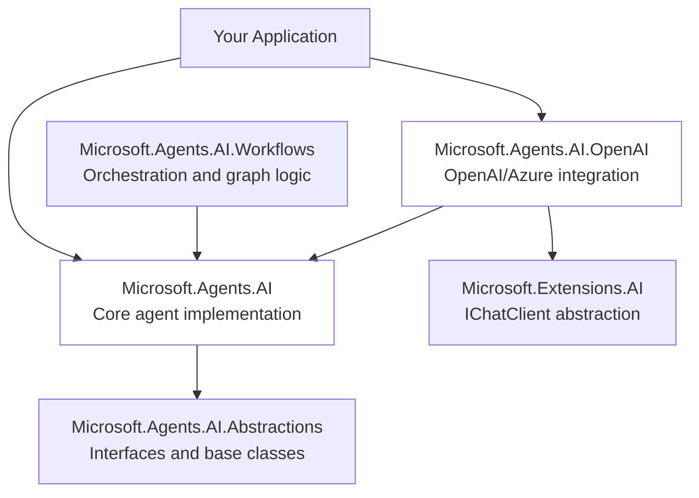

| Package                          | Responsibility                               | Key Types                                            |
|---------------------------------|----------------------------------------------|-----------------------------------------------------|
| `Microsoft.Agents.AI.Abstractions` | Base interfaces and contracts               | `AIAgent`, `AgentSession`, `AgentResponse`          |
| `Microsoft.Agents.AI`            | Core implementation and middleware           | `ChatClientAgent`, `ChatClientAgentOptions`         |
| `Microsoft.Agents.AI.Workflows`  | Multi-agent orchestration                     | `Workflow`, `AgentExecutor`, `MessageMerger`        |
| `Microsoft.Extensions.AI`        | AI client abstraction from Microsoft.Extensions | `IChatClient`, `ChatOptions`, `ChatResponse`       |

**Sources:** [dotnet/Directory.Packages.props:100-101](), [dotnet/src/Microsoft.Agents.AI/Microsoft.Agents.AI.csproj:1-58]()

---

## Creating Your First Agent

### Basic Agent Setup

The primary abstraction to create an agent is the `ChatClientAgent`, which wraps an `IChatClient` (the standard AI chat client abstraction from `Microsoft.Extensions.AI`).

Example usage in C#:

```csharp
using Microsoft.Agents.AI;
using Microsoft.Extensions.AI;
using System.Threading.Tasks;

// 1. Initialize a ChatClient (provider-specific code, e.g., OpenAIClient wrapper)
IChatClient chatClient = /* e.g., new OpenAIClient(...).AsChatClient(...) */;

// 2. Define the agent options with instructions and identity
var options = new ChatClientAgentOptions
{
    Name = "Assistant",
    ChatOptions = new ChatOptions 
    { 
        Instructions = "You are a helpful assistant that answers in rhymes." 
    }
};

// 3. Create the ChatClientAgent instance using chat client and options
var agent = new ChatClientAgent(chatClient, options);

// 4. Run the agent with a prompt
var response = await agent.RunAsync("What is the capital of France?");
Console.WriteLine(response.Text);
```

The `ChatClientAgent` constructor orchestrates creation of the underlying chat client pipeline, injecting a `FunctionInvokingChatClient` decorator to handle automatic tool invocation and function calling if not already present. It supports additional injectables such as tools and logger factories for customization [dotnet/src/Microsoft.Agents.AI/ChatClient/ChatClientAgent.cs:80-116](). The `ChatOptions.Instructions` parameter serves as system prompt to shape the agent's behavior, while `Name` and `Description` help identify the agent during logging and diagnostics.

An extension method `AsAIAgent()` on `IChatClient` is also available for concise construction [dotnet/src/Microsoft.Agents.AI/ChatClient/ChatClientExtensions.cs:18-37]().

**Sources:**  
[dotnet/src/Microsoft.Agents.AI/ChatClient/ChatClientAgent.cs:80-116](),  
[dotnet/src/Microsoft.Agents.AI/ChatClient/ChatClientExtensions.cs:22-38]()

---

## Agent Architecture Flow

This diagram bridges natural language input/output with code entities inside the framework:

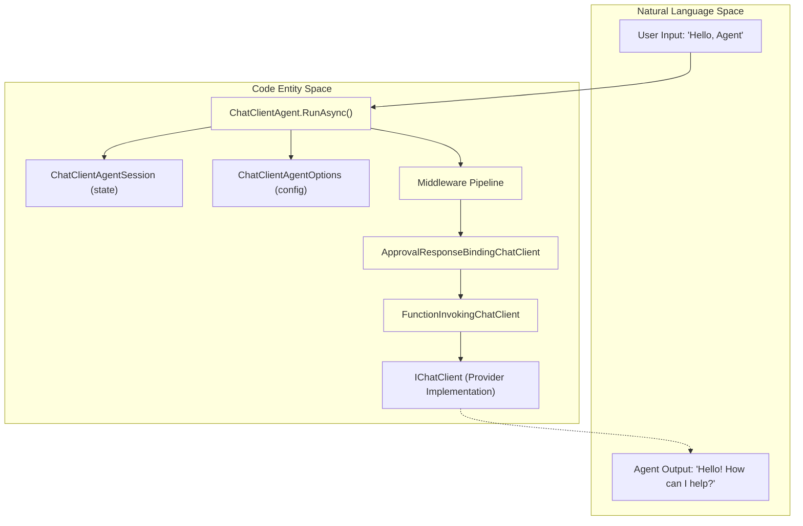

### Execution Flow Explanation

1. **Starting point:** Your application calls `ChatClientAgent.RunAsync()` with a set of input messages (e.g., user prompts).

2. **Session Handling:** `ChatClientAgentSession` maintains conversation state including conversation IDs and chat history references.

3. **Options Application:** `ChatClientAgentOptions` configures instructions, tools, history providers, and concurrency behaviors.

4. **Middleware Pipeline:** The agent wraps the `IChatClient` with decorators:
   - `ApprovalResponseBindingChatClient` binds model approval requests to user approvals.
   - `FunctionInvokingChatClient` automatically invokes AI functions (tools) as directed by the model.

5. **Base Provider Call:** The leaf `IChatClient` makes calls to the underlying AI service (e.g., OpenAI, Azure OpenAI).

6. **Response Delivery**: The agent returns the model-generated response as `ChatMessage` or text to the caller.

**Sources:**  
[dotnet/src/Microsoft.Agents.AI/ChatClient/ChatClientAgent.cs:39-128](),  
[dotnet/src/Microsoft.Agents.AI/ChatClient/ChatClientExtensions.cs:50-128]()

---

## Core Types and Relationships

Below is a diagram illustrating key core classes and their relationships involved in agent construction and usage:

```mermaid
graph TB
    subgraph "Abstractions"
        AIAgent["AIAgent (abstract base)"]
        AgentSession["AgentSession (abstract)"]
    end
    
    subgraph "Core Implementation"
        ChatClientAgent["ChatClientAgent (concrete agent)"]
        ChatClientAgentOptions["ChatClientAgentOptions (configuration)"]
        ChatClientAgentSession["ChatClientAgentSession (session state)"]
        ChatHistoryProvider["ChatHistoryProvider (chat persistence)"]
        AIContextProvider["AIContextProvider (dynamic context)"]
    end
    
    ChatClientAgent --|> AIAgent
    ChatClientAgentSession --|> AgentSession
    ChatClientAgent --> ChatClientAgentOptions
    ChatClientAgent ..> ChatClientAgentSession : manages
    ChatClientAgentOptions --> ChatHistoryProvider
    ChatClientAgentOptions --> AIContextProvider
```

| Type                     | Role                                      | Key Members / Notes                                           |
|--------------------------|-------------------------------------------|--------------------------------------------------------------|
| `ChatClientAgent`        | Primary agent implementation for LLM interaction | Entry methods: `RunAsync()`, `CreateSessionAsync()`; handles session and middleware wrapping [dotnet/src/Microsoft.Agents.AI/ChatClient/ChatClientAgent.cs:39-130]() |
| `ChatClientAgentOptions` | Configuration container for agent's identity and behavior | Properties for agent Id, Name, Instructions, and ChatHistoryProvider setup [dotnet/src/Microsoft.Agents.AI/ChatClient/ChatClientAgentOptions.cs:18-105]() |
| `ChatClientAgentSession` | Maintains chat session state and conversation id | Holds ongoing chat state and conversation context              |
| `ChatHistoryProvider`    | Interface enabling long-term chat conversation persistence | Supports multiple backend stores for chat history support      |
| `AIContextProvider`      | Provides enriched context dynamically for the agent run | Adds context segments to augment prompts                       |

**Sources:**  
[dotnet/src/Microsoft.Agents.AI/ChatClient/ChatClientAgent.cs:118-130](),  
[dotnet/src/Microsoft.Agents.AI/ChatClient/ChatClientAgentOptions.cs:18-105]()

---

## Multi-Turn Conversations and State Persistence

To maintain conversation context across multiple user turns, reuse the session object returned from calls to `RunAsync`:

```csharp
// Turn 1: start conversation and get session
var response1 = await agent.RunAsync("My name is Alice.");
var session = response1.Session;

// Turn 2: reuse session to continue conversation
var response2 = await agent.RunAsync("What is my name?", session);
Console.WriteLine(response2.Text); // Outputs: "Your name is Alice."
```

### Chat History Persistence

The framework includes support for persistent chat history via implementation of `ChatHistoryProvider` which your agent can configure in `ChatClientAgentOptions`. When no provider is specified, an in-memory provider is used by default.

Additionally, enabling **per-service-call chat history persistence** allows incremental state saving after each API call during function invocation cycles. This is useful for robustness in multi-step workflows. Set the following flag in options:

```csharp
options.RequirePerServiceCallChatHistoryPersistence = true;
```

This activates the `PerServiceCallChatHistoryPersistingChatClient` decorator in the middleware pipeline to manage per-call history storage, update conversation IDs dynamically, and help simulate both framework-managed and service-stored chat histories effectively [dotnet/src/Microsoft.Agents.AI/ChatClient/ChatClientAgentOptions.cs:90-105]().

Developers can also combine history persistence with AI context providers for enriched context injection and sessions with memory integration [dotnet/samples/02-agents/Agents/Agent_Step19_InFunctionLoopCheckpointing/Program.cs:1-24]().

**Sources:**  
[dotnet/src/Microsoft.Agents.AI/ChatClient/ChatClientAgentOptions.cs:90-105](),  
[dotnet/tests/Microsoft.Agents.AI.UnitTests/ChatClient/ChatClientAgentTests.cs:155-160](),  
[dotnet/samples/02-agents/Agents/Agent_Step19_InFunctionLoopCheckpointing/Program.cs:1-24]()

---

## Advanced: Declarative Workflow Support

For complex multi-agent orchestration, the Microsoft Agent Framework supports declarative workflows. These are graph-based, JSON/YAML-defined workflows that can compose multiple agents, define execution sequences, and merge messages. They leverage the PowerFx expression language for dynamic computation.

The package `Microsoft.Agents.AI.Workflows` implements the execution engine providing classes like `Workflow`, `AgentExecutor`, and `MessageMerger` for running and managing these workflows [dotnet/src/Microsoft.Agents.AI.Workflows/MessageMerger.cs:10-170]().

This feature enables the creation of rich conversational flows and multi-agent collaborations with minimal imperative code, focusing instead on declarative descriptors [dotnet/samples/02-agents/Agents/Agent_Step16_Declarative/README.md:1-2]().

**Sources:**  
[dotnet/src/Microsoft.Agents.AI.Workflows/MessageMerger.cs:10-170](),  
[dotnet/samples/02-agents/Agents/Agent_Step16_Declarative/README.md:1-2]()

---

# Summary

The Microsoft Agent Framework for .NET enables you to:

- Easily create AI agents by wrapping `IChatClient` implementations with `ChatClientAgent`.
- Configure agent behavior and tools with `ChatClientAgentOptions`.
- Maintain conversational context across multiple turns using agent sessions.
- Leverage middleware decorating `IChatClient` for automatic function invocation and approvals.
- Leverage chat history persistence and AI context providers for robust conversations.
- Extend the system into advanced multi-agent orchestration with declarative workflows.

This quick start empowers developers to build powerful AI agents integrated with modern LLM providers with simple API calls, supported by a scalable middleware and session management architecture.

---

## Further Reading

- [Architecture at a Glance (1.1)](1.1)  
- [Python Quick Start (2.2)](2.2)  
- [Core Concepts (3)](3)  
- [Workflows and Orchestration (4)](4)  

---

### File Citation Summary

- `ChatClientAgent` construction and options [dotnet/src/Microsoft.Agents.AI/ChatClient/ChatClientAgent.cs:39-116]()
- Middleware pipeline construction [dotnet/src/Microsoft.Agents.AI/ChatClient/ChatClientExtensions.cs:23-128]()
- Agent session and RunAsync tests [dotnet/tests/Microsoft.Agents.AI.UnitTests/ChatClient/ChatClientAgentTests.cs:155-160]()
- Package versions and dependencies [dotnet/Directory.Packages.props:100-101](), [dotnet/nuget/nuget-package.props:4-9]()
- Declarative workflow basics [dotnet/samples/02-agents/Agents/Agent_Step16_Declarative/README.md:1-2](), [dotnet/src/Microsoft.Agents.AI.Workflows/MessageMerger.cs:10-170]()

**Sources:**  
[dotnet/Directory.Packages.props:100-101](),  
[dotnet/nuget/nuget-package.props:1-93](),  
[dotnet/src/Microsoft.Agents.AI/ChatClient/ChatClientAgent.cs:39-116](),  
[dotnet/src/Microsoft.Agents.AI/ChatClient/ChatClientExtensions.cs:22-128](),  
[dotnet/tests/Microsoft.Agents.AI.UnitTests/ChatClient/ChatClientAgentTests.cs:155-160](),  
[dotnet/samples/02-agents/Agents/Agent_Step16_Declarative/README.md:1-2](),  
[dotnet/src/Microsoft.Agents.AI.Workflows/MessageMerger.cs:10-170]()

---

# Page: Python Quick Start

# Python Quick Start

<details>
<summary>Relevant source files</summary>

The following files were used as context for generating this wiki page:

- [python/CHANGELOG.md](python/CHANGELOG.md)
- [python/packages/a2a/pyproject.toml](python/packages/a2a/pyproject.toml)
- [python/packages/ag-ui/pyproject.toml](python/packages/ag-ui/pyproject.toml)
- [python/packages/anthropic/pyproject.toml](python/packages/anthropic/pyproject.toml)
- [python/packages/azure-cosmos-memory/AGENTS.md](python/packages/azure-cosmos-memory/AGENTS.md)
- [python/packages/copilotstudio/pyproject.toml](python/packages/copilotstudio/pyproject.toml)
- [python/packages/core/pyproject.toml](python/packages/core/pyproject.toml)
- [python/packages/devui/pyproject.toml](python/packages/devui/pyproject.toml)
- [python/packages/lab/pyproject.toml](python/packages/lab/pyproject.toml)
- [python/packages/lab/uv.lock](python/packages/lab/uv.lock)
- [python/packages/mem0/pyproject.toml](python/packages/mem0/pyproject.toml)
- [python/packages/postgres/README.md](python/packages/postgres/README.md)
- [python/packages/postgres/pyproject.toml](python/packages/postgres/pyproject.toml)
- [python/packages/purview/pyproject.toml](python/packages/purview/pyproject.toml)
- [python/packages/redis/pyproject.toml](python/packages/redis/pyproject.toml)
- [python/pyproject.toml](python/pyproject.toml)
- [python/samples/01-get-started/01_hello_agent.py](python/samples/01-get-started/01_hello_agent.py)
- [python/samples/01-get-started/02_add_tools.py](python/samples/01-get-started/02_add_tools.py)
- [python/samples/01-get-started/03_multi_turn.py](python/samples/01-get-started/03_multi_turn.py)
- [python/samples/01-get-started/04_memory.py](python/samples/01-get-started/04_memory.py)
- [python/samples/01-get-started/05a_functional_workflow_basics.py](python/samples/01-get-started/05a_functional_workflow_basics.py)
- [python/samples/01-get-started/05b_functional_workflow_with_agents.py](python/samples/01-get-started/05b_functional_workflow_with_agents.py)
- [python/samples/01-get-started/05c_first_graph_workflow.py](python/samples/01-get-started/05c_first_graph_workflow.py)
- [python/samples/01-get-started/06_agent_harness.py](python/samples/01-get-started/06_agent_harness.py)
- [python/samples/01-get-started/README.md](python/samples/01-get-started/README.md)
- [python/samples/README.md](python/samples/README.md)
- [python/uv.lock](python/uv.lock)

</details>


This page provides a step-by-step guide for Python developers to install the Microsoft Agent Framework, configure API credentials, create a simple agent, and execute your first conversation. This covers the essential setup and basic agent patterns to get started quickly.

For more advanced agent concepts including tools, middleware, and workflows, see **Core Concepts (3)**. For hosting and deployment options, see **Python Deployment Options (6.2)**.

---

## Prerequisites

Before installing the framework, ensure you have:

**Required:**
- **Python 3.10 or higher**: Supported versions from 3.10 up to 3.14 as per package metadata.  
- **uv (Recommended)**: The recommended Python dependency and workspace management tool used by the framework installation process for fast, reproducible installs and consistent environment resolution.  
- **An API key** from one of the supported LLM providers:  
  - OpenAI API key  
  - Azure OpenAI endpoint and API key  
  - Anthropic, Mistral, Gemini, or Bedrock credentials  

**Supported Platforms:** Windows, macOS, Linux.  

Sources: [python/pyproject.toml:6-22](), [python/uv.lock:19-21](), [python/pyproject.toml:60-61](), [python/packages/core/pyproject.toml:79-85]()

---

## Installation

The framework is distributed as modular Python packages. You can install the meta-package for full access or install selected core packages as needed.

### Using uv (Recommended)

`uv` is the primary tool used for the Python workspace and dependency management across the monorepo and is recommended for installing the framework.

```bash
# Install the full Microsoft Agent Framework with uv pip.
uv pip install agent-framework
```

This installs the main meta-package `agent-framework` which depends on `agent-framework-core` and all optional packages.

### Using pip

If you prefer standard pip installation, you can install the core package or full meta-package:

```bash
# Core foundational package only
pip install agent-framework-core

# Full Microsoft Agent Framework
pip install agent-framework
```

### Package Architecture

The Python implementation is modular. The critical packages are:

| Package                    | Purpose                                                                                               |
|----------------------------|-----------------------------------------------------------------------------------------------------|
| `agent-framework-core`     | Base abstractions and implementations: agents, chat clients, messages, tools, sessions, middleware.  |
| `agent-framework-openai`   | Integration for OpenAI and Azure OpenAI LLM providers.                                              |
| `agent-framework-anthropic`| Integration with Anthropic API and Claude models.                                                   |
| `agent-framework-orchestrations` | High-level workflow and multi-agent orchestration patterns.                                         |

Sources: [python/packages/core/pyproject.toml:2-66](), [python/pyproject.toml:25-27]()

---

## Code Entity Space: Core Abstractions

This diagram bridges natural language concepts to core Python classes and modules in `agent-framework-core`.

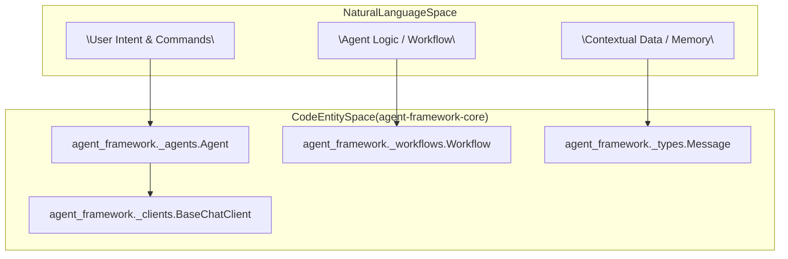

This shows:
- `Agent` as the primary abstraction handling user intents.
- `Workflow` for logic orchestration.
- `Message` representing context and conversation data.
- `BaseChatClient` acts as the client interface to LLM providers.

Sources: [python/packages/core/agent_framework/_agents.py:206-213](), [python/packages/core/agent_framework/_types.py:50-75](), [python/packages/core/agent_framework/_clients.py:27-38]()

---

## API Key Configuration

The framework loads configuration from environment variables, optionally supported by `python-dotenv` to load `.env` files automatically. This allows you to configure keys without hardcoding.

### Configuration Precedence (Example: OpenAI)

1. Constructor explicit parameters: e.g. passing `api_key` in `OpenAIChatClient`.  
2. `OPENAI_API_KEY` environment variable.  
3. Azure-specific environment variables fallback: `AZURE_OPENAI_ENDPOINT` and `AZURE_OPENAI_API_KEY`.  

### Environment Variables Summary

| Provider      | Environment Variable          | Example                            |
|---------------|------------------------------|----------------------------------|
| OpenAI        | `OPENAI_API_KEY`              | `sk-xxx...`                      |
| Azure OpenAI  | `AZURE_OPENAI_ENDPOINT`       | `https://<your-resource>.openai.azure.com` |
| Azure OpenAI  | `AZURE_OPENAI_API_KEY`        | Key for the Azure OpenAI endpoint |
| Anthropic     | `ANTHROPIC_API_KEY`           | `sk-ant-...`                     |

Sources: [python/packages/core/pyproject.toml:29-31](), [python/packages/core/agent_framework/observability.py:16-48](), [python/packages/anthropic/tests/test_anthropic_client.py:85-92]()

---

## Creating Your First Agent

### Basic Agent with OpenAI

You create an `Agent` instance by passing a `ChatClient` implementation (e.g. `OpenAIChatClient`) and instructions to define its behavior.

```python
import asyncio
from agent_framework import Agent
from agent_framework.openai import OpenAIChatClient

async def main():
    # OpenAIChatClient reads OPENAI_API_KEY from env by default
    agent = Agent(
        client=OpenAIChatClient(model="gpt-4o"),
        instructions="You are a helpful assistant."
    )
    
    result = await agent.run("What is the capital of France?")
    print(result.text)

if __name__ == "__main__":
    asyncio.run(main())
```

- `Agent.run()` asynchronously processes the input, calls the underlying chat client, and returns the response.  
- `OpenAIChatClient` acts as a bridge to the OpenAI API using `BaseChatClient` abstractions.  

Sources: [python/packages/core/agent_framework/_agents.py:206-250](), [python/packages/core/agent_framework/_types.py:50-75]()

---

## Interaction Flow: Code to Provider

The following sequence diagram shows the data flow when calling `Agent.run()`:

```mermaid
sequenceDiagram
    participant App as "Application Code"
    participant Agent as "agent_framework._agents.Agent"
    participant Client as "agent_framework._clients.BaseChatClient"
    participant Provider as "LLM Provider (OpenAI/Anthropic/etc)"

    App->>Agent: .run(user_input)
    Agent->>Agent: Create RunContext and prepare messages
    Agent->>Client: .get_response(messages)
    Client->>Provider: Make API call (Messages API)
    Provider-->>Client: API Response JSON
    Client-->>Agent: Parsed ChatResponse
    Agent-->>App: AgentResponse (text, tool results, etc.)
```

- The `Agent` creates an internal run context with session info.  
- `BaseChatClient` defines the protocol to communicate with providers.  
- The provider returns raw JSON; the client translates it into common response objects.  

Sources: [python/packages/core/agent_framework/_agents.py:206-213](), [python/packages/core/agent_framework/_clients.py:27-46](), [python/packages/anthropic/agent_framework_anthropic/_chat_client.py:178-183]()

---

## Adding Tools

Tools extend agent capabilities by exposing callable functions as tools that can be invoked by the agent during conversations.

### Defining a Simple Tool

Use the `@tool` decorator to expose a function. Function arguments use Python type annotations with Pydantic's `Field` for validation and description.

```python
from typing import Annotated
from pydantic import Field
from agent_framework import Agent, tool
from agent_framework.openai import OpenAIChatClient

@tool
def get_weather(
    location: Annotated[str, Field(description="The city name")]
) -> str:
    """Returns the current weather for a location."""
    return f"The weather in {location} is 22°C and sunny."

async def main():
    agent = Agent(
        client=OpenAIChatClient(model="gpt-4o"),
        tools=[get_weather]
    )
    
    response = await agent.run("What's the weather in Seattle?")
    print(response.text)
```

- The agent automatically detects when to invoke the tool based on the conversation context.  
- The tool's schema is generated from the function signature and docstring.  

Sources: [python/packages/core/agent_framework/_tools.py:205-230](), [python/packages/core/agent_framework/_agents.py:114-120]()

---

## Model Context Protocol (MCP) Support

The Agent Framework supports the Model Context Protocol, allowing external tool servers to be integrated as tools via IPC or network transports like stdio or websockets.

### Example: Connecting to MCP Server over stdio

```python
from agent_framework import Agent, MCPStdioTool
from agent_framework.openai import OpenAIChatClient

async def main():
    mcp_tool = MCPStdioTool(
        name="my-mcp-server",
        command="npx",
        args=["-y", "@modelcontextprotocol/server-everything"]
    )
    
    async with mcp_tool:
        agent = Agent(
            client=OpenAIChatClient(model="gpt-4o"),
            tools=mcp_tool.functions
        )
        response = await agent.run("What tools do you have available?")
        print(response.text)
```

- `MCPStdioTool` manages the lifecycle of the MCP server process and exposes functions to the agent.  
- This enables seamless, dynamic discovery and invocation of external tool functions.  

Sources: [python/packages/core/agent_framework/_tools.py:69-76](), [python/packages/core/pyproject.toml:35-42]()

---

## Next Steps

- **Multi-turn Conversations:** Use `AgentSession` to maintain context and memory across multiple `run()` calls.  
- **Workflows:** Use `Workflow` and related executors to create complex multi-agent or multi-step orchestration.  
- **Observability:** Enable OpenTelemetry integration to trace agents, track tokens, and monitor usage.  
- **Agent Skills System:** Extend agents modularly with skills for enhanced capabilities.

Sources: [python/packages/core/agent_framework/_agents.py:37-43](), [python/packages/core/agent_framework/observability.py:10-58](), [python/CHANGELOG.md:15-17]()

---

# Diagram: Natural Language To Code Entity Mapping for Run Flow

```mermaid
graph LR
    subgraph "NaturalLanguageSpace"
        UserText["User sends text"]
        AgentLogic["Agent orchestrates logic"]
        FunctionCall["Functions & Tools"]
        LLMRequest["LLM API Request"]
        LLMResponse["LLM API Response"]
    end

    subgraph "CodeEntitySpace(agent-framework-core)"
        Agent["agent_framework._agents.Agent.run()"]
        RunContext["agent_framework._agents._RunContext"]
        ToolInvoke["agent_framework._tools.ToolInvocation"]
        ChatClient["agent_framework._clients.BaseChatClient.get_response()"]
        ProviderResponse["OpenAI/Anthropic/Azure Response"]
    end

    UserText --> Agent
    Agent --> RunContext
    RunContext --> ChatClient
    ChatClient --> LLMRequest
    LLMRequest --> ProviderResponse
    ProviderResponse --> ChatClient
    ChatClient --> RunContext
    RunContext --> Agent
    Agent --> FunctionCall
```

Sources: [python/packages/core/agent_framework/_agents.py:206-213](), [python/packages/core/agent_framework/_tools.py:139-180](), [python/packages/core/agent_framework/_clients.py:27-46]()

---

# Diagram: Package Installation and Agent Creation Process

```mermaid
flowchart TD
    Install[Install agent-framework with uv]
    PythonEnv["Python 3.10+ environment"]
    Import["Import packages:\nagent_framework, agent_framework.openai"]
    AgentCreation["Create Agent instance\nwith OpenAIChatClient"]
    RunAgent["Call agent.run() with prompt"]
    AsyncLoop["asyncio.run()"]

    Install --> PythonEnv
    PythonEnv --> Import
    Import --> AgentCreation
    AgentCreation --> RunAgent
    RunAgent --> AsyncLoop
```

---

This completes the Python Quick Start guide. Follow this guide to install the framework, define simple agents with tools, and run your first conversations. For deeper concepts, explore Core Concepts (3) and Workflow orchestration (4).

Sources:  
[python/pyproject.toml:1-31](),  
[python/uv.lock:1-25](),  
[python/packages/core/agent_framework/_agents.py:206-250](),  
[python/packages/core/agent_framework/_tools.py:69-76,139-230](),  
[python/packages/core/agent_framework/_clients.py:10-50](),  
[python/packages/core/agent_framework/observability.py:10-50](),  
[python/packages/anthropic/tests/test_anthropic_client.py:85-92]()

---

# Page: Core Concepts

# Core Concepts

<details>
<summary>Relevant source files</summary>

The following files were used as context for generating this wiki page:

- [docs/specs/004-python-function-calling-loop.md](docs/specs/004-python-function-calling-loop.md)
- [python/packages/core/AGENTS.md](python/packages/core/AGENTS.md)
- [python/packages/core/agent_framework/__init__.py](python/packages/core/agent_framework/__init__.py)
- [python/packages/core/agent_framework/__init__.pyi](python/packages/core/agent_framework/__init__.pyi)
- [python/packages/core/agent_framework/_agents.py](python/packages/core/agent_framework/_agents.py)
- [python/packages/core/agent_framework/_clients.py](python/packages/core/agent_framework/_clients.py)
- [python/packages/core/agent_framework/_compaction.py](python/packages/core/agent_framework/_compaction.py)
- [python/packages/core/agent_framework/_harness/_tool_approval.py](python/packages/core/agent_framework/_harness/_tool_approval.py)
- [python/packages/core/agent_framework/_middleware.py](python/packages/core/agent_framework/_middleware.py)
- [python/packages/core/agent_framework/_skills.py](python/packages/core/agent_framework/_skills.py)
- [python/packages/core/agent_framework/_tools.py](python/packages/core/agent_framework/_tools.py)
- [python/packages/core/agent_framework/_types.py](python/packages/core/agent_framework/_types.py)
- [python/packages/core/agent_framework/observability.py](python/packages/core/agent_framework/observability.py)
- [python/packages/core/tests/core/test_agent_hooks.py](python/packages/core/tests/core/test_agent_hooks.py)
- [python/packages/core/tests/core/test_agents.py](python/packages/core/tests/core/test_agents.py)
- [python/packages/core/tests/core/test_clients.py](python/packages/core/tests/core/test_clients.py)
- [python/packages/core/tests/core/test_compaction.py](python/packages/core/tests/core/test_compaction.py)
- [python/packages/core/tests/core/test_function_invocation_logic.py](python/packages/core/tests/core/test_function_invocation_logic.py)
- [python/packages/core/tests/core/test_harness_tool_approval.py](python/packages/core/tests/core/test_harness_tool_approval.py)
- [python/packages/core/tests/core/test_middleware_with_agent.py](python/packages/core/tests/core/test_middleware_with_agent.py)
- [python/packages/core/tests/core/test_middleware_with_chat.py](python/packages/core/tests/core/test_middleware_with_chat.py)
- [python/packages/core/tests/core/test_observability.py](python/packages/core/tests/core/test_observability.py)
- [python/packages/core/tests/core/test_skills.py](python/packages/core/tests/core/test_skills.py)
- [python/packages/core/tests/core/test_tools.py](python/packages/core/tests/core/test_tools.py)
- [python/packages/core/tests/core/test_types.py](python/packages/core/tests/core/test_types.py)
- [python/samples/02-agents/context_providers/cross_session_observer.py](python/samples/02-agents/context_providers/cross_session_observer.py)
- [python/samples/02-agents/observability/README.md](python/samples/02-agents/observability/README.md)
- [python/samples/02-agents/observability/microsoft_opentelemetry_distro.py](python/samples/02-agents/observability/microsoft_opentelemetry_distro.py)
- [python/samples/02-agents/skills/README.md](python/samples/02-agents/skills/README.md)
- [python/samples/02-agents/skills/class_based_skill/README.md](python/samples/02-agents/skills/class_based_skill/README.md)
- [python/samples/02-agents/skills/class_based_skill/class_based_skill.py](python/samples/02-agents/skills/class_based_skill/class_based_skill.py)
- [python/samples/02-agents/skills/code_defined_skill/README.md](python/samples/02-agents/skills/code_defined_skill/README.md)
- [python/samples/02-agents/skills/code_defined_skill/code_defined_skill.py](python/samples/02-agents/skills/code_defined_skill/code_defined_skill.py)
- [python/samples/02-agents/skills/file_based_skill/file_based_skill.py](python/samples/02-agents/skills/file_based_skill/file_based_skill.py)
- [python/samples/02-agents/skills/mixed_skills/README.md](python/samples/02-agents/skills/mixed_skills/README.md)
- [python/samples/02-agents/skills/mixed_skills/mixed_skills.py](python/samples/02-agents/skills/mixed_skills/mixed_skills.py)
- [python/samples/02-agents/skills/script_approval/script_approval.py](python/samples/02-agents/skills/script_approval/script_approval.py)
- [python/samples/02-agents/skills/subprocess_script_runner.py](python/samples/02-agents/skills/subprocess_script_runner.py)

</details>


This document introduces the fundamental abstractions and systems that form the foundation of the Microsoft Agent Framework. These core concepts are consistent across both Python and .NET implementations, providing a unified mental model for building AI agents.

**Scope**: This page provides conceptual overviews and shows how the main components relate to each other. For detailed implementation specifics, see the child pages linked at the bottom of this document.

## Framework Architecture Overview

The Agent Framework is designed with a layered architecture that distinctly separates responsibilities, enhancing modularity and extensibility. At the top, agents coordinate conversations utilizing chat clients that provide access to LLM providers. Supporting systems like tools, memory, and observability enrich interactions and state management. Middleware and cross-cutting concerns operate throughout these layers.

```mermaid
graph TB
    subgraph "Agent Layer"
        AgentProto["SupportsAgentRun / AIAgent<br/>(Interface/Protocol)"]
        ChatAgent["Agent (Python) / ChatClientAgent (.NET)<br/>(Implementation)"]
    end
    
    subgraph "Chat Client Layer"
        ChatClientProto["SupportsChatGetResponse / IChatClient<br/>(Interface/Protocol)"]
        BaseChatClient["BaseChatClient<br/>(Python base)"]
        OpenAIClient["OpenAIChatClient / OpenAIClient Extensions"]
        FoundryClient["FoundryChatClient / AIProjectClient Extensions"]
        AnthropicClient["AnthropicClient / RawAnthropicClient"]
    end
    
    subgraph "Message Layer"
        ChatMessage["Message / ChatMessage<br/>(role, contents)"]
        ChatResponse["ChatResponse<br/>(messages, usage)"]
        ChatResponseUpdate["ChatResponseUpdate<br/>(streaming chunks)"]
        AgentResponse["AgentResponse<br/>(wrapper)"]
    end
    
    subgraph "Tool System"
        ToolProto["ToolTypes / AITool<br/>(Union/Interface)"]
        FunctionTool["FunctionTool / AIFunction<br/>(@tool decorator)"]
        HostedTool["Hosted Tools<br/>(code interpreter, search)"]
        MCPTool["MCPTool / MCPStdioTool<br/>(Model Context Protocol)"]
    end
    
    subgraph "Memory & State"
        AgentSession["AgentSession / ChatClientAgentSession"]
        HistoryProvider["HistoryProvider / ChatHistoryProvider<br/>(conversation history)"]
        ContextProvider["ContextProvider / AIContextProvider<br/>(dynamic context enrichment)"]
    end
    
    subgraph "Cross-Cutting"
        Middleware["Middleware / ChatMiddleware<br/>(agent & function)"]
        Observability["OpenTelemetry<br/>(traces, metrics, logs)"]
    end
    
    ChatAgent --> AgentProto
    ChatAgent --> ChatClientProto
    BaseChatClient --> ChatClientProto
    OpenAIClient --> BaseChatClient
    FoundryClient --> BaseChatClient
    AnthropicClient --> BaseChatClient
    
    ChatAgent --> ChatMessage
    ChatClientProto --> ChatResponse
    ChatClientProto --> ChatResponseUpdate
    ChatAgent --> AgentResponse
    
    ChatAgent --> ToolProto
    FunctionTool --> ToolProto
    HostedTool --> ToolProto
    MCPTool --> ToolProto
    
    ChatAgent --> AgentSession
    AgentSession --> HistoryProvider
    AgentSession --> ContextProvider
    
    ChatAgent --> Middleware
    ChatAgent --> Observability
    ChatClientProto --> Observability
```

**Diagram: Core Framework Components and Layer Relations**

Sources:  
[python/packages/core/agent_framework/_agents.py:20-24]()  
[python/packages/core/agent_framework/_clients.py:85-128]()  
[python/packages/core/agent_framework/_clients.py:217-221]()  
[python/packages/core/agent_framework/_tools.py:26-40]()  
[python/packages/core/agent_framework/_sessions.py:37-44]()  
[dotnet/src/Microsoft.Agents.AI.Abstractions/AIAgent.cs]()  
[dotnet/src/Microsoft.Agents.AI/ChatClient/ChatClientAgent.cs:39-40]()

---

## Agent Abstraction

Agents are the central abstraction representing AI-powered entities that engage in conversations or workflows. They encapsulate the conversation logic, state management, and orchestration of tools and services.

### Python: Agent and `SupportsAgentRun`

In Python, the agent abstraction is expressed via the `SupportsAgentRun` protocol, which defines an interface compliant with an async `run` method to process inputs and produce agent responses [python/packages/core/agent_framework/_agents.py:20-24](). The primary concrete agent is the `Agent` class that delegates LLM interactions to an underlying chat client (a `SupportsChatGetResponse` object) and manages tooling, instructions, and context.

```mermaid
classDiagram
    class SupportsAgentRun {
        <<protocol>>
        +id: str
        +name: str | None
        +description: str | None
        +run(messages, stream=False, session=None, **kwargs) AgentResponse | AsyncIterable[AgentResponseUpdate]
    }
    
    class Agent {
        +client: SupportsChatGetResponse
        +id: str
        +name: str | None
        +instructions: str | None
        +tools: list~ToolTypes~
        +run(messages, stream=False, session=None, **kwargs) AgentResponse | AsyncIterable[AgentResponseUpdate]
        +create_session(session_id, **kwargs) AgentSession
    }
    
    SupportsAgentRun <|.. Agent : implements
```

*Diagram: Python Agent Abstraction - Protocol and implementation*

Sources: [python/packages/core/agent_framework/_agents.py:20-24](), [python/packages/core/agent_framework/_agents.py:27-27]()

### .NET: AIAgent and ChatClientAgent

In .NET, `AIAgent` is the base class defining the essential agent interface, lifecycle, and session concepts [dotnet/src/Microsoft.Agents.AI.Abstractions/AIAgent.cs](). Primary implementations like `ChatClientAgent` delegate LLM interactions via an `IChatClient` interface, integrating middleware layers and managing conversation state [dotnet/src/Microsoft.Agents.AI/ChatClient/ChatClientAgent.cs:39-40](). This abstraction allows uniform handling of diverse chat clients and tooling.

For comprehensive details, see the child page on [Agents and Chat Clients](#3.1).

Sources: [dotnet/src/Microsoft.Agents.AI.Abstractions/AIAgent.cs](), [dotnet/src/Microsoft.Agents.AI/ChatClient/ChatClientAgent.cs:39-40]()

---

## Chat Client Abstraction

Chat clients abstract the language model provider interactions. They define how chat messages are sent, responses are received, and middleware layers are applied.

### Python: SupportsChatGetResponse and BaseChatClient

Python defines a protocol `SupportsChatGetResponse` that standardizes expected methods and type contracts for chat clients [python/packages/core/agent_framework/_clients.py:85-128](). The `BaseChatClient` provides partial base implementations for sharing common functionality across integrations [python/packages/core/agent_framework/_clients.py:217-221]().

Widely used clients like `OpenAIChatClient`, `FoundryChatClient`, and `AnthropicClient` extend `BaseChatClient` and implement provider-specific details [python/packages/anthropic/agent_framework_anthropic/_chat_client.py:76-77]().

```mermaid
graph LR
    subgraph "Chat Client Layer (Python)"
        PyProto["SupportsChatGetResponse[TOptions]"]
        PyBase["BaseChatClient"]
        PyProto --implements--> PyBase
    end
    
    subgraph "Provider Implementations"
        OpenAI["OpenAIChatClient"]
        Foundry["FoundryChatClient"]
        Anthropic["AnthropicClient"]
    end
    
    PyBase --> OpenAI
    PyBase --> Foundry
    PyBase --> Anthropic
```

*Diagram: Chat Client Abstraction and Provider Implementations (Python)*

Sources: [python/packages/core/agent_framework/_clients.py:85-128](), [python/packages/core/agent_framework/_clients.py:217-221](), [python/packages/anthropic/agent_framework_anthropic/_chat_client.py:76-77]()

For more information, see [Agents and Chat Clients](#3.1) and [Provider Integrations](#3.2).

---

## Message and Content Model

The framework employs a unified, extensible content model to represent conversation messages and their multi-part contents. This model supports a variety of content types such as text, data blobs, function calls, and annotations.

- **Message**: Represents a single conversation turn authored by a role (e.g., user, assistant, system, tool). It contains one or more content items [python/packages/core/agent_framework/_types.py:53-75]().

- **Content**: An item within a message, typed to support diverse payloads like plain text, structured data, function calls, or multimedia [python/packages/core/agent_framework/_types.py:81-173]().

| Component | Description                            | Python Entity                          |
|-----------|------------------------------------|-------------------------------------|
| Message   | Represents a conversation turn       | `Message` class                     |
| Content   | Individual content item within a message | `Content` class                     |
| Role      | Author type indicating source/modality | `Literal["user", "assistant", "system", "tool"]` |

This flexible model enables rich, structured interactions beyond simple text, including tool invocation and media handling.

Sources: [python/packages/core/agent_framework/_types.py:53-75](), [python/packages/core/agent_framework/_types.py:81-173]()

---

## Tools and Function Calling

Tools extend agent capabilities by enabling execution of functions, access to external services, or invoking hosted tools.

- **Function Tools**: Local function wrappers defined typically via the `@tool` decorator (Python) or `AIFunction` (C#). They encapsulate callable code with validated input schemas and metadata [python/packages/core/agent_framework/_tools.py:29-41]().

- **Hosted Tools**: Provider-hosted services such as code interpreters, web/file search, or image generation integrated with the framework.

- **Model Context Protocol (MCP)**: A standard enabling dynamic discovery and execution of tools over stdio, HTTP, or WebSocket transport. Represented by the `MCPTool` class [python/packages/core/agent_framework/_tools.py:69-69]().

The function calling lifecycle involves parsing model instructions, invoking local or remote tools, handling approvals, and streaming or aggregating responses.

```mermaid
graph TD
    Agent["Agent / ChatClientAgent"] --> Tools["Tools Collection"]
    Tools --> Local["FunctionTool (@tool decorator)"]
    Tools --> Hosted["Hosted Tools (CodeInterpreter, Search)"]
    Tools --> MCP["MCPTool (Model Context Protocol)"]
    
    subgraph "Execution Flow"
        LLM["LLM issues tool_calls"] --> Invoke["FunctionInvocationContext / Middleware"]
        Invoke --> Execute["Run/Invoke Tool"]
        Execute --> Result["Result Content / Messages"]
    end
```

*Diagram: Tool System and Function Invocation Cycle*

Sources: [python/packages/core/agent_framework/_tools.py:29-41](), [python/packages/core/agent_framework/_middleware.py:31-31]()

See [Tools and Function Calling](#3.3) for a deeper exploration of the tool architecture and approval mechanics.

---

## Memory and Context Management

Maintaining conversation state and context is critical for agent continuity and relevance.

- **AgentSession**: Represents the agent's conversation session state, including persisted data and context identifiers [python/packages/core/agent_framework/_sessions.py:38-38]().
  
- **HistoryProvider**: Abstracts persistence of conversation messages to various backends including memory stores, Redis, Cosmos DB, or Foundry memory services [python/packages/core/agent_framework/_sessions.py:40-40]().

- **ContextProvider**: Injects dynamic or static context data to enrich the conversation prompt or metadata during agent runs [python/packages/core/agent_framework/_sessions.py:39-39]().

These components mitigate statelessness of LLM calls by persisting and dynamically augmenting conversation data transparently to the agent logic.

Sources: [python/packages/core/agent_framework/_sessions.py:37-44](), [python/packages/core/agent_framework/_agents.py:37-44]()

Refer to [Memory and Context Management](#3.4) for implementation details and supported providers.

---

## Observability and Monitoring

The framework integrates OpenTelemetry for comprehensive observability:

- **Tracing**: Tracks agent invocations, chat client calls, and tool executions. Specialized spans are attributed with semantic conventions defined in `OtelAttr` [python/packages/core/agent_framework/observability.py:121-170]().

- **Metrics**: Captures token usage distributions and operation durations with histogram metrics [python/packages/core/agent_framework/observability.py:157-187]().

- **Logging**: Uses a `MessageListTimestampFilter` to increment log timestamps for ordered event logging, crucial for chat message timeline reconstruction [python/packages/core/agent_framework/observability.py:208-217]().

This instrumentation supports performance analysis, usage accounting, and troubleshooting across the agent lifecycle.

Sources: [python/packages/core/agent_framework/observability.py:121-217](), [python/packages/core/tests/core/test_observability.py:33-160]()

More on this is available in [Observability and Monitoring](#3.6).

---

## Middleware System

Middleware layers provide interception points for augmenting or altering agent and chat client behavior without modifying core logic.

- **Agent Middleware**: Used around agent `run` calls to add hooks for pre/post processing, error handling, or enrichment [python/packages/core/agent_framework/_middleware.py:93-138]().

- **Function Middleware**: Wraps tool invocation lifecycles, enabling approval integration, validation, or telemetry instrumentation [python/packages/core/agent_framework/_middleware.py:31-31]().

- **Chat Middleware**: Intercepts raw chat client calls, useful for logging, telemetry, or response transformations [python/packages/core/agent_framework/_middleware.py:262-271]().

Middleware stacks are composable and extendable, supporting cross-layer concerns elegantly.

Sources: [python/packages/core/agent_framework/_middleware.py:31-31](), [python/packages/core/agent_framework/_middleware.py:93-138](), [python/packages/core/agent_framework/_middleware.py:262-271]()

See [Middleware System](#3.7) for usage patterns and customization guidance.

---

## Summary

The Microsoft Agent Framework revolves around these foundational concepts:

| Concept              | Role                                                                                 | Relevant Entities/Python Classes                      |
|----------------------|--------------------------------------------------------------------------------------|-----------------------------------------------------|
| Agent                | Coordinators of conversation, tooling, and state                                    | `Agent`, `SupportsAgentRun`, `AIAgent` (.NET)       |
| Chat Client          | Interface to LLM provider APIs                                                      | `SupportsChatGetResponse`, `BaseChatClient`          |
| Message & Content    | Unified conversation turn and payload model                                        | `Message`, `Content`                                 |
| Tools & Function Call | Mechanisms to extend LLM interaction with external/local code                      | `FunctionTool`, `MCPTool`, `Hosted Tools`            |
| Memory & Context     | Conversation session and dynamic context management                                | `AgentSession`, `HistoryProvider`, `ContextProvider` |
| Observability         | Instrumentation for telemetry and diagnostics                                     | OpenTelemetry integration (`OtelAttr`, layers)       |
| Middleware            | Interception layers for extensibility and cross-cutting functionality              | Agent, Function, and Chat middleware layers           |

Together, these components enable building robust, extendable AI agents and multi-agent workflows.

---

## Child Pages

For more details on specific components, see the following child pages:

- [Agents and Chat Clients](#3.1) — Explain the agent abstraction and chat client architecture that forms the foundation of the framework  
- [Provider Integrations](#3.2) — Overview of AI provider integrations, showing the breadth of supported platforms and integration patterns  
- [Tools and Function Calling](#3.3) — Explain the tool system including function tools, hosted tools, and MCP integration  
- [Memory and Context Management](#3.4) — Overview of session management, context providers, chat history, and memory service integration  
- [Agent-to-Agent Communication (A2A)](#3.5) — Explain the A2A protocol for agent communication, including protocol specifications and implementation details  
- [Observability and Monitoring](#3.6) — Document OpenTelemetry integration, tracing, metrics, Application Insights, and observability configuration  
- [Middleware System](#3.7) — Explain the middleware architecture, ChatMiddleware, FunctionInvocationLayer, ChatTelemetryLayer, and custom middleware creation  
- [Data Governance with Purview](#3.8) — Document Microsoft Purview integration for policy evaluation, content auditing, and data governance in both .NET and Python  
- [CodeAct and Code Execution](#3.9) — Document the CodeAct pattern for LLM-driven code execution, covering Hyperlight (VM-isolated sandbox), LocalCodeAct (.NET local Python execution), and Monty (Rust-based Python interpreter) backends, plus the LocalShellTool for shell command execution  
- [Security and Prompt Injection Defense](#3.10) — Document the FIDES prompt injection defense system, security.py module, content trust levels, and developer guidance for securing agents against adversarial inputs  

---

# Supplementary Diagrams Bridging Natural Language Concepts and Code Entities

### Diagram 1: Agent and Chat Client Natural Language to Python Code Entities

```mermaid
graph LR
    subgraph "Natural Language"
        NLAgent["Agent (AI entity managing conversation)"]
        NLChatClient["Chat Client (Provider API Interface)"]
    end
    
    subgraph "Python Code Entities"
        AgentProto["SupportsAgentRun"]
        AgentClass["Agent"]
        ChatClientProto["SupportsChatGetResponse"]
        BaseChatClientCls["BaseChatClient"]
        OpenAIClientCls["OpenAIChatClient"]
        AnthropicClientCls["AnthropicClient"]
    end
    
    NLAgent --> AgentProto
    AgentProto --> AgentClass
    NLChatClient --> ChatClientProto
    ChatClientProto --> BaseChatClientCls
    BaseChatClientCls --> OpenAIClientCls
    BaseChatClientCls --> AnthropicClientCls
```

Sources: [python/packages/core/agent_framework/_agents.py:20-24](), [python/packages/core/agent_framework/_clients.py:85-128](), [python/packages/anthropic/agent_framework_anthropic/_chat_client.py:76-77]()

---

### Diagram 2: Tools and Function Calling - Natural Language to Code

```mermaid
graph TD
    NLTools["Tools (functions, hosted services, MCP)"]
    NLInvocation["Function Invocation/Approval"]
    NLResult["Tool Result (messages with special content)"]
    
    ToolUnion["ToolTypes (Union)"]
    FunctionToolClass["FunctionTool (@tool)"]
    MCPToolClass["MCPTool"]
    
    FunctionInvocationCtx["FunctionInvocationContext (middleware)"]
    MiddlewareFlow["Middleware System"]
    
    NLTools --> ToolUnion
    ToolUnion --> FunctionToolClass
    ToolUnion --> MCPToolClass
    
    NLInvocation --> FunctionInvocationCtx
    FunctionInvocationCtx --> MiddlewareFlow
    MiddlewareFlow --> FunctionToolClass
    MiddlewareFlow --> MCPToolClass
    
    NLResult --> ToolUnion
```

Sources: [python/packages/core/agent_framework/_tools.py:26-40](), [python/packages/core/agent_framework/_middleware.py:31-31]()

---

This completes the overview of core framework concepts in Microsoft Agent Framework. For implementation specifics, usage, and detailed design, users should explore the respective child pages referenced above.

---

# Page: Agents and Chat Clients

# Agents and Chat Clients

<details>
<summary>Relevant source files</summary>

The following files were used as context for generating this wiki page:

- [docs/decisions/0022-chat-history-persistence-consistency.md](docs/decisions/0022-chat-history-persistence-consistency.md)
- [docs/specs/004-python-function-calling-loop.md](docs/specs/004-python-function-calling-loop.md)
- [dotnet/samples/02-agents/Agents/Agent_Step19_InFunctionLoopCheckpointing/Program.cs](dotnet/samples/02-agents/Agents/Agent_Step19_InFunctionLoopCheckpointing/Program.cs)
- [dotnet/samples/02-agents/Agents/Agent_Step19_InFunctionLoopCheckpointing/README.md](dotnet/samples/02-agents/Agents/Agent_Step19_InFunctionLoopCheckpointing/README.md)
- [dotnet/src/Microsoft.Agents.AI.Abstractions/AdditionalPropertiesExtensions.cs](dotnet/src/Microsoft.Agents.AI.Abstractions/AdditionalPropertiesExtensions.cs)
- [dotnet/src/Microsoft.Agents.AI/ChatClient/ChatClientAgent.cs](dotnet/src/Microsoft.Agents.AI/ChatClient/ChatClientAgent.cs)
- [dotnet/src/Microsoft.Agents.AI/ChatClient/ChatClientAgentContinuationToken.cs](dotnet/src/Microsoft.Agents.AI/ChatClient/ChatClientAgentContinuationToken.cs)
- [dotnet/src/Microsoft.Agents.AI/ChatClient/ChatClientAgentLogMessages.cs](dotnet/src/Microsoft.Agents.AI/ChatClient/ChatClientAgentLogMessages.cs)
- [dotnet/src/Microsoft.Agents.AI/ChatClient/ChatClientAgentOptions.cs](dotnet/src/Microsoft.Agents.AI/ChatClient/ChatClientAgentOptions.cs)
- [dotnet/src/Microsoft.Agents.AI/ChatClient/ChatClientBuilderExtensions.cs](dotnet/src/Microsoft.Agents.AI/ChatClient/ChatClientBuilderExtensions.cs)
- [dotnet/src/Microsoft.Agents.AI/ChatClient/ChatClientExtensions.cs](dotnet/src/Microsoft.Agents.AI/ChatClient/ChatClientExtensions.cs)
- [dotnet/tests/Microsoft.Agents.AI.Abstractions.UnitTests/AdditionalPropertiesExtensionsTests.cs](dotnet/tests/Microsoft.Agents.AI.Abstractions.UnitTests/AdditionalPropertiesExtensionsTests.cs)
- [dotnet/tests/Microsoft.Agents.AI.UnitTests/ChatClient/ChatClientAgentContinuationTokenTests.cs](dotnet/tests/Microsoft.Agents.AI.UnitTests/ChatClient/ChatClientAgentContinuationTokenTests.cs)
- [dotnet/tests/Microsoft.Agents.AI.UnitTests/ChatClient/ChatClientAgentOptionsTests.cs](dotnet/tests/Microsoft.Agents.AI.UnitTests/ChatClient/ChatClientAgentOptionsTests.cs)
- [dotnet/tests/Microsoft.Agents.AI.UnitTests/ChatClient/ChatClientAgentTestHelper.cs](dotnet/tests/Microsoft.Agents.AI.UnitTests/ChatClient/ChatClientAgentTestHelper.cs)
- [dotnet/tests/Microsoft.Agents.AI.UnitTests/ChatClient/ChatClientAgentTests.cs](dotnet/tests/Microsoft.Agents.AI.UnitTests/ChatClient/ChatClientAgentTests.cs)
- [dotnet/tests/Microsoft.Agents.AI.UnitTests/ChatClient/ChatClientAgent_ApprovalsTests.cs](dotnet/tests/Microsoft.Agents.AI.UnitTests/ChatClient/ChatClientAgent_ApprovalsTests.cs)
- [dotnet/tests/Microsoft.Agents.AI.UnitTests/ChatClient/ChatClientAgent_BackgroundResponsesTests.cs](dotnet/tests/Microsoft.Agents.AI.UnitTests/ChatClient/ChatClientAgent_BackgroundResponsesTests.cs)
- [dotnet/tests/Microsoft.Agents.AI.UnitTests/ChatClient/ChatClientAgent_ChatHistoryManagementTests.cs](dotnet/tests/Microsoft.Agents.AI.UnitTests/ChatClient/ChatClientAgent_ChatHistoryManagementTests.cs)
- [dotnet/tests/Microsoft.Agents.AI.UnitTests/ChatClient/ChatClientAgent_ChatOptionsMergingTests.cs](dotnet/tests/Microsoft.Agents.AI.UnitTests/ChatClient/ChatClientAgent_ChatOptionsMergingTests.cs)
- [dotnet/tests/Microsoft.Agents.AI.UnitTests/ChatClient/ChatClientBuilderExtensionsTests.cs](dotnet/tests/Microsoft.Agents.AI.UnitTests/ChatClient/ChatClientBuilderExtensionsTests.cs)
- [dotnet/tests/Microsoft.Agents.AI.UnitTests/ChatClient/ChatClientExtensionsTests.cs](dotnet/tests/Microsoft.Agents.AI.UnitTests/ChatClient/ChatClientExtensionsTests.cs)
- [python/packages/core/agent_framework/_agents.py](python/packages/core/agent_framework/_agents.py)
- [python/packages/core/agent_framework/_clients.py](python/packages/core/agent_framework/_clients.py)
- [python/packages/core/agent_framework/_compaction.py](python/packages/core/agent_framework/_compaction.py)
- [python/packages/core/agent_framework/_harness/_tool_approval.py](python/packages/core/agent_framework/_harness/_tool_approval.py)
- [python/packages/core/agent_framework/_middleware.py](python/packages/core/agent_framework/_middleware.py)
- [python/packages/core/agent_framework/_tools.py](python/packages/core/agent_framework/_tools.py)
- [python/packages/core/agent_framework/_types.py](python/packages/core/agent_framework/_types.py)
- [python/packages/core/agent_framework/observability.py](python/packages/core/agent_framework/observability.py)
- [python/packages/core/tests/core/test_agent_hooks.py](python/packages/core/tests/core/test_agent_hooks.py)
- [python/packages/core/tests/core/test_agents.py](python/packages/core/tests/core/test_agents.py)
- [python/packages/core/tests/core/test_clients.py](python/packages/core/tests/core/test_clients.py)
- [python/packages/core/tests/core/test_compaction.py](python/packages/core/tests/core/test_compaction.py)
- [python/packages/core/tests/core/test_function_invocation_logic.py](python/packages/core/tests/core/test_function_invocation_logic.py)
- [python/packages/core/tests/core/test_harness_tool_approval.py](python/packages/core/tests/core/test_harness_tool_approval.py)
- [python/packages/core/tests/core/test_middleware_with_agent.py](python/packages/core/tests/core/test_middleware_with_agent.py)
- [python/packages/core/tests/core/test_middleware_with_chat.py](python/packages/core/tests/core/test_middleware_with_chat.py)
- [python/packages/core/tests/core/test_observability.py](python/packages/core/tests/core/test_observability.py)
- [python/packages/core/tests/core/test_tools.py](python/packages/core/tests/core/test_tools.py)
- [python/packages/core/tests/core/test_types.py](python/packages/core/tests/core/test_types.py)
- [python/samples/02-agents/context_providers/cross_session_observer.py](python/samples/02-agents/context_providers/cross_session_observer.py)
- [python/samples/02-agents/observability/README.md](python/samples/02-agents/observability/README.md)
- [python/samples/02-agents/observability/microsoft_opentelemetry_distro.py](python/samples/02-agents/observability/microsoft_opentelemetry_distro.py)

</details>


## Purpose and Scope

This page provides a comprehensive overview of the Agent Framework's two foundational abstractions: **Agents** and **Chat Clients**. Agents orchestrate AI-powered conversations, managing session state, context, and tools; Chat Clients provide the interface to Large Language Model (LLM) services, handling request formatting, response parsing, and provider-specific adaptations. Together, these abstractions enable building conversational AI applications that interoperate with multiple LLM providers through a unified interface.

This page covers the architecture, relationships, and interaction patterns between agents and chat clients. Detailed technical information resides in child pages focusing on:
- Agent lifecycle and protocol: [Agent Abstraction](#3.1.1)  
- Chat client implementation details: [Chat Client Architecture](#3.1.2)  
- Message and content typing: [Message Types and Content](#3.1.3)  
- Streaming and response handling: [Response Processing and Streaming](#3.1.4)  
- Tool integration and invocation: [Tools and Function Calling](#3.3)  
- Session and state management: [Memory and Context Management](#3.4)  

---

## Conceptual Architecture

### The Two-Layer Model: Agent Layer and Chat Client Layer

The Agent Framework uses a **two-layer architecture** to separate AI conversation orchestration from LLM communication:

- The **Agent Layer** handles conversation flow control, session and state management, history, context enrichment, tool coordination, and message normalization.
- The **Chat Client Layer** acts as the interface adapter for LLM service providers, managing request preparation, middleware pipelines, response parsing, and provider-specific transformations.

This separation ensures modularity, extensibility, and provider-agnostic agent development.

```mermaid
graph TB
    User["User Application"]
    
    subgraph AgentLayer["Agent Layer (Orchestration)"]
        Agent["Agent<br/>- Session Management<br/>- Context Providers<br/>- Tool Coordination<br/>- Message Normalization"]
    end
    
    subgraph ChatClientLayer["Chat Client Layer (LLM Communication)"]
        ChatClient["Chat Client<br/>- Request Preparation<br/>- Response Parsing<br/>- Middleware Pipeline<br/>- Provider-Specific Translation"]
    end
    
    subgraph LLMProviders["LLM Service Providers"]
        OpenAI["OpenAI<br/>Chat, Responses, Assistants"]
        Azure["Azure OpenAI<br/>Azure AI Agents"]
        Anthropic["Anthropic (Claude)"]
        Others["Ollama, Bedrock,<br/>Google, and more"]
    end
    
    User -->|"run(messages)"| Agent
    Agent -->|"get_response(messages, options)"| ChatClient
    ChatClient -->|HTTP/SDK Calls| LLMProviders
    LLMProviders -->|"ChatResponse"| ChatClient
    ChatClient -->|"ChatResponse"| Agent
    Agent -->|"AgentResponse"| User
    
    Agent -.->|uses| SessionMgmt["Session Management<br/>Context Providers<br/>History Providers"]
    ChatClient -.->|uses| Middleware["Middleware<br/>Function Invocation<br/>Telemetry"]
```

**Sources:**  
[python/packages/core/agent_framework/_agents.py:545-1001](),  
[dotnet/src/Microsoft.Agents.AI/ChatClient/ChatClientAgent.cs:39-48]()

---

## Agent Fundamentals

### The Agent Role

An **Agent** is the high-level orchestrator responsible for:

- Managing conversation sessions and state using constructs like `AgentSession` (Python)  
- Employing `ContextProvider` implementations to enrich conversations with memory and contextual data  
- Normalizing incoming messages into standard `Message` objects  
- Delegating the calls to LLMs through an injected Chat Client  
- Producing rich agent responses (`AgentResponse`) that unify text, function calls, structured data, and annotations  

Agents abstract complexity from the application developer by orchestrating tools, applying middleware, tracking usage, and maintaining conversational context.

### Agent Protocol and Implementations

The framework defines a conceptual agent protocol with parallel abstractions in Python and .NET:

```mermaid
graph TB
    subgraph Protocols["Agent Protocol Layer"]
        SupportsAgentRun["SupportsAgentRun (Python Protocol)<br/>- id: str<br/>- name: Optional[str]<br/>- run(messages, stream, session)"]
        AIAgent["AIAgent (.NET Abstract Class)<br/>- Id: string<br/>- Name: string?<br/>+ RunAsync()"]
    end
    
    subgraph BaseClasses["Base Implementation Classes"]
        BaseAgent["BaseAgent (Python)<br/>- manages context_providers<br/>- applies middleware"]
        RawAgent["RawAgent[OptionsCoT] (Python Generic)<br/>- client: SupportsChatGetResponse"]
    end
    
    subgraph ConcreteAgents["Concrete Agent Types"]
        Agent["Agent (Python)<br/>RawAgent + Telemetry + Middleware layers"]
        ChatClientAgent["ChatClientAgent (.NET)<br/>Delegates to IChatClient"]
    end
    
    SupportsAgentRun -.->|"implements"| BaseAgent
    BaseAgent -->|"inherits"| RawAgent
    RawAgent -->|"composed into"| Agent
    
    AIAgent -->|"inherits"| ChatClientAgent
```

Key entities:
- **Python:**  
  `SupportsAgentRun` protocol [python/packages/core/agent_framework/_agents.py:213-234](),  
  `BaseAgent` class [python/packages/core/agent_framework/_agents.py:305-540](),  
  `RawAgent` class [python/packages/core/agent_framework/_agents.py:545-1001]()  
- **.NET:**  
  `AIAgent` abstract base class [dotnet/src/Microsoft.Agents.AI.Abstractions/AIAgent.cs:11-40](),  
  `ChatClientAgent` class that delegates to `IChatClient` [dotnet/src/Microsoft.Agents.AI/ChatClient/ChatClientAgent.cs:39-118]()

**Sources:**  
[python/packages/core/agent_framework/_agents.py:213-1070](),  
[dotnet/src/Microsoft.Agents.AI.Abstractions/AIAgent.cs:11-40](),  
[dotnet/src/Microsoft.Agents.AI/ChatClient/ChatClientAgent.cs:39-118]()

---

## Chat Client Fundamentals

### The Chat Client Role

A **Chat Client** is an adapter that directly communicates with LLM providers. Its responsibilities include:

- Translating framework-agnostic request models into provider-specific API formats  
- Parsing provider responses and normalizing into the framework's unified `ChatResponse` model  
- Implementing middleware for function/tool invocation, telemetry, and request/response lifecycles  
- Providing a consistent interface so agents can operate transparently across LLM providers  

For example, the Python `AnthropicClient` adapts stop sequences and tool invocations to Claude's API [python/packages/anthropic/agent_framework_anthropic/_chat_client.py:179-183](). The .NET side uses the `IChatClient` interface from the Microsoft.Extensions.AI SDK.

### Chat Client Architecture

The Python Chat Client system uses interface protocols and layered middleware to compose capabilities:

- `BaseChatClient` implements the core request/response handling features [python/packages/core/agent_framework/_clients.py:217-362]()  
- Middleware layers add features such as:  
  - `ChatTelemetryLayer` for OpenTelemetry instrumentation [python/packages/core/agent_framework/observability.py:886-1113]()  
  - `FunctionInvocationLayer` for managing tool function call loops and approvals [python/packages/core/agent_framework/_tools.py:1077-1352]()  
  - Additional chat-specific middleware  

Concrete chat clients compose these layers and may implement provider-specific logic.

```mermaid
graph TB
    subgraph ProtocolLayer["Chat Client Protocols"]
        SupportsChatGetResponse["SupportsChatGetResponse (Python Protocol)<br/>+ get_response()"]
        IChatClient["IChatClient (.NET Interface)<br/>Microsoft.Extensions.AI"]
    end
    
    subgraph MiddlewareLayers["Middleware Layers (Python)"]
        ChatMiddleware["ChatMiddlewareLayer"]
        FunctionInvoke["FunctionInvocationLayer"]
        Telemetry["ChatTelemetryLayer"]
    end
    
    subgraph ComposedClients["Concrete Provider Chat Clients"]
        AnthropicClient["AnthropicClient<br/>Composes FunctionInvocationLayer, ChatMiddlewareLayer, ChatTelemetryLayer"]
        OpenAIChat["OpenAIChatClient"]
    end
    
    SupportsChatGetResponse -.->|"implements"| ComposedClients
    MiddlewareLayers -->|"composed into"| ComposedClients
```

Key entities:
- **Python:** `SupportsChatGetResponse` protocol [python/packages/core/agent_framework/_clients.py:85-201]()  
- **.NET:** `IChatClient` interface in Microsoft.Extensions.AI [dotnet/src/Microsoft.Agents.AI/ChatClient/ChatClientAgent.cs:18-18]()  
- **Anthropic:** Python Anthropic client layering in agent_framework_anthropic [python/packages/anthropic/agent_framework_anthropic/_chat_client.py:130-141]()

**Sources:**  
[python/packages/core/agent_framework/_clients.py:85-362](),  
[python/packages/anthropic/agent_framework_anthropic/_chat_client.py:130-141](),  
[dotnet/src/Microsoft.Agents.AI/ChatClient/ChatClientAgent.cs:82-118]()

---

## Agent-Client Interaction Patterns

### Session and History Management

Agents manage conversational state and history via `HistoryProvider` implementations like `InMemoryHistoryProvider` [python/packages/core/agent_framework/_agents.py:40-41](). This abstraction supports different persistence backends and conversation scopes.

On the .NET side, the `ChatClientAgent` allows override of history providers and session options per invocation through `AgentRunOptions` [dotnet/tests/Microsoft.Agents.AI.UnitTests/ChatClient/ChatClientAgentTests.cs:160-160]().

### Tool Invocation and Middleware

The tool invocation lifecycle is primarily managed through middleware layers that intercept agent responses and chat client communications.

- `FunctionInvocationLayer` in Python orchestrates function call loops, user approval workflows, argument serialization, and error recovery [python/packages/core/agent_framework/_tools.py:1077-1352]().  
- The .NET `ChatClientAgent` ensures required tool middleware such as `FunctionInvokingChatClient` is present, inserting it if missing, and manages invocation pipelines and approval flows [dotnet/src/Microsoft.Agents.AI/ChatClient/ChatClientAgent.cs:72-80]().

This middleware-based layering enables flexible extension points, interception, and telemetry.

**Sources:**  
[python/packages/core/agent_framework/_agents.py:738-821](),  
[python/packages/core/agent_framework/_tools.py:1077-1352](),  
[dotnet/src/Microsoft.Agents.AI/ChatClient/ChatClientAgent.cs:72-80]()

---

## Summary

The Microsoft Agent Framework defines a modular two-layer architecture enabling conversational AI development:

- **Agents** are responsible for managing conversation logic, sessions, state, context providers, and tool coordination.  
- **Chat Clients** encapsulate provider-specific communication, executing requests, parsing responses, and running middleware for features such as function invocation and telemetry.

This clear separation fosters multi-provider interoperability, unified observability via OpenTelemetry, and extensible invocation patterns.

For detailed technical information, see the child pages:
- [Agent Abstraction](#3.1.1)  
- [Chat Client Architecture](#3.1.2)  
- [Message Types and Content](#3.1.3)  
- [Response Processing and Streaming](#3.1.4)  

---

**Sources:**  
[python/packages/core/agent_framework/_agents.py:1-1070](),  
[python/packages/core/agent_framework/_clients.py:1-633](),  
[dotnet/src/Microsoft.Agents.AI/ChatClient/ChatClientAgent.cs:1-128]()

---

# Page: Agent Abstraction

# Agent Abstraction

<details>
<summary>Relevant source files</summary>

The following files were used as context for generating this wiki page:

- [docs/specs/004-python-function-calling-loop.md](docs/specs/004-python-function-calling-loop.md)
- [dotnet/src/Microsoft.Agents.AI.Abstractions/AIAgent.cs](dotnet/src/Microsoft.Agents.AI.Abstractions/AIAgent.cs)
- [dotnet/src/Microsoft.Agents.AI.Abstractions/DelegatingAIAgent.cs](dotnet/src/Microsoft.Agents.AI.Abstractions/DelegatingAIAgent.cs)
- [dotnet/src/Microsoft.Agents.AI/ChatClient/DeferredOpenTelemetryChatClient.cs](dotnet/src/Microsoft.Agents.AI/ChatClient/DeferredOpenTelemetryChatClient.cs)
- [dotnet/src/Microsoft.Agents.AI/OpenTelemetryAgent.cs](dotnet/src/Microsoft.Agents.AI/OpenTelemetryAgent.cs)
- [dotnet/src/Microsoft.Agents.AI/OpenTelemetryConsts.cs](dotnet/src/Microsoft.Agents.AI/OpenTelemetryConsts.cs)
- [dotnet/tests/Microsoft.Agents.AI.Abstractions.UnitTests/AIAgentTests.cs](dotnet/tests/Microsoft.Agents.AI.Abstractions.UnitTests/AIAgentTests.cs)
- [dotnet/tests/Microsoft.Agents.AI.Abstractions.UnitTests/DelegatingAIAgentTests.cs](dotnet/tests/Microsoft.Agents.AI.Abstractions.UnitTests/DelegatingAIAgentTests.cs)
- [dotnet/tests/Microsoft.Agents.AI.UnitTests/OpenTelemetryAgentTests.cs](dotnet/tests/Microsoft.Agents.AI.UnitTests/OpenTelemetryAgentTests.cs)
- [python/packages/core/agent_framework/_agents.py](python/packages/core/agent_framework/_agents.py)
- [python/packages/core/agent_framework/_clients.py](python/packages/core/agent_framework/_clients.py)
- [python/packages/core/agent_framework/_compaction.py](python/packages/core/agent_framework/_compaction.py)
- [python/packages/core/agent_framework/_harness/_tool_approval.py](python/packages/core/agent_framework/_harness/_tool_approval.py)
- [python/packages/core/agent_framework/_middleware.py](python/packages/core/agent_framework/_middleware.py)
- [python/packages/core/agent_framework/_tools.py](python/packages/core/agent_framework/_tools.py)
- [python/packages/core/agent_framework/_types.py](python/packages/core/agent_framework/_types.py)
- [python/packages/core/agent_framework/observability.py](python/packages/core/agent_framework/observability.py)
- [python/packages/core/tests/core/test_agent_hooks.py](python/packages/core/tests/core/test_agent_hooks.py)
- [python/packages/core/tests/core/test_agents.py](python/packages/core/tests/core/test_agents.py)
- [python/packages/core/tests/core/test_clients.py](python/packages/core/tests/core/test_clients.py)
- [python/packages/core/tests/core/test_compaction.py](python/packages/core/tests/core/test_compaction.py)
- [python/packages/core/tests/core/test_function_invocation_logic.py](python/packages/core/tests/core/test_function_invocation_logic.py)
- [python/packages/core/tests/core/test_harness_tool_approval.py](python/packages/core/tests/core/test_harness_tool_approval.py)
- [python/packages/core/tests/core/test_middleware_with_agent.py](python/packages/core/tests/core/test_middleware_with_agent.py)
- [python/packages/core/tests/core/test_middleware_with_chat.py](python/packages/core/tests/core/test_middleware_with_chat.py)
- [python/packages/core/tests/core/test_observability.py](python/packages/core/tests/core/test_observability.py)
- [python/packages/core/tests/core/test_tools.py](python/packages/core/tests/core/test_tools.py)
- [python/packages/core/tests/core/test_types.py](python/packages/core/tests/core/test_types.py)
- [python/samples/02-agents/context_providers/cross_session_observer.py](python/samples/02-agents/context_providers/cross_session_observer.py)
- [python/samples/02-agents/observability/README.md](python/samples/02-agents/observability/README.md)
- [python/samples/02-agents/observability/microsoft_opentelemetry_distro.py](python/samples/02-agents/observability/microsoft_opentelemetry_distro.py)

</details>


## Purpose and Scope

This page documents the core agent abstraction foundational to the Microsoft Agent Framework. It details the base classes and protocols representing AI agents, the run lifecycle coordinating message processing and function invocation, session and state management patterns, and the agent-as-interface pattern enabling modular agent compositions.

The information covers both the .NET and Python implementations, showing parallels in design while respecting language idioms. The goal is to provide implementers and users the deep technical understanding needed to extend, compose, and operate agents consistently.

---

## Agent Protocol and Interface Contract

### Python: `SupportsAgentRun` Protocol

In Python, the agent abstraction is defined by the structural protocol `SupportsAgentRun`. This protocol defines the minimal required interface for an agent: an ID, optional name and description, and essential methods for running the agent and creating sessions.

```python
@runtime_checkable
class SupportsAgentRun(Protocol):
    id: str
    name: str | None
    description: str | None

    async def run(
        self,
        messages: Sequence[Message] | Content | str,
        *,
        stream: bool = False,
        session: AgentSession | None = None,
        options: ChatOptions | None = None,
    ) -> AgentResponse | ResponseStream[AgentResponseUpdate, AgentResponse]:
        """Generate a response from the agent."""
        ...

    def create_session(self, **kwargs) -> AgentSession:
        """Create a new conversation session."""
        ...
```

- `run`: The core asynchronous method to generate agent output from messages or content.
- `create_session`: Factory method to create a new conversation session, which scopes state and context.

This protocol-based pattern enables flexibility: agents need not derive from a particular base, allowing duck typing and composition.

**Sources:** [python/packages/core/agent_framework/_agents.py:213-255]()

---

### .NET: `AIAgent` Abstract Class

In .NET, the core agent abstraction is the abstract class `AIAgent`. It exposes asynchronous methods `RunAsync` and `RunStreamingAsync` for obtaining agent responses non-streaming and streaming respectively. Subclasses implement the protected core methods for actual logic.

```mermaid
classDiagram
    class AIAgent {
        <<abstract>>
        +string Id
        +string? Name
        +string? Description
        +Task<AgentResponse> RunAsync(IEnumerable<Message> messages, AgentSession session, ChatOptions options)
        +IAsyncEnumerable<AgentResponseUpdate> RunStreamingAsync(IEnumerable<Message> messages, AgentSession session, ChatOptions options)
    }

    class ChatClientAgent {
        -IChatClient _chatClient
        +Task<AgentResponse> RunCoreAsync(IEnumerable<Message> messages, AgentSession session, ChatOptions options)
        +IAsyncEnumerable<AgentResponseUpdate> RunCoreStreamingAsync(IEnumerable<Message> messages, AgentSession session, ChatOptions options)
    }

    AIAgent <|-- ChatClientAgent
```

- `RunAsync` and `RunStreamingAsync`: public entry points wrapping the core run logic.
- `RunCoreAsync` and `RunCoreStreamingAsync`: protected abstract methods subclasses override.
- `ChatClientAgent`: concrete agent using an `IChatClient` for chat functionality delegation.

This base abstraction defines the essential contract for .NET agents, allowing composition with chat clients, middleware, and tooling layers.

**Sources:** [dotnet/src/Microsoft.Agents.AI.Abstractions/AIAgent.cs:15-150](), [dotnet/src/Microsoft.Agents.AI/ChatClient/ChatClientAgent.cs:39-40]()

---

## Agent Class Hierarchy and Composition (Python)

The Python agent implementation is designed as a layered class hierarchy to provide extensibility, middleware integration, telemetry, and function invocation support.

| Class        | Purpose                            | Key Features                                                                                                    | Location                                      |
|--------------|----------------------------------|----------------------------------------------------------------------------------------------------------------|-----------------------------------------------|
| `BaseAgent`  | Core agent logic                  | Implements serialization, manages context providers, and exposes `as_tool()` to wrap the agent as a function tool. | `_agents.py:328-353`                           |
| `RawAgent`   | Chat client delegating agent      | Wraps a chat client instance, manages tool normalization and options merging, orchestrates run lifecycle.         | `_agents.py:567-603`                           |
| `Agent`      | Fully-featured layered agent      | A type alias combining `RawAgent` with telemetry, function invocation, and chat middleware layers.                | `_agents.py:1143-1173`                         |

This design enables clear separation of concerns, middleware composition, and extensible agent capability augmentation.

**Sources:** [python/packages/core/agent_framework/_agents.py:117-155](), [python/packages/core/agent_framework/_agents.py:328-353](), [python/packages/core/agent_framework/_agents.py:567-603](), [python/packages/core/agent_framework/_agents.py:1143-1173]()

---

## Agent Run Lifecycle

The run lifecycle orchestrates multiple components and hooks to process input messages and produce AI-driven responses. Notable steps in the lifecycle include option merging, context enrichment via providers, running chat clients, handling function/tool invocation, and applying post-processing.

### General Agent Run Flow Sequence

```mermaid
sequenceDiagram
    participant User as "User / Caller"
    participant Agent as "Agent (RawAgent or ChatClientAgent)"
    participant ContextProviders as "AIContextProvider(s)"
    participant ChatClient as "BaseChatClient or IChatClient"
    participant Middleware as "FunctionInvocationLayer & Middleware"

    User->>Agent: run(messages, session, options)
    Note right of Agent: Merge options and prepare _RunContext
    Agent->>ContextProviders: before_run(agent, session, context)
    ContextProviders-->>Agent: enriched context/state
    Agent->>ChatClient: get_response(messages, options)
    ChatClient->>Middleware: invoke tool/function middleware pipeline
    Middleware-->Middleware: detect and execute function calls/tools
    Middleware-->>ChatClient: completed ChatResponse or stream
    ChatClient-->>Agent: ChatResponse or ResponseStream
    Agent->>ContextProviders: after_run(agent, session, context)
    Agent-->>User: AgentResponse or ResponseStream
```

- The lifecycle begins with input messages plus optional session and run options.
- Options are merged carefully including tools and metadata.
- Context providers augment the session and context before invoking the chat client.
- The chat client issues requests to models or remote services, routed through function invocation middleware.
- Middleware intercepts function calls embedded in chat messages, executes them, and injects results.
- The response or streamed updates are returned to the caller.
- Post-run hooks allow context providers to update session or trigger side-effects.

This coordinated sequence ensures extensible, observable, and composable agent execution.

**Sources:** [python/packages/core/agent_framework/_agents.py:899-1057](), [python/packages/core/agent_framework/observability.py:93-112](), [python/packages/core/agent_framework/_tools.py:206-210](), [dotnet/src/Microsoft.Agents.AI/ChatClient/ChatClientAgent.cs:181-220]()

---

## Session and State Management

Agents maintain conversation and context state via `AgentSession` objects, which orchestrate state dictionaries, chat history, and other providers to persist and isolate conversational data across interactions.

### Session State Architecture

```mermaid
graph TD
    subgraph CodeEntitySpace
        AS["AgentSession"]
        SB["state: MutableMapping[str, Any]"]
        CP["ContextProvider state integration"]
        HP["HistoryProvider manages chat history"]
        SSID["ServiceSessionId or external identifiers"]
    end

    AS --> SB
    SB --> CP
    SB --> HP
    AS --> SSID
```

- **AgentSession** encapsulates:
  - A stable `session_id` string for conversation continuity.
  - A mutable state dictionary used by context providers for memory, tool approvals, etc.
  - History management through `HistoryProvider` abstractions for in-memory or external persistence.
  - Optional service session IDs for linking to external systems.

- The session object is passed throughout the run lifecycle to preserve context and state isolation.

**Sources:** [python/packages/core/agent_framework/_sessions.py:226-304](), [python/packages/core/agent_framework/_agents.py:367-443]()

---

## Agent-as-Interface Pattern

A key architectural pattern in the framework is expressing agents as callable tools, enabling:

- Hierarchical agent compositions.
- Modular and reusable AI capabilities.
- Orchestration of multi-agent workflows where agents invoke other agents as tools.

### Transforming an Agent to a Tool

- The agent name is sanitized by replacing invalid characters with underscores.
- The `run()` method of the agent is wrapped into a `FunctionTool` instance.
- This tool exposes the agent logic as a structured function-callable entity.
- Supports invocation from other agents or orchestrators via the function calling system.

### Pattern Diagram Bridging Natural Language and Code Entities

```mermaid
graph LR
    subgraph NaturalLanguageSpace
        User["Human User"]
        Coordinator["Coordinator Agent"]
        Worker["Worker Agent"]
    end

    subgraph CodeEntitySpace
        AgentRun["Agent.run()"]
        FunctionToolObj["FunctionTool instance"]
        AgentAsTool["Agent.as_tool() method"]
    end

    User -->|Interacts| Coordinator
    Coordinator -->|Invokes| FunctionToolObj
    FunctionToolObj -->|Calls| AgentRun
    Worker -.->|Provided to| AgentAsTool
    AgentAsTool --> FunctionToolObj
```

This bridging shows how human user intents flow through a higher-level coordinator agent invoking other agents exposed as function tools.

**Sources:** [python/packages/core/agent_framework/_agents.py:158-192](), [python/packages/core/agent_framework/_agents.py:470-562](), [python/packages/core/agent_framework/_tools.py:206-210]()

---

## Key Functions and Classes Overview

| Entity                 | File Path                                              | Role                                                                                               |
|------------------------|-------------------------------------------------------|--------------------------------------------------------------------------------------------------|
| `Agent`                | `python/packages/core/agent_framework/_agents.py`     | Primary high-level Python agent class combining telemetry, function invocation, and middleware.  |
| `AIAgent`              | `dotnet/src/Microsoft.Agents.AI.Abstractions/AIAgent.cs` | Abstract .NET agent base defining basic run methods for agents.                                   |
| `ChatClientAgent`      | `dotnet/src/Microsoft.Agents.AI/ChatClient/ChatClientAgent.cs` | .NET agent implementation delegating to `IChatClient`.                                           |
| `_RunContext`          | `python/packages/core/agent_framework/_agents.py`     | TypedDict encapsulating state used during a single agent execution.                               |
| `_merge_options`       | `python/packages/core/agent_framework/_agents.py`     | Utility to merge nested agent run options with careful handling of tools and metadata.            |
| `AgentSession`         | `python/packages/core/agent_framework/_sessions.py`   | Container for session-scoped mutable state and conversation history management.                    |
| `Content`              | `python/packages/core/agent_framework/_types.py`      | Unified content model representing text, data, function calls, annotations, media, and errors.    |

---

# Summary

The Agent Abstraction layer defines the fundamental interface and lifecycle for AI agents in the Microsoft Agent Framework. Key characteristics include:

- Minimal agent interface contracts, realized by abstract base classes in .NET (e.g., `AIAgent`) and protocols in Python (e.g., `SupportsAgentRun`).
- A robust run lifecycle coordinating message processing, middleware invocation, tool/function execution, and context enrichment.
- Stateful session management via `AgentSession` to maintain conversation continuity and support memory/context providers.
- The agent-as-interface pattern, enabling any agent to be wrapped as a callable function tool, promoting modularity and composability.
- Parallel design patterns in both .NET and Python implementations with carefully composed middleware layers and telemetry integration.

This design facilitates extensible, modular, and observable AI agents capable of complex multi-agent workflows and real-world applications.

---

# References and Sources

- Python Agent Framework Source: `python/packages/core/agent_framework/_agents.py` [117-207](), [328-353](), [567-603](), [1143-1173]()
- Python Session Management: `python/packages/core/agent_framework/_sessions.py` [226-304]()
- Python Unified Content Model: `python/packages/core/agent_framework/_types.py` [49-73]()
- Python Tools and Function Invocation: `python/packages/core/agent_framework/_tools.py` [206-210]()
- .NET Abstract Agent Base: `dotnet/src/Microsoft.Agents.AI.Abstractions/AIAgent.cs` [15-150]()
- .NET ChatClientAgent Implementation: `dotnet/src/Microsoft.Agents.AI/ChatClient/ChatClientAgent.cs` [39-40]()
- Observability Integration: `python/packages/core/agent_framework/observability.py` [93-112]()

---

# Page: Chat Client Architecture

# Chat Client Architecture

<details>
<summary>Relevant source files</summary>

The following files were used as context for generating this wiki page:

- [docs/decisions/0022-chat-history-persistence-consistency.md](docs/decisions/0022-chat-history-persistence-consistency.md)
- [dotnet/samples/02-agents/Agents/Agent_Step19_InFunctionLoopCheckpointing/Program.cs](dotnet/samples/02-agents/Agents/Agent_Step19_InFunctionLoopCheckpointing/Program.cs)
- [dotnet/samples/02-agents/Agents/Agent_Step19_InFunctionLoopCheckpointing/README.md](dotnet/samples/02-agents/Agents/Agent_Step19_InFunctionLoopCheckpointing/README.md)
- [dotnet/src/Microsoft.Agents.AI.Abstractions/AdditionalPropertiesExtensions.cs](dotnet/src/Microsoft.Agents.AI.Abstractions/AdditionalPropertiesExtensions.cs)
- [dotnet/src/Microsoft.Agents.AI/ChatClient/ChatClientAgent.cs](dotnet/src/Microsoft.Agents.AI/ChatClient/ChatClientAgent.cs)
- [dotnet/src/Microsoft.Agents.AI/ChatClient/ChatClientAgentContinuationToken.cs](dotnet/src/Microsoft.Agents.AI/ChatClient/ChatClientAgentContinuationToken.cs)
- [dotnet/src/Microsoft.Agents.AI/ChatClient/ChatClientAgentLogMessages.cs](dotnet/src/Microsoft.Agents.AI/ChatClient/ChatClientAgentLogMessages.cs)
- [dotnet/src/Microsoft.Agents.AI/ChatClient/ChatClientAgentOptions.cs](dotnet/src/Microsoft.Agents.AI/ChatClient/ChatClientAgentOptions.cs)
- [dotnet/src/Microsoft.Agents.AI/ChatClient/ChatClientBuilderExtensions.cs](dotnet/src/Microsoft.Agents.AI/ChatClient/ChatClientBuilderExtensions.cs)
- [dotnet/src/Microsoft.Agents.AI/ChatClient/ChatClientExtensions.cs](dotnet/src/Microsoft.Agents.AI/ChatClient/ChatClientExtensions.cs)
- [dotnet/tests/Microsoft.Agents.AI.Abstractions.UnitTests/AdditionalPropertiesExtensionsTests.cs](dotnet/tests/Microsoft.Agents.AI.Abstractions.UnitTests/AdditionalPropertiesExtensionsTests.cs)
- [dotnet/tests/Microsoft.Agents.AI.UnitTests/ChatClient/ChatClientAgentContinuationTokenTests.cs](dotnet/tests/Microsoft.Agents.AI.UnitTests/ChatClient/ChatClientAgentContinuationTokenTests.cs)
- [dotnet/tests/Microsoft.Agents.AI.UnitTests/ChatClient/ChatClientAgentOptionsTests.cs](dotnet/tests/Microsoft.Agents.AI.UnitTests/ChatClient/ChatClientAgentOptionsTests.cs)
- [dotnet/tests/Microsoft.Agents.AI.UnitTests/ChatClient/ChatClientAgentTestHelper.cs](dotnet/tests/Microsoft.Agents.AI.UnitTests/ChatClient/ChatClientAgentTestHelper.cs)
- [dotnet/tests/Microsoft.Agents.AI.UnitTests/ChatClient/ChatClientAgentTests.cs](dotnet/tests/Microsoft.Agents.AI.UnitTests/ChatClient/ChatClientAgentTests.cs)
- [dotnet/tests/Microsoft.Agents.AI.UnitTests/ChatClient/ChatClientAgent_ApprovalsTests.cs](dotnet/tests/Microsoft.Agents.AI.UnitTests/ChatClient/ChatClientAgent_ApprovalsTests.cs)
- [dotnet/tests/Microsoft.Agents.AI.UnitTests/ChatClient/ChatClientAgent_BackgroundResponsesTests.cs](dotnet/tests/Microsoft.Agents.AI.UnitTests/ChatClient/ChatClientAgent_BackgroundResponsesTests.cs)
- [dotnet/tests/Microsoft.Agents.AI.UnitTests/ChatClient/ChatClientAgent_ChatHistoryManagementTests.cs](dotnet/tests/Microsoft.Agents.AI.UnitTests/ChatClient/ChatClientAgent_ChatHistoryManagementTests.cs)
- [dotnet/tests/Microsoft.Agents.AI.UnitTests/ChatClient/ChatClientAgent_ChatOptionsMergingTests.cs](dotnet/tests/Microsoft.Agents.AI.UnitTests/ChatClient/ChatClientAgent_ChatOptionsMergingTests.cs)
- [dotnet/tests/Microsoft.Agents.AI.UnitTests/ChatClient/ChatClientBuilderExtensionsTests.cs](dotnet/tests/Microsoft.Agents.AI.UnitTests/ChatClient/ChatClientBuilderExtensionsTests.cs)
- [dotnet/tests/Microsoft.Agents.AI.UnitTests/ChatClient/ChatClientExtensionsTests.cs](dotnet/tests/Microsoft.Agents.AI.UnitTests/ChatClient/ChatClientExtensionsTests.cs)
- [python/packages/core/agent_framework/_feature_stage.py](python/packages/core/agent_framework/_feature_stage.py)
- [python/packages/core/tests/core/test_feature_stage.py](python/packages/core/tests/core/test_feature_stage.py)
- [python/packages/foundry/README.md](python/packages/foundry/README.md)
- [python/packages/foundry/agent_framework_foundry/_agent.py](python/packages/foundry/agent_framework_foundry/_agent.py)
- [python/packages/foundry/agent_framework_foundry/_chat_client.py](python/packages/foundry/agent_framework_foundry/_chat_client.py)
- [python/packages/foundry/tests/foundry/test_foundry_agent.py](python/packages/foundry/tests/foundry/test_foundry_agent.py)
- [python/packages/foundry/tests/foundry/test_foundry_chat_client.py](python/packages/foundry/tests/foundry/test_foundry_chat_client.py)
- [python/packages/openai/agent_framework_openai/_chat_client.py](python/packages/openai/agent_framework_openai/_chat_client.py)
- [python/packages/openai/agent_framework_openai/_chat_completion_client.py](python/packages/openai/agent_framework_openai/_chat_completion_client.py)
- [python/packages/openai/tests/openai/test_openai_chat_client.py](python/packages/openai/tests/openai/test_openai_chat_client.py)
- [python/packages/openai/tests/openai/test_openai_chat_completion_client.py](python/packages/openai/tests/openai/test_openai_chat_completion_client.py)

</details>


## Purpose and Scope

This document explains the chat client architecture that forms the foundation of the Microsoft Agent Framework. Chat clients serve as the abstraction layer between the framework and Large Language Model (LLM) APIs (OpenAI, Anthropic, Azure AI, Bedrock, Gemini, etc.). They handle message formatting, request/response processing, streaming, and provider-specific protocol translation.

The architecture is designed to be highly extensible via a middleware layering pattern, allowing features like tool calling, history persistence, and telemetry to be injected into the communication pipeline without modifying the core provider implementations.

---

## Architecture Overview

The chat client architecture follows a layered pattern where each layer adds specific functionality while maintaining a consistent interface. In .NET, this is built upon the `Microsoft.Extensions.AI` abstractions, while Python uses a protocol-based design.

**Chat Client Component Stack**

```mermaid
flowchart TB
    subgraph "Application Layer"
        Agent[".NET: ChatClientAgent"]
        PyAgent["Python: Agent"]
    end
    
    subgraph "Middleware / Decorator Layers"
        FIC[".NET: FunctionInvokingChatClient"]
        PyFIC["Python: FunctionInvocationLayer"]
        History[".NET: PerServiceCallChatHistoryPersistingChatClient"]
        PyHistory["Python: PerServiceCallHistoryPersistingMiddleware"]
        Telemetry[".NET: OpenTelemetry ChatClient"]
        PyTelemetry["Python: ChatTelemetryLayer"]
    end
    
    subgraph "Base Implementation"
        BaseChatClient["Python: BaseChatClient"]
        IChatClient[".NET: IChatClient"]
    end
    
    subgraph "Protocol/Interface Layer"
        SupportsChatGetResponse["Python: SupportsChatGetResponse"]
        MEAIIChatClient[".NET: Microsoft.Extensions.AI.IChatClient"]
    end
    
    subgraph "Provider Implementations"
        OpenAI["OpenAIChatClient"]
        AzureAI["Azure OpenAI Integration"]
        Anthropic["AnthropicClient"]
        Bedrock["BedrockChatClient"]
    end
    
    Agent --> FIC
    PyAgent --> PyFIC
    FIC --> History
    PyFIC --> PyHistory
    History --> Telemetry
    PyHistory --> PyTelemetry
    Telemetry --> IChatClient
    PyTelemetry --> BaseChatClient
    
    BaseChatClient -.->|"implements"| SupportsChatGetResponse
    IChatClient -.->|"implements"| MEAIIChatClient
    
    OpenAI -.->|"extends"| BaseChatClient
    Anthropic -.->|"extends"| BaseChatClient
    Bedrock -.->|"extends"| BaseChatClient
```

**Sources:**  
- [dotnet/src/Microsoft.Agents.AI/ChatClient/ChatClientAgent.cs:18-37]()  
- [python/packages/core/agent_framework/_clients.py:20-40]()  
- [python/packages/anthropic/agent_framework_anthropic/_chat_client.py:10-32]()  

---

## Chat Client Protocol (Python) and Interface (.NET)

### Python: `SupportsChatGetResponse` Protocol

The `SupportsChatGetResponse` protocol in Python defines the essential interface that all chat clients must implement. It is generic over a type parameter for options to allow provider-specific settings.

The key method:

- `get_response(messages: list[Message], *, options: OptionsT | None = None, stream: bool = False) -> ChatResponse | ResponseStream`  
  Supports both streaming and non-streaming chat completions.

Any class with this method signature can be used as a chat client in the framework, enabling polymorphism based on structural typing.

```mermaid
flowchart LR
    subgraph "Python Chat Client Protocol"
        SupportsChatGetResponse["SupportsChatGetResponse[OptionsT]"]
        SupportsChatGetResponse --> |implements| get_response["get_response(messages, options, stream)"]
    end
    
    Agent["Python Agent"] --> |uses| SupportsChatGetResponse
```

**Sources:**  
- [python/packages/core/agent_framework/_clients.py:20-35]()  
- [python/packages/core/agent_framework/_agents.py:170-180]()  

### .NET: `IChatClient` Interface

In .NET, chat clients implement the standard interface `Microsoft.Extensions.AI.IChatClient`. The class `ChatClientAgent` wraps any such instance, layering additional behaviors like middleware.

Key points:

- `ChatClientAgent` applies default decorators such as `FunctionInvokingChatClient` to handle function/tool invocation lifecycle unless the user opts out.  
- An optional `PerServiceCallChatHistoryPersistingChatClient` decorator persists chat history after each conversation turn.  

This approach allows seamless extensibility while keeping a consistent backing chat client instance.

```mermaid
flowchart LR
    subgraph ".NET Chat Client Interface"
        IChatClient["IChatClient (Microsoft.Extensions.AI)"]
        ChatClientAgent["ChatClientAgent"]
        ChatClientAgent --> |decorates| IChatClient
        ChatClientAgent -.-> |injects| FunctionInvokingChatClient
        ChatClientAgent -.-> |injects| PerServiceCallChatHistoryPersistingChatClient
    end

    Application[".NET Application"] --> ChatClientAgent
```

**Sources:**  
- [dotnet/src/Microsoft.Agents.AI/ChatClient/ChatClientAgent.cs:18-71]()  
- [dotnet/src/Microsoft.Agents.AI/ChatClient/ChatClientAgent.cs:82-130]()  

---

## Base Chat Client Implementation (Python)

`BaseChatClient` is the foundational Python implementation that supports the `SupportsChatGetResponse` protocol. It provides the plumbing for sending chat requests and receiving responses (streaming or non-streaming). Concrete chat clients for various providers extend it.

### Responsibilities

- Implements `get_response` as an async method routing chat requests through middleware layers.
- Defines an internal method `_inner_get_response` for subclasses to override with actual API calls.
- Manages a middleware pipeline as a chain of callables, allowing layered behaviors.
- Handles request/response transformations and error mapping.

### Data Flow in Python BaseChatClient

```mermaid
flowchart TD
    User["Agent/Caller"] --> GR[get_response(messages, options, stream)]
    GR --> MW[_middleware_pipeline (middlewares chain)]
    MW --> IGR[_inner_get_response(messages, options)]
    IGR --> API["Provider API Call (OpenAI, Anthropic, etc.)"]
    
    API --> Response["ChatResponse / ResponseStream"]
    Response --> MW
    MW --> GR
    GR --> User
```

Concrete providers (e.g., `OpenAIChatClient`) override `_inner_get_response` to call their specific APIs after middleware processing.

**Sources:**  
- [python/packages/core/agent_framework/_clients.py:10-40]()  
- [python/packages/openai/agent_framework_openai/_chat_client.py:30-50]()  
- [python/packages/anthropic/agent_framework_anthropic/_chat_client.py:10-30]()  

---

## Middleware and Layering Pattern

The chat client architecture employs middleware layers to enable cross-cutting features without changing core client logic.

### .NET Middleware Layers

Middleware layers are implemented by wrapping `IChatClient` implementations within decorator classes:

- **FunctionInvokingChatClient**: Manages function/tool invocation loops, handling approval, execution, and response chaining.  
- **PerServiceCallChatHistoryPersistingChatClient**: Persists and reloads chat history at each service call during the agent run.  
- **Telemetry Layers**: Wrap clients to instrument OpenTelemetry tracing and metrics.

These layers compose into a call chain so that requests flow down through layers to the raw client and responses flow back up.

### Python Middleware Layers

Python implements middleware as classes conforming to interfaces such as `ChatMiddlewareLayer` and `FunctionInvocationLayer`. Middleware intercepts the chat interaction lifecycle and can inject or modify messages, responses, or function calls.

| Layer Type              | Role / Description                                                                              |
|-------------------------|------------------------------------------------------------------------------------------------|
| **ChatTelemetryLayer**   | Adds OpenTelemetry tracing and metrics to chat calls.                                          |
| **FunctionInvocationLayer** | Handles lifecycle of function/tool invocation, including approvals and streaming results.   |
| **ChatMiddlewareLayer**  | Base abstraction for chat middleware that can modify messages or responses in the pipeline.    |

Middleware pipelines are constructed in a specific order to ensure correct interaction between features and allow injection or override.

```mermaid
flowchart LR
    ChatRequest --> Middleware1 --> Middleware2 --> ... --> BaseChatClient._inner_get_response
    BaseChatClient._inner_get_response --> ProviderAPI
    ProviderAPI --> Middleware2 --> Middleware1 --> ChatResponse
```

This pattern enables extensibility and clean separation of concerns.

**Sources:**  
- [python/packages/core/agent_framework/_middleware.py:10-60]()  
- [python/packages/core/agent_framework/observability.py:50-110]()  
- [dotnet/src/Microsoft.Agents.AI/ChatClient/ChatClientAgent.cs:80-130]()  

---

## Configuration and Options

### `ChatClientAgentOptions` (.NET)

The `ChatClientAgentOptions` class configures the chat client agent's behavior:

- **Id, Name, Description**: Metadata for the agent instance.  
- **ChatOptions**: Default chat options including instructions and tools.  
- **ChatHistoryProvider**: Specifies the provider for chat history persistence.  
- **AIContextProviders**: Providers to inject dynamic context into agent runs.  
- **UseProvidedChatClientAsIs**: Whether to skip default middleware decoration on the provided chat client.  
- **AllowConcurrentInvocation**: Allows concurrent execution of multiple function calls in a single LLM response.  
- **ClearOnChatHistoryProviderConflict**, **WarnOnChatHistoryProviderConflict**, **ThrowOnChatHistoryProviderConflict**: Policies when the AI service manages chat history conflicting with configured providers.  
- **PersistChatHistoryPerCall**: Enables persisting chat history after every individual service call during function invocation loops.

These options enable fine control over the agent’s chat client configuration and lifecycle.

### Python Options Merging

In Python, merging chat options follows a layered approach via a `_merge_options` function:

- **Instructions**: Concatenated preserving leading/trailing newline for structured prompts.  
- **Tools**: Combined with duplicates removed by tool name.  
- **Logit Bias, Metadata**: Merged dictionaries with override precedence.  
- **Other fields**: Overridden unless `None`.

This ensures that default options provided to an agent can be merged sensibly with per-run overrides.

**Sources:**  
- [dotnet/src/Microsoft.Agents.AI/ChatClient/ChatClientAgentOptions.cs:10-105]()  
- [dotnet/src/Microsoft.Agents.AI/ChatClient/ChatClientAgent.cs:115-130]()  
- [python/packages/core/agent_framework/_agents.py:120-165]()  
- [python/packages/anthropic/agent_framework_anthropic/_chat_client.py:185-194]()  

---

## Summary

The Chat Client Architecture in Microsoft Agent Framework provides a robust, layered abstraction over multiple AI providers, enabling consistent, extensible, and maintainable integration. It uses clean separation via protocols (Python) or interfaces (C#), supported by middleware layers to inject features like function invocation, history persistence, and telemetry. This design empowers developers to build advanced conversational AI agents with flexibility and observability across language boundaries.

---

**Sources:**  
- [dotnet/src/Microsoft.Agents.AI/ChatClient/ChatClientAgent.cs:1-130]()  
- [dotnet/src/Microsoft.Agents.AI/ChatClient/ChatClientAgentOptions.cs:10-105]()  
- [python/packages/core/agent_framework/_clients.py:1-40]()  
- [python/packages/core/agent_framework/_agents.py:110-179]()  
- [python/packages/core/agent_framework/_middleware.py:1-80]()  
- [python/packages/anthropic/agent_framework_anthropic/_chat_client.py:1-180]()  
- [python/packages/core/agent_framework/observability.py:1-217]()

---

# Page: Message Types and Content

# Message Types and Content

<details>
<summary>Relevant source files</summary>

The following files were used as context for generating this wiki page:

- [docs/specs/004-python-function-calling-loop.md](docs/specs/004-python-function-calling-loop.md)
- [python/packages/core/agent_framework/_agents.py](python/packages/core/agent_framework/_agents.py)
- [python/packages/core/agent_framework/_clients.py](python/packages/core/agent_framework/_clients.py)
- [python/packages/core/agent_framework/_compaction.py](python/packages/core/agent_framework/_compaction.py)
- [python/packages/core/agent_framework/_harness/_tool_approval.py](python/packages/core/agent_framework/_harness/_tool_approval.py)
- [python/packages/core/agent_framework/_middleware.py](python/packages/core/agent_framework/_middleware.py)
- [python/packages/core/agent_framework/_serialization.py](python/packages/core/agent_framework/_serialization.py)
- [python/packages/core/agent_framework/_tools.py](python/packages/core/agent_framework/_tools.py)
- [python/packages/core/agent_framework/_types.py](python/packages/core/agent_framework/_types.py)
- [python/packages/core/agent_framework/observability.py](python/packages/core/agent_framework/observability.py)
- [python/packages/core/tests/core/test_agent_hooks.py](python/packages/core/tests/core/test_agent_hooks.py)
- [python/packages/core/tests/core/test_agents.py](python/packages/core/tests/core/test_agents.py)
- [python/packages/core/tests/core/test_clients.py](python/packages/core/tests/core/test_clients.py)
- [python/packages/core/tests/core/test_compaction.py](python/packages/core/tests/core/test_compaction.py)
- [python/packages/core/tests/core/test_function_invocation_logic.py](python/packages/core/tests/core/test_function_invocation_logic.py)
- [python/packages/core/tests/core/test_harness_tool_approval.py](python/packages/core/tests/core/test_harness_tool_approval.py)
- [python/packages/core/tests/core/test_middleware_with_agent.py](python/packages/core/tests/core/test_middleware_with_agent.py)
- [python/packages/core/tests/core/test_middleware_with_chat.py](python/packages/core/tests/core/test_middleware_with_chat.py)
- [python/packages/core/tests/core/test_observability.py](python/packages/core/tests/core/test_observability.py)
- [python/packages/core/tests/core/test_serializable_mixin.py](python/packages/core/tests/core/test_serializable_mixin.py)
- [python/packages/core/tests/core/test_tools.py](python/packages/core/tests/core/test_tools.py)
- [python/packages/core/tests/core/test_types.py](python/packages/core/tests/core/test_types.py)
- [python/samples/02-agents/context_providers/cross_session_observer.py](python/samples/02-agents/context_providers/cross_session_observer.py)
- [python/samples/02-agents/observability/README.md](python/samples/02-agents/observability/README.md)
- [python/samples/02-agents/observability/microsoft_opentelemetry_distro.py](python/samples/02-agents/observability/microsoft_opentelemetry_distro.py)

</details>


This page documents the message and content type system in the Agent Framework. It covers the `Message` and `Content` classes, content type variants, factory methods for content creation, annotations, and serialization patterns. This is the foundational type system used throughout the framework for representing communication between users, agents, LLMs, and tools.

For information about how messages flow through chat clients and middleware, see [Chat Client Architecture](3.1.2). For information about streaming responses and content updates, see [Response Processing and Streaming](3.1.4).

---

## Message Structure

The `Message` class represents a single message in a conversation. Each message has a role and one or more content items encapsulated as a list of `Content` objects. It also provides convenience properties such as aggregated `text` content and supports serialization/deserialization [python/packages/core/agent_framework/_types.py:681-904]().

### Message and Content Class Relationship

```mermaid
classDiagram
    class Message {
        +Role role
        +list~Content~ contents
        +str text
        +dict additional_properties
        +Any raw_representation
        +from_dict()
        +to_dict()
    }

    class Role {
        <<enumeration>>
        system
        user
        assistant
        tool
    }

    class Content {
        +ContentType type
        +str text
        +str uri
        +str media_type
        +dict additional_properties
        +Any raw_representation
    }

    Message "1" --> "*" Content : "contains"
    Message --> Role : "has"
```

Sources: [python/packages/core/agent_framework/_types.py:681-904]()

The `Message` type supports several construction patterns allowing simple to complex message representation:

| Pattern        | Example                                 | Description                                           |
|----------------|-----------------------------------------|-------------------------------------------------------|
| Text string    | `Message("user", "Hello")`               | Creates a single text content automatically           |
| Role + text    | `Message(role="user", text="Hello")`     | Explicit role and text                                 |
| Role + contents| `Message(role="assistant", contents=[...])` | Explicit multiple content items                        |
| Content list   | `Message("user", [Content.from_text(...), ...])` | Flexible mixed content types                         |

The `text` property concatenates all text from the content items joined by newlines for convenience [python/packages/core/agent_framework/_types.py:773-780]().

Sources: [python/packages/core/agent_framework/_types.py:681-904]()

---

## Content Type System Overview

The framework uses a unified `Content` class with a discriminated union type system. All content, regardless of source or role, is represented with the same `Content` data model.

### Unified Content Model Variants

```mermaid
graph TB
    Content["Content<br/>(Unified Type)"]

    subgraph "Text_Content"
        Text["text"]
        TextReasoning["text_reasoning"]
    end

    subgraph "Media_Content"
        Data["data<br/>(embedded binary)"]
        URI["uri<br/>(reference)"]
    end

    subgraph "Function_Content"
        FunctionCall["function_call"]
        FunctionResult["function_result"]
        FunctionApprovalReq["function_approval_request"]
        FunctionApprovalResp["function_approval_response"]
    end

    subgraph "Hosted_Content"
        HostedFile["hosted_file"]
        HostedVector["hosted_vector_store"]
    end

    subgraph "Tool_Results"
        CodeInterpreterCall["code_interpreter_tool_call"]
        CodeInterpreterResult["code_interpreter_tool_result"]
        ImageGenCall["image_generation_tool_call"]
        ImageGenResult["image_generation_tool_result"]
        MCPCall["mcp_server_tool_call"]
        MCPResult["mcp_server_tool_result"]
    end

    subgraph "Other"
        Error["error"]
        Usage["usage"]
    end

    Content --> Text
    Content --> TextReasoning
    Content --> Data
    Content --> URI
    Content --> FunctionCall
    Content --> FunctionResult
    Content --> FunctionApprovalReq
    Content --> FunctionApprovalResp
    Content --> HostedFile
    Content --> HostedVector
    Content --> CodeInterpreterCall
    Content --> CodeInterpreterResult
    Content --> ImageGenCall
    Content --> ImageGenResult
    Content --> MCPCall
    Content --> MCPResult
    Content --> Error
    Content --> Usage
```

Sources: [python/packages/core/agent_framework/_types.py:315-334](), [python/packages/core/agent_framework/_types.py:906-1198]()

The allowed content types are enumerated in the `ContentType` literal [python/packages/core/agent_framework/_types.py:315-334]().

| Content Type            | Purpose                              | Key Attributes/Fields                                     |
|------------------------|------------------------------------|-----------------------------------------------------------|
| `text`                 | Plain textual messages             | `text` string                                             |
| `text_reasoning`       | Chain-of-thought / reasoning text | `text`, `annotations`                                     |
| `data`                 | Embedded binary data               | `uri` (data URI with base64), `media_type`               |
| `uri`                  | External resource references       | `uri`, `media_type`                                       |
| `function_call`        | Request to invoke a function/tool  | `call_id`, `name`, `arguments` (JSON str)                |
| `function_result`      | Result from function execution     | `call_id`, `result` (str or Content list), `exception`   |
| `function_approval_request` | Tool invocation approval request | `id`, `function_call` (Content), additional metadata      |
| `function_approval_response` | Approval response (approved/rejected) | `id`, `approved`, `reason`, `function_call`             |
| `hosted_file`          | Provider-hosted file reference     | `file_id`                                                |
| `hosted_vector_store`  | Provider-hosted vector store       | `vector_store_id`                                        |
| `code_interpreter_tool_call` | Code interpreter tool call      | ---                                                     |
| `code_interpreter_tool_result` | Code interpreter result        | ---                                                     |
| `image_generation_tool_call` | Image generation tool call      | ---                                                     |
| `image_generation_tool_result` | Image generation result        | ---                                                     |
| `mcp_server_tool_call` | MCP protocol tool call             | ---                                                     |
| `mcp_server_tool_result` | MCP protocol tool result           | ---                                                     |
| `error`                 | Error messages or exceptions       | `text`, `exception`                                      |
| `usage`                 | Token usage statistics              | Structured usage detail object                           |

Sources: [python/packages/core/agent_framework/_types.py:315-334](), [python/packages/core/agent_framework/_types.py:906-1198]()

---

## Text and Reasoning Content

### Text Content

This is the default content type representing plain text messages.

- Created via `Content.from_text()`
- Encapsulates string text and optional raw/metadata fields
- Supports additional properties and serialization [python/packages/core/agent_framework/_types.py:1212-1234]()

```python
# Factory usage
content = Content.from_text(text="Hello, world!")

# Serialized dictionary representation
{
    "type": "text",
    "text": "Hello, world!"
}
```

### Text Reasoning Content

Special content type to encode chain-of-thought or reasoning text produced by models.

- Created with `Content.from_text_reasoning()`
- Includes optional `annotations` to link references or citations to spans inside the text [python/packages/core/agent_framework/_types.py:1236-1262]()

```python
content = Content.from_text_reasoning(
    text="Let me think through this step by step...",
    annotations=[...]
)
```

Sources: [python/packages/core/agent_framework/_types.py:906-1198](), [python/packages/core/agent_framework/_types.py:1212-1262]()

---

## Media Content

### Data Content (Embedded Binary)

Binary data can be embedded directly into messages encoded as base64 data URIs.

- Created via `Content.from_data()`
- Accepts raw bytes and media type (MIME type)
- Internally stores content as a `data:` URI [python/packages/core/agent_framework/_types.py:1264-1313]()

Example:

```python
image_bytes = b'\x89PNG...'
content = Content.from_data(
    data=image_bytes,
    media_type="image/png"
)
```

### URI Content (External Reference)

A generic content type for external references (e.g., URLs).

- Created via `Content.from_uri()`
- Stores a URI string and optional media type [python/packages/core/agent_framework/_types.py:1315-1351]()

Example:

```python
content = Content.from_uri(
    uri="https://example.com/myfile.png",
    media_type="image/png"
)
```

### Media Type Detection

The framework supports media type detection via `detect_media_type_from_base64()` which inspects magic bytes to identify common media types like PNG, JPEG, GIF, PDF, WAV, MP3, etc. It supports various inputs including raw bytes, base64 strings, and full data URIs [python/packages/core/agent_framework/_types.py:79-167]().

Sources: [python/packages/core/agent_framework/_types.py:79-167](), [python/packages/core/agent_framework/_types.py:1264-1351]()

---

## Function Call and Result Content

### Function Call Content

Represents an LLM's request to invoke a function or tool.

- Created through `Content.from_function_call()`
- Key fields: `call_id` (unique), `name` (function/tool name), `arguments` (JSON string) [python/packages/core/agent_framework/_types.py:1353-1389]()

### Function Result Content

Carries the output of the executed function.

- Created via `Content.from_function_result()`
- Contains the original `call_id` and either a `result` (string or list of Content) or `exception` details in case of failure [python/packages/core/agent_framework/_types.py:1391-1430]()

### Function Approval Content

Supports human-in-the-loop approval workflows for tool execution.

- Requests approval with `Content.from_function_approval_request()`
- Receives approval/rejection via `Content.from_function_approval_response()`
- Includes fields like `approved` (bool), `reason` (optional string), and linked `function_call` [python/packages/core/agent_framework/_types.py:1593-1672]()

Example:

```python
approval_request = Content.from_function_approval_request(
    call_id="call_123",
    name="delete_file",
    arguments='{"path": "/tmp/file.txt"}'
)

approval_response = Content.from_function_approval_response(
    call_id="call_123",
    approved=True,
    reason="Approved by user"
)
```

Sources: [python/packages/core/agent_framework/_types.py:1353-1389](), [python/packages/core/agent_framework/_types.py:1391-1430](), [python/packages/core/agent_framework/_types.py:1593-1672]()

---

## Error and Usage Content

### Error Content

Wraps error messages and exceptions encountered during function execution or processing.

- Created with `Content.from_error()`
- Carries `text` and optional serializable `exception` fields [python/packages/core/agent_framework/_types.py:1515-1542]()

### Usage Content

Reports token consumption and usage statistics from the AI model calls.

- Created with `Content.from_usage()`
- Uses the `UsageDetails` class to hold detailed counts such as:
  - `input_token_count`
  - `output_token_count`
  - `total_token_count`
  - `reasoning_token_count` (for o1 chain-of-thought) [python/packages/core/agent_framework/_types.py:359-412]()

Sources: [python/packages/core/agent_framework/_types.py:1515-1567](), [python/packages/core/agent_framework/_types.py:359-412]()

---

## Annotations

Annotations enrich text content with metadata like citations referencing external documents or tools.

### Annotation and TextSpanRegion Structure

```mermaid
classDiagram
    class Annotation {
        <<TypedDict>>
        +Literal["citation"] type
        +str title
        +str url
        +str file_id
        +str tool_name
        +str snippet
        +list~TextSpanRegion~ annotated_regions
        +dict additional_properties
        +Any raw_representation
    }

    class TextSpanRegion {
        <<TypedDict>>
        +Literal["text_span"] type
        +int start_index
        +int end_index
    }

    Annotation "1" --> "*" TextSpanRegion : "references"
```

Sources: [python/packages/core/agent_framework/_types.py:337-357]()

- Each `Annotation` references one or more `TextSpanRegion` which specify character index ranges in the associated text.
- This allows marking specific spans of text as citations or references to external sources [python/packages/core/agent_framework/_types.py:337-357]().

Sources: [python/packages/core/agent_framework/_types.py:337-357]()

---

## Content Serialization and Parsing

### Serialization to Dictionary

The `Content` class supports serialization to dictionaries suitable for JSON encoding through the `to_dict()` method.

- This produces a normalized dict representation including type, content fields, and additional properties [python/packages/core/agent_framework/_types.py:1145-1198]()

### Parsing from Dictionary

Content objects can be recreated from dictionaries via the `from_dict()` class method.

- Uses the `type` discriminator field to parse into the correct `Content` variant
- Raises `ContentError` if unrecognized types or invalid data are encountered [python/packages/core/agent_framework/_types.py:1019-1143]()

Sources: [python/packages/core/agent_framework/_types.py:1019-1198]()

---

## Content Parsing Utilities

### Parsing Content Lists

The framework includes a `_parse_content_list()` helper to convert a sequence of mixed content data into a safe list of `Content` objects.

- Handles input data as strings (converted to text content), dicts (parsed as content), or already-constructed `Content`
- Unrecognized or invalid content types produce warnings and are skipped [python/packages/core/agent_framework/_types.py:49-74]()

### Tool Input Parsing

Within the tool system, `_parse_inputs()` handles translating varied input formats into typed content objects.

- Converts strings into `UriContent` if they look like URIs
- Converts dicts using `Content.from_dict` to appropriate content types
- Supports input validation before function/tool invocation [python/packages/core/agent_framework/_tools.py:150-202]()

Sources: [python/packages/core/agent_framework/_types.py:49-74](), [python/packages/core/agent_framework/_tools.py:150-202]()

---

## Bridging Natural Language to Code Entity Space

### Diagram: Natural Language Space to Code Entity Space (Message & Content)

```mermaid
graph LR
    subgraph "Natural_Language_Space"
        NLS_Msg[""Assistant says Hello""]
        NLS_Call[""Call the weather tool""]
        NLS_Usage[""Tokens consumed""]
    end

    subgraph "Code_Entity_Space"
        CES_Msg["Message(role='assistant', text='Hello')"]
        CES_Call["Content.from_function_call(...)"]
        CES_Usage["UsageDetails(input_token_count=...)"]

        CES_Types["_types.py"]
        CES_Tools["_tools.py"]
    end

    NLS_Msg --> CES_Msg
    NLS_Call --> CES_Call
    NLS_Usage --> CES_Usage

    CES_Msg -- "defined in" --> CES_Types
    CES_Call -- "defined in" --> CES_Types
    CES_Usage -- "defined in" --> CES_Types
```

Sources: [python/packages/core/agent_framework/_types.py:315-412](), [python/packages/core/agent_framework/_types.py:681-904]()

### Diagram: Natural Language Space to Code Entity Space (Tooling & Observability)

```mermaid
graph LR
    subgraph "Natural_Language_Space"
        NLS_Tool[""Search Tool""]
        NLS_Obs[""Trace execution""]
    end

    subgraph "Code_Entity_Space"
        CES_Tool["FunctionTool(name='search')"]
        CES_Layer["ChatTelemetryLayer"]
        CES_Attr["OtelAttr.TOOL_NAME"]

        CES_ObsFile["observability.py"]
        CES_ToolFile["_tools.py"]
    end

    NLS_Tool --> CES_Tool
    NLS_Obs --> CES_Layer

    CES_Tool -- "defined in" --> CES_ToolFile
    CES_Layer -- "defined in" --> CES_ObsFile
    CES_Attr -- "defined in" --> CES_ObsFile
```

Sources: [python/packages/core/agent_framework/_tools.py:1-50](), [python/packages/core/agent_framework/observability.py:90-110]()

These diagrams illustrate how natural language concepts like a user message or a tool invocation correspond directly to key classes and functions in the codebase, primarily in the `_types.py` and `_tools.py` modules, with observability linked to `observability.py`.

---

# Summary

The Agent Framework builds all conversation and tool invocation flows on a unified `Message` and `Content` type system that supports:

- Multiple content types: text, data, URIs, function calls, approval workflows, tool results, errors, usage reports
- Rich annotations linking text spans to external references
- Serialization mechanisms for safe transmission and storage
- Parsing utilities to normalize varied inbound content representations
- Integration with tool invocation and function approval subsystems
- Observability hooks through telemetry layers

Understanding this system is critical for working with agents, chat clients, multi-agent workflows, and tool integration across both .NET and Python implementations in Agent Framework.

Sources: [python/packages/core/agent_framework/_types.py:315-412](), [python/packages/core/agent_framework/_types.py:681-904](), [python/packages/core/agent_framework/_types.py:906-1198](), [python/packages/core/agent_framework/_types.py:1212-1351](), [python/packages/core/agent_framework/_types.py:1515-1672](), [python/packages/core/agent_framework/_tools.py:150-202](), [python/packages/core/agent_framework/observability.py:191-230]()

---

# Page: Response Processing and Streaming

# Response Processing and Streaming

<details>
<summary>Relevant source files</summary>

The following files were used as context for generating this wiki page:

- [python/packages/core/agent_framework/_feature_stage.py](python/packages/core/agent_framework/_feature_stage.py)
- [python/packages/core/tests/core/test_as_tool_kwargs_propagation.py](python/packages/core/tests/core/test_as_tool_kwargs_propagation.py)
- [python/packages/core/tests/core/test_feature_stage.py](python/packages/core/tests/core/test_feature_stage.py)
- [python/packages/core/tests/core/test_middleware.py](python/packages/core/tests/core/test_middleware.py)
- [python/packages/core/tests/core/test_middleware_context_result.py](python/packages/core/tests/core/test_middleware_context_result.py)
- [python/packages/foundry/README.md](python/packages/foundry/README.md)
- [python/packages/foundry/agent_framework_foundry/_agent.py](python/packages/foundry/agent_framework_foundry/_agent.py)
- [python/packages/foundry/agent_framework_foundry/_chat_client.py](python/packages/foundry/agent_framework_foundry/_chat_client.py)
- [python/packages/foundry/tests/foundry/test_foundry_agent.py](python/packages/foundry/tests/foundry/test_foundry_agent.py)
- [python/packages/foundry/tests/foundry/test_foundry_chat_client.py](python/packages/foundry/tests/foundry/test_foundry_chat_client.py)
- [python/packages/openai/agent_framework_openai/_chat_client.py](python/packages/openai/agent_framework_openai/_chat_client.py)
- [python/packages/openai/agent_framework_openai/_chat_completion_client.py](python/packages/openai/agent_framework_openai/_chat_completion_client.py)
- [python/packages/openai/tests/openai/test_openai_chat_client.py](python/packages/openai/tests/openai/test_openai_chat_client.py)
- [python/packages/openai/tests/openai/test_openai_chat_completion_client.py](python/packages/openai/tests/openai/test_openai_chat_completion_client.py)
- [python/samples/02-agents/middleware/README.md](python/samples/02-agents/middleware/README.md)
- [python/samples/02-agents/middleware/override_result_with_middleware.py](python/samples/02-agents/middleware/override_result_with_middleware.py)
- [python/samples/02-agents/middleware/usage_tracking_middleware.py](python/samples/02-agents/middleware/usage_tracking_middleware.py)
- [python/samples/02-agents/response_stream.py](python/samples/02-agents/response_stream.py)

</details>


This page explains how responses from chat clients are processed and streamed within the Microsoft Agent Framework. It details the handling of full responses and streaming partial updates, the way updates are aggregated into coherent final results, the use of continuation tokens to manage background or long-running responses, and how background response flows are orchestrated and persisted.

For foundational concepts regarding the chat client architecture and message structures, refer to [Chat Client Architecture](3.1.2) and [Message Types and Content](3.1.3).

---

## Response Type Hierarchy

The framework distinguishes between two parallel hierarchies of response types that operate at different layers:

- **Chat-level responses** originate from `IChatClient` (C#) or `BaseChatClient` (Python) implementations and represent raw completions or streams of partial updates from the AI provider.
- **Agent-level responses** wrap those chat-level responses to provide richer metadata and agent-specific state.

### Core Response Classes

| Response Type             | Description                                                                                                   |
|--------------------------|---------------------------------------------------------------------------------------------------------------|
| `ChatResponse`           | Represents a full response from a chat client, including a list of `Message` objects, usage info, and metadata. [python/packages/core/agent_framework/_types.py:1000-1001]() |
| `ChatResponseUpdate`     | Represents a partial, incremental update chunk in a streaming response, typically containing `Content` items. [python/packages/core/agent_framework/_types.py:1020-1021]() |
| `AgentResponse`          | Wraps `ChatResponse` at the agent level, adding agent-related state and identification. [dotnet/src/Microsoft.Agents.AI/ChatClient/ChatClientAgent.cs:39-40]() |
| `AgentResponseUpdate`    | Wraps `ChatResponseUpdate` similarly to provide partial updates at the agent abstraction level. |

```mermaid
graph TB
    subgraph "CompleteResponseTypes"
        CR["ChatResponse"]
        AR["AgentResponse"]
    end
    
    subgraph "StreamingUpdateTypes"
        CRU["ChatResponseUpdate"]
        ARU["AgentResponseUpdate"]
    end
    
    subgraph "ResponseProperties"
        Props["Messages: list[Message]<br/>ResponseId: str<br/>FinishReason: FinishReasonLiteral<br/>Usage: UsageDetails"]
    end
    
    subgraph "UpdateProperties"
        UpdateProps["Contents: list[Content]<br/>ResponseId: str<br/>Role: Role<br/>ChoiceIndex: int"]
    end
    
    CR -->|"contains"| Props
    CRU -->|"contains"| UpdateProps
    
    AR -->|"wraps"| CR
    ARU -->|"wraps"| CRU
    
    CRU -->|"aggregatesTo"| CR
    ARU -->|"aggregatesTo"| AR
```

Sources:
- [python/packages/core/agent_framework/_types.py:1000-1021]()
- [dotnet/src/Microsoft.Agents.AI/ChatClient/ChatClientAgent.cs:39-40]()

---

## Non-Streaming Response Flow

The non-streaming response mode processes a complete chat interaction in one invocation. This flow involves the agent merging base chat options with runtime overrides and then invoking the configured chat client to obtain a final `ChatResponse`. The agent wraps this into an `AgentResponse` enriched with agent-specific metadata like agent name and ID.

```mermaid
sequenceDiagram
    participant Agent as "ChatClientAgent / Agent"
    participant CC as "IChatClient / BaseChatClient"
    participant Middleware as "ChatMiddlewareLayer / FunctionInvocationLayer"
    
    Agent->>CC: GetResponseAsync(messages, merged_options)
    CC->>Middleware: Process middleware pipeline
    Middleware-->>CC: ChatResponse (complete)
    CC-->>Agent: ChatResponse
    
    Agent->>Agent: Wrap as AgentResponse
    Agent-->>Agent: Enrich with Metadata (AgentId, Name)
```

Sources:
- [dotnet/src/Microsoft.Agents.AI/ChatClient/ChatClientAgent.cs:118-130]()
- [python/packages/core/agent_framework/_clients.py:100-100]()
- [python/packages/core/agent_framework/_agents.py:309-310]()

---

## Streaming Response Flow

Streaming enables partial content updates to be sent as chunks as soon as they are available from the AI service, allowing applications to display output progressively. The framework supports streaming via asynchronous iterable sequences:

- In .NET, streaming responses are represented by `IAsyncEnumerable<ChatResponseUpdate>`.
- In Python, streaming responses are expressed as `AsyncIterable[ChatResponseUpdate]` [python/packages/core/agent_framework/_types.py:85-86]().

### OpenAI Streaming

The OpenAI client integration handles streaming responses through the `ResponseStream` abstraction [python/packages/openai/tests/openai/test_openai_chat_client.py:26-26]() which wraps the OpenAI SDK's streaming event types such as `ResponseStreamEvent` [python/packages/openai/agent_framework_openai/_chat_client.py:102-104](). These include events for reasoning tokens and partial summaries:
- `ResponseReasoningTextDeltaEvent` [python/packages/openai/tests/openai/test_openai_chat_client.py:65-67]()
- `ResponseReasoningSummaryTextDeltaEvent` [python/packages/openai/tests/openai/test_openai_chat_client.py:59-61]()

The client accumulates and translates these streaming events into `ChatResponseUpdate` objects in real time.

### Anthropic Streaming

For Anthropic streaming support, the raw client processes streams of message stream events containing blocks like text blocks, tool use blocks, and code execution results. These blocks are transformed asynchronously into `ChatResponseUpdate` instances yielding incremental content suitable for streaming presentation.

### Update Aggregation and Coalescing

The framework provides facilities to take a stream of partial updates and aggregate them into a final coherent response:
- **Concatenating text fragments:** Stitches partial text spans into complete text strings.
- **Accumulating usage metrics:** Sums token counts (input, output, reasoning) via `add_usage_details`.
- **Reassembling function call parameters:** Reconstructs tool invocation calls received in segments from partial JSON fragments.

Sources:
- [python/packages/core/agent_framework/_types.py:85-86]()
- [python/packages/openai/tests/openai/test_openai_chat_client.py:26-67]()
- [python/packages/openai/agent_framework_openai/_chat_client.py:102-104]()

---

## Background Response Handling and Persistence

The Agent Framework supports advanced scenarios with background or long-running response streams, particularly with the OpenAI Responses API.

### Per-Service-Call Persistence

In .NET, the `PerServiceCallChatHistoryPersistingChatClient` component decorates an existing chat client to persist chat history after **each service call** in a function invocation sequence. This guards against run interruptions during multi-step workflows by saving intermediate state incrementally.

In Python, a similar pattern is implemented with `PerServiceCallHistoryPersistingMiddleware` which persists history at the end of each service call during streaming or function invocation loops.

### Message Injection for Loop Evaluation

A specialized chat client wrapper `MessageInjectingChatClient` allows tool delegates or agents themselves to inject messages back into the chat loop dynamically. This is foundational for "loop evaluation" scenarios where the agent re-injects system or assistant messages to reconsider state based on intermediate results or tool outputs.

Sources:
- [dotnet/src/Microsoft.Agents.AI/ChatClient/ChatClientAgentOptions.cs:93-130]()
- [dotnet/src/Microsoft.Agents.AI/ChatClient/MessageInjectingChatClient.cs:1-10]()
- [python/packages/core/agent_framework/_sessions.py:42-42]()

---

## Continuation Tokens

Continuation tokens enable the framework to support background or asynchronous response resumption. For example, the OpenAI Responses API issues a `response_id` to identify a running response that can be later retrieved or resumed.

### OpenAIContinuationToken

The `OpenAIContinuationToken` type [python/packages/openai/agent_framework_openai/_chat_client.py:184-189]() extends a generic continuation token with a `response_id` string property specific to the OpenAI Responses API lifecycle:

| Property       | Type | Description                                    |
|----------------|------|------------------------------------------------|
| `response_id`  | str  | The unique identifier assigned by OpenAI Responses API to track the response session and enable resuming or retrieving the streamed result. [python/packages/openai/agent_framework_openai/_chat_client.py:187-188]() |

Sources:
- [python/packages/openai/agent_framework_openai/_chat_client.py:184-189]()
- [python/packages/core/agent_framework/_types.py:1050-1055]()

---

## Natural Language to Code Entity Mapping

```mermaid
graph TB
  NL["NaturalLanguageResponses"]

  subgraph ChatLayer
    CR["ChatResponse"]
    CRU["ChatResponseUpdate"]
  end

  subgraph AgentLayer
    AR["AgentResponse"]
    ARU["AgentResponseUpdate"]
  end

  NL --> CR
  NL --> CRU

  CR --> AR
  CRU --> ARU
```

Sources:
- [python/packages/core/agent_framework/_types.py:1000-1021]()
- [dotnet/src/Microsoft.Agents.AI/ChatClient/ChatClientAgent.cs:39-40]()

---

## Response Processing Components and Data Flow

```mermaid
flowchart LR
    subgraph "ChatClientLayer"
        ChatClient["BaseChatClient"]
        MiddlewareLayer["FunctionInvocationLayer"]
        ChatResponseUpdateStream["ResponseStream"]
    end

    subgraph "AgentAbstractionLayer"
        ChatClientAgent["ChatClientAgent"]
        AgentResponse["AgentResponse"]
    end

    subgraph "BackgroundPersistenceAndContinuations"
        PerCallPersistence["PerServiceCallChatHistoryPersistingChatClient"]
        MsgInjection["MessageInjectingChatClient"]
        ContinuationToken["OpenAIContinuationToken"]
    end

    ChatClient --> MiddlewareLayer
    MiddlewareLayer --> ChatResponseUpdateStream
    ChatResponseUpdateStream --> ChatClientAgent
    ChatClientAgent --> AgentResponse

    AgentResponse --> PerCallPersistence
    AgentResponse --> ContinuationToken

    MsgInjection -.-> ChatClientAgent
```

Sources:
- [python/packages/core/agent_framework/_clients.py:100-100]()
- [python/packages/openai/agent_framework_openai/_chat_client.py:184-189]()
- [dotnet/src/Microsoft.Agents.AI/ChatClient/ChatClientAgent.cs:118-130]()

---

# Page: Provider Integrations

# Provider Integrations

<details>
<summary>Relevant source files</summary>

The following files were used as context for generating this wiki page:

- [python/packages/anthropic/agent_framework_anthropic/_chat_client.py](python/packages/anthropic/agent_framework_anthropic/_chat_client.py)
- [python/packages/anthropic/tests/test_anthropic_client.py](python/packages/anthropic/tests/test_anthropic_client.py)
- [python/packages/bedrock/agent_framework_bedrock/_chat_client.py](python/packages/bedrock/agent_framework_bedrock/_chat_client.py)
- [python/packages/bedrock/tests/test_bedrock_client.py](python/packages/bedrock/tests/test_bedrock_client.py)
- [python/packages/bedrock/tests/test_bedrock_settings.py](python/packages/bedrock/tests/test_bedrock_settings.py)
- [python/packages/bedrock/tests/test_bedrock_structured_output.py](python/packages/bedrock/tests/test_bedrock_structured_output.py)
- [python/packages/core/agent_framework/_feature_stage.py](python/packages/core/agent_framework/_feature_stage.py)
- [python/packages/core/tests/core/test_feature_stage.py](python/packages/core/tests/core/test_feature_stage.py)
- [python/packages/foundry/README.md](python/packages/foundry/README.md)
- [python/packages/foundry/agent_framework_foundry/_agent.py](python/packages/foundry/agent_framework_foundry/_agent.py)
- [python/packages/foundry/agent_framework_foundry/_chat_client.py](python/packages/foundry/agent_framework_foundry/_chat_client.py)
- [python/packages/foundry/tests/foundry/test_foundry_agent.py](python/packages/foundry/tests/foundry/test_foundry_agent.py)
- [python/packages/foundry/tests/foundry/test_foundry_chat_client.py](python/packages/foundry/tests/foundry/test_foundry_chat_client.py)
- [python/packages/gemini/AGENTS.md](python/packages/gemini/AGENTS.md)
- [python/packages/gemini/README.md](python/packages/gemini/README.md)
- [python/packages/gemini/agent_framework_gemini/__init__.py](python/packages/gemini/agent_framework_gemini/__init__.py)
- [python/packages/gemini/agent_framework_gemini/_chat_client.py](python/packages/gemini/agent_framework_gemini/_chat_client.py)
- [python/packages/gemini/tests/test_gemini_client.py](python/packages/gemini/tests/test_gemini_client.py)
- [python/packages/ollama/agent_framework_ollama/_chat_client.py](python/packages/ollama/agent_framework_ollama/_chat_client.py)
- [python/packages/ollama/tests/test_ollama_chat_client.py](python/packages/ollama/tests/test_ollama_chat_client.py)
- [python/packages/openai/agent_framework_openai/_chat_client.py](python/packages/openai/agent_framework_openai/_chat_client.py)
- [python/packages/openai/agent_framework_openai/_chat_completion_client.py](python/packages/openai/agent_framework_openai/_chat_completion_client.py)
- [python/packages/openai/tests/openai/test_openai_chat_client.py](python/packages/openai/tests/openai/test_openai_chat_client.py)
- [python/packages/openai/tests/openai/test_openai_chat_completion_client.py](python/packages/openai/tests/openai/test_openai_chat_completion_client.py)
- [python/packages/orchestrations/agent_framework_orchestrations/_participant_output_config.py](python/packages/orchestrations/agent_framework_orchestrations/_participant_output_config.py)

</details>


This page provides an overview of how the Microsoft Agent Framework integrates with AI service providers through standardized chat client abstractions. Provider integrations enable agents to communicate with different large language model (LLM) and agentic services while maintaining consistent execution contracts across both .NET and Python implementations.

For details on core framework abstractions, see [Agents and Chat Clients](#3.1). Because this is a parent overview page, detailed discussions of specific provider implementations are delegated to child pages: [OpenAI Integration](#3.2.1), [Azure OpenAI Integration](#3.2.2), [Azure AI Foundry Integration](#3.2.3), and [Other Provider Integrations](#3.2.4).

---

## Architecture Overview

The framework adopts a protocol-based design where provider integrations implement uniform contracts (`IChatClient` in .NET, and `SupportsChatGetResponse` or `BaseChatClient` in Python). This allows agents to operate agnostically across various backend platforms.

### Provider Integration Architecture

The following diagram maps natural language capabilities to concrete code entities across the supported provider packages:

```mermaid
graph TB
    subgraph "Agent_Layer"
        Agent["Agent(client, instructions)"]
    end
    
    subgraph "Protocol_Space"
        BaseChatClient["BaseChatClient"]
        SupportsChatGetResponse["SupportsChatGetResponse"]
    end
    
    subgraph "Code_Entity_Space"
        OpenAIChatClient["OpenAIChatClient"]
        RawFoundryAgentChatClient["RawFoundryAgentChatClient"]
        AnthropicClient["AnthropicClient"]
        GeminiChatClient["GeminiChatClient"]
        BedrockChatClient["BedrockChatClient"]
        OllamaChatClient["OllamaChatClient"]
    end
    
    subgraph "Service_Space"
        OpenAIService["OpenAI_API_and_Responses"]
        FoundryService["Azure_AI_Projects_Service"]
        AnthropicService["Anthropic_Messages_API"]
        GeminiService["Google_GenAI_Service"]
        BedrockService["AWS_Bedrock_Converse_API"]
        OllamaService["Local_Ollama_Endpoint"]
    end
    
    Agent --> SupportsChatGetResponse
    SupportsChatGetResponse --> BaseChatClient
    
    BaseChatClient --> OpenAIChatClient
    BaseChatClient --> RawFoundryAgentChatClient
    BaseChatClient --> AnthropicClient
    BaseChatClient --> GeminiChatClient
    BaseChatClient --> BedrockChatClient
    BaseChatClient --> OllamaChatClient
    
    OpenAIChatClient --> OpenAIService
    RawFoundryAgentChatClient --> FoundryService
    AnthropicClient --> AnthropicService
    GeminiChatClient --> GeminiService
    BedrockChatClient --> BedrockService
    OllamaChatClient --> OllamaService
```

Sources:  
[python/packages/openai/agent_framework_openai/_chat_client.py:31-60](),  
[python/packages/foundry/agent_framework_foundry/_agent.py:158-175](),  
[python/packages/anthropic/agent_framework_anthropic/_chat_client.py:46-51](),  
[python/packages/gemini/agent_framework_gemini/_chat_client.py:13-30](),  
[python/packages/bedrock/agent_framework_bedrock/_chat_client.py:16-35](),  
[python/packages/ollama/agent_framework_ollama/_chat_client.py:19-34]()

---

## Common Implementation Patterns

Provider clients utilize a layered composition pattern separating raw API invocation from cross-cutting concerns like telemetry and function invocation.

### Client Inheritance and Middleware Layering

```mermaid
graph TD
    subgraph "Code_Entity_Hierarchy"
        BaseClass["BaseChatClient<br/>agent_framework._clients"]
        RawClient["RawOpenAIChatClient / RawAnthropicClient"]
        TelemetryLayer["ChatTelemetryLayer<br/>agent_framework.observability"]
        MiddlewareLayer["ChatMiddlewareLayer<br/>agent_framework._middleware"]
        FunctionLayer["FunctionInvocationLayer<br/>agent_framework._tools"]
        PublicClient["OpenAIChatClient / AnthropicClient"]
    end

    RawClass -->|inherits| BaseClass
    TelemetryLayer -->|inherits| RawClient
    MiddlewareLayer -->|inherits| TelemetryLayer
    FunctionLayer -->|inherits| MiddlewareLayer
    PublicClient -->|inherits| FunctionLayer
```

Sources:  
[python/packages/openai/agent_framework_openai/_chat_client.py:39-82](),  
[python/packages/anthropic/agent_framework_anthropic/_chat_client.py:14-45]()

---

## Provider Integration Categories

### OpenAI Integration
The OpenAI integration supports both the Chat Completions API via `OpenAIChatCompletionClient` and the newer Responses API via `OpenAIChatClient`. It exposes advanced platform features including native tool calling, Code Interpreter, File Search, and Web Search.

For detailed information, see [OpenAI Integration](#3.2.1).

Sources:  
[python/packages/openai/agent_framework_openai/_chat_client.py:197-214](),  
[python/packages/openai/agent_framework_openai/_chat_completion_client.py:35-48]()

### Azure OpenAI Integration
Azure OpenAI builds upon OpenAI support with specific enterprise endpoint configurations, API version management, Azure TokenCredentials, and compliance-oriented tool options.

For details, see [Azure OpenAI Integration](#3.2.2).

Sources:  
[python/packages/openai/agent_framework_openai/_chat_client.py:82-85](),  
[python/packages/openai/agent_framework_openai/_chat_completion_client.py:50-55]()

### Azure AI Foundry Integration
Foundry integration connects agents directly to the Azure AI Agent Service using `AIProjectClient`, providing access to pre-provisioned PromptAgents and HostedAgents with integrated vector stores, memory, and project tools.

For details, see [Azure AI Foundry Integration](#3.2.3).

Sources:  
[python/packages/foundry/agent_framework_foundry/_agent.py:38-40](),  
[python/packages/foundry/agent_framework_foundry/_chat_client.py:25-58]()

### Other Provider Integrations
The framework supports several additional platforms, including Anthropic (`AnthropicClient`), Amazon Bedrock (`BedrockChatClient`), Google Gemini (`GeminiChatClient`), and Ollama (`OllamaChatClient`), standardizing their request payloads and streaming responses.

For details, see [Other Provider Integrations](#3.2.4).

Sources:  
[python/packages/anthropic/agent_framework_anthropic/_chat_client.py:46-51](),  
[python/packages/gemini/agent_framework_gemini/_chat_client.py:26-30](),  
[python/packages/bedrock/agent_framework_bedrock/_chat_client.py:40-45]()

---

# Page: OpenAI Integration

# OpenAI Integration

<details>
<summary>Relevant source files</summary>

The following files were used as context for generating this wiki page:

- [docs/decisions/0032-dotnet-hosting-protocol-helpers.md](docs/decisions/0032-dotnet-hosting-protocol-helpers.md)
- [dotnet/samples/04-hosting/af-hosting/local_responses/README.md](dotnet/samples/04-hosting/af-hosting/local_responses/README.md)
- [dotnet/samples/04-hosting/af-hosting/local_responses/Server/README.md](dotnet/samples/04-hosting/af-hosting/local_responses/Server/README.md)
- [dotnet/src/Microsoft.Agents.AI.Hosting/NoopAgentSessionStore.cs](dotnet/src/Microsoft.Agents.AI.Hosting/NoopAgentSessionStore.cs)
- [dotnet/src/Shared/IntegrationTests/TestSkipReasons.cs](dotnet/src/Shared/IntegrationTests/TestSkipReasons.cs)
- [dotnet/tests/AzureAIAgentsPersistent.IntegrationTests/AzureAIAgentsPersistentFixture.cs](dotnet/tests/AzureAIAgentsPersistent.IntegrationTests/AzureAIAgentsPersistentFixture.cs)
- [dotnet/tests/Microsoft.Agents.AI.Hosting.OpenAI.IntegrationTests/OpenAIResponsesClientFunctionToolsLiveTests.cs](dotnet/tests/Microsoft.Agents.AI.Hosting.OpenAI.IntegrationTests/OpenAIResponsesClientFunctionToolsLiveTests.cs)
- [dotnet/tests/Microsoft.Agents.AI.Hosting.OpenAI.IntegrationTests/OpenAIResponsesHostingLiveTests.cs](dotnet/tests/Microsoft.Agents.AI.Hosting.OpenAI.IntegrationTests/OpenAIResponsesHostingLiveTests.cs)
- [dotnet/tests/Microsoft.Agents.AI.Hosting.OpenAI.UnitTests/OpenAIResponsesHostingTests.cs](dotnet/tests/Microsoft.Agents.AI.Hosting.OpenAI.UnitTests/OpenAIResponsesHostingTests.cs)
- [dotnet/tests/OpenAIChatCompletion.IntegrationTests/OpenAIChatCompletionFixture.cs](dotnet/tests/OpenAIChatCompletion.IntegrationTests/OpenAIChatCompletionFixture.cs)
- [dotnet/tests/OpenAIResponse.IntegrationTests/OpenAIResponse.IntegrationTests.csproj](dotnet/tests/OpenAIResponse.IntegrationTests/OpenAIResponse.IntegrationTests.csproj)
- [dotnet/tests/OpenAIResponse.IntegrationTests/OpenAIResponseFixture.cs](dotnet/tests/OpenAIResponse.IntegrationTests/OpenAIResponseFixture.cs)
- [python/packages/core/agent_framework/_feature_stage.py](python/packages/core/agent_framework/_feature_stage.py)
- [python/packages/core/tests/core/test_feature_stage.py](python/packages/core/tests/core/test_feature_stage.py)
- [python/packages/foundry/README.md](python/packages/foundry/README.md)
- [python/packages/foundry/agent_framework_foundry/_agent.py](python/packages/foundry/agent_framework_foundry/_agent.py)
- [python/packages/foundry/agent_framework_foundry/_chat_client.py](python/packages/foundry/agent_framework_foundry/_chat_client.py)
- [python/packages/foundry/tests/foundry/test_foundry_agent.py](python/packages/foundry/tests/foundry/test_foundry_agent.py)
- [python/packages/foundry/tests/foundry/test_foundry_chat_client.py](python/packages/foundry/tests/foundry/test_foundry_chat_client.py)
- [python/packages/openai/agent_framework_openai/_chat_client.py](python/packages/openai/agent_framework_openai/_chat_client.py)
- [python/packages/openai/agent_framework_openai/_chat_completion_client.py](python/packages/openai/agent_framework_openai/_chat_completion_client.py)
- [python/packages/openai/agent_framework_openai/_shared.py](python/packages/openai/agent_framework_openai/_shared.py)
- [python/packages/openai/tests/openai/conftest.py](python/packages/openai/tests/openai/conftest.py)
- [python/packages/openai/tests/openai/test_openai_chat_client.py](python/packages/openai/tests/openai/test_openai_chat_client.py)
- [python/packages/openai/tests/openai/test_openai_chat_completion_client.py](python/packages/openai/tests/openai/test_openai_chat_completion_client.py)
- [python/packages/openai/tests/openai/test_openai_chat_completion_client_azure.py](python/packages/openai/tests/openai/test_openai_chat_completion_client_azure.py)
- [python/packages/openai/tests/openai/test_openai_embedding_client_azure.py](python/packages/openai/tests/openai/test_openai_embedding_client_azure.py)
- [python/packages/openai/tests/openai/test_openai_shared.py](python/packages/openai/tests/openai/test_openai_shared.py)

</details>


## Purpose and Scope

This page documents the OpenAI provider integration in the Microsoft Agent Framework, covering support for:

- **Chat Completions API**: Stateless chat interaction for standard LLM conversations.
- **Responses API**: Stateful, reasoning-capable API with background execution and enhanced tooling.
- **Assistants API**: Persistent, managed agents with service-side memory and threading.
  
Support spans both .NET and Python implementations, maintaining parity with idiomatic designs per language.

**Related pages:**
- [Azure OpenAI Integration (3.2.2)](3.2.2)
- [Provider Integrations (3.2)](3.2)
- [Azure AI Foundry Integration (3.2.3)](3.2.3)

Sources: [python/packages/openai/agent_framework_openai/_chat_client.py:33-101](), [dotnet/tests/OpenAIResponse.IntegrationTests/OpenAIResponseFixture.cs:17-88]()

---

## OpenAI Client Architecture Overview

The integration in both languages is designed around layering client abstractions, adapting OpenAI SDK clients into the Agent Framework `IChatClient` / `BaseChatClient` abstractions, and enabling middleware for functionality such as tool invocation, telemetry, and session management.

### .NET Integration Architecture

The .NET package `Microsoft.Agents.AI.OpenAI` provides extension methods to convert native OpenAI `ResponsesClient` instances into Framework agents or chat clients via `OpenAIResponseFixture`.

- `ResponsesClient` (OpenAI SDK) → wrapped via factory methods:
  - `.AsIChatClient()` → binds model deployment.
  - ChatClientAgent configuration wrapping `IChatClient`.

```mermaid
graph TB
    subgraph DotNetEntities["Code Entity Space (.NET)"]
        ResponsesClient["OpenAI.Responses.ResponsesClient<br/>(OpenAI SDK)"]
        OpenAIResponseFixture["ResponseResult.IntegrationTests.OpenAIResponseFixture<br/>[dotnet/tests/OpenAIResponse.IntegrationTests/OpenAIResponseFixture.cs:17]"]
        ChatClientAgent["Microsoft.Agents.AI.ChatClientAgent<br/>(Framework Agent)"]
        IChatClient["Microsoft.Extensions.AI.IChatClient<br/>(MEAI Abstraction)"]
    end

    ResponsesClient -->|Wrapped by| OpenAIResponseFixture
    OpenAIResponseFixture -->|Creates| ChatClientAgent
    ResponsesClient -->|Converts to MEAI| IChatClient
    ChatClientAgent -->|Uses| IChatClient
```

Sources: [dotnet/tests/OpenAIResponse.IntegrationTests/OpenAIResponseFixture.cs:17-88]()

### Python Integration Architecture

Python implements OpenAI clients using a protocol-based, layered approach atop `BaseChatClient`:

- **RawOpenAIChatClient**: Minimal API wrapper around OpenAI SDK clients exposing core functionality without middleware.
- **OpenAIChatClient**: Adds framework middleware for function invocation, chat middleware, and telemetry.
- **OpenAIChatCompletionClient**: Specializes for the stateless Chat Completions API.

```mermaid
graph TB
    subgraph ClientHierarchy["Client Type Hierarchy (Python)"]
        ChatClient["OpenAIChatClient<br/>[python/packages/openai/agent_framework_openai/_chat_client.py]"]
        ChatCompletionClient["OpenAIChatCompletionClient<br/>[python/packages/openai/agent_framework_openai/_chat_completion_client.py]"]
        RawOpenAI["RawOpenAIChatClient<br/>[python/packages/openai/agent_framework_openai/_chat_client.py:284]"]
    end

    subgraph CoreLayers["Core Layers (Applied to All)"]
        ChatMiddleware["ChatMiddlewareLayer<br/>[python/packages/openai/agent_framework_openai/_chat_client.py:33]"]
        FunctionInvocation["FunctionInvocationLayer<br/>[python/packages/openai/agent_framework_openai/_chat_client.py:39]"]
        Telemetry["ChatTelemetryLayer<br/>[python/packages/openai/agent_framework_openai/_chat_client.py:74]"]
        BaseClient["BaseChatClient<br/>[python/packages/openai/agent_framework_openai/_chat_client.py:33]"]
    end

    ChatClient --> ChatMiddleware
    ChatCompletionClient --> ChatMiddleware

    ChatMiddleware --> FunctionInvocation
    FunctionInvocation --> Telemetry
    Telemetry --> BaseClient
    RawOpenAI --> BaseClient
```

Sources: [python/packages/openai/agent_framework_openai/_chat_client.py:33-101](), [python/packages/openai/agent_framework_openai/_chat_completion_client.py:10-120]()

---

## Chat Completions API

The Chat Completions API is stateless, suitable for simple request-response chat interactions without inherent conversation tracking or management.

### Python Implementation: `OpenAIChatCompletionClient`

- Converts framework `Message` objects into OpenAI's native message structures.
- Supports web search tool integration via `WebSearchOptions` but **does not** support code interpreter, MCP, or file search tools.
- Uses sanitized author names (`_sanitize_author_name`) to remove spaces and unsafe characters, truncated at 64 characters to comply with OpenAI validation.
- Allows configuring base URL via parameter or environment variable `OPENAI_BASE_URL`.

```python
def _sanitize_author_name(name: str | None) -> str | None:
    """Sanitize an author name for use as the Chat Completions message ``name`` field."""
    if not name:
        return None
    sanitized = _INVALID_AUTHOR_NAME_RE.sub("", name)
    return sanitized[:_MAX_AUTHOR_NAME_LENGTH] if sanitized else None
```

Sources: [python/packages/openai/agent_framework_openai/_chat_completion_client.py:120-137](), [python/packages/openai/tests/openai/test_openai_chat_completion_client.py:93-108]()

---

## Responses API

The Responses API adds statefulness, conversation tracking, and advanced features like reasoning models, background operations, and extended tooling.

### .NET Implementation

- Converts a `ResponsesClient` into a Framework `ChatClientAgent` via `OpenAIResponseFixture`.
- Supports configuring reasoning content inclusion and stored output via `CreateResponseOptions`.

Sources: [dotnet/tests/OpenAIResponse.IntegrationTests/OpenAIResponseFixture.cs:73-89]()

### Python Implementation: `OpenAIChatClient`

- Wraps OpenAI's Responses API using the SDK's `AsyncOpenAI` client.
- Supports background execution returning an `OpenAIContinuationToken`.
- Supports reasoning model options (`ReasoningOptions`) with configurable `effort` and `summary` levels.
- Manages advanced tools (`CodeInterpreter`, `FileSearchToolParam`, `WebSearchToolParam`, `ImageGeneration`, `Mcp`).

```python
class OpenAIContinuationToken(ContinuationToken):
    """Continuation token for OpenAI Responses API background operations."""
    response_id: str
```

Sources: [python/packages/openai/agent_framework_openai/_chat_client.py:184-210](), [python/packages/openai/tests/openai/test_openai_chat_client.py:100-192]()

---

## Assistants API (Persistent Agents)

The Assistants API enables managed, persistent agents backed by service-side memory and agent threads.

- Managed through `PersistentAgentsClient` and corresponding integration tests.
- Agents maintain metadata, instructions, and associated vector stores.

Sources: [dotnet/tests/AzureAIAgentsPersistent.IntegrationTests/AzureAIAgentsPersistentCreateTests.cs:37-51]()

---

## Tool Integration

The OpenAI integration supports built-in OpenAI-hosted tools exposed through typed parameters:

| Tool | Description | Python Parameter Type |
|-------|-------------|----------------------|
| Code Interpreter | Python code execution sandbox | `CodeInterpreter` |
| File Search | Search uploaded files using vector embeddings | `FileSearchToolParam` |
| Web Search | Real-time web search capability | `WebSearchToolParam` |
| Image Generation | Generate images from prompts using DALL-E | `ImageGeneration` |
| MCP (Model Context Protocol) | Tool support using MCP extensions in Responses API | `Mcp` |

Sources: [python/packages/openai/agent_framework_openai/_chat_client.py:80-112]()

---

## Session and History Management

- `InMemoryHistoryProvider`: Ephemeral chat history provider.
- Managed session stores and file-based function approval storage.

Sources: [python/packages/openai/tests/openai/test_openai_chat_client.py:32-41]()

---

# Summary Mermaid Diagrams Bridging Natural Language System Names and Code Entities

### Diagram 1: OpenAI Chat Completions API Mapping (Python)

```mermaid
graph TD
    subgraph NaturalLanguage["Natural Language API Concepts"]
        ChatCompletionAPI["Chat Completions API"]
        Stateless["Stateless interaction"]
        WebSearchTool["WebSearchOptions support"]
        AuthorSanitization["_sanitize_author_name validation"]
    end

    subgraph CodeEntities["Code Entity Space (Python)"]
        OAIChatCompletionClient["OpenAIChatCompletionClient<br/>[python/packages/openai/agent_framework_openai/_chat_completion_client.py]"]
        BaseChatClientLayer["BaseChatClient<br/>[python/packages/core/agent_framework/_clients.py]"]
    end

    ChatCompletionAPI --> OAIChatCompletionClient
    Stateless --> OAIChatCompletionClient
    WebSearchTool --> OAIChatCompletionClient
    AuthorSanitization --> OAIChatCompletionClient
    OAIChatCompletionClient --> BaseChatClientLayer
```

Sources: [python/packages/openai/agent_framework_openai/_chat_completion_client.py:10-140]()

### Diagram 2: OpenAI Responses API Mapping (Python and .NET)

```mermaid
graph LR
    subgraph NaturalLanguage["Natural Language System Names"]
        ResponsesAPI["OpenAI Responses API"]
        ReasoningModels["ReasoningOptions (effort, summary)"]
        BackgroundMode["OpenAIContinuationToken"]
        HostedTools["Hosted Tools (CodeInterpreter, Mcp)"]
    end

    subgraph PythonEntities["Code Entity Space (Python)"]
        OAIChatClient["OpenAIChatClient<br/>[python/packages/openai/agent_framework_openai/_chat_client.py]"]
        RawOpenAI ["RawOpenAIChatClient<br/>[python/packages/openai/agent_framework_openai/_chat_client.py]"]
    end

    subgraph DotNetEntities["Code Entity Space (.NET)"]
        ResponsesClient["ResponsesClient<br/>(OpenAI SDK)"]
        Fixture["OpenAIResponseFixture<br/>[dotnet/tests/OpenAIResponse.IntegrationTests/OpenAIResponseFixture.cs]"]
        ChatClientAgent["ChatClientAgent<br/>(Microsoft.Agents.AI)"]
    end

    ResponsesAPI --> OAIChatClient
    ReasoningModels --> OAIChatClient
    BackgroundMode --> OAIChatClient
    HostedTools --> OAIChatClient

    ResponsesClient --> Fixture
    Fixture --> ChatClientAgent
    OAIChatClient --> RawOpenAI
```

Sources: [python/packages/openai/agent_framework_openai/_chat_client.py:33-210](), [dotnet/tests/OpenAIResponse.IntegrationTests/OpenAIResponseFixture.cs:17-88]()

---

# Page: Azure OpenAI Integration

# Azure OpenAI Integration

<details>
<summary>Relevant source files</summary>

The following files were used as context for generating this wiki page:

- [dotnet/.vscode/settings.json](dotnet/.vscode/settings.json)
- [dotnet/src/Microsoft.Agents.AI.AzureAI.Persistent/PersistentAgentsClientExtensions.cs](dotnet/src/Microsoft.Agents.AI.AzureAI.Persistent/PersistentAgentsClientExtensions.cs)
- [dotnet/src/Microsoft.Agents.AI.OpenAI/Extensions/OpenAIChatClientExtensions.cs](dotnet/src/Microsoft.Agents.AI.OpenAI/Extensions/OpenAIChatClientExtensions.cs)
- [dotnet/src/Microsoft.Agents.AI.OpenAI/Extensions/OpenAIResponseClientExtensions.cs](dotnet/src/Microsoft.Agents.AI.OpenAI/Extensions/OpenAIResponseClientExtensions.cs)
- [dotnet/tests/AzureAIAgentsPersistent.IntegrationTests/AzureAIAgentsPersistent.IntegrationTests.csproj](dotnet/tests/AzureAIAgentsPersistent.IntegrationTests/AzureAIAgentsPersistent.IntegrationTests.csproj)
- [dotnet/tests/AzureAIAgentsPersistent.IntegrationTests/AzureAIAgentsPersistentCreateTests.cs](dotnet/tests/AzureAIAgentsPersistent.IntegrationTests/AzureAIAgentsPersistentCreateTests.cs)
- [dotnet/tests/Microsoft.Agents.AI.AzureAI.Persistent.UnitTests/Extensions/PersistentAgentsClientExtensionsTests.cs](dotnet/tests/Microsoft.Agents.AI.AzureAI.Persistent.UnitTests/Extensions/PersistentAgentsClientExtensionsTests.cs)
- [dotnet/tests/Microsoft.Agents.AI.Foundry.UnitTests/ProjectResponsesClientExtensionsTests.cs](dotnet/tests/Microsoft.Agents.AI.Foundry.UnitTests/ProjectResponsesClientExtensionsTests.cs)
- [dotnet/tests/Microsoft.Agents.AI.OpenAI.UnitTests/Extensions/OpenAIResponseClientExtensionsTests.cs](dotnet/tests/Microsoft.Agents.AI.OpenAI.UnitTests/Extensions/OpenAIResponseClientExtensionsTests.cs)
- [python/packages/core/agent_framework/azure/__init__.py](python/packages/core/agent_framework/azure/__init__.py)
- [python/packages/core/agent_framework/azure/__init__.pyi](python/packages/core/agent_framework/azure/__init__.pyi)
- [python/samples/02-agents/middleware/exception_handling_with_middleware.py](python/samples/02-agents/middleware/exception_handling_with_middleware.py)
- [python/samples/02-agents/multimodal_input/azure_chat_multimodal.py](python/samples/02-agents/multimodal_input/azure_chat_multimodal.py)
- [python/samples/02-agents/multimodal_input/azure_responses_multimodal.py](python/samples/02-agents/multimodal_input/azure_responses_multimodal.py)
- [python/samples/02-agents/multimodal_input/openai_chat_multimodal.py](python/samples/02-agents/multimodal_input/openai_chat_multimodal.py)

</details>


## Purpose and Scope

This page documents the Azure OpenAI Service integration in the Agent Framework. Azure OpenAI Service provides enterprise-grade access to OpenAI models hosted on Microsoft Azure infrastructure with enhanced security, compliance, and regional availability features.

**Scope clarification:**
- For standard OpenAI API integration, see [OpenAI Integration (3.2.1)](3.2.1).
- For Azure AI Foundry (Agents API v1/v2) integration, see [Azure AI Foundry Integration (3.2.3)](3.2.3).
- This page focuses on Azure-hosted OpenAI models (Chat Completions, Responses API, and Embeddings) accessed via Azure OpenAI Service endpoints.

Sources: [python/packages/core/agent_framework/azure/__init__.py:1-46]()

## Architecture Overview

Azure OpenAI integration is layered as a specialized extension over the base OpenAI implementations. 

- In **Python**, this involves configuring specialized clients with Azure-specific settings and custom API versions, lazy-loading Azure-specific connectors through `agent_framework.azure`.
- In **.NET**, extension methods bridge Azure SDKs (`Azure.AI.Agents.Persistent`, `OpenAI.Responses`) with the Microsoft Agent Framework abstractions.

### Mapping Natural Language Concepts to Code Entities

```mermaid
graph TB
    subgraph "Natural Language Space"
        AzureOpenAI["Azure OpenAI Service"]
        ChatCompletion["Chat Completions API"]
        ResponsesAPI["Responses API"]
        PersistentAgents["Persistent Agents (Azure AI Project Agents API)"]
    end

    subgraph "Code Entity Space (Python)"
        PyAzureNS["agent_framework.azure"]
        PyAzureChatClient["OpenAIChatCompletionClient"]
        PyAzureRespClient["OpenAIChatClient"]
        PyFoundryAgent["FoundryAgent"]
    end

    subgraph "Code Entity Space (.NET)"
        DotNetRespExt["OpenAIResponseClientExtensions"]
        DotNetPersistentExt["PersistentAgentsClientExtensions"]
        DotNetChatClientAgent["ChatClientAgent"]
    end

    AzureOpenAI --> ChatCompletion
    AzureOpenAI --> ResponsesAPI
    AzureOpenAI --> PersistentAgents

    ChatCompletion --> PyAzureChatClient
    ResponsesAPI --> PyAzureRespClient
    PersistentAgents --> PyFoundryAgent

    ChatCompletion --> DotNetChatClientAgent
    ResponsesAPI --> DotNetRespExt
    PersistentAgents --> DotNetPersistentExt

    PyAzureNS --> PyAzureChatClient
    PyAzureNS --> PyAzureRespClient
```

This diagram clarifies how natural language services map to specific client classes and extension methods exposed by the Agent Framework.

Sources:  
- [python/packages/core/agent_framework/azure/__init__.py:1-46]()  
- [dotnet/src/Microsoft.Agents.AI.OpenAI/Extensions/OpenAIResponseClientExtensions.cs:23-101]()  
- [dotnet/src/Microsoft.Agents.AI.AzureAI.Persistent/PersistentAgentsClientExtensions.cs:21-119]()

## Service Configuration and API Versions

Azure OpenAI integration requires explicit configuration of service endpoint URLs and sometimes API version overrides due to Azure's evolving preview APIs.

### Service Settings and Client Extensions (.NET & Python)

- The entry point for Azure AI Project and Persistent Agents in .NET is the `PersistentAgentsClient` requiring an HTTPs service endpoint URL and an Azure `TokenCredential` [dotnet/tests/AzureAIAgentsPersistent.IntegrationTests/AzureAIAgentsPersistentCreateTests.cs:22-22]().
- Agents are constructed via extension methods such as `CreateAIAgentAsync()` or retrieved via `GetAIAgentAsync()` [dotnet/src/Microsoft.Agents.AI.AzureAI.Persistent/PersistentAgentsClientExtensions.cs:23-119]().
- `OpenAIResponseClientExtensions.AsAIAgent()` wraps `ResponsesClient` to expose the Azure Responses API as an `IChatClient` implementation suitable for agent use [dotnet/src/Microsoft.Agents.AI.OpenAI/Extensions/OpenAIResponseClientExtensions.cs:39-67]().

Sources:  
- [dotnet/tests/AzureAIAgentsPersistent.IntegrationTests/AzureAIAgentsPersistentCreateTests.cs:22-51]()  
- [dotnet/src/Microsoft.Agents.AI.OpenAI/Extensions/OpenAIResponseClientExtensions.cs:39-101]()  
- [dotnet/src/Microsoft.Agents.AI.AzureAI.Persistent/PersistentAgentsClientExtensions.cs:23-119]()

## Azure-Specific Tool Support

The framework integrates Azure-hosted tools allowing AI agents to extend capabilities using Azure-specific resources.

### Vector Store and File Search Integration

Azure supports vector stores as hosted resources linked to agent files. The framework exposes:

- `HostedFileSearchTool` in .NET, which references `HostedVectorStoreContent` identifying vector stores by ID [dotnet/tests/AzureAIAgentsPersistent.IntegrationTests/AzureAIAgentsPersistentCreateTests.cs:106-118]().
- Corresponding file management and vector store creation methods via `PersistentAgentsClient` [dotnet/tests/AzureAIAgentsPersistent.IntegrationTests/AzureAIAgentsPersistentCreateTests.cs:87-98]().

Workflow:

- User uploads a file representing data.
- This file is indexed into an Azure vector store.
- The vector store ID is passed to the tool configurations.
- The AI agent uses the vector store for semantic file search [dotnet/tests/AzureAIAgentsPersistent.IntegrationTests/AzureAIAgentsPersistentCreateTests.cs:87-128]().

```mermaid
graph LR
    subgraph Azure Resources
        AgentFile["PersistentAgentFileInfo"]
        VectorStore["Vector Store (ID)"]
    end
    
    subgraph .NET Framework Entities
        ChatClientAgent["ChatClientAgent"]
        HostedFileSearchTool["HostedFileSearchTool"]
        HostedVectorStore["HostedVectorStoreContent"]
    end
    
    AgentFile --> VectorStore
    VectorStore --> HostedVectorStore
    HostedVectorStore --> HostedFileSearchTool
    HostedFileSearchTool --> ChatClientAgent
```

Sources:  
- [dotnet/tests/AzureAIAgentsPersistent.IntegrationTests/AzureAIAgentsPersistentCreateTests.cs:74-137]()  
- [dotnet/src/Microsoft.Agents.AI.AzureAI.Persistent/PersistentAgentsClientExtensions.cs:23-119]()

## API and Client Extensions

The Agent Framework extends Azure OpenAI clients with additional capabilities and configuration options.

### Disabling Output Storage

Developers can disable server-side persistent storage of chat completions and responses using:

- `.AsIChatClientWithStoredOutputDisabled()` extension on `ResponsesClient` or `ProjectResponsesClient` [dotnet/src/Microsoft.Agents.AI.OpenAI/Extensions/OpenAIResponseClientExtensions.cs:120-125](), [dotnet/tests/Microsoft.Agents.AI.Foundry.UnitTests/ProjectResponsesClientExtensionsTests.cs:45-51]().
- This configures `StoredOutputEnabled` to `false` and optionally manages `IncludedResponseProperty.ReasoningEncryptedContent` [dotnet/tests/Microsoft.Agents.AI.Foundry.UnitTests/ProjectResponsesClientExtensionsTests.cs:76-110]().

Sources:  
- [dotnet/src/Microsoft.Agents.AI.OpenAI/Extensions/OpenAIResponseClientExtensions.cs:120-125]()  
- [dotnet/tests/Microsoft.Agents.AI.Foundry.UnitTests/ProjectResponsesClientExtensionsTests.cs:45-110]()

### Client Factory and Service Provider Customization

Both OpenAI and Azure response/chat client extensions accept custom `clientFactory` delegates and `IServiceProvider` instances to wrap or augment underlying chat clients and resolve dependency-injected services [dotnet/src/Microsoft.Agents.AI.OpenAI/Extensions/OpenAIResponseClientExtensions.cs:39-48](), [dotnet/tests/Microsoft.Agents.AI.OpenAI.UnitTests/Extensions/OpenAIResponseClientExtensionsTests.cs:70-93]().

Sources:  
- [dotnet/src/Microsoft.Agents.AI.OpenAI/Extensions/OpenAIResponseClientExtensions.cs:39-101]()  
- [dotnet/tests/Microsoft.Agents.AI.OpenAI.UnitTests/Extensions/OpenAIResponseClientExtensionsTests.cs:70-194]()

---

# Summary Table

| Feature | Python Implementation | .NET Implementation |
|---------|-----------------------|---------------------|
| Service Endpoint Configuration | Lazy-loaded via `agent_framework.azure` | `PersistentAgentsClient` with credentials |
| Responses API Wrapping | `OpenAIChatClient` / standard models | `OpenAIResponseClientExtensions.AsAIAgent()` |
| Persistent Agents Lifecycle | Optional package lazy imports | PersistentAgentsClient extensions with Async methods |
| Vector Store Integration | Azure AI Search / Cosmos connectors | `HostedFileSearchTool` & `HostedVectorStoreContent` |
| Stored Output Control | Configurable client properties | `AsIChatClientWithStoredOutputDisabled()` |
| Client Customization | Middleware and custom clients | `clientFactory` & `IServiceProvider` integration |

---

Sources:  
- [python/packages/core/agent_framework/azure/__init__.py:1-46]()  
- [dotnet/src/Microsoft.Agents.AI.OpenAI/Extensions/OpenAIResponseClientExtensions.cs:23-125]()  
- [dotnet/src/Microsoft.Agents.AI.AzureAI.Persistent/PersistentAgentsClientExtensions.cs:20-119]()  
- [dotnet/tests/AzureAIAgentsPersistent.IntegrationTests/AzureAIAgentsPersistentCreateTests.cs:20-137]()  
- [dotnet/tests/Microsoft.Agents.AI.Foundry.UnitTests/ProjectResponsesClientExtensionsTests.cs:45-110]()

---

# Page: Azure AI Foundry Integration

# Azure AI Foundry Integration

<details>
<summary>Relevant source files</summary>

The following files were used as context for generating this wiki page:

- [dotnet/global.json](dotnet/global.json)
- [dotnet/samples/04-hosting/FoundryHostedAgents/responses/Using-Samples/SessionFilesClient/SessionFilesClient.csproj](dotnet/samples/04-hosting/FoundryHostedAgents/responses/Using-Samples/SessionFilesClient/SessionFilesClient.csproj)
- [dotnet/samples/04-hosting/FoundryHostedAgents/responses/Using-Samples/SimpleAgent/SimpleAgent.csproj](dotnet/samples/04-hosting/FoundryHostedAgents/responses/Using-Samples/SimpleAgent/SimpleAgent.csproj)
- [dotnet/samples/04-hosting/FoundryHostedAgents/responses/Using-Samples/UserIsolationAgent/Program.cs](dotnet/samples/04-hosting/FoundryHostedAgents/responses/Using-Samples/UserIsolationAgent/Program.cs)
- [dotnet/samples/04-hosting/FoundryHostedAgents/responses/Using-Samples/UserIsolationAgent/README.md](dotnet/samples/04-hosting/FoundryHostedAgents/responses/Using-Samples/UserIsolationAgent/README.md)
- [dotnet/src/Microsoft.Agents.AI.Foundry.Hosting/HostedAgentUserAgentPolicy.cs](dotnet/src/Microsoft.Agents.AI.Foundry.Hosting/HostedAgentUserAgentPolicy.cs)
- [dotnet/src/Microsoft.Agents.AI.Foundry/ClientHeadersAgent.cs](dotnet/src/Microsoft.Agents.AI.Foundry/ClientHeadersAgent.cs)
- [dotnet/src/Microsoft.Agents.AI.Foundry/ClientHeadersExtensions.cs](dotnet/src/Microsoft.Agents.AI.Foundry/ClientHeadersExtensions.cs)
- [dotnet/src/Microsoft.Agents.AI.Foundry/ClientHeadersPolicy.cs](dotnet/src/Microsoft.Agents.AI.Foundry/ClientHeadersPolicy.cs)
- [dotnet/src/Microsoft.Agents.AI.Foundry/ClientHeadersScope.cs](dotnet/src/Microsoft.Agents.AI.Foundry/ClientHeadersScope.cs)
- [dotnet/src/Microsoft.Agents.AI.Foundry/FoundryAgent.cs](dotnet/src/Microsoft.Agents.AI.Foundry/FoundryAgent.cs)
- [dotnet/src/Microsoft.Agents.AI.Foundry/FoundryChatOptionsExtensions.cs](dotnet/src/Microsoft.Agents.AI.Foundry/FoundryChatOptionsExtensions.cs)
- [dotnet/src/Microsoft.Agents.AI.Foundry/FoundryHostedRequestAgent.cs](dotnet/src/Microsoft.Agents.AI.Foundry/FoundryHostedRequestAgent.cs)
- [dotnet/src/Microsoft.Agents.AI.Foundry/UserIdentityScope.cs](dotnet/src/Microsoft.Agents.AI.Foundry/UserIdentityScope.cs)
- [dotnet/tests/Foundry.Hosting.IntegrationTests/HostedSessionAndUserIdentityTests.cs](dotnet/tests/Foundry.Hosting.IntegrationTests/HostedSessionAndUserIdentityTests.cs)
- [dotnet/tests/Microsoft.Agents.AI.Foundry.Hosting.UnitTests/HostedOutboundUserAgentTests.cs](dotnet/tests/Microsoft.Agents.AI.Foundry.Hosting.UnitTests/HostedOutboundUserAgentTests.cs)
- [dotnet/tests/Microsoft.Agents.AI.Foundry.UnitTests/ClientHeadersExtensionsTests.cs](dotnet/tests/Microsoft.Agents.AI.Foundry.UnitTests/ClientHeadersExtensionsTests.cs)
- [dotnet/tests/Microsoft.Agents.AI.Foundry.UnitTests/FoundryAgentTests.cs](dotnet/tests/Microsoft.Agents.AI.Foundry.UnitTests/FoundryAgentTests.cs)
- [dotnet/tests/Microsoft.Agents.AI.Foundry.UnitTests/Microsoft.Agents.AI.Foundry.UnitTests.csproj](dotnet/tests/Microsoft.Agents.AI.Foundry.UnitTests/Microsoft.Agents.AI.Foundry.UnitTests.csproj)
- [python/packages/core/agent_framework/_feature_stage.py](python/packages/core/agent_framework/_feature_stage.py)
- [python/packages/core/tests/core/test_feature_stage.py](python/packages/core/tests/core/test_feature_stage.py)
- [python/packages/foundry/README.md](python/packages/foundry/README.md)
- [python/packages/foundry/agent_framework_foundry/_agent.py](python/packages/foundry/agent_framework_foundry/_agent.py)
- [python/packages/foundry/agent_framework_foundry/_chat_client.py](python/packages/foundry/agent_framework_foundry/_chat_client.py)
- [python/packages/foundry/tests/foundry/test_foundry_agent.py](python/packages/foundry/tests/foundry/test_foundry_agent.py)
- [python/packages/foundry/tests/foundry/test_foundry_chat_client.py](python/packages/foundry/tests/foundry/test_foundry_chat_client.py)
- [python/packages/openai/agent_framework_openai/_chat_client.py](python/packages/openai/agent_framework_openai/_chat_client.py)
- [python/packages/openai/agent_framework_openai/_chat_completion_client.py](python/packages/openai/agent_framework_openai/_chat_completion_client.py)
- [python/packages/openai/tests/openai/test_openai_chat_client.py](python/packages/openai/tests/openai/test_openai_chat_client.py)
- [python/packages/openai/tests/openai/test_openai_chat_completion_client.py](python/packages/openai/tests/openai/test_openai_chat_completion_client.py)

</details>


## Purpose and Scope
This document details the integration between the Microsoft Agent Framework and **Azure AI Foundry** (formerly Azure AI Projects). Azure AI Foundry provides a managed service for deploying and running AI agents with built-in tools, versioning, and enterprise features through the **Azure AI Agent Service**, exposing capabilities via the **Foundry Agents API** and an OpenAI-compatible **Responses API**. 

This integration layer maps core abstractions such as `Agent`, `ChatClient`, `AgentSession`, and tools (`FunctionTool`, hosted tools) onto the `azure-ai-projects` SDK, enabling agent hosting, message transformation, citation enhancement, and memory integration.

Sources: [python/packages/foundry/README.md:1-10](), [python/packages/foundry/agent_framework_foundry/_chat_client.py:151-170]()

---

## Architecture Overview

The Azure AI Foundry integration bridges the Microsoft Agent Framework core abstractions with the underlying Azure AI project clients and remote endpoints.

### Diagram: Client and Service Architecture (Code Entity Space)

```mermaid
graph TB
    subgraph "Agent Framework Core"
        AFAgent["Agent"]
        FoundryChatClient["FoundryChatClient"]
        RawFoundryChatClient["RawFoundryChatClient"]
        FoundryAgentPy["FoundryAgent"]
        FoundryAgentDotNet["FoundryAgent (.NET)"]
    end
    
    subgraph "Azure AI Foundry SDK"
        AIProjectClient["AIProjectClient"]
    end
    
    subgraph "Azure AI Foundry Service"
        ResponsesAPI["Responses API"]
        AgentsAPI["Agents API"]
    end
    
    AFAgent -->|uses| FoundryChatClient
    FoundryChatClient -->|inherits| RawFoundryChatClient
    RawFoundryChatClient -->|instantiates| AIProjectClient
    AIProjectClient -->|calls| ResponsesAPI
    FoundryAgentPy -->|uses| RawFoundryAgentChatClient
    FoundryAgentDotNet -->|wraps| AIProjectClient
    AIProjectClient -->|calls| AgentsAPI
```

Sources: [python/packages/foundry/agent_framework_foundry/_chat_client.py:151-190](), [python/packages/foundry/agent_framework_foundry/_agent.py:158-175](), [dotnet/src/Microsoft.Agents.AI.Foundry/FoundryAgent.cs:19-50]()

---

## Python Client Implementation

### RawFoundryChatClient and FoundryChatClient

`RawFoundryChatClient` extends `RawOpenAIChatClient` to target the Azure AI Foundry project endpoint. It initializes an `AIProjectClient` from `azure.ai.projects.aio` and obtains an OpenAI-compatible client for requests.

- **Initialization**: Resolves configuration from environment variables `FOUNDRY_MODEL` and `FOUNDRY_PROJECT_ENDPOINT`, or explicit arguments [python/packages/foundry/agent_framework_foundry/_chat_client.py:173-188]().
- **Telemetry**: Integrates `FeatureUsagePolicy` to track usage via `FeatureIndex.FOUNDRY_CHAT_CLIENT` [python/packages/foundry/agent_framework_foundry/_chat_client.py:171-171](), [python/packages/foundry/tests/foundry/test_foundry_chat_client.py:143-145]().
- **FoundryChatClient**: Builds upon `RawFoundryChatClient` by adding the `FunctionInvocationLayer` and `ChatTelemetryLayer` for full middleware support [python/packages/foundry/agent_framework_foundry/_chat_client.py:10-25]().

### Diagram: Python Client Inheritance Hierarchy

```mermaid
classDiagram
    class BaseChatClient {
    }
    class RawOpenAIChatClient {
    }
    class RawFoundryChatClient {
        +ClassVar[str] OTEL_PROVIDER_NAME
        +ClassVar[bool] SUPPORTS_RICH_FUNCTION_OUTPUT
    }
    class FoundryChatClient {
    }
    
    BaseChatClient <|-- RawOpenAIChatClient
    RawOpenAIChatClient <|-- RawFoundryChatClient
    RawFoundryChatClient <|-- FoundryChatClient
```

Sources: [python/packages/foundry/agent_framework_foundry/_chat_client.py:151-172]()

---

## FoundryAgent Integration

`FoundryAgent` connects to pre-configured PromptAgents or HostedAgents in Foundry via the Responses API. 

- **Session Continuity**: Stores and retrieves the hosted agent session identifier using `AgentSession.state[FOUNDRY_HOSTED_AGENT_SESSION_ID_KEY]` [python/packages/foundry/agent_framework_foundry/_agent.py:44-44]().
- **Tool Ownership**: Supplied `tools` serve as local Python function declarations matching remote capabilities; the remote agent retains ownership of tool execution and policy [python/packages/foundry/README.md:11-23]().

Sources: [python/packages/foundry/agent_framework_foundry/_agent.py:3-179](), [python/packages/foundry/README.md:11-23]()

---

## Responses API and Message Transformation

The integration leverages the OpenAI-compatible Responses API for streaming events, tool calls, and structured outputs.

- **File ID Resolution**: `resolve_file_ids()` maps string IDs or hosted file content objects to formats accepted by code interpreters [python/packages/foundry/agent_framework_foundry/_chat_client.py:114-138]().
- **Reasoning Replay**: Manages provider-native reasoning items via internal keys like `_FOUNDRY_REASONING_REPLAY_ITEM_KEY` to preserve reasoning state across turns [python/packages/foundry/agent_framework_foundry/_chat_client.py:88-97]().

Sources: [python/packages/foundry/agent_framework_foundry/_chat_client.py:88-138]()

---

## Hosted Tools and Toolbox Integration

Foundry projects bundle hosted tools into versioned toolboxes or expose them directly via specialized parameter classes.

### Supported Hosted Tool Parameters

| Python Class / Parameter | Description | Azure SDK Mapping |
| :--- | :--- | :--- |
| `CodeInterpreterTool` | Containerized Python execution | `AutoCodeInterpreterToolParam` [python/packages/foundry/agent_framework_foundry/_chat_client.py:29-41]() |
| `ProjectsFileSearchTool` | RAG search over project files | `ProjectsFileSearchTool` [python/packages/foundry/agent_framework_foundry/_chat_client.py:54-54]() |
| `WebSearchTool` | Bing-powered web grounding | `WebSearchTool` [python/packages/foundry/agent_framework_foundry/_chat_client.py:51-51]() |
| `ImageGenTool` | DALL-E image generation | `ImageGenTool` [python/packages/foundry/agent_framework_foundry/_chat_client.py:44-44]() |
| `FoundryMCPTool` | Model Context Protocol integration | `FoundryMCPTool` [python/packages/foundry/agent_framework_foundry/_chat_client.py:55-55]() |

Sources: [python/packages/foundry/agent_framework_foundry/_chat_client.py:26-58](), [python/packages/foundry/README.md:110-140]()

---

## .NET Implementation

The .NET integration is delivered through the `Microsoft.Agents.AI.Foundry` package [dotnet/tests/Microsoft.Agents.AI.Foundry.UnitTests/Microsoft.Agents.AI.Foundry.UnitTests.csproj:19-19]().

- **FoundryAgent (.NET)**: Connects to pre-configured agents using `AIProjectClient` from the `Azure.AI.Projects` namespace [dotnet/tests/Microsoft.Agents.AI.Foundry.UnitTests/Microsoft.Agents.AI.Foundry.UnitTests.csproj:11-11]().
- **Session Management**: Uses `HostedSessionIdCapturePolicy` and `HostedSessionIdCaptureScope` to capture and persist session identifiers across service calls.

Sources: [dotnet/src/Microsoft.Agents.AI.Foundry/FoundryAgent.cs:1-132](), [dotnet/src/Microsoft.Agents.AI.Foundry/HostedSessionIdCapturePolicy.cs]()

---

# Page: Other Provider Integrations

# Other Provider Integrations

<details>
<summary>Relevant source files</summary>

The following files were used as context for generating this wiki page:

- [docs/decisions/0033-feature-usage-bitmask-user-agent.md](docs/decisions/0033-feature-usage-bitmask-user-agent.md)
- [docs/specs/004-feature-usage-telemetry.md](docs/specs/004-feature-usage-telemetry.md)
- [docs/specs/feature-usage-bit-registry.md](docs/specs/feature-usage-bit-registry.md)
- [dotnet/samples/02-agents/AgentProviders/github-copilot/Agent_With_GitHubCopilot/README.md](dotnet/samples/02-agents/AgentProviders/github-copilot/Agent_With_GitHubCopilot/README.md)
- [dotnet/src/Microsoft.Agents.AI.GitHub.Copilot/CopilotClientExtensions.cs](dotnet/src/Microsoft.Agents.AI.GitHub.Copilot/CopilotClientExtensions.cs)
- [dotnet/src/Microsoft.Agents.AI.GitHub.Copilot/GitHubCopilotAgent.cs](dotnet/src/Microsoft.Agents.AI.GitHub.Copilot/GitHubCopilotAgent.cs)
- [dotnet/src/Microsoft.Agents.AI.GitHub.Copilot/GitHubCopilotAgentLogMessages.cs](dotnet/src/Microsoft.Agents.AI.GitHub.Copilot/GitHubCopilotAgentLogMessages.cs)
- [dotnet/src/Microsoft.Agents.AI.GitHub.Copilot/GitHubCopilotJsonUtilities.cs](dotnet/src/Microsoft.Agents.AI.GitHub.Copilot/GitHubCopilotJsonUtilities.cs)
- [dotnet/src/Microsoft.Agents.AI.GitHub.Copilot/Microsoft.Agents.AI.GitHub.Copilot.csproj](dotnet/src/Microsoft.Agents.AI.GitHub.Copilot/Microsoft.Agents.AI.GitHub.Copilot.csproj)
- [dotnet/src/Microsoft.Agents.AI.GitHub.Copilot/buildTransitive/.gitignore](dotnet/src/Microsoft.Agents.AI.GitHub.Copilot/buildTransitive/.gitignore)
- [dotnet/src/Microsoft.Agents.AI.GitHub.Copilot/buildTransitive/Microsoft.Agents.AI.GitHub.Copilot.targets](dotnet/src/Microsoft.Agents.AI.GitHub.Copilot/buildTransitive/Microsoft.Agents.AI.GitHub.Copilot.targets)
- [dotnet/tests/Microsoft.Agents.AI.GitHub.Copilot.IntegrationTests/GitHubCopilotAgentTests.cs](dotnet/tests/Microsoft.Agents.AI.GitHub.Copilot.IntegrationTests/GitHubCopilotAgentTests.cs)
- [dotnet/tests/Microsoft.Agents.AI.GitHub.Copilot.IntegrationTests/Microsoft.Agents.AI.GitHub.Copilot.IntegrationTests.csproj](dotnet/tests/Microsoft.Agents.AI.GitHub.Copilot.IntegrationTests/Microsoft.Agents.AI.GitHub.Copilot.IntegrationTests.csproj)
- [dotnet/tests/Microsoft.Agents.AI.GitHub.Copilot.UnitTests/CopilotClientExtensionsTests.cs](dotnet/tests/Microsoft.Agents.AI.GitHub.Copilot.UnitTests/CopilotClientExtensionsTests.cs)
- [dotnet/tests/Microsoft.Agents.AI.GitHub.Copilot.UnitTests/GitHubCopilotAgentTests.cs](dotnet/tests/Microsoft.Agents.AI.GitHub.Copilot.UnitTests/GitHubCopilotAgentTests.cs)
- [dotnet/tests/Microsoft.Agents.AI.GitHub.Copilot.UnitTests/Microsoft.Agents.AI.GitHub.Copilot.UnitTests.csproj](dotnet/tests/Microsoft.Agents.AI.GitHub.Copilot.UnitTests/Microsoft.Agents.AI.GitHub.Copilot.UnitTests.csproj)
- [dotnet/tests/Microsoft.Agents.AI.GitHub.Copilot.UnitTests/ToolExecutionEventProjectionTests.cs](dotnet/tests/Microsoft.Agents.AI.GitHub.Copilot.UnitTests/ToolExecutionEventProjectionTests.cs)
- [python/.env.example](python/.env.example)
- [python/packages/anthropic/agent_framework_anthropic/_chat_client.py](python/packages/anthropic/agent_framework_anthropic/_chat_client.py)
- [python/packages/anthropic/tests/test_anthropic_client.py](python/packages/anthropic/tests/test_anthropic_client.py)
- [python/packages/bedrock/agent_framework_bedrock/_chat_client.py](python/packages/bedrock/agent_framework_bedrock/_chat_client.py)
- [python/packages/bedrock/tests/test_bedrock_client.py](python/packages/bedrock/tests/test_bedrock_client.py)
- [python/packages/bedrock/tests/test_bedrock_settings.py](python/packages/bedrock/tests/test_bedrock_settings.py)
- [python/packages/bedrock/tests/test_bedrock_structured_output.py](python/packages/bedrock/tests/test_bedrock_structured_output.py)
- [python/packages/chatkit/AGENTS.md](python/packages/chatkit/AGENTS.md)
- [python/packages/chatkit/README.md](python/packages/chatkit/README.md)
- [python/packages/chatkit/agent_framework_chatkit/_converter.py](python/packages/chatkit/agent_framework_chatkit/_converter.py)
- [python/packages/chatkit/tests/test_converter.py](python/packages/chatkit/tests/test_converter.py)
- [python/packages/claude/agent_framework_claude/__init__.py](python/packages/claude/agent_framework_claude/__init__.py)
- [python/packages/claude/agent_framework_claude/_agent.py](python/packages/claude/agent_framework_claude/_agent.py)
- [python/packages/claude/tests/test_claude_agent.py](python/packages/claude/tests/test_claude_agent.py)
- [python/packages/core/agent_framework/_telemetry.py](python/packages/core/agent_framework/_telemetry.py)
- [python/packages/core/agent_framework/anthropic/__init__.py](python/packages/core/agent_framework/anthropic/__init__.py)
- [python/packages/core/agent_framework/anthropic/__init__.pyi](python/packages/core/agent_framework/anthropic/__init__.pyi)
- [python/packages/core/agent_framework/chatkit/__init__.py](python/packages/core/agent_framework/chatkit/__init__.py)
- [python/packages/core/agent_framework/chatkit/__init__.pyi](python/packages/core/agent_framework/chatkit/__init__.pyi)
- [python/packages/core/agent_framework/mistral/__init__.py](python/packages/core/agent_framework/mistral/__init__.py)
- [python/packages/core/agent_framework/mistral/__init__.pyi](python/packages/core/agent_framework/mistral/__init__.pyi)
- [python/packages/core/tests/core/test_mistral_namespace.py](python/packages/core/tests/core/test_mistral_namespace.py)
- [python/packages/core/tests/core/test_telemetry.py](python/packages/core/tests/core/test_telemetry.py)
- [python/packages/gemini/AGENTS.md](python/packages/gemini/AGENTS.md)
- [python/packages/gemini/README.md](python/packages/gemini/README.md)
- [python/packages/gemini/agent_framework_gemini/__init__.py](python/packages/gemini/agent_framework_gemini/__init__.py)
- [python/packages/gemini/agent_framework_gemini/_chat_client.py](python/packages/gemini/agent_framework_gemini/_chat_client.py)
- [python/packages/gemini/tests/test_gemini_client.py](python/packages/gemini/tests/test_gemini_client.py)
- [python/packages/github_copilot/AGENTS.md](python/packages/github_copilot/AGENTS.md)
- [python/packages/github_copilot/README.md](python/packages/github_copilot/README.md)
- [python/packages/github_copilot/agent_framework_github_copilot/_agent.py](python/packages/github_copilot/agent_framework_github_copilot/_agent.py)
- [python/packages/github_copilot/tests/test_github_copilot_agent.py](python/packages/github_copilot/tests/test_github_copilot_agent.py)
- [python/packages/mistral/AGENTS.md](python/packages/mistral/AGENTS.md)
- [python/packages/mistral/README.md](python/packages/mistral/README.md)
- [python/packages/mistral/agent_framework_mistral/__init__.py](python/packages/mistral/agent_framework_mistral/__init__.py)
- [python/packages/mistral/agent_framework_mistral/_chat_client.py](python/packages/mistral/agent_framework_mistral/_chat_client.py)
- [python/packages/mistral/agent_framework_mistral/_embedding_client.py](python/packages/mistral/agent_framework_mistral/_embedding_client.py)
- [python/packages/mistral/agent_framework_mistral/_http_client.py](python/packages/mistral/agent_framework_mistral/_http_client.py)
- [python/packages/mistral/pyproject.toml](python/packages/mistral/pyproject.toml)
- [python/packages/mistral/tests/mistral/test_mistral_chat_client.py](python/packages/mistral/tests/mistral/test_mistral_chat_client.py)
- [python/packages/mistral/tests/mistral/test_mistral_embedding_client.py](python/packages/mistral/tests/mistral/test_mistral_embedding_client.py)
- [python/packages/ollama/agent_framework_ollama/_chat_client.py](python/packages/ollama/agent_framework_ollama/_chat_client.py)
- [python/packages/ollama/tests/test_ollama_chat_client.py](python/packages/ollama/tests/test_ollama_chat_client.py)
- [python/packages/orchestrations/agent_framework_orchestrations/_participant_output_config.py](python/packages/orchestrations/agent_framework_orchestrations/_participant_output_config.py)
- [python/samples/02-agents/providers/anthropic/README.md](python/samples/02-agents/providers/anthropic/README.md)
- [python/samples/02-agents/providers/anthropic/anthropic_claude_sequential_agents.py](python/samples/02-agents/providers/anthropic/anthropic_claude_sequential_agents.py)
- [python/samples/02-agents/providers/github_copilot/README.md](python/samples/02-agents/providers/github_copilot/README.md)
- [python/samples/02-agents/providers/github_copilot/github_copilot_with_byok.py](python/samples/02-agents/providers/github_copilot/github_copilot_with_byok.py)
- [python/samples/02-agents/providers/github_copilot/github_copilot_with_file_hooks.py](python/samples/02-agents/providers/github_copilot/github_copilot_with_file_hooks.py)
- [python/samples/02-agents/providers/github_copilot/github_copilot_with_instruction_directories.py](python/samples/02-agents/providers/github_copilot/github_copilot_with_instruction_directories.py)

</details>


This page documents LLM provider integrations beyond the core OpenAI, Azure OpenAI, and Azure AI Foundry integrations. It covers Anthropic (Claude models), Ollama (local models), GitHub Copilot, Google Gemini, Amazon Bedrock, Mistral, Monty CodeAct, Copilot Studio, and the ChatKit integration for front-end compatibility.

## Overview

The Agent Framework provides an extensible architecture for integrating diverse AI providers. In Python, these integrations typically implement `BaseChatClient` [python/packages/bedrock/agent_framework_bedrock/_chat_client.py:19-19]() or `BaseAgent` [python/packages/github_copilot/agent_framework_github_copilot/_agent.py:33-33](). In .NET, they adhere to the `IChatClient` interface or wrap provider-specific SDKs as specialized agent implementations like `GitHubCopilotAgent` [dotnet/src/Microsoft.Agents.AI.GitHub.Copilot/GitHubCopilotAgent.cs:24-28]().

**Supported Provider Integrations:**

| Provider          | Python Package                     | .NET Package                            | Primary Implementation         | Key Features                                |
|-------------------|----------------------------------|---------------------------------------|-------------------------------|---------------------------------------------|
| **Anthropic**     | `agent-framework-anthropic`       | `Anthropic`                          | `AnthropicClient`              | Claude 3.5, Extended Thinking, Computer Use |
| **GitHub Copilot**| `agent-framework-github_copilot`  | `Microsoft.Agents.AI.GitHub.Copilot` | `GitHubCopilotAgent`           | MCP support, Shell/File permissions, CLI-based |
| **Claude (SDK)**  | `agent-framework-claude`          | N/A                                   | `ClaudeAgent`                  | Claude Code CLI integration, MCP tool hosting |
| **Amazon Bedrock**| `agent-framework-bedrock`         | N/A                                   | `BedrockChatClient`            | Converse API, Guardrails, Cross-model support |
| **Google Gemini** | `agent-framework-gemini`          | `Google.GenAI` (wrapper)               | `GeminiChatClient`             | Code execution, Google Search grounding    |
| **Ollama**        | `agent-framework-ollama`          | `CommunityToolkit.Aspire.OllamaSharp` | `OllamaChatClient`             | Local model execution via OllamaSharp       |
| **Foundry Local** | `agent-framework-foundry_local`   | N/A                                   | `FoundryLocalChatClient`       | Local development for Foundry agents        |
| **ChatKit**       | `agent-framework-chatkit`         | N/A                                   | `ChatKitChatClient`            | OpenAI ChatKit frontend compatibility      |
| **Mistral**       | `agent-framework-mistral`         | N/A                                   | `MistralChatClient`            | Native Mistral API support                   |
| **Copilot Studio**| `agent-framework-copilotstudio`   | N/A                                   | `CopilotStudioAgent`           | Direct integration with Copilot Studio bots |

Sources:  
[python/packages/github_copilot/agent_framework_github_copilot/_agent.py:33-44](),  
[python/packages/claude/agent_framework_claude/_agent.py:37-43](),  
[python/packages/bedrock/agent_framework_bedrock/_chat_client.py:18-32](),  
[python/packages/gemini/agent_framework_gemini/_chat_client.py:14-30](),  
[dotnet/src/Microsoft.Agents.AI.GitHub.Copilot/GitHubCopilotAgent.cs:24-28]().

---

## Anthropic Integration

The Anthropic integration supports Claude models via multiple backends, including direct Anthropic API, Amazon Bedrock, and Google Vertex AI. Advanced features include "Extended Thinking" and "Computer Use" capabilities.

### Implementation Detail

- The integration provides asynchronous clients to handle different Anthropic backends which respect the common interface pattern (`BaseChatClient`) [python/packages/anthropic/agent_framework_anthropic/_chat_client.py:14-14]().
- It features support for `ThinkingConfig` to enable extended reasoning budgets [python/packages/anthropic/agent_framework_anthropic/_chat_client.py:125-141]().
- Beta flags enable advanced features such as multiprocess client (MCP) support and computer interaction [python/packages/anthropic/agent_framework_anthropic/_chat_client.py:98-98]().

### Data Flow: Framework to Anthropic

```mermaid
graph TD
    subgraph NaturalLanguageSpace
        Message["Message (role, contents)"]
        Options["AnthropicChatOptions"]
    end

    subgraph CodeEntitySpace
        Prep["_prepare_message_for_anthropic()"]
        Transform["_apply_option_translations()"]
        AnthropicClient["AnthropicClient / AsyncAnthropic / AsyncAnthropicBedrock"]
    end

    Message --> Prep
    Options --> Transform
    Prep --> AnthropicClient
    Transform --> AnthropicClient
```

Sources:  
[python/packages/anthropic/agent_framework_anthropic/_chat_client.py:14-14](),  
[python/packages/anthropic/agent_framework_anthropic/_chat_client.py:98-98](),  
[python/packages/anthropic/agent_framework_anthropic/_chat_client.py:125-141]().

---

## GitHub Copilot Integration

The `GitHubCopilotAgent` wraps the GitHub Copilot SDK, interfacing with GitHub Copilot CLI to provide agent capabilities in both Python and .NET.

### Architecture and Key Components

- **Agent Class:** The `GitHubCopilotAgent` class in .NET implements the `AIAgent` base and manages a `CopilotClient` instance internally [dotnet/src/Microsoft.Agents.AI.GitHub.Copilot/GitHubCopilotAgent.cs:24-41]().
- **Session Management:** Supports creating sessions with optional session IDs, allowing persistent conversations [dotnet/src/Microsoft.Agents.AI.GitHub.Copilot/GitHubCopilotAgent.cs:132-134]().
- **Permission Handling:** Interactive permission requests like shell access or file operations are implemented using callbacks and hooks (`on_permission_request`) [python/packages/github_copilot/agent_framework_github_copilot/_agent.py:130-143]().
- **Tool Approval:** Tool approval callback `_resolve_function_approval` supports synchronous/async function call approvals [python/packages/github_copilot/agent_framework_github_copilot/_agent.py:162-191]().
- **MCP Servers:** Supports native management of MCP servers but advises that MCP servers used by the Copilot SDK itself should be configured via the SDK, not wrapped as framework `MCPTool` instances.

### Data Flow

```mermaid
graph TD
    subgraph NaturalLanguageSpace
        AgentInterface["GitHubCopilotAgent"]
        ToolCall["FunctionTool Calls"]
        PermissionCallback["on_permission_request"]
    end

    subgraph CodeEntitySpace
        CopilotSDK["CopilotClient / CopilotSession"]
        ApprovalHandler["_resolve_function_approval()"]
        MCPServers["MCPServerConfig (native)"]
    end

    AgentInterface --> CopilotSDK
    ToolCall --> ApprovalHandler
    ApprovalHandler --> CopilotSDK
    AgentInterface --> MCPServers
```

Sources:  
[python/packages/github_copilot/agent_framework_github_copilot/_agent.py:130-191](),  
[dotnet/src/Microsoft.Agents.AI.GitHub.Copilot/GitHubCopilotAgent.cs:24-41](),  
[dotnet/src/Microsoft.Agents.AI.GitHub.Copilot/GitHubCopilotAgent.cs:132-134](),  
[dotnet/tests/Microsoft.Agents.AI.GitHub.Copilot.UnitTests/GitHubCopilotAgentTests.cs:71-100]().

---

## Amazon Bedrock Integration

`BedrockChatClient` provides integration with the Amazon Bedrock Converse API, enabling unified access to multiple foundation models such as Claude, Titan, and Llama.

### Key Features

- **Guardrails:** Support for Bedrock Guardrails configuration for content filtering and safety [python/packages/bedrock/agent_framework_bedrock/_chat_client.py:93-110]().
- **Performance Config:** Tuning options for inference performance and latency [python/packages/bedrock/agent_framework_bedrock/_chat_client.py:169-174]().
- **Option Translation:** Maps generic `ChatOptions` from the framework to Bedrock API keys such as `modelId`, `inferenceConfig.*`, and `toolConfig` [python/packages/bedrock/agent_framework_bedrock/_chat_client.py:112-162]().

### Data Flow

```mermaid
graph TD
    subgraph NaturalLanguageSpace
        Msg["Message (role, contents)"]
        Options["BedrockChatOptions"]
    end

    subgraph CodeEntitySpace
        Prep["_prepare_options()"]
        BedrockClient["BedrockChatClient"]
        Runtime["AWS Bedrock Converse API"]
    end

    Msg --> Prep
    Options --> Prep
    Prep --> BedrockClient
    BedrockClient --> Runtime
```

Sources:  
[python/packages/bedrock/agent_framework_bedrock/_chat_client.py:93-174]().

---

## Claude Code Integration

The `ClaudeAgent` integration uses the Claude Agent SDK and local CLI for agent capabilities.

### Architecture Highlights

- **In-Process MCP Server:** Uses an MCP server named `TOOLS_MCP_SERVER_NAME` (`_agent_framework_tools`) to host framework `FunctionTool` instances as SDK MCP tools, enabling seamless CLI interaction [python/packages/claude/agent_framework_claude/_agent.py:95-99]().
- **Permission Modes:** Configurable modes for permissions including default, acceptEdits, bypassPermissions [python/packages/claude/agent_framework_claude/_agent.py:168-170]().
- **Sandboxing:** Bash sandbox settings supported for secure code execution.
- **Thinking Configuration:** Supports reasoning configurations and "thinking" modes [python/packages/claude/agent_framework_claude/_agent.py:72-72]().

### Data Flow

```mermaid
graph TD
    subgraph NaturalLanguageSpace
        Agent["ClaudeAgent"]
        FuncTools["FunctionTool Instances"]
    end

    subgraph CodeEntitySpace
        MCPServer["_agent_framework_tools (MCPServer)"]
        SDK["Claude Agent SDK CLI"]
    end

    FuncTools --> MCPServer
    Agent --> SDK
    MCPServer --> SDK
```

Sources:  
[python/packages/claude/agent_framework_claude/_agent.py:72-99](),  
[python/packages/claude/agent_framework_claude/_agent.py:168-170]().

---

## Google Gemini Integration

`GeminiChatClient` wraps the Google Gemini Developer API or Vertex AI and supports structured outputs with code execution and reasoning parts [python/packages/gemini/agent_framework_gemini/_chat_client.py:44-48]().

### Features

- **Reasoning Support:** Extended thinking configurations with token budgets and thinking levels [python/packages/gemini/agent_framework_gemini/_chat_client.py:105-123]().
- **Structured Responses:** Can parse response parts for executable code and code execution results [python/packages/gemini/tests/test_gemini_client.py:95-155]().
- **Dynamic Endpoint Selection:** Automatically switches base URL between `generativelanguage.googleapis.com` and `aiplatform.googleapis.com` based on Vertex AI flags.

### Data Flow Diagram

```mermaid
graph TD
    subgraph NaturalLanguageSpace
        Msg["Message (role, contents)"]
        GeminiOptions["GeminiChatOptions"]
    end

    subgraph CodeEntitySpace
        GeminiClient["GeminiChatClient"]
        GoogleGenAI["Google GenAI SDK / Vertex AI"]
    end

    Msg --> GeminiClient
    GeminiOptions --> GeminiClient
    GeminiClient --> GoogleGenAI
```

Sources:  
[python/packages/gemini/agent_framework_gemini/_chat_client.py:44-48](),  
[python/packages/gemini/agent_framework_gemini/_chat_client.py:105-123](),  
[python/packages/gemini/tests/test_gemini_client.py:95-155]().

---

## Ollama Integration

Ollama supports local LLM execution, integrated into the framework via Python and .NET.

### .NET Support

- Utilizes the `CommunityToolkit.Aspire.OllamaSharp` client for communicating with Ollama servers.

### Python Integration

- The `OllamaChatClient` converts framework `Message` instances to Ollama's expected formats and supports tool call and reasoning features [python/packages/ollama/agent_framework_ollama/_chat_client.py:19-42]().
- Includes tests for streaming responses, tool calls, and reasoning content [python/packages/ollama/tests/test_ollama_chat_client.py:86-155]().

Sources:  
[python/packages/ollama/agent_framework_ollama/_chat_client.py:19-42](),  
[python/packages/ollama/tests/test_ollama_chat_client.py:86-155]().

---

## Mistral Integration

The `MistralChatClient` and `MistralEmbeddingClient` provide chat and embedding integrations with Mistral AI models.

- Implements `BaseChatClient` and exposes Mistral-specific options.
- Supports API key management, model selection, and endpoint configuration via `MistralSettings`.
- Environment variables like `MISTRAL_API_KEY` control credentials.

Sources:  
[python/packages/mistral/agent_framework_mistral/_chat_client.py:61-67](),  
[python/packages/mistral/agent_framework_mistral/_embedding_client.py:1-20]().

---

## Copilot Studio Integration

`CopilotStudioAgent` wraps interactions with bots hosted in the Microsoft Copilot Studio.

- Requires environment variables like `COPILOTSTUDIOAGENT__ENVIRONMENTID`, `COPILOTSTUDIOAGENT__SCHEMANAME`, `COPILOTSTUDIOAGENT__TENANTID`, and `COPILOTSTUDIOAGENT__AGENTAPPID` for authentication and identification.
- The agent extends `BaseAgent` and manages calls directly to the Copilot Studio service [python/packages/copilotstudio/agent_framework_copilotstudio/_agent.py:1-20]().

Sources:  
[python/packages/copilotstudio/agent_framework_copilotstudio/_agent.py:1-20]().

---

## Foundry Local Integration

Provides a local client for Azure AI Foundry agents to facilitate local development and debugging without requiring full Foundry service deployment.

- `FoundryLocalChatClient` simulates the behavior of the Azure AI Foundry chat client [python/packages/foundry_local/agent_framework_foundry_local/_foundry_local_client.py:1-20]().

Sources:  
[python/packages/foundry_local/agent_framework_foundry_local/_foundry_local_client.py:1-20]().

---

## Monty CodeAct Integration

Monty is a Rust-based Python interpreter used as a secure backend for the CodeAct pattern to run Python code under strict isolation.

- Although not a direct LLM provider, Monty enables LLM-driven code execution with agents using `LocalCodeAct`.
- Ensures sandboxed execution of code generated or triggered by LLMs.

Sources:  
[python/packages/core/agent_framework/codeact/monty/__init__.py:1-20]().

---

## Implementation Architecture Summary

This diagram maps natural language space elements (agents, chat clients) to code entity implementations and underlying infrastructures.

```mermaid
graph LR
    subgraph "NaturalLanguageSpace"
        Agent["BaseAgent / AIAgent"]
        ChatClient["BaseChatClient / IChatClient"]
    end

    subgraph "CodeEntitySpace"
        Claude["ClaudeAgent"]
        GHCop["GitHubCopilotAgent"]
        Bedrock["BedrockChatClient"]
        Gemini["GeminiChatClient"]
        Ollama["OllamaChatClient"]
        FoundryLocal["FoundryLocalChatClient"]
        Mistral["MistralChatClient"]
        CopilotStudio["CopilotStudioAgent"]
    end

    subgraph "InfrastructureSpace"
        MCP["MCP Server (_agent_framework_tools)"]
        CLI["Copilot CLI Binary"]
        AWS["AWS Bedrock Runtime"]
        Google["Google GenAI / Vertex AI"]
        OllamaServer["Ollama Local Server"]
        LocalFoundryMocks["Local Foundry Mocks"]
        MistralAPI["Mistral AI API"]
        CopilotStudioService["Copilot Studio Service"]
        MontyInterpreter["Monty Python Interpreter"]
    end

    Agent --> Claude
    Agent --> GHCop
    Agent --> CopilotStudio
    ChatClient --> Bedrock
    ChatClient --> Gemini
    ChatClient --> Ollama
    ChatClient --> FoundryLocal
    ChatClient --> Mistral
    
    Claude --> MCP
    GHCop --> CLI
    Bedrock --> AWS
    Gemini --> Google
    Ollama --> OllamaServer
    FoundryLocal --> LocalFoundryMocks
    Mistral --> MistralAPI
    CopilotStudio --> CopilotStudioService
    CodeActPattern[CodeAct Pattern] --> MontyInterpreter
```

Sources:  
[python/packages/claude/agent_framework_claude/_agent.py:37-43](),  
[python/packages/github_copilot/agent_framework_github_copilot/_agent.py:33-44](),  
[python/packages/bedrock/agent_framework_bedrock/_chat_client.py:18-32](),  
[python/packages/gemini/agent_framework_gemini/_chat_client.py:44-48](),  
[python/packages/ollama/agent_framework_ollama/_chat_client.py:19-42](),  
[python/packages/mistral/agent_framework_mistral/_chat_client.py:61-67](),  
[python/packages/copilotstudio/agent_framework_copilotstudio/_agent.py:1-20]().

---

## ChatKit Integration

The `agent-framework-chatkit` package enables integration with OpenAI's ChatKit frontend, allowing agents to interact with ChatKit-compliant UIs.

- Requires `openai-chatkit>=1.6.4` [python/packages/chatkit/pyproject.toml:26-26]().
- Provides a standard bridge between the Agent Framework's core and ChatKit frontend tooling.
- Supports Python 3.10+ and uses `agent-framework-core` as a dependency.

Sources:  
[python/packages/chatkit/pyproject.toml:1-27]().

---

# Page: Tools and Function Calling

# Tools and Function Calling

<details>
<summary>Relevant source files</summary>

The following files were used as context for generating this wiki page:

- [docs/specs/004-python-function-calling-loop.md](docs/specs/004-python-function-calling-loop.md)
- [python/packages/core/agent_framework/_agents.py](python/packages/core/agent_framework/_agents.py)
- [python/packages/core/agent_framework/_clients.py](python/packages/core/agent_framework/_clients.py)
- [python/packages/core/agent_framework/_compaction.py](python/packages/core/agent_framework/_compaction.py)
- [python/packages/core/agent_framework/_harness/_tool_approval.py](python/packages/core/agent_framework/_harness/_tool_approval.py)
- [python/packages/core/agent_framework/_middleware.py](python/packages/core/agent_framework/_middleware.py)
- [python/packages/core/agent_framework/_tools.py](python/packages/core/agent_framework/_tools.py)
- [python/packages/core/agent_framework/_types.py](python/packages/core/agent_framework/_types.py)
- [python/packages/core/agent_framework/observability.py](python/packages/core/agent_framework/observability.py)
- [python/packages/core/tests/core/test_agent_hooks.py](python/packages/core/tests/core/test_agent_hooks.py)
- [python/packages/core/tests/core/test_agents.py](python/packages/core/tests/core/test_agents.py)
- [python/packages/core/tests/core/test_clients.py](python/packages/core/tests/core/test_clients.py)
- [python/packages/core/tests/core/test_compaction.py](python/packages/core/tests/core/test_compaction.py)
- [python/packages/core/tests/core/test_function_invocation_logic.py](python/packages/core/tests/core/test_function_invocation_logic.py)
- [python/packages/core/tests/core/test_harness_tool_approval.py](python/packages/core/tests/core/test_harness_tool_approval.py)
- [python/packages/core/tests/core/test_middleware_with_agent.py](python/packages/core/tests/core/test_middleware_with_agent.py)
- [python/packages/core/tests/core/test_middleware_with_chat.py](python/packages/core/tests/core/test_middleware_with_chat.py)
- [python/packages/core/tests/core/test_observability.py](python/packages/core/tests/core/test_observability.py)
- [python/packages/core/tests/core/test_tools.py](python/packages/core/tests/core/test_tools.py)
- [python/packages/core/tests/core/test_types.py](python/packages/core/tests/core/test_types.py)
- [python/packages/tools/LICENSE](python/packages/tools/LICENSE)
- [python/packages/tools/README.md](python/packages/tools/README.md)
- [python/packages/tools/agent_framework_tools/__init__.py](python/packages/tools/agent_framework_tools/__init__.py)
- [python/packages/tools/agent_framework_tools/py.typed](python/packages/tools/agent_framework_tools/py.typed)
- [python/packages/tools/agent_framework_tools/shell/__init__.py](python/packages/tools/agent_framework_tools/shell/__init__.py)
- [python/packages/tools/agent_framework_tools/shell/_docker.py](python/packages/tools/agent_framework_tools/shell/_docker.py)
- [python/packages/tools/agent_framework_tools/shell/_environment.py](python/packages/tools/agent_framework_tools/shell/_environment.py)
- [python/packages/tools/agent_framework_tools/shell/_executor.py](python/packages/tools/agent_framework_tools/shell/_executor.py)
- [python/packages/tools/agent_framework_tools/shell/_executor_base.py](python/packages/tools/agent_framework_tools/shell/_executor_base.py)
- [python/packages/tools/agent_framework_tools/shell/_killtree.py](python/packages/tools/agent_framework_tools/shell/_killtree.py)
- [python/packages/tools/agent_framework_tools/shell/_session.py](python/packages/tools/agent_framework_tools/shell/_session.py)
- [python/packages/tools/agent_framework_tools/shell/_tool.py](python/packages/tools/agent_framework_tools/shell/_tool.py)
- [python/packages/tools/agent_framework_tools/shell/_types.py](python/packages/tools/agent_framework_tools/shell/_types.py)
- [python/packages/tools/tests/test_docker_shell_tool.py](python/packages/tools/tests/test_docker_shell_tool.py)
- [python/packages/tools/tests/test_local_shell_tool.py](python/packages/tools/tests/test_local_shell_tool.py)
- [python/packages/tools/tests/test_shell_resolve.py](python/packages/tools/tests/test_shell_resolve.py)
- [python/samples/02-agents/context_providers/cross_session_observer.py](python/samples/02-agents/context_providers/cross_session_observer.py)
- [python/samples/02-agents/observability/README.md](python/samples/02-agents/observability/README.md)
- [python/samples/02-agents/observability/microsoft_opentelemetry_distro.py](python/samples/02-agents/observability/microsoft_opentelemetry_distro.py)
- [python/samples/02-agents/tools/README.md](python/samples/02-agents/tools/README.md)
- [python/samples/02-agents/tools/local_shell_with_allowlist.py](python/samples/02-agents/tools/local_shell_with_allowlist.py)

</details>


This page documents the tool and function calling system in the Microsoft Agent Framework. It explains how agents interact with external capabilities through function tools, hosted tools, and Model Context Protocol (MCP) integrations. The framework provides a unified abstraction for defining, validating, and executing tools across Python and .NET implementations.

For information about orchestration patterns, see [Workflows and Orchestration](#4). For middleware and interception patterns, see [Middleware System](#3.7).

---

## Tool System Overview

The framework supports several tool patterns, each serving different use cases. These range from local code execution to service-side capabilities and standardized protocols for external tool servers.

| Tool Pattern | Description | Python Class | Execution Location |
|---|---|---|---|
| **Function Tools** | Local code functions wrapped with metadata | `FunctionTool` | Client-side |
| **Hosted Tools** | Marker classes for AI service capabilities | `HostedCodeInterpreterTool`, `HostedFileSearchTool`, `HostedWebSearchTool` | Service-side |
| **MCP Tools** | Protocol-based connection to tool servers | `MCPStdioTool`, `MCPStreamableHTTPTool`, `MCPWebsocketTool` | External MCP server |

Function tools represent local executable functions enhanced with schema validation and metadata. Hosted tools are integrated capabilities provided by AI service providers, facilitating functionalities such as code interpretation and document search within the service. MCP tools enable dynamic discovery and invocation of external tool servers through a standardized protocol across various transport layers.

Sources: [python/packages/core/agent_framework/_tools.py:100-130](), [python/packages/core/agent_framework/_mcp.py:30-40](), [python/packages/core/agent_framework/_types.py:160-175]()

---

### Tool Architecture and Space Bridge Diagram

This diagram bridges "Natural Language Space" (where user prompts, tool descriptions, and model intent originate) to "Code Entity Space" (classes and execution pipelines like `FunctionTool`, `FunctionInvocationLayer`, and `MCPTool`).

Title: Tool Architecture and Space Bridge

```mermaid
graph TB
    subgraph "Natural-Language-Space"
        NLS1["User Intent / Prompt"]
        NLS2["Function Description / Docstring"]
    end

    subgraph "Code-Entity-Space"
        CE1["Agent / SupportsAgentRun"]
        CE2["Tool / ToolTypes (FunctionTool, HostedTool, MCPTool)"]
        CE3["Decorator / @tool (Python) or AIFunction (C#)"]
        CE4["Middleware Layer / FunctionInvocationLayer"]
        
        subgraph "Hosted-Tools"
            HT1["Code Interpreter / HostedCodeInterpreterTool"]
            HT2["File Search / HostedFileSearchTool"]
            HT3["Web Search / HostedWebSearchTool"]
            HT4["Image Generation / HostedImageGenerationTool"]
            HT5["Shell / ShellTool (SHELL_TOOL_KIND_VALUE)"]
        end

        subgraph "MCP-Integration"
            MCP1["MCPTool (Base)"]
            MCP2["MCPStdioTool (stdio transport)"]
            MCP3["MCPStreamableHTTPTool (HTTP/SSE transport)"]
            MCP4["MCPWebsocketTool (WebSocket transport)"]
        end
    end

    NLS1 --> CE1
    NLS2 -.-> CE3
    CE3 --> CE2
    CE1 --> CE4
    CE4 --> CE2
    CE4 --> HT1
    CE4 --> HT2
    CE4 --> HT3
    CE4 --> MCP1
```

Sources: [python/packages/core/agent_framework/_tools.py:105-130](), [python/packages/core/agent_framework/_mcp.py:28-40](), [python/packages/core/agent_framework/_agents.py:110-115](), [python/packages/core/agent_framework/observability.py:215-230]()

---

## Function Tools
**Detail page: [Function Tools](#3.3.1)**

Function tools are local code functions enhanced to be callable by AI models, exposing their callable signature and argument schema. In Python, the `@tool` decorator and `FunctionTool` class facilitate creating these tools, automatically generating JSON schemas for argument validation from function signatures and docstrings. This is done using Pydantic's `create_model`, ensuring robust validation of inputs passed from model-generated function calls.

In .NET, a parallel abstraction exists with `AIFunction`. Function tools are an essential mechanism for embedding executable behavior directly into agent workflows, enabling safe and validated interactions.

For details on defining, auto-generating schemas, and parameter validation, see [Function Tools](#3.3.1).

Sources: [python/packages/core/agent_framework/_tools.py:20-50](), [python/packages/core/agent_framework/_tools.py:40-45]()

---

## Function Invocation and Approval
**Detail page: [Function Invocation and Approval](#3.3.2)**

Function invocation is managed through a controlled loop encapsulated in the `FunctionInvocationLayer`. This mechanism allows:

- Multiple sequential or concurrent calls with a configurable maximum number of iterations (default 40) to avoid infinite loops.
- Limiting consecutive errors per user request (default 3), enhancing robustness.
- Dynamic approval workflows where tool invocations can require human-in-the-loop confirmation to enforce security or other policies.
- Support for approval modes such as `always_require` or `never_require` to configure the security posture of tools.
- Pausing execution for required user input or approval, using exceptions like `UserInputRequiredException`.

This lifecycle ensures that function tools are invoked safely and interactions with the agent are controllable for approval and security considerations.

For an in-depth explanation of the invocation lifecycle, approval modes, human-in-the-loop patterns, and limits, see [Function Invocation and Approval](#3.3.2).

Sources: [python/packages/core/agent_framework/_tools.py:95-130](), [docs/specs/004-python-function-calling-loop.md:10-135]()

---

## Hosted Tools
**Detail page: [Hosted Tools](#3.3.3)**

Hosted tools represent capabilities directly provided by AI service providers or via integrated cloud services rather than local client-side execution.

The framework supports several kinds of hosted tools, including but not limited to:

- **Code Interpreter**: Executes arbitrary code in a secure, sandboxed environment remotely, enabling dynamic runtime capabilities.
- **File Search**: Enables Retrieval-Augmented Generation (RAG) capabilities over hosted document collections using vector stores or file-based search abstractions.
- **Web Search**: Provides live web search capabilities through provider APIs.
- **Image Generation**: Allows models to generate images leveraging AI image generation services.
- **Shell Tools**: Specialized shell command execution, referenced with a constant identifier (`SHELL_TOOL_KIND_VALUE`).

Hosted tools are typically markers or specialized classes that interact with the relevant service API or infrastructure to perform the requested capability on behalf of the agent.

For comprehensive documentation of provider-hosted tools such as Code Interpreter, File Search, Web Search, Image Generation, and Shell Tool support, see [Hosted Tools](#3.3.3).

Sources: [python/packages/core/agent_framework/_tools.py:190-195](), [python/packages/anthropic/agent_framework_anthropic/_chat_client.py:95-105](), [python/packages/core/agent_framework/_tools.py:100-110]()

---

## Model Context Protocol (MCP)
**Detail page: [Model Context Protocol (MCP)](#3.3.4)**

The Model Context Protocol (MCP) is a standard enabling dynamic integration of external toolservers with agents. MCP facilitates:

- **Dynamic Tool Discovery**: Agents connect to MCP servers to list available tools dynamically.
- **Tool Invocation**: Calls to MCP-exposed tools are serialized and routed over standard transport mechanisms.
- **Transport Flexibility**: MCP supports multiple transports:
  - `stdio` for local subprocess integration via `MCPStdioTool`.
  - HTTP streaming or SSE via `MCPStreamableHTTPTool`.
  - WebSockets via `MCPWebsocketTool`.
- **Name Prefixing**: Tool names can be prefixed to avoid collisions when multiple MCP servers are connected simultaneously.

`MCPTool` is the base abstraction managing connection lifecycle, tool discovery, and call dispatch, allowing seamless integration with external MCP-compliant tool servers.

### MCP Integration Flow Diagram

Title: MCP Integration Architecture

```mermaid
graph LR
    subgraph "Natural-Language-Space"
        NLS1["Model Tool Call Intent"]
    end

    subgraph "Code-Entity-Space"
        AF1["Agent / SupportsAgentRun"]
        AF2["MCPTool / MCPStdioTool"]
        TL1["Stdio / stdio"]
        TL2["HTTP / SSE"]
        TL3["WebSocket / WS"]
        RMS1["MCP Server / mcp.server"]
        RMS2["Remote Tools / list_tools"]
    end

    NLS1 --> AF1
    AF1 --> AF2
    AF2 --> TL1
    AF2 --> TL2
    AF2 --> TL3
    TL1 --> RMS1
    TL2 --> RMS1
    TL3 --> RMS1
    RMS1 --> RMS2
```

Sources: [python/packages/core/agent_framework/_mcp.py:180-205](), [python/packages/core/tests/core/test_mcp.py:80-100](), [python/packages/core/agent_framework/_mcp.py:110-130]()

---

This page provides the high-level view of the tool and function calling system. For deep implementation details, usage patterns, and examples, please refer to the linked child pages specific to each aspect of the system.

---

# Page: Function Tools

# Function Tools

<details>
<summary>Relevant source files</summary>

The following files were used as context for generating this wiki page:

- [docs/specs/004-python-function-calling-loop.md](docs/specs/004-python-function-calling-loop.md)
- [python/packages/core/agent_framework/_agents.py](python/packages/core/agent_framework/_agents.py)
- [python/packages/core/agent_framework/_clients.py](python/packages/core/agent_framework/_clients.py)
- [python/packages/core/agent_framework/_compaction.py](python/packages/core/agent_framework/_compaction.py)
- [python/packages/core/agent_framework/_harness/_tool_approval.py](python/packages/core/agent_framework/_harness/_tool_approval.py)
- [python/packages/core/agent_framework/_middleware.py](python/packages/core/agent_framework/_middleware.py)
- [python/packages/core/agent_framework/_tools.py](python/packages/core/agent_framework/_tools.py)
- [python/packages/core/agent_framework/_types.py](python/packages/core/agent_framework/_types.py)
- [python/packages/core/agent_framework/observability.py](python/packages/core/agent_framework/observability.py)
- [python/packages/core/tests/core/test_agent_hooks.py](python/packages/core/tests/core/test_agent_hooks.py)
- [python/packages/core/tests/core/test_agents.py](python/packages/core/tests/core/test_agents.py)
- [python/packages/core/tests/core/test_clients.py](python/packages/core/tests/core/test_clients.py)
- [python/packages/core/tests/core/test_compaction.py](python/packages/core/tests/core/test_compaction.py)
- [python/packages/core/tests/core/test_function_invocation_logic.py](python/packages/core/tests/core/test_function_invocation_logic.py)
- [python/packages/core/tests/core/test_harness_tool_approval.py](python/packages/core/tests/core/test_harness_tool_approval.py)
- [python/packages/core/tests/core/test_middleware_with_agent.py](python/packages/core/tests/core/test_middleware_with_agent.py)
- [python/packages/core/tests/core/test_middleware_with_chat.py](python/packages/core/tests/core/test_middleware_with_chat.py)
- [python/packages/core/tests/core/test_observability.py](python/packages/core/tests/core/test_observability.py)
- [python/packages/core/tests/core/test_tools.py](python/packages/core/tests/core/test_tools.py)
- [python/packages/core/tests/core/test_types.py](python/packages/core/tests/core/test_types.py)
- [python/samples/02-agents/context_providers/cross_session_observer.py](python/samples/02-agents/context_providers/cross_session_observer.py)
- [python/samples/02-agents/observability/README.md](python/samples/02-agents/observability/README.md)
- [python/samples/02-agents/observability/microsoft_opentelemetry_distro.py](python/samples/02-agents/observability/microsoft_opentelemetry_distro.py)

</details>


This page documents the `FunctionTool` class and the `@tool` decorator in Python, along with the integration of `AIFunction` and `ChatClientAgent` in .NET. These abstractions wrap code functions as callable tools accessible by AI models. Function tools manage automatic schema generation from type annotations, argument validation, and result serialization for LLM interactions.

For advanced execution and approval mechanisms, see [Function Invocation and Approval (page://3.3.2)]. For hosted tools like code interpreters, see [Hosted Tools (page://3.3.3)]. For integration with external tool servers, refer to [Model Context Protocol (MCP) (page://3.3.4)].

---

## Overview

Function tools serve as a bridge from the AI model's "Natural Language Space" to application "Code Entity Space." Key features provided by the framework include:

- **Automatic generation of JSON schemas** from Python function signatures using type annotations. This supports a rich spectrum of types including literals, optional fields, and annotated metadata [python/packages/core/agent_framework/_tools.py:1100-1216]().
- **Pydantic-powered argument validation** to ensure input conforms to expected schema before execution [python/packages/core/agent_framework/_tools.py:448-463]().
- **Result parsing** to serialize function return values into strings or structured content consumable by models [python/packages/core/agent_framework/_tools.py:580-602]().
- **Approval modes** for secure control over sensitive tools via explicit user or automated consent [python/packages/core/agent_framework/_tools.py:238]().
- **Invocation limits** and error thresholds to avoid runaway executions and infinite loops [python/packages/core/agent_framework/_tools.py:394-407]().
- **OpenTelemetry observability** with tracing spans and invocation duration histograms for monitoring tool usage [python/packages/core/agent_framework/observability.py:39-68](), [python/packages/core/agent_framework/_tools.py:220]().

Sources: [python/packages/core/agent_framework/_tools.py:208-1216](), [python/packages/core/agent_framework/observability.py:39-68]()

---

## Architecture and Data Flow

### Mapping Natural Language to Code (Python)

This diagram illustrates how documentation, type hints, and annotated metadata in natural language source code are parsed and transformed into code entities, namely the `FunctionTool` and corresponding Pydantic input models.

```mermaid
graph TD
    subgraph "NaturalLanguageSpace"
        DOC["Function Docstring<br/>'Get the weather for a city'"]
        HINTS["Type Hints<br/>location: str"]
        ANNOT["Annotated Metadata<br/>Annotated[int, 'Age description']"]
    end

    subgraph "CodeEntitySpace"
        DECORATOR["@tool decorator<br/>in _tools.py:898"]
        TOOL_CLASS["FunctionTool class<br/>in _tools.py:208"]
        INPUT_MODEL["Pydantic input_model<br/>in _tools.py:246"]
        PARSE_FUNC["_parse_annotation()<br/>in _tools.py:1218"]
        INFER_FUNC["_create_input_model_from_func()<br/>in _tools.py:1100"]
    end

    DOC -->|Extracts description| TOOL_CLASS
    HINTS -->|Parsed| INFER_FUNC
    ANNOT -->|Processed| PARSE_FUNC
    INFER_FUNC -->|Generates| INPUT_MODEL
    DECORATOR -->|Wraps function| TOOL_CLASS
    TOOL_CLASS -->|Holds| INPUT_MODEL
```
Sources: [python/packages/core/agent_framework/_tools.py:208-1218]()

### FunctionTool Invocation Lifecycle

The invocation lifecycle bridges the model’s function call request to the actual execution of the function tool, validating inputs, executing the code, and returning the response.

```mermaid
graph TB
    subgraph "NaturalLanguageSpace"
        MODEL_CALL["Model function call<br/>e.g. 'get_weather(city=\"Seattle\")'"]
        MODEL_RESULT["Model receives result<br/>e.g. 'It is 72°F'"]
    end

    subgraph "CodeEntitySpace"
        INVOKE["FunctionTool.invoke()<br/>(validates and executes)"]
        VALIDATE["Argument validation<br/>via Pydantic's model_validate()"]
        EXECUTE["FunctionTool.__call__()<br/>calls user function"]
        OTEL["OpenTelemetry span<br/>get_function_span()"]
        HISTOGRAM["Invocation duration histogram"]
    end

    MODEL_CALL -->|Passes args| INVOKE
    INVOKE -->|Validate args| VALIDATE
    VALIDATE -->|Valid data| EXECUTE
    INVOKE -.->|Collects metrics| OTEL
    EXECUTE -.->|Measures duration| HISTOGRAM
    EXECUTE -->|Return serialized string| MODEL_RESULT
```

Sources: [python/packages/core/agent_framework/_tools.py:208-246](), [python/packages/core/agent_framework/_tools.py:391-417](), [python/packages/core/agent_framework/observability.py:39-68](), [python/packages/core/agent_framework/_tools.py:220]()

---

## Python Implementation: `@tool` Decorator and `FunctionTool`

### The `@tool` Decorator

The `@tool` decorator is the recommended entry point for creating function tools in Python. It can be applied directly to a function or configured with custom parameters such as name, description, schema overrides, approval mode, and invocation limits.

| Parameter          | Type                     | Description                                                           |
|--------------------|--------------------------|-----------------------------------------------------------------------|
| `name`             | `str`                    | Optional tool name; by default, the Python function's name is used.   |
| `description`      | `str`                    | Optional description, defaults to function docstring if omitted.      |
| `schema`           | `BaseModel` or `dict`    | Optional override for the JSON Schema model inferred from the function.|
| `approval_mode`    | `str`                    | `"always_require"` or `"never_require"` to control user approval flow.|
| `max_invocations`  | `int`                    | Maximum number of allowed invocations during a single agent run.      |

Usage example:

```python
from agent_framework import tool

@tool(description="Add two numbers")
def add(x: int, y: int) -> int:
    return x + y
```

This decorates `add` as a `FunctionTool` automatically.

### Schema Generation

The system creates Pydantic input models from the function signature and type annotations. It supports:

- **Literal types**: Converted to JSON Schema enum constraints via `_parse_annotation()` [python/packages/core/agent_framework/_tools.py:1232-1234]().
- **Annotated types**: Metadata strings in `Annotated[T, "description"]` are extracted as parameter descriptions for docs and schema [python/packages/core/agent_framework/_tools.py:1248-1250]().
- **Pydantic Field instances**: Constraints such as `ge`, `le`, or defaults declared via `Field()` are preserved for validation and schema generation [python/packages/core/agent_framework/_tools.py:1255-1260]().

This produces detailed and accurate interface descriptions for LLM tooling and model prompts.

### Result Parsing

The `FunctionTool` class includes a `parse_result()` method that converts Python return values into serializable strings suitable for AI consumption:

- If the result is a **Pydantic model**, `model_dump()` is used for serialization.
- If the return type is a **Content** object (the framework’s content abstraction), it is serialized with `.to_dict()` [python/packages/core/agent_framework/_types.py:1506-1517]().
- Special marker `SKIP_PARSING` allows returning raw Python objects instead of stringified content [python/packages/core/agent_framework/_tools.py:132-133]().

This parsing translates raw computation results into structured or text outputs understandable by the LLM.

Sources: [python/packages/core/agent_framework/_tools.py:208-1389](), [python/packages/core/agent_framework/_types.py:1506-1517](), [python/packages/core/tests/core/test_tools.py:25-109]()

---

## .NET Implementation: `AIFunction` and `ChatClientAgent`

In the .NET ecosystem, the primary function tool abstraction is `AIFunction` from the `Microsoft.Extensions.AI` library, with integration handled by `ChatClientAgent`.

### ChatClientAgent Integration

`ChatClientAgent` consumes an `IChatClient` to manage chat and tool execution. Tools including functions (`AIFunction`) are injected via `ChatClientAgentOptions` or directly passed in the constructor to the agent.

Key points:

- Tools are collected and passed into the agent as a list of `AITool` objects, where `AIFunction` represents code functions [dotnet/src/Microsoft.Agents.AI/ChatClient/ChatClientAgent.cs:82-98]().
- The agent does not assume the safety of LLM-generated arguments and warns clients to treat such inputs as untrusted for security [dotnet/src/Microsoft.Agents.AI/ChatClient/ChatClientAgent.cs:22-34]().
- The agent leverages .NET reflection and JSON schema generation to build schemas and perform method invocation safely.

Example snippet:

```csharp
var options = new ChatClientAgentOptions()
{
    Tools = new List<AITool>
    {
        AIFunction.Create(nameof(MyFunction), (string input) => { return "result"; }, "Function description")
    }
};

var agent = new ChatClientAgent(chatClient, options);
```

### Key Implementation Aspects

- The `ChatClientAgent` constructor initializes tools and manages invocation lifecycle within a conversation [dotnet/src/Microsoft.Agents.AI/ChatClient/ChatClientAgent.cs:18-120]().
- The schema generation and validation utilize reflection metadata, aligning with Python’s Pydantic model usage conceptually but respecting .NET idioms.

Sources: [dotnet/src/Microsoft.Agents.AI/ChatClient/ChatClientAgent.cs:18-120](), [dotnet/src/Microsoft.Agents.AI/ChatClient/ChatClientAgentOptions.cs:1-50]()

---

## Parameter Validation and Error Handling

### Validation Logic

- **Python**: Arguments passed to the function tool invocation are validated against a Pydantic-generated `input_model` created from the function signature [python/packages/core/agent_framework/_tools.py:448-463]().
  When validation fails, `ValidationError` is caught and converted to an error message, enabling the model to correct arguments.

- **.NET**: Method parameters are validated according to `AIFunction` and reflected metadata during method invocation, adhering to expected argument types.

### Invocation Limits

To prevent infinite or runaway tool execution caused by repeating error cycles:

- `max_invocations`: Caps the total number of calls to a single tool within one agent run. Exceeding this limit raises a controlled failure [python/packages/core/agent_framework/_tools.py:254]().
- `max_consecutive_errors_per_request`: If a tool fails consecutively more times than this threshold (default is 3), a `ToolException` is raised to halt invocation attempts, preventing runaway loops [python/packages/core/agent_framework/_tools.py:96-103](), [python/packages/core/agent_framework/_tools.py:399-407]().

This provides a robust safety net in the function invocation control flow.

Sources: [python/packages/core/agent_framework/_tools.py:96-103](), [python/packages/core/agent_framework/_tools.py:254-407](), [python/packages/core/agent_framework/_tools.py:448-463]()

---

## Comparison: Python vs .NET

| Feature                  | Python Implementation                          | .NET Implementation                                       |
|--------------------------|-----------------------------------------------|-----------------------------------------------------------|
| **Core Abstraction**     | `FunctionTool` class [python/packages/core/agent_framework/_tools.py:208]() | `AIFunction` class (Microsoft.Extensions.AI)               |
| **Creation Method**      | `@tool` decorator                              | `AIFunctionFactory.Create`                                 |
| **Schema Engine**        | Pydantic models and JSON Schema generation    | System.Reflection and JSON Schema                         |
| **Argument Validation**  | Pydantic `model_validate()`                    | Type-safe method invocation with reflected metadata       |
| **Telemetry/Observability** | OpenTelemetry spans with `get_function_span()` [python/packages/core/agent_framework/observability.py:39]() | Standard .NET diagnostics (`ActivitySource`)             |
| **Tool Approval**        | Configurable approval modes                     | Approval via custom agent/user logic                       |

This parity in design allows developers fluent in either language to create robust, validated AI-callable tools with consistent conceptual behavior.

Sources: [python/packages/core/agent_framework/_tools.py:208](), [python/packages/core/agent_framework/observability.py:39]()

---

# Summary

Function tools in Microsoft Agent Framework are key abstractions enabling AI models to call typed code routines with semantic schema validation, controlled execution, and observability. The Python `@tool` decorator and `FunctionTool` class provide flexible, Pydantic-powered schema generation and parameter validation. The .NET framework counterpart, `AIFunction`, integrates tightly with the `ChatClientAgent` to safely expose code functions to AI.

By encapsulating parameter typing, validation, result serialization, and invocation controls, function tools ensure that AI-generated calls are executed reliably and securely, forming the foundational mechanism for tool-augmented agent interactions across languages.

Sources:  
- [python/packages/core/agent_framework/_tools.py:208-246,391-417,448-463,580-602,894-966,1100-1218,96-103,254-407]()  
- [python/packages/core/agent_framework/_types.py:1506-1517]()  
- [python/packages/core/tests/core/test_tools.py:25-109]()  
- [dotnet/src/Microsoft.Agents.AI/ChatClient/ChatClientAgent.cs:18-120]()  
- [dotnet/src/Microsoft.Agents.AI/ChatClient/ChatClientAgentOptions.cs:1-50]()  
- [python/packages/core/agent_framework/observability.py:39-68]()  
- [docs/specs/004-python-function-calling-loop.md:66-123]()

---

# Page: Function Invocation and Approval

# Function Invocation and Approval

<details>
<summary>Relevant source files</summary>

The following files were used as context for generating this wiki page:

- [dotnet/samples/05-end-to-end/AGUIClientServer/AGUIDojoServer/ChatClientAgentFactory.cs](dotnet/samples/05-end-to-end/AGUIClientServer/AGUIDojoServer/ChatClientAgentFactory.cs)
- [dotnet/samples/05-end-to-end/AGUIClientServer/AGUIDojoServer/Program.cs](dotnet/samples/05-end-to-end/AGUIClientServer/AGUIDojoServer/Program.cs)
- [dotnet/samples/05-end-to-end/AGUIClientServer/AGUIServer/AGUIServer.csproj](dotnet/samples/05-end-to-end/AGUIClientServer/AGUIServer/AGUIServer.csproj)
- [dotnet/samples/05-end-to-end/AGUIClientServer/AGUIServer/Program.cs](dotnet/samples/05-end-to-end/AGUIClientServer/AGUIServer/Program.cs)
- [dotnet/samples/05-end-to-end/AGUIClientServer/README.md](dotnet/samples/05-end-to-end/AGUIClientServer/README.md)
- [dotnet/src/Microsoft.Agents.AI.Hosting.AGUI.AspNetCore/AGUIEndpointRouteBuilderExtensions.cs](dotnet/src/Microsoft.Agents.AI.Hosting.AGUI.AspNetCore/AGUIEndpointRouteBuilderExtensions.cs)
- [dotnet/src/Microsoft.Agents.AI/ChatClient/ApprovalNotRequiredFunctionBypassingChatClient.cs](dotnet/src/Microsoft.Agents.AI/ChatClient/ApprovalNotRequiredFunctionBypassingChatClient.cs)
- [dotnet/src/Microsoft.Agents.AI/ChatClient/ApprovalRequirement.cs](dotnet/src/Microsoft.Agents.AI/ChatClient/ApprovalRequirement.cs)
- [dotnet/src/Microsoft.Agents.AI/ChatClient/ApprovalResponseBindingChatClient.cs](dotnet/src/Microsoft.Agents.AI/ChatClient/ApprovalResponseBindingChatClient.cs)
- [dotnet/src/Microsoft.Agents.AI/ChatClient/InvocableFunctionBypassingChatClient.cs](dotnet/src/Microsoft.Agents.AI/ChatClient/InvocableFunctionBypassingChatClient.cs)
- [dotnet/src/Microsoft.Agents.AI/FunctionInvocationContextExtensions.cs](dotnet/src/Microsoft.Agents.AI/FunctionInvocationContextExtensions.cs)
- [dotnet/src/Microsoft.Agents.AI/FunctionInvocationDelegatingAgent.cs](dotnet/src/Microsoft.Agents.AI/FunctionInvocationDelegatingAgent.cs)
- [dotnet/src/Microsoft.Agents.AI/FunctionInvocationDelegatingAgentBuilderExtensions.cs](dotnet/src/Microsoft.Agents.AI/FunctionInvocationDelegatingAgentBuilderExtensions.cs)
- [dotnet/src/Microsoft.Agents.AI/Harness/ToolApproval/AlwaysApproveToolApprovalResponseContent.cs](dotnet/src/Microsoft.Agents.AI/Harness/ToolApproval/AlwaysApproveToolApprovalResponseContent.cs)
- [dotnet/src/Microsoft.Agents.AI/Harness/ToolApproval/ToolApprovalAgent.cs](dotnet/src/Microsoft.Agents.AI/Harness/ToolApproval/ToolApprovalAgent.cs)
- [dotnet/src/Microsoft.Agents.AI/Harness/ToolApproval/ToolApprovalAgentBuilderExtensions.cs](dotnet/src/Microsoft.Agents.AI/Harness/ToolApproval/ToolApprovalAgentBuilderExtensions.cs)
- [dotnet/src/Microsoft.Agents.AI/Harness/ToolApproval/ToolApprovalAgentOptions.cs](dotnet/src/Microsoft.Agents.AI/Harness/ToolApproval/ToolApprovalAgentOptions.cs)
- [dotnet/src/Microsoft.Agents.AI/Harness/ToolApproval/ToolApprovalRequestContentExtensions.cs](dotnet/src/Microsoft.Agents.AI/Harness/ToolApproval/ToolApprovalRequestContentExtensions.cs)
- [dotnet/src/Microsoft.Agents.AI/Harness/ToolApproval/ToolApprovalRule.cs](dotnet/src/Microsoft.Agents.AI/Harness/ToolApproval/ToolApprovalRule.cs)
- [dotnet/src/Microsoft.Agents.AI/Harness/ToolApproval/ToolApprovalState.cs](dotnet/src/Microsoft.Agents.AI/Harness/ToolApproval/ToolApprovalState.cs)
- [dotnet/src/Microsoft.Agents.AI/PublicAPI/net10.0/PublicAPI.Unshipped.txt](dotnet/src/Microsoft.Agents.AI/PublicAPI/net10.0/PublicAPI.Unshipped.txt)
- [dotnet/src/Microsoft.Agents.AI/PublicAPI/net472/PublicAPI.Unshipped.txt](dotnet/src/Microsoft.Agents.AI/PublicAPI/net472/PublicAPI.Unshipped.txt)
- [dotnet/src/Microsoft.Agents.AI/PublicAPI/net8.0/PublicAPI.Unshipped.txt](dotnet/src/Microsoft.Agents.AI/PublicAPI/net8.0/PublicAPI.Unshipped.txt)
- [dotnet/src/Microsoft.Agents.AI/PublicAPI/net9.0/PublicAPI.Unshipped.txt](dotnet/src/Microsoft.Agents.AI/PublicAPI/net9.0/PublicAPI.Unshipped.txt)
- [dotnet/src/Microsoft.Agents.AI/PublicAPI/netstandard2.0/PublicAPI.Unshipped.txt](dotnet/src/Microsoft.Agents.AI/PublicAPI/netstandard2.0/PublicAPI.Unshipped.txt)
- [dotnet/tests/Microsoft.Agents.AI.Hosting.AGUI.AspNetCore.IntegrationTests/ToolCallingTests.cs](dotnet/tests/Microsoft.Agents.AI.Hosting.AGUI.AspNetCore.IntegrationTests/ToolCallingTests.cs)
- [dotnet/tests/Microsoft.Agents.AI.Hosting.OpenAI.UnitTests/AgentHostingServiceCollectionExtensionsTests.cs](dotnet/tests/Microsoft.Agents.AI.Hosting.OpenAI.UnitTests/AgentHostingServiceCollectionExtensionsTests.cs)
- [dotnet/tests/Microsoft.Agents.AI.UnitTests/ChatClient/ApprovalNotRequiredFunctionBypassingChatClientTests.cs](dotnet/tests/Microsoft.Agents.AI.UnitTests/ChatClient/ApprovalNotRequiredFunctionBypassingChatClientTests.cs)
- [dotnet/tests/Microsoft.Agents.AI.UnitTests/ChatClient/ApprovalRequirementTests.cs](dotnet/tests/Microsoft.Agents.AI.UnitTests/ChatClient/ApprovalRequirementTests.cs)
- [dotnet/tests/Microsoft.Agents.AI.UnitTests/ChatClient/ApprovalResponseBindingChatClientTests.cs](dotnet/tests/Microsoft.Agents.AI.UnitTests/ChatClient/ApprovalResponseBindingChatClientTests.cs)
- [dotnet/tests/Microsoft.Agents.AI.UnitTests/ChatClient/ChatClientAgent_ApprovalBypassTests.cs](dotnet/tests/Microsoft.Agents.AI.UnitTests/ChatClient/ChatClientAgent_ApprovalBypassTests.cs)
- [dotnet/tests/Microsoft.Agents.AI.UnitTests/ChatClient/ChatClientAgent_ApprovalRetryTests.cs](dotnet/tests/Microsoft.Agents.AI.UnitTests/ChatClient/ChatClientAgent_ApprovalRetryTests.cs)
- [dotnet/tests/Microsoft.Agents.AI.UnitTests/ChatClient/ChatClientAgent_DuplicateToolNameTests.cs](dotnet/tests/Microsoft.Agents.AI.UnitTests/ChatClient/ChatClientAgent_DuplicateToolNameTests.cs)
- [dotnet/tests/Microsoft.Agents.AI.UnitTests/ChatClient/InvocableFunctionBypassingChatClientTests.cs](dotnet/tests/Microsoft.Agents.AI.UnitTests/ChatClient/InvocableFunctionBypassingChatClientTests.cs)
- [dotnet/tests/Microsoft.Agents.AI.UnitTests/FunctionInvocationDelegatingAgentTests.cs](dotnet/tests/Microsoft.Agents.AI.UnitTests/FunctionInvocationDelegatingAgentTests.cs)
- [dotnet/tests/Microsoft.Agents.AI.UnitTests/Harness/ToolApproval/ToolApprovalAgentTests.cs](dotnet/tests/Microsoft.Agents.AI.UnitTests/Harness/ToolApproval/ToolApprovalAgentTests.cs)
- [dotnet/tests/Microsoft.Agents.AI.UnitTests/Harness/ToolApproval/ToolApprovalRuleTests.cs](dotnet/tests/Microsoft.Agents.AI.UnitTests/Harness/ToolApproval/ToolApprovalRuleTests.cs)

</details>


This page explains the function invocation lifecycle, tool approval modes, human-in-the-loop patterns, and invocation limits across both .NET and Python implementations of the Microsoft Agent Framework.

## Purpose and Scope

Function invocation is the mechanism by which the framework coordinates tool calling between Large Language Models and executable code (such as `@tool` decorated functions in Python or `AIFunction` instances in .NET). This lifecycle covers detection of function calls, execution loops, error handling, invocation limits, and human-in-the-loop approval mechanisms.

Sources:
- `python/packages/core/agent_framework/_tools.py:691-858`
- `dotnet/src/Microsoft.Agents.AI/ChatClient/ChatClientAgent.cs:39-40`

---

## Function Invocation Lifecycle and Middleware

The framework manages tool invocation through middleware layers that wrap underlying chat clients or agents.

- **Python**: `FunctionInvocationLayer` intercepts calls to handle streaming and non-streaming responses, executing tool calls iteratively [python/packages/core/agent_framework/_tools.py:691-858]().
- **.NET**: `ChatClientAgent` orchestrates runs using `FunctionInvokingChatClient` from Microsoft.Extensions.AI, complemented by `FunctionInvocationDelegatingAgent` for custom callback interception [dotnet/src/Microsoft.Agents.AI/FunctionInvocationDelegatingAgent.cs:16-23]().

### Execution Flow: Natural Language to Code Entities

```mermaid
flowchart TD
    subgraph "Natural Language Space"
        UserQuery["User Input Message"]
        ModelToolCall["LLM Requests Tool Execution (FunctionCallContent)"]
        ToolOutput["Tool Execution Output (FunctionResultContent)"]
    end

    subgraph "Code Entity Space"
        PythonFIL["FunctionInvocationLayer.get_response()"]
        DotNetFICC["FunctionInvokingChatClient"]
        DelegateAgent["FunctionInvocationDelegatingAgent.RunCoreAsync()"]
        ExecuteTool["AIFunction.InvokeAsync()"]
    end

    UserQuery --> PythonFIL
    UserQuery --> DotNetFICC
    PythonFIL --> ModelToolCall
    DotNetFICC --> ModelToolCall
    ModelToolCall --> DelegateAgent
    DelegateAgent --> ExecuteTool
    ExecuteTool --> ToolOutput
```

Sources:
- `python/packages/core/agent_framework/_tools.py:691-858`
- `dotnet/src/Microsoft.Agents.AI/FunctionInvocationDelegatingAgent.cs:16-27`

---

## Approval Workflow and Human-in-the-Loop Patterns

When tools require human consent or validation before running, the framework uses approval request and response content types stored within `AgentSessionStateBag`.

### .NET Approval Architecture

In .NET, specialized chat client decorators and harness agents manage approval flows:
- `ApprovalResponseBindingChatClient`: Intercepts outbound `ToolApprovalRequestContent` items and records them in session state (`_pendingApprovalRequests`). On inbound requests, validates `ToolApprovalResponseContent` to prevent forged approvals and binds them back to original model-originated calls [dotnet/src/Microsoft.Agents.AI/ChatClient/ApprovalResponseBindingChatClient.cs:15-62]().
- `ApprovalNotRequiredFunctionBypassingChatClient`: Automatically bypasses approval requirements for tools that do not require human sign-off, storing auto-approved results in the session [dotnet/src/Microsoft.Agents.AI/ChatClient/ApprovalNotRequiredFunctionBypassingChatClient.cs:15-57]().
- `ToolApprovalAgent`: A delegating agent middleware that implements "don't ask again" standing rules and queues multiple approval requests to present them to callers one at a time [dotnet/src/Microsoft.Agents.AI/Harness/ToolApproval/ToolApprovalAgent.cs:16-52]().

### Approval Binding Sequence

```mermaid
sequenceDiagram
    participant Caller as "Caller / User"
    participant BindingClient as "ApprovalResponseBindingChatClient"
    participant StateBag as "AgentSessionStateBag"
    participant FICC as "FunctionInvokingChatClient"

    BindingClient->>StateBag: "Record pending ToolApprovalRequestContent (StateBagKey)"
    Caller->>BindingClient: "Send ToolApprovalResponseContent"
    BindingClient->>StateBag: "Lookup and validate pending request ID"
    StateBag-->>BindingClient: "Match original FunctionCallContent"
    BindingClient->>FICC: "Forward bound ToolApprovalResponseContent"
    Note over FICC: "Execute tool if approved, or skip if rejected"
```

Sources:
- `dotnet/src/Microsoft.Agents.AI/ChatClient/ApprovalResponseBindingChatClient.cs:15-103`
- `dotnet/src/Microsoft.Agents.AI/Harness/ToolApproval/ToolApprovalAgent.cs:16-52`

---

## Content Types in Invocation and Approval

The framework relies on a robust content type model to represent tool operations across language boundaries:

| Content Type | Purpose | Key Attributes |
|---|---|---|
| `FunctionCallContent` / `AIFunctionCall` | Represents a request from the LLM to invoke a tool. | `call_id`, `name`, `arguments` |
| `FunctionResultContent` / `AIFunctionResult` | Encapsulates the output or error resulting from tool execution. | `call_id`, `result`, `error` |
| `ToolApprovalRequestContent` | Signals that a tool call requires explicit human approval. | `RequestId`, `ToolCall` |
| `ToolApprovalResponseContent` | Carries the user's approval or rejection decision. | `RequestId`, `Approved`, `ToolCall` |

Sources:
- `dotnet/src/Microsoft.Agents.AI/Harness/ToolApproval/ToolApprovalAgent.cs:26-41`
- `python/packages/core/agent_framework/_types.py:1101-1243`

---

## Configuration and Invocation Limits

To prevent infinite loops and runaway costs, the framework enforces strict iteration and error limits:
- **Max Iterations**: Bounds the number of consecutive function invocation turns per run (default is typically `40`) [python/packages/core/agent_framework/_tools.py:95-96]().
- **Max Consecutive Errors**: Limits the number of consecutive tool execution errors before terminating a run.
- **Auto-Approval Iterations**: Configured via `ToolApprovalAgentOptions.MaxAutoApprovalIterations` in .NET [dotnet/src/Microsoft.Agents.AI/Harness/ToolApproval/ToolApprovalAgent.cs:54-77]().

Sources:
- `dotnet/src/Microsoft.Agents.AI/Harness/ToolApproval/ToolApprovalAgent.cs:54-77`
- `python/packages/core/agent_framework/_tools.py:95-96`

---

## Observability

The function invocation lifecycle is fully instrumented with OpenTelemetry tracing and metrics:
- Tool execution durations are recorded via metric histograms.
- Spans track tool execution identifiers, names, and arguments (`gen_ai.tool.name`, `gen_ai.tool.call.id`, `gen_ai.tool.call.arguments`).

Sources:
- `python/packages/core/agent_framework/observability.py:43-55`

---

# Page: Hosted Tools

# Hosted Tools

<details>
<summary>Relevant source files</summary>

The following files were used as context for generating this wiki page:

- [python/packages/core/agent_framework/_feature_stage.py](python/packages/core/agent_framework/_feature_stage.py)
- [python/packages/core/tests/core/test_feature_stage.py](python/packages/core/tests/core/test_feature_stage.py)
- [python/packages/foundry/README.md](python/packages/foundry/README.md)
- [python/packages/foundry/agent_framework_foundry/_agent.py](python/packages/foundry/agent_framework_foundry/_agent.py)
- [python/packages/foundry/agent_framework_foundry/_chat_client.py](python/packages/foundry/agent_framework_foundry/_chat_client.py)
- [python/packages/foundry/tests/foundry/test_foundry_agent.py](python/packages/foundry/tests/foundry/test_foundry_agent.py)
- [python/packages/foundry/tests/foundry/test_foundry_chat_client.py](python/packages/foundry/tests/foundry/test_foundry_chat_client.py)
- [python/packages/foundry_hosting/agent_framework_foundry_hosting/_toolbox.py](python/packages/foundry_hosting/agent_framework_foundry_hosting/_toolbox.py)
- [python/packages/foundry_hosting/tests/test_toolbox.py](python/packages/foundry_hosting/tests/test_toolbox.py)
- [python/packages/openai/agent_framework_openai/_chat_client.py](python/packages/openai/agent_framework_openai/_chat_client.py)
- [python/packages/openai/agent_framework_openai/_chat_completion_client.py](python/packages/openai/agent_framework_openai/_chat_completion_client.py)
- [python/packages/openai/tests/openai/test_openai_chat_client.py](python/packages/openai/tests/openai/test_openai_chat_client.py)
- [python/packages/openai/tests/openai/test_openai_chat_completion_client.py](python/packages/openai/tests/openai/test_openai_chat_completion_client.py)
- [python/samples/04-hosting/foundry-hosted-agents/responses/files/README.md](python/samples/04-hosting/foundry-hosted-agents/responses/files/README.md)
- [python/samples/04-hosting/foundry-hosted-agents/responses/files/main.py](python/samples/04-hosting/foundry-hosted-agents/responses/files/main.py)
- [python/samples/04-hosting/foundry-hosted-agents/responses/foundry_toolbox/README.md](python/samples/04-hosting/foundry-hosted-agents/responses/foundry_toolbox/README.md)
- [python/samples/04-hosting/foundry-hosted-agents/responses/foundry_toolbox/main.py](python/samples/04-hosting/foundry-hosted-agents/responses/foundry_toolbox/main.py)
- [python/samples/04-hosting/foundry-hosted-agents/responses/foundry_toolbox_mcp_skills/README.md](python/samples/04-hosting/foundry-hosted-agents/responses/foundry_toolbox_mcp_skills/README.md)
- [python/samples/04-hosting/foundry-hosted-agents/responses/foundry_toolbox_mcp_skills/main.py](python/samples/04-hosting/foundry-hosted-agents/responses/foundry_toolbox_mcp_skills/main.py)

</details>


Hosted Tools in the Microsoft Agent Framework refer to service-managed capabilities that execute within the provider’s infrastructure rather than locally. Distinct from **Function Tools** (see [3.3.1]()), which execute code in your application environment, hosted tools leverage specialized infrastructure provided by large language model (LLM) providers such as OpenAI, Azure AI Foundry, Anthropic, and others. These tools perform complex tasks like code interpretation, file and web search, image generation, and computer interaction on behalf of the agent.

This page documents the key abstractions, data flow, provider-specific implementations, and integration details for hosted tools across supported providers.

---

## Tool Type Hierarchy

The framework supports a unified type alias `ToolTypes` that encompasses both local function tools and a variety of hosted tool types. This union enables agents to reference different tool categories consistently regardless of the underlying implementation or hosting environment.

### Primary Hosted Tool Types:

- **FunctionTool**: Local callable functions, defined via decorators or classes, executing in the agent host process.
- **MCPTool**: Tools integrated with the Model Context Protocol (MCP), enabling dynamic discovery and invocation of hosted skills or APIs.
- **HostedCodeInterpreterTool**: A hosted provider-side code interpreter, operating within the provider’s managed environment.
- **HostedFileSearchTool**: Hosted tools that perform file or vector store searches using provider-managed indexes.
- **HostedWebSearchTool**: Tools that conduct web searches directly through provider services.
- **HostedImageGenerationTool**: Hosted image generators invoking provider APIs.
- **HostedComputerUseTool**: Hosted tools that enable stateful interaction with computers or automation (supported in Foundry preview).

Diagram: Tool Type Hierarchy
```mermaid
classDiagram
    class ToolTypesUnion["ToolTypes"] {
        <<TypeAlias>>
    }
    class FunctionTool["FunctionTool"] {
        +func: Callable
        +name: str
        +description: str
        +invoke(context) Any
    }
    class MCPTool["MCPTool"] {
        +name: str
        +tool_name_prefix: str
        +get_mcp_client()
    }
    class HostedCodeInterpreterTool["CodeInterpreter"] {
        +type: "code_interpreter"
        +inputs: list[Content]
    }
    class HostedFileSearchTool["FileSearchToolParam"] {
        +type: "file_search"
        +inputs: list[Content]
    }
    class HostedWebSearchTool["WebSearchToolParam"] {
        +type: "web_search"
        +filters: dict
    }
    class HostedImageGenerationTool["ImageGeneration"] {
        +type: "image_generation"
        +parameters: dict
    }
    class HostedComputerUseTool["ComputerUsePreviewTool"] {
        +type: "computer_use"
        +parameters: dict
    }

    ToolTypesUnion <|-- FunctionTool
    ToolTypesUnion <|-- MCPTool
    ToolTypesUnion <|-- HostedCodeInterpreterTool
    ToolTypesUnion <|-- HostedFileSearchTool
    ToolTypesUnion <|-- HostedWebSearchTool
    ToolTypesUnion <|-- HostedImageGenerationTool
    ToolTypesUnion <|-- HostedComputerUseTool
```

Sources:
[python/packages/openai/agent_framework_openai/_chat_client.py:49-112]()
[python/packages/foundry/agent_framework_foundry/_chat_client.py:26-55]()

---

## Supported Hosted Tools by Provider

The following table summarizes which hosted tools are supported and their corresponding specific SDK representations in major providers:

| Tool Type          | OpenAI (Responses API)                      | OpenAI (Chat Completions)                  | Azure AI Foundry (Persistent Agents / FoundryChatClient) |
|--------------------|--------------------------------------------|--------------------------------------------|-----------------------------------------------------------|
| **Code Interpreter**| `CodeInterpreter` (`openai.types.responses.tool_param`) | Not supported                              | `CodeInterpreterTool` / `AutoCodeInterpreterToolParam` |
| **File Search**     | `FileSearchToolParam` (`openai.types.responses.file_search_tool_param`) | Not supported              | `ProjectsFileSearchTool` / `AzureAISearchTool` |
| **Web Search**      | `WebSearchToolParam` (`openai.types.responses.web_search_tool_param`) | `WebSearchOptions` (chat completion params) | `WebSearchTool` / `BingGroundingTool` |
| **Image Generation**| `ImageGeneration` (`openai.types.responses.tool_param`) | Not supported                      | `ImageGenTool` |
| **Computer Use**    | Not supported                              | Not supported                              | `ComputerUsePreviewTool` (preview feature) |
| **MCP Integration** | `Mcp` tool type natively supported         | No direct integration                      | `FoundryMCPTool` / Toolbox MCP endpoints |

Sources:
[python/packages/openai/agent_framework_openai/_chat_client.py:95-112]()
[python/packages/foundry/agent_framework_foundry/_chat_client.py:26-55]()
[python/packages/core/agent_framework/_feature_stage.py:43-70]()

---

## Hosted Content Types and Resource Resolvers

Hosted tools frequently work with "hosted content" that references entity IDs or provider-managed resources instead of raw data bytes. These content types represent references required by hosted tools for operation.

- `Content.from_hosted_file`: References to a file previously uploaded to the provider, providing a `file_id` for code interpreter or file search inputs.
- `Content.from_hosted_vector_store`: References an external vector store for retrieval operations.
- `resolve_file_ids`: Utility function in `agent_framework_foundry._chat_client` that resolves file IDs from strings or hosted-file `Content` objects before submitting requests to Foundry clients [python/packages/foundry/agent_framework_foundry/_chat_client.py:114-138]().

Sources:
[python/packages/foundry/agent_framework_foundry/_chat_client.py:114-138]()
[python/packages/openai/tests/openai/test_openai_chat_client.py:173-192]()

---

## Data Flow: Natural Language to Hosted Tool Invocation

The following diagram traces the flow from user natural language to invocation of provider-hosted tool APIs, bridging Natural Language Space to Code Entity Space.

Diagram: Natural Language to Hosted Tool Data Flow
```mermaid
flowchart TD
    subgraph "NaturalLanguageSpace"
        User["User: 'Find info in my vector store'"]
    end

    subgraph "AgentFrameworkCore"
        Agent["Agent / ChatClientAgent\n(main agent logic)"]
        Normalize["normalize_tools()\n(agent_framework._tools)"]
    end

    subgraph "CodeEntitySpace"
        OpenAIClient["OpenAIChatClient\n(agent_framework_openai._chat_client)"]
        ToolParam["FileSearchToolParam\n(openai.types.responses)"]
        ResponsesAPI["Responses API Client"]
    end

    User --> Agent
    Agent --> Normalize
    Normalize --> OpenAIClient
    OpenAIClient --> ToolParam
    OpenAIClient --> ResponsesAPI
```

This data flow shows that user requests are parsed and routed by the agent, which normalizes declared tools into provider-compatible formats. The OpenAI client then invokes the provider’s Responses API with hosted tool parameters, obtaining conversational results.

Sources:
[python/packages/openai/agent_framework_openai/_chat_client.py:44-59]()
[python/packages/openai/agent_framework_openai/_chat_completion_client.py:28-34]()

---

## Implementation Details: OpenAI Responses API & Azure AI Foundry Toolboxes

### Hosted Code Interpreter vs Local Shell Execution

- **Hosted Code Interpreter**: The OpenAI Responses API natively supports a hosted code interpreter as a managed external tool. The tool parameter `CodeInterpreter` triggers provider-executed code interpretations within a secure sandbox [python/packages/openai/agent_framework_openai/_chat_client.py:107-109]().
- **Local Shell Execution**: The framework supports invoking a local shell tool represented by a special kind (`SHELL_TOOL_KIND_VALUE`) and intercepts these calls via `FunctionInvocationLayer` middleware to safely execute code locally [python/packages/openai/agent_framework_openai/_chat_client.py:51-53](). Local shell call metadata is handled with keys like `OPENAI_LOCAL_SHELL_CALL_ITEM_ID_KEY` to correlate inputs and outputs in chat responses [python/packages/openai/agent_framework_openai/_chat_client.py:167]().

### Handling Hosted Tool Outputs

Hosted tools return specialized output content types which are parsed by the client:
- The client detects output types (e.g., `OPENAI_SHELL_OUTPUT_TYPE_SHELL_CALL`) embedded in response message contents and maps them back into conversation history with proper attribution [python/packages/openai/agent_framework_openai/_chat_client.py:169]().
- Hosted tool results are encapsulated as `Content` objects with relevant metadata for downstream processing or storage.

### Hosted Tool Approval Mechanism

Certain hosted tools (e.g., file or code interpreters) may require explicit human approval before execution.
- The framework uses an internal private utility `_is_hosted_tool_approval` to detect if a particular function call requires hosted tool approval [python/packages/openai/agent_framework_openai/_chat_client.py:56]().
- Approval calls from a hosted tool carry server and session context to ensure human-in-the-loop consent flows are honored securely.

Sources:
[python/packages/openai/agent_framework_openai/_chat_client.py:51-59,107-111,165-170]()

---

## Data Flow: Foundry Toolboxes and Persistent Agent Vector Search

Azure AI Foundry agents and `FoundryChatClient` demonstrate integration with hosted toolboxes (named, versioned bundles of hosted tool configurations stored in a Foundry project). Each toolbox is reachable as an MCP server connected via `MCPStreamableHTTPTool` or `FoundryToolbox` [python/packages/foundry_hosting/agent_framework_foundry_hosting/_toolbox.py:111-161]().

Diagram: Foundry Toolbox and Persistent Agent Data Flow
```mermaid
sequenceDiagram
    participant User as User
    participant Client as FoundryChatClient / FoundryAgent
    participant Foundry as AIProjectClient / Foundry Project
    participant Toolbox as FoundryToolbox / MCP Endpoint

    User->>Client: RunAsync("Analyze document with toolbox code interpreter")
    Client->>Foundry: POST /runs (chat invocation with tool resources)
    Foundry->>Toolbox: MCP tools/list & tools/call (Code Interpreter / Search)
    Toolbox-->>Foundry: Tool execution results
    Foundry-->>Client: ChatResponse with processed answer
    Client-->>User: Final Agent Response
```

This sequence demonstrates how persistent agents or `FoundryChatClient` offload tool execution to cloud-managed toolboxes and vector search resources without requiring local sandboxes or indexing infrastructure.

Sources:
[python/packages/foundry/agent_framework_foundry/_agent.py:100-116]()
[python/packages/foundry/agent_framework_foundry/_chat_client.py:26-55]()
[python/packages/foundry_hosting/agent_framework_foundry_hosting/_toolbox.py:161-163]()
[python/packages/foundry/README.md:110-140]()

---

# Page: Model Context Protocol (MCP)

# Model Context Protocol (MCP)

<details>
<summary>Relevant source files</summary>

The following files were used as context for generating this wiki page:

- [docs/decisions/0024-prompt-injection-defense.md](docs/decisions/0024-prompt-injection-defense.md)
- [docs/features/FIDES_IMPLEMENTATION_SUMMARY.md](docs/features/FIDES_IMPLEMENTATION_SUMMARY.md)
- [dotnet/src/Microsoft.Agents.AI.Mcp/Skills/AgentMcpSkill.cs](dotnet/src/Microsoft.Agents.AI.Mcp/Skills/AgentMcpSkill.cs)
- [dotnet/src/Microsoft.Agents.AI.Mcp/Skills/AgentMcpSkillsSource.cs](dotnet/src/Microsoft.Agents.AI.Mcp/Skills/AgentMcpSkillsSource.cs)
- [dotnet/src/Microsoft.Agents.AI.Mcp/Skills/Loaders/AgentMcpSkillArchiveExtractor.cs](dotnet/src/Microsoft.Agents.AI.Mcp/Skills/Loaders/AgentMcpSkillArchiveExtractor.cs)
- [dotnet/src/Microsoft.Agents.AI.Mcp/Skills/Loaders/ArchiveEntryLoader.cs](dotnet/src/Microsoft.Agents.AI.Mcp/Skills/Loaders/ArchiveEntryLoader.cs)
- [dotnet/src/Microsoft.Agents.AI.Mcp/Skills/Loaders/ArchiveFormat.cs](dotnet/src/Microsoft.Agents.AI.Mcp/Skills/Loaders/ArchiveFormat.cs)
- [dotnet/src/Microsoft.Agents.AI.Mcp/Skills/Loaders/IMcpSkillEntryLoader.cs](dotnet/src/Microsoft.Agents.AI.Mcp/Skills/Loaders/IMcpSkillEntryLoader.cs)
- [dotnet/src/Microsoft.Agents.AI.Mcp/Skills/Loaders/SkillMdEntryLoader.cs](dotnet/src/Microsoft.Agents.AI.Mcp/Skills/Loaders/SkillMdEntryLoader.cs)
- [dotnet/tests/Microsoft.Agents.AI.FeatureRegistry.UnitTests/FeatureRegistryTests.cs](dotnet/tests/Microsoft.Agents.AI.FeatureRegistry.UnitTests/FeatureRegistryTests.cs)
- [dotnet/tests/Microsoft.Agents.AI.Mcp.UnitTests/Skills/AgentMcpSkillsSourceArchiveTests.cs](dotnet/tests/Microsoft.Agents.AI.Mcp.UnitTests/Skills/AgentMcpSkillsSourceArchiveTests.cs)
- [dotnet/tests/Microsoft.Agents.AI.Mcp.UnitTests/Skills/AgentMcpSkillsSourceTests.cs](dotnet/tests/Microsoft.Agents.AI.Mcp.UnitTests/Skills/AgentMcpSkillsSourceTests.cs)
- [python/packages/core/agent_framework/_mcp.py](python/packages/core/agent_framework/_mcp.py)
- [python/packages/core/agent_framework/security.py](python/packages/core/agent_framework/security.py)
- [python/packages/core/tests/core/test_mcp.py](python/packages/core/tests/core/test_mcp.py)
- [python/packages/core/tests/core/test_mcp_observability.py](python/packages/core/tests/core/test_mcp_observability.py)
- [python/packages/core/tests/core/test_mcp_skills.py](python/packages/core/tests/core/test_mcp_skills.py)
- [python/packages/core/tests/test_security.py](python/packages/core/tests/test_security.py)
- [python/samples/02-agents/mcp/README.md](python/samples/02-agents/mcp/README.md)
- [python/samples/02-agents/mcp/agent_as_mcp_server.py](python/samples/02-agents/mcp/agent_as_mcp_server.py)
- [python/samples/02-agents/mcp/mcp_api_key_auth.py](python/samples/02-agents/mcp/mcp_api_key_auth.py)
- [python/samples/02-agents/mcp/mcp_github_pat.py](python/samples/02-agents/mcp/mcp_github_pat.py)
- [python/samples/02-agents/mcp/mcp_long_running_task.py](python/samples/02-agents/mcp/mcp_long_running_task.py)
- [python/samples/02-agents/mcp/mcp_progressive_disclosure.py](python/samples/02-agents/mcp/mcp_progressive_disclosure.py)
- [python/samples/02-agents/mcp/mcp_sampling_approval.py](python/samples/02-agents/mcp/mcp_sampling_approval.py)
- [python/samples/02-agents/security/FIDES_DEVELOPER_GUIDE.md](python/samples/02-agents/security/FIDES_DEVELOPER_GUIDE.md)
- [python/samples/02-agents/security/README.md](python/samples/02-agents/security/README.md)
- [python/samples/02-agents/security/email_security_example.py](python/samples/02-agents/security/email_security_example.py)
- [python/samples/02-agents/security/github_mcp_example.py](python/samples/02-agents/security/github_mcp_example.py)
- [python/samples/02-agents/security/repo_confidentiality_example.py](python/samples/02-agents/security/repo_confidentiality_example.py)
- [python/samples/02-agents/security/user_identity_security_example.py](python/samples/02-agents/security/user_identity_security_example.py)
- [python/samples/02-agents/skills/mcp_based_skill/README.md](python/samples/02-agents/skills/mcp_based_skill/README.md)

</details>


This page explains the integration of the Model Context Protocol (MCP) in the Microsoft Agent Framework `[python/packages/core/agent_framework/_mcp.py:1-218]()`. MCP is an open protocol standard that enables AI agents to connect to external tools and data sources in a standardized, interoperable manner. This integration enables agents to dynamically discover, invoke, and interact with remote tools exposed by MCP servers, bridging natural language interaction with structured, function-callable interfaces `[python/packages/core/agent_framework/_mcp.py:397-477]()`.

The Agent Framework supports MCP natively on both Python and .NET through a layered approach that includes:

- The `MCPTool` base class in Python and the `DefaultMcpToolHandler` in .NET as core MCP client implementations `[python/packages/core/agent_framework/_mcp.py:202-218]()`.
- Multiple transport mechanisms tailored for different communication protocols: stdio subprocess, HTTP/SSE (`MCPStreamableHTTPTool`), and WebSocket (`MCPWebsocketTool`) `[python/packages/core/agent_framework/_mcp.py:776-1061]()`, `[python/packages/core/tests/core/test_mcp.py:31-33]()`.
- Dynamic discovery of remote tools and prompts to generate local function-callable tool representations `[python/packages/core/agent_framework/_mcp.py:647-693]()`.
- Integration with the agent skills system and declarative workflows for seamless MCP tool invocation and approval flows `[dotnet/src/Microsoft.Agents.AI.Workflows.Declarative/ObjectModel/InvokeMcpToolExecutor.cs:25-133]()`.

For context on core tool and function calling concepts, see Function Tools (3.3.1). For hosted AI-executed tools, see Hosted Tools (3.3.3).

---

## MCP Architecture Overview

MCP integration is realized primarily through the `MCPTool` family (Python) and the `DefaultMcpToolHandler` class (.NET). They serve as adapters translating between the MCP protocol surface and the agent framework’s internal function invocation model (`FunctionTool`) `[python/packages/core/agent_framework/_mcp.py:397-477]()`.

The following diagram relates MCP conceptual components in natural language to precise code entities:

```mermaid
graph TB
    subgraph "NaturalLanguageSpace" ["Natural Language Space"]
        Agent["AI Agent"]
        ToolPipeline["Tool Execution Pipeline"]
        Transport["Transport Mechanism"]
        Discovery["Dynamic Tool Discovery"]
        Workflow["Declarative Workflow"]
        SkillSys["Agent Skills System"]
    end
    
    subgraph "CodeEntitySpace" ["Code Entity Space"]
        ChatAgent["Agent class"]
        FunctionInvocationLayer["FunctionInvocationLayer class"]
        MCPTool["MCPTool class"]
        MCPStdio["MCPStdioTool class"]
        InvokeMcpTool["InvokeMcpToolExecutor class"]
        DefaultMcpHandler["DefaultMcpToolHandler class"]
        MCPSkill["AgentMcpSkillsSource class"]
        FoundryToolbox["FoundryToolbox class"]
        
        ChatAgent --> FunctionInvocationLayer
        FunctionInvocationLayer --> MCPTool
        MCPTool --> MCPStdio
        InvokeMcpTool --> DefaultMcpHandler
        MCPSkill --> MCPTool
        FoundryToolbox --> MCPStreamableHTTPTool
    end
    
    Agent -.-> ChatAgent
    ToolPipeline -.-> FunctionInvocationLayer
    Transport -.-> MCPTool
    Discovery -.-> MCPTool
    Workflow -.-> InvokeMcpTool
    SkillSys -.-> MCPSkill
```

**Sources:**  
[python/packages/core/agent_framework/_mcp.py:202-218](),  
[dotnet/src/Microsoft.Agents.AI.Workflows.Declarative/ObjectModel/InvokeMcpToolExecutor.cs:25-30](),  
[dotnet/src/Microsoft.Agents.AI.Workflows.Declarative.Mcp/DefaultMcpToolHandler.cs:29-30](),  
[dotnet/src/Microsoft.Agents.AI.Mcp/Skills/AgentMcpSkillsSource.cs:97-105]()

---

## Local MCP Tools (Client-Side Execution)

Local MCP tools run within the client application and talk directly to MCP servers. These clients handle connection lifecycle, tool discovery, command invocation, and response parsing `[python/packages/core/agent_framework/_mcp.py:397-477]`.

### MCPTool Base Class (Python)

The `MCPTool` class is the primary MCP client integration point in Python `[python/packages/core/agent_framework/_mcp.py:202-218]()`. It manages:

- Lifecycle and connection to MCP servers via `__aenter__` and `__aexit__` async context managers `[python/packages/core/agent_framework/_mcp.py:397-430]()`.
- Discovery of remote tools and prompts `[python/packages/core/agent_framework/_mcp.py:647-693]()`.
- Mapping remote MCP tools to local `FunctionTool` instances `[python/packages/core/agent_framework/_mcp.py:431-477]()`.
- Invocation of those tools with schema-validated arguments `[python/packages/core/agent_framework/_mcp.py:737-773]()`.
- Parsing results from MCP responses to agent framework `Content` items `[python/packages/core/agent_framework/_mcp.py:108-128]()`.

**Data Flow: MCP Tool Discovery and Execution**

```mermaid
sequenceDiagram
    participant Agent as "Agent/ChatClient"
    participant MCP as "MCPTool instance"
    participant Session as "ClientSession"
    participant Server as "External MCP Server"
    
    Note over Agent, Server: Initialization & Tool Discovery
    Agent->>MCP: __aenter__() - context enter
    MCP->>MCP: connect()
    MCP->>Session: list_tools()
    Session->>Server: "tools/list"
    Server-->>Session: ListToolsResult
    MCP->>MCP: _normalize_mcp_name()
    MCP->>MCP: create FunctionTool(func=call_tool)
    
    Note over Agent, Server: Tool Call Execution
    Agent->>MCP: invoke(tool_name, arguments)
    MCP->>MCP: _ensure_connected()
    MCP->>Session: call_tool(tool_name, arguments)
    Session->>Server: "tools/call"
    Server-->>Session: CallToolResult
    MCP->>MCP: _parse_contents_from_mcp_tool_result()
    MCP-->>Agent: list[Content]
```

**Sources:**  
[python/packages/core/agent_framework/_mcp.py:397-477](),  
[python/packages/core/agent_framework/_mcp.py:647-693](),  
[python/packages/core/agent_framework/_mcp.py:737-773]()

---

## Transport Protocols (Python)

The Agent Framework provides several transport protocol implementations under `MCPTool` to accommodate different MCP server connection modes `[python/packages/core/agent_framework/_mcp.py:776-1061]()`:

| Class                  | Transport Method       | Key Parameters                       | Protocol Description                              |
|------------------------|-----------------------|------------------------------------|--------------------------------------------------|
| `MCPStdioTool`          | Subprocess stdio      | `command`, `args`, `env`            | Launches a subprocess and communicates via stdin/stdout JSON streaming. |
| `MCPStreamableHTTPTool` | HTTP/SSE              | `url`, `http_client`, `header_provider` | Uses HTTP POST with Server-Sent Events for incremental responses.      |
| `MCPWebsocketTool`      | WebSocket             | `url`                              | Maintains bidirectional WebSocket connection for tool calls.           |

These tools encapsulate the complexities of connection management, framing, and session handling for their respective protocols `[python/packages/core/agent_framework/_mcp.py:776-1061]()`.

**Sources:**  
[python/packages/core/agent_framework/_mcp.py:776-1061]()

---

## Dynamic Tool Discovery

MCP supports dynamic discovery of remote tools which the framework loads as local callable tools `[python/packages/core/agent_framework/_mcp.py:647-693]()`.

- On connect or when requested (`load_tools_flag`), tools invoke `list_tools()` on the underlying MCP `ClientSession` `[python/packages/core/agent_framework/_mcp.py:647-693]()`.
- Tool names returned from the server are normalized using `_normalize_mcp_name` to valid tool identifiers `[python/packages/core/tests/core/test_mcp.py:141-149]()`.  
- Optional `tool_name_prefix` allows multiple MCP tools to coexist without name collisions by prefixing tool names `[python/packages/core/tests/core/test_mcp.py:155-173]()`.  
- In .NET, the reserved tool name `"tools/list"` triggers the discovery flow transparently via `IMcpToolHandler` `[dotnet/src/Microsoft.Agents.AI.Workflows.Declarative.Mcp/DefaultMcpToolHandler.cs:76-82]()`.

**Dynamic Tool Discovery Diagram:**

```mermaid
flowchart TB
    MCPTool["MCPTool instance"] -->|list_tools()| Session["ClientSession"]
    Session -->|Tools List JSON| Server["External MCP Server"]
    Server -->|Raw Tool Names| MCPTool
    MCPTool -->|Normalize and Prefix| NamedTools["Named FunctionTools"]
    NamedTools --> Agent["Agent/ChatClient Tool Map"]
```

**Sources:**  
[python/packages/core/agent_framework/_mcp.py:647-693](),  
[dotnet/src/Microsoft.Agents.AI.Workflows.Declarative.Mcp/DefaultMcpToolHandler.cs:76-82](),  
[python/packages/core/tests/core/test_mcp.py:141-173]()

---

## Content and Message Handling

MCP tool results often contain structured content and raw text content simultaneously. The framework supports configurable result content modes (`MCPToolResultContentMode`) for returning model-visible text from MCP results `[python/packages/core/agent_framework/_mcp.py:108-128]`:

- `structured_first` (default): Use `structuredContent` when present, else `content` `[python/packages/core/agent_framework/_mcp.py:120]()`.
- `content_first`: Use `content` when non-empty, else `structuredContent` `[python/packages/core/agent_framework/_mcp.py:121]()`.
- `content_only`: Ignore `structuredContent` for the model-visible result `[python/packages/core/agent_framework/_mcp.py:122]()`.
- `structured_only`: Ignore `content` for the model-visible result `[python/packages/core/agent_framework/_mcp.py:123]()`.
- `both`: Append serialized `structuredContent` after `content` blocks `[python/packages/core/agent_framework/_mcp.py:124]()`.

The full MCP payload is retained on the host channel regardless of mode, and internal runtime keys (such as `chat_options`, `conversation_id`, `session`) are filtered out via `_MCP_FRAMEWORK_DENYLIST` to prevent improper serialization to MCP servers `[python/packages/core/agent_framework/_mcp.py:126-166]()`.

**Sources:**  
[python/packages/core/agent_framework/_mcp.py:108-166]()

---

## Reconnection and Resilience

Before invoking remote MCP calls, `MCPTool` ensures the connection session is active through the `_ensure_connected` method. If a connection or session has become stale or broken, it reconnects automatically.

This mechanism preserves client resilience in the face of transport failures by handling reconnection and session reinitialization transparently `[python/packages/core/agent_framework/_mcp.py:709-735]()`.

**Sources:**  
[python/packages/core/agent_framework/_mcp.py:709-735]()

---

## Foundry Toolbox Integration (Python)

The Azure AI Foundry integration offers a specialized MCP tool implementation called `FoundryToolbox`, extending `MCPStreamableHTTPTool`. It features:

- Environment-driven endpoint resolution (`TOOLBOX_ENDPOINT` or composed from `FOUNDRY_PROJECT_ENDPOINT` and `TOOLBOX_NAME`) `[python/packages/foundry_hosting/agent_framework_foundry_hosting/_toolbox.py:47-95]()`.
- Authentication via `_ToolboxAuth` that adds Bearer tokens from Azure credentials per request `[python/packages/foundry_hosting/agent_framework_foundry_hosting/_toolbox.py:96-120]()`.
- Forwarding of special platform context headers (`x-agent-foundry-call-id`) to assure end-to-end tracing on the Foundry data plane `[python/packages/foundry_hosting/agent_framework_foundry_hosting/_toolbox.py:121-154]()`.

**Sources:**  
[python/packages/foundry_hosting/agent_framework_foundry_hosting/_toolbox.py:47-154]()

---

## Declarative Workflow Integration (.NET)

The .NET declarative workflow system integrates MCP support via these classes:

### InvokeMcpToolExecutor

- Implements an executor action that invokes MCP tools during workflows `[dotnet/src/Microsoft.Agents.AI.Workflows.Declarative/ObjectModel/InvokeMcpToolExecutor.cs:25-45]()`.
- Supports both direct invocation and user approval flows `[dotnet/src/Microsoft.Agents.AI.Workflows.Declarative/ObjectModel/InvokeMcpToolExecutor.cs:78-132]()`.
- If `requireApproval` is true, yields a `ToolApprovalRequestContent` wrapped in an `ExternalInputRequest` and suspends until approved `[dotnet/src/Microsoft.Agents.AI.Workflows.Declarative/ObjectModel/InvokeMcpToolExecutor.cs:78-110]()`.
- If no approval is required, directly calls `IMcpToolHandler.InvokeToolAsync` `[dotnet/src/Microsoft.Agents.AI.Workflows.Declarative/ObjectModel/InvokeMcpToolExecutor.cs:111-130]()`.

### DefaultMcpToolHandler

- Implements MCP client calls using the MCP C# SDK `[dotnet/src/Microsoft.Agents.AI.Workflows.Declarative.Mcp/DefaultMcpToolHandler.cs:29-50]()`.
- Maintains a cached map of `McpClient` instances keyed by server URL, label, connection name, and headers `[dotnet/src/Microsoft.Agents.AI.Workflows.Declarative.Mcp/DefaultMcpToolHandler.cs:51-90]()`.
- Exposes the reserved `"tools/list"` tool name to retrieve the list of remote tools via `ListToolsAsync` `[dotnet/src/Microsoft.Agents.AI.Workflows.Declarative.Mcp/DefaultMcpToolHandler.cs:91-130]()`.

**Sources:**  
[dotnet/src/Microsoft.Agents.AI.Workflows.Declarative/ObjectModel/InvokeMcpToolExecutor.cs:25-133](),  
[dotnet/src/Microsoft.Agents.AI.Workflows.Declarative.Mcp/DefaultMcpToolHandler.cs:29-168]()

---

## MCPTool Class Technical Details (Python)

The `MCPTool` class is an abstract base class with key attributes:

- Contains a `session` attribute of type `ClientSession` managing MCP transport connections `[python/packages/core/agent_framework/_mcp.py:202-218]()`.
- Implements an async context manager to maintain connection lifecycle (`__aenter__`, `__aexit__`) `[python/packages/core/agent_framework/_mcp.py:397-430]()`.
- Supports flags `load_tools_flag`, `load_prompts_flag` controlling discovery behavior `[python/packages/core/agent_framework/_mcp.py:431-477]()`.
- Encapsulates tool calls via an internal `_call_tool` coroutine, which forwards calls to the MCP server session `[python/packages/core/agent_framework/_mcp.py:737-773]()`.
- Dynamically creates `FunctionTool` wrappers per discovered MCP tool for seamless invocation in the framework `[python/packages/core/agent_framework/_mcp.py:647-693]()`.

**Sources:**  
[python/packages/core/agent_framework/_mcp.py:202-218](),  
[python/packages/core/agent_framework/_mcp.py:397-477](),  
[python/packages/core/agent_framework/_mcp.py:647-693]()

---

## Summary

The Microsoft Agent Framework fully integrates the Model Context Protocol (MCP) to enable AI assistants to:

- Dynamically discover remote tools exposed by MCP servers `[python/packages/core/agent_framework/_mcp.py:647-693]()`.
- Invoke those tools using strongly-typed arguments with runtime approval flows `[dotnet/src/Microsoft.Agents.AI.Workflows.Declarative/ObjectModel/InvokeMcpToolExecutor.cs:78-132]()`.
- Use efficient and pluggable transport implementations (local stdio, HTTP with SSE, WebSocket) `[python/packages/core/agent_framework/_mcp.py:776-1061]()`.
- Integrate MCP tool invocation into declarative workflows and the agent skills system `[dotnet/src/Microsoft.Agents.AI.Workflows.Declarative/ObjectModel/InvokeMcpToolExecutor.cs:25-133]()`.

---

# Additional Diagrams

## Natural Language MCP Space to Python MCPTool Class Mapping

```mermaid
graph TB
    Agent["Agent"] --> FunctionInvocation["FunctionInvocationLayer"]
    FunctionInvocation --> MCPToolCore["MCPTool"]
    MCPToolCore --> MCPStdio["MCPStdioTool"]
    MCPToolCore --> MCPStreamHTTP["MCPStreamableHTTPTool"]
    MCPToolCore --> MCPWebsocket["MCPWebsocketTool"]
    MCPToolCore --> FoundryToolbox["FoundryToolbox"]
```

**Sources:** [python/packages/core/agent_framework/_mcp.py:202-218](), [python/packages/foundry_hosting/agent_framework_foundry_hosting/_toolbox.py:133-134]()

---

## Natural Language MCP Space to .NET MCP Tool Invocation

```mermaid
graph TB
    Workflow["Workflow"] --> InvokeMcpToolExecutor["InvokeMcpToolExecutor"]
    InvokeMcpToolExecutor --> MCPHandler["DefaultMcpToolHandler"]
    MCPHandler --> McpClientSDK["McpClient"]
    MCPHandler --> HttpClientAuth["HttpClient"]
```

**Sources:** [dotnet/src/Microsoft.Agents.AI.Workflows.Declarative/ObjectModel/InvokeMcpToolExecutor.cs:25-133](), [dotnet/src/Microsoft.Agents.AI.Workflows.Declarative.Mcp/DefaultMcpToolHandler.cs:29-168]()

---

# References

- MCP source module (Python): `python/packages/core/agent_framework/_mcp.py`  
- MCP executor (Declarative .NET): `dotnet/src/Microsoft.Agents.AI.Workflows.Declarative/ObjectModel/InvokeMcpToolExecutor.cs`  
- MCP tool handler (.NET): `dotnet/src/Microsoft.Agents.AI.Workflows.Declarative.Mcp/DefaultMcpToolHandler.cs`  
- Foundry MCP Toolbox (Python): `python/packages/foundry_hosting/agent_framework_foundry_hosting/_toolbox.py`

---

# Page: Memory and Context Management

# Memory and Context Management

<details>
<summary>Relevant source files</summary>

The following files were used as context for generating this wiki page:

- [dotnet/src/Microsoft.Agents.AI.Abstractions/AIContextProvider.cs](dotnet/src/Microsoft.Agents.AI.Abstractions/AIContextProvider.cs)
- [dotnet/src/Microsoft.Agents.AI.Abstractions/ChatHistoryProvider.cs](dotnet/src/Microsoft.Agents.AI.Abstractions/ChatHistoryProvider.cs)
- [dotnet/src/Microsoft.Agents.AI.Abstractions/MessageAIContextProvider.cs](dotnet/src/Microsoft.Agents.AI.Abstractions/MessageAIContextProvider.cs)
- [dotnet/src/Microsoft.Agents.AI.Abstractions/ProviderSessionState{TState}.cs](dotnet/src/Microsoft.Agents.AI.Abstractions/ProviderSessionState{TState}.cs)
- [dotnet/src/Microsoft.Agents.AI.Mem0/Mem0Provider.cs](dotnet/src/Microsoft.Agents.AI.Mem0/Mem0Provider.cs)
- [dotnet/src/Microsoft.Agents.AI.Mem0/Mem0ProviderOptions.cs](dotnet/src/Microsoft.Agents.AI.Mem0/Mem0ProviderOptions.cs)
- [dotnet/src/Microsoft.Agents.AI/Memory/ChatHistoryMemoryProvider.cs](dotnet/src/Microsoft.Agents.AI/Memory/ChatHistoryMemoryProvider.cs)
- [dotnet/src/Microsoft.Agents.AI/Memory/ChatHistoryMemoryProviderOptions.cs](dotnet/src/Microsoft.Agents.AI/Memory/ChatHistoryMemoryProviderOptions.cs)
- [dotnet/src/Microsoft.Agents.AI/TextSearchProvider.cs](dotnet/src/Microsoft.Agents.AI/TextSearchProvider.cs)
- [dotnet/src/Microsoft.Agents.AI/TextSearchProviderOptions.cs](dotnet/src/Microsoft.Agents.AI/TextSearchProviderOptions.cs)
- [dotnet/tests/Microsoft.Agents.AI.Abstractions.UnitTests/ProviderSessionStateTests.cs](dotnet/tests/Microsoft.Agents.AI.Abstractions.UnitTests/ProviderSessionStateTests.cs)
- [dotnet/tests/Microsoft.Agents.AI.Mem0.IntegrationTests/Mem0ProviderTests.cs](dotnet/tests/Microsoft.Agents.AI.Mem0.IntegrationTests/Mem0ProviderTests.cs)
- [dotnet/tests/Microsoft.Agents.AI.Mem0.UnitTests/Mem0ProviderTests.cs](dotnet/tests/Microsoft.Agents.AI.Mem0.UnitTests/Mem0ProviderTests.cs)
- [dotnet/tests/Microsoft.Agents.AI.UnitTests/Data/TextSearchProviderTests.cs](dotnet/tests/Microsoft.Agents.AI.UnitTests/Data/TextSearchProviderTests.cs)
- [dotnet/tests/Microsoft.Agents.AI.UnitTests/Memory/ChatHistoryMemoryProviderTests.cs](dotnet/tests/Microsoft.Agents.AI.UnitTests/Memory/ChatHistoryMemoryProviderTests.cs)
- [python/packages/core/agent_framework/_sessions.py](python/packages/core/agent_framework/_sessions.py)
- [python/packages/core/tests/core/test_sessions.py](python/packages/core/tests/core/test_sessions.py)
- [python/packages/mem0/README.md](python/packages/mem0/README.md)
- [python/packages/mem0/agent_framework_mem0/__init__.py](python/packages/mem0/agent_framework_mem0/__init__.py)
- [python/packages/mem0/agent_framework_mem0/_context_provider.py](python/packages/mem0/agent_framework_mem0/_context_provider.py)
- [python/packages/mem0/tests/test_mem0_context_provider.py](python/packages/mem0/tests/test_mem0_context_provider.py)
- [python/packages/redis/AGENTS.md](python/packages/redis/AGENTS.md)
- [python/packages/redis/README.md](python/packages/redis/README.md)
- [python/packages/redis/agent_framework_redis/_context_provider.py](python/packages/redis/agent_framework_redis/_context_provider.py)
- [python/packages/redis/agent_framework_redis/_history_provider.py](python/packages/redis/agent_framework_redis/_history_provider.py)
- [python/packages/redis/tests/test_context_provider_edges.py](python/packages/redis/tests/test_context_provider_edges.py)
- [python/packages/redis/tests/test_providers.py](python/packages/redis/tests/test_providers.py)
- [python/samples/02-agents/conversations/redis_history_provider.py](python/samples/02-agents/conversations/redis_history_provider.py)

</details>


This document describes the memory and context management systems in the Microsoft Agent Framework, covering session state storage, chat history providers, context enrichment mechanisms, and semantic memory integration across both .NET and Python languages.

**Scope**: This page focuses on how agents maintain conversational state, manage chat history, and enrich context through pluggable providers. For information about agent-to-agent communication protocols, see [Agent-to-Agent Communication (A2A)](#3.5). For workflow state persistence and checkpointing, see [Workflow Execution and Checkpointing](#4.4). For deep dives into specific subsystems, see the child pages:
- [Agent Sessions and State](#3.4.1)
- [Context Providers](#3.4.2)
- [Chat History Providers](#3.4.3)
- [Memory Services Integration](#3.4.4)

---

## Architecture Overview

The framework provides three complementary systems for memory and context management:

1.  **Agent Sessions** - Stateful containers for conversation state and provider data.
2.  **Chat History Providers** - Manage the persistence and retrieval of conversation message history.
3.  **Context Providers** - Enrich agent context before invocations (e.g., via Retrieval Augmented Generation) and process results afterward.

```mermaid
graph TB
    subgraph "Agent Execution Space"
        Agent["AIAgent / ChatClientAgent"]
        Session["AgentSession / ChatClientAgentSession"]
    end

    subgraph "Chat History Management"
        HistoryProvider["ChatHistoryProvider / HistoryProvider"]
        InMemoryHistory["InMemoryChatHistoryProvider / InMemoryHistoryProvider"]
        FileHistory["FileHistoryProvider (Python)"]
        RedisHistory["RedisHistoryProvider"]
    end

    subgraph "Context Enrichment (Natural Language Space)"
        ContextProvider["AIContextProvider / ContextProvider"]
        TextSearch["TextSearchProvider (RAG)"]
        Mem0["Mem0Provider / Mem0ContextProvider"]
        HistoryMem["ChatHistoryMemoryProvider"]
        RedisContext["RedisContextProvider"]
    end

    subgraph "Code Entity Space: State Management"
        StateBag["StateBag (dotnet) / AgentSession.state (python)"]
        ProviderState["ProviderSessionState<TState>"]
    end

    Agent -->|"uses"| Session
    Agent -->|"reads/writes"| HistoryProvider
    Agent -->|"invokes"| ContextProvider

    Session -->|"contains"| StateBag
    HistoryProvider -->|"stores in"| StateBag
    ContextProvider -->|"stores in"| StateBag
    ProviderState -->|"manages"| StateBag

    HistoryProvider -.->|"implements"| InMemoryHistory
    HistoryProvider -.->|"implements"| FileHistory
    HistoryProvider -.->|"implements"| RedisHistory

    ContextProvider -.->|"implements"| TextSearch
    ContextProvider -.->|"implements"| Mem0
    ContextProvider -.->|"implements"| HistoryMem
    ContextProvider -.->|"implements"| RedisContext
```
**Diagram: Memory and Context Management Architecture**

Sources:  
[dotnet/src/Microsoft.Agents.AI.Abstractions/AIContextProvider.cs:42-43](),  
[python/packages/core/agent_framework/_sessions.py:5-13](),  
[dotnet/src/Microsoft.Agents.AI/Memory/ChatHistoryMemoryProvider.cs:19-55](),  
[python/packages/redis/agent_framework_redis/_history_provider.py:53-70](),  
[python/packages/redis/agent_framework_redis/_context_provider.py:45-54]()

---

## Agent Sessions and State

### AgentSession and ChatClientAgentSession

Agent sessions represent the conversational state container carrying information across agent invocations. In .NET, `ChatClientAgentSession` tightly integrates with `ChatClientAgent`, maintaining a type-safe `StateBag` that holds arbitrary key-value data for persistence.  

In Python, the `AgentSession` class serves as a lightweight session state container, exposing the `state` dictionary to hold arbitrary data per conversation. Python also supports session snapshot persistence with the `FileSessionStore` class that serializes state to JSON using `msgspec` for safe and efficient storage [python/packages/core/agent_framework/_sessions.py:9-13]().  

For details, see [Agent Sessions and State](#3.4.1).

Sources:  
[python/packages/core/agent_framework/_sessions.py:9-13]()

### State Management with ProviderSessionState

To enable strongly-typed and scoped state handling per provider within a session, the framework defines `ProviderSessionState<TState>` (in .NET) [dotnet/src/Microsoft.Agents.AI/Memory/ChatHistoryMemoryProvider.cs:75-75](). This class manages the lifecycle of provider-specific state objects serialized into the session's state bag beneath respective keys.  

In Python, providers typically use `AgentSession.state` with their unique source IDs as keys to store and retrieve their state objects [python/packages/core/agent_framework/_sessions.py:120-125]().

Sources:  
[dotnet/src/Microsoft.Agents.AI/Memory/ChatHistoryMemoryProvider.cs:75-75](),  
[python/packages/core/agent_framework/_sessions.py:120-125]()

---

## Context Providers

Context providers enhance the agent's invocation context dynamically by injecting additional messages, instructions, or tools relevant to the conversation state. They follow a two-phase lifecycle:
- **InvokingAsync** (or `before_run` in Python) — Called at the start of the agent invocation to provide additional context (e.g., relevant memory, search results) [dotnet/src/Microsoft.Agents.AI.Abstractions/AIContextProvider.cs:94-96](), [python/packages/redis/agent_framework_redis/_context_provider.py:126-134]().
- **InvokedAsync** (or `after_run` in Python) — Called after the invocation to process results, perform store updates, or trigger learning.

For details, see [Context Providers](#3.4.2).

### AIContextProvider Lifecycle

```mermaid
graph LR
    subgraph "Code Entity Space"
        Agent["ChatClientAgent / Agent"]
        CtxProv["AIContextProvider / ContextProvider"]
        InvokingContext["InvokingContext / SessionContext"]
    end

    Agent -->|"1. calls"| CtxProv
    CtxProv -->|"2. executes"| InvokingAsync["InvokingAsync / before_run"]
    InvokingAsync -->|"3. injects"| AIContext["Additional Context Messages/Tools"]
    Agent -->|"4. calls LLM"| LLM["Chat Client"]
    LLM -->|"5. returns"| Response["AgentResponse"]
    Agent -->|"6. calls"| InvokedAsync["InvokedAsync / after_run"]
```
**Diagram: Context Provider Invocation Lifecycle**

Sources:  
[dotnet/src/Microsoft.Agents.AI.Abstractions/AIContextProvider.cs:94-98](),  
[python/packages/redis/agent_framework_redis/_context_provider.py:126-134]()

---

## Chat History Providers

Chat history providers abstract the storage and retrieval of conversation history. They are especially important for models or agent configurations that do not support built-in conversation context management.

- .NET exposes an abstract `ChatHistoryProvider` base class.
- Python provides a corresponding `HistoryProvider` abstraction [python/packages/core/agent_framework/_sessions.py:8-8]().

### Notable Implementations
- **InMemoryChatHistoryProvider / InMemoryHistoryProvider**: Built-in in-memory providers for ephemeral context [python/packages/core/agent_framework/_sessions.py:12-12]().
- **FileHistoryProvider**: Persists chat history locally as JSON Lines files [python/packages/core/agent_framework/_sessions.py:13-13]().
- **RedisHistoryProvider**: Stores conversation history in Redis lists, supporting session isolation and max message limits [python/packages/redis/agent_framework_redis/_history_provider.py:53-86]().

For details, see [Chat History Providers](#3.4.3).

Sources:  
[python/packages/core/agent_framework/_sessions.py:8-13](),  
[python/packages/redis/agent_framework_redis/_history_provider.py:53-86]()

---

## Memory Services Integration

The framework supports deep integration with external and provider-backed memory services designed for semantic memory and enhanced context retrieval.

- **ChatHistoryMemoryProvider**: Stores chat history in a vector store and retrieves relevant conversations via semantic similarity [dotnet/src/Microsoft.Agents.AI/Memory/ChatHistoryMemoryProvider.cs:18-31]().
- **Mem0Provider / Mem0ContextProvider**: Persists conversation messages as durable memories via an external Mem0 service [dotnet/src/Microsoft.Agents.AI.Mem0/Mem0Provider.cs:19-27](), [python/packages/mem0/tests/test_mem0_context_provider.py:48-69]().
- **TextSearchProvider**: Enables search over external knowledge bases for Retrieval Augmented Generation (RAG) [dotnet/src/Microsoft.Agents.AI.TextSearchProvider.cs:16-20]().
- **RedisContextProvider**: Performs semantic search against a Redis vector index and injects relevant context messages [python/packages/redis/agent_framework_redis/_context_provider.py:45-54]().

For details, see [Memory Services Integration](#3.4.4).

### Semantic Memory Retrieval Flow

```mermaid
graph TD
    subgraph "Natural Language Space"
        UserQuery["User Query: 'What did I say about Python last week?'"]
    end

    subgraph "Code Entity Space"
        HistoryMem["ChatHistoryMemoryProvider / RedisContextProvider"]
        VectorStore["VectorStore / AsyncSearchIndex"]
        EmbedField["ContentEmbeddingField / redis_vectorizer"]
    end

    UserQuery --> HistoryMem
    HistoryMem -->|"1. Embed Query"| EmbedField
    EmbedField -->|"2. Vector Search"| VectorStore
    VectorStore -->|"3. Retrieved Similar Messages"| HistoryMem
    HistoryMem -->|"4. Inject Context Messages"| Agent["AgentContext"]
```
**Diagram: Semantic Memory Retrieval Flow**

Sources:  
[dotnet/src/Microsoft.Agents.AI/Memory/ChatHistoryMemoryProvider.cs:24-31](),  
[dotnet/src/Microsoft.Agents.AI.Mem0/Mem0Provider.cs:19-27](),  
[dotnet/src/Microsoft.Agents.AI.TextSearchProvider.cs:16-20](),  
[python/packages/redis/agent_framework_redis/_context_provider.py:45-54]()

---

# Page: Agent Sessions and State

# Agent Sessions and State

<details>
<summary>Relevant source files</summary>

The following files were used as context for generating this wiki page:

- [python/packages/core/agent_framework/_serialization.py](python/packages/core/agent_framework/_serialization.py)
- [python/packages/core/agent_framework/_sessions.py](python/packages/core/agent_framework/_sessions.py)
- [python/packages/core/tests/core/test_serializable_mixin.py](python/packages/core/tests/core/test_serializable_mixin.py)
- [python/packages/core/tests/core/test_sessions.py](python/packages/core/tests/core/test_sessions.py)
- [python/packages/mem0/README.md](python/packages/mem0/README.md)
- [python/packages/mem0/agent_framework_mem0/__init__.py](python/packages/mem0/agent_framework_mem0/__init__.py)
- [python/packages/mem0/agent_framework_mem0/_context_provider.py](python/packages/mem0/agent_framework_mem0/_context_provider.py)
- [python/packages/mem0/tests/test_mem0_context_provider.py](python/packages/mem0/tests/test_mem0_context_provider.py)
- [python/packages/redis/AGENTS.md](python/packages/redis/AGENTS.md)
- [python/packages/redis/README.md](python/packages/redis/README.md)
- [python/packages/redis/agent_framework_redis/_context_provider.py](python/packages/redis/agent_framework_redis/_context_provider.py)
- [python/packages/redis/agent_framework_redis/_history_provider.py](python/packages/redis/agent_framework_redis/_history_provider.py)
- [python/packages/redis/tests/test_context_provider_edges.py](python/packages/redis/tests/test_context_provider_edges.py)
- [python/packages/redis/tests/test_providers.py](python/packages/redis/tests/test_providers.py)
- [python/samples/02-agents/conversations/redis_history_provider.py](python/samples/02-agents/conversations/redis_history_provider.py)

</details>


This leaf page explains how the Microsoft Agent Framework manages conversation state, session persistence, and metadata through `AgentSession`, `ChatClientAgentSession`, `StateBag`, and state persistence patterns across both .NET and Python implementations.

---

## Overview

In the Microsoft Agent Framework, state management is centered around the **Session** abstraction. A session encapsulates conversation history, custom application state, and configuration overrides for a specific interaction sequence between a user and an agent.

Key components include:

- **`AgentSession`**: The core Python class for managing session state, including identifiers, arbitrary user state, and cross-session origins [python/packages/core/agent_framework/_sessions.py:209-245]().
- **`ChatClientAgentSession`**: The .NET equivalent specialized for chat client agents managing state and conversation IDs [dotnet/src/Microsoft.Agents.AI/ChatClient/ChatClientAgent.cs:39-46]().
- **`StateBag` / `AdditionalPropertiesDictionary`**: Thread-safe and serializable dictionaries for storing arbitrary, extensible state variables within sessions [dotnet/src/Microsoft.Agents.AI/ChatClient/ChatClientAgentOptions.cs:156-160]().
- **Session Persistence Stores**: Pluggable stores like `SessionStore` and `FileSessionStore` handle snapshotting and restoring session state for both ephemeral and durable storage [python/packages/core/agent_framework/_sessions.py:433-462]().
- **Chat History Providers**: Interface implementations that persist chat messages either in-memory or to durable storage, optionally integrated with service-managed conversation threading [python/packages/core/agent_framework/_sessions.py:348-360]().

Sources:
* [python/packages/core/agent_framework/_sessions.py:3-14,209-245,348-360,433-462]()
* [dotnet/src/Microsoft.Agents.AI/ChatClient/ChatClientAgent.cs:39-46,118-126]()
* [dotnet/src/Microsoft.Agents.AI/ChatClient/ChatClientAgentOptions.cs:150-160]()

---

## Session Architecture

The session architecture bridges natural language interactions with internal code entities, encapsulating stateful context, message history, and agent runtime data.

### Natural Language to Code Entity Space: Session Lifecycles

```mermaid
graph TD
    subgraph "Natural Language Space"
        NLUser["User Utterance & Intent"]
        NLContext["Conversation Dialogue Context"]
    end

    subgraph "Code Entity Space"
        Agent["ChatClientAgent / AIAgent"]
        Session["ChatClientAgentSession / AgentSession"]
        State["StateBag / AdditionalPropertiesDictionary"]
        History["ChatHistoryProvider / HistoryProvider"]
        Client["IChatClient / BaseChatClient"]
    end

    NLUser --> Agent
    NLContext --> Agent
    Agent -->|"manages"| Session
    Session -->|"contains"| State
    Session -->|"references"| History
    Agent -->|"invokes"| Client
    Client -->|"persists"| History
    
    style Session stroke-width:4px
    style State stroke-width:2px
```

- The **Agent** receives user input and controls the conversation lifecycle.
- Each **Agent** manages a **Session** instance (`ChatClientAgentSession` / `AgentSession`) that holds persistent state and identifiers.
- **Session** holds a **StateBag** / `AdditionalProperties` dictionary that serializes arbitrary state data across agent turns.
- The **Session** maintains a reference to a **HistoryProvider** / `ChatHistoryProvider` which manages persisted chat messages.
- The **Agent** uses an underlying **ChatClient** (`IChatClient` / `BaseChatClient`) to fetch responses, optionally calling middleware to persist history after service calls.

Sources:
* [dotnet/src/Microsoft.Agents.AI/ChatClient/ChatClientAgent.cs:118-126]()
* [python/packages/core/agent_framework/_sessions.py:209-245]()
* [dotnet/src/Microsoft.Agents.AI/ChatClient/ChatClientAgentOptions.cs:16-46]()

---

## AgentSession and ChatClientAgentSession

The **session object** is the core stateholder of a conversation instance, augmented with identifiers for integration with remote AI services and local context storage.

### `AgentSession` (Python)

- Holds properties:
  - `session_id`: Unique internal identifier string for the session.
  - `service_session_id`: Optional identifier to track the session as recognized by AI service providers (e.g., Azure AI Foundry, OpenAI Responses API).
  - `origin_session_ids`: A list of other session IDs to track related or merged session origins.
  - `state`: A dictionary-like container for arbitrary user-defined state keyed by strings [python/packages/core/agent_framework/_sessions.py:209-245]().
- Supports type registration and state serialization for user-defined classes to ensure persistence and rehydration fidelity [python/packages/core/agent_framework/_sessions.py:269-281]().

### `ChatClientAgentSession` (.NET)

- Similar role, specialized for chat client agents.
- Contains `ConversationId` which maps directly to the conversation identifier used by the remote AI service to continue conversations.
- Maintains an additional properties dictionary for extensible metadata.
- The session lifecycle is tightly coupled with `ChatClientAgent` run options and preservation of conversation identity [dotnet/src/Microsoft.Agents.AI/ChatClient/ChatClientAgent.cs:39-46]().

### Session Lifecycle and Data Flow

```mermaid
sequenceDiagram
    participant NLUser as "User Input (Natural Language)"
    participant Agent as ChatClientAgent
    participant Session as ChatClientAgentSession
    participant History as ChatHistoryProvider
    participant Client as IChatClient

    NLUser->>Agent: Send Utterance
    Agent->>Session: Access Session State and History
    Session->>History: Load messages (GetMessagesAsync)
    History-->>Session: Returns messages
    Agent->>Client: Call GetResponseAsync with messages and options
    Note over Client: Middleware e.g., PerServiceCallChatHistoryPersistingChatClient used
    Client-->>Agent: Returns ChatResponse (includes ConversationId)
    Agent->>Session: Update ConversationId if present
    Agent->>History: Persist new messages (AddMessagesAsync)
```

Sources:
* [dotnet/src/Microsoft.Agents.AI/ChatClient/ChatClientAgent.cs:118-126,32-46]()
* [dotnet/src/Microsoft.Agents.AI/ChatClient/ChatClientAgentOptions.cs:95-135]()
* [python/packages/core/agent_framework/_sessions.py:209-245]()

---

## State Persistence and Serialization

The framework employs robust serialization patterns allowing session state to be persisted, transmitted across process boundaries, and rehydrated accurately.

### Serialization Mechanism

- **Python**: Uses a type registry (`_STATE_TYPE_REGISTRY`) to map strings to custom state types, providing encoders and decoders registered by `register_state_type`. This enables session state to include rich objects beyond primitives [python/packages/core/agent_framework/_sessions.py:269-281]().
- **Serialization Protocol**: Types implement `to_dict()` and `from_dict()` methods (e.g., via `SerializationMixin`), allowing consistent state serialization and reconstruction [python/packages/core/agent_framework/_serialization.py:30-180]().
- **StateBag / AdditionalProperties**: Acts as a flexible dictionary, serializable and thread-safe.

### Session Stores & History Providers

- `SessionStore` serves as an abstract layer for state snapshot persistence [python/packages/core/agent_framework/_sessions.py:433-462]().
- `FileSessionStore` implements disk-based JSON or MsgPack file persistence in Python, providing atomic writes and safe filename derivation [python/packages/core/agent_framework/_sessions.py:433-462]().
- External history providers like `RedisHistoryProvider` store conversation history in structured data stores (e.g., Redis Lists) scoped by application and session identifiers [python/packages/redis/agent_framework_redis/_history_provider.py:53-92]().

### Natural Language to Code Entity Space: Persistence Pipeline

```mermaid
graph TD
    subgraph "Natural Language Space"
        NLStream["Streaming / Completed Dialogue"]
    end

    subgraph "Code Entity Space"
        SessionObj["AgentSession / ChatClientAgentSession"]
        Serializer["SerializationMixin / msgspec"]
        Store["FileSessionStore / RedisHistoryProvider"]
        Disk["Persistent Storage / Disk / Redis DB"]
    end

    NLStream --> SessionObj
    SessionObj -->|"serializes state"| Serializer
    Serializer --> Store
    Store -->|"writes snapshot / list"| Disk

    style Store stroke-width:4px
    style Serializer stroke-width:2px
```

### Per-Service-Call Persistence (.NET)

- Configurable via the `RequirePerServiceCallChatHistoryPersistence` option in `ChatClientAgentOptions`.
- When enabled, the `PerServiceCallChatHistoryPersistingChatClient` middleware persists conversation history immediately after every service call during tool invocation loops [dotnet/src/Microsoft.Agents.AI/ChatClient/ChatClientAgentOptions.cs:108-111]().
- The middleware intercepts calls to the underlying `IChatClient` to insert persistence logic after receiving responses.

Sources:
* [python/packages/core/agent_framework/_sessions.py:269-281,433-462]()
* [python/packages/core/agent_framework/_serialization.py:30-180]()
* [python/packages/redis/agent_framework_redis/_history_provider.py:53-92]()
* [dotnet/src/Microsoft.Agents.AI/ChatClient/ChatClientAgentOptions.cs:105-135]()
* [dotnet/src/Microsoft.Agents.AI/ChatClient/ChatClientBuilderExtensions.cs:113-116]()

---

## Implementation Details

### .NET Implementation (`ChatClientAgentSession` and `ChatClientAgent`)

- `ChatClientAgent` manages session lifecycle and session creation (`CreateSessionAsync`).
- Enforces strict conversation ID consistency when combining local and remote history sources with options such as `ThrowOnChatHistoryProviderConflict`, `WarnOnChatHistoryProviderConflict`, or `ClearOnChatHistoryProviderConflict` for conflict handling.
- Validates that injected `AIContextProviders` and `ChatHistoryProvider` do not clash by sharing state keys [dotnet/tests/Microsoft.Agents.AI.UnitTests/ChatClient/ChatClientAgentTests.cs:59-66]().
- The `ChatClientAgentSession` wraps `ConversationId` and has an extensible `AdditionalProperties` dictionary for custom state [dotnet/src/Microsoft.Agents.AI/ChatClient/ChatClientAgent.cs:39-46]().

### Python Implementation (`AgentSession` and Related Types)

- `AgentSession` is an extensible container for session state, storing:
  - `session_id` (unique string)
  - `service_session_id` (optional service-provided ID)
  - `origin_session_ids` (tracking related sessions for memory consolidation or cross-session tracking)
  - `state`: A dictionary holding arbitrary data, supporting registration of custom types with encode/decode functions to persist them safely [python/packages/core/agent_framework/_sessions.py:209-245,269-281]().
- Provides snapshot-serialization support compatible with JSON/MessagePack.
- Works with `HistoryProvider` modules like `InMemoryHistoryProvider` or `FileHistoryProvider` for message persistence [python/packages/core/agent_framework/_sessions.py:348-360]().

Sources:
* [dotnet/src/Microsoft.Agents.AI/ChatClient/ChatClientAgentOptions.cs:78-105]()
* [python/packages/core/agent_framework/_sessions.py:209-245,269-281]()
* [dotnet/tests/Microsoft.Agents.AI.UnitTests/ChatClient/ChatClientAgent_ChatHistoryManagementTests.cs:95-114,119-137]()

---

## Summary

The Microsoft Agent Framework's session and state management design provides a flexible, extensible foundation for managing AI agent conversation state. Through clearly defined session objects (`AgentSession` in Python, `ChatClientAgentSession` in .NET), extensible state containers (`StateBag` / `AdditionalPropertiesDictionary`), and robust serialization mechanisms, the framework supports durable, resumable conversations with both local and service-managed state.

---

### Documented Symbols

| Symbol | Description | Location |
|---|---|---|
| `AgentSession` | Python session object encapsulating state and IDs | `python/packages/core/agent_framework/_sessions.py:209-245` |
| `ChatClientAgentSession` | .NET session object for chat client agents | `dotnet/src/Microsoft.Agents.AI/ChatClient/ChatClientAgent.cs:39-46` |
| `StateBag` / `AdditionalPropertiesDictionary` | Thread-safe dictionaries holding arbitrary session state | `dotnet/src/Microsoft.Agents.AI/ChatClient/ChatClientAgentOptions.cs:156-160` |
| `SessionStore` | Abstract base for session snapshot persistence (Python) | `python/packages/core/agent_framework/_sessions.py:433-462` |
| `FileSessionStore` | File-backed snapshot storage with atomic writes | `python/packages/core/agent_framework/_sessions.py:433-462` |
| `ChatHistoryProvider` | Interface for chat message persistence | `python/packages/core/agent_framework/_sessions.py:348-360` |
| `RedisHistoryProvider` | Redis-backed history provider using scoped keys | `python/packages/redis/agent_framework_redis/_history_provider.py:53-92` |
| `register_state_type` | Registers custom state type for serialization | `python/packages/core/agent_framework/_sessions.py:269-281` |

Sources:
- [python/packages/core/agent_framework/_sessions.py:3-14,209-281,348-360,433-462]()
- [python/packages/core/agent_framework/_serialization.py:30-180]()
- [dotnet/src/Microsoft.Agents.AI/ChatClient/ChatClientAgent.cs:32-46,118-126]()
- [dotnet/src/Microsoft.Agents.AI/ChatClient/ChatClientAgentOptions.cs:78-111,150-160]()
- [python/packages/redis/agent_framework_redis/_history_provider.py:53-92]()

---

# Page: Context Providers

# Context Providers

<details>
<summary>Relevant source files</summary>

The following files were used as context for generating this wiki page:

- [dotnet/samples/02-agents/Harness/BuildYourOwnClaw/Claw_Step02_WorkingWithData/Claw_Step02_WorkingWithData.csproj](dotnet/samples/02-agents/Harness/BuildYourOwnClaw/Claw_Step02_WorkingWithData/Claw_Step02_WorkingWithData.csproj)
- [dotnet/samples/02-agents/Harness/BuildYourOwnClaw/Claw_Step02_WorkingWithData/Program.cs](dotnet/samples/02-agents/Harness/BuildYourOwnClaw/Claw_Step02_WorkingWithData/Program.cs)
- [dotnet/samples/02-agents/Harness/BuildYourOwnClaw/Claw_Step02_WorkingWithData/StockTools.cs](dotnet/samples/02-agents/Harness/BuildYourOwnClaw/Claw_Step02_WorkingWithData/StockTools.cs)
- [dotnet/samples/02-agents/Harness/BuildYourOwnClaw/Claw_Step02_WorkingWithData/TradingTools.cs](dotnet/samples/02-agents/Harness/BuildYourOwnClaw/Claw_Step02_WorkingWithData/TradingTools.cs)
- [dotnet/samples/02-agents/Harness/BuildYourOwnClaw/Claw_Step02_WorkingWithData/working/portfolio.csv](dotnet/samples/02-agents/Harness/BuildYourOwnClaw/Claw_Step02_WorkingWithData/working/portfolio.csv)
- [dotnet/src/Microsoft.Agents.AI.Abstractions/AIContextProvider.cs](dotnet/src/Microsoft.Agents.AI.Abstractions/AIContextProvider.cs)
- [dotnet/src/Microsoft.Agents.AI.Abstractions/ChatHistoryProvider.cs](dotnet/src/Microsoft.Agents.AI.Abstractions/ChatHistoryProvider.cs)
- [dotnet/src/Microsoft.Agents.AI.Abstractions/MessageAIContextProvider.cs](dotnet/src/Microsoft.Agents.AI.Abstractions/MessageAIContextProvider.cs)
- [dotnet/src/Microsoft.Agents.AI.Abstractions/ProviderSessionState{TState}.cs](dotnet/src/Microsoft.Agents.AI.Abstractions/ProviderSessionState{TState}.cs)
- [dotnet/src/Microsoft.Agents.AI.Mem0/Mem0Provider.cs](dotnet/src/Microsoft.Agents.AI.Mem0/Mem0Provider.cs)
- [dotnet/src/Microsoft.Agents.AI.Mem0/Mem0ProviderOptions.cs](dotnet/src/Microsoft.Agents.AI.Mem0/Mem0ProviderOptions.cs)
- [dotnet/src/Microsoft.Agents.AI/Memory/ChatHistoryMemoryProvider.cs](dotnet/src/Microsoft.Agents.AI/Memory/ChatHistoryMemoryProvider.cs)
- [dotnet/src/Microsoft.Agents.AI/Memory/ChatHistoryMemoryProviderOptions.cs](dotnet/src/Microsoft.Agents.AI/Memory/ChatHistoryMemoryProviderOptions.cs)
- [dotnet/src/Microsoft.Agents.AI/TextSearchProvider.cs](dotnet/src/Microsoft.Agents.AI/TextSearchProvider.cs)
- [dotnet/src/Microsoft.Agents.AI/TextSearchProviderOptions.cs](dotnet/src/Microsoft.Agents.AI/TextSearchProviderOptions.cs)
- [dotnet/tests/Microsoft.Agents.AI.Abstractions.UnitTests/ProviderSessionStateTests.cs](dotnet/tests/Microsoft.Agents.AI.Abstractions.UnitTests/ProviderSessionStateTests.cs)
- [dotnet/tests/Microsoft.Agents.AI.Mem0.IntegrationTests/Mem0ProviderTests.cs](dotnet/tests/Microsoft.Agents.AI.Mem0.IntegrationTests/Mem0ProviderTests.cs)
- [dotnet/tests/Microsoft.Agents.AI.Mem0.UnitTests/Mem0ProviderTests.cs](dotnet/tests/Microsoft.Agents.AI.Mem0.UnitTests/Mem0ProviderTests.cs)
- [dotnet/tests/Microsoft.Agents.AI.UnitTests/Data/TextSearchProviderTests.cs](dotnet/tests/Microsoft.Agents.AI.UnitTests/Data/TextSearchProviderTests.cs)
- [dotnet/tests/Microsoft.Agents.AI.UnitTests/Memory/ChatHistoryMemoryProviderTests.cs](dotnet/tests/Microsoft.Agents.AI.UnitTests/Memory/ChatHistoryMemoryProviderTests.cs)
- [python/packages/core/agent_framework/_filesystem.py](python/packages/core/agent_framework/_filesystem.py)
- [python/packages/core/agent_framework/_harness/_memory.py](python/packages/core/agent_framework/_harness/_memory.py)
- [python/packages/core/agent_framework/_harness/_mode.py](python/packages/core/agent_framework/_harness/_mode.py)
- [python/packages/core/agent_framework/_harness/_todo.py](python/packages/core/agent_framework/_harness/_todo.py)
- [python/packages/core/tests/core/test_filesystem.py](python/packages/core/tests/core/test_filesystem.py)
- [python/packages/core/tests/core/test_harness_memory.py](python/packages/core/tests/core/test_harness_memory.py)
- [python/packages/core/tests/core/test_harness_mode.py](python/packages/core/tests/core/test_harness_mode.py)
- [python/packages/core/tests/core/test_harness_todo.py](python/packages/core/tests/core/test_harness_todo.py)
- [python/samples/02-agents/context_providers/README.md](python/samples/02-agents/context_providers/README.md)
- [python/samples/02-agents/context_providers/agent_mode_provider.py](python/samples/02-agents/context_providers/agent_mode_provider.py)
- [python/samples/02-agents/context_providers/file_memory_provider.py](python/samples/02-agents/context_providers/file_memory_provider.py)
- [python/samples/02-agents/context_providers/todo_provider.py](python/samples/02-agents/context_providers/todo_provider.py)

</details>


## Purpose and Scope

Context Providers are components that dynamically enrich agent conversations by injecting additional messages, tools, and instructions at runtime. This enables agents to adapt context-aware capabilities such as retrieval-augmented generation (RAG), memory services, or custom logic without modifying the agent core. The main abstractions are `AIContextProvider` in .NET and `ContextProvider` in Python, reflecting parallel conceptual designs across both runtime implementations of the Microsoft Agent Framework.

Context providers engage in a two-phase lifecycle:
- **Invoking Phase:** Called at the start of agent invocation to supply additional context, system instructions, or function tools.
- **Invoked Phase:** Called optionally after agent execution to process results, update state, or augment memory.

They operate closely with `AgentSession.StateBag` for session-scoped state persistence and manage filtering of input and output messages to and from the context.

Sources: [dotnet/src/Microsoft.Agents.AI.Abstractions/AIContextProvider.cs:15-41](), [python/packages/core/agent_framework/_middleware.py:346-353]()

---

## AIContextProvider Abstraction

The core abstract class `AIContextProvider` defines the contract for components that can enhance AI context during an agent's run. It focuses on:

- Listening to conversation changes.
- Providing additional messages and function tools to the agent.
- Processing invocation results for state update or learning.

### Key Design Features

- **Message Filtering:** Three filters control messages considered for context provision and storage:
  - `ProvideInputMessageFilter`: Filters messages before context provision. Defaults to selecting external user messages (via `AgentRequestMessageSourceType.External`).
  - `StoreInputRequestMessageFilter`: Filters request messages to consider before storing context.
  - `StoreInputResponseMessageFilter`: Filters response messages before storing context.

- **State Keys:** Providers declare keys used in the session state dictionary (usually a single key with the provider's type name) to separate state among possible multiple providers.

- **Lifecycle Methods:**
  - `InvokingAsync(InvokingContext context, CancellationToken cancellationToken)`: Called before the LLM invocation to provide additional messages, system instructions, or tools.
  - `InvokedAsync(InvokedContext context, CancellationToken cancellationToken)`: Called after the agent completes, allowing the provider to inspect and store relevant messages or results.

- **Security Considerations:** Providers may inject system-role messages which deeply impact LLM behavior and trust boundaries. Data from external sources must be validated and sanitized to avoid indirect prompt injection attacks.

### Example Signature

```csharp
public abstract class AIContextProvider
{
    protected Func<IEnumerable<ChatMessage>, IEnumerable<ChatMessage>> ProvideInputMessageFilter { get; }
    protected Func<IEnumerable<ChatMessage>, IEnumerable<ChatMessage>> StoreInputRequestMessageFilter { get; }
    protected Func<IEnumerable<ChatMessage>, IEnumerable<ChatMessage>> StoreInputResponseMessageFilter { get; }

    public virtual IReadOnlyList<string> StateKeys { get; }
    
    public abstract Task<AIContext> InvokingAsync(InvokingContext context, CancellationToken cancellationToken = default);
    public virtual Task InvokedAsync(InvokedContext context, CancellationToken cancellationToken = default);
}
```

Sources: [dotnet/src/Microsoft.Agents.AI.Abstractions/AIContextProvider.cs:42-115]()

---

## Context Provider Lifecycle

Context Providers participate in the agent invocation lifecycle across the following execution phases:

1. **Invoking Phase:**
   - `InvokingAsync` (C#) / `before_run` (Python) is called before the LLM request.
   - Providers may:
     - Inject additional messages (e.g., search results, memories).
     - Supply function tools the agent can invoke.
     - Add system instructions or directives.

2. **Agent Run:**
   - The augmented messages and tools are included in the LLM request.
   - The agent invokes the model and obtains a response.

3. **Invoked Phase:**
   - `InvokedAsync` (C#) / `after_run` (Python) is called after the agent run completes.
   - Providers may:
     - Update vector stores or memory services with conversation history.
     - Process metadata or logs.
     - Adjust state in `AgentSession` or external systems.

### Title: Context Provider Lifecycle and State Integration
```mermaid
sequenceDiagram
    participant Agent as "AIAgent / SupportsAgentRun"
    participant Session as "AgentSession / StateBag"
    participant Provider as "AIContextProvider / ContextProvider"
    participant LLM as "IChatClient / BaseChatClient"
    
    Agent->>Provider: "InvokingAsync() / before_run()"
    Note over Provider: "Fetch data from external knowledge bases or memories"
    Provider-->>Agent: "AIContext (messages, tools, instructions)"
    
    Agent->>LLM: "GetResponseAsync() / get_response()"
    LLM-->>Agent: "ChatResponse / AgentResponse"
    
    Agent->>Provider: "InvokedAsync() / after_run()"
    Note over Provider: "Store messages or update state / memory"
    
    Agent-->>Session: "Persist StateBag updates"
```

Sources: [dotnet/src/Microsoft.Agents.AI.Abstractions/AIContextProvider.cs:29-32](), [dotnet/src/Microsoft.Agents.AI.Abstractions/AIContextProvider.cs:115-125](), [python/packages/core/agent_framework/_middleware.py:154-180]()

---

## Specialized Provider Types

### MessageAIContextProvider (C#)

A specialized subclass focusing on providers that only inject chat messages into the context. It simplifies implementations by exposing an abstract `ProvideMessagesAsync` method that returns messages to add during invocation.

Sources: [dotnet/src/Microsoft.Agents.AI.Abstractions/MessageAIContextProvider.cs:15-33]()

### Example Providers in .NET

- **TextSearchProvider:** Performs text search over external knowledge and injects results as user-role messages into the LLM context or exposes a search tool for on-demand querying.
- **ChatHistoryMemoryProvider:** Stores and retrieves chat history in a vector store for RAG via semantic similarity.
- **Mem0Provider:** Integrates with the Mem0 memory service, persisting messages and searching relevant memories by scopes like user or session.

### Built-in Providers and Memory (Python Sample Highlights)

- **TodoProvider:** Provides todo-list tools attached via context providers.
- **AgentModeProvider:** Tracks and switches agent modes dynamically.
- **FileMemoryProvider:** Stores memories as files on disk scoped by session or user.
- **FileAccessProvider:** Enables file read/write/search functions for external data access.

Sources:
- [dotnet/src/Microsoft.Agents.AI/TextSearchProvider.cs:48-80]()
- [dotnet/src/Microsoft.Agents.AI/Memory/ChatHistoryMemoryProvider.cs:18-32]()
- [dotnet/src/Microsoft.Agents.AI.Mem0/Mem0Provider.cs:18-27]()
- [python/samples/02-agents/context_providers/README.md:7-19]()
- [python/packages/core/agent_framework/_harness/_memory.py:30-68]()

---

## Implementation Architecture and Data Flow

### Chat History Memory Provider (.NET)

This provider stores chat messages in an external vector store and manages retrieval with semantic search, injecting relevant historical messages before an LLM call. It supports both automatic context injection and on-demand function calls for searches.

It uses:
- `VectorStore` and `VectorStoreCollection` for abstraction over vector databases.
- Options to configure search behavior, max results, prompts, and message filters.
- Session state to manage provider-scoped information.

### Mem0 Provider (.NET)

Integrates with the Mem0 service over HTTP, persisting full conversation messages and retrieving relevant memories on demand using semantic search. It manages security by requiring a configured `HttpClient` with base address and authentication headers.

### Text Search Provider (.NET)

Accepts a custom search delegate for queries, performs text search over external knowledge, and injects formatted search results as user messages with source citations. Its configuration allows switching between automatic search before LLM invocation or search exposed as an on-demand function tool.

### Title: Context Provider Class Relationships and Implementation
```mermaid
classDiagram
    class AIContextProvider {
        <<Abstract>>
        +StateKeys: IReadOnlyList~string~
        +InvokingAsync(InvokingContext)
        +InvokedAsync(InvokedContext)
    }
    
    class MessageAIContextProvider {
        <<Abstract>>
        +ProvideMessagesAsync(InvokingContext)
    }

    class ChatHistoryMemoryProvider {
        - _vectorStore: VectorStore
        - _collection: VectorStoreCollection
        +ProvideMessagesAsync()
    }

    class Mem0Provider {
        - _client: Mem0Client
        +ProvideMessagesAsync()
    }

    class ContextProvider {
        <<Python>>
        +before_run(context)
        +after_run(context)
    }
    
    class TextSearchProvider {
        - _searchAsync: Func~string, Task~
        +InvokingAsync()
    }

    AIContextProvider <|-- MessageAIContextProvider
    MessageAIContextProvider <|-- ChatHistoryMemoryProvider
    MessageAIContextProvider <|-- Mem0Provider
    AIContextProvider <|-- TextSearchProvider
```

Sources: 
[dotnet/src/Microsoft.Agents.AI.Abstractions/AIContextProvider.cs:42-42](), 
[dotnet/src/Microsoft.Agents.AI.Abstractions/MessageAIContextProvider.cs:15-15](), 
[dotnet/src/Microsoft.Agents.AI/Memory/ChatHistoryMemoryProvider.cs:55-55](), 
[dotnet/src/Microsoft.Agents.AI.Mem0/Mem0Provider.cs:47-47](), 
[dotnet/src/Microsoft.Agents.AI/TextSearchProvider.cs:48-48](), 
[python/packages/core/agent_framework/_middleware.py:346-346]()

---

## State Management and Security

### Provider State Persistence

Context providers store session-related state data in the `AgentSession.StateBag`. The `ProviderSessionState<T>` abstraction encapsulates safe state management, ensuring unique keys per provider and serializability.

### Security Considerations

- **Trust Boundary:** Context providers can inject messages with any role, including `system`. Only trusted providers should be attached to agents to avoid adversarial manipulation.
- **Indirect Prompt Injection:** Data fetched from external knowledge bases or vector stores is injected verbatim. Validation or sanitization must be implemented by provider authors.
- **PII and Sensitivity:** Logs or telemetry may contain sensitive user data. Providers employ redaction mechanisms by default unless configured to enable sensitive data logging (e.g., via `Redactor` or options like `EnableSensitiveTelemetryData`).

Sources: 
[dotnet/src/Microsoft.Agents.AI.Abstractions/AIContextProvider.cs:34-39](), 
[dotnet/src/Microsoft.Agents.AI.Mem0/Mem0Provider.cs:94-96](), 
[dotnet/src/Microsoft.Agents.AI/Memory/ChatHistoryMemoryProvider.cs:122-122]()

---

## Bridging Natural Language Space to Code Entity Space

### Title: Agent Invocation Incorporating Context Providers
```mermaid
graph TD
    subgraph NaturalLanguageSpace["Natural Language Space"]
        UserInput["User Input Messages"]
        ExternalData["External Knowledge / Memories"]
        AIRequest["AI Model Request"]
    end
    
    subgraph CodeEntitySpace["Code Entity Space"]
        Agent["AIAgent / SupportsAgentRun"]
        Session["AgentSession / StateBag"]
        ContextProvider["AIContextProvider / ContextProvider"]
        LLM["IChatClient / BaseChatClient"]
        VectorStore["VectorStore / VectorStoreCollection"]
        Mem0Client["Mem0Client"]
        SearchDelegate["TextSearchDelegate"]
    end

    UserInput --> Agent
    ExternalData --> ContextProvider
    Agent -->|InvokingAsync(InvokingContext)| ContextProvider
    ContextProvider -->|ProvideAIContextAsync| Agent
    Agent -->|GetResponseAsync| LLM
    LLM --> Agent
    Agent -->|InvokedAsync(InvokedContext)| ContextProvider
    ContextProvider --> Session
    Session --> ContextProvider
    ContextProvider --> VectorStore
    ContextProvider --> Mem0Client
    ContextProvider --> SearchDelegate
```

### Diagram Explanation

This diagram associates natural language concepts (user questions, retrieved memories, AI prompts) directly with their corresponding code entities (`AIContextProvider`, `VectorStore`, `Mem0Client`, `TextSearchDelegate`). When a run occurs, the framework coordinates these components to enrich requests without coupling business logic to chat execution.

Sources: [dotnet/src/Microsoft.Agents.AI.Abstractions/AIContextProvider.cs:29-32](), [dotnet/src/Microsoft.Agents.AI/Memory/ChatHistoryMemoryProvider.cs:18-32](), [dotnet/src/Microsoft.Agents.AI.Mem0/Mem0Provider.cs:47-126]()

---

# Summary

Context Providers are a foundational pattern in the Microsoft Agent Framework that enable extensible and composable enrichment of AI agent conversations. The two-phase lifecycle (`InvokingAsync` and `InvokedAsync`), integration with session state, configurable message filtering, and support for external knowledge sources (vector stores, Mem0, search) provide a flexible, secure, and powerful mechanism for adding context and capabilities to AI agents across both .NET and Python implementations.

---

# Page: Chat History Providers

# Chat History Providers

<details>
<summary>Relevant source files</summary>

The following files were used as context for generating this wiki page:

- [dotnet/src/Microsoft.Agents.AI.CosmosNoSql/CosmosChatHistoryProvider.cs](dotnet/src/Microsoft.Agents.AI.CosmosNoSql/CosmosChatHistoryProvider.cs)
- [dotnet/src/Microsoft.Agents.AI.CosmosNoSql/CosmosCheckpointStore.cs](dotnet/src/Microsoft.Agents.AI.CosmosNoSql/CosmosCheckpointStore.cs)
- [dotnet/src/Microsoft.Agents.AI.CosmosNoSql/CosmosDBChatExtensions.cs](dotnet/src/Microsoft.Agents.AI.CosmosNoSql/CosmosDBChatExtensions.cs)
- [dotnet/src/Microsoft.Agents.AI.CosmosNoSql/CosmosDBWorkflowExtensions.cs](dotnet/src/Microsoft.Agents.AI.CosmosNoSql/CosmosDBWorkflowExtensions.cs)
- [dotnet/src/Microsoft.Agents.AI.CosmosNoSql/CosmosOptionsHelper.cs](dotnet/src/Microsoft.Agents.AI.CosmosNoSql/CosmosOptionsHelper.cs)
- [dotnet/src/Microsoft.Agents.AI.CosmosNoSql/Microsoft.Agents.AI.CosmosNoSql.csproj](dotnet/src/Microsoft.Agents.AI.CosmosNoSql/Microsoft.Agents.AI.CosmosNoSql.csproj)
- [dotnet/tests/Microsoft.Agents.AI.Abstractions.UnitTests/AIContextProviderTests.cs](dotnet/tests/Microsoft.Agents.AI.Abstractions.UnitTests/AIContextProviderTests.cs)
- [dotnet/tests/Microsoft.Agents.AI.Abstractions.UnitTests/ChatHistoryProviderTests.cs](dotnet/tests/Microsoft.Agents.AI.Abstractions.UnitTests/ChatHistoryProviderTests.cs)
- [dotnet/tests/Microsoft.Agents.AI.Abstractions.UnitTests/InMemoryChatHistoryProviderTests.cs](dotnet/tests/Microsoft.Agents.AI.Abstractions.UnitTests/InMemoryChatHistoryProviderTests.cs)
- [dotnet/tests/Microsoft.Agents.AI.CosmosNoSql.UnitTests/.editorconfig](dotnet/tests/Microsoft.Agents.AI.CosmosNoSql.UnitTests/.editorconfig)
- [dotnet/tests/Microsoft.Agents.AI.CosmosNoSql.UnitTests/CosmosChatHistoryProviderMaxBatchSizeTests.cs](dotnet/tests/Microsoft.Agents.AI.CosmosNoSql.UnitTests/CosmosChatHistoryProviderMaxBatchSizeTests.cs)
- [dotnet/tests/Microsoft.Agents.AI.CosmosNoSql.UnitTests/CosmosChatHistoryProviderTests.cs](dotnet/tests/Microsoft.Agents.AI.CosmosNoSql.UnitTests/CosmosChatHistoryProviderTests.cs)
- [dotnet/tests/Microsoft.Agents.AI.CosmosNoSql.UnitTests/CosmosCheckpointStoreTests.cs](dotnet/tests/Microsoft.Agents.AI.CosmosNoSql.UnitTests/CosmosCheckpointStoreTests.cs)
- [dotnet/tests/Microsoft.Agents.AI.CosmosNoSql.UnitTests/CosmosOptionsHelperTests.cs](dotnet/tests/Microsoft.Agents.AI.CosmosNoSql.UnitTests/CosmosOptionsHelperTests.cs)
- [dotnet/tests/Microsoft.Agents.AI.CosmosNoSql.UnitTests/Microsoft.Agents.AI.CosmosNoSql.UnitTests.csproj](dotnet/tests/Microsoft.Agents.AI.CosmosNoSql.UnitTests/Microsoft.Agents.AI.CosmosNoSql.UnitTests.csproj)
- [python/packages/core/agent_framework/_sessions.py](python/packages/core/agent_framework/_sessions.py)
- [python/packages/core/tests/core/test_sessions.py](python/packages/core/tests/core/test_sessions.py)
- [python/packages/mem0/README.md](python/packages/mem0/README.md)
- [python/packages/mem0/agent_framework_mem0/__init__.py](python/packages/mem0/agent_framework_mem0/__init__.py)
- [python/packages/mem0/agent_framework_mem0/_context_provider.py](python/packages/mem0/agent_framework_mem0/_context_provider.py)
- [python/packages/mem0/tests/test_mem0_context_provider.py](python/packages/mem0/tests/test_mem0_context_provider.py)
- [python/packages/redis/AGENTS.md](python/packages/redis/AGENTS.md)
- [python/packages/redis/README.md](python/packages/redis/README.md)
- [python/packages/redis/agent_framework_redis/_context_provider.py](python/packages/redis/agent_framework_redis/_context_provider.py)
- [python/packages/redis/agent_framework_redis/_history_provider.py](python/packages/redis/agent_framework_redis/_history_provider.py)
- [python/packages/redis/tests/test_context_provider_edges.py](python/packages/redis/tests/test_context_provider_edges.py)
- [python/packages/redis/tests/test_providers.py](python/packages/redis/tests/test_providers.py)
- [python/samples/02-agents/conversations/redis_history_provider.py](python/samples/02-agents/conversations/redis_history_provider.py)

</details>


## Purpose and Scope

This document explains the **Chat History Provider** system in the Microsoft Agent Framework, which manages conversation history for agents. Chat history providers abstract the storage and retrieval of conversation messages, supporting both client-side (local) and server-side (service-managed) history management.

For information about context enrichment beyond message history, see [Context Providers](3.4.2). For session state management, see [Agent Sessions and State](3.4.1). For memory services that provide semantic memory storage, see [Memory Services Integration](3.4.4).

Sources: [dotnet/src/Microsoft.Agents.AI.Abstractions/ChatHistoryProvider.cs:16-32]()

---

## Overview

The chat history provider system enables agents to maintain conversation context across multiple interactions. The framework supports two distinct approaches:

1.  **Client-Side History Management**: Messages are stored locally using implementations like `InMemoryChatHistoryProvider` (.NET) or `InMemoryHistoryProvider` (Python).
2.  **Server-Side History Management**: The AI service manages history using a `conversation_id` or `ServiceSessionId` returned in responses.

These approaches are managed through `ChatHistoryProvider` (.NET) / `HistoryProvider` (Python) and specialized middleware to ensure consistency during complex tool-calling loops.

Sources: [dotnet/src/Microsoft.Agents.AI.Abstractions/ChatHistoryProvider.cs:16-32](), [dotnet/src/Microsoft.Agents.AI/ChatClient/PerServiceCallChatHistoryPersistingChatClient.cs:17-46]()

---

## Architecture Overview

### Chat History System Components

The following diagram illustrates how the `ChatClientAgent` (.NET) or `Agent` (Python) interacts with history providers and sessions, bridging the natural language interaction space with concrete code entities.

```mermaid
graph TB
    subgraph "Natural_Language_Space"
        UserMsg["User_Input_Message"]
        AgentResp["Agent_Response_Output"]
    end

    subgraph "Code_Entity_Space"
        AgentEntity["ChatClientAgent / Agent"]
        Session["AgentSession"]
        StateBag["StateBag"]
        BaseProvider["ChatHistoryProvider / HistoryProvider"]
        InMemory["InMemoryChatHistoryProvider"]
        Cosmos["CosmosChatHistoryProvider"]
        Redis["RedisHistoryProvider"]
        Invoking["InvokingAsync / before_run"]
        Invoked["InvokedAsync / after_run"]
        ConvId["ServiceSessionId / conversation_id"]
        PerCallPersist["PerServiceCallChatHistoryPersistingChatClient"]
    end
    
    UserMsg --> AgentEntity
    AgentEntity -->|"manages"| BaseProvider
    AgentEntity -->|"uses"| Session
    Session -->|"contains"| StateBag
    
    BaseProvider -->|"implemented_by"| InMemory
    BaseProvider -->|"implemented_by"| Cosmos
    BaseProvider -->|"implemented_by"| Redis
    
    BaseProvider -->|"executes"| Invoking
    BaseProvider -->|"executes"| Invoked
    
    InMemory -->|"persists_to"| StateBag
    Cosmos -->|"persists_to"| "CosmosChatHistoryProvider.cs"
    Redis -->|"persists_to"| "_history_provider.py"
    
    PerCallPersist -->|"updates"| ConvId
    PerCallPersist -->|"interacts_with"| BaseProvider
    AgentResp --> PerCallPersist
```

Sources: [dotnet/src/Microsoft.Agents.AI.Abstractions/ChatHistoryProvider.cs:51-56](), [dotnet/src/Microsoft.Agents.AI.CosmosNoSql/CosmosChatHistoryProvider.cs:41-45](), [python/packages/redis/agent_framework_redis/_history_provider.py:53-60]()

---

## Chat History Provider Base Classes

### .NET: ChatHistoryProvider

The `ChatHistoryProvider` is an abstract base class defining the interface and lifecycle for chat history operations. It provides hooks for:

- Retrieving chat history (`InvokingAsync`) before sending requests to the AI service.
- Storing new messages (`InvokedAsync`) after receiving responses.

Providers can supply filters to control what messages are fetched or stored (`ProvideOutputMessageFilter`, `StoreInputRequestMessageFilter`, `StoreInputResponseMessageFilter`). `StateKeys` identifies keys to isolate provider state within the shared `AgentSession.StateBag`.

### Python: HistoryProvider

The Python `HistoryProvider` implements a similar hooks pattern for retrieving and saving chat messages according to the `before_run` and `after_run` lifecycle hooks, aligning conceptually with `ChatHistoryProvider` in .NET.

Sources: [dotnet/src/Microsoft.Agents.AI.Abstractions/ChatHistoryProvider.cs:51-112](), [python/packages/core/agent_framework/_sessions.py:8-14]()

---

## Implementations

### InMemoryChatHistoryProvider

This provider stores chat messages **in-memory** within the current `AgentSession`'s `StateBag`. It persists messages across a conversation in-memory but does not provide durable persistence beyond the lifetime of the application instance.

- Supports an optional reducer mechanism to manage context size by trimming or summarizing.
- Uses the session's serialization mechanism to preserve message state during serialization, allowing long-running conversations with full message history fidelity.

### CosmosChatHistoryProvider

Stores conversation messages in **Azure Cosmos DB** for durable, scalable, and highly available persistence.

- Allows configuration of the partition key schema:
  - Simple partition key (e.g., `/conversationId`) for straightforward scenarios.
  - Hierarchical partition keys (`/tenantId`, `/userId`, `/sessionId`) for multi-tenant and user isolation.
- The property `MessageTtlSeconds` can automatically expire chat messages after a configured retention window.
- Supports `MaxMessagesToRetrieve` to limit how many messages are fetched to avoid exceeding LLM context windows, and `MaxItemCount` to tune query batch sizes.

### RedisHistoryProvider

Stores conversation history in **Redis Lists**, with each session isolated by a scoped key structure combining application ID, tenant ID, agent ID, provider source, and session ID.

- Supports scoped keys by default to prevent cross-tenant/cross-application data leakage.
- Offers `MaxMessages` configuration for automatic trimming of old transcript messages.
- Supports borrowed standalone `redis.asyncio.Redis` clients configured with `decode_responses=True`.

Sources: [dotnet/src/Microsoft.Agents.AI.CosmosNoSql/CosmosChatHistoryProvider.cs:41-127](), [python/packages/redis/agent_framework_redis/_history_provider.py:53-143]()

---

## Conflict Resolution and ConversationId

When AI services manage conversation history themselves, they return a **`conversation_id`** or **`ServiceSessionId`** along with chat responses. This ID represents the authoritative session identity at the service and impacts how local history providers synchronize.

### Middleware: PerServiceCallChatHistoryPersistingChatClient

The `PerServiceCallChatHistoryPersistingChatClient` middleware mediates between the local `ChatHistoryProvider` and the service-managed conversation:

- **Before service call**: If the session has no `ConversationId`, the middleware loads the local history from the provider using `InvokingAsync` and prepends these messages to the request.
- **Receive service response**: If a valid `ConversationId` is returned, it is saved in the session's state immediately. Subsequent calls will bypass local history and use the service-managed `ConversationId`.
- **After service call**: `InvokedAsync` is called to persist the latest messages in the local provider for durability and offline access.

### Conflict Interaction Flow

```mermaid
sequenceDiagram
    participant Agent as "ChatClientAgent"
    participant Middleware as "PerServiceCallChatHistoryPersistingChatClient"
    participant Provider as "ChatHistoryProvider"
    participant Service as "AI_Service_Endpoint"

    Agent->>Middleware: "GetResponseAsync(request)"
    alt "No_ServiceSessionId_In_Session"
        Middleware->>Provider: "InvokingAsync(session)"
        Provider-->>Middleware: "Return_History_Messages"
        Middleware->>Middleware: "Prepend_History_To_Request"
    end
    Middleware->>Service: "Invoke_AI_Service"
    Service-->>Middleware: "Return_Response_With_ServiceSessionId"
    Middleware->>Agent: "Update_Session_State_With_ConversationId"
    Middleware->>Provider: "InvokedAsync(session, messages)"
    Provider->>Provider: "Persist_Latest_Exchange"
    Middleware-->>Agent: "Return_AI_Response"
```

Sources: [dotnet/src/Microsoft.Agents.AI/ChatClient/PerServiceCallChatHistoryPersistingChatClient.cs:28-50]()

---

## AgentSession Extensions and State Management

### ProviderSessionState<TState>

The `ProviderSessionState<TState>` class manages provider-scoped state within `AgentSession.StateBag` uniquely keyed to avoid collisions.

Key features:
- **State Isolation**: Each provider uses either a configured or default `StateKey` for its stored state dictionary.
- **Lazy Initialization**: State is initialized only on first access, using a provided initializer delegate.

### Message Filtering

`ChatHistoryProvider` supports message filtering delegates to control storage and retrieval of chat messages:

| Filter Name | Purpose | Application Stage |
| --- | --- | --- |
| `ProvideOutputMessageFilter` | Filter messages on retrieval (outbound history) | Before returning history messages |
| `StoreInputRequestMessageFilter` | Filter request messages before storing | Before persisting request messages |
| `StoreInputResponseMessageFilter` | Filter response messages before storing | Before persisting response messages |

Sources: [dotnet/src/Microsoft.Agents.AI.Abstractions/ChatHistoryProvider.cs:65-77]()

---

## Summary Table of Key Classes and Roles

| Class / Component | Language | Role | Data Flow / Persistence |
| --- | --- | --- | --- |
| `ChatHistoryProvider` | .NET | Abstract base for chat history management | Defines history lifecycle, message filters |
| `InMemoryChatHistoryProvider` | .NET | Stores history in `AgentSession.StateBag` | Immediate in-memory persistence |
| `CosmosChatHistoryProvider` | .NET | Durable history using Azure Cosmos DB | Persists messages partitioned by conversation or hierarchies |
| `RedisHistoryProvider` | Python | Redis-backed persistent history provider | Stores message history in Redis Lists, scoped by keys |
| `PerServiceCallChatHistoryPersistingChatClient` | .NET | Middleware resolving service-managed `ConversationId` conflicts | Intercepts and merges local and service history |
| `ProviderSessionState<TState>` | .NET | Wrapper for provider-specific session state in `StateBag` | Manages isolated state with lazy initialization |

Sources: [dotnet/src/Microsoft.Agents.AI.Abstractions/ChatHistoryProvider.cs:16-112](), [dotnet/src/Microsoft.Agents.AI.CosmosNoSql/CosmosChatHistoryProvider.cs:41-137](), [python/packages/redis/agent_framework_redis/_history_provider.py:44-143]()

---

# Page: Memory Services Integration

# Memory Services Integration

<details>
<summary>Relevant source files</summary>

The following files were used as context for generating this wiki page:

- [.github/CODEOWNERS](.github/CODEOWNERS)
- [docs/features/vector-stores-and-embeddings/README.md](docs/features/vector-stores-and-embeddings/README.md)
- [dotnet/src/Microsoft.Agents.AI.CosmosNoSql/CosmosChatHistoryProvider.cs](dotnet/src/Microsoft.Agents.AI.CosmosNoSql/CosmosChatHistoryProvider.cs)
- [dotnet/src/Microsoft.Agents.AI.CosmosNoSql/CosmosCheckpointStore.cs](dotnet/src/Microsoft.Agents.AI.CosmosNoSql/CosmosCheckpointStore.cs)
- [dotnet/src/Microsoft.Agents.AI.CosmosNoSql/CosmosDBChatExtensions.cs](dotnet/src/Microsoft.Agents.AI.CosmosNoSql/CosmosDBChatExtensions.cs)
- [dotnet/src/Microsoft.Agents.AI.CosmosNoSql/CosmosDBWorkflowExtensions.cs](dotnet/src/Microsoft.Agents.AI.CosmosNoSql/CosmosDBWorkflowExtensions.cs)
- [dotnet/src/Microsoft.Agents.AI.CosmosNoSql/CosmosOptionsHelper.cs](dotnet/src/Microsoft.Agents.AI.CosmosNoSql/CosmosOptionsHelper.cs)
- [dotnet/src/Microsoft.Agents.AI.CosmosNoSql/Microsoft.Agents.AI.CosmosNoSql.csproj](dotnet/src/Microsoft.Agents.AI.CosmosNoSql/Microsoft.Agents.AI.CosmosNoSql.csproj)
- [dotnet/tests/Microsoft.Agents.AI.Abstractions.UnitTests/AIContextProviderTests.cs](dotnet/tests/Microsoft.Agents.AI.Abstractions.UnitTests/AIContextProviderTests.cs)
- [dotnet/tests/Microsoft.Agents.AI.Abstractions.UnitTests/ChatHistoryProviderTests.cs](dotnet/tests/Microsoft.Agents.AI.Abstractions.UnitTests/ChatHistoryProviderTests.cs)
- [dotnet/tests/Microsoft.Agents.AI.Abstractions.UnitTests/InMemoryChatHistoryProviderTests.cs](dotnet/tests/Microsoft.Agents.AI.Abstractions.UnitTests/InMemoryChatHistoryProviderTests.cs)
- [dotnet/tests/Microsoft.Agents.AI.CosmosNoSql.UnitTests/.editorconfig](dotnet/tests/Microsoft.Agents.AI.CosmosNoSql.UnitTests/.editorconfig)
- [dotnet/tests/Microsoft.Agents.AI.CosmosNoSql.UnitTests/CosmosChatHistoryProviderMaxBatchSizeTests.cs](dotnet/tests/Microsoft.Agents.AI.CosmosNoSql.UnitTests/CosmosChatHistoryProviderMaxBatchSizeTests.cs)
- [dotnet/tests/Microsoft.Agents.AI.CosmosNoSql.UnitTests/CosmosChatHistoryProviderTests.cs](dotnet/tests/Microsoft.Agents.AI.CosmosNoSql.UnitTests/CosmosChatHistoryProviderTests.cs)
- [dotnet/tests/Microsoft.Agents.AI.CosmosNoSql.UnitTests/CosmosCheckpointStoreTests.cs](dotnet/tests/Microsoft.Agents.AI.CosmosNoSql.UnitTests/CosmosCheckpointStoreTests.cs)
- [dotnet/tests/Microsoft.Agents.AI.CosmosNoSql.UnitTests/CosmosOptionsHelperTests.cs](dotnet/tests/Microsoft.Agents.AI.CosmosNoSql.UnitTests/CosmosOptionsHelperTests.cs)
- [dotnet/tests/Microsoft.Agents.AI.CosmosNoSql.UnitTests/Microsoft.Agents.AI.CosmosNoSql.UnitTests.csproj](dotnet/tests/Microsoft.Agents.AI.CosmosNoSql.UnitTests/Microsoft.Agents.AI.CosmosNoSql.UnitTests.csproj)
- [python/packages/azure-ai-search/AGENTS.md](python/packages/azure-ai-search/AGENTS.md)
- [python/packages/azure-ai-search/README.md](python/packages/azure-ai-search/README.md)
- [python/packages/azure-ai-search/agent_framework_azure_ai_search/__init__.py](python/packages/azure-ai-search/agent_framework_azure_ai_search/__init__.py)
- [python/packages/azure-ai-search/agent_framework_azure_ai_search/_context_provider.py](python/packages/azure-ai-search/agent_framework_azure_ai_search/_context_provider.py)
- [python/packages/azure-ai-search/agent_framework_azure_ai_search/_vector_store.py](python/packages/azure-ai-search/agent_framework_azure_ai_search/_vector_store.py)
- [python/packages/azure-ai-search/agent_framework_azure_ai_search/py.typed](python/packages/azure-ai-search/agent_framework_azure_ai_search/py.typed)
- [python/packages/azure-ai-search/tests/test_aisearch_context_provider.py](python/packages/azure-ai-search/tests/test_aisearch_context_provider.py)
- [python/packages/azure-ai-search/tests/test_vector_store.py](python/packages/azure-ai-search/tests/test_vector_store.py)
- [python/packages/azure-ai-search/tests/test_vector_store_integration.py](python/packages/azure-ai-search/tests/test_vector_store_integration.py)
- [python/packages/core/agent_framework/_in_memory.py](python/packages/core/agent_framework/_in_memory.py)
- [python/packages/core/agent_framework/_vector_filters.py](python/packages/core/agent_framework/_vector_filters.py)
- [python/packages/core/agent_framework/_vectors.py](python/packages/core/agent_framework/_vectors.py)
- [python/packages/core/tests/core/test_in_memory.py](python/packages/core/tests/core/test_in_memory.py)
- [python/packages/core/tests/core/test_vectors.py](python/packages/core/tests/core/test_vectors.py)
- [python/packages/mongodb/LICENSE](python/packages/mongodb/LICENSE)
- [python/packages/mongodb/README.md](python/packages/mongodb/README.md)
- [python/packages/mongodb/agent_framework_mongodb/__init__.py](python/packages/mongodb/agent_framework_mongodb/__init__.py)
- [python/packages/mongodb/agent_framework_mongodb/_vector_store.py](python/packages/mongodb/agent_framework_mongodb/_vector_store.py)
- [python/packages/mongodb/agent_framework_mongodb/py.typed](python/packages/mongodb/agent_framework_mongodb/py.typed)
- [python/packages/mongodb/pyproject.toml](python/packages/mongodb/pyproject.toml)
- [python/packages/mongodb/samples/README.md](python/packages/mongodb/samples/README.md)
- [python/packages/mongodb/samples/mongodb_agent_rag.py](python/packages/mongodb/samples/mongodb_agent_rag.py)
- [python/packages/mongodb/samples/mongodb_vectors.py](python/packages/mongodb/samples/mongodb_vectors.py)
- [python/packages/mongodb/tests/mongodb/test_vector_store.py](python/packages/mongodb/tests/mongodb/test_vector_store.py)
- [python/packages/purview/agent_framework_purview/_client.py](python/packages/purview/agent_framework_purview/_client.py)
- [python/samples/02-agents/context_providers/azure_ai_search/README.md](python/samples/02-agents/context_providers/azure_ai_search/README.md)
- [python/samples/02-agents/context_providers/azure_ai_search/search_context_agentic.py](python/samples/02-agents/context_providers/azure_ai_search/search_context_agentic.py)
- [python/samples/02-agents/vector_stores/README.md](python/samples/02-agents/vector_stores/README.md)

</details>


## Purpose and Scope

The Agent Framework integrates with specialized memory services to enable persistent, semantically rich memory management for AI agents. These services support retrieval-augmented generation (RAG), long-term session history, context enrichment, and checkpointing workflows. This page covers the implementations and patterns for the following memory service providers:

- **Mem0**: a managed semantic memory service offering user- and agent-scoped memory APIs.
- **Redis**: high-performance context and history storage with optional vector search.
- **Azure Cosmos DB**: durable NoSQL storage for chat history and workflow checkpointing via `CosmosChatHistoryProvider` and `CosmosCheckpointStore` [dotnet/src/Microsoft.Agents.AI.CosmosNoSql/CosmosChatHistoryProvider.cs:18-42](), [dotnet/tests/Microsoft.Agents.AI.CosmosNoSql.UnitTests/CosmosCheckpointStoreTests.cs:135-146]().
- **Azure AI Search**: semantic and hybrid vector+keyword search powering context enrichment via `AzureAISearchContextProvider` [python/packages/azure-ai-search/agent_framework_azure_ai_search/_context_provider.py:3-7]().
- **Foundry Memory Store**: foundational memory abstractions integrated in the framework.
- **Vector Stores and Context Providers**: vector-index-backed context providers allowing advanced filtering and retrieval (`InMemoryCollection`, `VectorStoreField`) [python/packages/core/agent_framework/_in_memory.py:3-4](), [python/packages/core/agent_framework/_vectors.py:186-190]().

---

## Architecture: Natural Language to Code Entity Space

The following diagrams illustrate the mapping from conceptual memory services to their main code implementations in .NET and Python. This bridges system-level understanding with concrete codebase artifacts.

### Title: Memory Service Integration Overview

```mermaid
graph TD
    subgraph NaturalLanguageSpace["Natural Language Space"]
        SemMem["Semantic Memory"]
        LongTerm["Long-Term Memory Persistence"]
        ContextInj["Context Injection and Enrichment"]
        RAG["Retrieval Augmented Generation (RAG)"]
        HistStore["Durable Chat History"]
    end

    subgraph DotNetCodeEntities[".NET Code Entities"]
        CHMP["ChatHistoryMemoryProvider"]
        M0P_NET["Mem0Provider"]
        TSP["TextSearchProvider"]
        CCHP["CosmosChatHistoryProvider"]
        CCP["CosmosCheckpointStore"]
    end

    subgraph PythonCodeEntities["Python Code Entities"]
        M0P_PY["Mem0ContextProvider"]
        AISCP["AzureAISearchContextProvider"]
        RCP["RedisContextProvider"]
        RHP["RedisHistoryProvider"]
        VCP["VectorCollectionContextProvider"]
        VS["VectorStore Base Classes"]
    end

    SemMem --- CHMP
    LongTerm --- RCP
    LongTerm --- M0P_NET
    ContextInj --- TSP
    ContextInj --- M0P_PY
    RAG --- AISCP
    HistStore --- CCHP
    HistStore --- RHP
    HistStore --- CCP

    CHMP -.->|"uses"| VectorStore["Microsoft.Extensions.VectorData.VectorStore"]
    M0P_NET -.->|"uses"| M0Client["Microsoft.Agents.AI.Mem0.Mem0Client"]
    CCHP -.->|"uses"| CosmosClient["Microsoft.Azure.Cosmos.CosmosClient"]
    AISCP -.->|"uses"| SearchClient["azure.search.documents.aio.SearchClient"]
    RCP -.->|"uses"| RedisClient["redis.asyncio.Redis"]
    RHP -.->|"uses"| RedisClient

    VCP -.-> VS
```

Sources:
- [dotnet/src/Microsoft.Agents.AI/Memory/ChatHistoryMemoryProvider.cs:18-98]()
- [dotnet/src/Microsoft.Agents.AI.Mem0/Mem0Provider.cs:19-178]()
- [dotnet/src/Microsoft.Agents.AI.TextSearchProvider.cs:10-75]()
- [dotnet/src/Microsoft.Agents.AI.CosmosNoSql/CosmosChatHistoryProvider.cs:18-132]()
- [dotnet/src/Microsoft.Agents.AI.CosmosNoSql/CosmosCheckpointStore.cs:22-128]()
- [python/packages/mem0/agent_framework_mem0/_context_provider.py:44-187]()
- [python/packages/azure-ai-search/agent_framework_azure_ai_search/_context_provider.py:35-50]()
- [python/packages/redis/agent_framework_redis/_context_provider.py:60-165]()
- [python/packages/redis/agent_framework_redis/_history_provider.py:44-164]()
- [python/packages/core/agent_framework/_vectors.py:20-120]()
- [python/packages/core/agent_framework/_sessions.py:160-210]()

---

## Mem0 Integration

Mem0 is a managed semantic memory service designed for application- and user-scoped memory storage with strong separation of storage and retrieval concerns.

### .NET Implementation: `Mem0Provider`

- **Base:** Inherits from `MessageAIContextProvider`.
- **Mem0Client:** Uses `Microsoft.Agents.AI.Mem0.Mem0Client` to interact with the Mem0 HTTP API [dotnet/src/Microsoft.Agents.AI.Mem0/Mem0Provider.cs:19-60]().
- **Scope Validation:** Requires at least one of `AgentId`, `ThreadId`, `UserId`, or `ApplicationId` set for scoping memories [dotnet/src/Microsoft.Agents.AI.Mem0/Mem0Provider.cs:101-116]().
- **Search:** Concatenates the text of request messages as a query prompt for `/v1/memories/search/`. The service returns relevant memories, converted into system messages for the context [dotnet/src/Microsoft.Agents.AI.Mem0/Mem0Provider.cs:119-140]().
- **Storage:** Filters conversation messages by role and posts them as memories to Mem0 using `/v1/memories` [dotnet/src/Microsoft.Agents.AI.Mem0/Mem0Provider.cs:152-178]().

### Python Implementation: `Mem0ContextProvider`

- **Base:** Implements the `ContextProvider` hooks pattern.
- **Mem0 Client:** Uses `mem0.AsyncMemoryClient` or OSS client (`mem0.AsyncMemory`). Auto-creates clients if none are supplied [python/packages/mem0/agent_framework_mem0/_context_provider.py:67-132]().
- **Separation of Scopes:** Separates storage scope (`application_id`, `agent_id`, `user_id`) from retrieval scope (`search_application_id`, `search_agent_id`, `search_user_id`) to enforce data partitioning [python/packages/mem0/agent_framework_mem0/_context_provider.py:44-62]().
- **Independent Partition Queries:** Performs independent searches against user and agent partitions via `asyncio.gather` and merges results [python/packages/mem0/agent_framework_mem0/_context_provider.py:162-180]().
- **Context Injection:** Formats retrieved memories into a single message prefixed by `context_prompt` and injects them into `SessionContext.context_messages` [python/packages/mem0/agent_framework_mem0/_context_provider.py:136-186]().

### Title: Data Flow for Mem0 Context Injection

```mermaid
flowchart TD
    A["InputUserMessagesInSessionContext"] --> B["ConcatenateQueryText"]
    B --> C["SearchMem0MemoriesAPI"]
    C --> D["ReceiveListOfMatchingMemories"]
    D --> E["FormatMemoriesAsSingleSystemMessage"]
    E --> F["InjectIntoSessionContextContextMessages"]
    F --> G["AgentUsesEnrichedContext"]
    H["ConversationMessages"] --> I["FilterForPersisting"]
    I --> J["SendToMem0MemoriesStorageAPI"]
```

Sources:
- [dotnet/src/Microsoft.Agents.AI.Mem0/Mem0Provider.cs:19-178]()
- [python/packages/mem0/agent_framework_mem0/_context_provider.py:44-186]()
- [python/packages/mem0/README.md:22-34]()

---

## Azure AI Search Integration (Python)

The `AzureAISearchContextProvider` provides advanced semantic search and retrieval backed by `azure.search.documents.aio.SearchClient` [python/packages/azure-ai-search/agent_framework_azure_ai_search/_context_provider.py:35-36]().

### Modes

- **Semantic Mode:** Uses a hybrid vector + keyword search index with semantic ranking [python/packages/azure-ai-search/agent_framework_azure_ai_search/_context_provider.py:175-185]().
- **Agentic Mode:** Supports Knowledge Base retrieval with multi-hop reasoning and query intent processing [python/packages/azure-ai-search/agent_framework_azure_ai_search/_context_provider.py:180-250]().

### SDK Version Feature Detection

- Detects installed `azure-search-documents` library version at runtime via `_installed_search_documents_version` [python/packages/azure-ai-search/agent_framework_azure_ai_search/_context_provider.py:144-150]().
- Enables extended reasoning options only when preview SDK features are available [python/packages/azure-ai-search/agent_framework_azure_ai_search/_context_provider.py:70-130]().

### Per-Request Authorization

- Supports `query_source_credential` for passing OAuth tokens at query time, enabling document-level security [python/packages/azure-ai-search/README.md:34-42]().

### Title: Data Flow for Azure AI Search Context Injection

```mermaid
flowchart TD
    M["UserInputMessages"] --> N["ConstructVectorAndKeywordQueries"]
    N --> O["AzureAISearchSearchClient"]
    O --> P["RetrieveMatchingDocuments"]
    P --> Q["FormatResultsIntoContextMessages"]
    Q --> R["InjectIntoSessionContextContextMessages"]
    R --> S["AgentRunUsesEnrichedContext"]
```

Sources:
- [python/packages/azure-ai-search/agent_framework_azure_ai_search/_context_provider.py:35-250]()
- [python/packages/azure-ai-search/README.md:9-51]()

---

## Azure Cosmos DB Integration (.NET)

Azure Cosmos DB stores durable chat history and workflow checkpoints in .NET applications using `CosmosClient` [dotnet/src/Microsoft.Agents.AI.CosmosNoSql/CosmosChatHistoryProvider.cs:48-50]().

### Chat History: `CosmosChatHistoryProvider`

- Persists conversation turns as documents with hierarchical partition keys (tenant, user, session IDs) [dotnet/src/Microsoft.Agents.AI.CosmosNoSql/CosmosChatHistoryProvider.cs:18-132]().
- Supports automatic message expiry via `MessageTtlSeconds` (default 86400 seconds) [dotnet/src/Microsoft.Agents.AI.CosmosNoSql/CosmosChatHistoryProvider.cs:93-97]().
- Restricts loaded message count via `MaxMessagesToRetrieve` [dotnet/src/Microsoft.Agents.AI.CosmosNoSql/CosmosChatHistoryProvider.cs:86-91]().

### Workflow Checkpointing: `CosmosCheckpointStore`

- Implements workflow checkpoint storage persisting state and progress [dotnet/src/Microsoft.Agents.AI.CosmosNoSql/CosmosCheckpointStore.cs:22-128]().
- Saves JSON-serializable checkpoint data per session ID in Cosmos DB containers.

### Title: Data Flow for Azure Cosmos DB Persistence

```mermaid
flowchart TD
    T["AgentConversationTurns"] --> CCHP["CosmosChatHistoryProvider"]
    CCHP --> COSMOSDB["AzureCosmosDbContainer"]
    W["WorkflowStates"] --> CCP["CosmosCheckpointStore"]
    CCP --> COSMOSDB
    COSMOSDB --> CCHP
    COSMOSDB --> CCP
```

Sources:
- [dotnet/src/Microsoft.Agents.AI.CosmosNoSql/CosmosChatHistoryProvider.cs:18-132]()
- [dotnet/src/Microsoft.Agents.AI.CosmosNoSql/CosmosCheckpointStore.cs:22-128]()

---

## Redis Integration (Python)

Redis serves as both a context provider with vector search and a chat history provider.

### Redis Context Provider

- Implements `ContextProvider` using Redisearch for vector similarity search.
- Supports scoping via user, agent, and application IDs [python/packages/redis/agent_framework_redis/_context_provider.py:60-165]().

### Redis History Provider

- Implements `HistoryProvider` for durable message storage using Redis Lists.
- Configures scoped keys by tenant, application, agent, and session identifiers with auto-trimming [python/packages/redis/agent_framework_redis/_history_provider.py:44-164]().

### Title: Data Flow for Redis Integration

```mermaid
flowchart TD
    UserMsgs["UserInputMessages"] --> RCP["RedisContextProvider"]
    RCP --> RedisSearch["RedisSearchIndex"]
    RedisSearch --> RCP
    RCP --> SessionCtx["SessionContextInjection"]
    ConversationMsgs --> RHP["RedisHistoryProvider"]
    RHP --> RedisList["RedisListStorage"]
    RedisList --> RHP
```

Sources:
- [python/packages/redis/agent_framework_redis/_context_provider.py:60-165]()
- [python/packages/redis/agent_framework_redis/_history_provider.py:44-164]()

---

## Vector Stores and Context Providers

Vector Stores generalize storage and retrieval of vectorized data for RAG workflows (`BaseVectorStore`, `BaseVectorCollection`, `InMemoryCollection`) [python/packages/core/agent_framework/_in_memory.py:27-30](), [python/packages/core/agent_framework/_vectors.py:25-30]().

### Key Concepts

- **VectorStore Models:** Registered models annotated with vector metadata using `@vectorstoremodel` and `VectorStoreField` [python/packages/core/tests/core/test_vectors.py:57-86]().
- **In-Memory & Persisted Collections:** Implement `ensure_collection_exists`, `upsert`, `get`, `delete`, and `search` [python/packages/core/tests/core/test_vectors.py:107-195]().
- **Portable Filters:** Composable filter expressions evaluated in-memory or translated by backends (`Filter`, `FilterGroup`) [python/packages/core/agent_framework/_vector_filters.py:39-62]().

### Title: Vector Store and Context Provider Hierarchy

```mermaid
graph LR
    VS["BaseVectorStore"] --> VCPC["VectorCollectionContextProvider"]
    VCPC --> ASCP["AzureAISearchContextProvider"]
    VCPC --> RCP["RedisContextProvider"]
    VCPC --> M0P["Mem0ContextProvider"]
    VCPC --> InMemVS["InMemoryCollection"]
```

Sources:
- [python/packages/core/agent_framework/_vectors.py:25-50]()
- [python/packages/core/agent_framework/_in_memory.py:27-40]()
- [python/packages/core/tests/core/test_vectors.py:22-60]()

---

## Summary

| Service | Primary Language | Purpose | Key Classes |
| --- | --- | --- | --- |
| Mem0 | .NET + Python | Semantic memory with separated storage/retrieval scopes | `Mem0Provider`, `Mem0ContextProvider` |
| Redis | Python | Context & history storage with vector search | `RedisContextProvider`, `RedisHistoryProvider` |
| Azure Cosmos DB | .NET | Durable chat history and workflow checkpointing | `CosmosChatHistoryProvider`, `CosmosCheckpointStore` |
| Azure AI Search | Python | Hybrid semantic search and Knowledge Base retrieval | `AzureAISearchContextProvider` |
| Vector Stores | Python | Schema-driven vector models and collections | `InMemoryCollection`, `VectorStoreField`, `VectorCollectionContextProvider` |

### Title: Overall Memory Services Integration Flow

```mermaid
flowchart TD
    subgraph UserInteraction["User Interaction"]
        USER_MSGS["UserInputMessages"]
        CONV_HISTORY["ConversationHistory"]
    end

    subgraph AgentFrameworkSession["Agent Framework Session"]
        SESSION_CTX["SessionContext"]
        AGENT_RUN["AgentRunAndMiddleware"]
        PERSISTENCE["MemoryPersistenceLayer"]
    end

    subgraph MemoryProviders["Memory Providers"]
        MEM0["Mem0ContextProvider"]
        REDIS["RedisContextProvider"]
        AZURE_SEARCH["AzureAISearchContextProvider"]
        COSMOSDB["CosmosChatHistoryProvider"]
    end

    USER_MSGS --> SESSION_CTX
    CONV_HISTORY --> PERSISTENCE
    PERSISTENCE --> SESSION_CTX
    SESSION_CTX --> AGENT_RUN
    AGENT_RUN --> PERSISTENCE

    PERSISTENCE --> MEM0
    PERSISTENCE --> REDIS
    PERSISTENCE --> AZURE_SEARCH
    PERSISTENCE --> COSMOSDB
```

---

## References

- Mem0: [python/packages/mem0/agent_framework_mem0/_context_provider.py:44-186](), [dotnet/src/Microsoft.Agents.AI.Mem0/Mem0Provider.cs:19-178]()
- Azure AI Search: [python/packages/azure-ai-search/agent_framework_azure_ai_search/_context_provider.py:35-250](), [python/packages/azure-ai-search/README.md:9-51]()
- Azure Cosmos DB: [dotnet/src/Microsoft.Agents.AI.CosmosNoSql/CosmosChatHistoryProvider.cs:18-132](), [dotnet/src/Microsoft.Agents.AI.CosmosNoSql/CosmosCheckpointStore.cs:22-128]()
- Redis: [python/packages/redis/agent_framework_redis/_context_provider.py:60-165](), [python/packages/redis/agent_framework_redis/_history_provider.py:44-164]()
- Vector Stores & Context Providers: [python/packages/core/agent_framework/_vectors.py:25-50](), [python/packages/core/agent_framework/_in_memory.py:27-40]()

---

# Page: Agent-to-Agent Communication (A2A)

# Agent-to-Agent Communication (A2A)

<details>
<summary>Relevant source files</summary>

The following files were used as context for generating this wiki page:

- [dotnet/src/Microsoft.Agents.AI.A2A/A2AAgent.cs](dotnet/src/Microsoft.Agents.AI.A2A/A2AAgent.cs)
- [dotnet/src/Microsoft.Agents.AI.A2A/A2AAgentOptions.cs](dotnet/src/Microsoft.Agents.AI.A2A/A2AAgentOptions.cs)
- [dotnet/src/Microsoft.Agents.AI.A2A/Extensions/A2AAgentCardExtensions.cs](dotnet/src/Microsoft.Agents.AI.A2A/Extensions/A2AAgentCardExtensions.cs)
- [dotnet/src/Microsoft.Agents.AI.A2A/Extensions/A2ACardResolverExtensions.cs](dotnet/src/Microsoft.Agents.AI.A2A/Extensions/A2ACardResolverExtensions.cs)
- [dotnet/src/Microsoft.Agents.AI.A2A/Extensions/A2AClientExtensions.cs](dotnet/src/Microsoft.Agents.AI.A2A/Extensions/A2AClientExtensions.cs)
- [dotnet/tests/Microsoft.Agents.AI.A2A.UnitTests/A2AAgentTests.cs](dotnet/tests/Microsoft.Agents.AI.A2A.UnitTests/A2AAgentTests.cs)
- [dotnet/tests/Microsoft.Agents.AI.A2A.UnitTests/Extensions/A2AAgentCardExtensionsTests.cs](dotnet/tests/Microsoft.Agents.AI.A2A.UnitTests/Extensions/A2AAgentCardExtensionsTests.cs)
- [dotnet/tests/Microsoft.Agents.AI.A2A.UnitTests/Extensions/A2ACardResolverExtensionsTests.cs](dotnet/tests/Microsoft.Agents.AI.A2A.UnitTests/Extensions/A2ACardResolverExtensionsTests.cs)
- [dotnet/tests/Microsoft.Agents.AI.A2A.UnitTests/Extensions/A2AClientExtensionsTests.cs](dotnet/tests/Microsoft.Agents.AI.A2A.UnitTests/Extensions/A2AClientExtensionsTests.cs)
- [dotnet/tests/Microsoft.Agents.AI.Hosting.AGUI.AspNetCore.IntegrationTests/BasicStreamingTests.cs](dotnet/tests/Microsoft.Agents.AI.Hosting.AGUI.AspNetCore.IntegrationTests/BasicStreamingTests.cs)
- [dotnet/tests/Microsoft.Agents.AI.Hosting.AGUI.AspNetCore.IntegrationTests/ForwardedPropertiesTests.cs](dotnet/tests/Microsoft.Agents.AI.Hosting.AGUI.AspNetCore.IntegrationTests/ForwardedPropertiesTests.cs)
- [dotnet/tests/Microsoft.Agents.AI.Hosting.AGUI.AspNetCore.IntegrationTests/SharedStateTests.cs](dotnet/tests/Microsoft.Agents.AI.Hosting.AGUI.AspNetCore.IntegrationTests/SharedStateTests.cs)
- [dotnet/tests/Microsoft.Agents.AI.Hosting.AGUI.AspNetCore.UnitTests/AGUIEndpointRouteBuilderExtensionsTests.cs](dotnet/tests/Microsoft.Agents.AI.Hosting.AGUI.AspNetCore.UnitTests/AGUIEndpointRouteBuilderExtensionsTests.cs)
- [dotnet/tests/Microsoft.Agents.AI.Workflows.UnitTests/TestEchoAgent.cs](dotnet/tests/Microsoft.Agents.AI.Workflows.UnitTests/TestEchoAgent.cs)
- [python/packages/a2a/agent_framework_a2a/__init__.py](python/packages/a2a/agent_framework_a2a/__init__.py)
- [python/packages/a2a/agent_framework_a2a/_agent.py](python/packages/a2a/agent_framework_a2a/_agent.py)
- [python/packages/a2a/tests/test_a2a_agent.py](python/packages/a2a/tests/test_a2a_agent.py)

</details>


The Agent-to-Agent Communication (A2A) protocol enables standardized remote invocation and coordination among agents across different processes, network boundaries, and platforms. This parent wiki page provides a high-level overview of the A2A protocol integration and agent architecture within the Microsoft Agent Framework. 

This page has child pages covering detailed specifications and code-level implementation:
- **[A2A Protocol Overview](#3.5.1)** — Detail the A2A protocol specification, message formats, and communication patterns.
- **[A2A Implementation](#3.5.2)** — Show how to implement A2A communication in both .NET and Python, including ASP.NET Core and FastAPI integration.

For intra-process multi-agent orchestration patterns, see [Multi-Agent Orchestration Patterns](#4.3). For deployment and hosting options, refer to [Deployment and Hosting](#6).

---

## Purpose and Scope

The A2A integration facilitates distributed multi-agent workflows through standardized contracts:

- Exposing agents as network-accessible services using an `AgentCard` metadata structure for discovery and interaction [python/packages/a2a/agent_framework_a2a/_agent.py:16-18]().
- Invoking remote agents conforming to the A2A protocol over HTTP/JSON-RPC, enabling interoperation across language or platform boundaries [python/packages/a2a/agent_framework_a2a/_agent.py:206-210]().
- Maintaining durable session and continuation state using tokens and persisted session IDs with task state awareness [python/packages/a2a/agent_framework_a2a/_agent.py:61-189]().

For deep technical details on the protocol specification, see [A2A Protocol Overview](#3.5.1).

Sources:
- [python/packages/a2a/agent_framework_a2a/_agent.py:16-18]()
- [python/packages/a2a/agent_framework_a2a/_agent.py:61-189]()

---

## A2A Protocol Overview

The A2A protocol standardizes communication between disparate agents via structured message types, task models, and streamable response protocols. 

### Communication and Protocol Architecture

The following diagram illustrates the major communication flows and integration points in the A2A ecosystem between clients and remote agent endpoints:

```mermaid
graph TB
    subgraph "A2A_Communication"
        A2AClient["A2AAgent / IA2AClient"]
        A2AServer["A2A Server Endpoint"]
        
        A2AClient -->|"SendMessageAsync / send_message"| A2AServer
        A2AServer -->|"StreamResponse / A2AStreamItem"| A2AClient
        A2AServer -->|"Task + task_id"| A2AClient
        A2AClient -->|"GetTaskAsync / get_task"| A2AServer
    end
```
*Diagram: High-level request and task polling flow between A2A clients and servers.*

For exhaustive protocol specifications, message formats, and payload definitions, refer to [A2A Protocol Overview](#3.5.1).

Sources:
- [python/packages/a2a/agent_framework_a2a/_agent.py:14-29]()
- [dotnet/src/Microsoft.Agents.AI.A2A/A2AAgent.cs:30-42]()

---

## SDK Integration and Implementation

Both .NET and Python packages (`Microsoft.Agents.AI.A2A` and `agent-framework-a2a`) bridge the framework core with the A2A standard. 

### Cross-Language Integration Summary

| Language | Client Class | Core Abstraction | Session Class |
| :--- | :--- | :--- | :--- |
| **Python** | `A2AAgent` [python/packages/a2a/agent_framework_a2a/_agent.py:35-35]() | `BaseAgent` [python/packages/a2a/agent_framework_a2a/_agent.py:35-35]() | `A2AAgentSession` [python/packages/a2a/agent_framework_a2a/_agent.py:69-69]() |
| **.NET** | `A2AAgent` [dotnet/src/Microsoft.Agents.AI.A2A/A2AAgent.cs:26-26]() | `AIAgent` [dotnet/src/Microsoft.Agents.AI.A2A/A2AAgent.cs:26-26]() | `A2AAgentSession` [dotnet/tests/Microsoft.Agents.AI.A2A.UnitTests/A2AAgentTests.cs:37-37]() |

The following diagram maps code entities to the A2A client integration space:

```mermaid
graph TB
    subgraph "Code_Entity_Space"
        PythonAgent["agent_framework_a2a.A2AAgent"]
        DotNetAgent["Microsoft.Agents.AI.A2A.A2AAgent"]
        CardResolver["A2ACardResolverExtensions"]
        ClientExt["A2AClientExtensions"]
    end
    
    PythonAgent -.->|"Wraps"| PythonClient["a2a.client.Client"]
    DotNetAgent -.->|"Wraps"| DotNetClient["A2A.IA2AClient"]
    CardResolver -.->|"Resolves Card"| DotNetAgent
    ClientExt -.->|"Extends"| DotNetClient
```
*Diagram: Mapping between framework agent wrappers and underlying A2A client contracts.*

For complete code examples, setup instructions, and server hosting guides (ASP.NET Core and FastAPI), see [A2A Implementation](#3.5.2).

Sources:
- [python/packages/a2a/agent_framework_a2a/_agent.py:35-69]()
- [dotnet/src/Microsoft.Agents.AI.A2A/A2AAgent.cs:26-75]()
- [dotnet/src/Microsoft.Agents.AI.A2A/Extensions/A2ACardResolverExtensions.cs:26-51]()
- [dotnet/src/Microsoft.Agents.AI.A2A/Extensions/A2AClientExtensions.cs:23-41]()

---

# Page: A2A Protocol Overview

# A2A Protocol Overview

<details>
<summary>Relevant source files</summary>

The following files were used as context for generating this wiki page:

- [dotnet/src/Microsoft.Agents.AI.A2A/A2AAgent.cs](dotnet/src/Microsoft.Agents.AI.A2A/A2AAgent.cs)
- [dotnet/src/Microsoft.Agents.AI.A2A/A2AAgentOptions.cs](dotnet/src/Microsoft.Agents.AI.A2A/A2AAgentOptions.cs)
- [dotnet/src/Microsoft.Agents.AI.A2A/Extensions/A2AAgentCardExtensions.cs](dotnet/src/Microsoft.Agents.AI.A2A/Extensions/A2AAgentCardExtensions.cs)
- [dotnet/src/Microsoft.Agents.AI.A2A/Extensions/A2ACardResolverExtensions.cs](dotnet/src/Microsoft.Agents.AI.A2A/Extensions/A2ACardResolverExtensions.cs)
- [dotnet/src/Microsoft.Agents.AI.A2A/Extensions/A2AClientExtensions.cs](dotnet/src/Microsoft.Agents.AI.A2A/Extensions/A2AClientExtensions.cs)
- [dotnet/src/Microsoft.Agents.AI.A2A/Microsoft.Agents.AI.A2A.csproj](dotnet/src/Microsoft.Agents.AI.A2A/Microsoft.Agents.AI.A2A.csproj)
- [dotnet/src/Microsoft.Agents.AI.Hosting.A2A.AspNetCore/Microsoft.Agents.AI.Hosting.A2A.AspNetCore.csproj](dotnet/src/Microsoft.Agents.AI.Hosting.A2A.AspNetCore/Microsoft.Agents.AI.Hosting.A2A.AspNetCore.csproj)
- [dotnet/src/Microsoft.Agents.AI.Hosting.A2A/Microsoft.Agents.AI.Hosting.A2A.csproj](dotnet/src/Microsoft.Agents.AI.Hosting.A2A/Microsoft.Agents.AI.Hosting.A2A.csproj)
- [dotnet/src/Microsoft.Agents.AI.Hosting.OpenAI/Microsoft.Agents.AI.Hosting.OpenAI.csproj](dotnet/src/Microsoft.Agents.AI.Hosting.OpenAI/Microsoft.Agents.AI.Hosting.OpenAI.csproj)
- [dotnet/src/Microsoft.Agents.AI.Hosting/Microsoft.Agents.AI.Hosting.csproj](dotnet/src/Microsoft.Agents.AI.Hosting/Microsoft.Agents.AI.Hosting.csproj)
- [dotnet/tests/Microsoft.Agents.AI.A2A.UnitTests/A2AAgentTests.cs](dotnet/tests/Microsoft.Agents.AI.A2A.UnitTests/A2AAgentTests.cs)
- [dotnet/tests/Microsoft.Agents.AI.A2A.UnitTests/Extensions/A2AAgentCardExtensionsTests.cs](dotnet/tests/Microsoft.Agents.AI.A2A.UnitTests/Extensions/A2AAgentCardExtensionsTests.cs)
- [dotnet/tests/Microsoft.Agents.AI.A2A.UnitTests/Extensions/A2ACardResolverExtensionsTests.cs](dotnet/tests/Microsoft.Agents.AI.A2A.UnitTests/Extensions/A2ACardResolverExtensionsTests.cs)
- [dotnet/tests/Microsoft.Agents.AI.A2A.UnitTests/Extensions/A2AClientExtensionsTests.cs](dotnet/tests/Microsoft.Agents.AI.A2A.UnitTests/Extensions/A2AClientExtensionsTests.cs)
- [dotnet/tests/Microsoft.Agents.AI.A2A.UnitTests/Microsoft.Agents.AI.A2A.UnitTests.csproj](dotnet/tests/Microsoft.Agents.AI.A2A.UnitTests/Microsoft.Agents.AI.A2A.UnitTests.csproj)
- [dotnet/tests/Microsoft.Agents.AI.Hosting.AGUI.AspNetCore.IntegrationTests/BasicStreamingTests.cs](dotnet/tests/Microsoft.Agents.AI.Hosting.AGUI.AspNetCore.IntegrationTests/BasicStreamingTests.cs)
- [dotnet/tests/Microsoft.Agents.AI.Hosting.AGUI.AspNetCore.IntegrationTests/ForwardedPropertiesTests.cs](dotnet/tests/Microsoft.Agents.AI.Hosting.AGUI.AspNetCore.IntegrationTests/ForwardedPropertiesTests.cs)
- [dotnet/tests/Microsoft.Agents.AI.Hosting.AGUI.AspNetCore.IntegrationTests/SharedStateTests.cs](dotnet/tests/Microsoft.Agents.AI.Hosting.AGUI.AspNetCore.IntegrationTests/SharedStateTests.cs)
- [dotnet/tests/Microsoft.Agents.AI.Hosting.AGUI.AspNetCore.UnitTests/AGUIEndpointRouteBuilderExtensionsTests.cs](dotnet/tests/Microsoft.Agents.AI.Hosting.AGUI.AspNetCore.UnitTests/AGUIEndpointRouteBuilderExtensionsTests.cs)
- [dotnet/tests/Microsoft.Agents.AI.Workflows.UnitTests/TestEchoAgent.cs](dotnet/tests/Microsoft.Agents.AI.Workflows.UnitTests/TestEchoAgent.cs)
- [python/packages/a2a/agent_framework_a2a/__init__.py](python/packages/a2a/agent_framework_a2a/__init__.py)
- [python/packages/a2a/agent_framework_a2a/_agent.py](python/packages/a2a/agent_framework_a2a/_agent.py)
- [python/packages/a2a/tests/test_a2a_agent.py](python/packages/a2a/tests/test_a2a_agent.py)

</details>


## Purpose and Scope

This document specifies the Agent-to-Agent (A2A) protocol used in the Microsoft Agent Framework to enable communication between AI agents. It focuses on:

- The A2A protocol specification and message formats.
- How agents maintain conversation context.
- Task management, including long-running and asynchronous tasks.
- Streaming response patterns and event handling.
- Protocol negotiation and transport selection.

This page bridges the high-level protocol concepts with the concrete implementation in the Microsoft Agent Framework .NET and Python packages.

For in-depth implementation and hosting of A2A agents, see page **3.5.2** (A2A Implementation).

Sources:  
- [python/packages/a2a/agent_framework_a2a/_agent.py:13-30]()  
- [dotnet/src/Microsoft.Agents.AI.A2A/A2AAgent.cs:18-26]()  
- [python/packages/a2a/README.md:9-35]()

---

## Protocol Overview

The A2A protocol enables AI agents to communicate using a standardized message format and task lifecycle over HTTP transports. Key features of the protocol include:

- **Synchronous messaging**: Immediate send-and-receive of chat messages [python/packages/a2a/agent_framework_a2a/_agent.py:20-21]().
- **Asynchronous tasks**: Agents can spawn background tasks that complete later [python/packages/a2a/agent_framework_a2a/_agent.py:22-26]().
- **Conversation context**: Messages share a `context_id` to group interactions [python/packages/a2a/agent_framework_a2a/_agent.py:61-66]().
- **Task referencing**: Tasks can be referenced via a `task_id` to continue or refine actions [python/packages/a2a/agent_framework_a2a/_agent.py:185-189]().
- **Streaming**: Responses can be streamed over Server-Sent Events or JSON-RPC [python/packages/a2a/agent_framework_a2a/_agent.py:21-22]().
- **Protocol negotiation**: Transport selection is negotiated via an `AgentCard` [python/packages/a2a/agent_framework_a2a/_agent.py:14]().

The framework exposes this as an abstraction where `A2AAgent` (both in .NET and Python) acts as a client to remote A2A agents by wrapping protocol details and exposing an agent interface [python/packages/a2a/agent_framework_a2a/_agent.py:69-80](), [dotnet/src/Microsoft.Agents.AI.A2A/A2AAgent.cs:26-27]().

Sources:  
- [python/packages/a2a/agent_framework_a2a/_agent.py:13-30]()  
- [dotnet/src/Microsoft.Agents.AI.A2A/A2AAgent.cs:18-27]()  

---

## A2A Message Structure

The protocol message is centered around an `A2AMessage` that includes unique identifiers and roles, with embedded content parts.

Title: A2A Message Architecture bridging Natural Language to Code Entities
```mermaid
graph TD
  subgraph "Natural Language Space"
    UserIntent["UserRequest"]
    AgentReply["AgentResponse"]
  end
  subgraph "Code Entity Space"
    A2AMsg["A2AMessage"]
    A2APart["A2APart"]
    A2ARole["A2ARole"]
    TextPart["TextPart"]
    FilePart["FilePart"]
    DataPart["DataPart"]
  end

  UserIntent -->|Encapsulated in| A2AMsg
  A2AMsg -->|Has Role| A2ARole
  A2AMsg -->|Contains| A2APart
  A2APart --> TextPart
  A2APart --> FilePart
  A2APart --> DataPart
  AgentReply -->|Returned as| A2AMsg
```

Sources:  
- [python/packages/a2a/agent_framework_a2a/_agent.py:27-31]()  
- [python/packages/a2a/tests/test_a2a_agent.py:49-59]()  
- [dotnet/src/Microsoft.Agents.AI.A2A/A2AAgent.cs:131-136]()

| Field       | Type                     | Description                                  |
|-------------|--------------------------|----------------------------------------------|
| `message_id` | string                   | Unique identifier for the message             |
| `role`      | `A2ARole`                | Role of the sender (User, Agent, System)     |
| `parts`     | `List[A2APart]`          | List of content parts (text, file, data)     |
| `context_id`| optional string          | Conversation grouping identifier              |
| `task_id`   | optional string          | Associated task identifier                     |

Each `Part` can represent different content types, such as text snippets, embedded files, or encoded data.

Sources:  
- [python/packages/a2a/agent_framework_a2a/_agent.py:27-30]()  
- [dotnet/src/Microsoft.Agents.AI.A2A/A2AAgent.cs:131-180]()

---

## Context Continuity with `context_id`

`context_id` is a core feature that allows conversational continuity across multiple messages.

- When starting a conversation, the client sends a message with no `context_id` or a new ID [python/packages/a2a/agent_framework_a2a/_agent.py:86-92]().
- The remote agent returns a `context_id` to associate all follow-up messages [python/packages/a2a/agent_framework_a2a/_agent.py:76-80]().
- The client stores this `context_id` in the session state and sends it on subsequent messages [python/packages/a2a/agent_framework_a2a/_agent.py:118-128]().

### Context Persistence in the Framework

- **Python**: An `A2AServiceSessionId` dictionary keyed in `AgentSession.service_session_id` stores `context_id`, `task_id`, and `task_state` for durable tracking [python/packages/a2a/agent_framework_a2a/_agent.py:61-66,69-172]().
- **.NET**: `A2AAgentSession` encapsulates the context state with `ContextId`, `TaskId`, and `TaskState` fields with serialization/deserialization support [dotnet/src/Microsoft.Agents.AI.A2A/A2AAgent.cs:82-92,74-110]().

Title: Context Continuity Sequence Flow
```mermaid
sequenceDiagram
  participant Client as "A2AAgent"
  participant Session as "A2AAgentSession"
  participant Remote as "Remote A2A Agent"

  Client->>Remote: SendMessage(context_id=None)
  Remote-->>Client: Message(context_id="ctx_12345")
  Client->>Session: Store context_id="ctx_12345"

  Note over Client,Session: Future conversation turns
  Client->>Session: Retrieve context_id
  Session-->>Client: "ctx_12345"
  Client->>Remote: SendMessage(context_id="ctx_12345")
```

Sources:  
- [python/packages/a2a/agent_framework_a2a/_agent.py:60-172]()  
- [dotnet/src/Microsoft.Agents.AI.A2A/A2AAgent.cs:74-110]()  

---

## Task Management

The protocol supports background tasks representing asynchronous or long-running operations.

### Task States and Categories

A task can have multiple states defined by the `TaskState` enum (from protobuf) [python/packages/a2a/agent_framework_a2a/_agent.py:23-27]():

| State                                 | Category         | Description                              |
|-------------------------------------|------------------|------------------------------------------|
| `TASK_STATE_SUBMITTED`              | In-Progress      | Task is accepted but not yet started.   |
| `TASK_STATE_WORKING`                | In-Progress      | Task is actively being worked on.       |
| `TASK_STATE_INPUT_REQUIRED`        | In-Progress      | Task is paused, awaiting external input.|
| `TASK_STATE_COMPLETED`              | Terminal         | Task finished successfully; results ready.|
| `TASK_STATE_FAILED` / `CANCELED` / `REJECTED` | Terminal | Task was aborted or stopped without completion.|

For ongoing tasks (in-progress states), the client receives an `A2AContinuationToken` to resume or poll the task status later [python/packages/a2a/agent_framework_a2a/_agent.py:185-189]().

### Continuation Token

The `A2AContinuationToken` stores the `task_id` and `context_id` to allow callers to resume or query the progress of a task via the `GetTask` method on the `A2AClient` [python/packages/a2a/agent_framework_a2a/_agent.py:185-189](), [dotnet/src/Microsoft.Agents.AI.A2A/A2AAgent.cs:121-124](). This token is passed in input messages to continue task execution from where it paused.

Sources:  
- [python/packages/a2a/agent_framework_a2a/_agent.py:185-189]()  
- [dotnet/src/Microsoft.Agents.AI.A2A/A2AAgent.cs:120-130]()  

---

## Streaming and Event Processing

To support interactive and real-time scenarios, the A2A protocol streams responses as they become available.

### Streaming Pipeline in Python

The A2A Python agent handles streaming responses as asynchronous iterators yielding `StreamResponse` objects [python/packages/a2a/agent_framework_a2a/_agent.py:21](). These may carry various event types:

- **A2AMessage**: Regular message content [python/packages/a2a/agent_framework_a2a/_agent.py:28]().
- **TaskStatusUpdateEvent**: Indicates task progress or state changes [python/packages/a2a/agent_framework_a2a/_agent.py:26]().
- **TaskArtifactUpdateEvent**: Delivers intermediate task results or data artifacts [python/packages/a2a/agent_framework_a2a/_agent.py:24]().

Title: A2A Streaming Event Processing Pipeline
```mermaid
graph LR
  subgraph "Stream Source"
    RawStream["A2AStream"]
  end
  subgraph "Code Entity Space"
    StreamHandler["A2AAgent._run_stream"]
    MapMessage["MapA2AMessage"]
    MapTaskEvent["MapTaskEvent"]
  end
  RawStream --> StreamHandler
  StreamHandler --> MapMessage
  StreamHandler --> MapTaskEvent
  MapMessage --> OutStream["ResponseStream"]
  MapTaskEvent --> OutStream
```

Sources:  
- [python/packages/a2a/agent_framework_a2a/_agent.py:21-28]()  
- [python/packages/a2a/tests/test_a2a_agent.py:93-101]()  

---

## Protocol Negotiation and Transport

The A2A protocol supports multiple transport bindings (e.g., HTTP+JSON, JSON-RPC). The client negotiates the best binding using the `AgentCard` [dotnet/src/Microsoft.Agents.AI.A2A/Extensions/A2ACardResolverExtensions.cs:45-51]().

- **Python**: Uses `ClientFactory` to select transport protocol from `AgentCard`, defaulting via `minimal_agent_card()` to HTTP+JSON and falling back to JSON-RPC [python/packages/a2a/agent_framework_a2a/_agent.py:13-14]().
- **.NET**: Uses `A2ACardResolver` to obtain an `AgentCard` via well-known URI discovery, then calls `A2AClientFactory.Create()` to instantiate an `IA2AClient` [dotnet/src/Microsoft.Agents.AI.A2A/Extensions/A2ACardResolverExtensions.cs:45-51](). Protocol preference is HTTP+JSON first, then JSON-RPC.

Sources:  
- [python/packages/a2a/agent_framework_a2a/_agent.py:13-14]()  
- [dotnet/src/Microsoft.Agents.AI.A2A/Extensions/A2ACardResolverExtensions.cs:45-51]()  

---

## Summary Diagram: Mapping Protocol Concepts to Code Entities

Title: Protocol Concepts to Code Entities Mapping
```mermaid
graph TB
  subgraph "Protocol Space"
    ContextId["ContextId"]
    TaskId["TaskId"]
    Message["A2AMessage"]
    Parts["A2APart"]
    Stream["StreamResponse"]
  end

  subgraph ".NET Code Entity Space"
    AgentSession["A2AAgentSession"]
    Client["IA2AClient"]
    AgentClass["A2AAgent"]
    CardResolver["A2ACardResolver"]
  end

  subgraph "Python Code Entity Space"
    PyAgentSession["A2AServiceSessionId"]
    PyClient["ClientFactory"]
    PyAgentClass["A2AAgent"]
  end

  ContextId --> AgentSession
  ContextId --> PyAgentSession
  TaskId --> AgentSession
  TaskId --> PyAgentSession
  Message --> AgentClass
  Message --> PyAgentClass
  Stream --> AgentClass
  Stream --> PyAgentClass
  CardResolver --> Client
  Client --> AgentClass
  PyClient --> PyAgentClass
```

Sources:  
- [python/packages/a2a/agent_framework_a2a/_agent.py:13-189]()  
- [dotnet/src/Microsoft.Agents.AI.A2A/A2AAgent.cs:26-148]()  
- [dotnet/src/Microsoft.Agents.AI.A2A/Extensions/A2ACardResolverExtensions.cs:28-87]()

---

# References

- Python A2A Agent: `agent_framework_a2a._agent.A2AAgentSession` and `A2AAgent` [python/packages/a2a/agent_framework_a2a/_agent.py:60-189]()
- .NET A2A Agent: `Microsoft.Agents.AI.A2A.A2AAgent` class and related client [dotnet/src/Microsoft.Agents.AI.A2A/A2AAgent.cs:18-148]()
- A2A transport and discovery extensions [dotnet/src/Microsoft.Agents.AI.A2A/Extensions/A2ACardResolverExtensions.cs:28-87]()
- Unit tests demonstrating message flows and client behaviors [python/packages/a2a/tests/test_a2a_agent.py:40-120](), [dotnet/tests/Microsoft.Agents.AI.A2A.UnitTests/A2AAgentTests.cs:20-210]()

---

# Page: A2A Implementation

# A2A Implementation

<details>
<summary>Relevant source files</summary>

The following files were used as context for generating this wiki page:

- [dotnet/samples/05-end-to-end/A2AClientServer/A2AServer/Program.cs](dotnet/samples/05-end-to-end/A2AClientServer/A2AServer/Program.cs)
- [dotnet/samples/05-end-to-end/AgentWebChat/AgentWebChat.AgentHost/Program.cs](dotnet/samples/05-end-to-end/AgentWebChat/AgentWebChat.AgentHost/Program.cs)
- [dotnet/samples/05-end-to-end/AgentWebChat/AgentWebChat.Web/OpenAIChatCompletionsAgentClient.cs](dotnet/samples/05-end-to-end/AgentWebChat/AgentWebChat.Web/OpenAIChatCompletionsAgentClient.cs)
- [dotnet/samples/05-end-to-end/AgentWebChat/AgentWebChat.Web/OpenAIResponsesAgentClient.cs](dotnet/samples/05-end-to-end/AgentWebChat/AgentWebChat.Web/OpenAIResponsesAgentClient.cs)
- [dotnet/src/Microsoft.Agents.AI.A2A/Extensions/A2AAIContentExtensions.cs](dotnet/src/Microsoft.Agents.AI.A2A/Extensions/A2AAIContentExtensions.cs)
- [dotnet/src/Microsoft.Agents.AI.A2A/Extensions/ChatMessageExtensions.cs](dotnet/src/Microsoft.Agents.AI.A2A/Extensions/ChatMessageExtensions.cs)
- [dotnet/src/Microsoft.Agents.AI.Hosting.A2A/A2AAgentHandler.cs](dotnet/src/Microsoft.Agents.AI.Hosting.A2A/A2AAgentHandler.cs)
- [dotnet/src/Microsoft.Agents.AI.Hosting.A2A/A2AHostingJsonUtilities.cs](dotnet/src/Microsoft.Agents.AI.Hosting.A2A/A2AHostingJsonUtilities.cs)
- [dotnet/src/Microsoft.Agents.AI.Hosting.A2A/A2ARunDecisionContext.cs](dotnet/src/Microsoft.Agents.AI.Hosting.A2A/A2ARunDecisionContext.cs)
- [dotnet/src/Microsoft.Agents.AI.Hosting.A2A/A2AServerRegistrationOptions.cs](dotnet/src/Microsoft.Agents.AI.Hosting.A2A/A2AServerRegistrationOptions.cs)
- [dotnet/src/Microsoft.Agents.AI.Hosting.A2A/A2AServerServiceCollectionExtensions.cs](dotnet/src/Microsoft.Agents.AI.Hosting.A2A/A2AServerServiceCollectionExtensions.cs)
- [dotnet/src/Microsoft.Agents.AI.Hosting.A2A/AgentEventQueueExtensions.cs](dotnet/src/Microsoft.Agents.AI.Hosting.A2A/AgentEventQueueExtensions.cs)
- [dotnet/src/Microsoft.Agents.AI.Hosting.A2A/AgentRunMode.cs](dotnet/src/Microsoft.Agents.AI.Hosting.A2A/AgentRunMode.cs)
- [dotnet/src/Microsoft.Agents.AI.Hosting.A2A/ArtifactStreamWriter.cs](dotnet/src/Microsoft.Agents.AI.Hosting.A2A/ArtifactStreamWriter.cs)
- [dotnet/src/Microsoft.Agents.AI.Hosting.A2A/Converters/MessageConverter.cs](dotnet/src/Microsoft.Agents.AI.Hosting.A2A/Converters/MessageConverter.cs)
- [dotnet/src/Microsoft.Agents.AI.Hosting.A2A/IsolationKeyScopedTaskStore.cs](dotnet/src/Microsoft.Agents.AI.Hosting.A2A/IsolationKeyScopedTaskStore.cs)
- [dotnet/src/Microsoft.Agents.AI.Hosting.OpenAI/Responses/IResponsesService.cs](dotnet/src/Microsoft.Agents.AI.Hosting.OpenAI/Responses/IResponsesService.cs)
- [dotnet/tests/Microsoft.Agents.AI.A2A.UnitTests/Extensions/A2AAIContentExtensionsTests.cs](dotnet/tests/Microsoft.Agents.AI.A2A.UnitTests/Extensions/A2AAIContentExtensionsTests.cs)
- [dotnet/tests/Microsoft.Agents.AI.A2A.UnitTests/Extensions/ChatMessageExtensionsTests.cs](dotnet/tests/Microsoft.Agents.AI.A2A.UnitTests/Extensions/ChatMessageExtensionsTests.cs)
- [dotnet/tests/Microsoft.Agents.AI.Hosting.A2A.UnitTests/A2AAgentHandlerTests.cs](dotnet/tests/Microsoft.Agents.AI.Hosting.A2A.UnitTests/A2AAgentHandlerTests.cs)
- [dotnet/tests/Microsoft.Agents.AI.Hosting.A2A.UnitTests/A2AEndpointRouteBuilderExtensionsTests.cs](dotnet/tests/Microsoft.Agents.AI.Hosting.A2A.UnitTests/A2AEndpointRouteBuilderExtensionsTests.cs)
- [dotnet/tests/Microsoft.Agents.AI.Hosting.A2A.UnitTests/A2AServerServiceCollectionExtensionsTests.cs](dotnet/tests/Microsoft.Agents.AI.Hosting.A2A.UnitTests/A2AServerServiceCollectionExtensionsTests.cs)
- [dotnet/tests/Microsoft.Agents.AI.Hosting.A2A.UnitTests/AgentRunModeTests.cs](dotnet/tests/Microsoft.Agents.AI.Hosting.A2A.UnitTests/AgentRunModeTests.cs)
- [dotnet/tests/Microsoft.Agents.AI.Hosting.A2A.UnitTests/Converters/MessageConverterTests.cs](dotnet/tests/Microsoft.Agents.AI.Hosting.A2A.UnitTests/Converters/MessageConverterTests.cs)
- [dotnet/tests/Microsoft.Agents.AI.Hosting.A2A.UnitTests/IsolationKeyScopedTaskStoreTests.cs](dotnet/tests/Microsoft.Agents.AI.Hosting.A2A.UnitTests/IsolationKeyScopedTaskStoreTests.cs)
- [dotnet/tests/Microsoft.Agents.AI.Hosting.OpenAI.UnitTests/EndpointRouteBuilderExtensionsTests.cs](dotnet/tests/Microsoft.Agents.AI.Hosting.OpenAI.UnitTests/EndpointRouteBuilderExtensionsTests.cs)
- [dotnet/tests/Microsoft.Agents.AI.Hosting.OpenAI.UnitTests/OpenAIHttpApiIntegrationTests.cs](dotnet/tests/Microsoft.Agents.AI.Hosting.OpenAI.UnitTests/OpenAIHttpApiIntegrationTests.cs)
- [dotnet/tests/Microsoft.Agents.AI.Hosting.OpenAI.UnitTests/OpenAIResponsesAgentResolutionIntegrationTests.cs](dotnet/tests/Microsoft.Agents.AI.Hosting.OpenAI.UnitTests/OpenAIResponsesAgentResolutionIntegrationTests.cs)
- [python/packages/a2a/AGENTS.md](python/packages/a2a/AGENTS.md)
- [python/packages/a2a/agent_framework_a2a/_a2a_executor.py](python/packages/a2a/agent_framework_a2a/_a2a_executor.py)
- [python/packages/a2a/tests/test_a2a_executor.py](python/packages/a2a/tests/test_a2a_executor.py)
- [python/packages/hosting-a2a/AGENTS.md](python/packages/hosting-a2a/AGENTS.md)
- [python/packages/hosting-a2a/README.md](python/packages/hosting-a2a/README.md)
- [python/packages/hosting-a2a/agent_framework_hosting_a2a/__init__.py](python/packages/hosting-a2a/agent_framework_hosting_a2a/__init__.py)
- [python/packages/hosting-a2a/agent_framework_hosting_a2a/_adapters.py](python/packages/hosting-a2a/agent_framework_hosting_a2a/_adapters.py)
- [python/packages/hosting-a2a/agent_framework_hosting_a2a/_conversion.py](python/packages/hosting-a2a/agent_framework_hosting_a2a/_conversion.py)
- [python/packages/hosting-a2a/tests/hosting_a2a/test_adapters.py](python/packages/hosting-a2a/tests/hosting_a2a/test_adapters.py)
- [python/packages/hosting-a2a/tests/hosting_a2a/test_conversion.py](python/packages/hosting-a2a/tests/hosting_a2a/test_conversion.py)
- [python/samples/04-hosting/a2a/README.md](python/samples/04-hosting/a2a/README.md)
- [python/samples/04-hosting/a2a/a2a_server.http](python/samples/04-hosting/a2a/a2a_server.http)
- [python/samples/04-hosting/a2a/a2a_server.py](python/samples/04-hosting/a2a/a2a_server.py)
- [python/samples/04-hosting/a2a/agent_definitions.py](python/samples/04-hosting/a2a/agent_definitions.py)
- [python/samples/04-hosting/a2a/agent_framework_to_a2a.py](python/samples/04-hosting/a2a/agent_framework_to_a2a.py)
- [python/samples/04-hosting/a2a/invoice_data.py](python/samples/04-hosting/a2a/invoice_data.py)
- [python/samples/04-hosting/a2a/requirements.txt](python/samples/04-hosting/a2a/requirements.txt)

</details>


## Purpose and Scope

This document details the implementation of Agent-to-Agent (A2A) communication within both the .NET and Python environments of the Microsoft Agent Framework. It explains how to host framework agents as A2A-compliant servers using ASP.NET Core and Starlette/FastAPI, manage the task execution lifecycle, handle session persistence, and translate between native framework run objects and protocol-level A2A messages.

Sources: [python/packages/a2a/agent_framework_a2a/_a2a_executor.py:31-37](), [dotnet/src/Microsoft.Agents.AI.Hosting.A2A/Microsoft.Agents.AI.Hosting.A2A.csproj:1-10](), [python/samples/04-hosting/a2a/README.md:3-9]()

## Package Architecture

### .NET Packages

The .NET A2A ecosystem is modularized across core protocol support, hosting integrations, and ASP.NET Core extension wrappers:

| Package | Purpose |
|---------|---------|
| `Microsoft.Agents.AI.A2A` | Core client and session protocol primitives for communicating with remote A2A agents. |
| `Microsoft.Agents.AI.Hosting.A2A` | Hosting integration providing `A2AAgentHandler`, `A2AServer`, and task storage mapping for `AIAgent`. |
| `Microsoft.Agents.AI.Hosting.A2A.AspNetCore` | ASP.NET Core routing extensions (`MapA2AHttpJson`, `MapA2AJsonRpc`) to expose agents over HTTP. |

Sources: [dotnet/src/Microsoft.Agents.AI.Hosting.A2A/Microsoft.Agents.AI.Hosting.A2A.csproj:1-25](), [dotnet/src/Microsoft.Agents.AI.Hosting.A2A.AspNetCore/Microsoft.Agents.AI.Hosting.A2A.AspNetCore.csproj:1-30]()

### Python Packages

The Python implementation separates raw execution logic, protocol definitions, and hosting conversion helpers:

| Package | Purpose |
|---------|---------|
| `a2a-sdk` | Underlying protocol implementation (JSON-RPC transport, base types, and request contexts). |
| `agent-framework-a2a` | Integration layer providing `A2AExecutor` and wrapping A2A clients as framework agent instances. |
| `agent-framework-hosting-a2a` | Conversion adapters (`AgentA2AAdapter`) bridging native agent execution streams and A2A parts. |

Sources: [python/packages/a2a/agent_framework_a2a/_a2a_executor.py:31-42](), [python/samples/04-hosting/a2a/README.md:5-9]()

## .NET Implementation

### Server Registration and Dependency Injection

In .NET applications, agents are exposed as A2A servers by registering them in the dependency injection container via `A2AServerServiceCollectionExtensions` [dotnet/src/Microsoft.Agents.AI.Hosting.A2A/A2AServerServiceCollectionExtensions.cs:16-21](). The registration binds an agent instance or builder name to an `A2AServer` instance [dotnet/src/Microsoft.Agents.AI.Hosting.A2A/A2AServerServiceCollectionExtensions.cs:79-112]().

Title: .NET A2A Server Registration Architecture
```mermaid
graph TB
    subgraph "NaturalLanguageSpace"
        NS["HostAgentService"]
        NT["TaskStoreMapping"]
    end
    
    subgraph "CodeEntitySpace"
        Ext["A2AServerServiceCollectionExtensions<br/>A2AServerServiceCollectionExtensions.cs"]
        Server["A2AServer"]
        Handler["A2AAgentHandler<br/>A2AAgentHandler.cs"]
    end
    
    NS -->|"AddA2AServer()"| Ext
    Ext -->|"registers"| Server
    Server -->|"invokes"| Handler
    NT -->|"ITaskStore"| Server
```

Sources: [dotnet/src/Microsoft.Agents.AI.Hosting.A2A/A2AServerServiceCollectionExtensions.cs:79-112](), [dotnet/src/Microsoft.Agents.AI.Hosting.A2A/A2AAgentHandler.cs:21-30]()

### ASP.NET Core Integration

Once registered in the container, A2A endpoints are mapped in ASP.NET Core via endpoint routing extensions such as `MapA2AHttpJson` and `MapA2AJsonRpc` [dotnet/samples/05-end-to-end/A2AClientServer/A2AServer/Program.cs:67-73]().

```csharp
// Register the policy agent with A2A hosting services
builder.AddA2AServer(policyAgent);

var app = builder.Build();

// Expose the agent through A2A protocol bindings
app.MapA2AHttpJson(policyAgent, "/");
app.MapA2AJsonRpc(policyAgent, "/");
app.MapWellKnownAgentCard(policyAgentCard);
```

Sources: [dotnet/samples/05-end-to-end/A2AClientServer/A2AServer/Program.cs:67-76]()

### Execution Logic and Handler

The `A2AAgentHandler` class bridges incoming `RequestContext` events to the underlying `AIHostAgent` [dotnet/src/Microsoft.Agents.AI.Hosting.A2A/A2AAgentHandler.cs:21-30](). It handles message execution, task continuations, cancellation via `CancelAsync`, and streaming updates [dotnet/src/Microsoft.Agents.AI.Hosting.A2A/A2AAgentHandler.cs:49-74]().

Title: .NET Execution Logic Data Flow
```mermaid
graph TB
    subgraph "HostingLayer"
        Req["RequestContext"]
        Hnd["A2AAgentHandler<br/>A2AAgentHandler.cs"]
        Q["AgentEventQueue"]
    end
    
    subgraph "AgentExecution"
        Host["AIHostAgent"]
        Upd["TaskUpdater"]
    end
    
    Req -->|"ExecuteAsync()"| Hnd
    Hnd -->|"GetOrCreateSessionAsync()"| Host
    Hnd -->|"RunAsync()"| Host
    Hnd -->|"TaskUpdater"| Upd
    Upd -->|"Enqueue"| Q
```

Sources: [dotnet/src/Microsoft.Agents.AI.Hosting.A2A/A2AAgentHandler.cs:21-74](), [dotnet/src/Microsoft.Agents.AI.Hosting.A2A/A2AAgentHandler.cs:124-128]()

Sources for section: [dotnet/src/Microsoft.Agents.AI.Hosting.A2A/A2AServerServiceCollectionExtensions.cs:79-112](), [dotnet/src/Microsoft.Agents.AI.Hosting.A2A/A2AAgentHandler.cs:21-74](), [dotnet/samples/05-end-to-end/A2AClientServer/A2AServer/Program.cs:67-76]()

## Python Implementation

### A2A Executor

The Python implementation provides `A2AExecutor`, which inherits from the A2A SDK's `AgentExecutor` class [python/packages/a2a/agent_framework_a2a/_a2a_executor.py:31-37](). It orchestrates session retrieval, streaming execution, and status updates via `TaskUpdater` [python/packages/a2a/agent_framework_a2a/_a2a_executor.py:141-170]().

Title: Python A2A Executor Execution Flow
```mermaid
graph TB
    subgraph "NaturalLanguageSpace"
        NLReq["AgentTaskRequest"]
        NLStrm["StreamingExecution"]
    end
    
    subgraph "CodeEntitySpace"
        Exec["A2AExecutor<br/>_a2a_executor.py"]
        Adapter["AgentA2AAdapter<br/>_adapters.py"]
        Updater["TaskUpdater"]
    end
    
    NLReq -->|"execute()"| Exec
    Exec -->|"a2a_to_run()"| Adapter
    Exec -->|"start_work()"| Updater
    NLStrm -->|"_run_stream()"| Exec
```

Sources: [python/packages/a2a/agent_framework_a2a/_a2a_executor.py:31-37](), [python/packages/a2a/agent_framework_a2a/_a2a_executor.py:141-170](), [python/packages/hosting-a2a/agent_framework_hosting_a2a/_adapters.py:1-20]()

### FastAPI and Starlette Hosting

Python agents are typically hosted using Starlette or FastAPI applications [python/samples/04-hosting/a2a/a2a_server.py:26-39](). Custom executors like `AppAgentExecutor` or library adapters coordinate request decoding, task state management, and JSON-RPC dispatching [python/samples/04-hosting/a2a/a2a_server.py:57-116]().

```python
# Example from Python A2A Server Sample
request_handler = DefaultRequestHandler(
    agent_executor=A2AExecutor(agent, stream=True),
    task_store=InMemoryTaskStore(),
    agent_card=public_agent_card,
)

app = Starlette(
    routes=[
        *create_agent_card_routes(public_agent_card),
        *create_jsonrpc_routes(request_handler, "/"),
    ],
)
```

Sources: [python/packages/a2a/agent_framework_a2a/_a2a_executor.py:45-87](), [python/samples/04-hosting/a2a/a2a_server.py:57-116]()

### Session Management

Session persistence across A2A interactions is maintained by mapping protocol identifiers (`context_id` and `tenant`) into framework session keys [python/samples/04-hosting/a2a/a2a_server.py:85-86](). The session object manages chat history and continuation state across multiple turn requests [python/samples/04-hosting/a2a/a2a_server.py:85-115]().

Sources: [python/samples/04-hosting/a2a/a2a_server.py:85-115]()

Sources for section: [python/packages/a2a/agent_framework_a2a/_a2a_executor.py:31-170](), [python/samples/04-hosting/a2a/a2a_server.py:26-116]()

## Implementation Parity Summary

| Feature | .NET Implementation | Python Implementation |
|---------|---------------------|-----------------------|
| **Core Handler** | `A2AAgentHandler` [dotnet/src/Microsoft.Agents.AI.Hosting.A2A/A2AAgentHandler.cs:21-25]() | `A2AExecutor` [python/packages/a2a/agent_framework_a2a/_a2a_executor.py:31-35]() |
| **Server Registration** | `AddA2AServer` [dotnet/src/Microsoft.Agents.AI.Hosting.A2A/A2AServerServiceCollectionExtensions.cs:54-61]() | `DefaultRequestHandler` with Starlette [python/samples/04-hosting/a2a/a2a_server.py:75-80]() |
| **Routing / Endpoints** | `MapA2AHttpJson` / `MapA2AJsonRpc` [dotnet/samples/05-end-to-end/A2AClientServer/A2AServer/Program.cs:72-73]() | `create_jsonrpc_routes` [python/packages/a2a/agent_framework_a2a/_a2a_executor.py:84-85]() |
| **Task / Session State** | `AgentSessionStore` / `ITaskStore` | `InMemoryTaskStore` / `AgentState` |

Sources: [dotnet/src/Microsoft.Agents.AI.Hosting.A2A/A2AAgentHandler.cs:21-26](), [dotnet/src/Microsoft.Agents.AI.Hosting.A2A/A2AServerServiceCollectionExtensions.cs:54-61](), [dotnet/samples/05-end-to-end/A2AClientServer/A2AServer/Program.cs:72-73](), [python/packages/a2a/agent_framework_a2a/_a2a_executor.py:31-37](), [python/samples/04-hosting/a2a/a2a_server.py:75-86]()

---

# Page: Observability and Monitoring

# Observability and Monitoring

<details>
<summary>Relevant source files</summary>

The following files were used as context for generating this wiki page:

- [docs/decisions/0033-feature-usage-bitmask-user-agent.md](docs/decisions/0033-feature-usage-bitmask-user-agent.md)
- [docs/specs/004-feature-usage-telemetry.md](docs/specs/004-feature-usage-telemetry.md)
- [docs/specs/004-python-function-calling-loop.md](docs/specs/004-python-function-calling-loop.md)
- [docs/specs/feature-usage-bit-registry.md](docs/specs/feature-usage-bit-registry.md)
- [dotnet/src/Microsoft.Agents.AI.Abstractions/AIAgent.cs](dotnet/src/Microsoft.Agents.AI.Abstractions/AIAgent.cs)
- [dotnet/src/Microsoft.Agents.AI.Abstractions/DelegatingAIAgent.cs](dotnet/src/Microsoft.Agents.AI.Abstractions/DelegatingAIAgent.cs)
- [dotnet/src/Microsoft.Agents.AI/ChatClient/DeferredOpenTelemetryChatClient.cs](dotnet/src/Microsoft.Agents.AI/ChatClient/DeferredOpenTelemetryChatClient.cs)
- [dotnet/src/Microsoft.Agents.AI/OpenTelemetryAgent.cs](dotnet/src/Microsoft.Agents.AI/OpenTelemetryAgent.cs)
- [dotnet/src/Microsoft.Agents.AI/OpenTelemetryConsts.cs](dotnet/src/Microsoft.Agents.AI/OpenTelemetryConsts.cs)
- [dotnet/tests/Microsoft.Agents.AI.Abstractions.UnitTests/AIAgentTests.cs](dotnet/tests/Microsoft.Agents.AI.Abstractions.UnitTests/AIAgentTests.cs)
- [dotnet/tests/Microsoft.Agents.AI.Abstractions.UnitTests/DelegatingAIAgentTests.cs](dotnet/tests/Microsoft.Agents.AI.Abstractions.UnitTests/DelegatingAIAgentTests.cs)
- [dotnet/tests/Microsoft.Agents.AI.UnitTests/OpenTelemetryAgentTests.cs](dotnet/tests/Microsoft.Agents.AI.UnitTests/OpenTelemetryAgentTests.cs)
- [python/packages/chatkit/AGENTS.md](python/packages/chatkit/AGENTS.md)
- [python/packages/chatkit/README.md](python/packages/chatkit/README.md)
- [python/packages/chatkit/agent_framework_chatkit/_converter.py](python/packages/chatkit/agent_framework_chatkit/_converter.py)
- [python/packages/chatkit/tests/test_converter.py](python/packages/chatkit/tests/test_converter.py)
- [python/packages/core/agent_framework/_agents.py](python/packages/core/agent_framework/_agents.py)
- [python/packages/core/agent_framework/_clients.py](python/packages/core/agent_framework/_clients.py)
- [python/packages/core/agent_framework/_compaction.py](python/packages/core/agent_framework/_compaction.py)
- [python/packages/core/agent_framework/_harness/_tool_approval.py](python/packages/core/agent_framework/_harness/_tool_approval.py)
- [python/packages/core/agent_framework/_middleware.py](python/packages/core/agent_framework/_middleware.py)
- [python/packages/core/agent_framework/_telemetry.py](python/packages/core/agent_framework/_telemetry.py)
- [python/packages/core/agent_framework/_tools.py](python/packages/core/agent_framework/_tools.py)
- [python/packages/core/agent_framework/_types.py](python/packages/core/agent_framework/_types.py)
- [python/packages/core/agent_framework/observability.py](python/packages/core/agent_framework/observability.py)
- [python/packages/core/tests/core/test_agent_hooks.py](python/packages/core/tests/core/test_agent_hooks.py)
- [python/packages/core/tests/core/test_agents.py](python/packages/core/tests/core/test_agents.py)
- [python/packages/core/tests/core/test_clients.py](python/packages/core/tests/core/test_clients.py)
- [python/packages/core/tests/core/test_compaction.py](python/packages/core/tests/core/test_compaction.py)
- [python/packages/core/tests/core/test_function_invocation_logic.py](python/packages/core/tests/core/test_function_invocation_logic.py)
- [python/packages/core/tests/core/test_harness_tool_approval.py](python/packages/core/tests/core/test_harness_tool_approval.py)
- [python/packages/core/tests/core/test_middleware_with_agent.py](python/packages/core/tests/core/test_middleware_with_agent.py)
- [python/packages/core/tests/core/test_middleware_with_chat.py](python/packages/core/tests/core/test_middleware_with_chat.py)
- [python/packages/core/tests/core/test_observability.py](python/packages/core/tests/core/test_observability.py)
- [python/packages/core/tests/core/test_telemetry.py](python/packages/core/tests/core/test_telemetry.py)
- [python/packages/core/tests/core/test_tools.py](python/packages/core/tests/core/test_tools.py)
- [python/packages/core/tests/core/test_types.py](python/packages/core/tests/core/test_types.py)
- [python/samples/02-agents/context_providers/cross_session_observer.py](python/samples/02-agents/context_providers/cross_session_observer.py)
- [python/samples/02-agents/observability/README.md](python/samples/02-agents/observability/README.md)
- [python/samples/02-agents/observability/microsoft_opentelemetry_distro.py](python/samples/02-agents/observability/microsoft_opentelemetry_distro.py)

</details>


This page documents the comprehensive observability system in the Microsoft Agent Framework, which uses OpenTelemetry to provide tracing, metrics, and logging for agent executions, chat operations, tool invocations, and workflow orchestration across both .NET and Python implementations.

Sources: [python/packages/core/agent_framework/observability.py:3-14](), [dotnet/src/Microsoft.Agents.AI/OpenTelemetryAgent.cs:33-54]()

## Overview

The Agent Framework provides production-grade observability through OpenTelemetry instrumentation that captures:

- **Traces**: Distributed tracing across agent runs, chat completions, tool invocations, and workflow executions.
- **Metrics**: Token usage, operation duration, and function invocation performance.
- **Logs**: Structured message events with conversation context and standardized GenAI attributes.
- **Feature Usage**: A specialized bitmask-based telemetry system to track framework feature adoption (e.g., Redis memory, Agent Hooks).

The observability system follows the OpenTelemetry semantic conventions for Generative AI and is designed to be optional, configurable, and extensible.

Sources: [python/packages/core/agent_framework/observability.py:3-14](), [python/packages/core/agent_framework/_agents.py:67-68](), [python/packages/core/agent_framework/_tools.py:51-58]()

## Architecture and Data Flow

The framework utilizes a layered middleware architecture to inject telemetry logic. `AgentTelemetryLayer` wraps the high-level agent execution, while `ChatTelemetryLayer` wraps the underlying chat client operations [python/packages/core/agent_framework/observability.py:93-96](). In .NET, `OpenTelemetryAgent` serves as a delegating wrapper around `AIAgent` [dotnet/src/Microsoft.Agents.AI/OpenTelemetryAgent.cs:33-54]().

Title: Telemetry Data Flow and Code Entity Mapping
```mermaid
graph TB
    subgraph "Natural Language Space"
        APP["User Application"]
        AGENT_RUN["Agent Run"]
        TOOL_EXEC["Tool Execution"]
    end
    
    subgraph "Code Entity Space"
        AGENT["_agents.py: Agent"]
        AGENT_TEL["observability.py: AgentTelemetryLayer"]
        FUNC_INV["_tools.py: FunctionInvocationLayer"]
        CHAT_TEL["observability.py: ChatTelemetryLayer"]
        CLIENT["_clients.py: BaseChatClient"]
        TOOL_SPAN["_tools.py: get_function_span"]
        DOTNET_OTEL["OpenTelemetryAgent.cs: OpenTelemetryAgent"]
        FEAT_TEL["observability.py: mark_feature_used"]
    end
    
    subgraph "OpenTelemetry SDK"
        TRACER["TracerProvider"]
        METER["MeterProvider"]
    end
    
    APP --> AGENT_RUN
    AGENT_RUN --> AGENT
    AGENT --> AGENT_TEL
    AGENT_TEL --> FUNC_INV
    FUNC_INV --> CHAT_TEL
    CHAT_TEL --> CLIENT
    
    AGENT_TEL -.->|"create_agent_span"| TRACER
    CHAT_TEL -.->|"create_chat_span"| TRACER
    FUNC_INV -.->|"get_function_span"| TOOL_SPAN
    TOOL_SPAN -.-> TRACER
    DOTNET_OTEL -.->|"ActivitySource"| TRACER
    
    CHAT_TEL -.->|"record usage"| METER
    FUNC_INV -.->|"record duration"| METER
    
    CLIENT -.-> FEAT_TEL
```

Sources: [python/packages/core/agent_framework/observability.py:93-96](), [python/packages/core/agent_framework/_agents.py:67-68](), [python/packages/core/agent_framework/_tools.py:51-58](), [python/packages/core/agent_framework/_clients.py:1-25]()

## Configuration

### Python Configuration
In Python, observability is controlled via settings loaded from environment variables or through the `observability` module functions (`configure_otel_providers`, `enable_instrumentation`, `enable_sensitive_telemetry`) [python/packages/core/agent_framework/observability.py:6-14]().

| Setting | Env Var | Description |
|---------|---------|-------------|
| `ENABLED` | `OBSERVABILITY_ENABLED` | Master switch for all instrumentation. Defaults to `True`. |
| `SENSITIVE_DATA_ENABLED` | `OBSERVABILITY_SENSITIVE_DATA_ENABLED` | Controls if prompts and tool outputs are logged. |

Sources: [python/packages/core/agent_framework/observability.py:6-14](), [python/packages/core/agent_framework/observability.py:101-105]()

### .NET Configuration
In .NET, observability is provided by the `OpenTelemetryAgent` class [dotnet/src/Microsoft.Agents.AI/OpenTelemetryAgent.cs:33-54](). It can automatically wrap the underlying `IChatClient` of a `ChatClientAgent` using `DeferredOpenTelemetryChatClient` to ensure chat-level telemetry flows alongside agent-level telemetry.

- **Sensitive Data**: Controlled via the `EnableSensitiveData` property [dotnet/src/Microsoft.Agents.AI/OpenTelemetryAgent.cs:33-40]().
- **Auto-wiring**: The `autoWireChatClient` constructor parameter determines if the inner chat client is automatically instrumented [dotnet/src/Microsoft.Agents.AI/OpenTelemetryAgent.cs:33-54]().

Sources: [dotnet/src/Microsoft.Agents.AI/OpenTelemetryAgent.cs:33-54]()

## Tracing and Spans

The framework creates hierarchical spans to represent the lifecycle of an AI interaction.

### Standard Attributes (OtelAttr)
The `OtelAttr` enum defines the keys used for GenAI semantic conventions:

- `gen_ai.operation.name`: Set to `chat`, `invoke_agent`, or `execute_tool` [python/packages/core/agent_framework/observability.py:32-38]().
- `gen_ai.provider.name`: The provider name (e.g., `openai`, `anthropic`) [python/packages/core/agent_framework/observability.py:32-38]().
- `gen_ai.request.model`: The model identifier used for the request [python/packages/core/agent_framework/observability.py:32-38]().
- `gen_ai.usage.input_tokens`: Number of tokens in the prompt [python/packages/core/agent_framework/observability.py:32-38]().
- `gen_ai.usage.output_tokens`: Number of tokens in the completion [python/packages/core/agent_framework/observability.py:32-38]().

Sources: [python/packages/core/agent_framework/observability.py:32-38](), [python/packages/core/agent_framework/tests/core/test_observability.py:57-65]()

### Agent and Chat Spans
- **Agent Span**: Created by `AgentTelemetryLayer` (Python) or `OpenTelemetryAgent` (.NET) [python/packages/core/agent_framework/observability.py:93-96](), [dotnet/src/Microsoft.Agents.AI/OpenTelemetryAgent.cs:35-43](). Tracks the high-level `run` call and includes the agent identifier.
- **Chat Span**: Created by `ChatTelemetryLayer` or `DeferredOpenTelemetryChatClient`. Tracks individual LLM calls, capturing token usage, finish reasons, and model metadata.

Sources: [python/packages/core/agent_framework/observability.py:93-96](), [dotnet/src/Microsoft.Agents.AI/OpenTelemetryAgent.cs:35-43]()

### Tool Invocation Spans
Tool executions are wrapped in a span with the operation name `execute_tool`. The framework uses `get_function_span` to encapsulate the logic [python/packages/core/agent_framework/_tools.py:51-58]().

Title: Tool Execution Span Context
```mermaid
graph LR
    subgraph "Natural Language Space"
        NL_CALL["Tool Invocation Request"]
        NL_EXEC["Local Tool Execution"]
    end

    subgraph "Code Entity Space"
        TOOL_DEC["_tools.py: @tool decorator"]
        FUNC_TOOL["_tools.py: FunctionTool"]
        SPAN_HELPER["observability.py: get_function_span"]
        ATTR_DEF["observability.py: OtelAttr"]
    end

    NL_CALL --> TOOL_DEC
    TOOL_DEC --> FUNC_TOOL
    FUNC_TOOL --> SPAN_HELPER
    SPAN_HELPER --> NL_EXEC
    NL_EXEC --> ATTR_DEF
```

Sources: [python/packages/core/agent_framework/_tools.py:51-58](), [python/packages/core/agent_framework/observability.py:51-58]()

## Feature Usage Telemetry

The framework implements a specialized telemetry system to track the usage of specific framework features via a bitmask sent in user-agent headers. Specific features are assigned bits in a registry (`FeatureIndex`), tracking capabilities such as specialized memory providers, storage backends, and agent hooks.

- **Python**: Uses `mark_feature_used(FeatureIndex)` to record bitmask flags within execution contexts [python/packages/core/agent_framework/_agents.py:52-52]().
- **.NET**: Implemented via internal diagnostic helpers to aggregate feature flags into versioned tracking strings.

Sources: [python/packages/core/agent_framework/_agents.py:52-52](), [python/packages/core/agent_framework/_compaction.py:20-20]()

## Metrics

The framework exports performance and usage metrics via OpenTelemetry Meters.

### Token Usage
Token counts are recorded using histograms with predefined bucket boundaries (`TOKEN_USAGE_BUCKET_BOUNDARIES`) ranging from `1` to `67108864` tokens [python/packages/core/agent_framework/observability.py:157-172]().

Sources: [python/packages/core/agent_framework/observability.py:157-172]()

### Operation Duration
Duration metrics are captured for LLM calls and tool executions using `OPERATION_DURATION_BUCKET_BOUNDARIES` ranging from `0.01` to `81.92` seconds [python/packages/core/agent_framework/observability.py:173-188]().

Sources: [python/packages/core/agent_framework/observability.py:173-188]()

## Logging and Message Events

The framework uses a specialized logging filter to handle the high frequency of message events and ensure order.

### Message Timestamp Resolution
Because multiple messages can be generated within nanoseconds, the `MessageListTimestampFilter` increments timestamps by 1 microsecond per message index (`chat_message_index`) to ensure correct ordering in backends like Azure Monitor and Application Insights [python/packages/core/agent_framework/observability.py:208-219]().

Sources: [python/packages/core/agent_framework/observability.py:208-219]()

## Sensitive Data Handling

By default, the framework limits telemetry to metadata (token counts, durations). To include raw message content, prompt text, and tool arguments/results, developers must explicitly enable sensitive telemetry:

- **Python**: Call `enable_sensitive_telemetry()` or set `OBSERVABILITY_SENSITIVE_DATA_ENABLED=true` [python/packages/core/agent_framework/observability.py:8-9]().
- **.NET**: Set `OpenTelemetryAgent.EnableSensitiveData = true` [dotnet/src/Microsoft.Agents.AI/OpenTelemetryAgent.cs:33-40]().

Sources: [python/packages/core/agent_framework/observability.py:8-9](), [dotnet/src/Microsoft.Agents.AI/OpenTelemetryAgent.cs:33-40]()

---

# Page: Middleware System

# Middleware System

<details>
<summary>Relevant source files</summary>

The following files were used as context for generating this wiki page:

- [dotnet/src/Microsoft.Agents.AI.Purview/PurviewExtensions.cs](dotnet/src/Microsoft.Agents.AI.Purview/PurviewExtensions.cs)
- [dotnet/src/Microsoft.Agents.AI.Purview/PurviewWrapper.cs](dotnet/src/Microsoft.Agents.AI.Purview/PurviewWrapper.cs)
- [dotnet/src/Microsoft.Agents.AI.Purview/README.md](dotnet/src/Microsoft.Agents.AI.Purview/README.md)
- [dotnet/tests/Microsoft.Agents.AI.Purview.UnitTests/PurviewDurableHistoryTests.cs](dotnet/tests/Microsoft.Agents.AI.Purview.UnitTests/PurviewDurableHistoryTests.cs)
- [dotnet/tests/Microsoft.Agents.AI.Purview.UnitTests/PurviewWrapperTests.cs](dotnet/tests/Microsoft.Agents.AI.Purview.UnitTests/PurviewWrapperTests.cs)
- [python/packages/core/agent_framework/_agent_hooks.py](python/packages/core/agent_framework/_agent_hooks.py)
- [python/packages/core/tests/core/test_as_tool_kwargs_propagation.py](python/packages/core/tests/core/test_as_tool_kwargs_propagation.py)
- [python/packages/core/tests/core/test_middleware.py](python/packages/core/tests/core/test_middleware.py)
- [python/packages/core/tests/core/test_middleware_context_result.py](python/packages/core/tests/core/test_middleware_context_result.py)
- [python/packages/purview/README.md](python/packages/purview/README.md)
- [python/packages/purview/agent_framework_purview/_middleware.py](python/packages/purview/agent_framework_purview/_middleware.py)
- [python/packages/purview/tests/purview/conftest.py](python/packages/purview/tests/purview/conftest.py)
- [python/packages/purview/tests/purview/test_chat_middleware.py](python/packages/purview/tests/purview/test_chat_middleware.py)
- [python/packages/purview/tests/purview/test_middleware.py](python/packages/purview/tests/purview/test_middleware.py)
- [python/samples/02-agents/middleware/README.md](python/samples/02-agents/middleware/README.md)
- [python/samples/02-agents/middleware/override_result_with_middleware.py](python/samples/02-agents/middleware/override_result_with_middleware.py)
- [python/samples/02-agents/middleware/usage_tracking_middleware.py](python/samples/02-agents/middleware/usage_tracking_middleware.py)
- [python/samples/02-agents/response_stream.py](python/samples/02-agents/response_stream.py)

</details>


The middleware system provides a flexible, pipeline-based mechanism for intercepting and processing requests and responses across three distinct layers: agent invocations, chat client operations, and function (tool) executions. This architecture enables cross-cutting concerns such as logging, authentication, rate limiting, error handling, telemetry, data governance, and advanced control loops to be implemented separately from core agent logic.

For details on tools and function calling, see [Tools and Function Calling](#3.3). For observability and tracing integration, see [Observability and Monitoring](#3.6). For data governance integration, see [Data Governance with Purview](#3.8).

## Architecture Overview

The middleware system operates as a chain-of-responsibility pattern where each middleware component can inspect, modify, or short-circuit the execution pipeline. The framework supports three distinct middleware layers aligned with major execution boundaries.

### Execution Layers Diagram

```mermaid
graph TB
    subgraph "Natural Language Space"
        UserCode["User Application Code"]
        AgentLayer["AgentMiddlewarePipeline"]
    end

    subgraph "Code Entity Space"
        Agent["Agent / ChatClientAgent"]
        ChatLayer["ChatMiddlewarePipeline"]
        ChatClient["BaseChatClient / IChatClient"]
        FunctionLayer["FunctionMiddlewarePipeline"]
        Function["FunctionTool / AIFunction"]
    end
    
    UserCode -->|"run()"| AgentLayer
    AgentLayer --> Agent
    Agent -->|"get_response()"| ChatLayer
    ChatLayer --> ChatClient
    ChatClient -->|"Tool Calls"| FunctionLayer
    FunctionLayer --> Function
    Function --> FunctionLayer
    FunctionLayer --> ChatClient
    ChatClient -->|"LLM Provider"| LLM["OpenAI / Azure / Foundry"]
    LLM --> ChatClient
    ChatClient --> ChatLayer
    ChatLayer --> Agent
    Agent --> AgentLayer
    AgentLayer --> UserCode
```

**Middleware Execution Layers**

Sources: [python/packages/core/agent_framework/_middleware.py:143-350](), [dotnet/src/Microsoft.Agents.AI/ChatClient/ChatClientAgent.cs:39-46]()

## Middleware Types and Contexts

The framework defines three primary middleware types, each targeting a specific execution boundary and operating over a dedicated context object.

| Middleware Type | Target Execution Boundary | Context Object | Primary Use Cases |
|----------------|---------------------------|----------------|-------------------|
| `AgentMiddleware` | Agent invocation (`run`/`run_async`) | `AgentContext` | Conversation logging, session management, loop refinement, result transformation, policy governance [python/packages/core/agent_framework/_middleware.py:154-186]() |
| `ChatMiddleware` | Chat client LLM calls | `ChatContext` | Token counting, prompt modification, response filtering, streaming override, usage tracking [python/packages/core/agent_framework/_middleware.py:228-260]() |
| `FunctionMiddleware` | Tool/function execution | `FunctionInvocationContext` | Parameter validation, ATR/security rules, approval workflows, argument interception [python/packages/core/agent_framework/_middleware.py:188-216]() |

Sources: [python/packages/core/agent_framework/_middleware.py:143-260](), [python/packages/core/tests/core/test_middleware.py:10-134]()

### AgentMiddleware
`AgentMiddleware` intercepts agent invocations at the highest level [python/packages/core/agent_framework/_middleware.py:154-165](). An `AgentContext` supplies references to the executing agent, messages, session, stream status, and metadata.

Sources: [python/packages/core/agent_framework/_middleware.py:154-186](), [python/packages/core/tests/core/test_middleware.py:36-90]()

### ChatMiddleware
`ChatMiddleware` operates at the chat client layer, intercepting calls to the LLM provider via `ChatContext`, which tracks options, metadata, and the execution result (including stream responses and buffered stream updates) [python/packages/core/agent_framework/_middleware.py:228-260](), [python/samples/02-agents/middleware/override_result_with_middleware.py:63-91]().

Sources: [python/packages/core/agent_framework/_middleware.py:228-260](), [python/samples/02-agents/middleware/override_result_with_middleware.py:63-92]()

### FunctionMiddleware
`FunctionMiddleware` intercepts individual tool executions via `FunctionInvocationContext`, allowing validation or blocking before function execution [python/packages/core/agent_framework/_middleware.py:188-216]().

Sources: [python/packages/core/agent_framework/_middleware.py:188-216](), [python/packages/core/tests/core/test_middleware.py:91-113]()

## Implementation Patterns and Custom Middleware Creation

Developers can implement custom middleware using class-based inheritance, function definitions, or decorators.

### Class-Based Middleware
Inheriting from `AgentMiddleware`, `ChatMiddleware`, or `FunctionMiddleware` requires implementing the `process` async method, calling `call_next()` to continue the pipeline.

```python
from agent_framework import AgentMiddleware, AgentContext

class LoggingMiddleware(AgentMiddleware):
    async def process(self, context: AgentContext, call_next):
        print(f"Starting agent: {context.agent.name}")
        await call_next()
        print(f"Result received: {context.result}")
```

Sources: [python/packages/core/agent_framework/_middleware.py:330-344](), [python/packages/core/tests/core/test_middleware_with_agent.py:57-65]()

### Function-Based Middleware and Decorators
Lightweight middleware can be written as plain asynchronous functions decorated with `@agent_middleware`, `@chat_middleware`, or `@function_middleware`.

Sources: [python/packages/core/agent_framework/_middleware.py:380-450]()

## Advanced Middleware Layers and Specialized Components

### FunctionInvocationLayer and .NET Decorator System
In .NET, middleware is structured around the `IChatClient` decorator pattern. `ChatClientBuilder` stacks decorators like `FunctionInvokingChatClient` and `PerServiceCallChatHistoryPersistingChatClient` [dotnet/src/Microsoft.Agents.AI/ChatClient/ChatClientExtensions.cs:52-128]().

Sources: [dotnet/src/Microsoft.Agents.AI/ChatClient/ChatClientExtensions.cs:52-128]()

### ChatTelemetryLayer and Feature Usage Tracking
Telemetry layers capture call metrics and integrate with OpenTelemetry. In Python, feature usage tracking sets bits in the process-global feature mask via `mark_feature_used` and embeds versioned feature tokens in the User-Agent header [python/packages/core/agent_framework/_telemetry.py:140-180]().

Sources: [python/packages/core/agent_framework/_telemetry.py:140-180]()

### Agent Hooks (`agent-hooks-sdk`)
The experimental `agent-hooks` integration (`_agent_hooks.py`) maps the control contract onto native middleware seams:
- `agent_startup`, `input`, `output`, `agent_shutdown` on the agent seam.
- `pre_model_call`, `post_model_call` on the chat seam.
- `pre_tool_call`, `post_tool_call` on the function seam.

Sources: [python/packages/core/agent_framework/_agent_hooks.py:1-96]()

### Control Flow and AgentLoopMiddleware
`AgentLoopMiddleware` re-runs an agent in a loop until a criterion is met (such as a `should_continue` predicate, open todos remaining via `TodoProvider`, or a chat-client judge via `AgentLoopMiddleware.with_judge`) [python/packages/core/agent_framework/_harness/_loop.py:3-23]().

Sources: [python/packages/core/agent_framework/_harness/_loop.py:1-26]()

### Data Governance Middleware (Microsoft Purview)
The Purview integration package provides `PurviewPolicyMiddleware` (Python) and `PurviewChatClient` / `PurviewAgent` (.NET) to enforce data loss prevention (DLP) and governance policies on prompts and responses [python/packages/purview/README.md:1-16](), [dotnet/src/Microsoft.Agents.AI.Purview/README.md:1-17](), [python/packages/purview/agent_framework_purview/_middleware.py:70-152](), [dotnet/src/Microsoft.Agents.AI.Purview/PurviewExtensions.cs:51-92]().

Sources: [python/packages/purview/README.md:1-16](), [dotnet/src/Microsoft.Agents.AI.Purview/README.md:1-17](), [python/packages/purview/agent_framework_purview/_middleware.py:70-152](), [dotnet/src/Microsoft.Agents.AI.Purview/PurviewExtensions.cs:51-92]()

### Natural Language to Code Entity Space: Agent Hooks & Control Flow

```mermaid
graph TB
    subgraph "Natural Language Space"
        UserTask["User Task Prompt"]
        JudgeEval["Judge Evaluation Prompt"]
    end

    subgraph "Code Entity Space"
        HooksBundle["MiddlewareBundle / create_agent_hooks_middleware"]
        LoopMiddleware["AgentLoopMiddleware"]
        AgentRun["Agent.run()"]
        Interception["InterceptionEmitter / InterceptionRecord"]
    end
    
    UserTask --> AgentRun
    AgentRun --> HooksBundle
    HooksBundle --> Interception
    Interception -->|"Pre/Post Model & Tool Calls"| AgentRun
    AgentRun --> LoopMiddleware
    LoopMiddleware -->|"with_judge()"| JudgeEval
    JudgeEval -->|"JudgeVerdict"| LoopMiddleware
```

**Advanced Control and Enforcement Mapping**

Sources: [python/packages/core/agent_framework/_agent_hooks.py:1-96](), [python/packages/core/agent_framework/_harness/_loop.py:1-26]()

## Pipeline Execution and Termination

The middleware pipeline supports two distinct exception types for flow control:
1. **`MiddlewareTermination`**: Gracefully stops the execution pipeline and returns the current response or substituted result [python/packages/core/agent_framework/_middleware.py:75-83]().
2. **`MiddlewareFailure`**: Fails closed, aborting the run entirely and propagating safety or guardrail failures [python/packages/core/agent_framework/_middleware.py:85-110]().

Sources: [python/packages/core/agent_framework/_middleware.py:75-142](), [python/packages/core/tests/core/test_middleware_with_agent.py:156-179]()

## Key Classes and Functions

- `AgentMiddleware`: Base class for agent-level middleware [python/packages/core/agent_framework/_middleware.py:154]()
- `ChatMiddleware`: Base class for chat client middleware [python/packages/core/agent_framework/_middleware.py:228]()
- `FunctionMiddleware`: Base class for tool invocation middleware [python/packages/core/agent_framework/_middleware.py:188]()
- `AgentMiddlewarePipeline`: Manages ordered execution of agent middleware [python/packages/core/agent_framework/_middleware.py:346]()
- `AgentLoopMiddleware`: Re-runs agents iteratively based on predicates or judge evaluations [python/packages/core/agent_framework/_harness/_loop.py:43]()
- `PurviewPolicyMiddleware`: Enforces Microsoft Purview compliance policies on prompts and responses [python/packages/purview/agent_framework_purview/_middleware.py:70]()
- `ChatClientAgent`: .NET primary agent implementation delegating to `IChatClient` pipelines [dotnet/src/Microsoft.Agents.AI/ChatClient/ChatClientAgent.cs:39]()

Sources: [python/packages/core/agent_framework/_middleware.py:154-346](), [python/packages/core/agent_framework/_harness/_loop.py:43-64](), [python/packages/purview/agent_framework_purview/_middleware.py:70-100](), [dotnet/src/Microsoft.Agents.AI/ChatClient/ChatClientAgent.cs:39-46]()

---

# Page: Data Governance with Purview

# Data Governance with Purview

<details>
<summary>Relevant source files</summary>

The following files were used as context for generating this wiki page:

- [dotnet/src/Microsoft.Agents.AI.Purview/BackgroundJobRunner.cs](dotnet/src/Microsoft.Agents.AI.Purview/BackgroundJobRunner.cs)
- [dotnet/src/Microsoft.Agents.AI.Purview/Models/Common/ContentToProcess.cs](dotnet/src/Microsoft.Agents.AI.Purview/Models/Common/ContentToProcess.cs)
- [dotnet/src/Microsoft.Agents.AI.Purview/Models/Common/PaymentRequiredCacheEntry.cs](dotnet/src/Microsoft.Agents.AI.Purview/Models/Common/PaymentRequiredCacheEntry.cs)
- [dotnet/src/Microsoft.Agents.AI.Purview/Models/Common/PaymentRequiredCacheKey.cs](dotnet/src/Microsoft.Agents.AI.Purview/Models/Common/PaymentRequiredCacheKey.cs)
- [dotnet/src/Microsoft.Agents.AI.Purview/Models/Jobs/ScopeRetrievalJob.cs](dotnet/src/Microsoft.Agents.AI.Purview/Models/Jobs/ScopeRetrievalJob.cs)
- [dotnet/src/Microsoft.Agents.AI.Purview/Models/Requests/ProcessContentRequest.cs](dotnet/src/Microsoft.Agents.AI.Purview/Models/Requests/ProcessContentRequest.cs)
- [dotnet/src/Microsoft.Agents.AI.Purview/PurviewClient.cs](dotnet/src/Microsoft.Agents.AI.Purview/PurviewClient.cs)
- [dotnet/src/Microsoft.Agents.AI.Purview/PurviewExtensions.cs](dotnet/src/Microsoft.Agents.AI.Purview/PurviewExtensions.cs)
- [dotnet/src/Microsoft.Agents.AI.Purview/PurviewWrapper.cs](dotnet/src/Microsoft.Agents.AI.Purview/PurviewWrapper.cs)
- [dotnet/src/Microsoft.Agents.AI.Purview/README.md](dotnet/src/Microsoft.Agents.AI.Purview/README.md)
- [dotnet/src/Microsoft.Agents.AI.Purview/ScopedContentProcessor.cs](dotnet/src/Microsoft.Agents.AI.Purview/ScopedContentProcessor.cs)
- [dotnet/src/Microsoft.Agents.AI.Purview/Serialization/PurviewSerializationUtils.cs](dotnet/src/Microsoft.Agents.AI.Purview/Serialization/PurviewSerializationUtils.cs)
- [dotnet/tests/Microsoft.Agents.AI.Purview.UnitTests/PurviewClientTests.cs](dotnet/tests/Microsoft.Agents.AI.Purview.UnitTests/PurviewClientTests.cs)
- [dotnet/tests/Microsoft.Agents.AI.Purview.UnitTests/PurviewDurableHistoryTests.cs](dotnet/tests/Microsoft.Agents.AI.Purview.UnitTests/PurviewDurableHistoryTests.cs)
- [dotnet/tests/Microsoft.Agents.AI.Purview.UnitTests/PurviewWrapperTests.cs](dotnet/tests/Microsoft.Agents.AI.Purview.UnitTests/PurviewWrapperTests.cs)
- [dotnet/tests/Microsoft.Agents.AI.Purview.UnitTests/ScopedContentProcessorTests.cs](dotnet/tests/Microsoft.Agents.AI.Purview.UnitTests/ScopedContentProcessorTests.cs)
- [python/packages/core/agent_framework/_agent_hooks.py](python/packages/core/agent_framework/_agent_hooks.py)
- [python/packages/purview/README.md](python/packages/purview/README.md)
- [python/packages/purview/agent_framework_purview/_middleware.py](python/packages/purview/agent_framework_purview/_middleware.py)
- [python/packages/purview/agent_framework_purview/_models.py](python/packages/purview/agent_framework_purview/_models.py)
- [python/packages/purview/agent_framework_purview/_processor.py](python/packages/purview/agent_framework_purview/_processor.py)
- [python/packages/purview/tests/purview/conftest.py](python/packages/purview/tests/purview/conftest.py)
- [python/packages/purview/tests/purview/test_chat_middleware.py](python/packages/purview/tests/purview/test_chat_middleware.py)
- [python/packages/purview/tests/purview/test_middleware.py](python/packages/purview/tests/purview/test_middleware.py)
- [python/packages/purview/tests/purview/test_processor.py](python/packages/purview/tests/purview/test_processor.py)
- [python/packages/purview/tests/purview/test_purview_models.py](python/packages/purview/tests/purview/test_purview_models.py)

</details>


This page documents the Microsoft Purview integration for the Agent Framework (`agent-framework-purview` in Python and `Microsoft.Agents.AI.Purview` in .NET), which provides data security and governance policy enforcement through middleware that evaluates both user prompts and model responses against organizational policies via Microsoft Graph `dataSecurityAndGovernance` APIs.

For information about other middleware patterns in the framework, see [Middleware System](#3.7). For observability and monitoring of agent interactions, see [Observability and Monitoring](#3.6).

---

## Overview

The Purview integration enables organizations to enforce data loss prevention (DLP) and data governance policies on AI agent interactions. The middleware intercepts content at two critical evaluation points:

| **Evaluation Point** | **Content Evaluated** | **Action on Block** |
|---------------------|---------------------|-------------------|
| **Ingress (Prompt)** | User input + conversation history | Returns blocked message, prevents LLM invocation |
| **Egress (Response)** | Model-generated output | Returns blocked message, suppresses model response |

The integration works with both `IChatClient` (.NET) / `ChatClientProtocol` (Python) and `AIAgent` / `BaseAgent` abstractions through a standardized middleware pipeline.

**Key Capabilities:**
- Middleware-based policy enforcement at agent or chat client level. [python/packages/purview/README.md:9-11](), [dotnet/src/Microsoft.Agents.AI.Purview/README.md:10-12]()
- Blocks or allows content at both ingress (prompt) and egress (response). [python/packages/purview/README.md:10-11](), [dotnet/src/Microsoft.Agents.AI.Purview/README.md:10-11]()
- Authentication via Azure `TokenCredential` / `AsyncTokenCredential` with Microsoft Graph API integration (`dataSecurityAndGovernance`). [python/packages/purview/README.md:12-12](), [dotnet/src/Microsoft.Agents.AI.Purview/README.md:13-13]()
- Configurable response caching with customizable TTL and size limits for protection scopes. [python/packages/purview/README.md:14-14](), [dotnet/src/Microsoft.Agents.AI.Purview/README.md:15-15]()
- Asynchronous background processing for non-blocking policy evaluation and content activities. [python/packages/purview/README.md:15-15](), [dotnet/src/Microsoft.Agents.AI.Purview/ScopedContentProcessor.cs:20-25]()
- Customizable blocked content messages via `PurviewSettings`. [python/packages/purview/README.md:96-97](), [dotnet/src/Microsoft.Agents.AI.Purview/README.md:133-134]()

Sources: [python/packages/purview/README.md:9-15](), [dotnet/src/Microsoft.Agents.AI.Purview/README.md:10-16](), [dotnet/src/Microsoft.Agents.AI.Purview/ScopedContentProcessor.cs:20-25]()

---

## Architecture Components

### Middleware and Processor Integration

The Purview integration maps natural language governance requirements onto specific code entities across Python and .NET implementations.

#### Diagram 1: Natural Language to Code Entity Mapping for Governance Architecture
This diagram bridges the natural language concepts of policy enforcement, content processing, and client communication to the concrete code entities (`PurviewPolicyMiddleware`, `ScopedContentProcessor`, `PurviewClient`, `IPurviewClient`, `IChannelHandler`, and `BackgroundJobRunner`) defined in the codebase.

```mermaid
graph TB
    subgraph "NaturalLanguageSpace"
        NL_INGRESS["PromptIngressPolicyEnforcement"]
        NL_EGRESS["ResponseEgressPolicyEnforcement"]
        NL_CACHE["ProtectionScopeCaching"]
        NL_AUDIT["ContentActivityAuditing"]
    end

    subgraph "PythonEntitySpace"
        PY_MW["PurviewPolicyMiddleware"]
        PY_CHAT["PurviewChatPolicyMiddleware"]
        PY_PROC["ScopedContentProcessor"]
        PY_CLIENT["PurviewClient"]
        PY_CACHE["InMemoryCacheProvider"]
    end

    subgraph "DotNetEntitySpace"
        NET_WRAP["PurviewWrapper"]
        NET_PROC["ScopedContentProcessor"]
        NET_CLIENT["PurviewClient"]
        NET_CACHE["ICacheProvider"]
        NET_CHAN["IChannelHandler"]
    end

    subgraph "ExternalGraphSpace"
        GRAPH["MicrosoftGraphDataSecurityAndGovernanceAPI"]
    end

    NL_INGRESS --> PY_MW
    NL_INGRESS --> NET_WRAP
    NL_EGRESS --> PY_CHAT
    NL_EGRESS --> NET_WRAP
    NL_CACHE --> PY_CACHE
    NL_CACHE --> NET_CACHE
    NL_AUDIT --> NET_CHAN

    PY_MW --> PY_PROC
    PY_CHAT --> PY_PROC
    PY_PROC --> PY_CLIENT
    PY_CLIENT --> GRAPH

    NET_WRAP --> NET_PROC
    NET_PROC --> NET_CLIENT
    NET_CLIENT --> GRAPH
    NET_PROC --> NET_CHAN
    NET_CHAN --> NET_CLIENT
```
Sources: [python/packages/purview/README.md:9-15](), [python/packages/purview/agent_framework_purview/_processor.py:17-45](), [dotnet/src/Microsoft.Agents.AI.Purview/ScopedContentProcessor.cs:20-42](), [dotnet/tests/Microsoft.Agents.AI.Purview.UnitTests/PurviewClientTests.cs:24-39]()

---

## Configuration System

### PurviewSettings

The configuration object controls middleware behavior, including error handling, custom messaging, and caching parameters.

| **Property** | **Type (Python / .NET)** | **Purpose** |
|-------------|--------------------------|-------------|
| `app_name` / `AppName` | `str` | Publicly visible application name |
| `app_version` / `AppVersion` | `str \| None` | Optional version string for the application |
| `tenant_id` / `TenantId` | `str \| None` | Azure AD tenant identifier (GUID) |
| `purview_app_location` / `PurviewAppLocation` | `PurviewAppLocation \| None` | Policy evaluation location context (App/URL/Domain) |
| `ignore_exceptions` / `IgnoreExceptions` | `bool` | Whether to log and suppress exceptions in middleware |
| `blocked_prompt_message` / `BlockedPromptMessage` | `str` | Message returned when prompt is blocked |
| `blocked_response_message` / `BlockedResponseMessage` | `str` | Message returned when response is blocked |
| `cache_ttl_seconds` / `CacheTTL` | `int` / `TimeSpan` | TTL for protection scope cache |
| `max_cache_size_bytes` | `int` (Python) | Max cache size in bytes (default 200MB) |

Sources: [python/packages/purview/README.md:90-102](), [dotnet/src/Microsoft.Agents.AI.Purview/README.md:123-134]()

### Session and User Resolution

The middleware must resolve a session ID and user identity to perform accurate policy lookups. Purview policies are user-centric, requiring a valid Entra Object ID.

**Resolution Logic in Python (`ScopedContentProcessor`):**
1. Extracts `tenant_id` and `user_id` from the authentication token via `get_user_info_from_token` [python/packages/purview/tests/purview/test_processor.py:51-58]().
2. Fallback: Searches message properties or author metadata if it represents a valid GUID `_is_valid_guid` [python/packages/purview/agent_framework_purview/_processor.py:50-58]().

**Resolution Logic in .NET (`ScopedContentProcessor`):**
1. Searches `ChatMessage.AdditionalProperties` for user identifiers [dotnet/src/Microsoft.Agents.AI.Purview/ScopedContentProcessor.cs:151-152]().
2. Fallback: Attempts to parse `ChatMessage.AuthorName` as a GUID.

Sources: [python/packages/purview/agent_framework_purview/_processor.py:50-58](), [dotnet/src/Microsoft.Agents.AI.Purview/ScopedContentProcessor.cs:151-152](), [python/packages/purview/tests/purview/test_processor.py:51-58]()

---

## Policy Evaluation Lifecycle

### Data Flow Diagram
#### Diagram 2: Natural Language to Code Entity Sequence for Policy Evaluation
This diagram bridges natural language prompt/response flows to concrete methods like `ProcessMessagesAsync` (.NET) / `process_messages` (Python) and `ProcessContentAsync` (.NET) / `process_content` (Python).

```mermaid
sequenceDiagram
    participant AGENT as "AIAgent / IChatClient"
    participant MW as "PurviewPolicyMiddleware / PurviewWrapper"
    participant PROC as "ScopedContentProcessor"
    participant CLIENT as "PurviewClient"
    participant GRAPH as "MicrosoftGraphAPI"

    AGENT->>MW: "InvokeChatAsync / agent.run()"
    MW->>PROC: "ProcessMessagesAsync(Activity.UploadText)"
    PROC->>CLIENT: "ProcessContentAsync(ProcessContentRequest)"
    CLIENT->>GRAPH: "POST /dataSecurityAndGovernance/processContent"
    GRAPH-->>CLIENT: "ProcessContentResponse (PolicyActions)"
    CLIENT-->>PROC: "ProcessContentResponse"
    
    alt isBlockingAction
        PROC-->>MW: "shouldBlock = true"
        MW-->>AGENT: "Return BlockedPromptMessage"
    else isAllowed
        PROC-->>MW: "shouldBlock = false"
        MW->>AGENT: "Proceed to LLM Invocation"
        AGENT-->>MW: "Model Response"
        MW->>PROC: "ProcessMessagesAsync(Activity.DownloadText)"
        PROC-->>MW: "shouldBlockResponse"
    end
```
Sources: [python/packages/purview/agent_framework_purview/_processor.py:100-141](), [dotnet/src/Microsoft.Agents.AI.Purview/ScopedContentProcessor.cs:45-70](), [dotnet/tests/Microsoft.Agents.AI.Purview.UnitTests/PurviewClientTests.cs:43-75]()

---

## Implementation Details

### Content Processing (`ScopedContentProcessor`)

The `ScopedContentProcessor` orchestrates the translation of Framework messages into Purview-compatible data structures (`ContentToProcess`, `ProcessContentRequest`, `PurviewTextContent`, `PurviewBinaryContent`) [python/packages/purview/agent_framework_purview/_processor.py:20-45](), [dotnet/src/Microsoft.Agents.AI.Purview/Models/Common/ContentToProcess.cs:12-34]().

1. **Mapping:** `_map_content` / `MapMessageToPCRequestsAsync` inspects content types (`text`, `data`, `function_call`, `function_result`). Data URIs are decoded via `_decode_data_uri` [python/packages/purview/agent_framework_purview/_processor.py:87-98](); other types are serialized via `_serialize_for_evaluation` [python/packages/purview/agent_framework_purview/_processor.py:75-85]() to prevent policy bypasses.
2. **Policy Enforcement:** Evaluates `PolicyActions`. An action is blocking if `action == DlpAction.BLOCK_ACCESS` or `restriction_action == RestrictionAction.BLOCK` [python/packages/purview/agent_framework_purview/_processor.py:143-150](), [dotnet/src/Microsoft.Agents.AI.Purview/ScopedContentProcessor.cs:84-86]().
3. **Activity Translation:** Translates activities using `Activity.UPLOAD_TEXT` for prompts and `Activity.DOWNLOAD_TEXT` for responses [python/packages/purview/agent_framework_purview/_models.py:21-29](), [dotnet/tests/Microsoft.Agents.AI.Purview.UnitTests/ScopedContentProcessorTests.cs:61-66]().

Sources: [python/packages/purview/agent_framework_purview/_processor.py:20-150](), [dotnet/src/Microsoft.Agents.AI.Purview/ScopedContentProcessor.cs:45-86](), [python/packages/purview/agent_framework_purview/_models.py:21-29]()

### Caching Strategy

To minimize the latency of policy evaluation, the framework implements a caching layer for "Protection Scopes" (the set of active policies applicable to a specific user/tenant).

- **Python:** Uses `CacheProvider` / `InMemoryCacheProvider` with configurable `cache_ttl_seconds` (default 4 hours) and `max_cache_size_bytes` [python/packages/purview/README.md:100-113]().
- **.NET:** Uses `ICacheProvider` within `ScopedContentProcessor` supporting distributed cache integration [dotnet/src/Microsoft.Agents.AI.Purview/README.md:15-15]().

Sources: [python/packages/purview/README.md:100-113](), [dotnet/src/Microsoft.Agents.AI.Purview/README.md:15-15](), [dotnet/src/Microsoft.Agents.AI.Purview/ScopedContentProcessor.cs:20-25]()

---

## Usage and Integration

### .NET Quick Start & Extension Methods

In .NET, the `WithPurview` extension methods apply the middleware to an `IChatClient` or `AIAgent` builder [dotnet/src/Microsoft.Agents.AI.Purview/README.md:50-58]().

```csharp
IChatClient client = new OpenAIClient(credential, new OpenAIClientOptions { Endpoint = endpoint })
    .GetResponsesClient()
    .AsIChatClient(deploymentName)
    .AsBuilder()
    .WithPurview(browserCredential, new PurviewSettings("My Sample App"))
    .Build();
```
Sources: [dotnet/src/Microsoft.Agents.AI.Purview/README.md:45-58]()

### Python Quick Start

In Python, instantiate `PurviewPolicyMiddleware` and pass it to the `Agent` [python/packages/purview/README.md:64-73]():

```python
purview_middleware = PurviewPolicyMiddleware(
    credential=InteractiveBrowserCredential(),
    settings=PurviewSettings(app_name="My Sample App")
)

agent = Agent(
    client=client,
    instructions="You are a helpful assistant.",
    middleware=[purview_middleware]
)
```
Sources: [python/packages/purview/README.md:60-73]()

### Error Handling and Resilience

- **Payment Required:** `PurviewPaymentRequiredError` (Python) or `PurviewPaymentRequiredException` (.NET) is raised when HTTP 402 is returned due to tenant licensing requirements [dotnet/tests/Microsoft.Agents.AI.Purview.UnitTests/PurviewClientTests.cs:173-176]().
- **Rate Limiting:** `PurviewRateLimitException` handles HTTP 429 rate limits [dotnet/tests/Microsoft.Agents.AI.Purview.UnitTests/PurviewClientTests.cs:137-146]().
- **Exception Suppression:** When `ignore_exceptions` is enabled, non-payment errors are logged and suppressed to fail open [python/packages/purview/README.md:98-99](), [dotnet/src/Microsoft.Agents.AI.Purview/README.md:131-131]().

Sources: [python/packages/purview/README.md:98-99](), [dotnet/src/Microsoft.Agents.AI.Purview/README.md:131-131](), [dotnet/tests/Microsoft.Agents.AI.Purview.UnitTests/PurviewClientTests.cs:137-176]()

---

# Page: CodeAct and Code Execution

# CodeAct and Code Execution

<details>
<summary>Relevant source files</summary>

The following files were used as context for generating this wiki page:

- [dotnet/src/Microsoft.Agents.AI.LocalCodeAct/Internal/ProcessBridge.cs](dotnet/src/Microsoft.Agents.AI.LocalCodeAct/Internal/ProcessBridge.cs)
- [dotnet/src/Microsoft.Agents.AI.LocalCodeAct/LocalCodeActApprovalMode.cs](dotnet/src/Microsoft.Agents.AI.LocalCodeAct/LocalCodeActApprovalMode.cs)
- [dotnet/src/Microsoft.Agents.AI.LocalCodeAct/LocalCodeActProvider.cs](dotnet/src/Microsoft.Agents.AI.LocalCodeAct/LocalCodeActProvider.cs)
- [dotnet/src/Microsoft.Agents.AI.LocalCodeAct/LocalCodeActProviderOptions.cs](dotnet/src/Microsoft.Agents.AI.LocalCodeAct/LocalCodeActProviderOptions.cs)
- [dotnet/src/Microsoft.Agents.AI.LocalCodeAct/LocalExecuteCodeFunction.cs](dotnet/src/Microsoft.Agents.AI.LocalCodeAct/LocalExecuteCodeFunction.cs)
- [dotnet/src/Microsoft.Agents.AI.LocalCodeAct/README.md](dotnet/src/Microsoft.Agents.AI.LocalCodeAct/README.md)
- [dotnet/src/Microsoft.Agents.AI.LocalCodeAct/Resources/validator.py](dotnet/src/Microsoft.Agents.AI.LocalCodeAct/Resources/validator.py)
- [dotnet/tests/Microsoft.Agents.AI.LocalCodeAct.UnitTests/ApprovalPropagationTests.cs](dotnet/tests/Microsoft.Agents.AI.LocalCodeAct.UnitTests/ApprovalPropagationTests.cs)
- [dotnet/tests/Microsoft.Agents.AI.LocalCodeAct.UnitTests/LocalExecuteCodeFunctionIntegrationTests.cs](dotnet/tests/Microsoft.Agents.AI.LocalCodeAct.UnitTests/LocalExecuteCodeFunctionIntegrationTests.cs)
- [python/packages/hyperlight/README.md](python/packages/hyperlight/README.md)
- [python/packages/hyperlight/agent_framework_hyperlight/_execute_code_tool.py](python/packages/hyperlight/agent_framework_hyperlight/_execute_code_tool.py)
- [python/packages/hyperlight/agent_framework_hyperlight/_instructions.py](python/packages/hyperlight/agent_framework_hyperlight/_instructions.py)
- [python/packages/hyperlight/agent_framework_hyperlight/_provider.py](python/packages/hyperlight/agent_framework_hyperlight/_provider.py)
- [python/packages/hyperlight/tests/hyperlight/test_hyperlight_codeact.py](python/packages/hyperlight/tests/hyperlight/test_hyperlight_codeact.py)
- [python/packages/monty/AGENTS.md](python/packages/monty/AGENTS.md)
- [python/packages/monty/LICENSE](python/packages/monty/LICENSE)
- [python/packages/monty/README.md](python/packages/monty/README.md)
- [python/packages/monty/agent_framework_monty/__init__.py](python/packages/monty/agent_framework_monty/__init__.py)
- [python/packages/monty/agent_framework_monty/_execute_code_tool.py](python/packages/monty/agent_framework_monty/_execute_code_tool.py)
- [python/packages/monty/agent_framework_monty/_instructions.py](python/packages/monty/agent_framework_monty/_instructions.py)
- [python/packages/monty/agent_framework_monty/_monty_bridge.py](python/packages/monty/agent_framework_monty/_monty_bridge.py)
- [python/packages/monty/agent_framework_monty/_provider.py](python/packages/monty/agent_framework_monty/_provider.py)
- [python/packages/monty/agent_framework_monty/_types.py](python/packages/monty/agent_framework_monty/_types.py)
- [python/packages/monty/tests/monty/test_monty_codeact.py](python/packages/monty/tests/monty/test_monty_codeact.py)
- [python/packages/monty/tests/monty/test_monty_codeact_integration.py](python/packages/monty/tests/monty/test_monty_codeact_integration.py)
- [python/packages/tools/LICENSE](python/packages/tools/LICENSE)
- [python/packages/tools/README.md](python/packages/tools/README.md)
- [python/packages/tools/agent_framework_tools/__init__.py](python/packages/tools/agent_framework_tools/__init__.py)
- [python/packages/tools/agent_framework_tools/py.typed](python/packages/tools/agent_framework_tools/py.typed)
- [python/packages/tools/agent_framework_tools/shell/__init__.py](python/packages/tools/agent_framework_tools/shell/__init__.py)
- [python/packages/tools/agent_framework_tools/shell/_docker.py](python/packages/tools/agent_framework_tools/shell/_docker.py)
- [python/packages/tools/agent_framework_tools/shell/_environment.py](python/packages/tools/agent_framework_tools/shell/_environment.py)
- [python/packages/tools/agent_framework_tools/shell/_executor.py](python/packages/tools/agent_framework_tools/shell/_executor.py)
- [python/packages/tools/agent_framework_tools/shell/_executor_base.py](python/packages/tools/agent_framework_tools/shell/_executor_base.py)
- [python/packages/tools/agent_framework_tools/shell/_killtree.py](python/packages/tools/agent_framework_tools/shell/_killtree.py)
- [python/packages/tools/agent_framework_tools/shell/_session.py](python/packages/tools/agent_framework_tools/shell/_session.py)
- [python/packages/tools/agent_framework_tools/shell/_tool.py](python/packages/tools/agent_framework_tools/shell/_tool.py)
- [python/packages/tools/agent_framework_tools/shell/_types.py](python/packages/tools/agent_framework_tools/shell/_types.py)
- [python/packages/tools/tests/test_docker_shell_tool.py](python/packages/tools/tests/test_docker_shell_tool.py)
- [python/packages/tools/tests/test_local_shell_tool.py](python/packages/tools/tests/test_local_shell_tool.py)
- [python/packages/tools/tests/test_shell_resolve.py](python/packages/tools/tests/test_shell_resolve.py)
- [python/samples/02-agents/tools/README.md](python/samples/02-agents/tools/README.md)
- [python/samples/02-agents/tools/local_shell_with_allowlist.py](python/samples/02-agents/tools/local_shell_with_allowlist.py)

</details>


The CodeAct pattern enables Large Language Models (LLMs) to interact with their environment by generating and executing code (typically Python) or shell commands rather than relying solely on traditional direct tool calls. This framework provides multiple execution backends—Hyperlight, Monty, LocalCodeAct, and local/containerized shell tools—allowing agents to perform complex data analysis, file manipulation, and system interactions securely or locally.

---

## 1. Overview of CodeAct Implementation

The framework implements CodeAct through specialized tools and context providers that bridge natural language reasoning with concrete execution runtimes. In Python, this is surfaced via `HyperlightExecuteCodeTool` and `HyperlightCodeActProvider` [python/packages/hyperlight/agent_framework_hyperlight/_execute_code_tool.py:31-37](), as well as Monty equivalents [python/packages/monty/README.md:21-28](). In .NET, it is provided through `LocalCodeActProvider` and `LocalExecuteCodeFunction` [dotnet/src/Microsoft.Agents.AI.LocalCodeAct/README.md:10-14](). Additionally, cross-OS shell tools (`LocalShellTool`, `DockerShellTool`) provide persistent or stateless shell execution [python/packages/tools/agent_framework_tools/shell/_tool.py:71-146](), [python/packages/tools/agent_framework_tools/shell/_docker.py:3-40]().

**Diagram: Natural Language to Code Entity Execution Bridge**
```mermaid
graph TD
    User["UserRequest('Multiply 6 by 7')"] --> AgentClass["Agent (agent_framework.Agent)"]
    AgentClass --> ChatClientImpl["BaseChatClient"]
    ChatClientImpl --> ToolObj["HyperlightExecuteCodeTool / MontyExecuteCodeTool"]
    
    subgraph ExecutionSpace ["Execution Entity Space"]
        ToolObj --> ProviderImpl["HyperlightCodeActProvider._execute_code_tool"]
        ProviderImpl --> WorkerClass["_SandboxWorker"]
        WorkerClass --> SandboxClass["WasmSandbox"]
    end

    SandboxClass --> ToolObj
    ToolObj --> AgentClass
    AgentClass --> UserResp["ChatResponse"]
```
Sources: [python/packages/hyperlight/agent_framework_hyperlight/_execute_code_tool.py:31-131](), [python/packages/hyperlight/README.md:21-49]()

---

## 2. Execution Backends

The framework supports multiple isolation tiers and runtimes to balance security, performance, and host environment compatibility.

### 2.1. Hyperlight (VM-Isolated Sandbox)
Hyperlight provides hardware-isolated sandboxes using micro-VMs or WebAssembly (Wasm) [python/packages/hyperlight/README.md:11-15](). It is designed for executing untrusted model-generated code securely.

*   **Implementation**: Managed via `_SandboxWorker`, a thread-confined actor that owns a sandbox and a snapshot [python/packages/hyperlight/agent_framework_hyperlight/_execute_code_tool.py:139-164](). The underlying `WasmSandbox` is PyO3-unsendable, meaning it must be accessed and dropped exclusively on the OS thread that created it [python/packages/hyperlight/agent_framework_hyperlight/_execute_code_tool.py:139-147]().
*   **Safety**: `_SandboxWorker._run_on_worker` isolates and sanitizes exception tracebacks [python/packages/hyperlight/agent_framework_hyperlight/_execute_code_tool.py:176-179](). This drops tracebacks containing unsendable PyO3 references on the worker thread, preventing cross-thread garbage collection panics [python/packages/hyperlight/agent_framework_hyperlight/_execute_code_tool.py:155-164]().
*   **Isolation**: Supports `FileMount` path mappings and `AllowedDomain` network rules [python/packages/hyperlight/agent_framework_hyperlight/_execute_code_tool.py:97-98]().
*   **Platform Support**: Requires Linux or Windows runners with a functional Hyperlight hypervisor and packages such as `hyperlight-sandbox-backend-wasm` [python/packages/hyperlight/tests/hyperlight/test_hyperlight_codeact.py:52-66]().

Sources: [python/packages/hyperlight/agent_framework_hyperlight/_execute_code_tool.py:132-179](), [python/packages/hyperlight/tests/hyperlight/test_hyperlight_codeact.py:52-91]()

### 2.2. Monty (Rust-Based Python Interpreter)
Monty uses `pydantic-monty`, a Rust-implemented Python interpreter, providing a lightweight cross-platform sandboxed environment without full hypervisor overhead [python/packages/monty/README.md:15-18]().

*   **Context Provider**: `MontyCodeActProvider` injects the `execute_code` tool and CodeAct system instructions into agent sessions [python/packages/monty/README.md:21-28]().
*   **Type Stubs and DSL Primitives**: Registered host tools are exposed inside the Monty interpreter as typed async functions, supporting DSL primitives like `await call_tool(...)`, `await tool_name(...)`, and `asyncio.gather(...)` [python/packages/monty/README.md:21-28]().
*   **Resource Limits**: Forwards limits directly via the `ResourceLimits` typed dictionary (e.g. `max_duration_secs`, `max_memory`) [python/packages/monty/README.md:166-170]().

Sources: [python/packages/monty/README.md:15-184]()

### 2.3. LocalCodeAct (.NET Subprocess & AST Validation)
For hosted environments that already provide container, VM, or process-level isolation, `Microsoft.Agents.AI.LocalCodeAct` executes generated Python code locally via a child process [dotnet/src/Microsoft.Agents.AI.LocalCodeAct/README.md:6-14]().

*   **AST Validation**: Pre-screens generated code against strict import and builtin allow/block lists in a short-lived subprocess using `validator.py` [dotnet/src/Microsoft.Agents.AI.LocalCodeAct/README.md:42-43](), [dotnet/src/Microsoft.Agents.AI.LocalCodeAct/Resources/validator.py:14-256]().
*   **Defense-in-Depth**: Blocks dangerous capabilities (`eval`, `exec`, `subprocess`, attribute access for `os.system`, `__class__`, frame payload attributes like `f_globals`, and string format traversal methods) [dotnet/src/Microsoft.Agents.AI.LocalCodeAct/README.md:55-58](), [dotnet/src/Microsoft.Agents.AI.LocalCodeAct/Resources/validator.py:117-170]().
*   **Tool Gating**: Registered host tools are reached through `await call_tool("<name>", ...)` inside the executed script [dotnet/src/Microsoft.Agents.AI.LocalCodeAct/README.md:50-51]().

Sources: [dotnet/src/Microsoft.Agents.AI.LocalCodeAct/README.md:6-161](), [dotnet/src/Microsoft.Agents.AI.LocalCodeAct/Resources/validator.py:1-256]()

---

## 3. Shell Tools and Persistent Sessions

Beyond Python-based code execution, the framework offers `LocalShellTool` and `DockerShellTool` for raw shell command execution [python/packages/tools/agent_framework_tools/shell/_tool.py:71-146](), [python/packages/tools/agent_framework_tools/shell/_docker.py:3-40]().

*   **Modes**: Operates in `persistent` mode (retaining working directory and environment variables across calls via a long-lived shell process) or `stateless` mode (spawning a fresh subprocess per invocation) [python/packages/tools/agent_framework_tools/shell/_tool.py:101-104]().
*   **ShellSession Sentinel Protocol**: `ShellSession` executes commands sequentially by writing them to stdin followed by a unique sentinel probe. Persistent reader background tasks consume stdout and stderr, separating output streams reliably without requiring a PTY [python/packages/tools/agent_framework_tools/shell/_session.py:3-38]().

**Diagram: Shell Tool Natural Language to Execution Bridge**
```mermaid
graph TD
    UserReq["UserRequest('Run shell command')"] --> AgentObj["Agent"]
    AgentObj --> ToolFunc["LocalShellTool.as_function()"]
    
    subgraph ShellExecutionSpace ["Shell Execution Entity Space"]
        ToolFunc --> SessionObj["ShellSession.run()"]
        SessionObj --> ProcSpawn["asyncio.create_subprocess_exec"]
        ProcSpawn --> ReaderTask["ShellSession._reader"]
    end

    ReaderTask --> ToolFunc
    ToolFunc --> AgentObj
    AgentObj --> Resp["ChatResponse"]
```
Sources: [python/packages/tools/agent_framework_tools/shell/_tool.py:71-87](), [python/packages/tools/agent_framework_tools/shell/_session.py:63-142]()

---

## 4. Technical Implementation Details & Data Flow

The configuration for execution tools is encapsulated in structures such as `_RunConfig` (Python Hyperlight/Monty) and `LocalCodeActProviderOptions` (.NET) [python/packages/hyperlight/agent_framework_hyperlight/_execute_code_tool.py:89-102](), [dotnet/src/Microsoft.Agents.AI.LocalCodeAct/LocalCodeActProviderOptions.cs]().

### Run Configuration Parameters

| Property / Option | Type | Description |
| :--- | :--- | :--- |
| `code` | `string` | The Python code snippet generated by the LLM. |
| `backend` / `module` | `string` | Hyperlight backend configuration (defaulting to `wasm` and `python_guest.path`) [python/packages/hyperlight/agent_framework_hyperlight/_execute_code_tool.py:35-36](). |
| `workspace_root` | `Path` / `string` | Base directory mounted for file operations [python/packages/hyperlight/agent_framework_hyperlight/_execute_code_tool.py:95](). |
| `file_mounts` | Sequence | Host-to-sandbox path mappings with read/write modes [python/packages/hyperlight/agent_framework_hyperlight/_execute_code_tool.py:97](). |
| `allowed_domains` | Sequence | Allowed outbound network domains [python/packages/hyperlight/agent_framework_hyperlight/_execute_code_tool.py:98](). |

Sources: [python/packages/hyperlight/agent_framework_hyperlight/_execute_code_tool.py:89-125]()

---

## 5. Tool Approval, Security, and Validation

Code execution tools handle powerful capabilities and require strict governance:

*   **Approval Gating**: In `LocalCodeAct`, if any registered tool is an `ApprovalRequiredAIFunction`, or if `LocalCodeActApprovalMode.AlwaysRequire` is configured, `execute_code` requires explicit user approval before execution begins [dotnet/src/Microsoft.Agents.AI.LocalCodeAct/README.md:99-106]().
*   **Shell Policies**: `LocalShellTool` supports `ShellPolicy` with allowlists and denylists, though security relies fundamentally on user approval and proper host container/VM isolation [python/packages/tools/agent_framework_tools/shell/_tool.py:125-143]().
*   **Security Disclaimer**: Local process execution packages are explicitly **not** security sandboxes; untrusted code requires external containerization, micro-VMs, or hardened virtual machines [dotnet/src/Microsoft.Agents.AI.LocalCodeAct/README.md:5-9]().

Sources: [dotnet/src/Microsoft.Agents.AI.LocalCodeAct/README.md:5-116](), [python/packages/tools/agent_framework_tools/shell/_tool.py:125-143]()

---

# Page: Security and Prompt Injection Defense

# Security and Prompt Injection Defense

<details>
<summary>Relevant source files</summary>

The following files were used as context for generating this wiki page:

- [docs/decisions/0024-prompt-injection-defense.md](docs/decisions/0024-prompt-injection-defense.md)
- [docs/features/FIDES_IMPLEMENTATION_SUMMARY.md](docs/features/FIDES_IMPLEMENTATION_SUMMARY.md)
- [python/packages/core/agent_framework/_mcp.py](python/packages/core/agent_framework/_mcp.py)
- [python/packages/core/agent_framework/security.py](python/packages/core/agent_framework/security.py)
- [python/packages/core/tests/core/test_mcp.py](python/packages/core/tests/core/test_mcp.py)
- [python/packages/core/tests/core/test_mcp_observability.py](python/packages/core/tests/core/test_mcp_observability.py)
- [python/packages/core/tests/test_security.py](python/packages/core/tests/test_security.py)
- [python/samples/02-agents/mcp/README.md](python/samples/02-agents/mcp/README.md)
- [python/samples/02-agents/mcp/agent_as_mcp_server.py](python/samples/02-agents/mcp/agent_as_mcp_server.py)
- [python/samples/02-agents/mcp/mcp_api_key_auth.py](python/samples/02-agents/mcp/mcp_api_key_auth.py)
- [python/samples/02-agents/mcp/mcp_github_pat.py](python/samples/02-agents/mcp/mcp_github_pat.py)
- [python/samples/02-agents/mcp/mcp_long_running_task.py](python/samples/02-agents/mcp/mcp_long_running_task.py)
- [python/samples/02-agents/mcp/mcp_progressive_disclosure.py](python/samples/02-agents/mcp/mcp_progressive_disclosure.py)
- [python/samples/02-agents/mcp/mcp_sampling_approval.py](python/samples/02-agents/mcp/mcp_sampling_approval.py)
- [python/samples/02-agents/security/FIDES_DEVELOPER_GUIDE.md](python/samples/02-agents/security/FIDES_DEVELOPER_GUIDE.md)
- [python/samples/02-agents/security/README.md](python/samples/02-agents/security/README.md)
- [python/samples/02-agents/security/email_security_example.py](python/samples/02-agents/security/email_security_example.py)
- [python/samples/02-agents/security/github_mcp_example.py](python/samples/02-agents/security/github_mcp_example.py)
- [python/samples/02-agents/security/repo_confidentiality_example.py](python/samples/02-agents/security/repo_confidentiality_example.py)
- [python/samples/02-agents/security/user_identity_security_example.py](python/samples/02-agents/security/user_identity_security_example.py)

</details>


This page documents the security infrastructure of the Microsoft Agent Framework, specifically focusing on prompt injection defense, content trust levels, security middleware, and the **FIDES** (Flow Integrity Deterministic Enforcement System) module implemented in `python/packages/core/agent_framework/security.py` [python/packages/core/agent_framework/security.py:3-13]().

The Microsoft Agent Framework includes a robust security infrastructure designed to protect agents against adversarial inputs and prompt injection attacks [docs/features/FIDES_IMPLEMENTATION_SUMMARY.md:3-5](). At its core is FIDES, a deterministic defense system based on information-flow control [docs/features/FIDES_IMPLEMENTATION_SUMMARY.md:3-5](). Unlike heuristic-based defenses, FIDES provides verifiable security guarantees by tracking the integrity and confidentiality of data as it flows through an agent's execution lifecycle [docs/decisions/0024-prompt-injection-defense.md:14-16]().

## FIDES Architecture Overview

The FIDES system implements label-based security mechanisms to prevent untrusted content (e.g., external API responses or injected user instructions) from influencing privileged agent actions [python/packages/core/agent_framework/security.py:5-13]().

### Security Data Flow
The following diagram illustrates how content is labeled, tracked, and isolated within the framework, bridging natural language spaces to code entities.

**Figure 1: FIDES Content Isolation and Labeling Flow**
```mermaid
graph TD
    subgraph "Natural Language Space"
        User["User Input"]
        External["External API/Web Content"]
    end

    subgraph "Code Entity Space (agent_framework/security.py)"
        LabelTracking["LabelTrackingFunctionMiddleware"]
        PolicyEnforcement["PolicyEnforcementFunctionMiddleware"]
        VarStore["ContentVariableStore"]
        Quarantine["quarantined_llm()"]
        
        subgraph "Labels"
            Integrity["IntegrityLabel (TRUSTED/UNTRUSTED)"]
            Confidentiality["ConfidentialityLabel (PUBLIC/PRIVATE/USER_IDENTITY)"]
        end
    end

    User -->|Marked| Integrity
    External -->|Marked| Integrity
    Integrity --> LabelTracking
    LabelTracking -->|UNTRUSTED content| VarStore
    VarStore -->|Variable ID| AgentContext["LLM Context"]
    LabelTracking --> PolicyEnforcement
    PolicyEnforcement -->|Blocked/Approval| Action["Privileged Tool Call"]
    Quarantine -.->|Safe Inspection| VarStore
```
Sources: [python/packages/core/agent_framework/security.py:91-133](), [docs/features/FIDES_IMPLEMENTATION_SUMMARY.md:19-28](), [docs/decisions/0024-prompt-injection-defense.md:39-44]()

Sources: [python/packages/core/agent_framework/security.py:5-13](), [docs/features/FIDES_IMPLEMENTATION_SUMMARY.md:3-28](), [docs/decisions/0024-prompt-injection-defense.md:14-44]()

## Core Security Primitives

FIDES relies on two primary dimensions for content labeling defined in the `security.py` module:

### 1. Integrity Labels
Represents the trustworthiness of the source.
*   `IntegrityLabel.TRUSTED`: Content originated from trusted sources (e.g., user input, system messages) [python/packages/core/agent_framework/security.py:96-100]().
*   `IntegrityLabel.UNTRUSTED`: Content originated from untrusted sources (e.g., AI-generated, external APIs) [python/packages/core/agent_framework/security.py:97-101]().

### 2. Confidentiality Labels
Represents the sensitivity of the data and its sharing permissions.
*   `ConfidentialityLabel.PUBLIC`: Content can be shared publicly [python/packages/core/agent_framework/security.py:118]().
*   `ConfidentialityLabel.PRIVATE`: Content is private and should not be shared [python/packages/core/agent_framework/security.py:119]().
*   `ConfidentialityLabel.USER_IDENTITY`: Content is restricted to specific user identities only [python/packages/core/agent_framework/security.py:120]().

### Principal Binding for `USER_IDENTITY`
`USER_IDENTITY` labels require a canonical, non-empty principal set using `PRINCIPAL_METADATA_KEY` [python/samples/02-agents/security/FIDES_DEVELOPER_GUIDE.md:60-65](). Each principal entry contains strictly `tenant_id` and `user_id` [python/packages/core/agent_framework/security.py:113-118](). Source tools declare the owner of identity-scoped output, and destination tools validate that the source principals are a subset of authorized destination principals [python/samples/02-agents/security/FIDES_DEVELOPER_GUIDE.md:60-75]().

### Content Label Combination
When multiple pieces of content are merged (e.g., joining tool arguments), FIDES applies a "most restrictive wins" policy via the `combine_labels()` function [python/packages/core/agent_framework/security.py:465-470](). 
*   If any input label is `UNTRUSTED`, the combined result is `UNTRUSTED` [python/packages/core/agent_framework/security.py:488-490]().
*   Confidentiality is merged by selecting the most restrictive level present (e.g., `USER_IDENTITY` > `PRIVATE` > `PUBLIC`) [python/packages/core/agent_framework/security.py:492-495]().

Sources: [python/packages/core/agent_framework/security.py:91-137](), [python/packages/core/agent_framework/security.py:465-500](), [python/samples/02-agents/security/FIDES_DEVELOPER_GUIDE.md:60-75](), [docs/features/FIDES_IMPLEMENTATION_SUMMARY.md:89-94]()

## Implementation: The Middleware Pipeline

Security is enforced through specialized middleware that wraps tool invocations, managed by `LabelTrackingFunctionMiddleware` and `PolicyEnforcementFunctionMiddleware`.

### Label Tracking and Automatic Hiding
The `LabelTrackingFunctionMiddleware` is responsible for propagating labels and isolating untrusted data [python/packages/core/agent_framework/security.py:1145-1150]().
*   **Automatic Variable Hiding**: Any content labeled as `UNTRUSTED` is automatically moved to the `ContentVariableStore` and replaced with a `VariableReferenceContent` (e.g., `[var_123abc]`) before being sent to the LLM [python/packages/core/agent_framework/security.py:1260-1280](). This prevents the LLM from ever seeing or executing instructions hidden within untrusted data [docs/features/FIDES_IMPLEMENTATION_SUMMARY.md:137-140]().
*   **Tiered Propagation**: Labels are determined by a strict 3-tier priority hierarchy [python/samples/02-agents/security/FIDES_DEVELOPER_GUIDE.md:60-65]():
    1.  **Tier 1**: Per-item embedded labels in `additional_properties.security_label` [python/packages/core/agent_framework/security.py:1220-1230]().
    2.  **Tier 2**: Tool-level `source_integrity` declarations [python/packages/core/agent_framework/security.py:1235-1240]().
    3.  **Tier 3**: Joined labels from input arguments via `combine_labels` [python/packages/core/agent_framework/security.py:1245-1250]().

### Policy Enforcement
The `PolicyEnforcementFunctionMiddleware` checks the current context's labels against tool requirements before execution [python/packages/core/agent_framework/security.py:1490-1500]().
*   **Sink Protection**: Tools can be configured with `accepts_untrusted=False`. If the agent's context is "tainted" by untrusted data, the middleware blocks the call or requests approval [python/packages/core/agent_framework/security.py:1550-1570]().
*   **Exfiltration Prevention**: Tools define `max_allowed_confidentiality`. If an agent tries to pass `PRIVATE` data to a `PUBLIC` tool (like `post_to_slack`), the system triggers a security violation [python/packages/core/agent_framework/security.py:1575-1590]().

Sources: [python/packages/core/agent_framework/security.py:1145-1600](), [python/samples/02-agents/security/FIDES_DEVELOPER_GUIDE.md:60-65](), [docs/features/FIDES_IMPLEMENTATION_SUMMARY.md:56-72](), [docs/decisions/0024-prompt-injection-defense.md:41-44]()

## Security Tools and Isolated Execution

To allow agents to safely process untrusted data, FIDES provides specialized tools that handle variable references via `ContentVariableStore`.

| Tool | Purpose | Implementation |
| :--- | :--- | :--- |
| `quarantined_llm` | Executes an isolated LLM call using a separate `quarantine_chat_client` to summarize or analyze hidden variable content. | [python/packages/core/agent_framework/security.py:2285-2300]() |
| `inspect_variable` | Allows an agent to view the metadata or a sanitized version of a hidden variable in the `ContentVariableStore`. | [python/packages/core/agent_framework/security.py:2230-2245]() |

**Figure 2: Secure Tool Invocation Sequence**
```mermaid
sequenceDiagram
    autonumber
    participant User as "User / External Content"
    participant LLM as "Agent(LLM) [Agent._run]"
    participant Middleware as "LabelTrackingFunctionMiddleware [.on_function_invocation]"
    participant Store as "ContentVariableStore [.store]"
    participant Tool as "FunctionTool [fetch_web_page]"

    User->>LLM: "Untrusted Prompt / Payload"
    LLM->>Middleware: "Call fetch_web_page()"
    Middleware->>Tool: "Execute Tool"
    Tool-->>Middleware: "Return Content(UNTRUSTED)"
    Middleware->>Store: "store(content, UNTRUSTED)"
    Store-->>Middleware: "var_id ('var_f92')"
    Middleware-->>LLM: "VariableReferenceContent('[var_f92]')"
    Note over LLM: "LLM only sees the variable ID, never raw untrusted payload."
```
Sources: [python/packages/core/agent_framework/security.py:2230-2350](), [docs/features/FIDES_IMPLEMENTATION_SUMMARY.md:137-145]()

Sources: [python/packages/core/agent_framework/security.py:2230-2350](), [docs/features/FIDES_IMPLEMENTATION_SUMMARY.md:137-145]()

## MCP Integration and Secure Proxies

For Model Context Protocol (MCP) integrations, FIDES provides `SecureMCPToolProxy` [python/packages/core/agent_framework/security.py:66]() and `apply_mcp_security_labels` [python/packages/core/agent_framework/security.py:68](). 
*   **Hint-Based Auto-Labeling**: MCP `ToolAnnotations` (such as `readOnlyHint` or `openWorldHint`) are mapped automatically to FIDES tool properties (`source_integrity`, `accepts_untrusted`, `max_allowed_confidentiality`) [docs/decisions/0024-prompt-injection-defense.md:46-48]().
*   **Server `_meta.ifc` Labels**: When servers emit IFC labels via result metadata (e.g., GitHub MCP with `X-MCP-Features: ifc_labels`), `SecureMCPToolProxy` parses these into per-item `security_label` values, ensuring remote provider trust levels are enforced locally [docs/decisions/0024-prompt-injection-defense.md:49-50]().

Sources: [python/packages/core/agent_framework/security.py:66-68](), [python/packages/core/agent_framework/security.py:1750-1850](), [docs/decisions/0024-prompt-injection-defense.md:46-50]()

## General Security Considerations & .NET Decorators

Beyond the Python FIDES framework, developers must account for general AI orchestration risks across languages.

### General Risks
| Risk Type | Description | Mitigation Strategy |
| :--- | :--- | :--- |
| **Hallucination** | LLMs generating factually incorrect but plausible info. | Verification of output; human-in-the-loop for critical data [dotnet/src/Microsoft.Agents.AI/ChatClient/ChatClientAgent.cs:25-26](). |
| **Indirect Injection** | Adversarial content retrieved by tools/context providers. | Use FIDES `UNTRUSTED` labels; sanitize tool inputs [dotnet/src/Microsoft.Agents.AI/ChatClient/ChatClientAgent.cs:27-28](). |
| **Malicious Payloads** | Harmful HTML, SQL, or shell commands in LLM output. | Sanitize output before rendering or execution [dotnet/src/Microsoft.Agents.AI/ChatClient/ChatClientAgent.cs:29-30](). |
| **Tool Invocation** | Automated tool execution without user approval. | Require explicit approval for tools with side effects [dotnet/src/Microsoft.Agents.AI/ChatClient/ChatClientAgent.cs:31-33](). |

### .NET Security Decorators
In the .NET implementation, the `ChatClientAgent` applies a pipeline of decorators to manage tool safety and approval [dotnet/src/Microsoft.Agents.AI/ChatClient/ChatClientExtensions.cs:52-61]():
*   **`ApprovalResponseBindingChatClient`**: Outermost decorator that binds user approvals to specific model-originated requests [dotnet/src/Microsoft.Agents.AI/ChatClient/ChatClientExtensions.cs:64-66]().
*   **`FunctionInvokingChatClient`**: Manages the loop of tool execution and handles `AllowConcurrentInvocation` settings [dotnet/src/Microsoft.Agents.AI/ChatClient/ChatClientExtensions.cs:100-104]().

Sources: [dotnet/src/Microsoft.Agents.AI/ChatClient/ChatClientAgent.cs:22-37](), [dotnet/src/Microsoft.Agents.AI/ChatClient/ChatClientExtensions.cs:52-132]()

## Developer Guidance: Securing an Agent

The simplest way to secure an agent is using `SecureAgentConfig`, which acts as a `ContextProvider` to automatically inject security middleware, tools, and instructions into the agent's lifecycle [python/packages/core/agent_framework/security.py:65]().

### One-Line Configuration
By adding `SecureAgentConfig` to the `context_providers` list, developers enable automatic label tracking and policy enforcement without manual middleware wiring [python/samples/02-agents/security/FIDES_DEVELOPER_GUIDE.md:5-15]().

```python
from agent_framework.security import SecureAgentConfig

# Configure security policy
security_config = SecureAgentConfig(
    auto_hide_untrusted=True,
    enable_policy_enforcement=True,
    approval_on_violation=True,
    quarantine_chat_client=quarantine_client
)

# Apply to agent via context provider pattern
agent = Agent(
    client=client,
    tools=my_tools,
    context_providers=[security_config]
)
```

Sources: [python/packages/core/agent_framework/security.py:65](), [python/packages/core/agent_framework/security.py:2020-2080](), [python/samples/02-agents/security/FIDES_DEVELOPER_GUIDE.md:5-15](), [docs/features/FIDES_IMPLEMENTATION_SUMMARY.md:7-14]()

---

# Page: Workflows and Orchestration

# Workflows and Orchestration

<details>
<summary>Relevant source files</summary>

The following files were used as context for generating this wiki page:

- [dotnet/src/Microsoft.Agents.AI.Workflows/AIAgentBinding.cs](dotnet/src/Microsoft.Agents.AI.Workflows/AIAgentBinding.cs)
- [dotnet/src/Microsoft.Agents.AI.Workflows/AIAgentHostOptions.cs](dotnet/src/Microsoft.Agents.AI.Workflows/AIAgentHostOptions.cs)
- [dotnet/src/Microsoft.Agents.AI.Workflows/Specialized/AIAgentHostExecutor.cs](dotnet/src/Microsoft.Agents.AI.Workflows/Specialized/AIAgentHostExecutor.cs)
- [dotnet/src/Microsoft.Agents.AI.Workflows/Specialized/ConcurrentEndExecutor.cs](dotnet/src/Microsoft.Agents.AI.Workflows/Specialized/ConcurrentEndExecutor.cs)
- [dotnet/src/Microsoft.Agents.AI.Workflows/Specialized/OutputMessagesExecutor.cs](dotnet/src/Microsoft.Agents.AI.Workflows/Specialized/OutputMessagesExecutor.cs)
- [dotnet/src/Microsoft.Agents.AI.Workflows/Workflow.cs](dotnet/src/Microsoft.Agents.AI.Workflows/Workflow.cs)
- [dotnet/src/Microsoft.Agents.AI.Workflows/WorkflowHostAgent.cs](dotnet/src/Microsoft.Agents.AI.Workflows/WorkflowHostAgent.cs)
- [dotnet/src/Microsoft.Agents.AI.Workflows/WorkflowSession.cs](dotnet/src/Microsoft.Agents.AI.Workflows/WorkflowSession.cs)
- [dotnet/tests/Microsoft.Agents.AI.Workflows.UnitTests/AIAgentHostExecutorTests.cs](dotnet/tests/Microsoft.Agents.AI.Workflows.UnitTests/AIAgentHostExecutorTests.cs)
- [dotnet/tests/Microsoft.Agents.AI.Workflows.UnitTests/AIAgentHostingExecutorTestsBase.cs](dotnet/tests/Microsoft.Agents.AI.Workflows.UnitTests/AIAgentHostingExecutorTestsBase.cs)
- [dotnet/tests/Microsoft.Agents.AI.Workflows.UnitTests/SpecializedExecutorSmokeTests.cs](dotnet/tests/Microsoft.Agents.AI.Workflows.UnitTests/SpecializedExecutorSmokeTests.cs)
- [dotnet/tests/Microsoft.Agents.AI.Workflows.UnitTests/WorkflowHostSmokeTests.cs](dotnet/tests/Microsoft.Agents.AI.Workflows.UnitTests/WorkflowHostSmokeTests.cs)
- [dotnet/tests/Microsoft.Agents.AI.Workflows.UnitTests/WorkflowSessionTests.cs](dotnet/tests/Microsoft.Agents.AI.Workflows.UnitTests/WorkflowSessionTests.cs)
- [python/packages/core/agent_framework/_workflows/_agent.py](python/packages/core/agent_framework/_workflows/_agent.py)
- [python/packages/core/agent_framework/_workflows/_agent_executor.py](python/packages/core/agent_framework/_workflows/_agent_executor.py)
- [python/packages/core/agent_framework/_workflows/_checkpoint.py](python/packages/core/agent_framework/_workflows/_checkpoint.py)
- [python/packages/core/agent_framework/_workflows/_checkpoint_encoding.py](python/packages/core/agent_framework/_workflows/_checkpoint_encoding.py)
- [python/packages/core/agent_framework/_workflows/_const.py](python/packages/core/agent_framework/_workflows/_const.py)
- [python/packages/core/agent_framework/_workflows/_events.py](python/packages/core/agent_framework/_workflows/_events.py)
- [python/packages/core/agent_framework/_workflows/_runner.py](python/packages/core/agent_framework/_workflows/_runner.py)
- [python/packages/core/agent_framework/_workflows/_runner_context.py](python/packages/core/agent_framework/_workflows/_runner_context.py)
- [python/packages/core/agent_framework/_workflows/_workflow.py](python/packages/core/agent_framework/_workflows/_workflow.py)
- [python/packages/core/agent_framework/_workflows/_workflow_executor.py](python/packages/core/agent_framework/_workflows/_workflow_executor.py)
- [python/packages/core/tests/workflow/test_agent_executor.py](python/packages/core/tests/workflow/test_agent_executor.py)
- [python/packages/core/tests/workflow/test_agent_executor_tool_calls.py](python/packages/core/tests/workflow/test_agent_executor_tool_calls.py)
- [python/packages/core/tests/workflow/test_checkpoint.py](python/packages/core/tests/workflow/test_checkpoint.py)
- [python/packages/core/tests/workflow/test_checkpoint_decode.py](python/packages/core/tests/workflow/test_checkpoint_decode.py)
- [python/packages/core/tests/workflow/test_checkpoint_encode.py](python/packages/core/tests/workflow/test_checkpoint_encode.py)
- [python/packages/core/tests/workflow/test_checkpoint_orchestrations_deserialization.py](python/packages/core/tests/workflow/test_checkpoint_orchestrations_deserialization.py)
- [python/packages/core/tests/workflow/test_checkpoint_unrestricted_pickle.py](python/packages/core/tests/workflow/test_checkpoint_unrestricted_pickle.py)
- [python/packages/core/tests/workflow/test_checkpoint_validation.py](python/packages/core/tests/workflow/test_checkpoint_validation.py)
- [python/packages/core/tests/workflow/test_executor_future.py](python/packages/core/tests/workflow/test_executor_future.py)
- [python/packages/core/tests/workflow/test_request_info_event_rehydrate.py](python/packages/core/tests/workflow/test_request_info_event_rehydrate.py)
- [python/packages/core/tests/workflow/test_runner.py](python/packages/core/tests/workflow/test_runner.py)
- [python/packages/core/tests/workflow/test_sub_workflow.py](python/packages/core/tests/workflow/test_sub_workflow.py)
- [python/packages/core/tests/workflow/test_workflow.py](python/packages/core/tests/workflow/test_workflow.py)
- [python/packages/core/tests/workflow/test_workflow_agent.py](python/packages/core/tests/workflow/test_workflow_agent.py)
- [python/packages/core/tests/workflow/test_workflow_kwargs.py](python/packages/core/tests/workflow/test_workflow_kwargs.py)

</details>


This page serves as the parent overview of the workflow and orchestration system in the Microsoft Agent Framework. The workflow system enables graph-based execution of connected executors—including agents, functions, and nested sub-workflows—coordinating complex multi-agent interactions using a Pregel-like superstep execution model.

For deep technical dives, refer to the child sections linked throughout this page.

---

## Architecture at a Glance

Workflows orchestrate processing units called executors along directed edges. The execution engine manages message passing, state persistence, and event streaming across synchronized iterations. The following diagram bridges high-level architectural concepts (Natural Language Space) to their concrete implementations in the codebase (Code Entity Space).

### Workflow Engine Core Architecture

```mermaid
graph TB
    subgraph "Natural Language: Definition Space"
        NL_Workflow["Workflow Definition Graph"]
        NL_Runner["Execution Superstep Runner"]
    end
    
    subgraph "Code Entity Space"
        WorkflowBuilder["WorkflowBuilder"] --> Workflow["Workflow"]
        Workflow --> Runner["RunnerImpl"]
        Runner --> RunnerContext["RunnerContext"]
        Runner --> State["State"]
    end
    
    NL_Workflow -.-> WorkflowBuilder
    NL_Runner -.-> Runner
```

Sources: [python/packages/core/agent_framework/_workflows/_workflow.py:172-230](), [python/packages/core/agent_framework/_workflows/_runner.py:45-85]()

---

### Orchestration and Agent Wrapping Patterns

```mermaid
graph TB
    subgraph "Natural Language: Multi-Agent Patterns"
        NL_Seq["Sequential & Concurrent Pipelines"]
        NL_Agent["Workflow-as-Agent Wrapper"]
    end
    
    subgraph "Code Entity Space"
        SeqBuilder["SequentialBuilder / ConcurrentBuilder"] --> SubWorkflow["WorkflowExecutor"]
        WorkflowAgent["WorkflowAgent"] --> WrappedWorkflow["Workflow"]
    end
    
    NL_Seq -.-> SeqBuilder
    NL_Agent -.-> WorkflowAgent
```

Sources: [python/packages/core/agent_framework/_workflows/_agent.py:55-154](), [python/packages/core/agent_framework/_workflows/_workflow_executor.py:152-173]()

---

## 4.1 Workflow Fundamentals

Workflows are modeled as directed graphs where nodes represent `Executor` instances and edges define message routing pathways. The `WorkflowBuilder` class provides a fluent API to construct these graphs, specify entry points, configure timeout limits, and bind state storage.

For detailed information on graph topologies, builder methods, and the run lifecycle, see [Workflow Fundamentals](#4.1).

Sources: [python/packages/core/agent_framework/_workflows/_workflow.py:172-230]()

---

## 4.2 Executors and Handlers

Executors are the fundamental processing units within a workflow graph. Using the `@handler` and `@response_handler` decorators in Python, developers define how messages are processed. Built-in executors like `AgentExecutor` and `WorkflowExecutor` bridge agents and sub-workflows into the graph [python/packages/core/agent_framework/_workflows/_agent_executor.py:129-163](), [python/packages/core/agent_framework/_workflows/_workflow_executor.py:112-173]().

For details on custom executors, handler methods, functional workflows, and the `ExecutionContext` pattern, see [Executors and Handlers](#4.2).

Sources: [python/packages/core/agent_framework/_workflows/_agent_executor.py:129-163](), [python/packages/core/agent_framework/_workflows/_workflow_executor.py:112-173]()

---

## 4.3 Multi-Agent Orchestration Patterns

Complex multi-agent applications require structured collaboration patterns. The framework provides high-level orchestration builders for common patterns including sequential pipelines, concurrent execution, agent handoffs, and group chat discussions.

For comprehensive coverage of pattern builders and execution topologies, see [Multi-Agent Orchestration Patterns](#4.3).

Sources: [python/packages/core/agent_framework/_workflows/_workflow.py:103-184]()

---

## 4.4 Workflow Execution and Checkpointing

Workflows execute in discrete supersteps managed by the `RunnerImpl` engine [python/packages/core/agent_framework/_workflows/_runner.py:45-85](). At the end of each superstep, state changes are committed and checkpoints can be persisted via `CheckpointStorage` to enable durable execution and fault recovery.

For details on supersteps, runner loops, and state persistence, see [Workflow Execution and Checkpointing](#4.4).

Sources: [python/packages/core/agent_framework/_workflows/_runner.py:45-167]()

---

## 4.5 Human-in-the-Loop Workflows

Workflows frequently need to pause execution to request human approval or external input. Executors invoke `ctx.request_info()`, emitting `request_info` events and placing the workflow into a pending state until resumed with external responses.

For information on request events, approval workflows, and resumption patterns, see [Human-in-the-Loop Workflows](#4.5).

Sources: [python/packages/core/agent_framework/_workflows/_workflow.py:66-75]()

---

## 4.6 Workflow as Agent Pattern

To facilitate hierarchical composition, workflows can be wrapped as standard agents using `WorkflowAgent` [python/packages/core/agent_framework/_workflows/_agent.py:55-144](). This allows a complex multi-agent workflow to be exposed through the standard agent interface and consumed anywhere an agent is expected.

For details on exposing workflows as agents, see [Workflow as Agent Pattern](#4.6).

Sources: [python/packages/core/agent_framework/_workflows/_agent.py:55-144]()

---

## 4.7 Workflow Visualization and Debugging

Debugging distributed multi-agent workflows requires tracking events across data and control planes. The workflow engine emits `WorkflowEvent` objects representing status transitions, superstep boundaries, and executor outputs.

For debugging techniques, status timelines, and event inspection, see [Workflow Visualization and Debugging](#4.7).

Sources: [python/packages/core/agent_framework/_workflows/_workflow.py:129-150]()

---

## 4.8 Declarative Workflows (.NET)

In .NET, workflows can be defined declaratively using YAML or JSON configurations, leveraging PowerFx expressions and source generators to construct execution graphs without manual code wiring.

For .NET declarative workflow specifications and samples, see [Declarative Workflows (.NET)](#4.8).

Sources: [python/packages/core/agent_framework/_workflows/_workflow.py:172-230]()

---

## 4.9 Declarative Agents (Python)

Python developers can define agents and workflows declaratively using YAML configuration files and PowerFx expressions, streamlining the creation of reusable agent definitions.

For Python declarative schemas and sample definitions, see [Declarative Agents (Python)](#4.9).

Sources: [python/packages/core/agent_framework/_workflows/_workflow.py:172-230]()

---

# Page: Workflow Fundamentals

# Workflow Fundamentals

<details>
<summary>Relevant source files</summary>

The following files were used as context for generating this wiki page:

- [python/packages/core/agent_framework/_workflows/_agent.py](python/packages/core/agent_framework/_workflows/_agent.py)
- [python/packages/core/agent_framework/_workflows/_agent_executor.py](python/packages/core/agent_framework/_workflows/_agent_executor.py)
- [python/packages/core/agent_framework/_workflows/_checkpoint.py](python/packages/core/agent_framework/_workflows/_checkpoint.py)
- [python/packages/core/agent_framework/_workflows/_checkpoint_encoding.py](python/packages/core/agent_framework/_workflows/_checkpoint_encoding.py)
- [python/packages/core/agent_framework/_workflows/_const.py](python/packages/core/agent_framework/_workflows/_const.py)
- [python/packages/core/agent_framework/_workflows/_edge.py](python/packages/core/agent_framework/_workflows/_edge.py)
- [python/packages/core/agent_framework/_workflows/_edge_runner.py](python/packages/core/agent_framework/_workflows/_edge_runner.py)
- [python/packages/core/agent_framework/_workflows/_events.py](python/packages/core/agent_framework/_workflows/_events.py)
- [python/packages/core/agent_framework/_workflows/_runner.py](python/packages/core/agent_framework/_workflows/_runner.py)
- [python/packages/core/agent_framework/_workflows/_runner_context.py](python/packages/core/agent_framework/_workflows/_runner_context.py)
- [python/packages/core/agent_framework/_workflows/_workflow.py](python/packages/core/agent_framework/_workflows/_workflow.py)
- [python/packages/core/agent_framework/_workflows/_workflow_builder.py](python/packages/core/agent_framework/_workflows/_workflow_builder.py)
- [python/packages/core/agent_framework/_workflows/_workflow_executor.py](python/packages/core/agent_framework/_workflows/_workflow_executor.py)
- [python/packages/core/tests/workflow/test_agent_executor.py](python/packages/core/tests/workflow/test_agent_executor.py)
- [python/packages/core/tests/workflow/test_agent_executor_tool_calls.py](python/packages/core/tests/workflow/test_agent_executor_tool_calls.py)
- [python/packages/core/tests/workflow/test_checkpoint.py](python/packages/core/tests/workflow/test_checkpoint.py)
- [python/packages/core/tests/workflow/test_checkpoint_decode.py](python/packages/core/tests/workflow/test_checkpoint_decode.py)
- [python/packages/core/tests/workflow/test_checkpoint_encode.py](python/packages/core/tests/workflow/test_checkpoint_encode.py)
- [python/packages/core/tests/workflow/test_checkpoint_orchestrations_deserialization.py](python/packages/core/tests/workflow/test_checkpoint_orchestrations_deserialization.py)
- [python/packages/core/tests/workflow/test_checkpoint_unrestricted_pickle.py](python/packages/core/tests/workflow/test_checkpoint_unrestricted_pickle.py)
- [python/packages/core/tests/workflow/test_checkpoint_validation.py](python/packages/core/tests/workflow/test_checkpoint_validation.py)
- [python/packages/core/tests/workflow/test_edge.py](python/packages/core/tests/workflow/test_edge.py)
- [python/packages/core/tests/workflow/test_executor_future.py](python/packages/core/tests/workflow/test_executor_future.py)
- [python/packages/core/tests/workflow/test_full_conversation.py](python/packages/core/tests/workflow/test_full_conversation.py)
- [python/packages/core/tests/workflow/test_request_info_event_rehydrate.py](python/packages/core/tests/workflow/test_request_info_event_rehydrate.py)
- [python/packages/core/tests/workflow/test_runner.py](python/packages/core/tests/workflow/test_runner.py)
- [python/packages/core/tests/workflow/test_sub_workflow.py](python/packages/core/tests/workflow/test_sub_workflow.py)
- [python/packages/core/tests/workflow/test_workflow.py](python/packages/core/tests/workflow/test_workflow.py)
- [python/packages/core/tests/workflow/test_workflow_agent.py](python/packages/core/tests/workflow/test_workflow_agent.py)
- [python/packages/core/tests/workflow/test_workflow_builder.py](python/packages/core/tests/workflow/test_workflow_builder.py)
- [python/packages/core/tests/workflow/test_workflow_kwargs.py](python/packages/core/tests/workflow/test_workflow_kwargs.py)
- [python/packages/core/tests/workflow/test_workflow_observability.py](python/packages/core/tests/workflow/test_workflow_observability.py)
- [python/packages/core/tests/workflow/test_workflow_states.py](python/packages/core/tests/workflow/test_workflow_states.py)

</details>


## Purpose and Scope

This page introduces the workflow system's core architecture, execution model, and fundamental components. Workflows enable graph-based orchestration of executors (processing units) connected via edges, executing in synchronized supersteps until convergence. For specific multi-agent orchestration patterns see [Multi-Agent Orchestration Patterns](#4.3), for checkpointing and state persistence see [Workflow Execution and Checkpointing](#4.4), for detailed executor implementation see [Executors and Handlers](#4.2), and for human-in-the-loop patterns see [Human-in-the-Loop Workflows](#4.5).

Sources:
- [python/packages/core/agent_framework/_workflows/_workflow.py:1-60]()
- [python/packages/core/agent_framework/_workflows/_runner.py:44-56]()

---

## What is a Workflow?

A `Workflow` is a graph-based execution engine that orchestrates connected `Executor` instances. Each workflow consists of:

- **Executors**: Processing units that handle messages and perform computations [python/packages/core/agent_framework/_workflows/_executor.py:31-35]().
- **Edges**: Connections between executors that define message routing [python/packages/core/agent_framework/_workflows/_edge.py:17-18]().
- **State**: Shared key-value storage accessible across all executors via `State` objects [python/packages/core/agent_framework/_workflows/_workflow.py:55-55]().
- **Execution model**: Pregel-like superstep iteration managed by `RunnerImpl` until the graph becomes idle [python/packages/core/agent_framework/_workflows/_runner.py:44-46]().

Workflows are created using the `WorkflowBuilder` class and execute until no executors have pending messages (convergence) or until a maximum iteration count is reached [python/packages/core/agent_framework/_workflows/_workflow.py:103-111]().

**Key Classes:**
- `Workflow`: Main execution engine.
- `WorkflowBuilder`: Fluent API for constructing workflows.
- `WorkflowRunResult`: Container for execution results, maintaining separation between data-plane (outputs) and control-plane (status timeline) events [python/packages/core/agent_framework/_workflows/_workflow.py:131-154]().

Sources:
- [python/packages/core/agent_framework/_workflows/_workflow.py:103-183]()
- [python/packages/core/agent_framework/_workflows/_executor.py:31-35]()
- [python/packages/core/agent_framework/_workflows/_edge.py:17-18]()
- [python/packages/core/agent_framework/_workflows/_runner.py:44-46]()

---

## Execution Model: Pregel-Like Supersteps

### Superstep Iteration

Workflows execute in synchronized **supersteps** managed by the `RunnerImpl` class, inspired by the Pregel model [python/packages/core/agent_framework/_workflows/_runner.py:44-46](). The `RunnerImpl.run_until_convergence` method drives the loop [python/packages/core/agent_framework/_workflows/_runner.py:108-167]().

1. **Message Distribution**: Pending messages are delivered to target executors via `EdgeRunner` instances [python/packages/core/agent_framework/_workflows/_runner.py:69-72]().
2. **Parallel Execution**: Executors process messages concurrently. The `RunnerImpl` polls for new events while the iteration progresses [python/packages/core/agent_framework/_workflows/_runner.py:127-136]().
3. **Message Collection**: Executors send new messages via `ctx.send_message()` which are queued in the runner context for the next superstep.
4. **Event Emission**: Outputs via `ctx.yield_output()` and custom events are emitted immediately through the workflow context to the runner event queue.
5. **Checkpoint Creation**: Checkpoints are created at the end of each superstep by `RunnerImpl`, capturing executor states, messages in transit, and shared state [python/packages/core/agent_framework/_workflows/_runner.py:166-167]().
6. **Convergence Check**: If no messages remain, the workflow has converged and stops.

### Convergence Criteria

A workflow converges when no executors have pending messages to process. External request handling (human-in-the-loop) may keep the workflow in `IDLE_WITH_PENDING_REQUESTS` state if `request_info` events were emitted [python/packages/core/agent_framework/_workflows/_workflow.py:179-185]().

The maximum iteration count (`max_iterations`, default 100) prevents infinite loops and raises a `WorkflowConvergenceException` if exceeded [python/packages/core/agent_framework/_workflows/_runner.py:80-81]().

Sources:
- [python/packages/core/agent_framework/_workflows/_runner.py:44-167]()
- [python/packages/core/agent_framework/_workflows/_workflow.py:131-185]()

---

## Core Components

### Executors

An `Executor` is the fundamental processing unit. Each executor:
- Has a unique identifier (`id`).
- Declares logic via `@handler` methods [python/packages/core/agent_framework/_workflows/_executor.py:27-27]().

**Specialized Executors:**
- `AgentExecutor`: Wraps agents. It manages conversation context and handles streaming by concatenating updates into a final response for downstream executors [python/packages/core/agent_framework/_workflows/_agent_executor.py:52-84]().
- `WorkflowExecutor`: Enables hierarchical composition by wrapping a sub-workflow [python/packages/core/agent_framework/_workflows/_workflow_executor.py:152-160]().

### Edges and Edge Groups

Edges define how messages flow between executors. `EdgeGroup` implementations handle different routing logic [python/packages/core/agent_framework/_workflows/_edge.py:41-43]().

| Edge Group | Pattern | Implementation |
|------------|---------|----------------|
| `SingleEdgeGroup` | One-to-one | [python/packages/core/agent_framework/_workflows/_edge.py:41-43]() |
| `FanOutEdgeGroup` | One-to-many | [python/packages/core/agent_framework/_workflows/_edge.py:42-42]() |
| `FanInEdgeGroup` | Many-to-one | [python/packages/core/agent_framework/_workflows/_edge.py:41-43]() |

### WorkflowContext

`WorkflowContext` is the interface executors use to interact with the engine. It is typed with message and output types [python/packages/core/agent_framework/_workflows/_workflow_context.py:1-40]().

**Core API:**
- `send_message(data)`: Queues messages for downstream executors.
- `yield_output(data)`: Emits workflow-level outputs.
- `request_info(request, response_type)`: Requests external input.

Sources:
- [python/packages/core/agent_framework/_workflows/_executor.py:27-27]()
- [python/packages/core/agent_framework/_workflows/_agent_executor.py:52-84]()
- [python/packages/core/agent_framework/_workflows/_workflow_executor.py:152-160]()
- [python/packages/core/agent_framework/_workflows/_edge.py:41-43]()

---

## Workflow Visualization and Graph Execution

The framework provides utilities to inspect and visualize the execution graph and states.

### Code-to-Entity Bridge: Execution Engine & Runner

```mermaid
graph TD
    subgraph "NaturalLanguageSpace"
        A["WorkflowExecutionEngine"]
        B["SuperstepIteration"]
        C["StateManagement"]
    end
    subgraph "CodeEntitySpace"
        D["Workflow (python/packages/core/agent_framework/_workflows/_workflow.py)"]
        E["RunnerImpl (python/packages/core/agent_framework/_workflows/_runner.py)"]
        F["State (python/packages/core/agent_framework/_workflows/_state.py)"]
        G["CheckpointStorage (python/packages/core/agent_framework/_workflows/_checkpoint.py)"]
    end
    A --> D
    B --> E
    C --> F
    E --> G
```

Sources:
- [python/packages/core/agent_framework/_workflows/_workflow.py:172-185]()
- [python/packages/core/agent_framework/_workflows/_runner.py:44-167]()
- [python/packages/core/agent_framework/_workflows/_state.py:1-50]()
- [python/packages/core/agent_framework/_workflows/_checkpoint.py:134-162]()

---

## Workflow Lifecycle and Building

The `WorkflowBuilder` provides a fluent API to construct the execution graph. It handles automatic wrapping of agents via `AgentExecutor` and ensures graph validation during the build process.

### Code-to-Entity Bridge: Workflow Construction & Builders

```mermaid
graph LR
    subgraph "NaturalLanguageSpace"
        A["WorkflowBuilderAPI"]
        B["WorkflowGraph"]
        C["AgentExecutor"]
    end
    subgraph "CodeEntitySpace"
        D["WorkflowBuilder (python/packages/core/agent_framework/_workflows/_workflow_builder.py)"]
        E["add_edge()"]
        F["build()"]
        G["AgentExecutor (python/packages/core/agent_framework/_workflows/_agent_executor.py)"]
    end
    A --> D
    D --> E
    D --> F
    E --> G
    F --> B
```

Sources:
- [python/packages/core/agent_framework/_workflows/_workflow_builder.py:1-50]()
- [python/packages/core/agent_framework/_workflows/_agent_executor.py:152-176]()

---

## Workflow as Agent Pattern

A `Workflow` can be exposed as a standard agent using `WorkflowAgent`. This enables hierarchical composition where workflows can be participants in other workflows [python/packages/core/agent_framework/_workflows/_agent.py:55-56]().

**Implementation Details:**
- **WorkflowAgent**: (Python) Agent subclass that wraps a workflow. It validates that the workflow's start executor can handle `list[Message]` [python/packages/core/agent_framework/_workflows/_agent.py:135-142]().
- **Event Conversion**: Workflow output events and request info events are converted into agent responses during execution [python/packages/core/agent_framework/_workflows/_agent.py:125-130]().

Sources:
- [python/packages/core/agent_framework/_workflows/_agent.py:55-150]()

---

# Page: Executors and Handlers

# Executors and Handlers

<details>
<summary>Relevant source files</summary>

The following files were used as context for generating this wiki page:

- [python/packages/core/agent_framework/_workflows/__init__.py](python/packages/core/agent_framework/_workflows/__init__.py)
- [python/packages/core/agent_framework/_workflows/_executor.py](python/packages/core/agent_framework/_workflows/_executor.py)
- [python/packages/core/agent_framework/_workflows/_function_executor.py](python/packages/core/agent_framework/_workflows/_function_executor.py)
- [python/packages/core/agent_framework/_workflows/_functional.py](python/packages/core/agent_framework/_workflows/_functional.py)
- [python/packages/core/agent_framework/_workflows/_request_info_mixin.py](python/packages/core/agent_framework/_workflows/_request_info_mixin.py)
- [python/packages/core/agent_framework/_workflows/_typing_utils.py](python/packages/core/agent_framework/_workflows/_typing_utils.py)
- [python/packages/core/agent_framework/_workflows/_validation.py](python/packages/core/agent_framework/_workflows/_validation.py)
- [python/packages/core/agent_framework/_workflows/_workflow_context.py](python/packages/core/agent_framework/_workflows/_workflow_context.py)
- [python/packages/core/tests/workflow/test_executor.py](python/packages/core/tests/workflow/test_executor.py)
- [python/packages/core/tests/workflow/test_function_executor.py](python/packages/core/tests/workflow/test_function_executor.py)
- [python/packages/core/tests/workflow/test_function_executor_future.py](python/packages/core/tests/workflow/test_function_executor_future.py)
- [python/packages/core/tests/workflow/test_functional_workflow.py](python/packages/core/tests/workflow/test_functional_workflow.py)
- [python/packages/core/tests/workflow/test_request_info_mixin.py](python/packages/core/tests/workflow/test_request_info_mixin.py)
- [python/packages/core/tests/workflow/test_typing_utils.py](python/packages/core/tests/workflow/test_typing_utils.py)
- [python/packages/core/tests/workflow/test_validation.py](python/packages/core/tests/workflow/test_validation.py)
- [python/packages/core/tests/workflow/test_workflow_context.py](python/packages/core/tests/workflow/test_workflow_context.py)
- [python/packages/foundry_hosting/agent_framework_foundry_hosting/_agent_source.py](python/packages/foundry_hosting/agent_framework_foundry_hosting/_agent_source.py)
- [python/samples/03-workflows/functional/agent_integration.py](python/samples/03-workflows/functional/agent_integration.py)
- [python/samples/03-workflows/functional/basic_pipeline.py](python/samples/03-workflows/functional/basic_pipeline.py)
- [python/samples/03-workflows/functional/basic_streaming_pipeline.py](python/samples/03-workflows/functional/basic_streaming_pipeline.py)
- [python/samples/03-workflows/functional/hitl_review.py](python/samples/03-workflows/functional/hitl_review.py)
- [python/samples/03-workflows/functional/naive_group_chat.py](python/samples/03-workflows/functional/naive_group_chat.py)
- [python/samples/03-workflows/functional/parallel_pipeline.py](python/samples/03-workflows/functional/parallel_pipeline.py)

</details>


## Purpose and Scope

This page details the executor system, handler methods, functional workflows, built-in executors (`AgentExecutor`, `WorkflowExecutor`), and the `ExecutionContext` pattern that form the computational core of multi-agent orchestration in the Microsoft Agent Framework. Executors act as nodes in workflow graphs, receiving messages, dispatching them to decorated handler methods, and emitting state modifications or downstream messages.

---

## 1. Executor Architecture and Base Class

The `Executor` base class (`python/packages/core/agent_framework/_workflows/_executor.py`) serves as the root abstraction for all computational units within a workflow [python/packages/core/agent_framework/_workflows/_executor.py:36-40](). It governs capability introspection, state management, and message routing.

### Core Capabilities and Type System
Executors maintain a robust type system inferred from method signatures and context annotations:
- **Input Types**: Discovered from the message parameter annotations of `@handler` decorated methods [python/packages/core/agent_framework/_workflows/_executor.py:47-56](). Accessible via `input_types`.
- **Output Types**: Extracted from the first generic parameter (`OutT`) of `WorkflowContext` [python/packages/core/agent_framework/_workflows/_executor.py:58-67](). Accessible via `output_types`.
- **Workflow Output Types**: Extracted from the second generic parameter (`W_OutT`) of `WorkflowContext` [python/packages/core/agent_framework/_workflows/_executor.py:69-78](). Accessible via `workflow_output_types`.

Title: "Executor Hierarchy and Capabilities"
```mermaid
graph TB
    subgraph "Code Entity Space"
        ExecutorClass["Executor python/packages/core/agent_framework/_workflows/_executor.py"]
        HandlerDec["handler python/packages/core/agent_framework/_workflows/_executor.py"]
        WorkflowCtx["WorkflowContext python/packages/core/agent_framework/_workflows/_workflow_context.py"]
        FuncExec["FunctionExecutor python/packages/core/agent_framework/_workflows/_function_executor.py"]
    end
    
    subgraph "Execution Capabilities"
        InputDiscovery["InputTypeIntrospection input_types"]
        OutputDiscovery["OutputTypeIntrospection output_types"]
        WfOutputDiscovery["WorkflowOutputIntrospection workflow_output_types"]
    end
    
    ExecutorClass --> HandlerDec
    ExecutorClass --> WorkflowCtx
    FuncExec -->|"inherits"| ExecutorClass
    ExecutorClass --> InputDiscovery
    ExecutorClass --> OutputDiscovery
    ExecutorClass --> WfOutputDiscovery
```
Sources: [python/packages/core/agent_framework/_workflows/_executor.py:36-78](), [python/packages/core/agent_framework/_workflows/_function_executor.py:40-60]()

---

## 2. Handler Methods and Dispatch

Handler methods define how an executor processes incoming data. The `@handler` decorator marks instance methods as message receivers.

### Dispatch and Validation
During initialization, the executor inspects all methods decorated with `@handler`, validating their parameter structures and type annotations [python/packages/core/agent_framework/_workflows/_executor.py:78-110](). At runtime, incoming messages (`WorkflowMessage`) are evaluated against `can_handle()` to find the matching handler.

Title: "Handler Dispatch Data Flow"
```mermaid
graph LR
    subgraph "Code Entity Space"
        Msg["WorkflowMessage _runner_context.py"]
        Exec["Executor _executor.py"]
        HandlerMethod["HandlerMethod _executor.py"]
    end
    
    Msg -->|"delivered_to"| Exec
    Exec -->|"invokes_can_handle"| HandlerMethod
    HandlerMethod -->|"matches_message_type"| Exec
```
Sources: [python/packages/core/agent_framework/_workflows/_executor.py:78-140](), [python/packages/core/agent_framework/_workflows/_runner_context.py:21-25]()

---

## 3. WorkflowContext Pattern and Types

The `WorkflowContext` class (`python/packages/core/agent_framework/_workflows/_workflow_context.py`) provides scoped operations for executors [python/packages/core/agent_framework/_workflows/_workflow_context.py:30-34](). Handlers declare their capabilities via generic typing parameters:

- **`WorkflowContext`**: Side-effect only handlers (no message sending or output yielding) [python/packages/core/agent_framework/_workflows/_executor.py:112-123]().
- **`WorkflowContext[OutT]`**: Enables sending messages of type `OutT` via `ctx.send_message()` [python/packages/core/agent_framework/_workflows/_executor.py:124-133]().
- **`WorkflowContext[OutT, W_OutT]`**: Enables sending messages (`OutT`) and yielding workflow-level outputs (`W_OutT` via `ctx.yield_output()`) [python/packages/core/agent_framework/_workflows/_executor.py:134-144]().

Validation of these annotations is handled by `validate_workflow_context_annotation()` and `infer_output_types_from_ctx_annotation()` [python/packages/core/agent_framework/_workflows/_workflow_context.py:37-156]().

Sources: [python/packages/core/agent_framework/_workflows/_executor.py:112-144](), [python/packages/core/agent_framework/_workflows/_workflow_context.py:30-156]()

---

## 4. Function Executors and the `@executor` Decorator

Instead of subclassing `Executor`, simple synchronous or asynchronous functions can be wrapped into executable nodes using the `@executor` decorator (`python/packages/core/agent_framework/_workflows/_function_executor.py`) [python/packages/core/agent_framework/_workflows/_function_executor.py:40-60]().

- **Sync/Async Execution**: Synchronous functions are automatically offloaded to a thread pool via `asyncio.to_thread()` to prevent blocking the event loop [python/packages/core/agent_framework/_workflows/_function_executor.py:45-48]().
- **Explicit Type Overrides**: Developers can pass explicit `input`, `output`, and `workflow_output` parameters to the decorator to override runtime signature introspection [python/packages/core/agent_framework/_workflows/_function_executor.py:50-58]().

Title: "FunctionExecutor Integration"
```mermaid
graph TB
    subgraph "Code Entity Space"
        FuncDec["executor_decorator _function_executor.py"]
        FuncExec["FunctionExecutor _function_executor.py"]
        BaseExec["Executor _executor.py"]
    end
    
    subgraph "Execution Behavior"
        SyncCheck{"IsFunctionSync"}
        ThreadWrap["asyncio.to_thread"]
        DirectRun["DirectAwait"]
    end
    
    FuncDec --> FuncExec
    FuncExec -->|"inherits"| BaseExec
    FuncExec --> SyncCheck
    SyncCheck -->|"Yes"| ThreadWrap
    SyncCheck -->|"No"| DirectRun
```
Sources: [python/packages/core/agent_framework/_workflows/_function_executor.py:40-145]()

---

## 5. Functional Workflows and RunContext

The functional workflow API (`python/packages/core/agent_framework/_workflows/_functional.py`) allows defining workflows using native Python control flow rather than rigid graph structures, via the `@workflow` and `@step` decorators [python/packages/core/agent_framework/_workflows/_functional.py:10-35]().

- **`RunContext`**: An opt-in handle injected into workflow or step functions to access human-in-the-loop (`request_info`), custom event emission (`add_event`), and state persistence (`get_state`, `set_state`) [python/packages/core/agent_framework/_workflows/_functional.py:116-130]().
- **`get_run_context()`**: Retrieves the active run context from within nested asynchronous tasks or step functions [python/packages/core/agent_framework/_workflows/_functional.py:79-87]().
- **Concurrency**: Integrates natively with `asyncio.gather` for fan-out/fan-in patterns without requiring explicit graph edges [python/samples/03-workflows/functional/parallel_pipeline.py:10-60]().

Sources: [python/packages/core/agent_framework/_workflows/_functional.py:10-177](), [python/samples/03-workflows/functional/parallel_pipeline.py:10-60]()

---

## 6. Built-in Executors (`AgentExecutor` & `WorkflowExecutor`)

- **`AgentExecutor`**: Bridges the agent abstraction with the workflow graph, managing session state and streaming updates.
- **`WorkflowExecutor`**: Wraps an inner `Workflow` instance, enabling hierarchical sub-workflow composition where requests for information (`SubWorkflowRequestMessage`) and responses (`SubWorkflowResponseMessage`) flow across hierarchy boundaries.

Sources: [python/packages/core/agent_framework/_workflows/_agent_executor.py:119-165](), [python/packages/core/agent_framework/_workflows/_workflow_executor.py:35-114]()

---

## 7. Checkpointing and Checkpoint Encoding

Workflows persist their operational state via the `WorkflowCheckpoint` dataclass (`python/packages/core/agent_framework/_workflows/_checkpoint.py`) and storage backends implementing `CheckpointStorage` [python/packages/core/agent_framework/_workflows/_checkpoint.py:35-162]().

### Hybrid Serialization and Security Model
Checkpoint encoding (`python/packages/core/agent_framework/_workflows/_checkpoint_encoding.py`) utilizes a hybrid approach:
- Human-readable JSON structure for primitives and collections.
- Full Python object fidelity via `pickle` combined with Base64 encoding for complex objects.
- **`_RestrictedUnpickler`**: A defense-in-depth unpickler that restricts class instantiation during deserialization to an explicit allowlist (built-in safe types, framework internals, OpenAI types, and registered application types) [python/packages/core/agent_framework/_workflows/_checkpoint_encoding.py:17-45]().

Sources: [python/packages/core/agent_framework/_workflows/_checkpoint.py:35-162](), [python/packages/core/agent_framework/_workflows/_checkpoint_encoding.py:17-174]()

---

# Page: Multi-Agent Orchestration Patterns

# Multi-Agent Orchestration Patterns

<details>
<summary>Relevant source files</summary>

The following files were used as context for generating this wiki page:

- [python/packages/core/agent_framework/_workflows/_agent_utils.py](python/packages/core/agent_framework/_workflows/_agent_utils.py)
- [python/packages/orchestrations/README.md](python/packages/orchestrations/README.md)
- [python/packages/orchestrations/agent_framework_orchestrations/_concurrent.py](python/packages/orchestrations/agent_framework_orchestrations/_concurrent.py)
- [python/packages/orchestrations/agent_framework_orchestrations/_group_chat.py](python/packages/orchestrations/agent_framework_orchestrations/_group_chat.py)
- [python/packages/orchestrations/agent_framework_orchestrations/_handoff.py](python/packages/orchestrations/agent_framework_orchestrations/_handoff.py)
- [python/packages/orchestrations/agent_framework_orchestrations/_magentic.py](python/packages/orchestrations/agent_framework_orchestrations/_magentic.py)
- [python/packages/orchestrations/agent_framework_orchestrations/_orchestration_request_info.py](python/packages/orchestrations/agent_framework_orchestrations/_orchestration_request_info.py)
- [python/packages/orchestrations/agent_framework_orchestrations/_orchestrator_helpers.py](python/packages/orchestrations/agent_framework_orchestrations/_orchestrator_helpers.py)
- [python/packages/orchestrations/agent_framework_orchestrations/_sequential.py](python/packages/orchestrations/agent_framework_orchestrations/_sequential.py)
- [python/packages/orchestrations/tests/test_concurrent.py](python/packages/orchestrations/tests/test_concurrent.py)
- [python/packages/orchestrations/tests/test_group_chat.py](python/packages/orchestrations/tests/test_group_chat.py)
- [python/packages/orchestrations/tests/test_handoff.py](python/packages/orchestrations/tests/test_handoff.py)
- [python/packages/orchestrations/tests/test_magentic.py](python/packages/orchestrations/tests/test_magentic.py)
- [python/packages/orchestrations/tests/test_orchestration_request_info.py](python/packages/orchestrations/tests/test_orchestration_request_info.py)
- [python/packages/orchestrations/tests/test_sequential.py](python/packages/orchestrations/tests/test_sequential.py)
- [python/samples/03-workflows/README.md](python/samples/03-workflows/README.md)
- [python/samples/03-workflows/agents/handoff_workflow_as_agent.py](python/samples/03-workflows/agents/handoff_workflow_as_agent.py)
- [python/samples/03-workflows/declarative/agent_to_function_tool/main.py](python/samples/03-workflows/declarative/agent_to_function_tool/main.py)
- [python/samples/03-workflows/declarative/customer_support/main.py](python/samples/03-workflows/declarative/customer_support/main.py)
- [python/samples/03-workflows/orchestrations/README.md](python/samples/03-workflows/orchestrations/README.md)
- [python/samples/03-workflows/orchestrations/concurrent_agents.py](python/samples/03-workflows/orchestrations/concurrent_agents.py)
- [python/samples/03-workflows/orchestrations/concurrent_custom_agent_executors.py](python/samples/03-workflows/orchestrations/concurrent_custom_agent_executors.py)
- [python/samples/03-workflows/orchestrations/concurrent_custom_aggregator.py](python/samples/03-workflows/orchestrations/concurrent_custom_aggregator.py)
- [python/samples/03-workflows/orchestrations/group_chat_agent_manager.py](python/samples/03-workflows/orchestrations/group_chat_agent_manager.py)
- [python/samples/03-workflows/orchestrations/group_chat_message_filtering.py](python/samples/03-workflows/orchestrations/group_chat_message_filtering.py)
- [python/samples/03-workflows/orchestrations/group_chat_philosophical_debate.py](python/samples/03-workflows/orchestrations/group_chat_philosophical_debate.py)
- [python/samples/03-workflows/orchestrations/group_chat_simple_selector.py](python/samples/03-workflows/orchestrations/group_chat_simple_selector.py)
- [python/samples/03-workflows/orchestrations/handoff_autonomous.py](python/samples/03-workflows/orchestrations/handoff_autonomous.py)
- [python/samples/03-workflows/orchestrations/handoff_simple.py](python/samples/03-workflows/orchestrations/handoff_simple.py)
- [python/samples/03-workflows/orchestrations/handoff_with_code_interpreter_file.py](python/samples/03-workflows/orchestrations/handoff_with_code_interpreter_file.py)
- [python/samples/03-workflows/orchestrations/handoff_with_tool_approval_checkpoint_resume.py](python/samples/03-workflows/orchestrations/handoff_with_tool_approval_checkpoint_resume.py)
- [python/samples/03-workflows/orchestrations/magentic.py](python/samples/03-workflows/orchestrations/magentic.py)
- [python/samples/03-workflows/orchestrations/magentic_custom_prompts.py](python/samples/03-workflows/orchestrations/magentic_custom_prompts.py)
- [python/samples/03-workflows/orchestrations/magentic_human_plan_review.py](python/samples/03-workflows/orchestrations/magentic_human_plan_review.py)
- [python/samples/03-workflows/orchestrations/sequential_chain_only_agent_responses.py](python/samples/03-workflows/orchestrations/sequential_chain_only_agent_responses.py)
- [python/samples/03-workflows/tool-approval/agent_as_tool_vs_workflow_approval.py](python/samples/03-workflows/tool-approval/agent_as_tool_vs_workflow_approval.py)

</details>


## Purpose and Scope

This page provides an overview of high-level orchestration patterns for coordinating multiple agents in workflows using the Microsoft Agent Framework. These patterns abstract common multi-agent collaboration structures into reusable builders in both .NET and Python [python/packages/orchestrations/agent_framework_orchestrations/_sequential.py:3-15](), [python/packages/orchestrations/agent_framework_orchestrations/_concurrent.py:35-53](), [python/packages/orchestrations/agent_framework_orchestrations/_handoff.py:3-30](). 

As a parent page, this section offers a high-level architectural view. For detailed information and usage guides, see the child pages:
- [Sequential and Concurrent Patterns](#4.3.1) for linear pipelines and parallel fan-out/fan-in execution.
- [Handoff Pattern](#4.3.2) for decentralized agent delegation via tool calls.
- [Group Chat and Advanced Patterns](#4.3.3) for orchestrated group chats, selector strategies, and magentic workflows.

Sources: [python/packages/orchestrations/agent_framework_orchestrations/_sequential.py:3-15](), [python/packages/orchestrations/agent_framework_orchestrations/_concurrent.py:35-53](), [python/packages/orchestrations/agent_framework_orchestrations/_handoff.py:3-30]()

## What Are Orchestration Patterns?

Orchestration patterns are pre-built workflow architectures that coordinate multiple agents. Rather than manually wiring `Executor` instances and edges using workflow builders, orchestration patterns provide specialized builders like `SequentialBuilder` [python/packages/orchestrations/agent_framework_orchestrations/_sequential.py:66-75](), `ConcurrentBuilder` [python/packages/orchestrations/agent_framework_orchestrations/_concurrent.py:35-53](), and `HandoffBuilder` [python/packages/orchestrations/agent_framework_orchestrations/_handoff.py:3-30]() that encapsulate message routing, conversation management, result aggregation, and control flow.

Sources: [python/packages/orchestrations/agent_framework_orchestrations/_sequential.py:66-75](), [python/packages/orchestrations/agent_framework_orchestrations/_concurrent.py:35-53](), [python/packages/orchestrations/agent_framework_orchestrations/_handoff.py:3-30]()

## High-Level Orchestration Architecture

The following diagram maps high-level architectural concepts to their underlying code entities within the orchestration package.

```mermaid
graph TB
    subgraph "Builder_Layer"
        SB["SequentialBuilder"]
        CB["ConcurrentBuilder"]
        HB["HandoffBuilder"]
        GB["GroupChatBuilder"]
        MB["MagenticBuilder"]
    end

    subgraph "Executors_and_Orchestrators"
        AE["AgentExecutor"]
        GCO["GroupChatOrchestrator"]
        MO["MagenticOrchestrator"]
    end

    SB -- "builds" --> AE
    CB -- "builds" --> AE
    HB -- "builds" --> AE
    GB -- "builds" --> GCO
    MB -- "builds" --> MO
```
**Orchestration Component Mapping**

Sources: [python/packages/orchestrations/agent_framework_orchestrations/_sequential.py:100-110](), [python/packages/orchestrations/agent_framework_orchestrations/_concurrent.py:56-62](), [python/packages/orchestrations/agent_framework_orchestrations/_group_chat.py:100-118]()

### Natural Language to Code Entity Mapping

To bridge natural language descriptions of multi-agent topologies to the codebase, the following diagram maps conceptual orchestration workflows directly to their Python class and builder implementations.

```mermaid
graph LR
    subgraph "Natural_Language_Space"
        NL1["Linear Pipeline"]
        NL2["Parallel Fan-Out"]
        NL3["Decentralized Routing"]
        NL4["Manager-Directed Chat"]
    end

    subgraph "Code_Entity_Space"
        CE1["SequentialBuilder"]
        CE2["ConcurrentBuilder"]
        CE3["HandoffBuilder"]
        CE4["GroupChatBuilder / MagenticBuilder"]
    end

    NL1 --> CE1
    NL2 --> CE2
    NL3 --> CE3
    NL4 --> CE4
```
**Conceptual to Code Entity Bridge**

Sources: [python/packages/orchestrations/agent_framework_orchestrations/_sequential.py:66-75](), [python/packages/orchestrations/agent_framework_orchestrations/_concurrent.py:35-53](), [python/packages/orchestrations/agent_framework_orchestrations/_handoff.py:3-30](), [python/packages/orchestrations/agent_framework_orchestrations/_group_chat.py:64-79]()

## Core Patterns Overview

### Sequential and Concurrent Patterns
Sequential workflows execute participants in a linear order, passing shared conversation context down the chain. Concurrent workflows execute multiple agents in parallel using a fan-out/fan-in topology, aggregating their replies into a unified response. 

For details, see [Sequential and Concurrent Patterns](#4.3.1).

Sources: [python/packages/orchestrations/agent_framework_orchestrations/_sequential.py:3-15](), [python/packages/orchestrations/agent_framework_orchestrations/_concurrent.py:35-53]()

### Handoff Pattern
The handoff pattern enables decentralized routing where agents dynamically decide which peer to invoke next by calling standardized tool functions like `handoff_to_{target_id}`. The framework maintains session state and manages conversation cleanup across hops.

For details, see [Handoff Pattern](#4.3.2).

Sources: [python/packages/orchestrations/agent_framework_orchestrations/_handoff.py:15-30](), [python/packages/orchestrations/agent_framework_orchestrations/_handoff.py:125-128]()

### Group Chat and Advanced Patterns
Group chat orchestration coordinates multi-agent conversations through a centralized manager or pluggable `GroupChatSelectionFunction`. Advanced patterns like Magentic workflows introduce dynamic task planning, a progress ledger, and adaptive replanning loops.

For details, see [Group Chat and Advanced Patterns](#4.3.3).

Sources: [python/packages/orchestrations/agent_framework_orchestrations/_group_chat.py:5-18](), [python/packages/orchestrations/agent_framework_orchestrations/_magentic.py:109-137]()

---

# Page: Sequential and Concurrent Patterns

# Sequential and Concurrent Patterns

<details>
<summary>Relevant source files</summary>

The following files were used as context for generating this wiki page:

- [dotnet/samples/03-workflows/_StartHere/03_AgentWorkflowPatterns/Program.cs](dotnet/samples/03-workflows/_StartHere/03_AgentWorkflowPatterns/Program.cs)
- [dotnet/src/Microsoft.Agents.AI.Workflows/Checkpointing/CheckpointInfoConverter.cs](dotnet/src/Microsoft.Agents.AI.Workflows/Checkpointing/CheckpointInfoConverter.cs)
- [dotnet/src/Microsoft.Agents.AI.Workflows/Checkpointing/FileSystemJsonCheckpointStore.cs](dotnet/src/Microsoft.Agents.AI.Workflows/Checkpointing/FileSystemJsonCheckpointStore.cs)
- [dotnet/src/Microsoft.Agents.AI.Workflows/Checkpointing/InMemoryCheckpointManager.cs](dotnet/src/Microsoft.Agents.AI.Workflows/Checkpointing/InMemoryCheckpointManager.cs)
- [dotnet/src/Microsoft.Agents.AI.Workflows/Checkpointing/JsonConverterDictionarySupportBase.cs](dotnet/src/Microsoft.Agents.AI.Workflows/Checkpointing/JsonConverterDictionarySupportBase.cs)
- [dotnet/src/Microsoft.Agents.AI.Workflows/Checkpointing/JsonMarshaller.cs](dotnet/src/Microsoft.Agents.AI.Workflows/Checkpointing/JsonMarshaller.cs)
- [dotnet/src/Microsoft.Agents.AI.Workflows/Checkpointing/ScopeKeyConverter.cs](dotnet/src/Microsoft.Agents.AI.Workflows/Checkpointing/ScopeKeyConverter.cs)
- [dotnet/src/Microsoft.Agents.AI.Workflows/GroupChatManager.cs](dotnet/src/Microsoft.Agents.AI.Workflows/GroupChatManager.cs)
- [dotnet/src/Microsoft.Agents.AI.Workflows/GroupChatWorkflowBuilder.cs](dotnet/src/Microsoft.Agents.AI.Workflows/GroupChatWorkflowBuilder.cs)
- [dotnet/src/Microsoft.Agents.AI.Workflows/PortableValue.cs](dotnet/src/Microsoft.Agents.AI.Workflows/PortableValue.cs)
- [dotnet/src/Microsoft.Agents.AI.Workflows/RoundRobinGroupChatManager.cs](dotnet/src/Microsoft.Agents.AI.Workflows/RoundRobinGroupChatManager.cs)
- [dotnet/src/Microsoft.Agents.AI.Workflows/SequentialWorkflowBuilder.cs](dotnet/src/Microsoft.Agents.AI.Workflows/SequentialWorkflowBuilder.cs)
- [dotnet/src/Microsoft.Agents.AI.Workflows/Specialized/GroupChatHost.cs](dotnet/src/Microsoft.Agents.AI.Workflows/Specialized/GroupChatHost.cs)
- [dotnet/src/Microsoft.Agents.AI.Workflows/WorkflowsJsonUtilities.cs](dotnet/src/Microsoft.Agents.AI.Workflows/WorkflowsJsonUtilities.cs)
- [dotnet/tests/Microsoft.Agents.AI.Workflows.UnitTests/AggregatingExecutorTests.cs](dotnet/tests/Microsoft.Agents.AI.Workflows.UnitTests/AggregatingExecutorTests.cs)
- [dotnet/tests/Microsoft.Agents.AI.Workflows.UnitTests/CheckpointManagerLatestTests.cs](dotnet/tests/Microsoft.Agents.AI.Workflows.UnitTests/CheckpointManagerLatestTests.cs)
- [dotnet/tests/Microsoft.Agents.AI.Workflows.UnitTests/FileSystemJsonCheckpointStoreTests.cs](dotnet/tests/Microsoft.Agents.AI.Workflows.UnitTests/FileSystemJsonCheckpointStoreTests.cs)
- [dotnet/tests/Microsoft.Agents.AI.Workflows.UnitTests/GroupChatOrchestrationTests.cs](dotnet/tests/Microsoft.Agents.AI.Workflows.UnitTests/GroupChatOrchestrationTests.cs)
- [dotnet/tests/Microsoft.Agents.AI.Workflows.UnitTests/JsonSerializationTests.cs](dotnet/tests/Microsoft.Agents.AI.Workflows.UnitTests/JsonSerializationTests.cs)
- [dotnet/tests/Microsoft.Agents.AI.Workflows.UnitTests/RoundRobinGroupChatManagerTests.cs](dotnet/tests/Microsoft.Agents.AI.Workflows.UnitTests/RoundRobinGroupChatManagerTests.cs)
- [dotnet/tests/Microsoft.Agents.AI.Workflows.UnitTests/SequentialWorkflowBuilderTests.cs](dotnet/tests/Microsoft.Agents.AI.Workflows.UnitTests/SequentialWorkflowBuilderTests.cs)
- [python/packages/core/agent_framework/_workflows/_agent_utils.py](python/packages/core/agent_framework/_workflows/_agent_utils.py)
- [python/packages/orchestrations/README.md](python/packages/orchestrations/README.md)
- [python/packages/orchestrations/agent_framework_orchestrations/_concurrent.py](python/packages/orchestrations/agent_framework_orchestrations/_concurrent.py)
- [python/packages/orchestrations/agent_framework_orchestrations/_group_chat.py](python/packages/orchestrations/agent_framework_orchestrations/_group_chat.py)
- [python/packages/orchestrations/agent_framework_orchestrations/_handoff.py](python/packages/orchestrations/agent_framework_orchestrations/_handoff.py)
- [python/packages/orchestrations/agent_framework_orchestrations/_magentic.py](python/packages/orchestrations/agent_framework_orchestrations/_magentic.py)
- [python/packages/orchestrations/agent_framework_orchestrations/_orchestration_request_info.py](python/packages/orchestrations/agent_framework_orchestrations/_orchestration_request_info.py)
- [python/packages/orchestrations/agent_framework_orchestrations/_orchestrator_helpers.py](python/packages/orchestrations/agent_framework_orchestrations/_orchestrator_helpers.py)
- [python/packages/orchestrations/agent_framework_orchestrations/_sequential.py](python/packages/orchestrations/agent_framework_orchestrations/_sequential.py)
- [python/packages/orchestrations/tests/test_concurrent.py](python/packages/orchestrations/tests/test_concurrent.py)
- [python/packages/orchestrations/tests/test_group_chat.py](python/packages/orchestrations/tests/test_group_chat.py)
- [python/packages/orchestrations/tests/test_handoff.py](python/packages/orchestrations/tests/test_handoff.py)
- [python/packages/orchestrations/tests/test_magentic.py](python/packages/orchestrations/tests/test_magentic.py)
- [python/packages/orchestrations/tests/test_orchestration_request_info.py](python/packages/orchestrations/tests/test_orchestration_request_info.py)
- [python/packages/orchestrations/tests/test_sequential.py](python/packages/orchestrations/tests/test_sequential.py)
- [python/samples/03-workflows/orchestrations/sequential_chain_only_agent_responses.py](python/samples/03-workflows/orchestrations/sequential_chain_only_agent_responses.py)

</details>


## Purpose and Scope

This page documents sequential agent chaining and parallel concurrent execution patterns in the Agent Framework's workflow system. These patterns enable orchestration of multiple agents or executors in linear sequences, parallel branches, fan-out/fan-in aggregations, and MapReduce-style workflows across .NET and Python implementations.

The framework provides both a low-level graph builder for custom topologies and specialized helper classes like `SequentialBuilder` and `ConcurrentBuilder` in Python [python/packages/orchestrations/agent_framework_orchestrations/_sequential.py:66-108](), [python/packages/orchestrations/agent_framework_orchestrations/_concurrent.py:35-53](), and `SequentialWorkflowBuilder` / `GroupChatWorkflowBuilder` in .NET to simplify multi-agent orchestration tasks.

Sources: [python/packages/orchestrations/agent_framework_orchestrations/_sequential.py:66-108](), [python/packages/orchestrations/agent_framework_orchestrations/_concurrent.py:35-53]()

---

## Sequential Pattern

### Overview

Sequential patterns chain executors in a linear sequence where each executor processes the output of the previous one. Execution proceeds step-by-step through the chain until reaching a terminal executor or convergence condition. In Python's `SequentialBuilder`, participants can be `SupportsAgentRun` or `Executor` instances sharing a common conversation context (`list[Message]`) [python/packages/orchestrations/agent_framework_orchestrations/_sequential.py:3-15]().

### Execution Model

Sequential workflows execute in supersteps coordinated by the workflow runner. The input is first normalized into a conversation history, and then passed sequentially down the participant chain via `AgentExecutor` nodes [python/packages/orchestrations/agent_framework_orchestrations/_sequential.py:9-15](), [python/packages/orchestrations/agent_framework_orchestrations/_sequential.py:50-64]().

Title: Sequential Execution Flow (Code Entity Space)
```mermaid
graph LR
    subgraph "Sequential_Execution_Chain"
        Start["Prompt_Input"] --> Conv["_InputToConversation<br/>(_sequential.py:50)"]
        Conv --> Exec1["Participant_1<br/>(AgentExecutor)"]
        Exec1 --> Exec2["Participant_2<br/>(AgentExecutor)"]
        Exec2 --> Term["Terminal_Output<br/>(AgentResponse)"]
    end
```
Sources: [python/packages/orchestrations/agent_framework_orchestrations/_sequential.py:3-64]()

### Implementation with SequentialBuilder

In Python, `SequentialBuilder` handles the wiring of participants, checkpoint storage, and intermediate output interception [python/packages/orchestrations/agent_framework_orchestrations/_sequential.py:66-134](). In .NET, `SequentialWorkflowBuilder` provides equivalent graph construction semantics.

Sources: [python/packages/orchestrations/agent_framework_orchestrations/_sequential.py:66-134]()

---

## Concurrent and Fan-Out Patterns

### Overview

Concurrent patterns enable multiple executors to process the same input in parallel. This is implemented via fan-out edges, which broadcast a single message or request to multiple target execution nodes.

### Fan-Out Execution

In the Python `_concurrent` module, `_DispatchToAllParticipants` broadcasts incoming requests, prompts, or messages to all connected downstream agent participants simultaneously [python/packages/orchestrations/agent_framework_orchestrations/_concurrent.py:35-82]().

Title: Fan-Out Pattern (Natural Language to Code Entity Space)
```mermaid
graph TB
    Source["_DispatchToAllParticipants<br/>(_concurrent.py:56)"]
    
    subgraph "Parallel_Execution_Branch"
        A["AgentExecutor_1<br/>(Participant A)"]
        B["AgentExecutor_2<br/>(Participant B)"]
        C["AgentExecutor_3<br/>(Participant C)"]
    end

    subgraph "Aggregation_Branch"
        Agg["_AggregateAgentConversations<br/>(_concurrent.py:84)"]
    end
    
    Source -->|"FanOutEdge"| A
    Source -->|"FanOutEdge"| B
    Source -->|"FanOutEdge"| C
    A --> Agg
    B --> Agg
    C --> Agg
```
Sources: [python/packages/orchestrations/agent_framework_orchestrations/_concurrent.py:35-138]()

---

## Fan-In and MapReduce Patterns

### Overview

Fan-in patterns aggregate outputs from multiple concurrent executors into a single target. The framework uses barrier logic to ensure the aggregator only runs once all parallel branches have completed their respective supersteps.

### MapReduce via Concurrent Builders

The concurrent architecture implements a MapReduce pattern:
1. **Map**: `_DispatchToAllParticipants` fans out input messages to multiple agent executors [python/packages/orchestrations/agent_framework_orchestrations/_concurrent.py:56-82]().
2. **Process**: Each agent processes its task concurrently.
3. **Reduce**: `_AggregateAgentConversations` or `_CallbackAggregator` collects `AgentExecutorResponse` items, extracts assistant replies, and aggregates them into a final `AgentResponse` or custom output [python/packages/orchestrations/agent_framework_orchestrations/_concurrent.py:84-151]().

| Component | Responsibility |
|-----------|----------------|
| `_DispatchToAllParticipants` | Broadcasts text, message, or request payloads to all parallel execution targets [python/packages/orchestrations/agent_framework_orchestrations/_concurrent.py:56-82](). |
| `_AggregateAgentConversations` | Collects responses and extracts final assistant messages in deterministic order [python/packages/orchestrations/agent_framework_orchestrations/_concurrent.py:84-138](). |
| `_CallbackAggregator` | Wraps custom sync/async callback functions to process aggregate results [python/packages/orchestrations/agent_framework_orchestrations/_concurrent.py:140-151](). |

Sources: [python/packages/orchestrations/agent_framework_orchestrations/_concurrent.py:56-151]()

---

## State Persistence and Checkpointing

Workflows supporting sequential and concurrent execution can integrate persistent checkpoint stores (such as `FileSystemJsonCheckpointStore` in .NET or in-memory equivalents in Python) to ensure state durability across pauses and process restarts [dotnet/src/Microsoft.Agents.AI.Workflows/Checkpointing/FileSystemJsonCheckpointStore.cs:21-30](), [python/packages/orchestrations/agent_framework_orchestrations/_sequential.py:104-114]().

Checkpoint stores serialize workflow execution snapshots and maintain append-only index logs (`index.jsonl`) to track valid commit histories [dotnet/src/Microsoft.Agents.AI.Workflows/Checkpointing/FileSystemJsonCheckpointStore.cs:25-78]().

Sources: [dotnet/src/Microsoft.Agents.AI.Workflows/Checkpointing/FileSystemJsonCheckpointStore.cs:21-112](), [python/packages/orchestrations/agent_framework_orchestrations/_sequential.py:104-114]()

---

# Page: Handoff Pattern

# Handoff Pattern

<details>
<summary>Relevant source files</summary>

The following files were used as context for generating this wiki page:

- [dotnet/src/Microsoft.Agents.AI.Abstractions/AgentRunOptions.cs](dotnet/src/Microsoft.Agents.AI.Abstractions/AgentRunOptions.cs)
- [dotnet/src/Microsoft.Agents.AI.Workflows/AgentWorkflowBuilder.cs](dotnet/src/Microsoft.Agents.AI.Workflows/AgentWorkflowBuilder.cs)
- [dotnet/src/Microsoft.Agents.AI.Workflows/HandoffWorkflowBuilder.cs](dotnet/src/Microsoft.Agents.AI.Workflows/HandoffWorkflowBuilder.cs)
- [dotnet/src/Microsoft.Agents.AI.Workflows/MessageMerger.cs](dotnet/src/Microsoft.Agents.AI.Workflows/MessageMerger.cs)
- [dotnet/src/Microsoft.Agents.AI.Workflows/Specialized/HandoffAgentExecutor.cs](dotnet/src/Microsoft.Agents.AI.Workflows/Specialized/HandoffAgentExecutor.cs)
- [dotnet/src/Microsoft.Agents.AI.Workflows/Specialized/HandoffEndExecutor.cs](dotnet/src/Microsoft.Agents.AI.Workflows/Specialized/HandoffEndExecutor.cs)
- [dotnet/src/Microsoft.Agents.AI.Workflows/Specialized/HandoffStartExecutor.cs](dotnet/src/Microsoft.Agents.AI.Workflows/Specialized/HandoffStartExecutor.cs)
- [dotnet/src/Microsoft.Agents.AI.Workflows/Specialized/HandoffState.cs](dotnet/src/Microsoft.Agents.AI.Workflows/Specialized/HandoffState.cs)
- [dotnet/src/Microsoft.Agents.AI.Workflows/Specialized/Magentic/StreamingToolCallResultPairMatcher.cs](dotnet/src/Microsoft.Agents.AI.Workflows/Specialized/Magentic/StreamingToolCallResultPairMatcher.cs)
- [dotnet/src/Microsoft.Agents.AI.Workflows/Specialized/MultiPartyConversation.cs](dotnet/src/Microsoft.Agents.AI.Workflows/Specialized/MultiPartyConversation.cs)
- [dotnet/tests/Microsoft.Agents.AI.Abstractions.UnitTests/AgentRunOptionsTests.cs](dotnet/tests/Microsoft.Agents.AI.Abstractions.UnitTests/AgentRunOptionsTests.cs)
- [dotnet/tests/Microsoft.Agents.AI.Workflows.UnitTests/AgentWorkflowBuilderTests.cs](dotnet/tests/Microsoft.Agents.AI.Workflows.UnitTests/AgentWorkflowBuilderTests.cs)
- [dotnet/tests/Microsoft.Agents.AI.Workflows.UnitTests/HandoffAgentExecutorTests.cs](dotnet/tests/Microsoft.Agents.AI.Workflows.UnitTests/HandoffAgentExecutorTests.cs)
- [dotnet/tests/Microsoft.Agents.AI.Workflows.UnitTests/HandoffOrchestrationTests.cs](dotnet/tests/Microsoft.Agents.AI.Workflows.UnitTests/HandoffOrchestrationTests.cs)
- [dotnet/tests/Microsoft.Agents.AI.Workflows.UnitTests/MessageMergerTests.cs](dotnet/tests/Microsoft.Agents.AI.Workflows.UnitTests/MessageMergerTests.cs)
- [dotnet/tests/Microsoft.Agents.AI.Workflows.UnitTests/Sample/06_GroupChat_Workflow.cs](dotnet/tests/Microsoft.Agents.AI.Workflows.UnitTests/Sample/06_GroupChat_Workflow.cs)
- [dotnet/tests/Microsoft.Agents.AI.Workflows.UnitTests/Sample/07_GroupChat_Workflow_HostAsAgent.cs](dotnet/tests/Microsoft.Agents.AI.Workflows.UnitTests/Sample/07_GroupChat_Workflow_HostAsAgent.cs)
- [dotnet/tests/Microsoft.Agents.AI.Workflows.UnitTests/Sample/10_Sequential_HostAsAgent.cs](dotnet/tests/Microsoft.Agents.AI.Workflows.UnitTests/Sample/10_Sequential_HostAsAgent.cs)
- [dotnet/tests/Microsoft.Agents.AI.Workflows.UnitTests/Sample/11_Concurrent_HostAsAgent.cs](dotnet/tests/Microsoft.Agents.AI.Workflows.UnitTests/Sample/11_Concurrent_HostAsAgent.cs)
- [dotnet/tests/Microsoft.Agents.AI.Workflows.UnitTests/Sample/12_HandOff_HostAsAgent.cs](dotnet/tests/Microsoft.Agents.AI.Workflows.UnitTests/Sample/12_HandOff_HostAsAgent.cs)
- [python/packages/core/agent_framework/_workflows/_agent_utils.py](python/packages/core/agent_framework/_workflows/_agent_utils.py)
- [python/packages/orchestrations/README.md](python/packages/orchestrations/README.md)
- [python/packages/orchestrations/agent_framework_orchestrations/_concurrent.py](python/packages/orchestrations/agent_framework_orchestrations/_concurrent.py)
- [python/packages/orchestrations/agent_framework_orchestrations/_group_chat.py](python/packages/orchestrations/agent_framework_orchestrations/_group_chat.py)
- [python/packages/orchestrations/agent_framework_orchestrations/_handoff.py](python/packages/orchestrations/agent_framework_orchestrations/_handoff.py)
- [python/packages/orchestrations/agent_framework_orchestrations/_magentic.py](python/packages/orchestrations/agent_framework_orchestrations/_magentic.py)
- [python/packages/orchestrations/agent_framework_orchestrations/_orchestration_request_info.py](python/packages/orchestrations/agent_framework_orchestrations/_orchestration_request_info.py)
- [python/packages/orchestrations/agent_framework_orchestrations/_orchestrator_helpers.py](python/packages/orchestrations/agent_framework_orchestrations/_orchestrator_helpers.py)
- [python/packages/orchestrations/agent_framework_orchestrations/_sequential.py](python/packages/orchestrations/agent_framework_orchestrations/_sequential.py)
- [python/packages/orchestrations/tests/test_concurrent.py](python/packages/orchestrations/tests/test_concurrent.py)
- [python/packages/orchestrations/tests/test_group_chat.py](python/packages/orchestrations/tests/test_group_chat.py)
- [python/packages/orchestrations/tests/test_handoff.py](python/packages/orchestrations/tests/test_handoff.py)
- [python/packages/orchestrations/tests/test_magentic.py](python/packages/orchestrations/tests/test_magentic.py)
- [python/packages/orchestrations/tests/test_orchestration_request_info.py](python/packages/orchestrations/tests/test_orchestration_request_info.py)
- [python/packages/orchestrations/tests/test_sequential.py](python/packages/orchestrations/tests/test_sequential.py)
- [python/samples/03-workflows/orchestrations/sequential_chain_only_agent_responses.py](python/samples/03-workflows/orchestrations/sequential_chain_only_agent_responses.py)

</details>


## Purpose and Scope

The Handoff Pattern is a multi-agent orchestration approach that enables autonomous agent-to-agent transitions based on conversation context and agent capabilities. Unlike fixed-order orchestration patterns, the handoff pattern allows agents to dynamically transfer control to the most appropriate specialist for the next step of a task.

In this pattern, agents themselves decide when and to whom to transfer control by invoking a standardized handoff tool. This decentralized routing distinguishes it from Group Chat (centralized orchestration) and Sequential patterns (fixed pipelines).

Sources: [python/packages/orchestrations/agent_framework_orchestrations/_handoff.py:3-30](), [dotnet/src/Microsoft.Agents.AI.Workflows/HandoffWorkflowBuilder.cs:33-43]()

## Core Concepts

### Autonomous Handoffs
Agents signal a handoff by calling a tool (e.g., `handoff_to_specialist`). In the Python implementation, the `_AutoHandoffMiddleware` intercepts these tool calls and injects synthetic results into the participant's execution flow [python/packages/orchestrations/agent_framework_orchestrations/_handoff.py:142-170](). In .NET, the `HandoffWorkflowBuilder` manages the transition logic by creating `HandoffAgentExecutor` instances for each participant and defining handoff function declarations using `HandoffWorkflowBuilder.FunctionPrefix` [dotnet/src/Microsoft.Agents.AI.Workflows/HandoffWorkflowBuilder.cs:28-43](), [dotnet/src/Microsoft.Agents.AI.Workflows/Specialized/HandoffAgentExecutor.cs:84-86]().

### Context Preservation
The entire conversation history is maintained and passed to the target agent during every hop. This ensures the specialist has full context of the preceding interaction. The `clean_conversation_for_handoff` utility is used in Python to prepare the message list before the next agent takes its turn [python/packages/orchestrations/agent_framework_orchestrations/_handoff.py:24-24](), [python/packages/orchestrations/agent_framework_orchestrations/_handoff.py:57-57](). In .NET, this is managed via `HandoffSharedState` accessed by `HandoffStartExecutor` and `HandoffAgentExecutor` [dotnet/src/Microsoft.Agents.AI.Workflows/Specialized/HandoffAgentExecutor.cs:56-63](), [dotnet/src/Microsoft.Agents.AI.Workflows/Specialized/HandoffAgentExecutor.cs:100-118]().

### Human-in-the-Loop (HITL) vs. Autonomous Mode
*   **Human-in-the-Loop (Default):** The workflow requests user input after every agent response that does not trigger a handoff [python/packages/orchestrations/agent_framework_orchestrations/_handoff.py:26-27]().
*   **Autonomous Mode:** Agents continue responding and handing off until they reach a termination condition or a maximum turn limit. If the turn limit is reached without a handoff, the system may prompt the user to continue [python/packages/orchestrations/agent_framework_orchestrations/_handoff.py:28-30](). In .NET, this is configured via `_autonomousTurnLimit` and `_autonomousContinuationPrompt` [dotnet/src/Microsoft.Agents.AI.Workflows/HandoffWorkflowBuilder.cs:58-63]().

Sources: [python/packages/orchestrations/agent_framework_orchestrations/_handoff.py:3-30](), [dotnet/src/Microsoft.Agents.AI.Workflows/Specialized/HandoffAgentExecutor.cs:100-118](), [dotnet/src/Microsoft.Agents.AI.Workflows/HandoffWorkflowBuilder.cs:58-63]()

## Architecture and Data Flow

### Handoff Tool Mechanism
The framework uses a specialized middleware or filtering layer to intercept handoff tool calls. Instead of executing a real function, the system identifies the target agent ID from the tool call and routes the workflow execution to that agent's executor.

### Diagram: Python Handoff Routing (Natural Language to Code Entity Space)

```mermaid
graph TB
    subgraph NaturalLanguageSpace["Natural Language Space"]
        UserPrompt[""I need a refund for order 123""]
        AgentThought[""I am Triage. I should send this to RefundAgent.""]
    end

    subgraph CodeEntitySpacePython["Code Entity Space (Python)"]
        Agent[""Agent (Triage)""]
        Tool[""get_handoff_tool_name""]
        Middleware[""_AutoHandoffMiddleware""]
        WorkflowBuilder[""WorkflowBuilder""]
        Executor[""HandoffAgentExecutor""]
        ResultKey[""HANDOFF_FUNCTION_RESULT_KEY""]
    end

    UserPrompt --> Agent
    Agent --> AgentThought
    AgentThought --> Tool
    Tool -- "Intercepted by" --> Middleware
    Middleware -- "Parses" --> ResultKey
    ResultKey -- "Terminates via" --> WorkflowBuilder
    WorkflowBuilder -- "Activates" --> Executor
```

Sources: [python/packages/orchestrations/agent_framework_orchestrations/_handoff.py:130-170](), [python/packages/orchestrations/agent_framework_orchestrations/_handoff.py:139-139]()

### .NET Handoff Implementation
In .NET, the `HandoffAgentExecutor` manages the agent's turn and responds to `HandoffState` events. It utilizes state bindings to access the shared conversation history across the workflow [dotnet/src/Microsoft.Agents.AI.Workflows/Specialized/HandoffAgentExecutor.cs:65-81](), [dotnet/src/Microsoft.Agents.AI.Workflows/Specialized/HandoffAgentExecutor.cs:84-86]().

### Diagram: .NET Handoff Execution Flow (Natural Language to Code Entity Space)

```mermaid
sequenceDiagram
    participant NL as "NaturalLanguagePrompt"
    participant W as "Workflow"
    participant HE as "HandoffAgentExecutor"
    participant A as "AIAgent"
    participant S as "HandoffSharedState"

    NL->>W: "Initiate Run"
    W->>HE: "HandleAsync(HandoffState)"
    HE->>S: "Load Conversation via StateRef"
    Note over HE: "Applies HandoffAgentExecutorOptions"
    HE->>A: "RunAsync(messages, options)"
    A-->>HE: "AgentResponse (with FunctionCallContent)"
    Note over HE: "Evaluates HandoffToolCallFilteringBehavior"
    HE-->>W: "Route to Target Handoff Agent"
```

Sources: [dotnet/src/Microsoft.Agents.AI.Workflows/Specialized/HandoffAgentExecutor.cs:16-38](), [dotnet/src/Microsoft.Agents.AI.Workflows/Specialized/HandoffAgentExecutor.cs:65-81](), [dotnet/src/Microsoft.Agents.AI.Workflows/Specialized/HandoffAgentExecutor.cs:84-115]()

## Implementation Details

### Participant Factories
In Python, participants can be provided as a static sequence or via factories, enabling dynamic resolution during workflow construction [python/packages/orchestrations/agent_framework_orchestrations/_handoff.py:32-40]().

### Tool Call Filtering
To prevent agents from seeing the internal plumbing of handoffs, the framework filters conversation history. In .NET, `HandoffToolCallFilteringBehavior` controls this:
*   `HandoffOnly`: Removes only tool calls and results prefixed with `handoff_to_` [dotnet/src/Microsoft.Agents.AI.Workflows/HandoffWorkflowBuilder.cs:39-43](), [dotnet/src/Microsoft.Agents.AI.Workflows/Specialized/HandoffAgentExecutor.cs:32-32]().
*   `All`: Strips all function calls and results from the history before the agent sees it.
*   `None`: Preserves all tool interactions in the history.

Sources: [dotnet/src/Microsoft.Agents.AI.Workflows/HandoffWorkflowBuilder.cs:39-50](), [dotnet/src/Microsoft.Agents.AI.Workflows/Specialized/HandoffAgentExecutor.cs:32-32]()

### Checkpoint and Resume
Handoff workflows support state persistence to allow resuming after a user turn. In .NET, `HandoffAgentExecutor` manages `HandoffAgentHostState` which includes a `ConversationBookmark` to track progress within the shared state [dotnet/src/Microsoft.Agents.AI.Workflows/Specialized/HandoffAgentExecutor.cs:56-63]().

Sources: [dotnet/src/Microsoft.Agents.AI.Workflows/Specialized/HandoffAgentExecutor.cs:56-63](), [dotnet/src/Microsoft.Agents.AI.Workflows/Specialized/HandoffAgentExecutor.cs:100-118]()

### Workflow as Agent Pattern
Workflows can be exposed as standard `AIAgent` instances using workflow hosting extensions, enabling hierarchical composition where a handoff workflow acts as a single agent.

Sources: [dotnet/tests/Microsoft.Agents.AI.Workflows.UnitTests/Sample/12_HandOff_HostAsAgent.cs:1-70]()

## Example: Customer Support Handoff

A triage agent routes to a specialist based on the user's request.

```python
# Python Example
from agent_framework.orchestrations import HandoffBuilder

triage = Agent(name="triage", instructions="Handoff to refund_agent for money issues.")
refund = Agent(name="refund_agent", instructions="Process refunds.")

builder = HandoffBuilder(participants=[triage, refund])
workflow = builder.build()
```

```csharp
// .NET Example
var builder = AgentWorkflowBuilder.CreateHandoffBuilderWith(triageAgent)
    .WithHandoff(triageAgent, refundAgent)
    .WithHandoffInstructions("You can hand off the conversation to another agent if appropriate.");
var workflow = builder.Build();
```

Sources: [python/packages/orchestrations/agent_framework_orchestrations/_handoff.py:3-30](), [dotnet/src/Microsoft.Agents.AI.Workflows/HandoffWorkflowBuilder.cs:88-94](), [dotnet/src/Microsoft.Agents.AI.Workflows/HandoffWorkflowBuilder.cs:105-109]()

### Data Structure: Handoff Agent User Request
When the workflow requires human intervention (non-autonomous mode), it handles requests using dedicated orchestration components and response wrappers [python/packages/orchestrations/agent_framework_orchestrations/_handoff.py:42-53]().

Sources: [python/packages/orchestrations/agent_framework_orchestrations/_handoff.py:42-53]()

---

# Page: Group Chat and Advanced Patterns

# Group Chat and Advanced Patterns

<details>
<summary>Relevant source files</summary>

The following files were used as context for generating this wiki page:

- [dotnet/samples/03-workflows/Orchestration/Magentic/Magentic.csproj](dotnet/samples/03-workflows/Orchestration/Magentic/Magentic.csproj)
- [dotnet/samples/03-workflows/Orchestration/Magentic/Program.cs](dotnet/samples/03-workflows/Orchestration/Magentic/Program.cs)
- [dotnet/src/Microsoft.Agents.AI.Workflows/ExecutorEvent.cs](dotnet/src/Microsoft.Agents.AI.Workflows/ExecutorEvent.cs)
- [dotnet/src/Microsoft.Agents.AI.Workflows/MagenticDefaultPrompts.cs](dotnet/src/Microsoft.Agents.AI.Workflows/MagenticDefaultPrompts.cs)
- [dotnet/src/Microsoft.Agents.AI.Workflows/MagenticPlanReviewRequest.cs](dotnet/src/Microsoft.Agents.AI.Workflows/MagenticPlanReviewRequest.cs)
- [dotnet/src/Microsoft.Agents.AI.Workflows/MagenticPlanReviewResponse.cs](dotnet/src/Microsoft.Agents.AI.Workflows/MagenticPlanReviewResponse.cs)
- [dotnet/src/Microsoft.Agents.AI.Workflows/MagenticProgressLedger.cs](dotnet/src/Microsoft.Agents.AI.Workflows/MagenticProgressLedger.cs)
- [dotnet/src/Microsoft.Agents.AI.Workflows/MagenticPromptOverrides.cs](dotnet/src/Microsoft.Agents.AI.Workflows/MagenticPromptOverrides.cs)
- [dotnet/src/Microsoft.Agents.AI.Workflows/MagenticWorkflowBuilder.cs](dotnet/src/Microsoft.Agents.AI.Workflows/MagenticWorkflowBuilder.cs)
- [dotnet/src/Microsoft.Agents.AI.Workflows/ResetChatSignal.cs](dotnet/src/Microsoft.Agents.AI.Workflows/ResetChatSignal.cs)
- [dotnet/src/Microsoft.Agents.AI.Workflows/Specialized/HandoffMessagesFilter.cs](dotnet/src/Microsoft.Agents.AI.Workflows/Specialized/HandoffMessagesFilter.cs)
- [dotnet/src/Microsoft.Agents.AI.Workflows/Specialized/Magentic/ChatMessageExtensions.cs](dotnet/src/Microsoft.Agents.AI.Workflows/Specialized/Magentic/ChatMessageExtensions.cs)
- [dotnet/src/Microsoft.Agents.AI.Workflows/Specialized/Magentic/ExecutorAgentHarness.cs](dotnet/src/Microsoft.Agents.AI.Workflows/Specialized/Magentic/ExecutorAgentHarness.cs)
- [dotnet/src/Microsoft.Agents.AI.Workflows/Specialized/Magentic/MagenticConstants.cs](dotnet/src/Microsoft.Agents.AI.Workflows/Specialized/Magentic/MagenticConstants.cs)
- [dotnet/src/Microsoft.Agents.AI.Workflows/Specialized/Magentic/MagenticManager.cs](dotnet/src/Microsoft.Agents.AI.Workflows/Specialized/Magentic/MagenticManager.cs)
- [dotnet/src/Microsoft.Agents.AI.Workflows/Specialized/Magentic/MagenticOrchestrator.cs](dotnet/src/Microsoft.Agents.AI.Workflows/Specialized/Magentic/MagenticOrchestrator.cs)
- [dotnet/src/Microsoft.Agents.AI.Workflows/Specialized/Magentic/MagenticTaskContext.cs](dotnet/src/Microsoft.Agents.AI.Workflows/Specialized/Magentic/MagenticTaskContext.cs)
- [dotnet/src/Microsoft.Agents.AI.Workflows/Specialized/Magentic/PromptTemplates.cs](dotnet/src/Microsoft.Agents.AI.Workflows/Specialized/Magentic/PromptTemplates.cs)
- [dotnet/tests/Microsoft.Agents.AI.Workflows.UnitTests/HandoffMessageFilterTests.cs](dotnet/tests/Microsoft.Agents.AI.Workflows.UnitTests/HandoffMessageFilterTests.cs)
- [dotnet/tests/Microsoft.Agents.AI.Workflows.UnitTests/MagenticOrchestrationTests.cs](dotnet/tests/Microsoft.Agents.AI.Workflows.UnitTests/MagenticOrchestrationTests.cs)
- [dotnet/tests/Microsoft.Agents.AI.Workflows.UnitTests/MagenticWorkflowBuilderTests.cs](dotnet/tests/Microsoft.Agents.AI.Workflows.UnitTests/MagenticWorkflowBuilderTests.cs)
- [dotnet/tests/Microsoft.Agents.AI.Workflows.UnitTests/Microsoft.Agents.AI.Workflows.UnitTests.csproj](dotnet/tests/Microsoft.Agents.AI.Workflows.UnitTests/Microsoft.Agents.AI.Workflows.UnitTests.csproj)
- [dotnet/tests/Microsoft.Agents.AI.Workflows.UnitTests/PromptTemplatesTests.cs](dotnet/tests/Microsoft.Agents.AI.Workflows.UnitTests/PromptTemplatesTests.cs)
- [dotnet/tests/Microsoft.Agents.AI.Workflows.UnitTests/RecordingEchoAgent.cs](dotnet/tests/Microsoft.Agents.AI.Workflows.UnitTests/RecordingEchoAgent.cs)
- [dotnet/tests/Microsoft.Agents.AI.Workflows.UnitTests/RecordingReplayAgent.cs](dotnet/tests/Microsoft.Agents.AI.Workflows.UnitTests/RecordingReplayAgent.cs)
- [python/packages/core/agent_framework/_workflows/_agent_utils.py](python/packages/core/agent_framework/_workflows/_agent_utils.py)
- [python/packages/orchestrations/README.md](python/packages/orchestrations/README.md)
- [python/packages/orchestrations/agent_framework_orchestrations/_concurrent.py](python/packages/orchestrations/agent_framework_orchestrations/_concurrent.py)
- [python/packages/orchestrations/agent_framework_orchestrations/_group_chat.py](python/packages/orchestrations/agent_framework_orchestrations/_group_chat.py)
- [python/packages/orchestrations/agent_framework_orchestrations/_handoff.py](python/packages/orchestrations/agent_framework_orchestrations/_handoff.py)
- [python/packages/orchestrations/agent_framework_orchestrations/_magentic.py](python/packages/orchestrations/agent_framework_orchestrations/_magentic.py)
- [python/packages/orchestrations/agent_framework_orchestrations/_orchestration_request_info.py](python/packages/orchestrations/agent_framework_orchestrations/_orchestration_request_info.py)
- [python/packages/orchestrations/agent_framework_orchestrations/_orchestrator_helpers.py](python/packages/orchestrations/agent_framework_orchestrations/_orchestrator_helpers.py)
- [python/packages/orchestrations/agent_framework_orchestrations/_sequential.py](python/packages/orchestrations/agent_framework_orchestrations/_sequential.py)
- [python/packages/orchestrations/tests/test_concurrent.py](python/packages/orchestrations/tests/test_concurrent.py)
- [python/packages/orchestrations/tests/test_group_chat.py](python/packages/orchestrations/tests/test_group_chat.py)
- [python/packages/orchestrations/tests/test_handoff.py](python/packages/orchestrations/tests/test_handoff.py)
- [python/packages/orchestrations/tests/test_magentic.py](python/packages/orchestrations/tests/test_magentic.py)
- [python/packages/orchestrations/tests/test_orchestration_request_info.py](python/packages/orchestrations/tests/test_orchestration_request_info.py)
- [python/packages/orchestrations/tests/test_sequential.py](python/packages/orchestrations/tests/test_sequential.py)
- [python/samples/03-workflows/orchestrations/sequential_chain_only_agent_responses.py](python/samples/03-workflows/orchestrations/sequential_chain_only_agent_responses.py)

</details>


This page explains group chat orchestration, selector strategies, magentic workflows, and advanced multi-agent patterns within the Microsoft Agent Framework. These advanced patterns enable complex multi-agent interactions where control flow is determined dynamically by agents, selection logic, or specialized orchestration builders.

Sources: [python/packages/orchestrations/agent_framework_orchestrations/_handoff.py:1-30](), [dotnet/src/Microsoft.Agents.AI.Workflows/MagenticWorkflowBuilder.cs:17-29]()

---

## Group Chat Orchestration

Group chat orchestration enables multiple agents to participate in a shared conversational space. Unlike simple sequential flows, group chats involve dynamic turn-taking or centralized orchestration.

### Centralized vs. Decentralized Orchestration
The framework distinguishes between two primary multi-agent communication models:
*   **Group Chat**: Centralized orchestration where an orchestrator or manager decides who speaks next `[python/packages/orchestrations/agent_framework_orchestrations/_handoff.py:20]()`.
*   **Handoff**: Decentralized routing where agents themselves decide who to hand off to by invoking specific tools `[python/packages/orchestrations/agent_framework_orchestrations/_handoff.py:21-25]()`.

### Architecture: Natural Language Space to Code Entity Space

The following diagram bridges conceptual multi-agent patterns with the specific code entities that implement them in the Agent Framework.

**Multi-Agent Orchestration Mapping**
```mermaid
graph TB
    subgraph "NaturalLanguageConcepts"
        RoundRobin["Round Robin Chat"]
        Swarm["Agent Swarm / Handoff"]
        Selector["Selector Group Chat"]
        Magentic["Magentic One"]
    end

    subgraph "CodeEntitySpace"
        GCO["GroupChatOrchestrator"]
        HB["HandoffBuilder"]
        GCB["GroupChatBuilder"]
        MAG["MagenticBuilder / MagenticOrchestrator"]
        HAE["HandoffAgentExecutor"]
    end

    RoundRobin -. "managed by" .-> GCO
    Swarm -. "built via" .-> HB
    Selector -. "configured in" .-> GCB
    Magentic -. "implemented by" .-> MAG
    
    HB -- "creates" --> HAE
    GCO -- "used by" --> GCB
```
Sources: [python/packages/orchestrations/agent_framework_orchestrations/_handoff.py:16-30](), [python/packages/orchestrations/agent_framework_orchestrations/_magentic.py:32-40](), [dotnet/src/Microsoft.Agents.AI.Workflows/MagenticWorkflowBuilder.cs:31-40](), [dotnet/src/Microsoft.Agents.AI.Workflows/Specialized/Magentic/MagenticOrchestrator.cs:82-84](), [python/packages/orchestrations/agent_framework_orchestrations/_group_chat.py:100-118]()

### GroupChatOrchestrator and GroupChatState
The `GroupChatOrchestrator` manages conversations using a pluggable `GroupChatSelectionFunction` that evaluates the immutable `GroupChatState` (containing `current_round`, `participants`, and `conversation`) to return the name of the next speaker `[python/packages/orchestrations/agent_framework_orchestrations/_group_chat.py:75-118]()`.

Sources: [python/packages/orchestrations/agent_framework_orchestrations/_group_chat.py:75-146]()

---

## Swarm and Handoff Patterns

The "Swarm" or "Handoff" pattern allows agents to autonomously transfer control to specialists using function calling.

### Handoff Implementation
1.  **Handoff Tools**: The framework generates standardized tool names like `handoff_to_{target_id}` `[python/packages/orchestrations/agent_framework_orchestrations/_handoff.py:130-136]()`.
2.  **Middleware Interception**: The `_AutoHandoffMiddleware` intercepts these tool calls and injects synthetic results to short-circuit the agent's execution and signal the workflow to route to the next agent `[python/packages/orchestrations/agent_framework_orchestrations/_handoff.py:142-170]()`.
3.  **Conversation Cleaning**: Before handing off, the conversation is cleaned using `clean_conversation_for_handoff` to ensure the target agent receives a relevant history without internal orchestration artifacts `[python/packages/orchestrations/agent_framework_orchestrations/_orchestrator_helpers.py:22-68]()`.
4.  **Handoff Events**: When a handoff occurs, a `HandoffSentEvent` is emitted, capturing the `source` and `target` agent identifiers `[python/packages/orchestrations/agent_framework_orchestrations/_handoff.py:81-88]()`.
5.  **Filtering**: In .NET, `HandoffMessagesFilter` can be used to prune handoff-related function calls and results from the message history `[dotnet/src/Microsoft.Agents.AI.Workflows/Specialized/HandoffMessagesFilter.cs:9-33]()`.

**Handoff Internal Flow**
```mermaid
sequenceDiagram
    participant AGT as "AgentSource"
    participant MID as "_AutoHandoffMiddleware"
    participant EXE as "AgentExecutor"
    participant WFC as "WorkflowContext"

    AGT->>MID: "process(FunctionInvocationContext)"
    MID-->>AGT: "raise MiddlewareTermination(result)"
    AGT->>EXE: "AgentResponse with tool_call"
    EXE->>WFC: "send_message(target_agent_id)"
    Note over WFC: "Routes to Specialist Agent Node"
```
Sources: [python/packages/orchestrations/agent_framework_orchestrations/_handoff.py:132-170](), [python/packages/orchestrations/agent_framework_orchestrations/_handoff.py:81-88]()

---

## Magentic-One and Advanced Orchestrators

Magentic-One is a sophisticated multi-agent pattern where a "Manager" agent coordinates a team through dynamic planning and progress tracking.

### Magentic Orchestration Lifecycle
The `MagenticOrchestrator` manages a multi-step loop:
1.  **Planning**: Upon receiving a task, the manager creates a task ledger containing verified facts and a step-by-step plan `[dotnet/src/Microsoft.Agents.AI.Workflows/Specialized/Magentic/MagenticOrchestrator.cs:65-66]()`.
2.  **Inner Loop**: The orchestrator tracks progress using a progress ledger, which determines the next speaker and checks for task completion or stalling `[dotnet/src/Microsoft.Agents.AI.Workflows/Specialized/Magentic/MagenticOrchestrator.cs:67-71]()`.
3.  **Replanning**: If the team stalls (fails to make progress over multiple rounds), the manager performs a replan to update the fact sheet and strategy `[dotnet/src/Microsoft.Agents.AI.Workflows/Specialized/Magentic/MagenticOrchestrator.cs:73-74]()`.
4.  **Events**: Orchestration progress is surfaced via `MagenticPlanCreatedEvent`, `MagenticReplannedEvent`, and `MagenticProgressLedgerUpdatedEvent` `[dotnet/src/Microsoft.Agents.AI.Workflows/Specialized/Magentic/MagenticOrchestrator.cs:28-58]()`.

### Magentic Components and Data Flow

| Component | Role | Code Entity |
| :--- | :--- | :--- |
| **Manager** | LLM-powered lead that plans and selects agents. | `MagenticManager` / `MagenticManagerBase` `[dotnet/src/Microsoft.Agents.AI.Workflows/Specialized/Magentic/MagenticOrchestrator.cs:85]()` |
| **Task Ledger** | Stores current facts and the active plan. | `TaskLedger` / `MagenticTaskContext` `[dotnet/src/Microsoft.Agents.AI.Workflows/Specialized/Magentic/MagenticOrchestrator.cs:93]()` |
| **Progress Ledger** | Dynamic state tracking for the current round. | `MagenticProgressLedger` `[dotnet/src/Microsoft.Agents.AI.Workflows/Specialized/Magentic/MagenticOrchestrator.cs:52]()` |
| **Signoff** | HITL step to approve plans. | `MagenticPlanReviewRequest` `[dotnet/src/Microsoft.Agents.AI.Workflows/Specialized/Magentic/MagenticOrchestrator.cs:119]()` |

**Magentic Data Flow**
```mermaid
graph TD
    UserTask["UserTask"] --> Plan["MagenticManager.plan"]
    Plan --> Ledger["MagenticTaskContext"]
    Ledger --> Loop["InnerLoop"]
    Loop --> Select["SelectNextAgent"]
    Select --> AgentRun["AIAgent.run"]
    AgentRun --> Loop
    Loop -- "StallDetected" --> Replan["MagenticManager.replan"]
    Replan --> Ledger
    Loop -- "Satisfied" --> Final["prepare_final_answer"]
```
Sources: [python/packages/orchestrations/agent_framework_orchestrations/_magentic.py:125-152](), [dotnet/src/Microsoft.Agents.AI.Workflows/Specialized/Magentic/MagenticOrchestrator.cs:60-85]()

---

## Specialized Orchestration Builders

The framework provides high-level builders in the Python `orchestrations` package and .NET `Workflows` namespace to simplify complex wiring.

### Sequential and Concurrent Patterns
*   **SequentialBuilder**: Chains agents where each agent receives the full conversation history from previous turns, or restricted via intermediate output configuration `[python/packages/orchestrations/README.md:13-27]()`.
*   **ConcurrentBuilder**: Implements fan-out/fan-in patterns by broadcasting requests to all participants in parallel and aggregating results `[python/packages/orchestrations/README.md:29-37]()`.

### Magentic Builders
*   **MagenticWorkflowBuilder (.NET)**: Configures the Magentic-One pattern, allowing for limits on rounds, stalls, and resets, alongside experimental features like `WithResponseLanguage` and `WithPromptOverrides` `[dotnet/src/Microsoft.Agents.AI.Workflows/MagenticWorkflowBuilder.cs:34-146]()`.
*   **MagenticBuilder (Python)**: Provides a high-level interface utilizing `MagenticManagerBase` and `MagenticOrchestrator` `[python/packages/orchestrations/README.md:81-93]()`.

### State and Persistence
Orchestrations rely on a robust checkpointing system to persist multi-agent state. In Python, `MagenticManagerBase` implements checkpoint serialization hooks to manage internal task ledgers and iteration counters `[python/packages/orchestrations/tests/test_magentic.py:98-124]()`.

Sources: [dotnet/src/Microsoft.Agents.AI.Workflows/MagenticWorkflowBuilder.cs:31-146](), [python/packages/orchestrations/README.md:13-93](), [python/packages/orchestrations/tests/test_magentic.py:98-124]()

---

# Page: Workflow Execution and Checkpointing

# Workflow Execution and Checkpointing

<details>
<summary>Relevant source files</summary>

The following files were used as context for generating this wiki page:

- [dotnet/samples/03-workflows/_StartHere/03_AgentWorkflowPatterns/Program.cs](dotnet/samples/03-workflows/_StartHere/03_AgentWorkflowPatterns/Program.cs)
- [dotnet/src/Microsoft.Agents.AI.Workflows/Checkpointing/CheckpointInfoConverter.cs](dotnet/src/Microsoft.Agents.AI.Workflows/Checkpointing/CheckpointInfoConverter.cs)
- [dotnet/src/Microsoft.Agents.AI.Workflows/Checkpointing/FileSystemJsonCheckpointStore.cs](dotnet/src/Microsoft.Agents.AI.Workflows/Checkpointing/FileSystemJsonCheckpointStore.cs)
- [dotnet/src/Microsoft.Agents.AI.Workflows/Checkpointing/InMemoryCheckpointManager.cs](dotnet/src/Microsoft.Agents.AI.Workflows/Checkpointing/InMemoryCheckpointManager.cs)
- [dotnet/src/Microsoft.Agents.AI.Workflows/Checkpointing/JsonConverterDictionarySupportBase.cs](dotnet/src/Microsoft.Agents.AI.Workflows/Checkpointing/JsonConverterDictionarySupportBase.cs)
- [dotnet/src/Microsoft.Agents.AI.Workflows/Checkpointing/JsonMarshaller.cs](dotnet/src/Microsoft.Agents.AI.Workflows/Checkpointing/JsonMarshaller.cs)
- [dotnet/src/Microsoft.Agents.AI.Workflows/Checkpointing/RepresentationExtensions.cs](dotnet/src/Microsoft.Agents.AI.Workflows/Checkpointing/RepresentationExtensions.cs)
- [dotnet/src/Microsoft.Agents.AI.Workflows/Checkpointing/ScopeKeyConverter.cs](dotnet/src/Microsoft.Agents.AI.Workflows/Checkpointing/ScopeKeyConverter.cs)
- [dotnet/src/Microsoft.Agents.AI.Workflows/Checkpointing/WorkflowInfo.cs](dotnet/src/Microsoft.Agents.AI.Workflows/Checkpointing/WorkflowInfo.cs)
- [dotnet/src/Microsoft.Agents.AI.Workflows/Execution/DirectEdgeRunner.cs](dotnet/src/Microsoft.Agents.AI.Workflows/Execution/DirectEdgeRunner.cs)
- [dotnet/src/Microsoft.Agents.AI.Workflows/Execution/EdgeConnection.cs](dotnet/src/Microsoft.Agents.AI.Workflows/Execution/EdgeConnection.cs)
- [dotnet/src/Microsoft.Agents.AI.Workflows/Execution/EdgeMap.cs](dotnet/src/Microsoft.Agents.AI.Workflows/Execution/EdgeMap.cs)
- [dotnet/src/Microsoft.Agents.AI.Workflows/Execution/EdgeRunner.cs](dotnet/src/Microsoft.Agents.AI.Workflows/Execution/EdgeRunner.cs)
- [dotnet/src/Microsoft.Agents.AI.Workflows/Execution/FanInEdgeRunner.cs](dotnet/src/Microsoft.Agents.AI.Workflows/Execution/FanInEdgeRunner.cs)
- [dotnet/src/Microsoft.Agents.AI.Workflows/Execution/FanOutEdgeRunner.cs](dotnet/src/Microsoft.Agents.AI.Workflows/Execution/FanOutEdgeRunner.cs)
- [dotnet/src/Microsoft.Agents.AI.Workflows/GroupChatManager.cs](dotnet/src/Microsoft.Agents.AI.Workflows/GroupChatManager.cs)
- [dotnet/src/Microsoft.Agents.AI.Workflows/GroupChatWorkflowBuilder.cs](dotnet/src/Microsoft.Agents.AI.Workflows/GroupChatWorkflowBuilder.cs)
- [dotnet/src/Microsoft.Agents.AI.Workflows/InProc/InProcessRunner.cs](dotnet/src/Microsoft.Agents.AI.Workflows/InProc/InProcessRunner.cs)
- [dotnet/src/Microsoft.Agents.AI.Workflows/InProc/InProcessRunnerContext.cs](dotnet/src/Microsoft.Agents.AI.Workflows/InProc/InProcessRunnerContext.cs)
- [dotnet/src/Microsoft.Agents.AI.Workflows/PortableValue.cs](dotnet/src/Microsoft.Agents.AI.Workflows/PortableValue.cs)
- [dotnet/src/Microsoft.Agents.AI.Workflows/RoundRobinGroupChatManager.cs](dotnet/src/Microsoft.Agents.AI.Workflows/RoundRobinGroupChatManager.cs)
- [dotnet/src/Microsoft.Agents.AI.Workflows/SequentialWorkflowBuilder.cs](dotnet/src/Microsoft.Agents.AI.Workflows/SequentialWorkflowBuilder.cs)
- [dotnet/src/Microsoft.Agents.AI.Workflows/Specialized/AIContentExternalHandler.cs](dotnet/src/Microsoft.Agents.AI.Workflows/Specialized/AIContentExternalHandler.cs)
- [dotnet/src/Microsoft.Agents.AI.Workflows/Specialized/GroupChatHost.cs](dotnet/src/Microsoft.Agents.AI.Workflows/Specialized/GroupChatHost.cs)
- [dotnet/src/Microsoft.Agents.AI.Workflows/WorkflowsJsonUtilities.cs](dotnet/src/Microsoft.Agents.AI.Workflows/WorkflowsJsonUtilities.cs)
- [dotnet/tests/Microsoft.Agents.AI.Workflows.UnitTests/AggregatingExecutorTests.cs](dotnet/tests/Microsoft.Agents.AI.Workflows.UnitTests/AggregatingExecutorTests.cs)
- [dotnet/tests/Microsoft.Agents.AI.Workflows.UnitTests/CheckpointManagerLatestTests.cs](dotnet/tests/Microsoft.Agents.AI.Workflows.UnitTests/CheckpointManagerLatestTests.cs)
- [dotnet/tests/Microsoft.Agents.AI.Workflows.UnitTests/CheckpointParentTests.cs](dotnet/tests/Microsoft.Agents.AI.Workflows.UnitTests/CheckpointParentTests.cs)
- [dotnet/tests/Microsoft.Agents.AI.Workflows.UnitTests/CheckpointResumeTests.cs](dotnet/tests/Microsoft.Agents.AI.Workflows.UnitTests/CheckpointResumeTests.cs)
- [dotnet/tests/Microsoft.Agents.AI.Workflows.UnitTests/FileSystemJsonCheckpointStoreTests.cs](dotnet/tests/Microsoft.Agents.AI.Workflows.UnitTests/FileSystemJsonCheckpointStoreTests.cs)
- [dotnet/tests/Microsoft.Agents.AI.Workflows.UnitTests/GroupChatOrchestrationTests.cs](dotnet/tests/Microsoft.Agents.AI.Workflows.UnitTests/GroupChatOrchestrationTests.cs)
- [dotnet/tests/Microsoft.Agents.AI.Workflows.UnitTests/JsonSerializationTests.cs](dotnet/tests/Microsoft.Agents.AI.Workflows.UnitTests/JsonSerializationTests.cs)
- [dotnet/tests/Microsoft.Agents.AI.Workflows.UnitTests/RepresentationTests.cs](dotnet/tests/Microsoft.Agents.AI.Workflows.UnitTests/RepresentationTests.cs)
- [dotnet/tests/Microsoft.Agents.AI.Workflows.UnitTests/RoundRobinGroupChatManagerTests.cs](dotnet/tests/Microsoft.Agents.AI.Workflows.UnitTests/RoundRobinGroupChatManagerTests.cs)
- [dotnet/tests/Microsoft.Agents.AI.Workflows.UnitTests/Sample/14_Subworkflow_SharedState.cs](dotnet/tests/Microsoft.Agents.AI.Workflows.UnitTests/Sample/14_Subworkflow_SharedState.cs)
- [dotnet/tests/Microsoft.Agents.AI.Workflows.UnitTests/SampleSmokeTest.cs](dotnet/tests/Microsoft.Agents.AI.Workflows.UnitTests/SampleSmokeTest.cs)
- [dotnet/tests/Microsoft.Agents.AI.Workflows.UnitTests/SequentialWorkflowBuilderTests.cs](dotnet/tests/Microsoft.Agents.AI.Workflows.UnitTests/SequentialWorkflowBuilderTests.cs)
- [python/packages/core/agent_framework/_workflows/_agent.py](python/packages/core/agent_framework/_workflows/_agent.py)
- [python/packages/core/agent_framework/_workflows/_agent_executor.py](python/packages/core/agent_framework/_workflows/_agent_executor.py)
- [python/packages/core/agent_framework/_workflows/_checkpoint.py](python/packages/core/agent_framework/_workflows/_checkpoint.py)
- [python/packages/core/agent_framework/_workflows/_checkpoint_encoding.py](python/packages/core/agent_framework/_workflows/_checkpoint_encoding.py)
- [python/packages/core/agent_framework/_workflows/_const.py](python/packages/core/agent_framework/_workflows/_const.py)
- [python/packages/core/agent_framework/_workflows/_events.py](python/packages/core/agent_framework/_workflows/_events.py)
- [python/packages/core/agent_framework/_workflows/_runner.py](python/packages/core/agent_framework/_workflows/_runner.py)
- [python/packages/core/agent_framework/_workflows/_runner_context.py](python/packages/core/agent_framework/_workflows/_runner_context.py)
- [python/packages/core/agent_framework/_workflows/_workflow.py](python/packages/core/agent_framework/_workflows/_workflow.py)
- [python/packages/core/agent_framework/_workflows/_workflow_executor.py](python/packages/core/agent_framework/_workflows/_workflow_executor.py)
- [python/packages/core/tests/workflow/test_agent_executor.py](python/packages/core/tests/workflow/test_agent_executor.py)
- [python/packages/core/tests/workflow/test_agent_executor_tool_calls.py](python/packages/core/tests/workflow/test_agent_executor_tool_calls.py)
- [python/packages/core/tests/workflow/test_checkpoint.py](python/packages/core/tests/workflow/test_checkpoint.py)
- [python/packages/core/tests/workflow/test_checkpoint_decode.py](python/packages/core/tests/workflow/test_checkpoint_decode.py)
- [python/packages/core/tests/workflow/test_checkpoint_encode.py](python/packages/core/tests/workflow/test_checkpoint_encode.py)
- [python/packages/core/tests/workflow/test_checkpoint_orchestrations_deserialization.py](python/packages/core/tests/workflow/test_checkpoint_orchestrations_deserialization.py)
- [python/packages/core/tests/workflow/test_checkpoint_unrestricted_pickle.py](python/packages/core/tests/workflow/test_checkpoint_unrestricted_pickle.py)
- [python/packages/core/tests/workflow/test_checkpoint_validation.py](python/packages/core/tests/workflow/test_checkpoint_validation.py)
- [python/packages/core/tests/workflow/test_executor_future.py](python/packages/core/tests/workflow/test_executor_future.py)
- [python/packages/core/tests/workflow/test_request_info_event_rehydrate.py](python/packages/core/tests/workflow/test_request_info_event_rehydrate.py)
- [python/packages/core/tests/workflow/test_runner.py](python/packages/core/tests/workflow/test_runner.py)
- [python/packages/core/tests/workflow/test_sub_workflow.py](python/packages/core/tests/workflow/test_sub_workflow.py)
- [python/packages/core/tests/workflow/test_workflow.py](python/packages/core/tests/workflow/test_workflow.py)
- [python/packages/core/tests/workflow/test_workflow_agent.py](python/packages/core/tests/workflow/test_workflow_agent.py)
- [python/packages/core/tests/workflow/test_workflow_kwargs.py](python/packages/core/tests/workflow/test_workflow_kwargs.py)

</details>


This page documents the workflow execution lifecycle, superstep mechanics, the Runner implementation, and state persistence through checkpointing. It covers how workflows move from Natural Language Space (intent) to Code Entity Space (execution), how state is captured, and how interrupted runs are resumed.

---

## Workflow Execution Lifecycle

Workflows in the Microsoft Agent Framework execute using a synchronized **superstep** model based on Pregel. This architecture ensures that message delivery and processing happen in discrete, predictable rounds, facilitating consistency and deterministic checkpointing.

### Execution Environments and Runners

The execution of a workflow is managed by a `Runner` which orchestrates the graph topology.

- **`RunnerImpl` (Python)**: Implements the Pregel-like superstep loop. It maintains a `RunnerContext` and manages `EdgeRunner` instances to deliver messages between `Executor` nodes [python/packages/core/agent_framework/_workflows/_runner.py:44-84]().
- **`InProcessRunner` (.NET)**: Orchestrates the movement of messages through the workflow graph within a single process [dotnet/src/Microsoft.Agents.AI.Workflows/InProc/InProcessRunner.cs:23-43]().
- **`InProcessRunnerContext`**: Manages the runtime state for a specific run, including the message queue, event sink, and executor instances [dotnet/src/Microsoft.Agents.AI.Workflows/InProc/InProcessRunnerContext.cs:22-50]().
- **`StreamingRunEventStream` (.NET)**: Streams workflow events using `System.Threading.Channels` and coordinates the background run loop [dotnet/src/Microsoft.Agents.AI.Workflows/Execution/StreamingRunEventStream.cs:18-45]().

### Superstep Mechanics

Execution proceeds in rounds called **Supersteps**. A superstep consists of delivering all pending messages to their target executors and allowing those executors to run concurrently until they produce new messages or halt.

1. **Iteration Loop**: The `RunnerImpl` executes a loop until convergence (no more messages) or until `max_iterations` is reached [python/packages/core/agent_framework/_workflows/_runner.py:108-167]().
2. **Concurrent Execution**: Within `_run_iteration`, all messages are drained from the context and delivered to their respective `EdgeRunner` instances concurrently [python/packages/core/agent_framework/_workflows/_runner.py:128-145]().
3. **State Commitment**: At the end of each superstep, the workflow `State` is committed, and a checkpoint is created if storage is configured [python/packages/core/agent_framework/_workflows/_runner.py:163-167]().
4. **Convergence**: The workflow converges when no executor sends a message to a downstream neighbor during the iteration round [python/packages/core/agent_framework/_workflows/_runner.py:108-122]().

**Diagram: Execution Space Mapping (Natural Language to Code Entities)**
```mermaid
graph TD
    subgraph "NaturalLanguageSpace"
        NL_Runner["Workflow Runner"]
        NL_Context["Run Context"]
        NL_Stream["Event Stream"]
    end

    subgraph "CodeEntitySpace"
        CE_Runner["InProcessRunner / RunnerImpl"]
        CE_Context["InProcessRunnerContext"]
        CE_Stream["StreamingRunEventStream"]
    end

    NL_Runner --> CE_Runner
    NL_Context --> CE_Context
    NL_Stream --> CE_Stream
```

**Execution Flow: Runner Superstep Loop**
```mermaid
sequenceDiagram
    participant R as "RunnerImpl / InProcessRunner"
    participant RC as "RunnerContext / InProcessRunnerContext"
    participant E as "Executor"
    participant S as "State / StateBag"

    R->>RC: "has_messages() / HasQueuedExternalDeliveries"
    loop While messages exist
        R->>R: "Emit superstep_started"
        R->>RC: "drain_messages()"
        R->>E: "handle_message() / ExecuteAsync() (Concurrent)"
        E-->>RC: "send_message() / yield_output() / PostAsync()"
        R->>S: "commit() / CommitAsync()"
        R->>R: "create_checkpoint_if_enabled() / CreateCheckpointAsync()"
        R->>R: "Emit superstep_completed"
    end
    R->>R: "Workflow Completed"
```

Sources: [python/packages/core/agent_framework/_workflows/_runner.py:44-167](), [dotnet/src/Microsoft.Agents.AI.Workflows/InProc/InProcessRunnerContext.cs:22-50](), [dotnet/src/Microsoft.Agents.AI.Workflows/InProc/InProcessRunner.cs:23-43](), [dotnet/src/Microsoft.Agents.AI.Workflows/Execution/StreamingRunEventStream.cs:18-45]()

---

## Checkpointing and State Persistence

Checkpointing allows a workflow to save its entire execution state (including pending messages, executor internal variables, and the shared state) to persistent storage.

### Checkpoint Storage Architecture

State persistence is handled by specialized storage providers. The framework provides implementations for both local development and cloud-scale production.

- **`WorkflowCheckpoint`**: A Python dataclass representing the complete execution state, including `workflow_name`, `graph_signature_hash`, `messages`, and `state` [python/packages/core/agent_framework/_workflows/_checkpoint.py:34-104]().
- **`CheckpointStorage`**: A protocol defining asynchronous save, load, and listing contracts for checkpoint persistence [python/packages/core/agent_framework/_workflows/_checkpoint.py:134-162]().
- **`FileSystemJsonCheckpointStore`**: A .NET implementation that persists checkpoint data to a specified directory, maintaining indices for efficient retrieval [dotnet/src/Microsoft.Agents.AI.Workflows/Checkpointing/FileSystemJsonCheckpointStore.cs:30-96]().

### Security and Serialization

The Python implementation uses a hybrid JSON/Pickle approach with a restricted unpickler to mitigate risks associated with serializing complex Python objects.

- **`encode_checkpoint_value`**: Passes JSON-native types through while pickling and base64-encoding custom objects using a `__pickled__` marker [python/packages/core/agent_framework/_workflows/_checkpoint_encoding.py:83-91]().
- **`_RestrictedUnpickler`**: Limits which classes can be instantiated during unpickling to a safe-list of primitives and framework types to prevent arbitrary code execution [python/packages/core/agent_framework/_workflows/_checkpoint_encoding.py:162-178]().
- **`register_checkpoint_type`**: Allows developers to explicitly add application-defined types to the allow-list [python/packages/core/agent_framework/_workflows/_checkpoint_encoding.py:65-81]().

**Diagram: Persistence Space Mapping (Natural Language to Code Entities)**
```mermaid
graph TD
    subgraph "NaturalLanguageSpace"
        NL_Model["Checkpoint Data Model"]
        NL_Store["Storage Interface"]
        NL_Security["Restricted Unpickler"]
    end

    subgraph "CodeEntitySpace"
        CE_Model["WorkflowCheckpoint"]
        CE_Store["CheckpointStorage / FileSystemJsonCheckpointStore"]
        CE_Security["_RestrictedUnpickler"]
    end

    NL_Model --> CE_Model
    NL_Store --> CE_Store
    NL_Security --> CE_Security
```

Sources: [python/packages/core/agent_framework/_workflows/_checkpoint.py:34-162](), [python/packages/core/agent_framework/_workflows/_checkpoint_encoding.py:65-178](), [dotnet/src/Microsoft.Agents.AI.Workflows/Checkpointing/FileSystemJsonCheckpointStore.cs:30-96]()

---

## Resuming Workflows and Human-in-the-Loop

Resumption is the process of re-hydrating a `Runner` from a saved checkpoint. This is critical for **Human-in-the-Loop (HIL)** scenarios where a workflow must pause while waiting for an external response.

### Human-in-the-Loop Resumption

When an executor needs external input, it invokes request tracking mechanisms:

1. **Request**: Executor signals a wait state via the `WorkflowContext` [python/packages/core/agent_framework/_workflows/_workflow.py:143-149]().
2. **Pause**: The workflow emits a request info event, and the `Runner` enters an idle state waiting for responses.
3. **Checkpoint**: A checkpoint is saved automatically at the superstep boundary, capturing pending request metadata and executor state [python/packages/core/agent_framework/_workflows/_checkpoint.py:59-77]().
4. **Republishing**: Upon resumption, runners re-emit pending request events to notify hosting environments [dotnet/src/Microsoft.Agents.AI.Workflows/InProc/InProcessRunner.cs:255-274]().
5. **Response Delivery**: The caller provides a response via `AddExternalResponseAsync` (.NET) or runner delivery methods (Python) [dotnet/src/Microsoft.Agents.AI.Workflows/InProc/InProcessRunnerContext.cs:147-182]().

**HIL Resumption Logic**
```mermaid
graph TD
    subgraph "Phase 1: Interruption"
        A["Executor"] -- "request_info()" --> B["WorkflowEvent(type='request_info')"]
        B --> C["Runner Loop Convergence"]
        C --> D["IDLE State with Pending Requests"]
    end

    subgraph "Phase 2: Resumption"
        E["User Response"] --> F["AddExternalResponseAsync()"]
        F --> G["InProcessRunner.ResumeStreamAsync()"]
        G --> H["RunnerContext.AddExternalResponseAsync()"]
        H --> I["Executor Response Handler"]
        I --> J["Superstep Loop Continues"]
    end
```

Sources: [dotnet/src/Microsoft.Agents.AI.Workflows/InProc/InProcessRunner.cs:255-274](), [dotnet/src/Microsoft.Agents.AI.Workflows/InProc/InProcessRunnerContext.cs:147-182](), [python/packages/core/agent_framework/_workflows/_checkpoint.py:34-104]()

---

## Hierarchical Composition (Sub-workflows)

A workflow can be embedded within another workflow using specialized executor proxies. This enables complex nested architectures while maintaining isolated state and checkpointing.

- **`WorkflowExecutor`**: Acts as a proxy between a parent workflow and a child workflow, forwarding messages and coordinating requests [python/packages/core/agent_framework/_workflows/_workflow_executor.py:152-169]().
- **`WorkflowHostExecutor`**: The .NET equivalent that hosts a sub-workflow within a parent executor node [dotnet/src/Microsoft.Agents.AI.Workflows/Specialized/WorkflowHostExecutor.cs:15-30]().
- **State Embedding**: Checkpoints recursively capture child workflow states within the parent's execution payload [python/packages/core/agent_framework/_workflows/_checkpoint.py:59-63]().

Sources: [python/packages/core/agent_framework/_workflows/_workflow_executor.py:152-169](), [dotnet/src/Microsoft.Agents.AI.Workflows/Specialized/WorkflowHostExecutor.cs:15-30](), [python/packages/core/agent_framework/_workflows/_checkpoint.py:59-63]()

---

# Page: Human-in-the-Loop Workflows

# Human-in-the-Loop Workflows

<details>
<summary>Relevant source files</summary>

The following files were used as context for generating this wiki page:

- [dotnet/src/Microsoft.Agents.AI.Workflows.Declarative/DeclarativeWorkflowBuilder.cs](dotnet/src/Microsoft.Agents.AI.Workflows.Declarative/DeclarativeWorkflowBuilder.cs)
- [dotnet/src/Microsoft.Agents.AI.Workflows.Declarative/Extensions/AgentProviderExtensions.cs](dotnet/src/Microsoft.Agents.AI.Workflows.Declarative/Extensions/AgentProviderExtensions.cs)
- [dotnet/src/Microsoft.Agents.AI.Workflows.Declarative/Extensions/IWorkflowContextExtensions.cs](dotnet/src/Microsoft.Agents.AI.Workflows.Declarative/Extensions/IWorkflowContextExtensions.cs)
- [dotnet/src/Microsoft.Agents.AI.Workflows.Declarative/Interpreter/DeclarativeWorkflowContext.cs](dotnet/src/Microsoft.Agents.AI.Workflows.Declarative/Interpreter/DeclarativeWorkflowContext.cs)
- [dotnet/src/Microsoft.Agents.AI.Workflows.Declarative/Interpreter/DeclarativeWorkflowExecutor.cs](dotnet/src/Microsoft.Agents.AI.Workflows.Declarative/Interpreter/DeclarativeWorkflowExecutor.cs)
- [dotnet/src/Microsoft.Agents.AI.Workflows.Declarative/Interpreter/DelegateActionExecutor.cs](dotnet/src/Microsoft.Agents.AI.Workflows.Declarative/Interpreter/DelegateActionExecutor.cs)
- [dotnet/src/Microsoft.Agents.AI.Workflows.Declarative/Kit/ActionExecutor.cs](dotnet/src/Microsoft.Agents.AI.Workflows.Declarative/Kit/ActionExecutor.cs)
- [dotnet/src/Microsoft.Agents.AI.Workflows.Declarative/Kit/AgentExecutor.cs](dotnet/src/Microsoft.Agents.AI.Workflows.Declarative/Kit/AgentExecutor.cs)
- [dotnet/src/Microsoft.Agents.AI.Workflows.Declarative/Kit/IWorkflowContextExtensions.cs](dotnet/src/Microsoft.Agents.AI.Workflows.Declarative/Kit/IWorkflowContextExtensions.cs)
- [dotnet/src/Microsoft.Agents.AI.Workflows.Declarative/Kit/RootExecutor.cs](dotnet/src/Microsoft.Agents.AI.Workflows.Declarative/Kit/RootExecutor.cs)
- [dotnet/src/Microsoft.Agents.AI.Workflows.Declarative/ObjectModel/CreateConversationExecutor.cs](dotnet/src/Microsoft.Agents.AI.Workflows.Declarative/ObjectModel/CreateConversationExecutor.cs)
- [dotnet/src/Microsoft.Agents.AI.Workflows.Declarative/ObjectModel/QuestionExecutor.cs](dotnet/src/Microsoft.Agents.AI.Workflows.Declarative/ObjectModel/QuestionExecutor.cs)
- [dotnet/src/Microsoft.Agents.AI.Workflows.Declarative/ObjectModel/SendActivityExecutor.cs](dotnet/src/Microsoft.Agents.AI.Workflows.Declarative/ObjectModel/SendActivityExecutor.cs)
- [dotnet/src/Microsoft.Agents.AI.Workflows.Declarative/PowerFx/WorkflowDiagnostics.cs](dotnet/src/Microsoft.Agents.AI.Workflows.Declarative/PowerFx/WorkflowDiagnostics.cs)
- [dotnet/src/Microsoft.Agents.AI.Workflows.Declarative/PowerFx/WorkflowFormulaState.cs](dotnet/src/Microsoft.Agents.AI.Workflows.Declarative/PowerFx/WorkflowFormulaState.cs)
- [dotnet/src/Microsoft.Agents.AI.Workflows/IWorkflowContext.cs](dotnet/src/Microsoft.Agents.AI.Workflows/IWorkflowContext.cs)
- [dotnet/src/Microsoft.Agents.AI.Workflows/IWorkflowContextExtensions.cs](dotnet/src/Microsoft.Agents.AI.Workflows/IWorkflowContextExtensions.cs)
- [dotnet/tests/Microsoft.Agents.AI.Workflows.Declarative.IntegrationTests/Testcases/ConfirmInput.json](dotnet/tests/Microsoft.Agents.AI.Workflows.Declarative.IntegrationTests/Testcases/ConfirmInput.json)
- [dotnet/tests/Microsoft.Agents.AI.Workflows.Declarative.IntegrationTests/Testcases/RequestExternalInput.json](dotnet/tests/Microsoft.Agents.AI.Workflows.Declarative.IntegrationTests/Testcases/RequestExternalInput.json)
- [dotnet/tests/Microsoft.Agents.AI.Workflows.Declarative.UnitTests/Extensions/AgentProviderExtensionsTest.cs](dotnet/tests/Microsoft.Agents.AI.Workflows.Declarative.UnitTests/Extensions/AgentProviderExtensionsTest.cs)
- [dotnet/tests/Microsoft.Agents.AI.Workflows.Declarative.UnitTests/ObjectModel/QuestionExecutorTest.cs](dotnet/tests/Microsoft.Agents.AI.Workflows.Declarative.UnitTests/ObjectModel/QuestionExecutorTest.cs)
- [dotnet/tests/Microsoft.Agents.AI.Workflows.Declarative.UnitTests/ObjectModel/SendActivityExecutorTest.cs](dotnet/tests/Microsoft.Agents.AI.Workflows.Declarative.UnitTests/ObjectModel/SendActivityExecutorTest.cs)
- [python/samples/03-workflows/README.md](python/samples/03-workflows/README.md)
- [python/samples/03-workflows/agents/handoff_workflow_as_agent.py](python/samples/03-workflows/agents/handoff_workflow_as_agent.py)
- [python/samples/03-workflows/declarative/agent_to_function_tool/main.py](python/samples/03-workflows/declarative/agent_to_function_tool/main.py)
- [python/samples/03-workflows/declarative/customer_support/main.py](python/samples/03-workflows/declarative/customer_support/main.py)
- [python/samples/03-workflows/orchestrations/README.md](python/samples/03-workflows/orchestrations/README.md)
- [python/samples/03-workflows/orchestrations/concurrent_agents.py](python/samples/03-workflows/orchestrations/concurrent_agents.py)
- [python/samples/03-workflows/orchestrations/concurrent_custom_agent_executors.py](python/samples/03-workflows/orchestrations/concurrent_custom_agent_executors.py)
- [python/samples/03-workflows/orchestrations/concurrent_custom_aggregator.py](python/samples/03-workflows/orchestrations/concurrent_custom_aggregator.py)
- [python/samples/03-workflows/orchestrations/group_chat_agent_manager.py](python/samples/03-workflows/orchestrations/group_chat_agent_manager.py)
- [python/samples/03-workflows/orchestrations/group_chat_message_filtering.py](python/samples/03-workflows/orchestrations/group_chat_message_filtering.py)
- [python/samples/03-workflows/orchestrations/group_chat_philosophical_debate.py](python/samples/03-workflows/orchestrations/group_chat_philosophical_debate.py)
- [python/samples/03-workflows/orchestrations/group_chat_simple_selector.py](python/samples/03-workflows/orchestrations/group_chat_simple_selector.py)
- [python/samples/03-workflows/orchestrations/handoff_autonomous.py](python/samples/03-workflows/orchestrations/handoff_autonomous.py)
- [python/samples/03-workflows/orchestrations/handoff_simple.py](python/samples/03-workflows/orchestrations/handoff_simple.py)
- [python/samples/03-workflows/orchestrations/handoff_with_code_interpreter_file.py](python/samples/03-workflows/orchestrations/handoff_with_code_interpreter_file.py)
- [python/samples/03-workflows/orchestrations/handoff_with_tool_approval_checkpoint_resume.py](python/samples/03-workflows/orchestrations/handoff_with_tool_approval_checkpoint_resume.py)
- [python/samples/03-workflows/orchestrations/magentic.py](python/samples/03-workflows/orchestrations/magentic.py)
- [python/samples/03-workflows/orchestrations/magentic_custom_prompts.py](python/samples/03-workflows/orchestrations/magentic_custom_prompts.py)
- [python/samples/03-workflows/orchestrations/magentic_human_plan_review.py](python/samples/03-workflows/orchestrations/magentic_human_plan_review.py)
- [python/samples/03-workflows/tool-approval/agent_as_tool_vs_workflow_approval.py](python/samples/03-workflows/tool-approval/agent_as_tool_vs_workflow_approval.py)

</details>


## Purpose and Scope

This document explains the human-in-the-loop (HITL) capabilities in Microsoft Agent Framework workflows across Python and .NET implementations. Human-in-the-loop enables workflows to pause execution, request information or approval from external systems or human operators, and resume once responses are provided. This pattern is essential for approval workflows, interactive applications, and scenarios requiring human oversight.

The framework provides HITL support at multiple levels:
- **Low-level API**: `ctx.request_info()` in custom executors allows pausing execution for external input `[python/packages/core/agent_framework/_workflows/_workflow_context.py:17-22]()`.
- **Declarative Questions**: `QuestionExecutor` in declarative workflows manages prompts, entity extraction, and external input request flows `[dotnet/src/Microsoft.Agents.AI.Workflows.Declarative.ObjectModel:QuestionExecutor.cs:45-90]()`.
- **Workflow-as-agent**: Automatic exposure of HITL requests as function approvals via `WorkflowAgent`, which uses a specialized `REQUEST_INFO_FUNCTION_NAME` to signal external needs to callers `[python/packages/core/agent_framework/_workflows/_agent.py:52-60]()`.
- **Session Management**: `WorkflowSession` (.NET) tracks pending external requests in an internal dictionary to enable state recovery and response conversion `[dotnet/src/Microsoft.Agents.AI.Workflows/WorkflowSession.cs:37-54]()`.
- **Agent Hosting**: `AIAgentHostExecutor` (.NET) intercepts tool approvals and function calls to facilitate human-in-the-loop validation before tool execution `[dotnet/src/Microsoft.Agents.AI.Workflows/Specialized/AIAgentHostExecutor.cs:53-68]()`.

Sources: `[python/packages/core/agent_framework/_workflows/_agent.py:52-60]`, `[dotnet/src/Microsoft.Agents.AI.Workflows/WorkflowSession.cs:37-54]`, `[dotnet/src/Microsoft.Agents.AI.Workflows/Specialized/AIAgentHostExecutor.cs:53-68]`, `[dotnet/src/Microsoft.Agents.AI.Workflows.Declarative.ObjectModel:QuestionExecutor.cs:45-90]()`

---

## Core Request/Response Pattern

The fundamental HITL pattern uses `request_info` events to pause execution and `@response_handler` methods to resume with the provided response. When a response is supplied, `_coerce_request_info_response` converts and validates it against the expected type `[python/packages/core/agent_framework/_workflows/_workflow.py:66-75]()`. In declarative workflows, `QuestionExecutor` handles state tracking and external input requests using `ExternalInputRequest` and `ExternalInputResponse` `[dotnet/src/Microsoft.Agents.AI.Workflows.Declarative.ObjectModel:QuestionExecutor.cs:86-98]()`.

### Request/Response Data Flow

The following diagram illustrates how a request for information travels from an internal executor to the external caller and back, bridging the natural language/caller space to core framework entities.

**Natural Language Space to Code Entity Space: Request/Response Flow**
```mermaid
graph TD
    subgraph "Executor Logic Code Space"
        ExecutorInstance["Executor"]
        RequestInfoCall["WorkflowContext.request_info"]
    end

    subgraph "Workflow Engine Runtime"
        WorkflowRun["Workflow.run"]
        ResponseStream["ResponseStream"]
        CheckpointStorage["CheckpointStorage"]
        RunnerImpl["RunnerImpl.run_until_convergence"]
    end

    subgraph "External Interface Caller Space"
        EventListener["EventListener"]
        WorkflowRunResponses["Workflow.run(responses=...)"]
    end

    ExecutorInstance -->|"calls"| RequestInfoCall
    RequestInfoCall -->|"emits"| ReqEv["WorkflowEvent(type='request_info')"]
    ReqEv -->|"handled by"| RunnerImpl
    RunnerImpl -->|"persists state to"| CheckpointStorage
    RunnerImpl -->|"yields event"| WorkflowRun
    ResponseStream -->|"notifies"| EventListener
    EventListener -->|"provides data via"| WorkflowRunResponses
    WorkflowRunResponses -->|"targets"| RespHandler["@response_handler in Executor"]
    RespHandler -->|"resumes"| ExecutorInstance
```
Sources: `[python/packages/core/agent_framework/_workflows/_workflow.py:66-75]`, `[python/packages/core/agent_framework/_workflows/_runner.py:108-122]`, `[python/packages/core/tests/workflow/test_workflow_agent.py:93-135]()`

### Basic Request/Response Implementation

In Python, the pattern requires an executor to implement a `@handler` that initiates the request and a `@response_handler` to process the reply. The framework uses type hints and helper utilities to ensure the response matches the expected data type. If a fresh message arrives while a request is pending, the runner advances executor state while keeping the original request answerable `[python/packages/core/tests/workflow/test_workflow.py:133-163]()`. In declarative workflows, questions are evaluated via `QuestionExecutor.ExecuteAsync` and responses captured through `CaptureResponseAsync` `[dotnet/src/Microsoft.Agents.AI.Workflows.Declarative.ObjectModel:QuestionExecutor.cs:45-98]()`.

Sources: `[python/packages/core/tests/workflow/test_workflow.py:133-163]`, `[python/packages/core/tests/workflow/test_workflow_agent.py:93-135]`, `[dotnet/src/Microsoft.Agents.AI.Workflows.Declarative.ObjectModel:QuestionExecutor.cs:45-98]()`

---

## Workflow as Agent Pattern & HITL Integration

A complex workflow can be wrapped and exposed as a single agent using the `WorkflowAgent` class `[python/packages/core/agent_framework/_workflows/_agent.py:55-57]()`. This enables hierarchical composition where a parent agent treats a sub-workflow as an agent-like entity.

### Event Conversion and Structured Args

When a sub-workflow inside a `WorkflowAgent` emits a `request_info` event, the `WorkflowAgent` converts it into an agent response update. It uses `REQUEST_INFO_FUNCTION_NAME` (`"request_info"`) to represent the request to the caller `[python/packages/core/agent_framework/_workflows/_agent.py:58-60]()`. The payload is encapsulated via `WorkflowAgent.RequestInfoFunctionArgs`, which handles serialization and rehydration through `from_dict` `[python/packages/core/agent_framework/_workflows/_agent.py:61-95]()`.

**Natural Language Space to Code Entity Space: WorkflowAgent and HITL Translation**
```mermaid
graph TD
    subgraph "Sub-Workflow Code Space"
        SubWorkflow["Workflow"]
        SubExecutor["RequestingExecutor"]
    end

    subgraph "Agent Wrapper Code Space"
        WorkflowAgentInstance["WorkflowWorkflowAgent"]
        RequestInfoArgs["WorkflowAgent.RequestInfoFunctionArgs"]
    end

    subgraph "Client Space"
        ClientCaller["External Client"]
    end

    SubExecutor -->|"emits request_info"| SubWorkflow
    SubWorkflow -->|"surfaces event"| WorkflowAgentInstance
    WorkflowAgentInstance -->|"wraps in"| RequestInfoArgs
    RequestInfoArgs -->|"exposes function call"| ClientCaller
    ClientCaller -->|"submits response"| WorkflowAgentInstance
    WorkflowAgentInstance -->|"resumes workflow"| SubWorkflow
```
Sources: `[python/packages/core/agent_framework/_workflows/_agent.py:55-95]`, `[python/packages/core/agent_framework/_workflows/_workflow.py:66-75]()`

---

## .NET Implementation Details

In .NET, human-in-the-loop is primarily managed through `WorkflowSession` and specialized executors like `AIAgentHostExecutor`.

### Data Flow in .NET

`WorkflowSession` maintains an internal pending requests mapping. When a response is received, message content is converted back into external response objects for the workflow execution context `[dotnet/src/Microsoft.Agents.AI.Workflows/WorkflowSession.cs:37-54]()`.

**Code Entity Mapping: .NET HITL Delivery**
```mermaid
graph TD
    subgraph "External Input"
        ToolApprovalResponse["ToolApprovalResponseContent"]
        FunctionResult["FunctionResultContent"]
    end

    subgraph "Host Executor Code Space"
        HostExecutor["AIAgentHostExecutor"]
        HandleUser["HandleUserInputResponseAsync"]
        HandleFunc["HandleFunctionResultAsync"]
    end

    subgraph "Agent Runtime"
        AgentRun["AIAgent.RunAsync"]
        SessionStore["WorkflowSession._pendingRequests"]
    end

    ToolApprovalResponse -->|"triggers"| HandleUser
    FunctionResult -->|"triggers"| HandleFunc
    HandleUser -->|"updates session"| SessionStore
    HandleFunc -->|"resumes turn"| HostExecutor
```
Sources: `[dotnet/src/Microsoft.Agents.AI.Workflows/WorkflowSession.cs:37-54]()`

### Specialized Interceptors
The `AIAgentHostExecutor` provides options to intercept specific HITL scenarios:
- `InterceptUserInputRequests`: Captures `ToolApprovalRequestContent` to pause for human confirmation before an agent proceeds with tool usage `[dotnet/src/Microsoft.Agents.AI.Workflows/Specialized/AIAgentHostExecutor.cs:58-59]()`.
- `InterceptUnterminatedFunctionCalls`: Intercepts function calls that require external execution or approval `[dotnet/src/Microsoft.Agents.AI.Workflows/Specialized/AIAgentHostExecutor.cs:64-65]()`.

Sources: `[dotnet/src/Microsoft.Agents.AI.Workflows/WorkflowSession.cs:37-54]`, `[dotnet/src/Microsoft.Agents.AI.Workflows/Specialized/AIAgentHostExecutor.cs:53-135]`, `[dotnet/tests/Microsoft.Agents.AI.Workflows.UnitTests/WorkflowHostSmokeTests.cs:35-54]()`

---

# Page: Workflow as Agent Pattern

# Workflow as Agent Pattern

<details>
<summary>Relevant source files</summary>

The following files were used as context for generating this wiki page:

- [dotnet/src/Microsoft.Agents.AI.Workflows/AIAgentBinding.cs](dotnet/src/Microsoft.Agents.AI.Workflows/AIAgentBinding.cs)
- [dotnet/src/Microsoft.Agents.AI.Workflows/AIAgentHostOptions.cs](dotnet/src/Microsoft.Agents.AI.Workflows/AIAgentHostOptions.cs)
- [dotnet/src/Microsoft.Agents.AI.Workflows/Specialized/AIAgentHostExecutor.cs](dotnet/src/Microsoft.Agents.AI.Workflows/Specialized/AIAgentHostExecutor.cs)
- [dotnet/src/Microsoft.Agents.AI.Workflows/Specialized/ConcurrentEndExecutor.cs](dotnet/src/Microsoft.Agents.AI.Workflows/Specialized/ConcurrentEndExecutor.cs)
- [dotnet/src/Microsoft.Agents.AI.Workflows/Specialized/OutputMessagesExecutor.cs](dotnet/src/Microsoft.Agents.AI.Workflows/Specialized/OutputMessagesExecutor.cs)
- [dotnet/src/Microsoft.Agents.AI.Workflows/Workflow.cs](dotnet/src/Microsoft.Agents.AI.Workflows/Workflow.cs)
- [dotnet/src/Microsoft.Agents.AI.Workflows/WorkflowHostAgent.cs](dotnet/src/Microsoft.Agents.AI.Workflows/WorkflowHostAgent.cs)
- [dotnet/src/Microsoft.Agents.AI.Workflows/WorkflowSession.cs](dotnet/src/Microsoft.Agents.AI.Workflows/WorkflowSession.cs)
- [dotnet/tests/Microsoft.Agents.AI.Workflows.UnitTests/AIAgentHostExecutorTests.cs](dotnet/tests/Microsoft.Agents.AI.Workflows.UnitTests/AIAgentHostExecutorTests.cs)
- [dotnet/tests/Microsoft.Agents.AI.Workflows.UnitTests/AIAgentHostingExecutorTestsBase.cs](dotnet/tests/Microsoft.Agents.AI.Workflows.UnitTests/AIAgentHostingExecutorTestsBase.cs)
- [dotnet/tests/Microsoft.Agents.AI.Workflows.UnitTests/SpecializedExecutorSmokeTests.cs](dotnet/tests/Microsoft.Agents.AI.Workflows.UnitTests/SpecializedExecutorSmokeTests.cs)
- [dotnet/tests/Microsoft.Agents.AI.Workflows.UnitTests/WorkflowHostSmokeTests.cs](dotnet/tests/Microsoft.Agents.AI.Workflows.UnitTests/WorkflowHostSmokeTests.cs)
- [dotnet/tests/Microsoft.Agents.AI.Workflows.UnitTests/WorkflowSessionTests.cs](dotnet/tests/Microsoft.Agents.AI.Workflows.UnitTests/WorkflowSessionTests.cs)
- [python/packages/core/agent_framework/_workflows/_agent.py](python/packages/core/agent_framework/_workflows/_agent.py)
- [python/packages/core/agent_framework/_workflows/_agent_executor.py](python/packages/core/agent_framework/_workflows/_agent_executor.py)
- [python/packages/core/agent_framework/_workflows/_checkpoint.py](python/packages/core/agent_framework/_workflows/_checkpoint.py)
- [python/packages/core/agent_framework/_workflows/_checkpoint_encoding.py](python/packages/core/agent_framework/_workflows/_checkpoint_encoding.py)
- [python/packages/core/agent_framework/_workflows/_const.py](python/packages/core/agent_framework/_workflows/_const.py)
- [python/packages/core/agent_framework/_workflows/_events.py](python/packages/core/agent_framework/_workflows/_events.py)
- [python/packages/core/agent_framework/_workflows/_runner.py](python/packages/core/agent_framework/_workflows/_runner.py)
- [python/packages/core/agent_framework/_workflows/_runner_context.py](python/packages/core/agent_framework/_workflows/_runner_context.py)
- [python/packages/core/agent_framework/_workflows/_workflow.py](python/packages/core/agent_framework/_workflows/_workflow.py)
- [python/packages/core/agent_framework/_workflows/_workflow_executor.py](python/packages/core/agent_framework/_workflows/_workflow_executor.py)
- [python/packages/core/tests/workflow/test_agent_executor.py](python/packages/core/tests/workflow/test_agent_executor.py)
- [python/packages/core/tests/workflow/test_agent_executor_tool_calls.py](python/packages/core/tests/workflow/test_agent_executor_tool_calls.py)
- [python/packages/core/tests/workflow/test_checkpoint.py](python/packages/core/tests/workflow/test_checkpoint.py)
- [python/packages/core/tests/workflow/test_checkpoint_decode.py](python/packages/core/tests/workflow/test_checkpoint_decode.py)
- [python/packages/core/tests/workflow/test_checkpoint_encode.py](python/packages/core/tests/workflow/test_checkpoint_encode.py)
- [python/packages/core/tests/workflow/test_checkpoint_orchestrations_deserialization.py](python/packages/core/tests/workflow/test_checkpoint_orchestrations_deserialization.py)
- [python/packages/core/tests/workflow/test_checkpoint_unrestricted_pickle.py](python/packages/core/tests/workflow/test_checkpoint_unrestricted_pickle.py)
- [python/packages/core/tests/workflow/test_checkpoint_validation.py](python/packages/core/tests/workflow/test_checkpoint_validation.py)
- [python/packages/core/tests/workflow/test_executor_future.py](python/packages/core/tests/workflow/test_executor_future.py)
- [python/packages/core/tests/workflow/test_request_info_event_rehydrate.py](python/packages/core/tests/workflow/test_request_info_event_rehydrate.py)
- [python/packages/core/tests/workflow/test_runner.py](python/packages/core/tests/workflow/test_runner.py)
- [python/packages/core/tests/workflow/test_sub_workflow.py](python/packages/core/tests/workflow/test_sub_workflow.py)
- [python/packages/core/tests/workflow/test_workflow.py](python/packages/core/tests/workflow/test_workflow.py)
- [python/packages/core/tests/workflow/test_workflow_agent.py](python/packages/core/tests/workflow/test_workflow_agent.py)
- [python/packages/core/tests/workflow/test_workflow_kwargs.py](python/packages/core/tests/workflow/test_workflow_kwargs.py)

</details>


## Purpose and Scope

The Workflow as Agent Pattern enables workflows to be exposed as agents using the `WorkflowAgent` class [python/packages/core/agent_framework/_workflows/_agent.py:55]() (Python) or `WorkflowHostAgent` [dotnet/src/Microsoft.Agents.AI.Workflows/WorkflowHostAgent.cs:27]() (.NET). This enables hierarchical composition, where complex multi-agent orchestrations are encapsulated as individual components that can be used anywhere a single agent is expected.

For information about workflows in general, see [Workflow Fundamentals](4.1). For nested workflows using `WorkflowExecutor`, see [Executors and Handlers](4.2).

Sources: [python/packages/core/agent_framework/_workflows/_agent.py:55-56](), [dotnet/src/Microsoft.Agents.AI.Workflows/WorkflowHostAgent.cs:27-29]()

## Overview

The pattern transforms a `Workflow` instance into an agent entity that implements the framework's base agent abstractions. This allows workflows to be:
- Used as participants in other workflows [python/packages/core/agent_framework/_workflows/_agent.py:97-106]().
- Integrated with agent-based APIs and hosting infrastructure.
- Exposed via communication protocols like A2A.

In Python, this is achieved through `WorkflowAgent` [python/packages/core/agent_framework/_workflows/_agent.py:55](). In .NET, `WorkflowHostAgent` provides the implementation [dotnet/src/Microsoft.Agents.AI.Workflows/WorkflowHostAgent.cs:27]().

### Workflow to Agent Mapping

The following diagram shows how the conceptual entities of "Workflows" and "Agents" map to specific code entities in the framework.

**Diagram: Entity Mapping for Workflow as Agent**
```mermaid
graph TD
    subgraph "Natural_Language_Space"
        W_NL["Workflow"]
        A_NL["Agent"]
    end

    subgraph "Code_Entity_Space"
        W_CE["Workflow"]
        WA_CE["WorkflowAgent"]
        WHA_CE["WorkflowHostAgent"]
        BA_CE["BaseAgent"]
        AIA_CE["AIAgent"]
    end

    W_NL -.-> W_CE
    A_NL -.-> BA_CE
    A_NL -.-> AIA_CE
    
    W_CE -->|"wrapped by (Python)"| WA_CE
    W_CE -->|"wrapped by (.NET)"| WHA_CE
    WA_CE --|> BA_CE
    WHA_CE --|> AIA_CE
```
Sources: [python/packages/core/agent_framework/_workflows/_agent.py:55-56](), [dotnet/src/Microsoft.Agents.AI.Workflows/WorkflowHostAgent.cs:27-29](), [python/packages/core/agent_framework/_workflows/_workflow_executor.py:152-156]()

## Implementation Details

### Python: WorkflowAgent
The `WorkflowAgent` validates that the workflow's start executor is compatible with agent-facing inputs (specifically `list[Message]`) during initialization [python/packages/core/agent_framework/_workflows/_agent.py:134-142]().

| Component | Role |
|-----------|------|
| `_workflow` | The underlying `Workflow` instance being executed [python/packages/core/agent_framework/_workflows/_agent.py:150](). |
| `run()` | The primary entry point that triggers the workflow run, supporting both streaming and non-streaming modes [python/packages/core/agent_framework/_workflows/_agent.py:158-183](). |
| `REQUEST_INFO_FUNCTION_NAME` | A class constant (`"request_info"`) used to expose workflow-level requests as tool calls to the caller [python/packages/core/agent_framework/_workflows/_agent.py:59-60](). |

### .NET: WorkflowHostAgent
In .NET, `WorkflowHostAgent` wraps a `Workflow` and manages execution state using `WorkflowSession` [dotnet/src/Microsoft.Agents.AI.Workflows/WorkflowHostAgent.cs:27-29](). It ensures that the workflow is compatible with chat protocols by validating its descriptor [dotnet/src/Microsoft.Agents.AI.Workflows/WorkflowHostAgent.cs:27-41]().

| Component | Role |
|-----------|------|
| `_workflow` | The internal `Workflow` definition [dotnet/src/Microsoft.Agents.AI.Workflows/WorkflowHostAgent.cs:27](). |
| `CreateSessionCoreAsync` | Instantiates a `WorkflowSession` which manages the specific execution environment [dotnet/src/Microsoft.Agents.AI.Workflows/WorkflowSession.cs:72-93](). |
| `RunCoreAsync` | Orchestrates the execution by invoking workflow stages and merging updates into an `AgentResponse`. |

Sources: [python/packages/core/agent_framework/_workflows/_agent.py:55-150](), [dotnet/src/Microsoft.Agents.AI.Workflows/WorkflowHostAgent.cs:27-51](), [dotnet/src/Microsoft.Agents.AI.Workflows/WorkflowSession.cs:72-93]()

## Data Flow: From Workflow Events to Agent Responses

The `WorkflowAgent` acts as a translator between the workflow's event-based execution and the agent's response-based execution.

1. **Input**: The agent's `run()` method receives messages and converts them into workflow inputs. In .NET, this involves updating the `WorkflowSession` chat history.
2. **Execution**: The workflow engine runs the graph. In Python, this is managed by the `RunnerImpl` which executes supersteps until convergence [python/packages/core/agent_framework/_workflows/_runner.py:44-108](). In .NET, this is handled via workflow execution environments.
3. **Event Handling**: 
    - `output` events are collected and transformed into `AgentResponse` messages [python/packages/core/agent_framework/_workflows/_workflow.py:155-161]().
    - `request_info` events are converted into special tool-call messages (using the `request_info` function name) so the caller can provide the missing data [python/packages/core/agent_framework/_workflows/_agent.py:59-67]().

**Diagram: Workflow Agent Execution Flow**
```mermaid
sequenceDiagram
    participant C as Caller
    participant WA as WorkflowAgent
    participant S as RunnerImpl
    participant E as Executor

    C->>WA: "run(messages)"
    WA->>S: "run_until_convergence()"
    loop "Execution Supersteps"
        S->>E: "handle_message()"
        E-->>S: "ctx.yield_output(data)"
        S-->>WA: "WorkflowEvent(type='output')"
    end
    WA-->>C: "AgentResponse(messages)"
```
Sources: [python/packages/core/agent_framework/_workflows/_workflow.py:155-161](), [python/packages/core/agent_framework/_workflows/_workflow_executor.py:152-168](), [python/packages/core/agent_framework/_workflows/_runner.py:108-122]()

## Hierarchical Composition Patterns

### Pattern 1: Workflow as a Participant
A `WorkflowAgent` can be passed as a participant to other orchestrators. The parent orchestrator treats the entire sub-workflow as a single agent, interacting through the standard `run` interface.

### Pattern 2: WorkflowExecutor (Graph Nesting)
For deeper graph integration, `WorkflowExecutor` (in Python) allows a workflow to be embedded directly as a node within another workflow [python/packages/core/agent_framework/_workflows/_workflow_executor.py:152-159](). This allows the parent workflow to intercept sub-workflow requests using `@handler` methods [python/packages/core/agent_framework/_workflows/_workflow_executor.py:27-28](). It uses `SubWorkflowRequestMessage` and `SubWorkflowResponseMessage` to coordinate data between levels [python/packages/core/agent_framework/_workflows/_workflow_executor.py:107-149]().

### Pattern 3: AIAgentHostExecutor (.NET)
The `AIAgentHostExecutor` allows a standard `AIAgent` to be hosted as an executor within a workflow [dotnet/src/Microsoft.Agents.AI.Workflows/Specialized/AIAgentHostExecutor.cs:27-29](). This enables the reverse pattern: putting an agent inside a workflow, which could then be exposed as an agent again. It specifically handles turn state and can intercept user input or function call requests [dotnet/src/Microsoft.Agents.AI.Workflows/Specialized/AIAgentHostExecutor.cs:53-68]().

Sources: [python/packages/core/agent_framework/_workflows/_workflow_executor.py:27-149](), [dotnet/src/Microsoft.Agents.AI.Workflows/Specialized/AIAgentHostExecutor.cs:27-68]()

## State and Context Management

### Checkpointing and Serialization
When a workflow exposed as an agent is checkpointed, the session state is preserved.
- **Python**: `WorkflowAgent` supports `checkpoint_id` and `checkpoint_storage` in its `run` method to resume execution. The `RunnerImpl` creates checkpoints at the end of each superstep boundary [python/packages/core/agent_framework/_workflows/_runner.py:108-165]().
- **.NET**: `WorkflowSession` handles serialization of the last checkpoint, state bags, and pending requests [dotnet/src/Microsoft.Agents.AI.Workflows/WorkflowSession.cs:130-133](). It supports an `InMemoryCheckpointManager` for state persistence [dotnet/src/Microsoft.Agents.AI.Workflows/WorkflowSession.cs:33]().

### Request Interception
When a workflow needs external information, it emits a `request_info` event. `WorkflowSession` tracks these as pending requests. This allows the workflow to suspend, be serialized, and later resume once the caller provides the requested data via the agent interface.

Sources: [dotnet/src/Microsoft.Agents.AI.Workflows/WorkflowSession.cs:33-54](), [python/packages/core/agent_framework/_workflows/_runner.py:108-165]()

---

# Page: Workflow Visualization and Debugging

# Workflow Visualization and Debugging

<details>
<summary>Relevant source files</summary>

The following files were used as context for generating this wiki page:

- [docs/decisions/0039-python-refusal-content.md](docs/decisions/0039-python-refusal-content.md)
- [dotnet/src/Microsoft.Agents.AI.Workflows/AgentResponseEvent.cs](dotnet/src/Microsoft.Agents.AI.Workflows/AgentResponseEvent.cs)
- [dotnet/src/Microsoft.Agents.AI.Workflows/AgentResponseUpdateEvent.cs](dotnet/src/Microsoft.Agents.AI.Workflows/AgentResponseUpdateEvent.cs)
- [dotnet/src/Microsoft.Agents.AI.Workflows/Execution/AsyncRunHandle.cs](dotnet/src/Microsoft.Agents.AI.Workflows/Execution/AsyncRunHandle.cs)
- [dotnet/src/Microsoft.Agents.AI.Workflows/Execution/ISuperStepRunner.cs](dotnet/src/Microsoft.Agents.AI.Workflows/Execution/ISuperStepRunner.cs)
- [dotnet/src/Microsoft.Agents.AI.Workflows/Execution/LockstepRunEventStream.cs](dotnet/src/Microsoft.Agents.AI.Workflows/Execution/LockstepRunEventStream.cs)
- [dotnet/src/Microsoft.Agents.AI.Workflows/Execution/NonThrowingChannelReaderAsyncEnumerable.cs](dotnet/src/Microsoft.Agents.AI.Workflows/Execution/NonThrowingChannelReaderAsyncEnumerable.cs)
- [dotnet/src/Microsoft.Agents.AI.Workflows/Execution/StreamingRunEventStream.cs](dotnet/src/Microsoft.Agents.AI.Workflows/Execution/StreamingRunEventStream.cs)
- [dotnet/src/Microsoft.Agents.AI.Workflows/IWorkflowExecutionEnvironment.cs](dotnet/src/Microsoft.Agents.AI.Workflows/IWorkflowExecutionEnvironment.cs)
- [dotnet/src/Microsoft.Agents.AI.Workflows/InProc/InProcessExecutionEnvironment.cs](dotnet/src/Microsoft.Agents.AI.Workflows/InProc/InProcessExecutionEnvironment.cs)
- [dotnet/src/Microsoft.Agents.AI.Workflows/InProcessExecution.cs](dotnet/src/Microsoft.Agents.AI.Workflows/InProcessExecution.cs)
- [dotnet/src/Microsoft.Agents.AI.Workflows/Run.cs](dotnet/src/Microsoft.Agents.AI.Workflows/Run.cs)
- [dotnet/src/Microsoft.Agents.AI.Workflows/Specialized/WorkflowHostExecutor.cs](dotnet/src/Microsoft.Agents.AI.Workflows/Specialized/WorkflowHostExecutor.cs)
- [dotnet/src/Microsoft.Agents.AI.Workflows/StreamingRun.cs](dotnet/src/Microsoft.Agents.AI.Workflows/StreamingRun.cs)
- [dotnet/src/Microsoft.Agents.AI.Workflows/WorkflowOutputEvent.cs](dotnet/src/Microsoft.Agents.AI.Workflows/WorkflowOutputEvent.cs)
- [dotnet/tests/Microsoft.Agents.AI.Workflows.UnitTests/AgentEventsTests.cs](dotnet/tests/Microsoft.Agents.AI.Workflows.UnitTests/AgentEventsTests.cs)
- [dotnet/tests/Microsoft.Agents.AI.Workflows.UnitTests/InProcessExecutionTests.cs](dotnet/tests/Microsoft.Agents.AI.Workflows.UnitTests/InProcessExecutionTests.cs)
- [dotnet/tests/Microsoft.Agents.AI.Workflows.UnitTests/RoleCheckAgent.cs](dotnet/tests/Microsoft.Agents.AI.Workflows.UnitTests/RoleCheckAgent.cs)
- [dotnet/tests/Microsoft.Agents.AI.Workflows.UnitTests/Sample/04_Simple_Workflow_ExternalRequest.cs](dotnet/tests/Microsoft.Agents.AI.Workflows.UnitTests/Sample/04_Simple_Workflow_ExternalRequest.cs)
- [dotnet/tests/Microsoft.Agents.AI.Workflows.UnitTests/Sample/05_Simple_Workflow_Checkpointing.cs](dotnet/tests/Microsoft.Agents.AI.Workflows.UnitTests/Sample/05_Simple_Workflow_Checkpointing.cs)
- [dotnet/tests/Microsoft.Agents.AI.Workflows.UnitTests/Sample/13_Subworkflow_Checkpointing.cs](dotnet/tests/Microsoft.Agents.AI.Workflows.UnitTests/Sample/13_Subworkflow_Checkpointing.cs)
- [dotnet/tests/Microsoft.Agents.AI.Workflows.UnitTests/TestReplayAgent.cs](dotnet/tests/Microsoft.Agents.AI.Workflows.UnitTests/TestReplayAgent.cs)
- [dotnet/tests/Microsoft.Agents.AI.Workflows.UnitTests/TestRequestAgent.cs](dotnet/tests/Microsoft.Agents.AI.Workflows.UnitTests/TestRequestAgent.cs)
- [dotnet/tests/Microsoft.Agents.AI.Workflows.UnitTests/TestWorkflowContext.cs](dotnet/tests/Microsoft.Agents.AI.Workflows.UnitTests/TestWorkflowContext.cs)
- [python/packages/devui/AGENTS.md](python/packages/devui/AGENTS.md)
- [python/packages/devui/README.md](python/packages/devui/README.md)
- [python/packages/devui/agent_framework_devui/__init__.py](python/packages/devui/agent_framework_devui/__init__.py)
- [python/packages/devui/agent_framework_devui/_cli.py](python/packages/devui/agent_framework_devui/_cli.py)
- [python/packages/devui/agent_framework_devui/_conversations.py](python/packages/devui/agent_framework_devui/_conversations.py)
- [python/packages/devui/agent_framework_devui/_discovery.py](python/packages/devui/agent_framework_devui/_discovery.py)
- [python/packages/devui/agent_framework_devui/_executor.py](python/packages/devui/agent_framework_devui/_executor.py)
- [python/packages/devui/agent_framework_devui/_mapper.py](python/packages/devui/agent_framework_devui/_mapper.py)
- [python/packages/devui/agent_framework_devui/_server.py](python/packages/devui/agent_framework_devui/_server.py)
- [python/packages/devui/agent_framework_devui/_utils.py](python/packages/devui/agent_framework_devui/_utils.py)
- [python/packages/devui/agent_framework_devui/models/_openai_custom.py](python/packages/devui/agent_framework_devui/models/_openai_custom.py)
- [python/packages/devui/agent_framework_devui/ui/assets/index.css](python/packages/devui/agent_framework_devui/ui/assets/index.css)
- [python/packages/devui/agent_framework_devui/ui/assets/index.js](python/packages/devui/agent_framework_devui/ui/assets/index.js)
- [python/packages/devui/dev.md](python/packages/devui/dev.md)
- [python/packages/devui/frontend/src/App.tsx](python/packages/devui/frontend/src/App.tsx)
- [python/packages/devui/frontend/src/components/features/agent/agent-view.tsx](python/packages/devui/frontend/src/components/features/agent/agent-view.tsx)
- [python/packages/devui/frontend/src/components/features/agent/message-renderers/OpenAIContentRenderer.tsx](python/packages/devui/frontend/src/components/features/agent/message-renderers/OpenAIContentRenderer.tsx)
- [python/packages/devui/frontend/src/components/features/workflow/execution-timeline.tsx](python/packages/devui/frontend/src/components/features/workflow/execution-timeline.tsx)
- [python/packages/devui/frontend/src/components/features/workflow/index.ts](python/packages/devui/frontend/src/components/features/workflow/index.ts)
- [python/packages/devui/frontend/src/components/features/workflow/schema-form-renderer.tsx](python/packages/devui/frontend/src/components/features/workflow/schema-form-renderer.tsx)
- [python/packages/devui/frontend/src/components/features/workflow/workflow-input-form.tsx](python/packages/devui/frontend/src/components/features/workflow/workflow-input-form.tsx)
- [python/packages/devui/frontend/src/components/features/workflow/workflow-view.tsx](python/packages/devui/frontend/src/components/features/workflow/workflow-view.tsx)
- [python/packages/devui/frontend/src/components/layout/debug-panel.tsx](python/packages/devui/frontend/src/components/layout/debug-panel.tsx)
- [python/packages/devui/frontend/src/components/layout/settings-modal.tsx](python/packages/devui/frontend/src/components/layout/settings-modal.tsx)
- [python/packages/devui/frontend/src/services/api.ts](python/packages/devui/frontend/src/services/api.ts)
- [python/packages/devui/frontend/src/services/streaming-state.ts](python/packages/devui/frontend/src/services/streaming-state.ts)
- [python/packages/devui/frontend/src/stores/devuiStore.ts](python/packages/devui/frontend/src/stores/devuiStore.ts)
- [python/packages/devui/frontend/src/types/index.ts](python/packages/devui/frontend/src/types/index.ts)
- [python/packages/devui/frontend/src/types/openai.ts](python/packages/devui/frontend/src/types/openai.ts)
- [python/packages/devui/frontend/src/utils/workflow-utils.ts](python/packages/devui/frontend/src/utils/workflow-utils.ts)
- [python/packages/devui/tests/devui/test_approval_validation.py](python/packages/devui/tests/devui/test_approval_validation.py)
- [python/packages/devui/tests/devui/test_conversations.py](python/packages/devui/tests/devui/test_conversations.py)
- [python/packages/devui/tests/devui/test_mapper.py](python/packages/devui/tests/devui/test_mapper.py)
- [python/packages/devui/tests/devui/test_multimodal_workflow.py](python/packages/devui/tests/devui/test_multimodal_workflow.py)
- [python/packages/devui/tests/devui/test_schema_generation.py](python/packages/devui/tests/devui/test_schema_generation.py)
- [python/packages/devui/tests/devui/test_server.py](python/packages/devui/tests/devui/test_server.py)
- [python/packages/devui/tests/devui/test_ui_memory_regression.py](python/packages/devui/tests/devui/test_ui_memory_regression.py)

</details>


This page documents the event system, visualization utilities, telemetry integration, and debugging capabilities for workflow execution in the Microsoft Agent Framework. It covers `WorkflowEvent` types, the workflow status timeline, debugging techniques, UI integration via DevUI, and tools for inspecting execution graphs across both .NET and Python implementations.

---

## 1. Overview

Workflows emit a continuous stream of events during execution that capture both data flow (executor invocations, intermediate emissions, final outputs, human-in-the-loop requests) and control system flow (status changes, superstep iterations, and execution errors). The framework architecture separates these concerns into distinct tracking channels:

- **Data-plane events**: Executor outputs, request/response coordination, custom telemetry data, and agent payloads.
- **Control-plane events**: Status transitions (`STARTED`, `IN_PROGRESS`, `IDLE`, `FAILED`, etc.) and superstep lifecycle markers.

This architectural separation facilitates debugging complex agentic workflows by allowing developers to inspect execution history and state changes independently from primary message payloads.

Sources: [python/packages/core/agent_framework/_workflows/_events.py:127-153](), [dotnet/src/Microsoft.Agents.AI.Workflows/Execution/StreamingRunEventStream.cs:95-126]()

---

## 2. Workflow Visualization

The framework includes built-in utility classes to export workflow graph topologies into standard diagram formats. This capability is essential for verifying multi-agent routing logic, custom conditional edges, and fan-in/fan-out barriers prior to runtime deployment.

### Visualization Formats
In the .NET implementation, the `WorkflowVisualizer` static class supports two primary export targets:
- **Graphviz DOT Format**: Exported via `ToDotString(this Workflow workflow)`, supporting hierarchical top-to-bottom layout (`rankdir=TD`), distinct styling for start nodes (`fillcolor=lightgreen`), and nested subgraph clustering for sub-workflows hosted via `WorkflowExecutor`. [dotnet/src/Microsoft.Agents.AI.Workflows/Visualization/WorkflowVisualizer.cs:22-43](), [dotnet/src/Microsoft.Agents.AI.Workflows/Visualization/WorkflowVisualizer.cs:129-152]()
- **Mermaid.js Format**: Exported via `ToMermaidString(this Workflow workflow)`, generating syntax safe for Markdown documentation and GitHub wikis using `SanitizeMermaidNodeId` to scrub special characters. [dotnet/src/Microsoft.Agents.AI.Workflows/Visualization/WorkflowVisualizer.cs:53-59](), [dotnet/src/Microsoft.Agents.AI.Workflows/Visualization/WorkflowVisualizer.cs:162-190]()

### Mapping Code Entities to Visuals
The visualizer bridges abstract workflow structures directly to underlying codebase entities, ensuring visual representation matches code configuration.

Title: Natural Language Space to Code Entity Space: Visualization Mapping
```mermaid
graph TD
    subgraph "Visual Representation"
        StartNode["Green Box (Start)"]
        NormalNode["Blue Box"]
        FanInNode["Golden Ellipse (fan-in)"]
        DashedEdge["Dashed Line (conditional)"]
        SolidEdge["Solid Line (direct)"]
        Cluster["Dashed Subgraph (sub-workflow)"]
    end

    subgraph "Code Entities (dotnet/src/Microsoft.Agents.AI.Workflows/)"
        StartId["Workflow.StartExecutorId"]
        ExecBinding["Workflow.ExecutorBindings"]
        FanInData["WorkflowVisualizer.ComputeFanInDescriptors"]
        EdgeObj["EdgeData.IsConditional"]
        DirectData["DirectEdgeData"]
        NestedWF["WorkflowVisualizer.TryGetNestedWorkflow"]
    end

    StartId --> StartNode
    ExecBinding --> NormalNode
    FanInData --> FanInNode
    EdgeObj --> DashedEdge
    DirectData --> SolidEdge
    NestedWF --> Cluster
```
Sources: [dotnet/src/Microsoft.Agents.AI.Workflows/Visualization/WorkflowVisualizer.cs:63-152](), [dotnet/src/Microsoft.Agents.AI.Workflows/WorkflowBuilder.cs:38-38](), [dotnet/src/Microsoft.Agents.AI.Workflows/WorkflowBuilder.cs:31-31](), [dotnet/tests/Microsoft.Agents.AI.Workflows.UnitTests/WorkflowVisualizerTests.cs:81-103]()

### Fan-In and Barrier Visualization
When multiple concurrent execution branches converge via a barrier, the visualizer inserts a synthetic `fan-in` node (`shape=ellipse`). This reflects the runtime state managed by `FanInEdgeState`, which tracks `SourceIds`, an `Unseen` set of pending branches, and buffered `PendingMessages` until the synchronization barrier is fully satisfied.

Sources: [dotnet/src/Microsoft.Agents.AI.Workflows/Visualization/WorkflowVisualizer.cs:80-99](), [dotnet/src/Microsoft.Agents.AI.Workflows/Execution/FanInEdgeState.cs:10-25](), [dotnet/tests/Microsoft.Agents.AI.Workflows.UnitTests/WorkflowVisualizerTests.cs:106-145]()

---

## 3. Workflow Event Types and Status Timeline

During workflow execution, the Python and .NET engines emit structured events governed by the `WorkflowEventType` and `WorkflowRunState` definitions.

### Workflow Event Types (`WorkflowEventType`)
Events are classified by their origin (`WorkflowEventSource.FRAMEWORK` or `WorkflowEventSource.EXECUTOR`) and type:
- **Lifecycle Events**: `"started"` (run began), `"status"` (state updated), `"failed"` (terminated with error).
- **Data Events**: `"output"` (terminal executor result), `"intermediate"` (non-terminal emission).
- **Request Events**: `"request_info"` (human-in-the-loop interruption).
- **Diagnostics**: `"warning"`, `"error"`.
- **Iteration Events**: `"superstep_started"`, `"superstep_completed"`.
- **Executor Lifecycle**: `"executor_invoked"`, `"executor_completed"`, `"executor_failed"`, `"executor_bypassed"`.
- **Orchestration Types**: `"group_chat"`, `"handoff_sent"`, `"magentic_orchestrator"`.

Sources: [python/packages/core/agent_framework/_workflows/_events.py:26-36](), [python/packages/core/agent_framework/_workflows/_events.py:127-153]()

### Execution Status Transitions
The runner maintains strict workflow run states to control execution flow, handle loop supersteps, and pause during human-in-the-loop interactions.

| State Enum | Description |
|------------|-------------|
| `STARTED` | Initial execution trigger before supersteps begin. |
| `IN_PROGRESS` | Actively processing supersteps across executor nodes. |
| `IN_PROGRESS_PENDING_REQUESTS` | Execution paused awaiting external human input. |
| `IDLE` | Execution halted normally; no further work queued. |
| `IDLE_WITH_PENDING_REQUESTS` | Workflow is idle while awaiting external responses. |
| `FAILED` | Execution terminated due to an unhandled exception. |
| `CANCELLED` | Execution was explicitly cancelled by the host application. |

Sources: [python/packages/core/agent_framework/_workflows/_events.py:81-91](), [dotnet/src/Microsoft.Agents.AI.Workflows/Execution/StreamingRunEventStream.cs:104-119]()

---

## 4. Workflow Execution Streaming

The framework provides real-time event streaming mechanisms via `StreamingRunEventStream` and `LockstepRunEventStream` in .NET, and async generator streams in Python.

### .NET Streaming Implementation
The `.NET` streaming infrastructure uses `System.Threading.Channels` to safely decouple the workflow execution engine from event consumers. An unbounded channel with `SingleReader = true` guarantees thread-safe message ordering and non-blocking event production during superstep execution [dotnet/src/Microsoft.Agents.AI.Workflows/Execution/StreamingRunEventStream.cs:18-45]().

Title: .NET Streaming Architecture
```mermaid
graph LR
    StepRunner["ISuperStepRunner"]
    EventStream["StreamingRunEventStream"]
    Channel["Channel<WorkflowEvent>"]
    Consumer["AsyncRunHandle"]

    StepRunner -- "EventRaised" --> EventStream
    EventStream -- "WriteAsync" --> Channel
    Channel -- "ReadAsync" --> Consumer
```
Sources: [dotnet/src/Microsoft.Agents.AI.Workflows/Execution/StreamingRunEventStream.cs:18-45](), [dotnet/src/Microsoft.Agents.AI.Workflows/Execution/StreamingRunEventStream.cs:56-140]()

---

## 5. Telemetry Integration

Workflow execution integrates with OpenTelemetry (OTEL) to provide complete tracing visibility into session management, superstep boundaries, and message routing.

### Activity Names and Events
The framework defines explicit activity span identifiers and metric event names for diagnostics.

| Name | Kind | Description |
|------|------|-------------|
| `workflow.build` | Activity | Captures workflow construction and validation overhead. |
| `workflow.session` | Activity | Spans the entire lifetime of a long-lived workflow session. |
| `workflow_invoke` | Activity | Tracks a single execution invocation run. |
| `executor.process` | Activity | Tracks individual executor message handling. |
| `message.send` | Activity | Tracks direct and switch-routed message propagation. |
| `SessionStarted` | Event | Emitted when a persistent session initializes. |
| `WorkflowStarted` | Event | Emitted when execution begins. |
| `WorkflowCompleted` | Event | Emitted upon successful termination. |

Sources: [dotnet/src/Microsoft.Agents.AI.Workflows/Observability/ActivityNames.cs:5-13](), [dotnet/src/Microsoft.Agents.AI.Workflows/Observability/EventNames.cs:5-9]()

### Mapping Natural Language Telemetry to Code Entities
The telemetry mapping correlates high-level operational metrics with specific OpenTelemetry attribute definitions and internal tracing classes.

Title: Natural Language Space to Code Entity Space: Telemetry Mapping
```mermaid
graph TD
    subgraph "Operational Concepts"
        TraceWorkflow["Workflow Run Trace"]
        TraceSession["Session Lifecycle"]
        TraceExecutor["Executor Processing"]
        TraceMessage["Message Propagation"]
    end

    subgraph "Code Entities (Observability & OtelAttr)"
        ActWorkflow["ActivityNames.WorkflowInvoke / workflow_invoke"]
        ActSession["ActivityNames.WorkflowSession / workflow.session"]
        ActExecutor["ActivityNames.ExecutorProcess / executor.process"]
        AttrKeys["OtelAttr / Tags (workflow.id, session.id, executor.id)"]
    end

    TraceWorkflow --> ActWorkflow
    TraceSession --> ActSession
    TraceExecutor --> ActExecutor
    TraceExecutor --> AttrKeys
    TraceMessage --> AttrKeys
```
Sources: [dotnet/src/Microsoft.Agents.AI.Workflows/Observability/ActivityNames.cs:5-13](), [dotnet/src/Microsoft.Agents.AI.Workflows/Observability/Tags.cs:5-27](), [python/packages/core/tests/workflow/test_workflow_observability.py:15-19]()

---

## 6. Debugging Techniques

### Event Inspection and Trace Analysis
Developers can programmatically inspect `WorkflowEvent` streams to diagnose failures. Specifically, filtering events for `type="executor_failed"` exposes structured `WorkflowErrorDetails` containing exact exception types, messages, and stack traces raised by user-provided executor code. In DevUI, execution states and traces are captured via `AgentFrameworkExecutor` instrumentation and mapped to OpenAI-compatible streaming structures [python/packages/devui/agent_framework_devui/_executor.py:63-120](), [python/packages/devui/agent_framework_devui/_mapper.py:175-184]().

Sources: [python/packages/core/agent_framework/_workflows/_events.py:94-123](), [python/packages/core/tests/workflow/test_workflow_states.py:41-47](), [python/packages/devui/agent_framework_devui/_executor.py:63-120]()

### Human-in-the-Loop Interruption Debugging
When workflows invoke `request_info`, the engine raises an internal `WorkflowInterrupted` exception and emits a `request_info` event. Debugging this state involves examining the active `RunContext` and payload structures to verify response routing and resume tokens.

Sources: [python/packages/core/agent_framework/_workflows/_functional.py:95-108](), [python/packages/core/tests/workflow/test_workflow_states.py:137-150]()

### Edge Router Diagnostics
Edge evaluation logic tracks message delivery outcomes via dedicated edge processing spans. These trace whether messages successfully traverse routes, encounter conditional mismatches (`DROPPED_TARGET_MISMATCH`), or successfully deliver payloads to downstream executors.

Sources: [python/packages/core/tests/workflow/test_workflow_observability.py:118-141](), [dotnet/tests/Microsoft.Agents.AI.Workflows.UnitTests/EdgeRunnerTests.cs:40-57]()

---

# Page: Declarative Workflows (.NET)

# Declarative Workflows (.NET)

<details>
<summary>Relevant source files</summary>

The following files were used as context for generating this wiki page:

- [dotnet/src/Microsoft.Agents.AI.Workflows.Declarative/DeclarativeWorkflowOptions.cs](dotnet/src/Microsoft.Agents.AI.Workflows.Declarative/DeclarativeWorkflowOptions.cs)
- [dotnet/src/Microsoft.Agents.AI.Workflows.Declarative/IHttpRequestHandler.cs](dotnet/src/Microsoft.Agents.AI.Workflows.Declarative/IHttpRequestHandler.cs)
- [dotnet/src/Microsoft.Agents.AI.Workflows.Declarative/Interpreter/DeclarativeActionExecutor.cs](dotnet/src/Microsoft.Agents.AI.Workflows.Declarative/Interpreter/DeclarativeActionExecutor.cs)
- [dotnet/src/Microsoft.Agents.AI.Workflows.Declarative/Interpreter/WorkflowActionVisitor.cs](dotnet/src/Microsoft.Agents.AI.Workflows.Declarative/Interpreter/WorkflowActionVisitor.cs)
- [dotnet/src/Microsoft.Agents.AI.Workflows.Declarative/ObjectModel/AddConversationMessageExecutor.cs](dotnet/src/Microsoft.Agents.AI.Workflows.Declarative/ObjectModel/AddConversationMessageExecutor.cs)
- [dotnet/src/Microsoft.Agents.AI.Workflows.Declarative/ObjectModel/ConditionGroupExecutor.cs](dotnet/src/Microsoft.Agents.AI.Workflows.Declarative/ObjectModel/ConditionGroupExecutor.cs)
- [dotnet/src/Microsoft.Agents.AI.Workflows.Declarative/ObjectModel/CopyConversationMessagesExecutor.cs](dotnet/src/Microsoft.Agents.AI.Workflows.Declarative/ObjectModel/CopyConversationMessagesExecutor.cs)
- [dotnet/src/Microsoft.Agents.AI.Workflows.Declarative/ObjectModel/ForeachExecutor.cs](dotnet/src/Microsoft.Agents.AI.Workflows.Declarative/ObjectModel/ForeachExecutor.cs)
- [dotnet/src/Microsoft.Agents.AI.Workflows.Declarative/ObjectModel/HttpRequestExecutor.cs](dotnet/src/Microsoft.Agents.AI.Workflows.Declarative/ObjectModel/HttpRequestExecutor.cs)
- [dotnet/src/Microsoft.Agents.AI.Workflows.Declarative/ObjectModel/InvokeAzureAgentExecutor.cs](dotnet/src/Microsoft.Agents.AI.Workflows.Declarative/ObjectModel/InvokeAzureAgentExecutor.cs)
- [dotnet/src/Microsoft.Agents.AI.Workflows.Declarative/ObjectModel/InvokeFunctionToolExecutor.cs](dotnet/src/Microsoft.Agents.AI.Workflows.Declarative/ObjectModel/InvokeFunctionToolExecutor.cs)
- [dotnet/src/Microsoft.Agents.AI.Workflows.Declarative/ObjectModel/InvokeMcpToolExecutor.cs](dotnet/src/Microsoft.Agents.AI.Workflows.Declarative/ObjectModel/InvokeMcpToolExecutor.cs)
- [dotnet/src/Microsoft.Agents.AI.Workflows.Declarative/ObjectModel/RetrieveConversationMessageExecutor.cs](dotnet/src/Microsoft.Agents.AI.Workflows.Declarative/ObjectModel/RetrieveConversationMessageExecutor.cs)
- [dotnet/src/Microsoft.Agents.AI.Workflows.Declarative/ObjectModel/RetrieveConversationMessagesExecutor.cs](dotnet/src/Microsoft.Agents.AI.Workflows.Declarative/ObjectModel/RetrieveConversationMessagesExecutor.cs)
- [dotnet/tests/Microsoft.Agents.AI.Workflows.Declarative.IntegrationTests/AzureAgentProviderTest.cs](dotnet/tests/Microsoft.Agents.AI.Workflows.Declarative.IntegrationTests/AzureAgentProviderTest.cs)
- [dotnet/tests/Microsoft.Agents.AI.Workflows.Declarative.IntegrationTests/DeclarativeWorkflowTest.cs](dotnet/tests/Microsoft.Agents.AI.Workflows.Declarative.IntegrationTests/DeclarativeWorkflowTest.cs)
- [dotnet/tests/Microsoft.Agents.AI.Workflows.Declarative.IntegrationTests/Framework/IntegrationTest.cs](dotnet/tests/Microsoft.Agents.AI.Workflows.Declarative.IntegrationTests/Framework/IntegrationTest.cs)
- [dotnet/tests/Microsoft.Agents.AI.Workflows.Declarative.IntegrationTests/Framework/Testcase.cs](dotnet/tests/Microsoft.Agents.AI.Workflows.Declarative.IntegrationTests/Framework/Testcase.cs)
- [dotnet/tests/Microsoft.Agents.AI.Workflows.Declarative.IntegrationTests/Framework/WorkflowEvents.cs](dotnet/tests/Microsoft.Agents.AI.Workflows.Declarative.IntegrationTests/Framework/WorkflowEvents.cs)
- [dotnet/tests/Microsoft.Agents.AI.Workflows.Declarative.IntegrationTests/Framework/WorkflowHarness.cs](dotnet/tests/Microsoft.Agents.AI.Workflows.Declarative.IntegrationTests/Framework/WorkflowHarness.cs)
- [dotnet/tests/Microsoft.Agents.AI.Workflows.Declarative.IntegrationTests/Framework/WorkflowTest.cs](dotnet/tests/Microsoft.Agents.AI.Workflows.Declarative.IntegrationTests/Framework/WorkflowTest.cs)
- [dotnet/tests/Microsoft.Agents.AI.Workflows.Declarative.IntegrationTests/Testcases/HumanInLoop.json](dotnet/tests/Microsoft.Agents.AI.Workflows.Declarative.IntegrationTests/Testcases/HumanInLoop.json)
- [dotnet/tests/Microsoft.Agents.AI.Workflows.Declarative.UnitTests/DeclarativeWorkflowTest.cs](dotnet/tests/Microsoft.Agents.AI.Workflows.Declarative.UnitTests/DeclarativeWorkflowTest.cs)
- [dotnet/tests/Microsoft.Agents.AI.Workflows.Declarative.UnitTests/ObjectModel/AddConversationMessageExecutorTest.cs](dotnet/tests/Microsoft.Agents.AI.Workflows.Declarative.UnitTests/ObjectModel/AddConversationMessageExecutorTest.cs)
- [dotnet/tests/Microsoft.Agents.AI.Workflows.Declarative.UnitTests/ObjectModel/ConditionGroupExecutorTest.cs](dotnet/tests/Microsoft.Agents.AI.Workflows.Declarative.UnitTests/ObjectModel/ConditionGroupExecutorTest.cs)
- [dotnet/tests/Microsoft.Agents.AI.Workflows.Declarative.UnitTests/ObjectModel/CopyConversationMessagesExecutorTest.cs](dotnet/tests/Microsoft.Agents.AI.Workflows.Declarative.UnitTests/ObjectModel/CopyConversationMessagesExecutorTest.cs)
- [dotnet/tests/Microsoft.Agents.AI.Workflows.Declarative.UnitTests/ObjectModel/ForeachExecutorTest.cs](dotnet/tests/Microsoft.Agents.AI.Workflows.Declarative.UnitTests/ObjectModel/ForeachExecutorTest.cs)
- [dotnet/tests/Microsoft.Agents.AI.Workflows.Declarative.UnitTests/ObjectModel/HttpRequestExecutorTest.cs](dotnet/tests/Microsoft.Agents.AI.Workflows.Declarative.UnitTests/ObjectModel/HttpRequestExecutorTest.cs)
- [dotnet/tests/Microsoft.Agents.AI.Workflows.Declarative.UnitTests/ObjectModel/InvokeAzureAgentExecutorTest.cs](dotnet/tests/Microsoft.Agents.AI.Workflows.Declarative.UnitTests/ObjectModel/InvokeAzureAgentExecutorTest.cs)
- [dotnet/tests/Microsoft.Agents.AI.Workflows.Declarative.UnitTests/ObjectModel/InvokeFunctionToolExecutorTest.cs](dotnet/tests/Microsoft.Agents.AI.Workflows.Declarative.UnitTests/ObjectModel/InvokeFunctionToolExecutorTest.cs)
- [dotnet/tests/Microsoft.Agents.AI.Workflows.Declarative.UnitTests/ObjectModel/InvokeMcpToolExecutorTest.cs](dotnet/tests/Microsoft.Agents.AI.Workflows.Declarative.UnitTests/ObjectModel/InvokeMcpToolExecutorTest.cs)
- [dotnet/tests/Microsoft.Agents.AI.Workflows.Declarative.UnitTests/ObjectModel/WorkflowActionExecutorTest.cs](dotnet/tests/Microsoft.Agents.AI.Workflows.Declarative.UnitTests/ObjectModel/WorkflowActionExecutorTest.cs)
- [dotnet/tests/Microsoft.Agents.AI.Workflows.Declarative.UnitTests/Workflows/LoopBreak.cs](dotnet/tests/Microsoft.Agents.AI.Workflows.Declarative.UnitTests/Workflows/LoopBreak.cs)
- [dotnet/tests/Microsoft.Agents.AI.Workflows.Declarative.UnitTests/Workflows/LoopContinue.cs](dotnet/tests/Microsoft.Agents.AI.Workflows.Declarative.UnitTests/Workflows/LoopContinue.cs)
- [dotnet/tests/Microsoft.Agents.AI.Workflows.Declarative.UnitTests/Workflows/LoopEach.cs](dotnet/tests/Microsoft.Agents.AI.Workflows.Declarative.UnitTests/Workflows/LoopEach.cs)

</details>


## Purpose and Scope

This document describes the declarative workflow system available in the .NET implementation of the Microsoft Agent Framework. Declarative workflows enable developers to define multi-agent orchestrations using YAML or JSON configuration files with Microsoft PowerFx expressions, rather than writing programmatic C# code.

This feature resides in the `Microsoft.Agents.AI.Workflows.Declarative` package. It leverages a specialized interpreter to map declarative definitions to the underlying workflow engine, supporting dynamic HTTP requests via `HttpRequestExecutor`, agent invocations via `InvokeAzureAgentExecutor`, tool/MCP interactions via `InvokeFunctionToolExecutor` and `InvokeMcpToolExecutor`, iterative constructs via `ForeachExecutor`, and state management via `WorkflowFormulaState`.

---

## Overview

Declarative workflows separate workflow definition from implementation by allowing orchestration logic to be specified in YAML files. The framework supports execution modes such as loading YAML at runtime and executing it via `DeclarativeWorkflowBuilder.Build<TInput>` [dotnet/tests/Microsoft.Agents.AI.Workflows.Declarative.IntegrationTests/DeclarativeWorkflowTest.cs:52-52]().

### Key Technologies
- **YAML/JSON Definitions**: Human-readable workflow structures defined in the `declarative-agents` sample folder [dotnet/tests/Microsoft.Agents.AI.Workflows.Declarative.IntegrationTests/DeclarativeWorkflowTest.cs:42-45]().
- **Microsoft PowerFx**: A formula language used for logic, conditions, and variable assignments within the workflow [dotnet/src/Microsoft.Agents.AI.Workflows.Declarative/Interpreter/DeclarativeActionExecutor.cs:55-56]().
- **Graph-Based Execution**: Definitions are parsed into a directed graph of `Executor` nodes via `WorkflowActionVisitor` [dotnet/src/Microsoft.Agents.AI.Workflows.Declarative/Interpreter/WorkflowActionVisitor.cs:48-64]().
- **Action Executors**: Specialized executors like `InvokeAzureAgentExecutor`, `InvokeFunctionToolExecutor`, `InvokeMcpToolExecutor`, and `HttpRequestExecutor` that handle agentic loops, approvals, tool calls, and remote calls [dotnet/src/Microsoft.Agents.AI.Workflows.Declarative/ObjectModel/InvokeAzureAgentExecutor.cs:23-26](), [dotnet/src/Microsoft.Agents.AI.Workflows.Declarative/ObjectModel/InvokeFunctionToolExecutor.cs:26-31](), [dotnet/src/Microsoft.Agents.AI.Workflows.Declarative/ObjectModel/InvokeMcpToolExecutor.cs:26-31](), [dotnet/src/Microsoft.Agents.AI.Workflows.Declarative/ObjectModel/HttpRequestExecutor.cs:24-29]().

**Sources:**
- [dotnet/tests/Microsoft.Agents.AI.Workflows.Declarative.IntegrationTests/DeclarativeWorkflowTest.cs:42-52]()
- [dotnet/src/Microsoft.Agents.AI.Workflows.Declarative/Interpreter/DeclarativeActionExecutor.cs:55-56]()
- [dotnet/src/Microsoft.Agents.AI.Workflows.Declarative/Interpreter/WorkflowActionVisitor.cs:48-64]()
- [dotnet/src/Microsoft.Agents.AI.Workflows.Declarative/ObjectModel/InvokeAzureAgentExecutor.cs:23-26]()
- [dotnet/src/Microsoft.Agents.AI.Workflows.Declarative/ObjectModel/InvokeFunctionToolExecutor.cs:26-31]()
- [dotnet/src/Microsoft.Agents.AI.Workflows.Declarative/ObjectModel/InvokeMcpToolExecutor.cs:26-31]()
- [dotnet/src/Microsoft.Agents.AI.Workflows.Declarative/ObjectModel/HttpRequestExecutor.cs:24-29]()

---

## Architecture: From Declaration to Execution

The system uses a visitor pattern (`WorkflowActionVisitor`) to traverse the declarative model and build the workflow graph.

### Natural Language Space to Code Entity Space

The following diagram bridges the YAML definitions to the internal .NET class structure.

Title: Mapping Declarative YAML to .NET Entities
```mermaid
graph TD
    subgraph "Natural Language Space (YAML)"
        YAML["Workflow.yaml<br/>- kind: Foreach<br/>- items: user_list<br/>- actions: [...]"]
        AGENT_YAML["InvokeAgent.yaml<br/>- kind: InvokeAzureAgent<br/>- agent: {...}"]
        TOOL_YAML["InvokeTool.yaml<br/>- kind: InvokeFunctionTool<br/>- functionName: 'get_weather'"]
        MCP_YAML["InvokeMcp.yaml<br/>- kind: InvokeMcpTool<br/>- serverUrl: '...'"]
    end

    subgraph "Code Entity Space (.NET)"
        Visitor["WorkflowActionVisitor"]
        Model["Foreach (DialogAction)"]
        Exec["ForeachExecutor"]
        AgentExec["InvokeAzureAgentExecutor"]
        ToolExec["InvokeFunctionToolExecutor"]
        McpExec["InvokeMcpToolExecutor"]
        State["WorkflowFormulaState"]
        Engine["RecalcEngine (PowerFx)"]
    end

    YAML -- "DeclarativeWorkflowBuilder.Build" --> Visitor
    AGENT_YAML -- "Visits" --> AgentExec
    TOOL_YAML -- "Visits" --> ToolExec
    MCP_YAML -- "Visits" --> McpExec
    Visitor -- "Visits" --> Model
    Model -- "Instantiates" --> Exec
    Exec -- "Evaluates via" --> Engine
    Engine -- "Reads/Writes" --> State
    State -- "Persists via" --> Context["IWorkflowContext"]
```

**Sources:**
- [dotnet/src/Microsoft.Agents.AI.Workflows.Declarative/Interpreter/WorkflowActionVisitor.cs:15-44]()
- [dotnet/src/Microsoft.Agents.AI.Workflows.Declarative/Interpreter/DeclarativeActionExecutor.cs:25-40]()
- [dotnet/src/Microsoft.Agents.AI.Workflows.Declarative/ObjectModel/InvokeAzureAgentExecutor.cs:23-26]()
- [dotnet/src/Microsoft.Agents.AI.Workflows.Declarative/ObjectModel/InvokeFunctionToolExecutor.cs:26-31]()
- [dotnet/src/Microsoft.Agents.AI.Workflows.Declarative/ObjectModel/InvokeMcpToolExecutor.cs:26-31]()

---

## Core Execution Logic

The system uses `DeclarativeActionExecutor` as the base class for all declarative steps. It bridges the `DialogAction` model with the framework's `Executor<T>` pattern.

### The Declarative Action Lifecycle

Title: Declarative Action Execution Lifecycle
```mermaid
sequenceDiagram
    participant C as IWorkflowContext
    participant E as DeclarativeActionExecutor
    participant P as PowerFx Engine
    participant S as WorkflowFormulaState

    C->>E: HandleAsync(ActionExecutorResult)
    E->>C: RaiseInvocationEventAsync(Model)
    E->>E: ExecuteAsync(context)
    Note over E: Subclass logic (e.g., InvokeAzureAgentExecutor)
    E->>P: Evaluator.GetValue(Expression)
    P->>S: Access Variables
    E->>C: QueueStateUpdateAsync(PropertyPath, Value)
    E->>C: SendResultMessageAsync(Id, Result)
    E->>C: RaiseCompletionEventAsync(Model)
```

**Sources:**
- [dotnet/src/Microsoft.Agents.AI.Workflows.Declarative/Interpreter/DeclarativeActionExecutor.cs:72-124]()

### Key Classes and Roles

| Class | Role |
| :--- | :--- |
| `DeclarativeActionExecutor<T>` | Base class for executing a specific `DialogAction` model. Handles invocation/completion events [dotnet/src/Microsoft.Agents.AI.Workflows.Declarative/Interpreter/DeclarativeActionExecutor.cs:18-23](). |
| `WorkflowActionVisitor` | Orchestrates the conversion of a declarative model into a `Workflow` graph [dotnet/src/Microsoft.Agents.AI.Workflows.Declarative/Interpreter/WorkflowActionVisitor.cs:15-44](). |
| `InvokeAzureAgentExecutor` | Executes Azure agent invocations, managing input parameters, auto-send flags, conversation IDs, and yielding for external input via `ExternalInputRequest` [dotnet/src/Microsoft.Agents.AI.Workflows.Declarative/ObjectModel/InvokeAzureAgentExecutor.cs:23-26, 46-91](). |
| `InvokeFunctionToolExecutor` | Manages function tool invocations, argument evaluation, and human-in-the-loop tool approvals using approval snapshots and request IDs [dotnet/src/Microsoft.Agents.AI.Workflows.Declarative/ObjectModel/InvokeFunctionToolExecutor.cs:26-44, 76-116](). |
| `InvokeMcpToolExecutor` | Dispatches Model Context Protocol (MCP) tool requests to remote servers, handling headers, transport payloads, and tool approval flows [dotnet/src/Microsoft.Agents.AI.Workflows.Declarative/ObjectModel/InvokeMcpToolExecutor.cs:26-47, 84-126](). |
| `HttpRequestExecutor` | Dispatches HTTP requests through `IHttpRequestHandler`, assigns responses/headers to property paths, and logs diagnostics [dotnet/src/Microsoft.Agents.AI.Workflows.Declarative/ObjectModel/HttpRequestExecutor.cs:24-32, 43-75](). |
| `ForeachExecutor` | Implements iterative logic, managing collection state and index via PowerFx. Supports checkpointing of `_index` and `_values` [dotnet/src/Microsoft.Agents.AI.Workflows.Declarative/ObjectModel/ForeachExecutor.cs:30-31]() |
| `ConditionGroupExecutor` | Manages branching logic. It evaluates conditions via PowerFx to determine the next node in the graph [dotnet/src/Microsoft.Agents.AI.Workflows.Declarative/ObjectModel/ConditionGroupExecutor.cs:21-25](). |
| `WorkflowFormulaState` | Maintains the PowerFx symbol table and manages synchronization with `IWorkflowContext` [dotnet/src/Microsoft.Agents.AI.Workflows.Declarative/PowerFx/WorkflowFormulaState.cs:16-20](). |

**Sources:**
- [dotnet/src/Microsoft.Agents.AI.Workflows.Declarative/Interpreter/DeclarativeActionExecutor.cs:18-23]()
- [dotnet/src/Microsoft.Agents.AI.Workflows.Declarative/Interpreter/WorkflowActionVisitor.cs:15-44]()
- [dotnet/src/Microsoft.Agents.AI.Workflows.Declarative/ObjectModel/InvokeAzureAgentExecutor.cs:23-26]()
- [dotnet/src/Microsoft.Agents.AI.Workflows.Declarative/ObjectModel/InvokeFunctionToolExecutor.cs:26-44]()
- [dotnet/src/Microsoft.Agents.AI.Workflows.Declarative/ObjectModel/InvokeMcpToolExecutor.cs:26-47]()
- [dotnet/src/Microsoft.Agents.AI.Workflows.Declarative/ObjectModel/HttpRequestExecutor.cs:24-32]()

---

## Data Flow and Variable Management

Declarative workflows rely on `WorkflowFormulaState` to manage data. Variables are accessed using PowerFx expressions and persisted through the `IWorkflowContext`.

### Multi-Turn Execution and Checkpointing

Interactive executors support resuming from checkpoints by overriding `OnCheckpointRestoredAsync` and managing transient state snapshots.

- **Tool Approval Snapshots**: `InvokeFunctionToolExecutor` and `InvokeMcpToolExecutor` maintain concurrent dictionaries of approval snapshots and header snapshots (`_approvalSnapshots`, `_approvalHeaderSnapshots`) keyed by per-invocation request IDs to secure transport credentials and restore context upon approval [dotnet/src/Microsoft.Agents.AI.Workflows.Declarative/ObjectModel/InvokeFunctionToolExecutor.cs:37-51](), [dotnet/src/Microsoft.Agents.AI.Workflows.Declarative/ObjectModel/InvokeMcpToolExecutor.cs:36-47]().
- **Foreach Checkpointing**: The `ForeachExecutor` persists the current iteration cursor and collection items to ensure consistency across restarts.

### Variable Assignment
The `AssignAsync` method in `DeclarativeActionExecutor` queues state updates to the workflow context, allowing PowerFx results to be stored in specified property paths with strict sensitivity tracking [dotnet/src/Microsoft.Agents.AI.Workflows.Declarative/Interpreter/DeclarativeActionExecutor.cs:135-156]().

**Sources:**
- [dotnet/src/Microsoft.Agents.AI.Workflows.Declarative/ObjectModel/InvokeFunctionToolExecutor.cs:37-51]()
- [dotnet/src/Microsoft.Agents.AI.Workflows.Declarative/ObjectModel/InvokeMcpToolExecutor.cs:36-47]()
- [dotnet/src/Microsoft.Agents.AI.Workflows.Declarative/Interpreter/DeclarativeActionExecutor.cs:135-156]()

---

## Testing and Validation

The framework includes a robust integration and unit testing suite (`DeclarativeWorkflowTest`) that validates declarative workflows against YAML definitions and JSON-based test cases [dotnet/tests/Microsoft.Agents.AI.Workflows.Declarative.IntegrationTests/DeclarativeWorkflowTest.cs:15-26](), [dotnet/tests/Microsoft.Agents.AI.Workflows.Declarative.UnitTests/DeclarativeWorkflowTest.cs:25-39]().

The `WorkflowHarness` manages the workflow run lifecycle, including:
- **Execution**: Starting the workflow via test execution harness runners [dotnet/tests/Microsoft.Agents.AI.Workflows.Declarative.IntegrationTests/Framework/WorkflowHarness.cs:46-56]().
- **Resumption**: Handling external input and resume events across multi-turn scenarios [dotnet/tests/Microsoft.Agents.AI.Workflows.Declarative.IntegrationTests/Framework/WorkflowHarness.cs:56-60]().
- **Verification**: Validating executor invocation events, conversation records, agent responses, and action event sequences [dotnet/tests/Microsoft.Agents.AI.Workflows.Declarative.IntegrationTests/DeclarativeWorkflowTest.cs:47-74]().

**Sources:**
- [dotnet/tests/Microsoft.Agents.AI.Workflows.Declarative.IntegrationTests/DeclarativeWorkflowTest.cs:15-74]()
- [dotnet/tests/Microsoft.Agents.AI.Workflows.Declarative.UnitTests/DeclarativeWorkflowTest.cs:25-39]()

---

# Page: Declarative Agents (Python)

# Declarative Agents (Python)

<details>
<summary>Relevant source files</summary>

The following files were used as context for generating this wiki page:

- [docs/decisions/0043-python-mcp-runtime-context.md](docs/decisions/0043-python-mcp-runtime-context.md)
- [python/packages/core/agent_framework/declarative/__init__.py](python/packages/core/agent_framework/declarative/__init__.py)
- [python/packages/core/agent_framework/declarative/__init__.pyi](python/packages/core/agent_framework/declarative/__init__.pyi)
- [python/packages/declarative/AGENTS.md](python/packages/declarative/AGENTS.md)
- [python/packages/declarative/agent_framework_declarative/__init__.py](python/packages/declarative/agent_framework_declarative/__init__.py)
- [python/packages/declarative/agent_framework_declarative/_loader.py](python/packages/declarative/agent_framework_declarative/_loader.py)
- [python/packages/declarative/agent_framework_declarative/_models.py](python/packages/declarative/agent_framework_declarative/_models.py)
- [python/packages/declarative/agent_framework_declarative/_workflows/__init__.py](python/packages/declarative/agent_framework_declarative/_workflows/__init__.py)
- [python/packages/declarative/agent_framework_declarative/_workflows/_declarative_base.py](python/packages/declarative/agent_framework_declarative/_workflows/_declarative_base.py)
- [python/packages/declarative/agent_framework_declarative/_workflows/_declarative_builder.py](python/packages/declarative/agent_framework_declarative/_workflows/_declarative_builder.py)
- [python/packages/declarative/agent_framework_declarative/_workflows/_executors_agents.py](python/packages/declarative/agent_framework_declarative/_workflows/_executors_agents.py)
- [python/packages/declarative/agent_framework_declarative/_workflows/_executors_basic.py](python/packages/declarative/agent_framework_declarative/_workflows/_executors_basic.py)
- [python/packages/declarative/agent_framework_declarative/_workflows/_executors_control_flow.py](python/packages/declarative/agent_framework_declarative/_workflows/_executors_control_flow.py)
- [python/packages/declarative/agent_framework_declarative/_workflows/_executors_external_input.py](python/packages/declarative/agent_framework_declarative/_workflows/_executors_external_input.py)
- [python/packages/declarative/agent_framework_declarative/_workflows/_executors_mcp.py](python/packages/declarative/agent_framework_declarative/_workflows/_executors_mcp.py)
- [python/packages/declarative/agent_framework_declarative/_workflows/_executors_tools.py](python/packages/declarative/agent_framework_declarative/_workflows/_executors_tools.py)
- [python/packages/declarative/agent_framework_declarative/_workflows/_factory.py](python/packages/declarative/agent_framework_declarative/_workflows/_factory.py)
- [python/packages/declarative/agent_framework_declarative/_workflows/_state.py](python/packages/declarative/agent_framework_declarative/_workflows/_state.py)
- [python/packages/declarative/agent_framework_declarative/_workflows/_state_path.py](python/packages/declarative/agent_framework_declarative/_workflows/_state_path.py)
- [python/packages/declarative/pyproject.toml](python/packages/declarative/pyproject.toml)
- [python/packages/declarative/tests/test_declarative_approval_binding.py](python/packages/declarative/tests/test_declarative_approval_binding.py)
- [python/packages/declarative/tests/test_declarative_loader.py](python/packages/declarative/tests/test_declarative_loader.py)
- [python/packages/declarative/tests/test_declarative_models.py](python/packages/declarative/tests/test_declarative_models.py)
- [python/packages/declarative/tests/test_declarative_state_path_safety.py](python/packages/declarative/tests/test_declarative_state_path_safety.py)
- [python/packages/declarative/tests/test_function_tool_executor.py](python/packages/declarative/tests/test_function_tool_executor.py)
- [python/packages/declarative/tests/test_graph_coverage.py](python/packages/declarative/tests/test_graph_coverage.py)
- [python/packages/declarative/tests/test_graph_executors.py](python/packages/declarative/tests/test_graph_executors.py)
- [python/packages/declarative/tests/test_graph_workflow_integration.py](python/packages/declarative/tests/test_graph_workflow_integration.py)
- [python/packages/declarative/tests/test_invoke_mcp_tool_executor.py](python/packages/declarative/tests/test_invoke_mcp_tool_executor.py)
- [python/packages/declarative/tests/test_workflow_factory.py](python/packages/declarative/tests/test_workflow_factory.py)
- [python/packages/declarative/tests/test_workflow_samples_integration.py](python/packages/declarative/tests/test_workflow_samples_integration.py)
- [python/packages/declarative/tests/test_workflow_state.py](python/packages/declarative/tests/test_workflow_state.py)
- [python/samples/02-agents/declarative/README.md](python/samples/02-agents/declarative/README.md)
- [python/samples/02-agents/declarative/get_weather_agent.py](python/samples/02-agents/declarative/get_weather_agent.py)
- [python/samples/02-agents/declarative/inline_yaml.py](python/samples/02-agents/declarative/inline_yaml.py)
- [python/samples/02-agents/declarative/mcp_tool_yaml.py](python/samples/02-agents/declarative/mcp_tool_yaml.py)
- [python/samples/02-agents/declarative/microsoft_learn_agent.py](python/samples/02-agents/declarative/microsoft_learn_agent.py)
- [python/samples/02-agents/declarative/openai_agent.py](python/samples/02-agents/declarative/openai_agent.py)
- [python/samples/03-workflows/declarative/README.md](python/samples/03-workflows/declarative/README.md)
- [python/samples/03-workflows/declarative/agent_to_function_tool/workflow.yaml](python/samples/03-workflows/declarative/agent_to_function_tool/workflow.yaml)
- [python/samples/03-workflows/declarative/invoke_mcp_tool/main.py](python/samples/03-workflows/declarative/invoke_mcp_tool/main.py)

</details>


This page documents the Python declarative agent and workflow system, which allows defining agents, workflows, and resources using YAML configuration files. The framework supports PowerFx expressions for dynamic behavior, environment variable resolution, and automated instantiation of complex structures including tools, model configurations, and graph-based workflows.

## Overview

The declarative system is provided by the `agent_framework_declarative` package [python/packages/declarative/pyproject.toml:1-7](). It bridges the gap between static YAML definitions and the live Python objects used by the framework (e.g., `Agent`, `BaseChatClient`, and graph `Workflow` executors).

### System Architecture

The following diagram illustrates the data flow and boundary between natural language/YAML specifications and core code entities in the Python implementation.

**Declarative Agent and Workflow Instantiation Flow**

```mermaid
graph TD
    subgraph "NaturalLanguageSpace" ["Natural Language & Configuration Space"]
        YAML["YAML Definition<br/>(PromptAgent / Workflow)"]
        Env["Environment Variables<br/>(os.environ)"]
    end

    subgraph "CodeEntitySpace" ["agent_framework_declarative Implementation Space"]
        PFX["_get_engine / _try_powerfx_eval<br/>(_models.py)"]
        Models["Declarative Models<br/>(_models.py)"]
        AgentFactory["AgentFactory<br/>(_loader.py)"]
        WorkflowFactory["WorkflowFactory<br/>(_workflows/_factory.py)"]
        Loader["PROVIDER_TYPE_OBJECT_MAPPING<br/>(_loader.py)"]
    end

    subgraph "CoreFrameworkSpace" ["agent_framework Core Entities"]
        Client["SupportsChatGetResponse<br/>(OpenAIChatClient)"]
        Tools["FunctionTool / McpTool<br/>(_models.py)"]
        Agent["Agent Instance<br/>(agent_framework.Agent)"]
        Workflow["Workflow Instance<br/>(agent_framework.Workflow)"]
    end

    YAML --> AgentFactory
    YAML --> WorkflowFactory
    AgentFactory --> Models
    WorkflowFactory --> Models
    Models --> PFX
    PFX -.->|"Resolve =Env.VAR"| Env
    AgentFactory --> Loader
    Loader --> Client
    Models --> Tools
    Client --> Agent
    Tools --> Agent
    WorkflowFactory --> Workflow
```
Sources: [python/packages/declarative/agent_framework_declarative/_models.py:19-32](), [python/packages/declarative/agent_framework_declarative/_loader.py:61-125](), [python/packages/declarative/agent_framework_declarative/_loader.py:143-189](), [python/packages/declarative/agent_framework_declarative/_workflows/_factory.py:41-82]()

---

## AgentFactory

The `AgentFactory` is the primary entry point for loading declarative agent definitions. It handles the resolution of model providers, tool bindings, and connection references [python/packages/declarative/agent_framework_declarative/_loader.py:143-189]().

### Key Functions and Classes
- `AgentFactory`: Main factory class for parsing agent YAML manifests [python/packages/declarative/agent_framework_declarative/_loader.py:144-190]().
- `PROVIDER_TYPE_OBJECT_MAPPING`: Maps string provider descriptors (e.g. `"AzureOpenAI"`, `"OpenAI.Chat"`, `"Foundry"`) to client target classes and packages [python/packages/declarative/agent_framework_declarative/_loader.py:62-126]().

### Provider Mappings
The factory uses a lookup table (`PROVIDER_TYPE_OBJECT_MAPPING`) to instantiate the correct chat client based on the `provider` field in YAML:

| Provider Key | Target Class | Package |
|--------------|--------------|---------|
| `AzureOpenAI` | `OpenAIChatClient` | `agent_framework.openai` |
| `OpenAI.Chat` | `OpenAIChatCompletionClient` | `agent_framework.openai` |
| `Foundry` | `FoundryChatClient` | `agent_framework.foundry` |
| `Anthropic.Chat`| `AnthropicChatClient` | `agent_framework.anthropic` |

Sources: [python/packages/declarative/agent_framework_declarative/_loader.py:61-125](), [python/packages/declarative/agent_framework_declarative/_loader.py:143-203]()

---

## Declarative Workflows and State Management

The Python implementation supports graph-based declarative workflows that maintain parity with the .NET implementation. These are managed via `WorkflowFactory` and constructed using `DeclarativeWorkflowBuilder` [python/packages/declarative/agent_framework_declarative/_workflows/_declarative_builder.py:111-130]().

### Workflow State (`DeclarativeWorkflowState`)
`DeclarativeWorkflowState` manages workflow variables stored in the framework's `State` object, enabling persistence and checkpointing [python/packages/declarative/agent_framework_declarative/_workflows/_declarative_base.py:6-7](). It organizes data into isolated namespaces:
- `Inputs`: Initial workflow inputs [python/packages/declarative/agent_framework_declarative/_workflows/_declarative_base.py:182]().
- `Outputs`: Values to return from the workflow [python/packages/declarative/agent_framework_declarative/_workflows/_declarative_base.py:183]().
- `Local`: Turn-based mutable variables [python/packages/declarative/agent_framework_declarative/_workflows/_declarative_base.py:184]().
- `System`: System-level metadata (e.g., `ConversationId`, `LastMessage`) [python/packages/declarative/agent_framework_declarative/_workflows/_declarative_base.py:185]().
- `Agent`: Results from the most recent agent invocation [python/packages/declarative/agent_framework_declarative/_workflows/_declarative_base.py:186]().
- `Conversation`: Active conversation messages and history [python/packages/declarative/agent_framework_declarative/_workflows/_declarative_base.py:187]().

**Workflow Execution Model**

```mermaid
graph TD
    subgraph "ExecutionEnvironment" ["Execution Environment"]
        Runner["Runner<br/>(agent_framework.Runner)"]
        Ctx["ExecutionContext<br/>(agent_framework.ExecutionContext)"]
    end

    subgraph "DeclarativeExecutors" ["Declarative Action Executors"]
        BaseExec["DeclarativeActionExecutor<br/>(_declarative_base.py)"]
        AgentExec["InvokeAzureAgentExecutor<br/>(_executors_agents.py)"]
        FlowExec["ForeachNextExecutor<br/>(_executors_control_flow.py)"]
        StateExec["SetValueExecutor<br/>(_executors_basic.py)"]
    end

    Runner --> Ctx
    Ctx --> BaseExec
    BaseExec --> AgentExec
    BaseExec --> FlowExec
    BaseExec --> StateExec
    StateExec --> DWState["DeclarativeWorkflowState<br/>(_declarative_base.py)"]
```
Sources: [python/packages/declarative/agent_framework_declarative/_workflows/_declarative_base.py:6-8](), [python/packages/declarative/agent_framework_declarative/_workflows/_declarative_base.py:175-184](), [python/packages/declarative/agent_framework_declarative/_workflows/_executors_agents.py:37-38]()

### Action Executors
Workflows are composed of actions defined in YAML. The `DeclarativeWorkflowBuilder` transforms these actions into a graph of `Executor` nodes [python/packages/declarative/agent_framework_declarative/_workflows/_declarative_builder.py:111-130](). Key executors mapped in `ALL_ACTION_EXECUTORS` include:
- `SetValue`: Updates a path in workflow state [python/packages/declarative/agent_framework_declarative/_workflows/_declarative_builder.py:53-61]().
- `SendActivity`: Yields output messages [python/packages/declarative/agent_framework_declarative/_workflows/_declarative_builder.py:53-61]().
- `Foreach`: Iterates over collections using `ForeachInitExecutor` and `ForeachNextExecutor` [python/packages/declarative/agent_framework_declarative/_workflows/_executors_control_flow.py:33-41]().
- `InvokeAzureAgent`: Invokes an AI agent and processes responses via `InvokeAzureAgentExecutor` [python/packages/declarative/agent_framework_declarative/_workflows/_executors_agents.py:3-13]().
- `HttpRequestAction`: Dispatches HTTP requests via a pluggable `HttpRequestHandler` [python/packages/declarative/agent_framework_declarative/_workflows/_http_handler.py:34-35]().
- `InvokeMcpTool`: Executes MCP tool calls via `InvokeMcpToolActionExecutor` [python/packages/declarative/agent_framework_declarative/_workflows/_executors_mcp.py:44-45]().

Sources: [python/packages/declarative/agent_framework_declarative/_workflows/_declarative_builder.py:53-61](), [python/packages/declarative/agent_framework_declarative/_workflows/_factory.py:43-50]()

---

## PowerFx Integration and Configuration

The framework supports PowerFx expressions for dynamic configuration. Any string value in YAML starting with `=` is evaluated as a PowerFx expression [python/packages/declarative/agent_framework_declarative/_models.py:60-61]().

### Evaluation and `DeclarativeEnvConfig`
Evaluation is handled by `_try_powerfx_eval` and `DeclarativeEnvConfig` [python/packages/declarative/agent_framework_declarative/_models.py:51-80](), [python/packages/declarative/agent_framework_declarative/_workflows/_declarative_base.py:138-164](). 
- `DeclarativeEnvConfig`: Populates the `Env` symbol for workflows [python/packages/declarative/agent_framework_declarative/_workflows/_declarative_base.py:138-144](). When `restrict_to_configuration` is `True` (default), the `Env` symbol is populated exclusively from configured values; otherwise, it can consult `os.environ` for explicitly referenced keys [python/packages/declarative/agent_framework_declarative/_workflows/_declarative_base.py:146-160]().
- `_safe_mode_context`: A `ContextVar` that governs whether environment variables are accessible in PowerFx expressions [python/packages/declarative/agent_framework_declarative/_models.py:37-41]().

Sources: [python/packages/declarative/agent_framework_declarative/_models.py:37-80](), [python/packages/declarative/agent_framework_declarative/_workflows/_declarative_base.py:138-181]()

---

## YAML Schema, Models, and Tool Binding

Declarative definitions are deserialized into internal models before being converted into live framework entities [python/packages/declarative/agent_framework_declarative/_models.py:83-138]().

### PromptAgent and Models
- `PromptAgent`: Represents the core agent prompt definition, containing instructions, model specifications, and tool lists [python/packages/declarative/agent_framework_declarative/_loader.py:147-150]().
- `Model`: Encapsulates `id`, `provider`, and `options` [python/packages/declarative/agent_framework_declarative/_loader.py:36-37]().

### Tool Definitions and Polymorphic Dispatch
Tool resources use a polymorphic dispatch mechanism via `Property.from_dict` and `agent_schema_dispatch` [python/packages/declarative/agent_framework_declarative/_models.py:117-138]():
- `function`: Maps to `FunctionTool`, requiring `bindings` in `AgentFactory` to connect YAML names to Python functions [python/packages/declarative/agent_framework_declarative/_loader.py:196-198]().
- `mcp`: Model Context Protocol tools (`McpTool`) supporting `serverName`, `serverUrl`, and approval modes [python/packages/declarative/agent_framework_declarative/_loader.py:35-35]().
- Hosted tools: `CodeInterpreterTool`, `WebSearchTool`, `FileSearchTool` [python/packages/declarative/agent_framework_declarative/_loader.py:31-42]().

**Entity Mapping Diagram**

```mermaid
classDiagram
    class AgentDefinition {
        +str name
        +str description
    }
    class PromptAgent {
        +str instructions
        +Model model
        +List~Tool~ tools
    }
    class Model {
        +str id
        +str provider
        +ModelOptions options
    }
    class Tool {
        <<interface>>
        +str kind
    }
    AgentDefinition <|-- PromptAgent
    PromptAgent *-- Model
    PromptAgent *-- Tool
    Tool <|-- FunctionTool
    Tool <|-- McpTool
    Tool <|-- CodeInterpreterTool
    Tool <|-- WebSearchTool
```
Sources: [python/packages/declarative/agent_framework_declarative/_models.py:83-205](), [python/packages/declarative/agent_framework_declarative/_loader.py:31-45]()

---

## Practical Samples and Usage

The framework includes top-level samples in `python/samples/02-agents/declarative/` and `python/samples/03-workflows/declarative/` demonstrating inline YAML, MCP tools, and HTTP integrations [python/samples/02-agents/declarative/README.md:1-10]().

### Loading an Agent with Tool Bindings
```python
def get_weather(location: str) -> str:
    return f"Sunny in {location}"

factory = AgentFactory(
    bindings={"get_weather": get_weather}
)
agent = factory.create_agent_from_yaml(yaml_str)
```
Sources: [python/packages/declarative/agent_framework_declarative/_loader.py:192-203]()

### Creating and Running a Declarative Workflow
```python
from agent_framework_declarative import WorkflowFactory

factory = WorkflowFactory()
workflow = factory.create_workflow_from_yaml("""
name: hello-workflow
actions:
  - kind: SendActivity
    activity:
      text: ="Hello, " & inputs.name
""")

result = await workflow.run({"name": "User"})
```
Sources: [python/packages/declarative/agent_framework_declarative/_workflows/_factory.py:43-84]()

---

## Limitations and Runtime Considerations

1. **Python Version Compatibility:** PowerFx evaluation relies on the `powerfx` package, which is constrained on Python versions `< 3.14` [python/packages/declarative/pyproject.toml:27]().
2. **Safe Mode Configuration:** `safe_mode` is enabled by default (`True`), restricting PowerFx expressions from accessing `os.environ` unless explicitly configured via `DeclarativeEnvConfig` or by setting `safe_mode=False` [python/packages/declarative/agent_framework_declarative/_models.py:37-41](), [python/packages/declarative/agent_framework_declarative/_loader.py:200-201]().
3. **HTTP Security Note:** `DefaultHttpRequestHandler` performs no URL filtering or SSRF protection; production deployments should supply a custom `HttpRequestHandler` [python/packages/declarative/agent_framework_declarative/_workflows/_factory.py:114-119]().

Sources: [python/packages/declarative/pyproject.toml:27](), [python/packages/declarative/agent_framework_declarative/_models.py:37-41](), [python/packages/declarative/agent_framework_declarative/_workflows/_factory.py:114-119]()

---

# Page: Developer Tools

# Developer Tools

<details>
<summary>Relevant source files</summary>

The following files were used as context for generating this wiki page:

- [docs/decisions/0039-python-refusal-content.md](docs/decisions/0039-python-refusal-content.md)
- [python/packages/devui/AGENTS.md](python/packages/devui/AGENTS.md)
- [python/packages/devui/README.md](python/packages/devui/README.md)
- [python/packages/devui/agent_framework_devui/__init__.py](python/packages/devui/agent_framework_devui/__init__.py)
- [python/packages/devui/agent_framework_devui/_cli.py](python/packages/devui/agent_framework_devui/_cli.py)
- [python/packages/devui/agent_framework_devui/_conversations.py](python/packages/devui/agent_framework_devui/_conversations.py)
- [python/packages/devui/agent_framework_devui/_discovery.py](python/packages/devui/agent_framework_devui/_discovery.py)
- [python/packages/devui/agent_framework_devui/_executor.py](python/packages/devui/agent_framework_devui/_executor.py)
- [python/packages/devui/agent_framework_devui/_mapper.py](python/packages/devui/agent_framework_devui/_mapper.py)
- [python/packages/devui/agent_framework_devui/_server.py](python/packages/devui/agent_framework_devui/_server.py)
- [python/packages/devui/agent_framework_devui/_utils.py](python/packages/devui/agent_framework_devui/_utils.py)
- [python/packages/devui/agent_framework_devui/models/_openai_custom.py](python/packages/devui/agent_framework_devui/models/_openai_custom.py)
- [python/packages/devui/agent_framework_devui/ui/assets/index.css](python/packages/devui/agent_framework_devui/ui/assets/index.css)
- [python/packages/devui/agent_framework_devui/ui/assets/index.js](python/packages/devui/agent_framework_devui/ui/assets/index.js)
- [python/packages/devui/dev.md](python/packages/devui/dev.md)
- [python/packages/devui/frontend/src/App.tsx](python/packages/devui/frontend/src/App.tsx)
- [python/packages/devui/frontend/src/components/features/agent/agent-view.tsx](python/packages/devui/frontend/src/components/features/agent/agent-view.tsx)
- [python/packages/devui/frontend/src/components/features/agent/message-renderers/OpenAIContentRenderer.tsx](python/packages/devui/frontend/src/components/features/agent/message-renderers/OpenAIContentRenderer.tsx)
- [python/packages/devui/frontend/src/components/features/workflow/execution-timeline.tsx](python/packages/devui/frontend/src/components/features/workflow/execution-timeline.tsx)
- [python/packages/devui/frontend/src/components/features/workflow/index.ts](python/packages/devui/frontend/src/components/features/workflow/index.ts)
- [python/packages/devui/frontend/src/components/features/workflow/schema-form-renderer.tsx](python/packages/devui/frontend/src/components/features/workflow/schema-form-renderer.tsx)
- [python/packages/devui/frontend/src/components/features/workflow/workflow-input-form.tsx](python/packages/devui/frontend/src/components/features/workflow/workflow-input-form.tsx)
- [python/packages/devui/frontend/src/components/features/workflow/workflow-view.tsx](python/packages/devui/frontend/src/components/features/workflow/workflow-view.tsx)
- [python/packages/devui/frontend/src/components/layout/debug-panel.tsx](python/packages/devui/frontend/src/components/layout/debug-panel.tsx)
- [python/packages/devui/frontend/src/components/layout/settings-modal.tsx](python/packages/devui/frontend/src/components/layout/settings-modal.tsx)
- [python/packages/devui/frontend/src/services/api.ts](python/packages/devui/frontend/src/services/api.ts)
- [python/packages/devui/frontend/src/services/streaming-state.ts](python/packages/devui/frontend/src/services/streaming-state.ts)
- [python/packages/devui/frontend/src/stores/devuiStore.ts](python/packages/devui/frontend/src/stores/devuiStore.ts)
- [python/packages/devui/frontend/src/types/index.ts](python/packages/devui/frontend/src/types/index.ts)
- [python/packages/devui/frontend/src/types/openai.ts](python/packages/devui/frontend/src/types/openai.ts)
- [python/packages/devui/frontend/src/utils/workflow-utils.ts](python/packages/devui/frontend/src/utils/workflow-utils.ts)
- [python/packages/devui/tests/devui/test_approval_validation.py](python/packages/devui/tests/devui/test_approval_validation.py)
- [python/packages/devui/tests/devui/test_conversations.py](python/packages/devui/tests/devui/test_conversations.py)
- [python/packages/devui/tests/devui/test_mapper.py](python/packages/devui/tests/devui/test_mapper.py)
- [python/packages/devui/tests/devui/test_multimodal_workflow.py](python/packages/devui/tests/devui/test_multimodal_workflow.py)
- [python/packages/devui/tests/devui/test_schema_generation.py](python/packages/devui/tests/devui/test_schema_generation.py)
- [python/packages/devui/tests/devui/test_server.py](python/packages/devui/tests/devui/test_server.py)
- [python/packages/devui/tests/devui/test_ui_memory_regression.py](python/packages/devui/tests/devui/test_ui_memory_regression.py)

</details>


The Microsoft Agent Framework provides comprehensive tooling to streamline agent and workflow development, testing, and debugging across both .NET and Python implementations. This page serves as a high-level overview of the available developer tools and how they integrate into the development lifecycle.

## Overview

The framework includes several developer-focused tooling categories designed to accelerate inner-loop iteration, maintain code quality, and simplify debugging:

| Tool Category | Purpose | Detailed Coverage |
|---------------|---------|-------------------|
| **DevUI** | Interactive web-based interface for testing and debugging agents and workflows | [DevUI Developer Interface](#5.1) |
| **VS Code Configuration** | Preconfigured settings, tasks, and devcontainers for Python and .NET | [VS Code Configuration](#5.2) |
| **Package Management** | Workspace and dependency management with `uv` (Python) and NuGet (.NET) | Section 7.1.1, Section 7.2.1 |
| **Task Automation** | `poethepoet` task orchestration for formatting, linting, and testing | Section 7.2.4 |
| **Code Quality & Testing** | Ruff, Pyright, Mypy (Python) and dotnet-format/analyzers (.NET) | Section 9.3 |

Sources: [python/packages/devui/agent_framework_devui/_server.py:67-113](), [python/packages/devui/agent_framework_devui/_executor.py:45-77]()

## Developer Tools Architecture

The following diagrams illustrate how abstract development concepts map to the concrete code entities implementing developer tooling within the codebase.

Title: "DevUI Bridge: Natural Language to Code Entity Space"
```mermaid
graph TB
    subgraph "NaturalLanguageSpace"["Natural Language Space (Developer Concepts)"]
        WebDebugger["Web Debugger (DevUI)"]
        AutoFormatting["Auto-Formatting (Ruff/dotnet-format)"]
        TypeSafety["Type Safety (Pyright/C# Dev Kit)"]
        TaskRunner["Task Runner (Poe/VSCode Tasks)"]
    end

    subgraph "CodeEntitySpace"["Code Entity Space (Implementation)"]
        subgraph "DevUI_Backend_Python"["DevUI Backend (Python)"]
            DevServer["_server.py: DevServer"]
            Executor["_executor.py: AgentFrameworkExecutor"]
            Discovery["_discovery.py: EntityDiscovery"]
            Mapper["_mapper.py: MessageMapper"]
        end

        subgraph "DevUI_Frontend_React"["DevUI Frontend (React)"]
            UIApp["App.tsx: App"]
            APIClient["api.ts: ApiClient"]
            Store["devuiStore.ts: useDevUIStore"]
        end
    end

    WebDebugger <==> UIApp
    UIApp <==> APIClient
    APIClient <==> DevServer
    
    DevServer --> Discovery
    DevServer --> Executor
    Executor --> Mapper
    
    Store -.-> UIApp
```

Sources: [python/packages/devui/agent_framework_devui/_server.py:67-113](), [python/packages/devui/agent_framework_devui/_executor.py:45-77](), [python/packages/devui/frontend/src/App.tsx:26-125](), [python/packages/devui/frontend/src/services/api.ts:132-170]()

Title: "Execution Flow: Agent Interface to Internal Logic"
```mermaid
graph LR
    subgraph "CodeEntitySpace"["Code Entity Space"]
        Discovery["_discovery.py: EntityDiscovery"]
        Executor["_executor.py: AgentFrameworkExecutor"]
        Mapper["_mapper.py: MessageMapper"]
        ConvStore["_conversations.py: ConversationStore"]
        CheckManager["_conversations.py: CheckpointConversationManager"]
    end

    Discovery -- "discover_entities()" --> Executor
    Executor -- "execute_streaming()" --> Mapper
    Executor -- "manages" --> CheckManager
    CheckManager -- "wraps" --> ConvStore
    Mapper -- "maps to" --> OpenAI_Format["OpenAI Compatibility Layer"]
```

Sources: [python/packages/devui/agent_framework_devui/_executor.py:45-77](), [python/packages/devui/agent_framework_devui/_discovery.py:23-51](), [python/packages/devui/agent_framework_devui/_mapper.py:175-184]()

## DevUI Developer Interface

DevUI is a web-based developer interface designed to facilitate local inspection, testing, and debugging of agents and workflows. It provides an OpenAI-compatible API backend (`DevServer`) paired with a React frontend (`App`) that handles real-time streaming, conversation session tracking, and tool execution approval flows [python/packages/devui/agent_framework_devui/_server.py:67-113](), [python/packages/devui/frontend/src/App.tsx:26-125]().

The backend uses `EntityDiscovery` to locate and lazily load agent definitions from directories [python/packages/devui/agent_framework_devui/_discovery.py:23-105](), while `AgentFrameworkExecutor` manages run execution, instrumentation setup, and tool safety checks (`_pending_approvals`) [python/packages/devui/agent_framework_devui/_executor.py:45-77](). For enhanced security when bound to non-loopback hosts, authentication tokens are strictly enforced [python/packages/devui/agent_framework_devui/_server.py:141-165]().

For details, see [DevUI Developer Interface](#5.1).

Sources: [python/packages/devui/agent_framework_devui/_server.py:67-165](), [python/packages/devui/agent_framework_devui/_executor.py:45-77](), [python/packages/devui/agent_framework_devui/_discovery.py:23-105]()

## VS Code Configuration

The framework includes workspace-level configurations to standardize editor behavior across development environments. These configurations enable strict type checking, consistent code formatting, and streamlined integration with task runners.

Settings provide preconfigured support for tools such as Ruff and Pyright in Python, along with automated code analysis and spell-checking configurations to maintain high code quality standards across the monorepo [python/packages/devui/agent_framework_devui/_server.py:67-80]().

For details, see [VS Code Configuration](#5.2).

Sources: [python/packages/devui/agent_framework_devui/_server.py:67-80]()

---

# Page: DevUI Developer Interface

# DevUI Developer Interface

<details>
<summary>Relevant source files</summary>

The following files were used as context for generating this wiki page:

- [docs/decisions/0039-python-refusal-content.md](docs/decisions/0039-python-refusal-content.md)
- [python/packages/devui/AGENTS.md](python/packages/devui/AGENTS.md)
- [python/packages/devui/README.md](python/packages/devui/README.md)
- [python/packages/devui/agent_framework_devui/__init__.py](python/packages/devui/agent_framework_devui/__init__.py)
- [python/packages/devui/agent_framework_devui/_cli.py](python/packages/devui/agent_framework_devui/_cli.py)
- [python/packages/devui/agent_framework_devui/_conversations.py](python/packages/devui/agent_framework_devui/_conversations.py)
- [python/packages/devui/agent_framework_devui/_discovery.py](python/packages/devui/agent_framework_devui/_discovery.py)
- [python/packages/devui/agent_framework_devui/_executor.py](python/packages/devui/agent_framework_devui/_executor.py)
- [python/packages/devui/agent_framework_devui/_mapper.py](python/packages/devui/agent_framework_devui/_mapper.py)
- [python/packages/devui/agent_framework_devui/_server.py](python/packages/devui/agent_framework_devui/_server.py)
- [python/packages/devui/agent_framework_devui/_utils.py](python/packages/devui/agent_framework_devui/_utils.py)
- [python/packages/devui/agent_framework_devui/models/_openai_custom.py](python/packages/devui/agent_framework_devui/models/_openai_custom.py)
- [python/packages/devui/agent_framework_devui/ui/assets/index.css](python/packages/devui/agent_framework_devui/ui/assets/index.css)
- [python/packages/devui/agent_framework_devui/ui/assets/index.js](python/packages/devui/agent_framework_devui/ui/assets/index.js)
- [python/packages/devui/dev.md](python/packages/devui/dev.md)
- [python/packages/devui/frontend/package-lock.json](python/packages/devui/frontend/package-lock.json)
- [python/packages/devui/frontend/package.json](python/packages/devui/frontend/package.json)
- [python/packages/devui/frontend/src/App.tsx](python/packages/devui/frontend/src/App.tsx)
- [python/packages/devui/frontend/src/components/features/agent/agent-view.tsx](python/packages/devui/frontend/src/components/features/agent/agent-view.tsx)
- [python/packages/devui/frontend/src/components/features/agent/message-renderers/OpenAIContentRenderer.tsx](python/packages/devui/frontend/src/components/features/agent/message-renderers/OpenAIContentRenderer.tsx)
- [python/packages/devui/frontend/src/components/features/workflow/execution-timeline.tsx](python/packages/devui/frontend/src/components/features/workflow/execution-timeline.tsx)
- [python/packages/devui/frontend/src/components/features/workflow/index.ts](python/packages/devui/frontend/src/components/features/workflow/index.ts)
- [python/packages/devui/frontend/src/components/features/workflow/schema-form-renderer.tsx](python/packages/devui/frontend/src/components/features/workflow/schema-form-renderer.tsx)
- [python/packages/devui/frontend/src/components/features/workflow/workflow-input-form.tsx](python/packages/devui/frontend/src/components/features/workflow/workflow-input-form.tsx)
- [python/packages/devui/frontend/src/components/features/workflow/workflow-view.tsx](python/packages/devui/frontend/src/components/features/workflow/workflow-view.tsx)
- [python/packages/devui/frontend/src/components/layout/debug-panel.tsx](python/packages/devui/frontend/src/components/layout/debug-panel.tsx)
- [python/packages/devui/frontend/src/components/layout/settings-modal.tsx](python/packages/devui/frontend/src/components/layout/settings-modal.tsx)
- [python/packages/devui/frontend/src/services/api.ts](python/packages/devui/frontend/src/services/api.ts)
- [python/packages/devui/frontend/src/services/streaming-state.ts](python/packages/devui/frontend/src/services/streaming-state.ts)
- [python/packages/devui/frontend/src/stores/devuiStore.ts](python/packages/devui/frontend/src/stores/devuiStore.ts)
- [python/packages/devui/frontend/src/types/index.ts](python/packages/devui/frontend/src/types/index.ts)
- [python/packages/devui/frontend/src/types/openai.ts](python/packages/devui/frontend/src/types/openai.ts)
- [python/packages/devui/frontend/src/utils/workflow-utils.ts](python/packages/devui/frontend/src/utils/workflow-utils.ts)
- [python/packages/devui/frontend/yarn.lock](python/packages/devui/frontend/yarn.lock)
- [python/packages/devui/tests/devui/test_approval_validation.py](python/packages/devui/tests/devui/test_approval_validation.py)
- [python/packages/devui/tests/devui/test_conversations.py](python/packages/devui/tests/devui/test_conversations.py)
- [python/packages/devui/tests/devui/test_mapper.py](python/packages/devui/tests/devui/test_mapper.py)
- [python/packages/devui/tests/devui/test_multimodal_workflow.py](python/packages/devui/tests/devui/test_multimodal_workflow.py)
- [python/packages/devui/tests/devui/test_schema_generation.py](python/packages/devui/tests/devui/test_schema_generation.py)
- [python/packages/devui/tests/devui/test_server.py](python/packages/devui/tests/devui/test_server.py)
- [python/packages/devui/tests/devui/test_ui_memory_regression.py](python/packages/devui/tests/devui/test_ui_memory_regression.py)
- [python/samples/05-end-to-end/ag_ui_single_agent/frontend/package-lock.json](python/samples/05-end-to-end/ag_ui_single_agent/frontend/package-lock.json)
- [python/samples/05-end-to-end/ag_ui_single_agent/frontend/package.json](python/samples/05-end-to-end/ag_ui_single_agent/frontend/package.json)
- [python/samples/05-end-to-end/ag_ui_workflow_handoff/frontend/package-lock.json](python/samples/05-end-to-end/ag_ui_workflow_handoff/frontend/package-lock.json)
- [python/samples/05-end-to-end/ag_ui_workflow_handoff/frontend/package.json](python/samples/05-end-to-end/ag_ui_workflow_handoff/frontend/package.json)
- [python/samples/05-end-to-end/chatkit-integration/frontend/package-lock.json](python/samples/05-end-to-end/chatkit-integration/frontend/package-lock.json)
- [python/samples/05-end-to-end/chatkit-integration/frontend/package.json](python/samples/05-end-to-end/chatkit-integration/frontend/package.json)

</details>


## Purpose and Scope

The `agent-framework-devui` package provides a web-based developer interface and a FastAPI debug server for testing and debugging agents and workflows. It implements an OpenAI-compatible API, allowing developers to use standard tools and SDKs to interact with their local Agent Framework entities. DevUI enables real-time interaction, execution tracing, and state inspection during the development lifecycle. Additionally, the `.NET` ecosystem provides the `Microsoft.Agents.AI.DevUI` package alongside Aspire integration for orchestrating agent services.

Sources: [python/packages/devui/agent_framework_devui/_server.py:68-78](), [python/packages/devui/README.md:1-10](), [dotnet/src/Microsoft.Agents.AI.DevUI/Microsoft.Agents.AI.DevUI.csproj:1-39]()

## Architecture and Data Flow

DevUI bridges the React-based frontend web interface and the Agent Framework core execution engine. The FastAPI backend orchestrates entity discovery, run dispatching, and OpenTelemetry trace capture.

```mermaid
graph TB
    subgraph "Frontend_Natural_Language_Space"
        UI["WebInterface"]
        Store["useDevUIStore"]
        APIClient["ApiClient"]
    end

    subgraph "Backend_Code_Entity_Space"
        Server["DevServer"]
        Discovery["EntityDiscovery"]
        Executor["AgentFrameworkExecutor"]
        Mapper["MessageMapper"]
        ConvStore["InMemoryConversationStore"]
    end

    subgraph "Core_Framework"
        Agents["SupportsAgentRun"]
        Otel["OpenTelemetry"]
    end

    UI <--> Store
    Store <--> APIClient
    APIClient <--> Server
    Server --> Discovery
    Server --> Executor
    Executor --> Agents
    Executor --> ConvStore
    Agents -.-> Otel
    Otel -.-> Executor
    Executor --> Mapper
    Mapper --> Server
```

The `DevServer` class initializes `EntityDiscovery` to scan for agents and workflows [python/packages/devui/agent_framework_devui/_server.py:81-94](). When execution is triggered, `AgentFrameworkExecutor` manages the agent or workflow run lifecycle, maintaining conversation state via `InMemoryConversationStore` and capturing traces through OpenTelemetry [python/packages/devui/agent_framework_devui/_executor.py:45-70]().

Sources: [python/packages/devui/agent_framework_devui/_server.py:68-113](), [python/packages/devui/agent_framework_devui/_executor.py:45-70](), [python/packages/devui/frontend/src/services/api.ts:132-180]()

### Entity Discovery and Lazy Loading

DevUI employs a lazy-loading strategy. It performs a sparse directory scan to identify potential agents or workflows without importing their modules immediately, loading modules on-demand upon first interaction.

| Code Entity | File Path | Role |
| :--- | :--- | :--- |
| `EntityDiscovery` | `_discovery.py` | Scans directories and registers discovered entities |
| `discover_entities` | `_discovery.py` | Executes the initial directory scan |
| `load_entity` | `_discovery.py` | Dynamically imports modules and enriches entity metadata |

Sources: [python/packages/devui/agent_framework_devui/_discovery.py:23-155]()

## Implementation Details

### Request Execution Flow

Incoming chat requests sent to `/v1/chat/completions` are handled by `DevServer` and processed via `AgentFrameworkExecutor`.

```mermaid
sequenceDiagram
    participant Client as "ApiClient"
    participant Server as "DevServer"
    participant Exec as "AgentFrameworkExecutor"
    participant Mapper as "MessageMapper"
    participant Agent as "SupportsAgentRun"

    Client->>Server: "POST /v1/chat/completions"
    Server->>Exec: "execute_entity"
    Exec->>Agent: "run"
    loop "Event Stream"
        Agent-->>Exec: "raw_event"
        Exec->>Mapper: "convert_event"
        Mapper-->>Exec: "OpenAI-formatted Event"
        Exec-->>Server: "yield SSE Event"
        Server-->>Client: "HTTP Stream"
    end
```

The `MessageMapper` class converts Agent Framework `Content` items (such as function calls and usage details) into OpenAI-compatible JSON responses [python/packages/devui/agent_framework_devui/_mapper.py:101-117](). It recursively serializes nested content objects via `_serialize_content_recursive` [python/packages/devui/agent_framework_devui/_mapper.py:120-173]().

Sources: [python/packages/devui/agent_framework_devui/_executor.py:45-70](), [python/packages/devui/agent_framework_devui/_mapper.py:101-173]()

### Trace and Instrumentation Capture

DevUI implements instrumentation to intercept OpenTelemetry spans generated during execution:
- **`_setup_instrumentation_provider`**: Sets up a local `TracerProvider` if none exists [python/packages/devui/agent_framework_devui/_executor.py:78-95]().
- **`_setup_agent_framework_instrumentation`**: Configures built-in Agent Framework observability settings [python/packages/devui/agent_framework_devui/_executor.py:103-120]().

Sources: [python/packages/devui/agent_framework_devui/_executor.py:78-120]()

### Authentication and Access Control

DevServer implements Bearer token authentication to protect endpoints on non-loopback bindings [python/packages/devui/agent_framework_devui/_server.py:141-165]().
- **Token Resolution**: Resolved from `DEVUI_AUTH_TOKEN` environment variables or explicit parameters [python/packages/devui/agent_framework_devui/_server.py:153-156]().
- **Automatic Generation**: When bound to loopback without an explicit token, a secure token is auto-generated and logged to the console [python/packages/devui/agent_framework_devui/_server.py:159-165]().

Sources: [python/packages/devui/agent_framework_devui/_server.py:141-166]()

## Frontend Implementation

The frontend is a React application built with Vite and Tailwind CSS [python/packages/devui/frontend/package.json:1-50]().

### State Management and Services

| Component | File Path | Role |
| :--- | :--- | :--- |
| `ApiClient` | `services/api.ts` | Encapsulates API requests, authentication headers, and stream reconnections [python/packages/devui/frontend/src/services/api.ts:132-221]() |

Sources: [python/packages/devui/frontend/src/services/api.ts:132-221](), [python/packages/devui/frontend/package.json:1-50]()

## .NET DevUI and Aspire Integration

The .NET ecosystem provides developer support through the `Microsoft.Agents.AI.DevUI` package and .NET Aspire integration. Aspire allows orchestrating DevUI alongside multi-agent applications, providing standardized endpoints for monitoring and debugging .NET agents.

Sources: [dotnet/src/Microsoft.Agents.AI.DevUI/Microsoft.Agents.AI.DevUI.csproj:1-39]()

---

# Page: VS Code Configuration

# VS Code Configuration

<details>
<summary>Relevant source files</summary>

The following files were used as context for generating this wiki page:

- [.github/scripts/check_python_api_compatibility.py](.github/scripts/check_python_api_compatibility.py)
- [.github/skills/pull-requests/SKILL.md](.github/skills/pull-requests/SKILL.md)
- [.github/tests/test_python_api_compatibility.py](.github/tests/test_python_api_compatibility.py)
- [.gitignore](.gitignore)
- [.vscode/settings.json](.vscode/settings.json)
- [.vscode/tasks.json](.vscode/tasks.json)
- [CONTRIBUTING.md](CONTRIBUTING.md)
- [docs/assets/readme-banner.png](docs/assets/readme-banner.png)
- [dotnet/.github/skills/pull-requests/SKILL.md](dotnet/.github/skills/pull-requests/SKILL.md)
- [dotnet/.gitignore](dotnet/.gitignore)
- [dotnet/agent-framework-release.slnf](dotnet/agent-framework-release.slnf)
- [dotnet/agent-framework-src-and-tests.slnf](dotnet/agent-framework-src-and-tests.slnf)
- [dotnet/nuget/NUGET.md](dotnet/nuget/NUGET.md)
- [dotnet/nuget/icon.png](dotnet/nuget/icon.png)
- [python/.github/skills/pull-requests/SKILL.md](python/.github/skills/pull-requests/SKILL.md)
- [python/.pre-commit-config.yaml](python/.pre-commit-config.yaml)
- [python/packages/devui/frontend/src/lib/utils.ts](python/packages/devui/frontend/src/lib/utils.ts)

</details>


## Purpose and Scope

This document details the Visual Studio Code workspace settings, tasks, extensions, and Dev Container configurations used for developing the Microsoft Agent Framework across both Python and .NET ecosystems. It covers integration with code quality and formatting engines such as **Ruff**, static type analyzers like **Pyright**, build orchestration tools, and automated linting tasks.

For related development resources, see [5.1 DevUI Developer Interface]() and [9 Development Guide]().

Sources: [.vscode/settings.json:1-3](), [.vscode/tasks.json:1-16]()

---

## Workspace Settings and Solution Filtering

The workspace root contains configurations tailored to load specific solution filters and enforce editor behaviors. For .NET development, VS Code is pre-configured to default to specific solution filter files rather than loading entire multi-project structures directly.

### Solution Configuration

The default solution filter for .NET projects is configured in the global workspace settings via `dotnet.defaultSolution`, pointing to the source and test solution filter.

```json
{
	"dotnet.defaultSolution": "dotnet/agent-framework-src-and-tests.slnf"
}
```

VS Code tasks are similarly configured to operate against the `dotnet` directory using standard build processes.

```mermaid
graph TB
    subgraph "Workspace_Settings [.vscode/settings.json]"
        Settings["dotnet.defaultSolution: dotnet/agent-framework-src-and-tests.slnf"]
    end
    
    subgraph "Task_Management [.vscode/tasks.json]"
        BuildTask["dotnet: build source and test solution filter"]
        BuildArgs["args: build agent-framework-src-and-tests.slnf"]
        CWD["options: cwd: ${workspaceFolder}/dotnet"]
    end
    
    Settings --> BuildTask
    BuildTask --> BuildArgs
    BuildTask --> CWD
```

**Title: .NET Workspace Setting and Task Mapping**

Sources: [.vscode/settings.json:1-3](), [.vscode/tasks.json:1-16]()

---

## Python Workspace and Quality Tooling

The Python workspace relies on strict enforcement of style and typing standards. Development is structured around `uv` for package management and `poe` for task execution, mirrored in editor extension configurations.

### Code Quality Integration

Workspace validation relies on pre-commit hooks and local task runners defined in `python/.pre-commit-config.yaml`. These components enforce formatting rules, security checks, and lockfile synchronization.

```mermaid
graph LR
    subgraph "PreCommit_Pipeline [python/.pre-commit-config.yaml]"
        PreCommitHook["pre-commit run"]
        CheckTOML["check-toml"]
        CheckYAML["check-yaml"]
        PoeCheck["poe-check (workspace_poe_tasks.py)"]
        BanditCheck["Bandit Security Checks"]
        UVLock["uv-lock"]
    end
    
    subgraph "Target_Files"
        PyProject["pyproject.toml"]
        PreCommitConfig[".pre-commit-config.yaml"]
    end
    
    PreCommitHook --> CheckTOML
    PreCommitHook --> CheckYAML
    PreCommitHook --> PoeCheck
    PreCommitHook --> BanditCheck
    PreCommitHook --> UVLock
    PoeCheck --> PreCommitConfig
    UVLock --> PyProject
```

**Title: Python Pre-commit and Quality Pipeline**

Sources: [python/.pre-commit-config.yaml:1-70]()

### Code Quality Tools Reference

| Tool | Purpose | Configuration Scope | Source Reference |
| :--- | :--- | :--- | :--- |
| `ruff` | Linting, Formatting, Import Sorting | Python Source Files | [python/.pre-commit-config.yaml:63-70]() |
| `bandit` | Security Static Analysis | Python Source Files | [python/.pre-commit-config.yaml:56-62]() |
| `pyupgrade` | Python Syntax Modernization | Python Source Files | [python/.pre-commit-config.yaml:43-49]() |
| `pre-commit` | Hook Orchestration | Repository Root | [python/.pre-commit-config.yaml:1-55]() |

Sources: [python/.pre-commit-config.yaml:1-70]()

---

## Development Environment Setup and Task Execution

Local automation is exposed through VS Code task definitions and Python task runners. Developers can execute pre-configured tasks for building, testing, and linting.

### Python Poe Tasks Integration
Local checks and tests are orchestrated through `uv run python scripts/workspace_poe_tasks.py prek-check` as registered in pre-commit hooks.

```mermaid
graph TB
    subgraph "Task_Invocation"
        PoeTask["uv run python scripts/workspace_poe_tasks.py prek-check"]
    end
    
    subgraph "Execution_Handlers"
        LocalSystem["system"]
        PoeCheckHook["poe-check hook"]
    end
    
    subgraph "PreCommit_Config [.pre-commit-config.yaml]"
        HookDefinition["repo: local -> id: poe-check"]
    end
    
    PoeTask --> LocalSystem
    LocalSystem --> PoeCheckHook
    PoeCheckHook --> HookDefinition
```

**Title: Poe Task Integration Flow**

Sources: [python/.pre-commit-config.yaml:50-55]()

Sources: [.vscode/settings.json:1-3](), [.vscode/tasks.json:1-16](), [python/.pre-commit-config.yaml:1-70]()

---

# Page: Deployment and Hosting

# Deployment and Hosting

<details>
<summary>Relevant source files</summary>

The following files were used as context for generating this wiki page:

- [docs/decisions/0027-hosting-channels.md](docs/decisions/0027-hosting-channels.md)
- [docs/decisions/0028-hosting-linking-multicast-enhancements.md](docs/decisions/0028-hosting-linking-multicast-enhancements.md)
- [docs/specs/002-python-hosting-channels.md](docs/specs/002-python-hosting-channels.md)
- [dotnet/src/Microsoft.Agents.AI.Hosting/AIHostAgent.cs](dotnet/src/Microsoft.Agents.AI.Hosting/AIHostAgent.cs)
- [dotnet/src/Microsoft.Agents.AI.Hosting/AgentHostingServiceCollectionExtensions.cs](dotnet/src/Microsoft.Agents.AI.Hosting/AgentHostingServiceCollectionExtensions.cs)
- [dotnet/src/Microsoft.Agents.AI.Hosting/HostApplicationBuilderAgentExtensions.cs](dotnet/src/Microsoft.Agents.AI.Hosting/HostApplicationBuilderAgentExtensions.cs)
- [dotnet/src/Microsoft.Agents.AI.Hosting/HostApplicationBuilderWorkflowExtensions.cs](dotnet/src/Microsoft.Agents.AI.Hosting/HostApplicationBuilderWorkflowExtensions.cs)
- [dotnet/src/Microsoft.Agents.AI.Hosting/HostedAgentBuilder.cs](dotnet/src/Microsoft.Agents.AI.Hosting/HostedAgentBuilder.cs)
- [dotnet/src/Microsoft.Agents.AI.Hosting/HostedAgentBuilderExtensions.cs](dotnet/src/Microsoft.Agents.AI.Hosting/HostedAgentBuilderExtensions.cs)
- [dotnet/src/Microsoft.Agents.AI.Hosting/HostedWorkflowBuilderExtensions.cs](dotnet/src/Microsoft.Agents.AI.Hosting/HostedWorkflowBuilderExtensions.cs)
- [dotnet/src/Microsoft.Agents.AI.Hosting/IHostedAgentBuilder.cs](dotnet/src/Microsoft.Agents.AI.Hosting/IHostedAgentBuilder.cs)
- [dotnet/tests/Microsoft.Agents.AI.Hosting.UnitTests/AgentHostingServiceCollectionExtensionsTests.cs](dotnet/tests/Microsoft.Agents.AI.Hosting.UnitTests/AgentHostingServiceCollectionExtensionsTests.cs)
- [dotnet/tests/Microsoft.Agents.AI.Hosting.UnitTests/HostApplicationBuilderAgentExtensionsTests.cs](dotnet/tests/Microsoft.Agents.AI.Hosting.UnitTests/HostApplicationBuilderAgentExtensionsTests.cs)
- [dotnet/tests/Microsoft.Agents.AI.Hosting.UnitTests/HostApplicationBuilderWorkflowExtensionsTests.cs](dotnet/tests/Microsoft.Agents.AI.Hosting.UnitTests/HostApplicationBuilderWorkflowExtensionsTests.cs)
- [dotnet/tests/Microsoft.Agents.AI.Hosting.UnitTests/HostedAgentBuilderToolsExtensionsTests.cs](dotnet/tests/Microsoft.Agents.AI.Hosting.UnitTests/HostedAgentBuilderToolsExtensionsTests.cs)
- [python/packages/hosting-responses/README.md](python/packages/hosting-responses/README.md)
- [python/packages/hosting-responses/agent_framework_hosting_responses/__init__.py](python/packages/hosting-responses/agent_framework_hosting_responses/__init__.py)
- [python/packages/hosting-responses/agent_framework_hosting_responses/_parsing.py](python/packages/hosting-responses/agent_framework_hosting_responses/_parsing.py)
- [python/packages/hosting-responses/tests/hosting_responses/test_http_round_trip.py](python/packages/hosting-responses/tests/hosting_responses/test_http_round_trip.py)
- [python/packages/hosting-responses/tests/hosting_responses/test_parsing.py](python/packages/hosting-responses/tests/hosting_responses/test_parsing.py)
- [python/packages/hosting/README.md](python/packages/hosting/README.md)
- [python/packages/hosting/agent_framework_hosting/_state.py](python/packages/hosting/agent_framework_hosting/_state.py)
- [python/packages/hosting/tests/hosting/test_state.py](python/packages/hosting/tests/hosting/test_state.py)
- [python/samples/04-hosting/af-hosting/local_responses/README.md](python/samples/04-hosting/af-hosting/local_responses/README.md)
- [python/samples/04-hosting/af-hosting/local_responses/app.py](python/samples/04-hosting/af-hosting/local_responses/app.py)
- [python/samples/04-hosting/af-hosting/local_responses_workflow/README.md](python/samples/04-hosting/af-hosting/local_responses_workflow/README.md)
- [python/samples/04-hosting/af-hosting/local_responses_workflow/app.py](python/samples/04-hosting/af-hosting/local_responses_workflow/app.py)
- [python/samples/04-hosting/af-hosting/local_responses_workflow/call_server.py](python/samples/04-hosting/af-hosting/local_responses_workflow/call_server.py)

</details>


This page provides an overview of deployment and hosting options for agents and workflows built with the Microsoft Agent Framework across both .NET and Python implementations. The framework decouples core agent execution logic from network transport layers, allowing developers to host AI capabilities in standard web frameworks, serverless environments, and containerized architectures.

For detailed technical specifications, refer to the following child pages:
- [.NET Deployment Options](#6.1) — Overview of .NET deployment strategies including Azure Functions, ASP.NET Core, and containers
- [Python Deployment Options](#6.2) — Cover Python deployment including FastAPI hosting, Azure Functions, Durable Task, Telegram hosting, the hosting/hosting-responses packages, and containerized deployments
- [Authentication and Configuration](#6.3) — Document authentication patterns including TokenCredential, API keys, managed identity, and environment configuration
- [Foundry Hosted Agents](#6.4) — Document the Foundry Hosted Agents pattern for deploying agents as managed services, including the Responses API hosting protocol, toolbox integration, session isolation, and the .NET Foundry.Hosting package

---

## Hosting Architecture Overview

The Microsoft Agent Framework uses a decoupled hosting architecture. In .NET, hosting integrates natively with `Microsoft.Extensions.Hosting` and dependency injection via extension methods [dotnet/src/Microsoft.Agents.AI.Hosting/AgentHostingServiceCollectionExtensions.cs:25-35](). In Python, the framework follows a "helper-first" hosting philosophy [docs/decisions/0027-hosting-channels.md:16-34](), where web frameworks like FastAPI own routing, authentication, and client lifecycles, while lightweight protocol helpers translate external requests into framework run values.

### Natural Language to Code Entity Space: Python Helper-First Hosting

The following diagram maps external API requests to the Python components that parse requests, manage execution state, and invoke agents.

```mermaid
graph TD
    subgraph "Natural Language Space"
        NLReq["Client sends Responses-shaped HTTP request"]
    end

    subgraph "Code Entity Space"
        Route["FastAPI Route Handler<br/>(python/samples/04-hosting/af-hosting/local_responses/app.py:116-118)"]
        Parser["responses_to_run(body)<br/>(python/packages/hosting-responses/agent_framework_hosting_responses/__init__.py)"]
        State["AgentState<br/>(python/packages/hosting/agent_framework_hosting/_state.py:74-81)"]
        Store["SessionStore / FileSessionStore<br/>(python/packages/hosting/README.md:12-14)"]
        Target["SupportsAgentRun.run(...)<br/>(python/packages/hosting-responses/tests/hosting_responses/test_http_round_trip.py:69-77)"]
    end

    NLReq --> Route
    Route --> Parser
    Parser --> State
    State --> Store
    State --> Target
```

Sources: `[python/samples/04-hosting/af-hosting/local_responses/app.py:116-118]()`, `[python/packages/hosting/agent_framework_hosting/_state.py:74-81]()`, `[python/packages/hosting/README.md:12-14]()`, `[python/packages/hosting-responses/tests/hosting_responses/test_http_round_trip.py:69-77]()`

---

## .NET Deployment Options

The .NET implementation relies on service collection extensions [dotnet/src/Microsoft.Agents.AI.Hosting/AgentHostingServiceCollectionExtensions.cs:25-35]() and hosted agent builders [dotnet/src/Microsoft.Agents.AI.Hosting/HostedAgentBuilderExtensions.cs:27-28]() to integrate agents and workflows into standard ASP.NET Core pipelines and background services. 

For detailed implementation strategies covering Azure Functions, ASP.NET Core hosting, and containerized Aspire topologies, see [.NET Deployment Options](#6.1).

Sources: `[dotnet/src/Microsoft.Agents.AI.Hosting/AgentHostingServiceCollectionExtensions.cs:25-35]()`, `[dotnet/src/Microsoft.Agents.AI.Hosting/HostedAgentBuilderExtensions.cs:27-28]()`

---

## Python Deployment Options

Python deployment utilizes application-owned web frameworks combined with the `agent-framework-hosting` and protocol-specific packages [docs/decisions/0027-hosting-channels.md:16-34](). Classes like `AgentState` and `WorkflowState` manage targets and session stores independently of the network layer [python/packages/hosting/README.md:5-11](), while wire formats are handled by dedicated helpers [python/packages/hosting-responses/README.md:5-18]().

For deep dives into FastAPI integration, Telegram bot hosting, and Durable Task runners, see [Python Deployment Options](#6.2).

Sources: `[docs/decisions/0027-hosting-channels.md:16-34]()`, `[python/packages/hosting/README.md:5-11]()`, `[python/packages/hosting-responses/README.md:5-18]()`

---

## Authentication and Configuration

Production deployments require secure handling of credentials, endpoint URLs, and tenant configurations. The framework supports environment-based settings, API keys, and Azure identity credentials (`TokenCredential`) across providers.

For comprehensive documentation on authentication providers, configuration merging, and secure environment setups, see [Authentication and Configuration](#6.3).

Sources: `[python/samples/04-hosting/af-hosting/local_responses/app.py:68-68]()`

---

## Foundry Hosted Agents

Deploying agents as managed services on Azure AI Foundry involves the Responses API protocol, managed session isolation, and integrated toolboxes. 

### Code Entity Bridge: Foundry Hosting Protocol

The following diagram illustrates how incoming requests are processed by Foundry hosting server components and routed to execution targets.

```mermaid
graph LR
    subgraph "Natural Language Space"
        NLExec["Client invokes managed agent deployment"]
    end

    subgraph "Code Entity Space"
        HostServer["ResponsesHostServer<br/>(python/packages/foundry_hosting/agent_framework_foundry_hosting/_responses.py:64)"]
        StoreProv["AgentSessionStoreProvider<br/>(python/packages/foundry_hosting/agent_framework_foundry_hosting/_state_store.py:74)"]
        AgentRun["SupportsAgentRun.run(...)<br/>(python/packages/hosting-responses/tests/hosting_responses/test_http_round_trip.py:69-77)"]
    end

    NLExec --> HostServer
    HostServer --> StoreProv
    StoreProv --> AgentRun
```

Sources: `[python/packages/foundry_hosting/agent_framework_foundry_hosting/_responses.py:64]`, `[python/packages/foundry_hosting/agent_framework_foundry_hosting/_state_store.py:74]()`, `[python/packages/hosting-responses/tests/hosting_responses/test_http_round_trip.py:69-77]()`

For complete details on managed agent hosting configurations, see [Foundry Hosted Agents](#6.4).

---

# Page: .NET Deployment Options

# .NET Deployment Options

<details>
<summary>Relevant source files</summary>

The following files were used as context for generating this wiki page:

- [dotnet/src/Microsoft.Agents.AI.Hosting/AIHostAgent.cs](dotnet/src/Microsoft.Agents.AI.Hosting/AIHostAgent.cs)
- [dotnet/src/Microsoft.Agents.AI.Hosting/AgentHostingServiceCollectionExtensions.cs](dotnet/src/Microsoft.Agents.AI.Hosting/AgentHostingServiceCollectionExtensions.cs)
- [dotnet/src/Microsoft.Agents.AI.Hosting/HostApplicationBuilderAgentExtensions.cs](dotnet/src/Microsoft.Agents.AI.Hosting/HostApplicationBuilderAgentExtensions.cs)
- [dotnet/src/Microsoft.Agents.AI.Hosting/HostApplicationBuilderWorkflowExtensions.cs](dotnet/src/Microsoft.Agents.AI.Hosting/HostApplicationBuilderWorkflowExtensions.cs)
- [dotnet/src/Microsoft.Agents.AI.Hosting/HostedAgentBuilder.cs](dotnet/src/Microsoft.Agents.AI.Hosting/HostedAgentBuilder.cs)
- [dotnet/src/Microsoft.Agents.AI.Hosting/HostedAgentBuilderExtensions.cs](dotnet/src/Microsoft.Agents.AI.Hosting/HostedAgentBuilderExtensions.cs)
- [dotnet/src/Microsoft.Agents.AI.Hosting/HostedWorkflowBuilderExtensions.cs](dotnet/src/Microsoft.Agents.AI.Hosting/HostedWorkflowBuilderExtensions.cs)
- [dotnet/src/Microsoft.Agents.AI.Hosting/IHostedAgentBuilder.cs](dotnet/src/Microsoft.Agents.AI.Hosting/IHostedAgentBuilder.cs)
- [dotnet/tests/Microsoft.Agents.AI.Hosting.UnitTests/AgentHostingServiceCollectionExtensionsTests.cs](dotnet/tests/Microsoft.Agents.AI.Hosting.UnitTests/AgentHostingServiceCollectionExtensionsTests.cs)
- [dotnet/tests/Microsoft.Agents.AI.Hosting.UnitTests/HostApplicationBuilderAgentExtensionsTests.cs](dotnet/tests/Microsoft.Agents.AI.Hosting.UnitTests/HostApplicationBuilderAgentExtensionsTests.cs)
- [dotnet/tests/Microsoft.Agents.AI.Hosting.UnitTests/HostApplicationBuilderWorkflowExtensionsTests.cs](dotnet/tests/Microsoft.Agents.AI.Hosting.UnitTests/HostApplicationBuilderWorkflowExtensionsTests.cs)
- [dotnet/tests/Microsoft.Agents.AI.Hosting.UnitTests/HostedAgentBuilderToolsExtensionsTests.cs](dotnet/tests/Microsoft.Agents.AI.Hosting.UnitTests/HostedAgentBuilderToolsExtensionsTests.cs)

</details>


The Microsoft Agent Framework .NET implementation supports multiple deployment targets through specialized hosting packages. This page provides a high-level overview of .NET deployment strategies, including Azure Functions (serverless), ASP.NET Core (web hosting and A2A/OpenAI Responses integration), and containerized deployments (Docker and .NET Aspire).

For Python deployment options, see page 6.2. For authentication configuration, see page 6.3. For deep-dive implementation details, refer to the child pages:
- [Azure Functions Integration](#6.1.1)
- [ASP.NET Core Hosting](#6.1.2)
- [Containerized Deployment](#6.1.3)

## Hosting Package Architecture

The framework provides modular hosting packages that bridge core agent abstractions to specific runtime environments. The base `Microsoft.Agents.AI.Hosting` package manages dependency injection (DI) registrations and host-level configurations via extension methods on `IHostApplicationBuilder` and `IServiceCollection`.

### Hosting Package Architecture Map

```mermaid
graph TB
    subgraph "Natural Language: Core Abstractions"
        A["Agent Abstraction"]
        CC["Chat Client"]
        WF["Workflow Engine"]
    end
    
    subgraph "Code Entity Space: Hosting Packages"
        H["Microsoft.Agents.AI.Hosting"]
        HAF["Microsoft.Agents.AI.Hosting.AzureFunctions"]
        HA2A["Microsoft.Agents.AI.Hosting.A2A"]
        AIH["AIHostAgent"]
    end
    
    A --> H
    CC --> H
    WF --> H
    H --> HAF
    H --> HA2A
    H --> AIH
```

**Sources:** [dotnet/src/Microsoft.Agents.AI.Hosting/AgentHostingServiceCollectionExtensions.cs:25-35](), [dotnet/src/Microsoft.Agents.AI.Hosting/HostApplicationBuilderWorkflowExtensions.cs:29-50](), [dotnet/src/Microsoft.Agents.AI.Hosting/AIHostAgent.cs:27-54]()

## Deployment Target Overview

| Deployment Target | Primary Package | Use Case | Key Code Entities |
|-------------------|----------------|----------|-----------------|
| **Azure Functions** | `Microsoft.Agents.AI.Hosting.AzureFunctions` | Serverless, event-driven execution, long-running durable workflows | `DurableWorkflowsFunctionMetadataTransformer` |
| **ASP.NET Core** | `Microsoft.Agents.AI.Hosting.A2A`, `Microsoft.Agents.AI.DevUI` | Web APIs, Agent-to-Agent (A2A) protocol servers, OpenAI Responses API, DevUI | `MapA2AHttpJson`, `MapA2AJsonRpc`, `AddA2AServer`, `MapOpenAIResponses`, `MapDevUI` |
| **Generic Host / Aspire** | `Microsoft.Agents.AI.Hosting` | Background workers, microservices with .NET Aspire orchestration | `IHostApplicationBuilder`, `AddAIAgent`, `AddWorkflow`, `AIHostAgent`, `HostedAgentBuilderExtensions` |

**Sources:** [dotnet/src/Microsoft.Agents.AI.Hosting/AgentHostingServiceCollectionExtensions.cs:25-35](), [dotnet/src/Microsoft.Agents.AI.Hosting/HostApplicationBuilderWorkflowExtensions.cs:29-50](), [dotnet/src/Microsoft.Agents.AI.Hosting/AIHostAgent.cs:27-54]()

## Dependency Injection and Hosting Extensions

The framework provides fluent registration extensions to configure agents, workflows, tools, and session stores directly within the .NET dependency injection container.

### Hosting Extensions Code Entity Mapping

```mermaid
graph LR
    subgraph "Natural Language: Host Builder Extensions"
        HB["Host Application Builder"]
        AB["Agent Builder"]
        WB["Workflow Builder"]
    end
    
    subgraph "Code Entity Space: Extension Classes"
        HABA["HostApplicationBuilderAgentExtensions"]
        AHSC["AgentHostingServiceCollectionExtensions"]
        HABE["HostedAgentBuilderExtensions"]
        HABW["HostApplicationBuilderWorkflowExtensions"]
        HWBE["HostedWorkflowBuilderExtensions"]
    end
    
    HB --> HABA
    HB --> AHSC
    HB --> HABW
    HABA --> HABE
    HABW --> HWBE
```

Agents are registered as keyed services using `AddAIAgent()`, allowing multiple distinct named agents to coexist within the same container [dotnet/src/Microsoft.Agents.AI.Hosting/AgentHostingServiceCollectionExtensions.cs:25-35](). Tools are attached via `WithAITool()` [dotnet/src/Microsoft.Agents.AI.Hosting/HostedAgentBuilderExtensions.cs:101-109](), and workflows can be exposed as agents using `AddAsAIAgent()` to enable hierarchical composition [dotnet/src/Microsoft.Agents.AI.Hosting/HostedWorkflowBuilderExtensions.cs:34-47]().

**Sources:** [dotnet/src/Microsoft.Agents.AI.Hosting/HostApplicationBuilderAgentExtensions.cs:25-96](), [dotnet/src/Microsoft.Agents.AI.Hosting/AgentHostingServiceCollectionExtensions.cs:25-104](), [dotnet/src/Microsoft.Agents.AI.Hosting/HostedAgentBuilderExtensions.cs:27-92](), [dotnet/src/Microsoft.Agents.AI.Hosting/HostApplicationBuilderWorkflowExtensions.cs:29-50](), [dotnet/src/Microsoft.Agents.AI.Hosting/HostedWorkflowBuilderExtensions.cs:34-47]()

## Azure Functions Deployment

Azure Functions offers serverless agent execution using the isolated worker model. The framework leverages Durable Functions integration to handle long-running operations and maintain persistent state across distributed triggers.

- **Durable Task Integration**: Hosting agents and workflows as durable entities.
- **HTTP and Event Triggers**: Exposing endpoints for agent execution workflows.

For detailed setup, configuration, and MCP hosting on Azure Functions, see [Azure Functions Integration](#6.1.1).

**Sources:** [dotnet/src/Microsoft.Agents.AI.Hosting/AgentHostingServiceCollectionExtensions.cs:25-35]()

## ASP.NET Core Hosting

ASP.NET Core applications serve as robust web backends for hosting agents, exposing A2A protocol servers, and integrating middleware like the OpenAI Responses API and DevUI.

- **A2A Protocol Server**: Use `AddA2AServer()` and mapping extensions to expose agents over standard HTTP JSON and JSON-RPC protocols.
- **OpenAI Responses API**: Map dynamic endpoints (`MapOpenAIResponses()`) to route requests to agents based on the request model parameter.
- **Developer Interface (DevUI)**: Integrate `MapDevUI()` in development environments for real-time inspection, testing, and debugging.

For complete implementation instructions, see [ASP.NET Core Hosting](#6.1.2).

**Sources:** [dotnet/src/Microsoft.Agents.AI.Hosting/AIHostAgent.cs:27-89]()

## Containerized Deployment

Containerized deployment patterns enable cloud-native scaling, multi-tenant session isolation, and orchestration with .NET Aspire.

- **Aspire Integration**: Register chat clients and service defaults across distributed microservices.
- **Persistent State Stores**: Transition from in-memory session stores (`WithInMemorySessionStore()`) to durable storage providers via `WithSessionStore()` [dotnet/src/Microsoft.Agents.AI.Hosting/HostedAgentBuilderExtensions.cs:27-63]().
- **Multi-Tenant Isolation**: Utilize isolation wrappers like `IsolationKeyScopedAgentSessionStore` to partition runtime state per user or tenant [dotnet/src/Microsoft.Agents.AI.Hosting/HostedAgentBuilderExtensions.cs:63-92]().

For containerization patterns and Aspire configuration details, see [Containerized Deployment](#6.1.3).

**Sources:** [dotnet/src/Microsoft.Agents.AI.Hosting/HostedAgentBuilderExtensions.cs:27-92]()

---

# Page: Azure Functions Integration

# Azure Functions Integration

<details>
<summary>Relevant source files</summary>

The following files were used as context for generating this wiki page:

- [dotnet/src/Microsoft.Agents.AI.Foundry.Hosting/FoundryToolboxBearerTokenHandler.cs](dotnet/src/Microsoft.Agents.AI.Foundry.Hosting/FoundryToolboxBearerTokenHandler.cs)
- [dotnet/src/Microsoft.Agents.AI.Foundry.Hosting/Microsoft.Agents.AI.Foundry.Hosting.csproj](dotnet/src/Microsoft.Agents.AI.Foundry.Hosting/Microsoft.Agents.AI.Foundry.Hosting.csproj)
- [dotnet/src/Microsoft.Agents.AI.Hosting/AIHostAgent.cs](dotnet/src/Microsoft.Agents.AI.Hosting/AIHostAgent.cs)
- [dotnet/src/Microsoft.Agents.AI.Hosting/AgentHostingServiceCollectionExtensions.cs](dotnet/src/Microsoft.Agents.AI.Hosting/AgentHostingServiceCollectionExtensions.cs)
- [dotnet/src/Microsoft.Agents.AI.Hosting/HostApplicationBuilderAgentExtensions.cs](dotnet/src/Microsoft.Agents.AI.Hosting/HostApplicationBuilderAgentExtensions.cs)
- [dotnet/src/Microsoft.Agents.AI.Hosting/HostApplicationBuilderWorkflowExtensions.cs](dotnet/src/Microsoft.Agents.AI.Hosting/HostApplicationBuilderWorkflowExtensions.cs)
- [dotnet/src/Microsoft.Agents.AI.Hosting/HostedAgentBuilder.cs](dotnet/src/Microsoft.Agents.AI.Hosting/HostedAgentBuilder.cs)
- [dotnet/src/Microsoft.Agents.AI.Hosting/HostedAgentBuilderExtensions.cs](dotnet/src/Microsoft.Agents.AI.Hosting/HostedAgentBuilderExtensions.cs)
- [dotnet/src/Microsoft.Agents.AI.Hosting/HostedWorkflowBuilderExtensions.cs](dotnet/src/Microsoft.Agents.AI.Hosting/HostedWorkflowBuilderExtensions.cs)
- [dotnet/src/Microsoft.Agents.AI.Hosting/IHostedAgentBuilder.cs](dotnet/src/Microsoft.Agents.AI.Hosting/IHostedAgentBuilder.cs)
- [dotnet/src/Microsoft.Agents.AI.Workflows.Declarative.Mcp/DefaultMcpToolHandler.cs](dotnet/src/Microsoft.Agents.AI.Workflows.Declarative.Mcp/DefaultMcpToolHandler.cs)
- [dotnet/src/Microsoft.Agents.AI.Workflows.Declarative.Mcp/Microsoft.Agents.AI.Workflows.Declarative.Mcp.csproj](dotnet/src/Microsoft.Agents.AI.Workflows.Declarative.Mcp/Microsoft.Agents.AI.Workflows.Declarative.Mcp.csproj)
- [dotnet/src/Shared/OriginPinning/OriginPinningHandler.cs](dotnet/src/Shared/OriginPinning/OriginPinningHandler.cs)
- [dotnet/src/Shared/OriginPinning/README.md](dotnet/src/Shared/OriginPinning/README.md)
- [dotnet/tests/Microsoft.Agents.AI.Foundry.Hosting.UnitTests/FoundryToolboxBearerTokenHandlerTests.cs](dotnet/tests/Microsoft.Agents.AI.Foundry.Hosting.UnitTests/FoundryToolboxBearerTokenHandlerTests.cs)
- [dotnet/tests/Microsoft.Agents.AI.Hosting.UnitTests/AgentHostingServiceCollectionExtensionsTests.cs](dotnet/tests/Microsoft.Agents.AI.Hosting.UnitTests/AgentHostingServiceCollectionExtensionsTests.cs)
- [dotnet/tests/Microsoft.Agents.AI.Hosting.UnitTests/HostApplicationBuilderAgentExtensionsTests.cs](dotnet/tests/Microsoft.Agents.AI.Hosting.UnitTests/HostApplicationBuilderAgentExtensionsTests.cs)
- [dotnet/tests/Microsoft.Agents.AI.Hosting.UnitTests/HostApplicationBuilderWorkflowExtensionsTests.cs](dotnet/tests/Microsoft.Agents.AI.Hosting.UnitTests/HostApplicationBuilderWorkflowExtensionsTests.cs)
- [dotnet/tests/Microsoft.Agents.AI.Hosting.UnitTests/HostedAgentBuilderToolsExtensionsTests.cs](dotnet/tests/Microsoft.Agents.AI.Hosting.UnitTests/HostedAgentBuilderToolsExtensionsTests.cs)
- [dotnet/tests/Microsoft.Agents.AI.Workflows.Declarative.Mcp.UnitTests/DefaultMcpToolHandlerTests.cs](dotnet/tests/Microsoft.Agents.AI.Workflows.Declarative.Mcp.UnitTests/DefaultMcpToolHandlerTests.cs)
- [dotnet/tests/Microsoft.Agents.AI.Workflows.Declarative.Mcp.UnitTests/Shared/OriginPinningHandlerTests.cs](dotnet/tests/Microsoft.Agents.AI.Workflows.Declarative.Mcp.UnitTests/Shared/OriginPinningHandlerTests.cs)

</details>


This page documents deploying agents and workflows to Azure Functions using the `Microsoft.Agents.AI.Hosting` and specialized integration packages. The framework provides patterns for HTTP-triggered agents, durable orchestrations with workflow persistence, and Model Context Protocol (MCP) hosting.

## Overview

Azure Functions provides a serverless compute platform for running agents with automatic scaling and consumption-based billing. The Agent Framework supports two primary deployment models:

1.  **HTTP-Triggered Agents**: Direct agent invocations via HTTP endpoints using standard Function triggers [dotnet/src/Microsoft.Agents.AI.Hosting/AgentHostingServiceCollectionExtensions.cs:25-35]().
2.  **Durable Orchestrations**: Multi-agent workflows with checkpoint persistence and state management using Durable Task Framework [dotnet/src/Microsoft.Agents.AI.Hosting/HostApplicationBuilderWorkflowExtensions.cs:29-50]().

The integration includes specialized support for long-running workflows, human-in-the-loop (HITL) interactions, and hosting agents as keyed services within the dependency injection (DI) container [dotnet/src/Microsoft.Agents.AI.Hosting/AgentHostingServiceCollectionExtensions.cs:107-115]().

Sources: [dotnet/src/Microsoft.Agents.AI.Hosting/AgentHostingServiceCollectionExtensions.cs:1-120](), [dotnet/src/Microsoft.Agents.AI.Hosting/HostApplicationBuilderWorkflowExtensions.cs:1-51]()

## Package Architecture

### Core Hosting Packages

The Azure Functions integration relies on specialized hosting and task management packages:

| Package | Purpose |
| :--- | :--- |
| `Microsoft.Agents.AI.Hosting` | Base hosting abstractions and `IHostedAgentBuilder` for DI registration [dotnet/src/Microsoft.Agents.AI.Hosting/Microsoft.Agents.AI.Hosting.csproj:1-30]() |
| `Microsoft.Agents.AI.Hosting.AzureStorage` | Provides Azure Blob Storage implementation for `AgentSessionStore` [dotnet/src/Microsoft.Agents.AI.Hosting.AzureStorage/Microsoft.Agents.AI.Hosting.AzureStorage.csproj:1-20]() |
| `Microsoft.Agents.AI.Workflows.Declarative.Mcp` | Provides MCP server integration for declarative workflows and handlers like `DefaultMcpToolHandler` [dotnet/src/Microsoft.Agents.AI.Workflows.Declarative.Mcp/DefaultMcpToolHandler.cs:35-55]() |

Sources: [dotnet/src/Microsoft.Agents.AI.Hosting/Microsoft.Agents.AI.Hosting.csproj:1-47](), [dotnet/src/Microsoft.Agents.AI.Workflows.Declarative.Mcp/DefaultMcpToolHandler.cs:35-90]()

### Hosting Entity Mapping

Diagram: Hosting Entity Mapping

```mermaid
graph TB
    subgraph "NaturalLanguageSpace ["Natural Language / Configuration"]"
        "AgentName" --> "KeyedService"
        "Instructions" --> "ChatClientAgent"
    end
    
    subgraph "CodeEntitySpace ["Code Entities"]"
        "KeyedService" -- "resolved by" --> "AgentHostingServiceCollectionExtensions.AddAIAgent"
        "AgentHostingServiceCollectionExtensions.AddAIAgent" -- "creates" --> "ChatClientAgent"
        "ChatClientAgent" -- "uses" --> "IChatClient"
        "ChatClientAgent" -- "manages" --> "AITool"
    end
    
    subgraph "HostingSpace ["Hosting Infrastructure"]"
        "IHostedAgentBuilder" -- "configures" --> "HostedAgentBuilderExtensions.WithAITool"
        "HostedAgentBuilderExtensions.WithSessionStore" -- "provides" --> "AgentSessionStore"
    end
```

Sources: [dotnet/src/Microsoft.Agents.AI.Hosting/AgentHostingServiceCollectionExtensions.cs:25-35](), [dotnet/src/Microsoft.Agents.AI.Hosting/HostedAgentBuilderExtensions.cs:63-92](), [dotnet/src/Microsoft.Agents.AI.Hosting/HostedAgentBuilderExtensions.cs:43-45]()

## Durable Workflow Integration

The integration allows workflows to be registered as keyed services, enabling stateful execution within host environments like Azure Functions [dotnet/src/Microsoft.Agents.AI.Hosting/HostApplicationBuilderWorkflowExtensions.cs:29-47]().

### Workflow Registration

Workflows are registered using a unique name and a factory delegate [dotnet/src/Microsoft.Agents.AI.Hosting/HostApplicationBuilderWorkflowExtensions.cs:29-33]().

- **Keyed Registration**: Workflows are added as `KeyedService` using the workflow name as the key [dotnet/src/Microsoft.Agents.AI.Hosting/HostApplicationBuilderWorkflowExtensions.cs:35-40]().
- **Workflow as Agent**: A registered workflow can be exposed as an `AIAgent` using the `AddAsAIAgent` extension [dotnet/src/Microsoft.Agents.AI.Hosting/HostedWorkflowBuilderExtensions.cs:34-47]().
- **Validation**: The framework ensures the workflow name returned by the factory matches the registration key [dotnet/src/Microsoft.Agents.AI.Hosting/HostApplicationBuilderWorkflowExtensions.cs:41-44]().

Sources: [dotnet/src/Microsoft.Agents.AI.Hosting/HostApplicationBuilderWorkflowExtensions.cs:29-50](), [dotnet/src/Microsoft.Agents.AI.Hosting/HostedWorkflowBuilderExtensions.cs:20-48]()

## Model Context Protocol (MCP) Hosting

Model Context Protocol integration allows agents and workflows running in Azure Functions to discover and invoke tools hosted on remote MCP servers.

### Default MCP Tool Handler

The `DefaultMcpToolHandler` class implements `IMcpToolHandler` using the MCP C# SDK to handle dynamic tool discovery (`tools/list`) and invocation [dotnet/src/Microsoft.Agents.AI.Workflows.Declarative.Mcp/DefaultMcpToolHandler.cs:35-45]().

- **Per-Server Authentication**: Supports an optional `httpClientProvider` callback that returns a pre-configured `HttpClient` for each server [dotnet/src/Microsoft.Agents.AI.Workflows.Declarative.Mcp/DefaultMcpToolHandler.cs:47-78]().
- **Session Caching**: When no custom client provider is supplied, MCP client sessions are cached by server URL, label, connection name, and header hashes [dotnet/src/Microsoft.Agents.AI.Workflows.Declarative.Mcp/DefaultMcpToolHandler.cs:48-51]().

Diagram: MCP Tool Invocation Flow

```mermaid
graph TB
    subgraph "NaturalLanguageSpace ["Tool Request"]"
        "ToolName" --> "DefaultMcpToolHandler.InvokeToolAsync"
    end

    subgraph "CodeEntitySpace ["MCP Execution"]"
        "DefaultMcpToolHandler.InvokeToolAsync" --> "DefaultMcpToolHandler.CreateClientAsync"
        "DefaultMcpToolHandler.CreateClientAsync" --> "ClientConnection"
        "ClientConnection" --> "McpClient"
    end
```

Sources: [dotnet/src/Microsoft.Agents.AI.Workflows.Declarative.Mcp/DefaultMcpToolHandler.cs:35-135]()

## Request and Response Flow

Diagram: Request Processing for Hosted Agents

```mermaid
sequenceDiagram
    participant Host as "Host (e.g. Azure Function)"
    participant DI as "Dependency Injection"
    participant Agent as "ChatClientAgent"
    participant Store as "AgentSessionStore"

    Host->>DI: GetRequiredKeyedService<AIAgent>("agent-name")
    DI-->>Agent: Instance (resolved with IChatClient & AITools)
    Host->>Agent: RunAsync(session, message)
    Agent->>Store: GetSessionAsync(sessionId)
    Store-->>Agent: AgentSession (loaded)
    Agent->>Agent: Process message with ChatClient
    Agent->>Store: SaveSessionAsync(session)
    Agent-->>Host: Response
```

Sources: [dotnet/src/Microsoft.Agents.AI.Hosting/AgentHostingServiceCollectionExtensions.cs:25-78](), [dotnet/src/Microsoft.Agents.AI.Hosting/HostedAgentBuilderExtensions.cs:63-90]()

---

# Page: ASP.NET Core Hosting

# ASP.NET Core Hosting

<details>
<summary>Relevant source files</summary>

The following files were used as context for generating this wiki page:

- [dotnet/src/Microsoft.Agents.AI.A2A/Microsoft.Agents.AI.A2A.csproj](dotnet/src/Microsoft.Agents.AI.A2A/Microsoft.Agents.AI.A2A.csproj)
- [dotnet/src/Microsoft.Agents.AI.Hosting.A2A.AspNetCore/Microsoft.Agents.AI.Hosting.A2A.AspNetCore.csproj](dotnet/src/Microsoft.Agents.AI.Hosting.A2A.AspNetCore/Microsoft.Agents.AI.Hosting.A2A.AspNetCore.csproj)
- [dotnet/src/Microsoft.Agents.AI.Hosting.A2A/Microsoft.Agents.AI.Hosting.A2A.csproj](dotnet/src/Microsoft.Agents.AI.Hosting.A2A/Microsoft.Agents.AI.Hosting.A2A.csproj)
- [dotnet/src/Microsoft.Agents.AI.Hosting.OpenAI/Microsoft.Agents.AI.Hosting.OpenAI.csproj](dotnet/src/Microsoft.Agents.AI.Hosting.OpenAI/Microsoft.Agents.AI.Hosting.OpenAI.csproj)
- [dotnet/src/Microsoft.Agents.AI.Hosting.OpenAI/OpenAIResponseRequestInfo.cs](dotnet/src/Microsoft.Agents.AI.Hosting.OpenAI/OpenAIResponseRequestInfo.cs)
- [dotnet/src/Microsoft.Agents.AI.Hosting.OpenAI/OpenAIResponsesMapOptions.cs](dotnet/src/Microsoft.Agents.AI.Hosting.OpenAI/OpenAIResponsesMapOptions.cs)
- [dotnet/src/Microsoft.Agents.AI.Hosting.OpenAI/Responses/AIAgentResponseExecutor.cs](dotnet/src/Microsoft.Agents.AI.Hosting.OpenAI/Responses/AIAgentResponseExecutor.cs)
- [dotnet/src/Microsoft.Agents.AI.Hosting.OpenAI/Responses/Converters/ItemResourceConversions.cs](dotnet/src/Microsoft.Agents.AI.Hosting.OpenAI/Responses/Converters/ItemResourceConversions.cs)
- [dotnet/src/Microsoft.Agents.AI.Hosting.OpenAI/Responses/HostedAgentResponseExecutor.cs](dotnet/src/Microsoft.Agents.AI.Hosting.OpenAI/Responses/HostedAgentResponseExecutor.cs)
- [dotnet/src/Microsoft.Agents.AI.Hosting.OpenAI/Responses/IResponseExecutor.cs](dotnet/src/Microsoft.Agents.AI.Hosting.OpenAI/Responses/IResponseExecutor.cs)
- [dotnet/src/Microsoft.Agents.AI.Hosting.OpenAI/Responses/InMemoryResponsesService.cs](dotnet/src/Microsoft.Agents.AI.Hosting.OpenAI/Responses/InMemoryResponsesService.cs)
- [dotnet/src/Microsoft.Agents.AI.Hosting.OpenAI/Responses/OpenAIResponseRequestInfoBuilder.cs](dotnet/src/Microsoft.Agents.AI.Hosting.OpenAI/Responses/OpenAIResponseRequestInfoBuilder.cs)
- [dotnet/src/Microsoft.Agents.AI.Hosting.OpenAI/Responses/ResponseErrorCodes.cs](dotnet/src/Microsoft.Agents.AI.Hosting.OpenAI/Responses/ResponseErrorCodes.cs)
- [dotnet/src/Microsoft.Agents.AI.Hosting.OpenAI/Responses/ResponsesHttpHandler.cs](dotnet/src/Microsoft.Agents.AI.Hosting.OpenAI/Responses/ResponsesHttpHandler.cs)
- [dotnet/src/Microsoft.Agents.AI.Hosting/Microsoft.Agents.AI.Hosting.csproj](dotnet/src/Microsoft.Agents.AI.Hosting/Microsoft.Agents.AI.Hosting.csproj)
- [dotnet/tests/Microsoft.Agents.AI.A2A.UnitTests/Microsoft.Agents.AI.A2A.UnitTests.csproj](dotnet/tests/Microsoft.Agents.AI.A2A.UnitTests/Microsoft.Agents.AI.A2A.UnitTests.csproj)
- [dotnet/tests/Microsoft.Agents.AI.Hosting.OpenAI.UnitTests/InMemoryResponsesServiceStreamingTests.cs](dotnet/tests/Microsoft.Agents.AI.Hosting.OpenAI.UnitTests/InMemoryResponsesServiceStreamingTests.cs)
- [dotnet/tests/Microsoft.Agents.AI.Hosting.OpenAI.UnitTests/InMemoryResponsesServiceTests.cs](dotnet/tests/Microsoft.Agents.AI.Hosting.OpenAI.UnitTests/InMemoryResponsesServiceTests.cs)
- [dotnet/tests/Microsoft.Agents.AI.Hosting.OpenAI.UnitTests/OpenAIMapOptionsTests.cs](dotnet/tests/Microsoft.Agents.AI.Hosting.OpenAI.UnitTests/OpenAIMapOptionsTests.cs)
- [dotnet/tests/Microsoft.Agents.AI.Hosting.OpenAI.UnitTests/OpenAIResponseRequestInfoBuilderTests.cs](dotnet/tests/Microsoft.Agents.AI.Hosting.OpenAI.UnitTests/OpenAIResponseRequestInfoBuilderTests.cs)
- [dotnet/tests/Microsoft.Agents.AI.Hosting.OpenAI.UnitTests/OpenAIResponsesAgentCompatibilityTests.cs](dotnet/tests/Microsoft.Agents.AI.Hosting.OpenAI.UnitTests/OpenAIResponsesAgentCompatibilityTests.cs)
- [dotnet/tests/Microsoft.Agents.AI.Hosting.OpenAI.UnitTests/OpenAIResponsesIntegrationTests.cs](dotnet/tests/Microsoft.Agents.AI.Hosting.OpenAI.UnitTests/OpenAIResponsesIntegrationTests.cs)
- [dotnet/tests/Microsoft.Agents.AI.Hosting.OpenAI.UnitTests/TestHelpers.cs](dotnet/tests/Microsoft.Agents.AI.Hosting.OpenAI.UnitTests/TestHelpers.cs)
- [python/packages/devui/tests/devui/test_execution.py](python/packages/devui/tests/devui/test_execution.py)

</details>


This page documents the hosting infrastructure for AI agents in ASP.NET Core applications within the Microsoft Agent Framework. It covers core dependency injection (DI) patterns, OpenAI Responses protocol hosting (including `InMemoryResponsesService` and `HostedAgentResponseExecutor`), the **AG-UI** protocol integration, **Agent-to-Agent (A2A)** protocol integration via `Microsoft.Agents.AI.Hosting.A2A.AspNetCore`, and hosting workflows as executable endpoints.

## Overview and Architecture

The Microsoft Agent Framework provides a first-class hosting experience for .NET applications. By leveraging standard ASP.NET Core abstractions like `IServiceCollection` and `IEndpointRouteBuilder`, developers can expose agents as scalable HTTP services supporting multiple interaction protocols (AG-UI, OpenAI Responses API, and A2A).

**Key Hosting Components**:
- **`IHostedAgentBuilder`**: A fluent interface for configuring agents, tools, and session stores within the DI container. [dotnet/src/Microsoft.Agents.AI.Hosting/IHostedAgentBuilder.cs:1-25]()
- **OpenAI Responses Hosting**: Maps OpenAI Responses API endpoints to hosted agents via `HostedAgentResponseExecutor`, `AIAgentResponseExecutor`, and `InMemoryResponsesService`. [dotnet/src/Microsoft.Agents.AI.Hosting.OpenAI/Responses/HostedAgentResponseExecutor.cs:16-20](), [dotnet/src/Microsoft.Agents.AI.Hosting.OpenAI/Responses/AIAgentResponseExecutor.cs:18-21](), [dotnet/src/Microsoft.Agents.AI.Hosting.OpenAI/Responses/InMemoryResponsesService.cs:20-22]()
- **AG-UI Protocol Integration**: Adapter layer connecting agents to frontends via Server-Sent Events (SSE) using `MapAGUIServer`. [dotnet/src/Microsoft.Agents.AI.Hosting.AGUI.AspNetCore/AGUIEndpointRouteBuilderExtensions.cs:33-50]()
- **A2A Protocol Support**: Standardized cross-agent communication via `Microsoft.Agents.AI.Hosting.A2A.AspNetCore` and `Microsoft.Agents.AI.Hosting.A2A`. [dotnet/src/Microsoft.Agents.AI.Hosting.A2A.AspNetCore/Microsoft.Agents.AI.Hosting.A2A.AspNetCore.csproj:1-38](), [dotnet/src/Microsoft.Agents.AI.Hosting.A2A/Microsoft.Agents.AI.Hosting.A2A.csproj:1-33]()

```mermaid
graph TD
    subgraph "Natural_Language_Space"
        User["Frontend_Or_Client_SDK"] -->|"HTTP_Request_AGUI_OpenAI_A2A"| AspNetCore["WebApplication_Server"]
    end

    subgraph "Code_Entity_Space"
        AspNetCore -->|"Route_Mapping"| EndpointBuilder["AGUIEndpointRouteBuilderExtensions.MapAGUIServer"]
        EndpointBuilder -->|"Resolve_Keyed_Service"| Agent["AIAgent_Keyed_Service"]
        Agent -->|"Execute_Run"| Executor["HostedAgentResponseExecutor_Or_InMemoryResponsesService"]
        Executor -->|"Chat_Client_Delegation"| ChatClient["IChatClient"]
    end

    style User stroke-dasharray: 5 5
    style AspNetCore stroke-dasharray: 5 5
```
**ASP.NET Core Hosting Architecture**

Sources: [dotnet/src/Microsoft.Agents.AI.Hosting.A2A/Microsoft.Agents.AI.Hosting.A2A.csproj:1-33](), [dotnet/src/Microsoft.Agents.AI.Hosting.AGUI.AspNetCore/AGUIEndpointRouteBuilderExtensions.cs:33-50](), [dotnet/src/Microsoft.Agents.AI.Hosting.OpenAI/Responses/HostedAgentResponseExecutor.cs:16-20](), [dotnet/src/Microsoft.Agents.AI.Hosting.OpenAI/Responses/InMemoryResponsesService.cs:20-22]()

## Dependency Injection and Configuration

Agents are registered using the `AddAIAgent` extension method. This creates a keyed service registration, ensuring that multiple agents can coexist in the same application without configuration collisions.

### Agent Registration Flow

```mermaid
graph TD
    subgraph "Code_Entity_Space"
        WebApplicationBuilder["WebApplicationBuilder"] --> AddAIAgent["AddAIAgent"]
        AddAIAgent --> ServiceCollection["IServiceCollection"]
        IHostedAgentBuilder["IHostedAgentBuilder"] --> WithAITools["WithAITools"]
        IHostedAgentBuilder --> WithInMemorySessionStore["WithInMemorySessionStore"]
        IHostedAgentBuilder --> AddA2AServer["AddA2AServer"]
    end

    subgraph "System_Registry"
        ServiceCollection -->|"Keyed_Singleton"| AIAgentService["AIAgent_Keyed_Service"]
        WithAITools -->|"Keyed"| AIToolService["AITool_Keyed_Service"]
        WithInMemorySessionStore -->|"Keyed"| SessionStoreService["AgentSessionStore_Keyed_Service"]
        AddA2AServer -->|"Keyed"| A2AServerService["A2AServer_Keyed_Service"]
    end

    style AIAgentService stroke-dasharray: 5 5
    style AIToolService stroke-dasharray: 5 5
    style SessionStoreService stroke-dasharray: 5 5
    style A2AServerService stroke-dasharray: 5 5
```
**DI Registration Mapping**

### Configuring Agents and Tools
The `IHostedAgentBuilder` allows chaining configuration for tools and state:

```csharp
builder.AddAIAgent("AGUIAssistant", "You are a helpful assistant.", chatClient)
    .WithAITools(
        new HostedWebSearchTool(),
        AIFunctionFactory.Create(() => DateTimeOffset.UtcNow, name: "get_current_time"))
    .WithInMemorySessionStore();
```

- **Tool Isolation**: Tools are registered as keyed services using the agent's name, preventing an agent from accidentally using tools intended for another. [dotnet/samples/05-end-to-end/AGUIClientServer/AGUIServer/Program.cs:40-63]()
- **Session Management**: Developers can register an `AgentSessionStore` (e.g., `WithInMemorySessionStore`) to persist conversation state across requests. [dotnet/samples/05-end-to-end/AGUIClientServer/AGUIServer/Program.cs:63-63]()
- **Isolation**: Hosts serving multiple users should register an `AgentIsolationKeyProvider` to scope sessions by principal. [dotnet/samples/05-end-to-end/AGUIClientServer/AGUIServer/Program.cs:35-38]()

Sources: [dotnet/samples/05-end-to-end/AGUIClientServer/AGUIServer/Program.cs:13-70](), [dotnet/src/Microsoft.Agents.AI.Hosting/IHostedAgentBuilder.cs:1-25]()

## OpenAI Responses Protocol Hosting

The framework provides ASP.NET Core hosting support for the OpenAI Responses API protocol through `Microsoft.Agents.AI.Hosting.OpenAI`. This allows clients using standard OpenAI Responses SDK clients (`ResponsesClient`) to communicate directly with local `AIAgent` instances.

### Key Components
- **`HostedAgentResponseExecutor`**: Routes incoming requests to hosted `AIAgent` services based on `agent.name` or `metadata["entity_id"]`. Resolves agents from keyed DI services. [dotnet/src/Microsoft.Agents.AI.Hosting.OpenAI/Responses/HostedAgentResponseExecutor.cs:16-20]()
- **`AIAgentResponseExecutor`**: Executes responses locally using a specific `AIAgent` instance. [dotnet/src/Microsoft.Agents.AI.Hosting.OpenAI/Responses/AIAgentResponseExecutor.cs:14-18]()
- **`InMemoryResponsesService`**: Provides an in-memory implementation of the responses service supporting thread-safe execution, background processing, caching, and stream event publication. [dotnet/src/Microsoft.Agents.AI.Hosting.OpenAI/Responses/InMemoryResponsesService.cs:16-25]()
- **`OpenAIResponsesMapOptions`**: Controls how incoming request settings are mapped to `AgentRunOptions`. [dotnet/src/Microsoft.Agents.AI.Hosting.OpenAI/OpenAIResponsesMapOptions.cs:15-18]()

### Request Mapping and Validation
`HostedAgentResponseExecutor` and `AIAgentResponseExecutor` validate incoming requests via `ValidateRequestAsync`, checking agent presence, session requirements, and run options mapping. [dotnet/src/Microsoft.Agents.AI.Hosting.OpenAI/Responses/HostedAgentResponseExecutor.cs:46-118](), [dotnet/src/Microsoft.Agents.AI.Hosting.OpenAI/Responses/AIAgentResponseExecutor.cs:54-69]()

```mermaid
sequenceDiagram
    participant Client as "OpenAI_Responses_SDK_Client"
    participant Endpoint as "ASP.NET_Core_Responses_Endpoint"
    participant Executor as "HostedAgentResponseExecutor"
    participant Agent as "AIAgent_Keyed_Service"

    Client->>Endpoint: POST /responses (CreateResponse)
    Endpoint->>Executor: ValidateRequestAsync(request)
    Executor->>Executor: Extract agent name from agent.name / metadata["entity_id"]
    Executor->>Agent: Resolve keyed AIAgent service
    Endpoint->>Executor: ExecuteAsync(context, request, history)
    Executor->>Agent: RunStreamingAsync(messages, options)
    Agent-->>Executor: StreamingResponseUpdate
    Executor-->>Endpoint: StreamingResponseEvent (SSE)
    Endpoint-->>Client: Streaming Response / Complete Response
```
**OpenAI Responses Execution Flow**

Sources: [dotnet/src/Microsoft.Agents.AI.Hosting.OpenAI/Responses/HostedAgentResponseExecutor.cs:1-150](), [dotnet/src/Microsoft.Agents.AI.Hosting.OpenAI/Responses/AIAgentResponseExecutor.cs:1-129](), [dotnet/src/Microsoft.Agents.AI.Hosting.OpenAI/Responses/InMemoryResponsesService.cs:16-131]()

## AG-UI Protocol Integration

The AG-UI protocol enables seamless connectivity to web frontends via Server-Sent Events (SSE).

- **Endpoint Routing**: `app.MapAGUIServer(AgentName, "/path")` maps the agent to an HTTP endpoint. [dotnet/samples/05-end-to-end/AGUIClientServer/AGUIServer/Program.cs:68-68]()
- **Streaming**: Supports streaming updates via `RunStreamingAsync`, emitting lifecycle events such as `RUN_STARTED` and output text deltas. [dotnet/src/Microsoft.Agents.AI.Hosting.AGUI.AspNetCore/AGUIEndpointRouteBuilderExtensions.cs:102-196]()
- **Human-in-the-Loop**: Natively supports tool approval mechanisms, allowing servers to pause execution for user approval and resume upon receiving resolution messages. [dotnet/src/Microsoft.Agents.AI.Hosting.AGUI.AspNetCore/AGUIEndpointRouteBuilderExtensions.cs:1-196]()

Sources: [dotnet/src/Microsoft.Agents.AI.Hosting.AGUI.AspNetCore/AGUIEndpointRouteBuilderExtensions.cs:33-196](), [dotnet/samples/05-end-to-end/AGUIClientServer/AGUIServer/Program.cs:65-70]()

## A2A (Agent-to-Agent) Hosting

The framework supports the A2A protocol in ASP.NET Core via `Microsoft.Agents.AI.Hosting.A2A.AspNetCore` and `Microsoft.Agents.AI.Hosting.A2A`, allowing agents to communicate across service boundaries.

- **Server Registration**: Utilizes `AddA2AServer` extension methods provided by the ASP.NET Core integration package to expose hosted agents over the A2A protocol. [dotnet/src/Microsoft.Agents.AI.Hosting.A2A.AspNetCore/Microsoft.Agents.AI.Hosting.A2A.AspNetCore.csproj:1-38]()
- **Core Abstractions**: Relies on `Microsoft.Agents.AI.Hosting.A2A` for underlying server and message routing primitives. [dotnet/src/Microsoft.Agents.AI.Hosting.A2A/Microsoft.Agents.AI.Hosting.A2A.csproj:1-33]()

### A2A Interaction Flow

```mermaid
sequenceDiagram
    participant App as "Local_Application"
    participant A2AServer as "Microsoft.Agents.AI.Hosting.A2A.AspNetCore"
    participant Agent as "Hosted_AIAgent"

    App->>A2AServer: POST /a2a/messages (JSON-RPC / A2A Protocol)
    A2AServer->>Agent: RunAsync(messages)
    Agent-->>A2AServer: AgentResponse
    A2AServer-->>App: A2A Message Response
```
**A2A ASP.NET Core Hosting Flow**

Sources: [dotnet/src/Microsoft.Agents.AI.Hosting.A2A.AspNetCore/Microsoft.Agents.AI.Hosting.A2A.AspNetCore.csproj:1-38](), [dotnet/src/Microsoft.Agents.AI.Hosting.A2A/Microsoft.Agents.AI.Hosting.A2A.csproj:1-33]()

## Hosting Workflows as Agents

Workflows can be exposed as standard agents, enabling complex multi-agent logic and graph-based pipelines to appear as a single conversational entity within ASP.NET Core applications.

- **State Persistence**: Conversations and execution steps can be integrated with `AgentSessionStore` implementations to maintain state across requests. [dotnet/samples/05-end-to-end/AGUIClientServer/AGUIServer/Program.cs:42-63]()
- **Hierarchical Composition**: Wrapped workflows can be hosted behind any protocol endpoint (AG-UI, OpenAI Responses, or A2A) interchangeably with standard chat-client-backed agents. [dotnet/src/Microsoft.Agents.AI.Hosting.OpenAI/Responses/HostedAgentResponseExecutor.cs:16-20](), [dotnet/src/Microsoft.Agents.AI.Hosting.AGUI.AspNetCore/AGUIEndpointRouteBuilderExtensions.cs:33-50]()

Sources: [dotnet/samples/05-end-to-end/AGUIClientServer/AGUIServer/Program.cs:42-63](), [dotnet/src/Microsoft.Agents.AI.Hosting.OpenAI/Responses/HostedAgentResponseExecutor.cs:16-20]()

---

# Page: Containerized Deployment

# Containerized Deployment

<details>
<summary>Relevant source files</summary>

The following files were used as context for generating this wiki page:

- [.github/dependabot.yml](.github/dependabot.yml)
- [.github/labeler.yml](.github/labeler.yml)
- [.github/pull_request_template.md](.github/pull_request_template.md)
- [.github/scripts/title_prefix.js](.github/scripts/title_prefix.js)
- [.github/workflows/merge-gatekeeper.yml](.github/workflows/merge-gatekeeper.yml)
- [dotnet/samples/02-agents/AgentWithMemory/AgentWithMemory_Step06_MemoryUsingAgentMemory/AgentWithMemory_Step06_MemoryUsingAgentMemory.csproj](dotnet/samples/02-agents/AgentWithMemory/AgentWithMemory_Step06_MemoryUsingAgentMemory/AgentWithMemory_Step06_MemoryUsingAgentMemory.csproj)
- [dotnet/samples/02-agents/AgentWithRAG/AgentWithRAG_Step05_Neo4jGraphRAG/AgentWithRAG_Step05_Neo4jGraphRAG.csproj](dotnet/samples/02-agents/AgentWithRAG/AgentWithRAG_Step05_Neo4jGraphRAG/AgentWithRAG_Step05_Neo4jGraphRAG.csproj)
- [dotnet/samples/04-hosting/FoundryHostedAgents/invocations/Hosted-Invocations-EchoAgent/Hosted-Invocations-EchoAgent.csproj](dotnet/samples/04-hosting/FoundryHostedAgents/invocations/Hosted-Invocations-EchoAgent/Hosted-Invocations-EchoAgent.csproj)
- [dotnet/samples/04-hosting/FoundryHostedAgents/responses/Hosted-AzureSearchRag/.env.example](dotnet/samples/04-hosting/FoundryHostedAgents/responses/Hosted-AzureSearchRag/.env.example)
- [dotnet/samples/04-hosting/FoundryHostedAgents/responses/Hosted-AzureSearchRag/HostedAzureSearchRag.csproj](dotnet/samples/04-hosting/FoundryHostedAgents/responses/Hosted-AzureSearchRag/HostedAzureSearchRag.csproj)
- [dotnet/samples/04-hosting/FoundryHostedAgents/responses/Hosted-AzureSearchRag/Program.cs](dotnet/samples/04-hosting/FoundryHostedAgents/responses/Hosted-AzureSearchRag/Program.cs)
- [dotnet/samples/04-hosting/FoundryHostedAgents/responses/Hosted-ChatClientAgent-Dockerfile/HostedChatClientAgentDocker.csproj](dotnet/samples/04-hosting/FoundryHostedAgents/responses/Hosted-ChatClientAgent-Dockerfile/HostedChatClientAgentDocker.csproj)
- [dotnet/samples/04-hosting/FoundryHostedAgents/responses/Hosted-LocalCodeAct/HostedLocalCodeAct.csproj](dotnet/samples/04-hosting/FoundryHostedAgents/responses/Hosted-LocalCodeAct/HostedLocalCodeAct.csproj)
- [dotnet/samples/04-hosting/FoundryHostedAgents/responses/Hosted_Shared_Contributor_Setup/Hosted_Shared_Contributor_Setup.csproj](dotnet/samples/04-hosting/FoundryHostedAgents/responses/Hosted_Shared_Contributor_Setup/Hosted_Shared_Contributor_Setup.csproj)
- [dotnet/src/Microsoft.Agents.AI/ChatClient/MessageInjectingChatClient.cs](dotnet/src/Microsoft.Agents.AI/ChatClient/MessageInjectingChatClient.cs)
- [dotnet/src/Shared/IntegrationTests/TestSettings.cs](dotnet/src/Shared/IntegrationTests/TestSettings.cs)
- [dotnet/tests/Foundry.Hosting.IntegrationTests.TestContainer/Foundry.Hosting.IntegrationTests.TestContainer.csproj](dotnet/tests/Foundry.Hosting.IntegrationTests.TestContainer/Foundry.Hosting.IntegrationTests.TestContainer.csproj)
- [dotnet/tests/Foundry.Hosting.IntegrationTests.TestContainer/Program.cs](dotnet/tests/Foundry.Hosting.IntegrationTests.TestContainer/Program.cs)
- [dotnet/tests/Foundry.Hosting.IntegrationTests/AzureSearchToolAnnotationsHostedAgentTests.cs](dotnet/tests/Foundry.Hosting.IntegrationTests/AzureSearchToolAnnotationsHostedAgentTests.cs)
- [dotnet/tests/Foundry.Hosting.IntegrationTests/Fixtures/AzureSearchToolAnnotationsHostedAgentFixture.cs](dotnet/tests/Foundry.Hosting.IntegrationTests/Fixtures/AzureSearchToolAnnotationsHostedAgentFixture.cs)
- [dotnet/tests/Foundry.Hosting.IntegrationTests/Fixtures/HostedAgentFixture.cs](dotnet/tests/Foundry.Hosting.IntegrationTests/Fixtures/HostedAgentFixture.cs)
- [dotnet/tests/Foundry.Hosting.IntegrationTests/Fixtures/WebSearchAnnotationsHostedAgentFixture.cs](dotnet/tests/Foundry.Hosting.IntegrationTests/Fixtures/WebSearchAnnotationsHostedAgentFixture.cs)
- [dotnet/tests/Foundry.Hosting.IntegrationTests/Foundry.Hosting.IntegrationTests.csproj](dotnet/tests/Foundry.Hosting.IntegrationTests/Foundry.Hosting.IntegrationTests.csproj)
- [dotnet/tests/Foundry.Hosting.IntegrationTests/README.md](dotnet/tests/Foundry.Hosting.IntegrationTests/README.md)
- [dotnet/tests/Foundry.Hosting.IntegrationTests/WebSearchAnnotationsHostedAgentTests.cs](dotnet/tests/Foundry.Hosting.IntegrationTests/WebSearchAnnotationsHostedAgentTests.cs)
- [dotnet/tests/Foundry.Hosting.IntegrationTests/scripts/it-bootstrap-agents.ps1](dotnet/tests/Foundry.Hosting.IntegrationTests/scripts/it-bootstrap-agents.ps1)
- [dotnet/tests/Foundry.Hosting.IntegrationTests/scripts/it-build-image.ps1](dotnet/tests/Foundry.Hosting.IntegrationTests/scripts/it-build-image.ps1)
- [dotnet/tests/Microsoft.Agents.AI.Foundry.Hosting.UnitTests/AgentFrameworkResponseHandlerTelemetryTests.cs](dotnet/tests/Microsoft.Agents.AI.Foundry.Hosting.UnitTests/AgentFrameworkResponseHandlerTelemetryTests.cs)
- [dotnet/tests/Microsoft.Agents.AI.Foundry.Hosting.UnitTests/AgentFrameworkResponseHandlerTests.cs](dotnet/tests/Microsoft.Agents.AI.Foundry.Hosting.UnitTests/AgentFrameworkResponseHandlerTests.cs)
- [dotnet/tests/Microsoft.Agents.AI.Foundry.Hosting.UnitTests/AgentFrameworkResponseHandlerWorkflowTests.cs](dotnet/tests/Microsoft.Agents.AI.Foundry.Hosting.UnitTests/AgentFrameworkResponseHandlerWorkflowTests.cs)
- [dotnet/tests/Microsoft.Agents.AI.Foundry.Hosting.UnitTests/WorkflowTestAgents.cs](dotnet/tests/Microsoft.Agents.AI.Foundry.Hosting.UnitTests/WorkflowTestAgents.cs)
- [dotnet/tests/Microsoft.Agents.AI.UnitTests/ChatClient/MessageInjectingChatClientTests.cs](dotnet/tests/Microsoft.Agents.AI.UnitTests/ChatClient/MessageInjectingChatClientTests.cs)

</details>


## Purpose and Scope
This document explains how to deploy Microsoft Agent Framework applications as Docker containers, focusing on multi-stage build patterns, .NET runtime integration, and orchestration via **.NET Aspire**. It also covers cloud-native hosting patterns for **Azure AI Foundry Hosted Agents** using `AgentFrameworkResponseHandler` [dotnet/src/Microsoft.Agents.AI.Foundry.Hosting/AgentFrameworkResponseHandler.cs:30-36](), protocol conversion via `OutputConverter` [dotnet/src/Microsoft.Agents.AI.Foundry.Hosting/OutputConverter.cs:39-45](), and session persistence using Azure Blob Storage or local storage stores [dotnet/samples/05-end-to-end/AgentWebChat/AgentWebChat.AgentHost/Program.cs:51-66]().

Sources: [dotnet/src/Microsoft.Agents.AI.Foundry.Hosting/AgentFrameworkResponseHandler.cs:30-36](), [dotnet/src/Microsoft.Agents.AI.Foundry.Hosting/OutputConverter.cs:39-45](), [dotnet/samples/05-end-to-end/AgentWebChat/AgentWebChat.AgentHost/Program.cs:51-66]()

---

## Container Architecture Overview
The framework's containerization strategy uses Docker multi-stage builds to minimize container size while providing a complete .NET runtime environment. The framework integrates deeply with **.NET Aspire** to manage distributed dependencies like LLM endpoints, local tool servers, and observability dashboards. The framework provides pre-configured container runtimes and test containers (such as the integration test container in `Foundry.Hosting.IntegrationTests.TestContainer`) that select agent behavior dynamically via environment variables like `IT_SCENARIO` [dotnet/tests/Foundry.Hosting.IntegrationTests.TestContainer/Program.cs:18-26]().

```mermaid
graph TB
    subgraph NaturalLanguageSpace["Natural Language & Deployment Specification Space"]
        UserScenario["User Scenario Request<br/>(e.g., happy-path, tool-calling)"]
        EnvConfig["Environment Configuration<br/>(IT_SCENARIO env var)"]
    end

    subgraph CodeEntitySpace["Code Entity Space (.NET Runtime)"]
        ProgramCs["Program.cs<br/>Entry Point"]
        TestContainer["TestContainer Setup<br/>(Program.cs:18-26)"]
        AgentFactory["AIAgent Creation<br/>(CreateHappyPathAgent / CreateToolCallingAgent)"]
        AgentInstance["AIAgent Instance<br/>(AIAgent.cs)"]
    end

    UserScenario --> EnvConfig
    EnvConfig --> ProgramCs
    ProgramCs --> TestContainer
    TestContainer --> AgentFactory
    AgentFactory --> AgentInstance
```
Title: Container Architecture and Scenario Wiring Bridge

Sources: [dotnet/tests/Foundry.Hosting.IntegrationTests.TestContainer/Program.cs:18-26](), [dotnet/tests/Foundry.Hosting.IntegrationTests.TestContainer/Program.cs:34-55]()

---

## Azure AI Foundry Hosted Agents & Protocol Bridging
A specialized containerization pattern is used for **Foundry Hosted Agents**. These agents are packaged as containers and hosted within the Azure AI Foundry infrastructure, communicating via the `responses` protocol v2.0.

### Implementation Architecture
The bridging between Azure AI Responses Server SDK and agent-framework `AIAgent` instances is performed by `AgentFrameworkResponseHandler` [dotnet/src/Microsoft.Agents.AI.Foundry.Hosting/AgentFrameworkResponseHandler.cs:30-36](). Stream updates produced by agents are translated into SDK response stream events using `OutputConverter` [dotnet/src/Microsoft.Agents.AI.Foundry.Hosting/OutputConverter.cs:39-45]().

| Code Entity | Role |
|-----------|------|
| `AgentFrameworkResponseHandler` | Bridges Azure AI Responses Server SDK with `AIAgent` instances [dotnet/src/Microsoft.Agents.AI.Foundry.Hosting/AgentFrameworkResponseHandler.cs:30-36](). |
| `OutputConverter` | Converts `AgentResponseUpdate` streams into `ResponseStreamEvent` sequences [dotnet/src/Microsoft.Agents.AI.Foundry.Hosting/OutputConverter.cs:39-45](). |
| `AgentIsolationKeyProvider` | Resolves per-user identity (e.g., `x-agent-user-id`) to ensure session isolation [dotnet/src/Microsoft.Agents.AI.Hosting.A2A/A2AServerServiceCollectionExtensions.cs:32-46](). |
| `A2AAgentHandler` | Bridges an `AIAgent` to the A2A (Agent2Agent) protocol [dotnet/src/Microsoft.Agents.AI.Hosting.A2A/A2AAgentHandler.cs:16-19](). |

### Data Flow: Natural Language to Code Entity (Foundry / A2A Bridge)
The following diagram bridges Natural Language Space to Code Entity Space, detailing how inbound requests flow through isolation and response handling components.

```mermaid
sequenceDiagram
    participant User as "Natural Language User"
    participant Gateway as "Foundry / A2A Gateway"
    participant Handler as "AgentFrameworkResponseHandler (AgentFrameworkResponseHandler.cs)"
    participant Iso as "HostedSessionIsolationKeyProvider / PlatformHostedSessionIsolationKeyProvider"
    participant Agent as "AIAgent (AIAgent.cs)"
    participant Converter as "OutputConverter (OutputConverter.cs)"

    User->>Gateway: Natural Language Query / Response Request
    Gateway->>Handler: CreateAsync(CreateResponse request, ResponseContext context)
    Handler->>Iso: GetKeysAsync(context, request)
    Iso-->>Handler: Resolved Hosted Session Context (User ID)
    Handler->>Agent: RunAsync / RunStreamingAsync
    Agent-->>Converter: IAsyncEnumerable<AgentResponseUpdate>
    Converter-->>Handler: IAsyncEnumerable<ResponseStreamEvent>
    Handler-->>Gateway: Response Stream Events
    Gateway-->>User: Natural Language Stream / Final Response
```
Title: Foundry Hosted Agent Request Processing Flow

Sources: [dotnet/src/Microsoft.Agents.AI.Foundry.Hosting/AgentFrameworkResponseHandler.cs:30-36](), [dotnet/src/Microsoft.Agents.AI.Foundry.Hosting/OutputConverter.cs:39-45](), [dotnet/src/Microsoft.Agents.AI.Hosting.A2A/A2AServerServiceCollectionExtensions.cs:32-46](), [dotnet/src/Microsoft.Agents.AI.Hosting.A2A/A2AAgentHandler.cs:16-19]()

---

## Session Persistence in Containers
In containerized environments, local filesystems are ephemeral. The framework provides robust persistence options.

- **Storage Options**: Configuration supports `InMemoryAgentSessionStore`, `FileSystemAgentSessionStore`, or Azure Blob Storage integration [dotnet/samples/05-end-to-end/AgentWebChat/AgentWebChat.AgentHost/Program.cs:38-66]().
- **Aspire Integration**: Aspire applications wire client defaults and session stores [dotnet/samples/05-end-to-end/AgentWebChat/AgentWebChat.AgentHost/Program.cs:13-16](). When `AZURE_STORAGE_BLOB_CONNECTION_STRING` is configured, `BlobContainerClient` initializes `WithAzureBlobSessionStore` [dotnet/samples/05-end-to-end/AgentWebChat/AgentWebChat.AgentHost/Program.cs:51-66]().

Sources: [dotnet/samples/05-end-to-end/AgentWebChat/AgentWebChat.AgentHost/Program.cs:13-66]()

---

## Multi-User Isolation in Containers
When hosting agents in a shared container (e.g., a web API serving multiple users), isolation is critical to prevent data leaks.

- **Isolation Provider**: Hosts can register an `AgentIsolationKeyProvider` or use claims-based isolation [dotnet/src/Microsoft.Agents.AI.Hosting.A2A/A2AServerServiceCollectionExtensions.cs:32-46]().
- **Scoped Stores**: `IsolationKeyScopedTaskStore` wraps underlying task and session stores, scoping identifiers with tenant or user keys [dotnet/tests/Microsoft.Agents.AI.Hosting.A2A.UnitTests/A2AServerServiceCollectionExtensions.cs:113-144]().

Sources: [dotnet/src/Microsoft.Agents.AI.Hosting.A2A/A2AServerServiceCollectionExtensions.cs:32-46](), [dotnet/tests/Microsoft.Agents.AI.Hosting.A2A.UnitTests/A2AServerServiceCollectionExtensions.cs:113-144]()

---

# Page: Python Deployment Options

# Python Deployment Options

<details>
<summary>Relevant source files</summary>

The following files were used as context for generating this wiki page:

- [docs/decisions/0027-hosting-channels.md](docs/decisions/0027-hosting-channels.md)
- [docs/decisions/0028-hosting-linking-multicast-enhancements.md](docs/decisions/0028-hosting-linking-multicast-enhancements.md)
- [docs/specs/002-python-hosting-channels.md](docs/specs/002-python-hosting-channels.md)
- [python/packages/a2a/AGENTS.md](python/packages/a2a/AGENTS.md)
- [python/packages/a2a/agent_framework_a2a/_a2a_executor.py](python/packages/a2a/agent_framework_a2a/_a2a_executor.py)
- [python/packages/a2a/tests/test_a2a_executor.py](python/packages/a2a/tests/test_a2a_executor.py)
- [python/packages/hosting-a2a/AGENTS.md](python/packages/hosting-a2a/AGENTS.md)
- [python/packages/hosting-a2a/README.md](python/packages/hosting-a2a/README.md)
- [python/packages/hosting-a2a/agent_framework_hosting_a2a/__init__.py](python/packages/hosting-a2a/agent_framework_hosting_a2a/__init__.py)
- [python/packages/hosting-a2a/agent_framework_hosting_a2a/_adapters.py](python/packages/hosting-a2a/agent_framework_hosting_a2a/_adapters.py)
- [python/packages/hosting-a2a/agent_framework_hosting_a2a/_conversion.py](python/packages/hosting-a2a/agent_framework_hosting_a2a/_conversion.py)
- [python/packages/hosting-a2a/tests/hosting_a2a/test_adapters.py](python/packages/hosting-a2a/tests/hosting_a2a/test_adapters.py)
- [python/packages/hosting-a2a/tests/hosting_a2a/test_conversion.py](python/packages/hosting-a2a/tests/hosting_a2a/test_conversion.py)
- [python/packages/hosting-responses/README.md](python/packages/hosting-responses/README.md)
- [python/packages/hosting-responses/agent_framework_hosting_responses/__init__.py](python/packages/hosting-responses/agent_framework_hosting_responses/__init__.py)
- [python/packages/hosting-responses/agent_framework_hosting_responses/_parsing.py](python/packages/hosting-responses/agent_framework_hosting_responses/_parsing.py)
- [python/packages/hosting-responses/tests/hosting_responses/test_http_round_trip.py](python/packages/hosting-responses/tests/hosting_responses/test_http_round_trip.py)
- [python/packages/hosting-responses/tests/hosting_responses/test_parsing.py](python/packages/hosting-responses/tests/hosting_responses/test_parsing.py)
- [python/packages/hosting/README.md](python/packages/hosting/README.md)
- [python/packages/hosting/agent_framework_hosting/_state.py](python/packages/hosting/agent_framework_hosting/_state.py)
- [python/packages/hosting/tests/hosting/test_state.py](python/packages/hosting/tests/hosting/test_state.py)
- [python/samples/04-hosting/a2a/README.md](python/samples/04-hosting/a2a/README.md)
- [python/samples/04-hosting/a2a/a2a_server.http](python/samples/04-hosting/a2a/a2a_server.http)
- [python/samples/04-hosting/a2a/a2a_server.py](python/samples/04-hosting/a2a/a2a_server.py)
- [python/samples/04-hosting/a2a/agent_definitions.py](python/samples/04-hosting/a2a/agent_definitions.py)
- [python/samples/04-hosting/a2a/agent_framework_to_a2a.py](python/samples/04-hosting/a2a/agent_framework_to_a2a.py)
- [python/samples/04-hosting/a2a/invoice_data.py](python/samples/04-hosting/a2a/invoice_data.py)
- [python/samples/04-hosting/a2a/requirements.txt](python/samples/04-hosting/a2a/requirements.txt)
- [python/samples/04-hosting/af-hosting/local_responses/README.md](python/samples/04-hosting/af-hosting/local_responses/README.md)
- [python/samples/04-hosting/af-hosting/local_responses/app.py](python/samples/04-hosting/af-hosting/local_responses/app.py)
- [python/samples/04-hosting/af-hosting/local_responses_workflow/README.md](python/samples/04-hosting/af-hosting/local_responses_workflow/README.md)
- [python/samples/04-hosting/af-hosting/local_responses_workflow/app.py](python/samples/04-hosting/af-hosting/local_responses_workflow/app.py)
- [python/samples/04-hosting/af-hosting/local_responses_workflow/call_server.py](python/samples/04-hosting/af-hosting/local_responses_workflow/call_server.py)

</details>


This document covers deployment patterns, packaging, and distribution strategies for Python applications built with Microsoft Agent Framework. It explains how to package agents for production deployment, configure dependencies, and deploy to various hosting environments including FastAPI, Azure Functions, Durable Task, Telegram, containerized deployments, and Azure AI Foundry.

For .NET deployment options, see [.NET Deployment Options](#6.1). For authentication and runtime configuration, see [Authentication and Configuration](#6.3).

---

## Package Distribution Model

Microsoft Agent Framework Python packages are distributed via PyPI using a multi-package architecture. The framework consists of specialized packages in a monorepo workspace managed by `uv` [docs/specs/002-python-hosting-channels.md:12-16]().

### Package Status and Lifecycle

The framework uses a staged lifecycle for its packages, ranging from initial development to stable release [python/PACKAGE_STATUS.md:5-11]().

| Stage | Description | Key Packages |
| :--- | :--- | :--- |
| `released` | Stable packages without breaking changes | `agent-framework-core`, `agent-framework-openai`, `agent-framework-orchestrations` [python/PACKAGE_STATUS.md:29-47]() |
| `rc` | Release candidate, close to stable | `agent-framework-ag-ui`, `agent-framework-github-copilot` [python/PACKAGE_STATUS.md:19-36]() |
| `beta` | Prerelease development | `agent-framework-azurefunctions`, `agent-framework-durabletask`, `agent-framework-anthropic` [python/PACKAGE_STATUS.md:20-32]() |
| `alpha` | Early development / Experimental | `agent-framework-hosting`, `agent-framework-hosting-responses`, `agent-framework-hosting-telegram`, `agent-framework-hosting-a2a` [python/PACKAGE_STATUS.md:37-39]() |

Sources: [python/PACKAGE_STATUS.md:1-50](), [docs/specs/002-python-hosting-channels.md:12-16]()

---

## Hosting Protocol Helpers

Following **ADR-0027**, the Python implementation uses a "helper-first" hosting model [docs/decisions/0027-hosting-channels.md:62-64](). Rather than providing a monolithic host framework, the framework provides protocol-specific conversion functions. This allows developers to use native web frameworks like FastAPI, Starlette, or Django while the framework handles protocol parsing and rendering [docs/specs/002-python-hosting-channels.md:15-23]().

### OpenAI Responses Protocol

The `agent-framework-hosting-responses` package provides helpers to expose agents via the OpenAI Responses API [python/packages/hosting-responses/README.md:1-5]().

Title: "Responses Hosting Protocol Integration Architecture"
```mermaid
graph TD
    subgraph "FastAPI_Route_app.py"
        Req["HTTP POST /responses"]
        Resp["JSONResponse or StreamingResponse"]
    end

    subgraph "agent_framework_hosting_responses"
        RTR["responses_to_run()"]
        RSID["responses_session_id()"]
        RFR["responses_from_run()"]
        RFSR["responses_from_streaming_run()"]
    end

    subgraph "agent_framework_hosting"
        AS["AgentState"]
    end

    subgraph "agent_framework"
        Agent["AIAgent.run()"]
        Session["AgentSession"]
    end

    Req --> RTR
    Req --> RSID
    RTR --> Agent
    AS -->|"get_or_create_session()"| Session
    Agent --> RFR
    Agent --> RFSR
    RFR --> Resp
    RFSR --> Resp
```
Sources: [docs/decisions/0027-hosting-channels.md:50-60](), [docs/specs/002-python-hosting-channels.md:78-90](), [python/packages/hosting-responses/README.md:1-65]()

**Key Helpers:**
- `responses_to_run(body)`: Converts a Responses request body into framework run values (messages and options) [python/packages/hosting-responses/README.md:7-8]().
- `responses_session_id(body)`: Extracts the `session_id` and determines if it is a `conversation_id` or `response_id` [python/packages/hosting-responses/README.md:9-11]().
- `responses_from_run(result, ...)`: Renders an `AgentResponse` into a Responses-compatible JSON payload [python/packages/hosting-responses/README.md:14-15]().
- `responses_from_streaming_run(stream, ...)`: Renders a `ResponseStream` into SSE events [python/packages/hosting-responses/README.md:16-17]().

Sources: [python/packages/hosting-responses/README.md:1-65](), [docs/specs/002-python-hosting-channels.md:78-90]()

---

## Agent2Agent (A2A) Hosting

The `agent-framework-hosting-a2a` package enables hosting agents as A2A-compliant servers [python/samples/04-hosting/a2a/README.md:3-8](). It provides adapters that convert between native A2A `Message` types and Agent Framework run values [python/packages/hosting-a2a/AGENTS.md:8-12]().

Title: "A2A Server Protocol Mapping Architecture"
```mermaid
graph TD
    subgraph "A2A_Application_agent_framework_to_a2a.py"
        A2AReq["A2A JSONRPC Request"]
        A2AExecutor["AgentExecutor.execute()"]
    end

    subgraph "agent_framework_hosting_a2a"
        Adapter["AgentA2AAdapter"]
        A2AToRun["a2a_to_run()"]
        A2AFromRun["a2a_from_run()"]
    end

    subgraph "agent_framework"
        AF_Agent["Agent Instance"]
        AF_Session["AgentSession"]
    end

    A2AReq --> A2AExecutor
    A2AExecutor --> A2AToRun
    A2AToRun --> AF_Agent
    AF_Agent --> A2AFromRun
    A2AFromRun --> A2AExecutor
```
Sources: [python/samples/04-hosting/a2a/README.md:1-17](), [python/samples/04-hosting/a2a/agent_framework_to_a2a.py:33-100](), [python/packages/hosting-a2a/AGENTS.md:1-64]()

**Key Entities:**
- `AgentA2AAdapter`: High-level adapter that re-exposes conversion helpers and generates `AgentCard` metadata from agent skills [python/packages/hosting-a2a/AGENTS.md:13-17]().
- `a2a_to_run(message)`: Converts A2A `Message` to `AgentRunArgs` [python/packages/hosting-a2a/AGENTS.md:8-9]().
- `a2a_from_run(result)`: Converts framework output into A2A `Part` values [python/packages/hosting-a2a/AGENTS.md:10-12]().

Sources: [python/samples/04-hosting/a2a/README.md:1-17](), [python/packages/hosting-a2a/AGENTS.md:1-64]()

---

## Azure AI Foundry Hosted Agents

Agents can be deployed as managed services on Azure AI Foundry using the `agent-framework-foundry-hosting` package [python/packages/foundry_hosting/README.md:1-7](). This hosting pattern uses the `ResponsesHostServer` to expose agents via the **Responses API** [python/packages/foundry_hosting/agent_framework_foundry_hosting/_responses.py:41-60]().

### ResponsesHostServer
The `ResponsesHostServer` class implements the `ResponseProviderProtocol` and manages the lifecycle of a hosted agent run [python/packages/foundry_hosting/agent_framework_foundry_hosting/_responses.py:34-41](). It handles:
- **Streaming Conversion**: Translates `AgentResponseUpdate` chunks into `ResponseStreamEvent` SSE events [python/packages/foundry_hosting/agent_framework_foundry_hosting/_responses.py:55-67]().
- **State Management**: Uses `StoreProvider` to persist `AgentSession` and `CheckpointStorage` across requests [python/packages/foundry_hosting/agent_framework_foundry_hosting/_state_store.py:73-80]().
- **Human-in-the-Loop**: Detects `function_approval_request` content and generates `FunctionShellAction` for client approval [python/packages/foundry_hosting/agent_framework_foundry_hosting/_responses.py:42-50]().

Sources: [python/packages/foundry_hosting/README.md:1-20](), [python/packages/foundry_hosting/agent_framework_foundry_hosting/_responses.py:1-120]()

---

## Azure Functions and Durable Task

The `agent-framework-azurefunctions` package provides serverless deployment using Azure Durable Functions for orchestration and state persistence across activity boundaries.

> [!NOTE]
> Python Azure Functions samples have moved to the [Durable Agent Framework extension repository](https://github.com/microsoft/agent-framework-durable-extension) [python/samples/04-hosting/azure_functions/README.md:1-3]().

Sources: [python/samples/04-hosting/azure_functions/README.md:1-3](), [python/samples/04-hosting/durabletask/README.md:1-3]()

---

## Shared Execution State

The `agent-framework-hosting` package provides small, optional state holders to manage session continuity in multi-request environments [docs/specs/002-python-hosting-channels.md:111-112]().

### SessionStore
`SessionStore` is an async lookup interface for `AgentSession` objects [docs/specs/002-python-hosting-channels.md:115-122]().
- **In-Memory:** Default store for local development [docs/specs/002-python-hosting-channels.md:126-128]().
- **File-Backed:** `FileSessionStore` persists session state to disk using msgspec JSON or MessagePack [python/packages/hosting/README.md:24-58]().

### AgentState and WorkflowState
`AgentState` pairs a `SupportsAgentRun` target with a `SessionStore` [docs/specs/002-python-hosting-channels.md:130-132](). It provides a `get_or_create_session(session_id)` helper that resolves the session from the store or initializes a new one [docs/specs/002-python-hosting-channels.md:137-140](). `WorkflowState` provides a parallel state container for workflow targets, integrating with `CheckpointStorage` [python/packages/hosting/README.md:116-126]().

Sources: [docs/specs/002-python-hosting-channels.md:111-140](), [python/packages/hosting/README.md:1-146]()

---

## Telegram Hosting

The `agent-framework-hosting-telegram` package provides helpers for parsing Telegram Bot API updates into framework run values [docs/specs/002-python-hosting-channels.md:72-73]().

**Key Helpers:**
- `telegram_to_run(update)`: Parses chat, session, and command data from Telegram updates [docs/specs/002-python-hosting-channels.md:72]().
- `telegram_session_id(update)`: Extracts the Telegram chat ID as the framework session ID [docs/specs/002-python-hosting-channels.md:97-98]().

Sources: [docs/specs/002-python-hosting-channels.md:72-73](), [docs/specs/002-python-hosting-channels.md:97-98]()

---

## Containerized Deployments

Python agent services packaged with FastAPI, Starlette, or custom servers can be containerized using standard `Dockerfile` patterns and orchestrated via tools like Docker Compose or Azure Developer CLI (`azd`) [python/samples/04-hosting/a2a/README.md:1-38](). The app-owned hosting model ensures that container entrypoints maintain full control over uvicorn/gunicorn server configuration, environment variable validation, and signal handling without framework interference.

Sources: [python/samples/04-hosting/a2a/README.md:1-38](), [docs/decisions/0027-hosting-channels.md:74-85]()

---

# Page: Authentication and Configuration

# Authentication and Configuration

<details>
<summary>Relevant source files</summary>

The following files were used as context for generating this wiki page:

- [dotnet/global.json](dotnet/global.json)
- [dotnet/samples/04-hosting/FoundryHostedAgents/responses/Using-Samples/SessionFilesClient/SessionFilesClient.csproj](dotnet/samples/04-hosting/FoundryHostedAgents/responses/Using-Samples/SessionFilesClient/SessionFilesClient.csproj)
- [dotnet/samples/04-hosting/FoundryHostedAgents/responses/Using-Samples/SimpleAgent/SimpleAgent.csproj](dotnet/samples/04-hosting/FoundryHostedAgents/responses/Using-Samples/SimpleAgent/SimpleAgent.csproj)
- [dotnet/samples/04-hosting/FoundryHostedAgents/responses/Using-Samples/UserIsolationAgent/Program.cs](dotnet/samples/04-hosting/FoundryHostedAgents/responses/Using-Samples/UserIsolationAgent/Program.cs)
- [dotnet/samples/04-hosting/FoundryHostedAgents/responses/Using-Samples/UserIsolationAgent/README.md](dotnet/samples/04-hosting/FoundryHostedAgents/responses/Using-Samples/UserIsolationAgent/README.md)
- [dotnet/src/Microsoft.Agents.AI.Foundry.Hosting/HostedAgentUserAgentPolicy.cs](dotnet/src/Microsoft.Agents.AI.Foundry.Hosting/HostedAgentUserAgentPolicy.cs)
- [dotnet/src/Microsoft.Agents.AI.Foundry/ClientHeadersAgent.cs](dotnet/src/Microsoft.Agents.AI.Foundry/ClientHeadersAgent.cs)
- [dotnet/src/Microsoft.Agents.AI.Foundry/ClientHeadersExtensions.cs](dotnet/src/Microsoft.Agents.AI.Foundry/ClientHeadersExtensions.cs)
- [dotnet/src/Microsoft.Agents.AI.Foundry/ClientHeadersPolicy.cs](dotnet/src/Microsoft.Agents.AI.Foundry/ClientHeadersPolicy.cs)
- [dotnet/src/Microsoft.Agents.AI.Foundry/ClientHeadersScope.cs](dotnet/src/Microsoft.Agents.AI.Foundry/ClientHeadersScope.cs)
- [dotnet/src/Microsoft.Agents.AI.Foundry/FoundryAgent.cs](dotnet/src/Microsoft.Agents.AI.Foundry/FoundryAgent.cs)
- [dotnet/src/Microsoft.Agents.AI.Foundry/FoundryChatOptionsExtensions.cs](dotnet/src/Microsoft.Agents.AI.Foundry/FoundryChatOptionsExtensions.cs)
- [dotnet/src/Microsoft.Agents.AI.Foundry/FoundryHostedRequestAgent.cs](dotnet/src/Microsoft.Agents.AI.Foundry/FoundryHostedRequestAgent.cs)
- [dotnet/src/Microsoft.Agents.AI.Foundry/UserIdentityScope.cs](dotnet/src/Microsoft.Agents.AI.Foundry/UserIdentityScope.cs)
- [dotnet/tests/Foundry.Hosting.IntegrationTests/HostedSessionAndUserIdentityTests.cs](dotnet/tests/Foundry.Hosting.IntegrationTests/HostedSessionAndUserIdentityTests.cs)
- [dotnet/tests/Microsoft.Agents.AI.Foundry.Hosting.UnitTests/HostedOutboundUserAgentTests.cs](dotnet/tests/Microsoft.Agents.AI.Foundry.Hosting.UnitTests/HostedOutboundUserAgentTests.cs)
- [dotnet/tests/Microsoft.Agents.AI.Foundry.UnitTests/ClientHeadersExtensionsTests.cs](dotnet/tests/Microsoft.Agents.AI.Foundry.UnitTests/ClientHeadersExtensionsTests.cs)
- [dotnet/tests/Microsoft.Agents.AI.Foundry.UnitTests/FoundryAgentTests.cs](dotnet/tests/Microsoft.Agents.AI.Foundry.UnitTests/FoundryAgentTests.cs)
- [dotnet/tests/Microsoft.Agents.AI.Foundry.UnitTests/Microsoft.Agents.AI.Foundry.UnitTests.csproj](dotnet/tests/Microsoft.Agents.AI.Foundry.UnitTests/Microsoft.Agents.AI.Foundry.UnitTests.csproj)
- [python/.env.example](python/.env.example)
- [python/packages/core/agent_framework/mistral/__init__.py](python/packages/core/agent_framework/mistral/__init__.py)
- [python/packages/core/agent_framework/mistral/__init__.pyi](python/packages/core/agent_framework/mistral/__init__.pyi)
- [python/packages/core/tests/core/test_mistral_namespace.py](python/packages/core/tests/core/test_mistral_namespace.py)
- [python/packages/mistral/AGENTS.md](python/packages/mistral/AGENTS.md)
- [python/packages/mistral/README.md](python/packages/mistral/README.md)
- [python/packages/mistral/agent_framework_mistral/__init__.py](python/packages/mistral/agent_framework_mistral/__init__.py)
- [python/packages/mistral/agent_framework_mistral/_chat_client.py](python/packages/mistral/agent_framework_mistral/_chat_client.py)
- [python/packages/mistral/agent_framework_mistral/_embedding_client.py](python/packages/mistral/agent_framework_mistral/_embedding_client.py)
- [python/packages/mistral/agent_framework_mistral/_http_client.py](python/packages/mistral/agent_framework_mistral/_http_client.py)
- [python/packages/mistral/pyproject.toml](python/packages/mistral/pyproject.toml)
- [python/packages/mistral/tests/mistral/test_mistral_chat_client.py](python/packages/mistral/tests/mistral/test_mistral_chat_client.py)
- [python/packages/mistral/tests/mistral/test_mistral_embedding_client.py](python/packages/mistral/tests/mistral/test_mistral_embedding_client.py)

</details>


This page documents authentication patterns and configuration mechanisms for deploying and hosting agents in the Microsoft Agent Framework. It covers credential management, environment configuration, secret handling via `SecretString`, client initialization patterns, per-call headers (such as `x-client-*` header propagation in .NET), and tool-level authentication (such as Model Context Protocol headers) for both Python and .NET implementations.

For information about deploying agents to specific hosting platforms, see [6.1 .NET Deployment Options]() and [6.2 Python Deployment Options](). For framework-level observability configuration, see [3.6 Observability and Monitoring]().

---

## Authentication Methods

The framework supports multiple authentication patterns depending on the deployment target and provider integration.

### TokenCredential Pattern (Azure)

Azure-based integrations use the `TokenCredential` pattern from the Azure SDK, providing a unified authentication interface across services. In .NET, classes like `FoundryAgent` accept authentication providers or credentials such as `AuthenticationTokenProvider` [dotnet/src/Microsoft.Agents.AI.Foundry/FoundryAgent.cs:55-55](). In Python, clients accept `TokenCredential` or `AsyncTokenCredential` for authenticating requests.

**Sources:** [dotnet/src/Microsoft.Agents.AI.Foundry/FoundryAgent.cs:53-70]()

---

### Managed Identity and Platform Headers

When hosting agents in Azure AI Foundry, the platform manages context and security via injected credentials and specific protocol headers. The `FoundryAgent` uses an `AIProjectClient` [dotnet/src/Microsoft.Agents.AI.Foundry/FoundryAgent.cs:66-66]() which can be initialized with these credentials. 

To propagate per-call user context securely across tenant boundaries, the .NET implementation provides `ClientHeadersExtensions.WithClientHeader` [dotnet/src/Microsoft.Agents.AI.Foundry/ClientHeadersExtensions.cs:50-58]() and `ClientHeadersAgent` [dotnet/src/Microsoft.Agents.AI.Foundry/ClientHeadersAgent.cs:30-31](). These components capture `x-client-*` headers stored on `ChatClientAgentRunOptions.ChatOptions` and push them onto an `AsyncLocal` `ClientHeadersScope` [dotnet/src/Microsoft.Agents.AI.Foundry/ClientHeadersAgent.cs:12-17](). The underlying `ClientHeadersPolicy` [dotnet/src/Microsoft.Agents.AI.Foundry/ClientHeadersPolicy.cs:27-28]() reads this scope during the transport pipeline execution and stamps the outbound HTTP request headers via `PipelineRequestHeaders.Set` [dotnet/src/Microsoft.Agents.AI.Foundry/ClientHeadersPolicy.cs:64-66]().

**Natural Language to Code Entity Space: Azure Client Headers and Authentication Pipeline**

```mermaid
graph TD
    subgraph "Execution Space"
        AgentRun["FoundryAgent.RunAsync()"]
        Options["ChatOptions.WithClientHeader()"]
        HeaderAgent["ClientHeadersAgent"]
    end
    
    subgraph "Scope & Policy Space"
        Scope["ClientHeadersScope.Current"]
        Policy["ClientHeadersPolicy.ProcessAsync()"]
        Pipeline["OpenAIRequestPolicies"]
    end
    
    subgraph "Transport Space"
        Req["PipelineMessage.Request"]
        Server["Azure AI Foundry Endpoint"]
    end
    
    AgentRun -->|"reads"| Options
    Options -->|"populates AdditionalProperties"| HeaderAgent
    HeaderAgent -->|"snapshots and sets"| Scope
    Pipeline -->|"invokes"| Policy
    Policy -->|"reads"| Scope
    Policy -->|"stamps x-client-* headers"| Req
    Req -->|"transmits"| Server

    style AgentRun stroke-width:2px
    style HeaderAgent stroke-width:2px
    style Policy stroke-width:2px
```

**Sources:** [dotnet/src/Microsoft.Agents.AI.Foundry/FoundryAgent.cs:37-70](), [dotnet/src/Microsoft.Agents.AI.Foundry/ClientHeadersAgent.cs:30-58](), [dotnet/src/Microsoft.Agents.AI.Foundry/ClientHeadersExtensions.cs:35-58](), [dotnet/src/Microsoft.Agents.AI.Foundry/ClientHeadersPolicy.cs:27-68]()

---

### API Key Authentication and Secret Management

For OpenAI, Anthropic, Mistral, and compatible providers, API key authentication is standard. Clients resolve these keys from environment variables, `.env` files, or explicit constructor parameters.

To prevent accidental exposure in logs or trace output, the core framework implements a `SecretString` wrapper class. String conversion, representation, formatting, and concatenation automatically apply a mask, and callers must explicitly unwrap credentials when passing them to provider SDKs. The setting loader `load_settings` wraps plain string overrides automatically.

For example, the Mistral integration (`MistralChatClient`) resolves `api_key` values through `load_settings` from the `MISTRAL_API_KEY` environment variable or explicit `SecretString` constructor arguments [python/packages/mistral/agent_framework_mistral/_chat_client.py:139-166]().

**Natural Language to Code Entity Space: Python Configuration and Secret Resolution**

```mermaid
graph TD
    subgraph "Configuration Space"
        Env[".env File / Environment"]
        Loader["load_settings()"]
        Sec["SecretString"]
    end

    subgraph "Client Entity Space"
        MCC["MistralChatClient"]
        Init["__init__(api_key)"]
        Config["Mistral Settings"]
    end

    subgraph "External SDK Space"
        SDK["Mistral SDK Client"]
    end

    Env -->|"reads keys"| Loader
    Loader -->|"wraps value"| Sec
    Sec -->|"passed to"| MCC
    MCC -->|"extracts via"| Init
    Init -->|"configures security"| Config
    Config -->|"authenticates"| SDK

    style MCC stroke-width:2px
    style Loader stroke-width:2px
    style Sec stroke-width:2px
```

**Sources:** [python/packages/mistral/agent_framework_mistral/_chat_client.py:139-166](), [python/.env.example:1-56]()

---

### MCP Tool Authentication

When connecting to remote Model Context Protocol (MCP) servers via HTTP, tools like `MCPStreamableHTTPTool` support dynamic authentication headers through a `header_provider` callback. This enables per-request token derivation or API key injection without hardcoding credentials into a shared `httpx.AsyncClient`.

**Sources:** [python/packages/core/tests/core/test_mcp_http_auth.py:131-138]()

---

## Configuration Patterns

The framework provides a layered configuration system with multiple resolution strategies across .NET and Python environments.

### Environment Variables

Standard environment variables used across the framework for discovery, endpoints, and runtime behavior are defined in template files such as `python/.env.example` [python/.env.example:1-56]() and consumed via configuration binders.

| Variable | Purpose | Provider / System |
|----------|---------|-------------------|
| `OPENAI_API_KEY` | API Key for OpenAI services | OpenAI [python/.env.example:26-26]() |
| `MISTRAL_API_KEY` | API Key for Mistral AI | Mistral [python/.env.example:50-50]() |
| `ANTHROPIC_API_KEY` | API Key for Anthropic | Anthropic [python/.env.example:41-41]() |
| `GOOGLE_API_KEY` | API Key for Google Gemini | Gemini [python/.env.example:44-44]() |
| `FOUNDRY_PROJECT_ENDPOINT` | Foundry project endpoint URL | Azure Foundry [python/.env.example:3-3]() |
| `OTEL_EXPORTER_OTLP_ENDPOINT`| OpenTelemetry OTLP endpoint | Observability [python/.env.example:56-56]() |

**Sources:** [python/.env.example:1-56]()

### .NET Project Configuration

In .NET implementations, global project properties, compiler settings, and SDK versions are governed centrally by configuration files such as `dotnet/global.json` [dotnet/global.json:1-10](). Projects referencing Azure Foundry services also configure package references and target frameworks explicitly within their project files [dotnet/tests/Microsoft.Agents.AI.Foundry.UnitTests/Microsoft.Agents.AI.Foundry.UnitTests.csproj:1-21]().

**Sources:** [dotnet/global.json:1-10](), [dotnet/tests/Microsoft.Agents.AI.Foundry.UnitTests/Microsoft.Agents.AI.Foundry.UnitTests.csproj:1-21]()

---

## Provider-Specific Options

### Mistral AI Options
`MistralChatOptions` extends base `ChatOptions` with provider-specific parameters such as `safe_prompt`, `prompt_mode`, `prediction`, `guardrails`, `prompt_cache_key`, `service_tier`, and `reasoning_effort` [python/packages/mistral/agent_framework_mistral/_chat_client.py:84-136](). It explicitly flags unsupported base options (such as `logit_bias`, `store`, `user`, and `conversation_id`) as `None` to prevent invalid API dispatches [python/packages/mistral/agent_framework_mistral/_chat_client.py:137-148]().

**Sources:** [python/packages/mistral/agent_framework_mistral/_chat_client.py:84-148]()

### Foundry Agent Configuration
The `FoundryAgent` class supports configuration via project endpoints or agent-specific URIs, integrating request policies like `FoundryUserAgentPolicies` to track feature usage and ensure compliance with hosting requirements [dotnet/src/Microsoft.Agents.AI.Foundry/FoundryAgent.cs:37-111](), [dotnet/tests/Microsoft.Agents.AI.Foundry.UnitTests/FoundryAgentTests.cs:101-146]().

**Sources:** [dotnet/src/Microsoft.Agents.AI.Foundry/FoundryAgent.cs:37-111](), [dotnet/tests/Microsoft.Agents.AI.Foundry.UnitTests/FoundryAgentTests.cs:101-146]()

---

## Security and Best Practices

1. **Secret Masking**: Always wrap sensitive credentials in `SecretString` within Python configuration handlers to prevent accidental output in logs.
2. **Environment Isolation**: Utilize `.env` files locally based on `.env.example` templates to segregate deployment endpoints from source code [python/.env.example:1-56]().
3. **Per-Call Context Stamping**: Use `ClientHeadersExtensions.WithClientHeader` in .NET pipelines to securely pass user and session context through multi-tenant proxies without leaking state across concurrent runs [dotnet/src/Microsoft.Agents.AI.Foundry/ClientHeadersExtensions.cs:35-58]().

**Sources:** [python/.env.example:1-56](), [dotnet/src/Microsoft.Agents.AI.Foundry/ClientHeadersExtensions.cs:35-58]()

---

# Page: Foundry Hosted Agents

# Foundry Hosted Agents

<details>
<summary>Relevant source files</summary>

The following files were used as context for generating this wiki page:

- [.github/actions/free-runner-disk-space/action.yml](.github/actions/free-runner-disk-space/action.yml)
- [dotnet/src/Microsoft.Agents.AI.Foundry.Hosting/AgentFrameworkResponseHandler.cs](dotnet/src/Microsoft.Agents.AI.Foundry.Hosting/AgentFrameworkResponseHandler.cs)
- [dotnet/src/Microsoft.Agents.AI.Foundry.Hosting/FileSystemAgentSessionStore.cs](dotnet/src/Microsoft.Agents.AI.Foundry.Hosting/FileSystemAgentSessionStore.cs)
- [dotnet/src/Microsoft.Agents.AI.Foundry.Hosting/FoundryResponsesOptions.cs](dotnet/src/Microsoft.Agents.AI.Foundry.Hosting/FoundryResponsesOptions.cs)
- [dotnet/src/Microsoft.Agents.AI.Foundry.Hosting/FoundryToolboxOptions.cs](dotnet/src/Microsoft.Agents.AI.Foundry.Hosting/FoundryToolboxOptions.cs)
- [dotnet/src/Microsoft.Agents.AI.Foundry.Hosting/FoundryToolboxService.cs](dotnet/src/Microsoft.Agents.AI.Foundry.Hosting/FoundryToolboxService.cs)
- [dotnet/src/Microsoft.Agents.AI.Foundry.Hosting/HostedStoredOutputCompatibility.cs](dotnet/src/Microsoft.Agents.AI.Foundry.Hosting/HostedStoredOutputCompatibility.cs)
- [dotnet/src/Microsoft.Agents.AI.Foundry.Hosting/HostedStoredOutputHealthCheck.cs](dotnet/src/Microsoft.Agents.AI.Foundry.Hosting/HostedStoredOutputHealthCheck.cs)
- [dotnet/src/Microsoft.Agents.AI.Foundry.Hosting/InMemoryAgentSessionStore.cs](dotnet/src/Microsoft.Agents.AI.Foundry.Hosting/InMemoryAgentSessionStore.cs)
- [dotnet/src/Microsoft.Agents.AI.Foundry.Hosting/InputConverter.cs](dotnet/src/Microsoft.Agents.AI.Foundry.Hosting/InputConverter.cs)
- [dotnet/src/Microsoft.Agents.AI.Foundry.Hosting/OAuthConsentLinkPolicy.cs](dotnet/src/Microsoft.Agents.AI.Foundry.Hosting/OAuthConsentLinkPolicy.cs)
- [dotnet/src/Microsoft.Agents.AI.Foundry.Hosting/OutputConverter.cs](dotnet/src/Microsoft.Agents.AI.Foundry.Hosting/OutputConverter.cs)
- [dotnet/src/Microsoft.Agents.AI.Foundry.Hosting/ServiceCollectionExtensions.cs](dotnet/src/Microsoft.Agents.AI.Foundry.Hosting/ServiceCollectionExtensions.cs)
- [dotnet/src/Microsoft.Agents.AI.Foundry.Hosting/StoredOutputProbeChatClient.cs](dotnet/src/Microsoft.Agents.AI.Foundry.Hosting/StoredOutputProbeChatClient.cs)
- [dotnet/src/Microsoft.Agents.AI.Foundry.Hosting/ToolApprovalIdMap.cs](dotnet/src/Microsoft.Agents.AI.Foundry.Hosting/ToolApprovalIdMap.cs)
- [dotnet/src/Microsoft.Agents.AI.Foundry.Hosting/VolatileChatHistoryProvider.cs](dotnet/src/Microsoft.Agents.AI.Foundry.Hosting/VolatileChatHistoryProvider.cs)
- [dotnet/tests/Foundry.Hosting.IntegrationTests/ToolCallingHostedAgentTests.cs](dotnet/tests/Foundry.Hosting.IntegrationTests/ToolCallingHostedAgentTests.cs)
- [dotnet/tests/Microsoft.Agents.AI.Foundry.Hosting.UnitTests/FileSystemAgentSessionStoreTests.cs](dotnet/tests/Microsoft.Agents.AI.Foundry.Hosting.UnitTests/FileSystemAgentSessionStoreTests.cs)
- [dotnet/tests/Microsoft.Agents.AI.Foundry.Hosting.UnitTests/FoundryToolboxServiceTests.cs](dotnet/tests/Microsoft.Agents.AI.Foundry.Hosting.UnitTests/FoundryToolboxServiceTests.cs)
- [dotnet/tests/Microsoft.Agents.AI.Foundry.Hosting.UnitTests/HostedStoredOutputHealthCheckTests.cs](dotnet/tests/Microsoft.Agents.AI.Foundry.Hosting.UnitTests/HostedStoredOutputHealthCheckTests.cs)
- [dotnet/tests/Microsoft.Agents.AI.Foundry.Hosting.UnitTests/InputConverterTests.cs](dotnet/tests/Microsoft.Agents.AI.Foundry.Hosting.UnitTests/InputConverterTests.cs)
- [dotnet/tests/Microsoft.Agents.AI.Foundry.Hosting.UnitTests/Microsoft.Agents.AI.Foundry.Hosting.UnitTests.csproj](dotnet/tests/Microsoft.Agents.AI.Foundry.Hosting.UnitTests/Microsoft.Agents.AI.Foundry.Hosting.UnitTests.csproj)
- [dotnet/tests/Microsoft.Agents.AI.Foundry.Hosting.UnitTests/OAuthConsentEmissionTests.cs](dotnet/tests/Microsoft.Agents.AI.Foundry.Hosting.UnitTests/OAuthConsentEmissionTests.cs)
- [dotnet/tests/Microsoft.Agents.AI.Foundry.Hosting.UnitTests/OAuthConsentLinkPolicyTests.cs](dotnet/tests/Microsoft.Agents.AI.Foundry.Hosting.UnitTests/OAuthConsentLinkPolicyTests.cs)
- [dotnet/tests/Microsoft.Agents.AI.Foundry.Hosting.UnitTests/OAuthConsentPolicyHandlerTests.cs](dotnet/tests/Microsoft.Agents.AI.Foundry.Hosting.UnitTests/OAuthConsentPolicyHandlerTests.cs)
- [dotnet/tests/Microsoft.Agents.AI.Foundry.Hosting.UnitTests/OutputConverterTests.cs](dotnet/tests/Microsoft.Agents.AI.Foundry.Hosting.UnitTests/OutputConverterTests.cs)
- [dotnet/tests/Microsoft.Agents.AI.Foundry.Hosting.UnitTests/OutputConverterWorkflowTests.cs](dotnet/tests/Microsoft.Agents.AI.Foundry.Hosting.UnitTests/OutputConverterWorkflowTests.cs)
- [dotnet/tests/Microsoft.Agents.AI.Foundry.Hosting.UnitTests/ServiceCollectionExtensionsTests.cs](dotnet/tests/Microsoft.Agents.AI.Foundry.Hosting.UnitTests/ServiceCollectionExtensionsTests.cs)
- [python/packages/core/agent_framework/foundry/__init__.py](python/packages/core/agent_framework/foundry/__init__.py)
- [python/packages/core/agent_framework/foundry/__init__.pyi](python/packages/core/agent_framework/foundry/__init__.pyi)
- [python/packages/core/tests/core/test_foundry_namespace.py](python/packages/core/tests/core/test_foundry_namespace.py)
- [python/packages/foundry/agent_framework_foundry/__init__.py](python/packages/foundry/agent_framework_foundry/__init__.py)
- [python/packages/foundry_hosting/README.md](python/packages/foundry_hosting/README.md)
- [python/packages/foundry_hosting/agent_framework_foundry_hosting/__init__.py](python/packages/foundry_hosting/agent_framework_foundry_hosting/__init__.py)
- [python/packages/foundry_hosting/agent_framework_foundry_hosting/_invocations.py](python/packages/foundry_hosting/agent_framework_foundry_hosting/_invocations.py)
- [python/packages/foundry_hosting/agent_framework_foundry_hosting/_request.py](python/packages/foundry_hosting/agent_framework_foundry_hosting/_request.py)
- [python/packages/foundry_hosting/agent_framework_foundry_hosting/_responses.py](python/packages/foundry_hosting/agent_framework_foundry_hosting/_responses.py)
- [python/packages/foundry_hosting/agent_framework_foundry_hosting/_scope.py](python/packages/foundry_hosting/agent_framework_foundry_hosting/_scope.py)
- [python/packages/foundry_hosting/agent_framework_foundry_hosting/_state_store.py](python/packages/foundry_hosting/agent_framework_foundry_hosting/_state_store.py)
- [python/packages/foundry_hosting/agent_framework_foundry_hosting/_toolbox.py](python/packages/foundry_hosting/agent_framework_foundry_hosting/_toolbox.py)
- [python/packages/foundry_hosting/agent_framework_foundry_hosting/_workflow_state.py](python/packages/foundry_hosting/agent_framework_foundry_hosting/_workflow_state.py)
- [python/packages/foundry_hosting/tests/conftest.py](python/packages/foundry_hosting/tests/conftest.py)
- [python/packages/foundry_hosting/tests/foundry_hosting/test_conftest.py](python/packages/foundry_hosting/tests/foundry_hosting/test_conftest.py)
- [python/packages/foundry_hosting/tests/foundry_hosting/test_invocations_workflow.py](python/packages/foundry_hosting/tests/foundry_hosting/test_invocations_workflow.py)
- [python/packages/foundry_hosting/tests/foundry_hosting/test_native_responses.py](python/packages/foundry_hosting/tests/foundry_hosting/test_native_responses.py)
- [python/packages/foundry_hosting/tests/foundry_hosting/test_workflow_state.py](python/packages/foundry_hosting/tests/foundry_hosting/test_workflow_state.py)
- [python/packages/foundry_hosting/tests/test_foundry_hosting_imports.py](python/packages/foundry_hosting/tests/test_foundry_hosting_imports.py)
- [python/packages/foundry_hosting/tests/test_invocations.py](python/packages/foundry_hosting/tests/test_invocations.py)
- [python/packages/foundry_hosting/tests/test_invocations_int.py](python/packages/foundry_hosting/tests/test_invocations_int.py)
- [python/packages/foundry_hosting/tests/test_request.py](python/packages/foundry_hosting/tests/test_request.py)
- [python/packages/foundry_hosting/tests/test_responses.py](python/packages/foundry_hosting/tests/test_responses.py)
- [python/packages/foundry_hosting/tests/test_responses_int.py](python/packages/foundry_hosting/tests/test_responses_int.py)
- [python/packages/foundry_hosting/tests/test_state_store.py](python/packages/foundry_hosting/tests/test_state_store.py)
- [python/packages/foundry_hosting/tests/test_toolbox.py](python/packages/foundry_hosting/tests/test_toolbox.py)
- [python/samples/04-hosting/foundry-hosted-agents/README.md](python/samples/04-hosting/foundry-hosted-agents/README.md)
- [python/samples/04-hosting/foundry-hosted-agents/invocations/basic/README.md](python/samples/04-hosting/foundry-hosted-agents/invocations/basic/README.md)
- [python/samples/04-hosting/foundry-hosted-agents/invocations/basic/main.py](python/samples/04-hosting/foundry-hosted-agents/invocations/basic/main.py)
- [python/samples/04-hosting/foundry-hosted-agents/invocations/basic/workflow.py](python/samples/04-hosting/foundry-hosted-agents/invocations/basic/workflow.py)
- [python/samples/04-hosting/foundry-hosted-agents/responses/files/README.md](python/samples/04-hosting/foundry-hosted-agents/responses/files/README.md)
- [python/samples/04-hosting/foundry-hosted-agents/responses/files/main.py](python/samples/04-hosting/foundry-hosted-agents/responses/files/main.py)
- [python/samples/04-hosting/foundry-hosted-agents/responses/foundry_toolbox/README.md](python/samples/04-hosting/foundry-hosted-agents/responses/foundry_toolbox/README.md)
- [python/samples/04-hosting/foundry-hosted-agents/responses/foundry_toolbox/main.py](python/samples/04-hosting/foundry-hosted-agents/responses/foundry_toolbox/main.py)
- [python/samples/04-hosting/foundry-hosted-agents/responses/foundry_toolbox_mcp_skills/README.md](python/samples/04-hosting/foundry-hosted-agents/responses/foundry_toolbox_mcp_skills/README.md)
- [python/samples/04-hosting/foundry-hosted-agents/responses/foundry_toolbox_mcp_skills/main.py](python/samples/04-hosting/foundry-hosted-agents/responses/foundry_toolbox_mcp_skills/main.py)
- [python/samples/04-hosting/foundry-hosted-agents/responses/using_deployed_agent.py](python/samples/04-hosting/foundry-hosted-agents/responses/using_deployed_agent.py)

</details>


Foundry Hosted Agents are agents deployed as managed services on Azure AI Foundry. This pattern allows developers to package agents and workflows into containers that communicate with the platform via the **Responses API** (based on the OpenAI Responses protocol). The framework provides specialized hosting packages for both .NET (`Microsoft.Agents.AI.Foundry.Hosting`) and Python (`agent-framework-foundry-hosting`) to handle protocol conversion, session isolation, and integration with Foundry-native features like Toolboxes and Memory.

Sources: [python/samples/04-hosting/foundry-hosted-agents/README.md:1-5](), [dotnet/src/Microsoft.Agents.AI.Foundry.Hosting/AgentFrameworkResponseHandler.cs:30-34]()

## Architecture and Data Flow

The hosting architecture bridges the Azure AI Responses protocol with the Agent Framework's internal agent and workflow abstractions.

### Responses API Hosting Protocol
The host server listens for `POST /responses` requests. It converts the incoming `CreateResponse` payload into `Message` objects (Python) or `ChatMessage` objects (.NET) for the agent and streams back `ResponseStreamEvent` sequences [python/packages/foundry_hosting/agent_framework_foundry_hosting/_responses.py:42-59](). In .NET, this is implemented via `AgentFrameworkResponseHandler`, which inherits from the SDK's `ResponseHandler` [dotnet/src/Microsoft.Agents.AI.Foundry.Hosting/AgentFrameworkResponseHandler.cs:36-37]().

Sources: [python/packages/foundry_hosting/agent_framework_foundry_hosting/_responses.py:42-59](), [dotnet/src/Microsoft.Agents.AI.Foundry.Hosting/AgentFrameworkResponseHandler.cs:30-37]()

### Hosting Data Flow Diagram
This diagram bridges Natural Language Space to Code Entity Space by associating platform concepts with code entities like `AgentFrameworkResponseHandler`, `InputConverter`, `OutputConverter`, and `AgentSession`.

**Request Processing and Conversion**
```mermaid
sequenceDiagram
    participant Platform as "AzureAIPlatform"
    participant Host as "AgentFrameworkResponseHandler"
    participant Conv as "InputConverter"
    participant Agent as "AIAgent"
    participant Session as "AgentSession"

    Platform->>Host: "POST /responses (CreateResponse)"
    Host->>Conv: "Map Items to Messages"
    Note over Conv: "InputConverter.ConvertInputToMessages"
    Host->>Host: "Resolve Session Isolation (HostedSessionIsolationKeyProvider)"
    Host->>Agent: "CreateAsync / run(messages, session)"
    Agent->>Session: "Update State"
    Agent-->>Host: "IAsyncEnumerable[ChatMessageContent]"
    Host->>Conv: "Convert Updates to ResponseStreamEvent"
    Note over Conv: "OutputConverter.ConvertUpdatesToEventsAsync"
    Conv-->>Platform: "SSE Stream (ResponseStreamEvent)"
```
Sources: [python/packages/foundry_hosting/agent_framework_foundry_hosting/_responses.py:113-120](), [dotnet/src/Microsoft.Agents.AI.Foundry.Hosting/AgentFrameworkResponseHandler.cs:104-118](), [dotnet/src/Microsoft.Agents.AI.Foundry.Hosting/InputConverter.cs:28-42](), [dotnet/src/Microsoft.Agents.AI.Foundry.Hosting/OutputConverter.cs:39-54]()

## Session Isolation and Persistence

In a hosted environment, multiple users may interact with the same agent container. The framework ensures strict session isolation using platform-provided metadata.

### User Isolation
The hosting layer uses a `HostedSessionIsolationKeyProvider` (.NET) or internal context logic (Python) to extract session identifiers from the request context. In .NET, the `PlatformHostedSessionIsolationKeyProvider` extracts the `x-agent-user-id` header to ensure one user cannot observe another user's session [dotnet/src/Microsoft.Agents.AI.Foundry.Hosting/AgentFrameworkResponseHandler.cs:116-128](). Python's `_responses.py` utilizes `azure.ai.agentserver.core.get_request_context` to retrieve platform headers like `x-agent-foundry-call-id` [python/packages/foundry_hosting/agent_framework_foundry_hosting/_responses.py:33-55]().

### Session Identifiers
Foundry hosted agents use multiple session-related values stored on the `AgentSession`:
- `AgentSession`: A lightweight application-side container keeping identifiers and mutable state together across agent runs [python/samples/04-hosting/foundry-hosted-agents/README.md:43-50]().
- `AgentSession.session_id`: Identifies the local session and lookup in the session store [python/samples/04-hosting/foundry-hosted-agents/README.md:51-51]().
- `AgentSession.service_session_id`: Continues the model-side response or conversation chain [python/samples/04-hosting/foundry-hosted-agents/README.md:52-52]().
- Foundry `agent_session_id`: Identifies the hosted-agent runtime session used by the deployed agent [python/samples/04-hosting/foundry-hosted-agents/README.md:53-53]().

### Resilient Background Responses
The framework supports durable long-running background responses via the `ResilientBackground` option [dotnet/src/Microsoft.Agents.AI.Foundry.Hosting/AgentFrameworkResponseHandler.cs:46-51](). When enabled, the handler can perform mid-turn session saves and recovery exits, allowing workflows to survive container restarts or long-running tool executions [dotnet/src/Microsoft.Agents.AI.Foundry.Hosting/AgentFrameworkResponseHandler.cs:46-51]().

Sources: [python/packages/foundry_hosting/agent_framework_foundry_hosting/_responses.py:33-55](), [dotnet/src/Microsoft.Agents.AI.Foundry.Hosting/AgentFrameworkResponseHandler.cs:46-51](), [dotnet/src/Microsoft.Agents.AI.Foundry.Hosting/AgentFrameworkResponseHandler.cs:116-128](), [python/samples/04-hosting/foundry-hosted-agents/README.md:43-53]()

## Foundry Toolbox Integration

Foundry Toolboxes allow agents to consume tools managed by the platform via the Model Context Protocol (MCP).

### Python FoundryToolbox
The `FoundryToolbox` class (inheriting from `MCPStreamableHTTPTool`) provides a convenience wrapper for toolbox consumption [python/packages/foundry_hosting/agent_framework_foundry_hosting/_toolbox.py:161-165](). It automatically:
- Resolves endpoints from `TOOLBOX_ENDPOINT` or `FOUNDRY_PROJECT_ENDPOINT` [python/packages/foundry_hosting/agent_framework_foundry_hosting/_toolbox.py:73-91]().
- Authenticates requests with Entra ID bearer tokens using `_ToolboxAuth` [python/packages/foundry_hosting/agent_framework_foundry_hosting/_toolbox.py:109-124]().
- Forwards the `x-agent-foundry-call-id` header to the platform [python/packages/foundry_hosting/agent_framework_foundry_hosting/_toolbox.py:121-123]().

### .NET FoundryToolbox Integration
The hosting layer supports discovering toolboxes via the `FoundryToolboxService`. It integrates with the `AgentFrameworkResponseHandler` to resolve MCP tools provided by the platform [dotnet/src/Microsoft.Agents.AI.Foundry.Hosting/AgentFrameworkResponseHandler.cs:64-75]().

### Toolbox Component Mapping Diagram
This diagram bridges Natural Language Space to Code Entity Space by mapping toolbox hosting abstractions to `FoundryToolboxService`, `FoundryToolbox`, `AgentFrameworkResponseHandler`, and `_ToolboxAuth`.

**Toolbox Component Mapping**
```mermaid
classDiagram
    class FoundryToolboxService {
        +GetToolsAsync()
    }
    class FoundryToolbox {
        +connect()
        +url
    }
    class AgentFrameworkResponseHandler {
        +ResolveAgent()
        +toolboxService
    }
    class _ToolboxAuth {
        +async_auth_flow()
        +sync_auth_flow()
    }
    AgentFrameworkResponseHandler ..> FoundryToolboxService : "Uses"
    FoundryToolbox ..> _ToolboxAuth : "Authenticates via"
```
Sources: [python/packages/foundry_hosting/agent_framework_foundry_hosting/_toolbox.py:73-134](), [dotnet/src/Microsoft.Agents.AI.Foundry.Hosting/AgentFrameworkResponseHandler.cs:64-75]()

## Implementation Details

### Protocol Compatibility
The framework enforces specific protocol versions. In .NET, if `FoundryEnvironment.IsHosted` is true, the `AgentFrameworkResponseHandler` requires a valid user identity from the `HostedSessionIsolationKeyProvider`, otherwise it rejects the request to prevent cross-user session leaks [dotnet/src/Microsoft.Agents.AI.Foundry.Hosting/AgentFrameworkResponseHandler.cs:118-131]().

### Output Conversion
The `OutputConverter` (.NET) and builders in `_responses.py` (Python) transform internal framework updates into protocol-compliant events.

| Internal Content Type | Response API Event(s) |
| :--- | :--- |
| `TextContent` | `ResponseOutputItemAddedEvent` -> `TextDelta` -> `TextDone` |
| `FunctionCallContent` | `OutputItemFunctionCall` -> `ArgumentsDelta` -> `ArgumentsDone` |
| `UsageDetails` | `ResponseCompletedEvent` (includes `ResponseUsage`) |

Sources: [dotnet/src/Microsoft.Agents.AI.Foundry.Hosting/AgentFrameworkResponseHandler.cs:118-131](), [dotnet/src/Microsoft.Agents.AI.Foundry.Hosting/OutputConverter.cs:39-74]()

## Configuration and Environment Variables

The hosting environment relies on platform-injected variables:

| Variable | Purpose |
| :--- | :--- |
| `FOUNDRY_PROJECT_ENDPOINT` | The base URL for the Azure AI Foundry project services [python/packages/foundry_hosting/agent_framework_foundry_hosting/_toolbox.py:84-86]() |
| `TOOLBOX_ENDPOINT` | Explicit URL for the toolbox MCP endpoint [python/packages/foundry_hosting/agent_framework_foundry_hosting/_toolbox.py:79-83]() |
| `TOOLBOX_NAME` | Used to build the toolbox URL if `TOOLBOX_ENDPOINT` is missing [python/packages/foundry_hosting/agent_framework_foundry_hosting/_toolbox.py:85-91]() |
| `AGENTSERVER_STATE_ROOT` | Root directory for local agent server state storage [python/packages/foundry_hosting/tests/test_responses.py:124-125]() |

Sources: [python/packages/foundry_hosting/agent_framework_foundry_hosting/_toolbox.py:79-91](), [python/packages/foundry_hosting/tests/test_responses.py:124-125]()

---

# Page: Implementation Architecture

# Implementation Architecture

<details>
<summary>Relevant source files</summary>

The following files were used as context for generating this wiki page:

- [dotnet/Directory.Packages.props](dotnet/Directory.Packages.props)
- [dotnet/agent-framework-dotnet.slnx](dotnet/agent-framework-dotnet.slnx)
- [dotnet/samples/02-agents/AgentProviders/anthropic/Agent_Anthropic_Step04_UsingSkills/Program.cs](dotnet/samples/02-agents/AgentProviders/anthropic/Agent_Anthropic_Step04_UsingSkills/Program.cs)
- [dotnet/src/Microsoft.Agents.AI.Anthropic/AnthropicBetaServiceExtensions.cs](dotnet/src/Microsoft.Agents.AI.Anthropic/AnthropicBetaServiceExtensions.cs)
- [dotnet/src/Microsoft.Agents.AI.Anthropic/Microsoft.Agents.AI.Anthropic.csproj](dotnet/src/Microsoft.Agents.AI.Anthropic/Microsoft.Agents.AI.Anthropic.csproj)
- [dotnet/src/Microsoft.Agents.AI.Anthropic/PublicAPI/net10.0/PublicAPI.Shipped.txt](dotnet/src/Microsoft.Agents.AI.Anthropic/PublicAPI/net10.0/PublicAPI.Shipped.txt)
- [dotnet/src/Microsoft.Agents.AI.Anthropic/PublicAPI/net10.0/PublicAPI.Unshipped.txt](dotnet/src/Microsoft.Agents.AI.Anthropic/PublicAPI/net10.0/PublicAPI.Unshipped.txt)
- [dotnet/src/Microsoft.Agents.AI.Anthropic/PublicAPI/net472/PublicAPI.Shipped.txt](dotnet/src/Microsoft.Agents.AI.Anthropic/PublicAPI/net472/PublicAPI.Shipped.txt)
- [dotnet/src/Microsoft.Agents.AI.Anthropic/PublicAPI/net472/PublicAPI.Unshipped.txt](dotnet/src/Microsoft.Agents.AI.Anthropic/PublicAPI/net472/PublicAPI.Unshipped.txt)
- [dotnet/src/Microsoft.Agents.AI.Anthropic/PublicAPI/net8.0/PublicAPI.Shipped.txt](dotnet/src/Microsoft.Agents.AI.Anthropic/PublicAPI/net8.0/PublicAPI.Shipped.txt)
- [dotnet/src/Microsoft.Agents.AI.Anthropic/PublicAPI/net8.0/PublicAPI.Unshipped.txt](dotnet/src/Microsoft.Agents.AI.Anthropic/PublicAPI/net8.0/PublicAPI.Unshipped.txt)
- [dotnet/src/Microsoft.Agents.AI.Anthropic/PublicAPI/net9.0/PublicAPI.Shipped.txt](dotnet/src/Microsoft.Agents.AI.Anthropic/PublicAPI/net9.0/PublicAPI.Shipped.txt)
- [dotnet/tests/AnthropicChatCompletion.IntegrationTests/AnthropicSkillsIntegrationTests.cs](dotnet/tests/AnthropicChatCompletion.IntegrationTests/AnthropicSkillsIntegrationTests.cs)
- [dotnet/tests/Microsoft.Agents.AI.Anthropic.UnitTests/Extensions/AnthropicBetaServiceExtensionsTests.cs](dotnet/tests/Microsoft.Agents.AI.Anthropic.UnitTests/Extensions/AnthropicBetaServiceExtensionsTests.cs)
- [dotnet/tests/Microsoft.Agents.AI.Anthropic.UnitTests/Extensions/AnthropicClientExtensionsTests.cs](dotnet/tests/Microsoft.Agents.AI.Anthropic.UnitTests/Extensions/AnthropicClientExtensionsTests.cs)
- [python/CHANGELOG.md](python/CHANGELOG.md)
- [python/packages/a2a/pyproject.toml](python/packages/a2a/pyproject.toml)
- [python/packages/ag-ui/pyproject.toml](python/packages/ag-ui/pyproject.toml)
- [python/packages/anthropic/pyproject.toml](python/packages/anthropic/pyproject.toml)
- [python/packages/copilotstudio/pyproject.toml](python/packages/copilotstudio/pyproject.toml)
- [python/packages/core/pyproject.toml](python/packages/core/pyproject.toml)
- [python/packages/devui/pyproject.toml](python/packages/devui/pyproject.toml)
- [python/packages/lab/pyproject.toml](python/packages/lab/pyproject.toml)
- [python/packages/lab/uv.lock](python/packages/lab/uv.lock)
- [python/packages/mem0/pyproject.toml](python/packages/mem0/pyproject.toml)
- [python/packages/postgres/README.md](python/packages/postgres/README.md)
- [python/packages/postgres/pyproject.toml](python/packages/postgres/pyproject.toml)
- [python/packages/purview/pyproject.toml](python/packages/purview/pyproject.toml)
- [python/packages/redis/pyproject.toml](python/packages/redis/pyproject.toml)
- [python/pyproject.toml](python/pyproject.toml)
- [python/uv.lock](python/uv.lock)

</details>


This page provides a high-level overview of the implementation architecture for both the .NET and Python ecosystems of the Microsoft Agent Framework. It serves as a parent reference page detailing package organization, build systems, multi-targeting strategies, and core component mapping.

For detailed framework concepts, see [Core Concepts](#3). For platform-specific implementations and design decisions, see [.NET Implementation](#7.1) and [Python Implementation](#7.2). For deployment strategies, see [Deployment and Hosting](#6).

## Overview

The Microsoft Agent Framework maintains parallel implementations in .NET and Python, each adhering to language-specific idioms while ensuring architectural parity. Both ecosystems follow a layered structure separating core abstractions, concrete client implementations, provider integrations, and modular extension packages.

Sources: [python/pyproject.toml:1-27](), [python/packages/core/pyproject.toml:1-33]()

## Package Organization Architecture

### .NET Package Structure

The .NET framework is distributed as a set of modular NuGet packages coordinated via centralized package versioning in `Directory.Packages.props`. The core abstractions are anchored by `Microsoft.Agents.AI.Abstractions`, while runtime agent behavior is implemented in `Microsoft.Agents.AI` through `ChatClientAgent`.

| Package | Role / Purpose | Primary Dependency |
| :--- | :--- | :--- |
| `Microsoft.Agents.AI.Abstractions` | Defines interfaces (`IAgent`, `AgentSession`) and contracts | `Microsoft.Extensions.AI` |
| `Microsoft.Agents.AI` | Core agent logic, state management, and middleware execution | `Microsoft.Agents.AI.Abstractions` |
| `Microsoft.Agents.AI.OpenAI` | OpenAI and Azure OpenAI chat completion and response providers | `Microsoft.Agents.AI` |
| `Microsoft.Agents.AI.Workflows` | Graph-based orchestration, runners, and execution executors | `Microsoft.Agents.AI` |
| `Microsoft.Agents.AI.Foundry` | Azure AI Foundry project and agent service integration | `Microsoft.Agents.AI` |

Sources: [dotnet/Directory.Packages.props:1-100]()

### Python Package Structure

The Python implementation is organized as a `uv`-managed monorepo under `python/` with specialized packages grouped in `python/packages/`. The root `agent-framework` package acts as a meta-package that aggregates core functionality and optional integrations via the `all` dependency extra.

Title: Python Workspace Entity Mapping
```mermaid
graph TB
    subgraph "WorkspaceRoot[python/pyproject.toml]"
        A["agent-framework"]
        B["agent-framework-core"]
    end
    
    subgraph "ProviderPackages[python/packages/]"
        C["agent-framework-openai"]
        D["agent-framework-anthropic"]
        E["agent-framework-bedrock"]
        F["agent-framework-ollama"]
    end
    
    subgraph "ExtensionPackages"
        G["agent-framework-orchestrations"]
        H["agent-framework-devui"]
        I["agent-framework-a2a"]
        J["agent-framework-ag-ui"]
    end
    
    A -->|"dependsOn"| B
    B -->|"optionalExtraAll"| C
    B -->|"optionalExtraAll"| G
    B -->|"optionalExtraAll"| J
    G -->|"dependsOn"| B
    I -->|"dependsOn"| B
```

Sources: [python/pyproject.toml:1-92](), [python/packages/core/pyproject.toml:1-71](), [python/uv.lock:27-65]()

## Build and Release Systems

### .NET Build System

The .NET build pipeline uses MSBuild with centralized package management (`Directory.Packages.props`) to enforce consistent dependency versions and enable transitive pinning. Package validation rules and audit mechanisms are integrated to monitor supply chain security and API surface changes.

Sources: [dotnet/Directory.Packages.props:1-100]()

### Python Build System

Python workspace management is handled via `uv`, with task orchestration standardized across workspace members using `poethepoet` tasks defined in `shared_tasks.toml`. Strict type checking is enforced using `pyright` and `mypy` targeting Python `>=3.10`.

Sources: [python/pyproject.toml:29-53](), [python/packages/core/pyproject.toml:133-148](), [python/packages/lab/pyproject.toml:143-161]()

## Core Implementation Components

The following diagram bridges abstract natural language system concepts to their exact implementations in code across both .NET and Python.

Title: Natural Language to Code Entity Space Mapping
```mermaid
graph LR
    subgraph "NaturalLanguageSpace"
        NL_Agent["Agent Abstraction"]
        NL_Session["Session State"]
        NL_Client["Chat Client Integration"]
        NL_Harness["Batteries-Included Harness"]
    end

    subgraph "CodeEntitySpace"
        CE_DotNetAgent["ChatClientAgent.cs"]
        CE_DotNetSession["ChatClientAgentSession.cs"]
        CE_PythonClient["agent_framework.core.BaseChatClient"]
        CE_PythonHarness["agent_framework.core.create_harness_agent"]
    end

    NL_Agent -.-> CE_DotNetAgent
    NL_Session -.-> CE_DotNetSession
    NL_Client -.-> CE_PythonClient
    NL_Harness -.-> CE_PythonHarness
```

Sources: [python/packages/core/pyproject.toml:1-7](), [python/CHANGELOG.md:13-18]()

## Implementation Detail Links

For deep dives into specific architectural domains, refer to the child pages:

- **.NET Implementation**: See [.NET Implementation](#7.1) for details on `ChatClientAgent`, middleware execution pipelines, and MSBuild configurations.
- **Python Implementation**: See [Python Implementation](#7.2) for workspace dependency resolution, `BaseChatClient`, and workflow runner architectures.
- **Cross-Language Design Patterns**: See [Cross-Language Design Patterns](#7.3) for common patterns including middleware, context providers, and tool systems.
- **HarnessAgent Pattern**: See [HarnessAgent Pattern](#7.4) for pre-configured agent setups covering file access, tool approval, and background loops.
- **Agent Skills System**: See [Agent Skills System](#7.5) for modular capability extensions via `SkillsProvider` and MCP integration.
- **AG-UI Protocol Integration**: See [AG-UI Protocol Integration](#7.6) for connecting agents to frontend UIs using FastAPI and SSE adapters.

Sources: [.NET Implementation](#7.1), [Python Implementation](#7.2), [Cross-Language Design Patterns](#7.3), [HarnessAgent Pattern](#7.4), [Agent Skills System](#7.5), [AG-UI Protocol Integration](#7.6)

## Experimental Features (AF Labs)

The `agent-framework-lab` package houses experimental research modules, evaluation benchmarks (GAIA, TAU2), and reinforcement learning integrations via `agentlightning`.

Sources: [python/packages/lab/pyproject.toml:1-105]()

---

# Page: .NET Implementation

# .NET Implementation

<details>
<summary>Relevant source files</summary>

The following files were used as context for generating this wiki page:

- [docs/decisions/0022-chat-history-persistence-consistency.md](docs/decisions/0022-chat-history-persistence-consistency.md)
- [dotnet/Directory.Packages.props](dotnet/Directory.Packages.props)
- [dotnet/agent-framework-dotnet.slnx](dotnet/agent-framework-dotnet.slnx)
- [dotnet/samples/02-agents/AgentProviders/anthropic/Agent_Anthropic_Step04_UsingSkills/Program.cs](dotnet/samples/02-agents/AgentProviders/anthropic/Agent_Anthropic_Step04_UsingSkills/Program.cs)
- [dotnet/samples/02-agents/Agents/Agent_Step19_InFunctionLoopCheckpointing/Program.cs](dotnet/samples/02-agents/Agents/Agent_Step19_InFunctionLoopCheckpointing/Program.cs)
- [dotnet/samples/02-agents/Agents/Agent_Step19_InFunctionLoopCheckpointing/README.md](dotnet/samples/02-agents/Agents/Agent_Step19_InFunctionLoopCheckpointing/README.md)
- [dotnet/src/Microsoft.Agents.AI.Abstractions/AdditionalPropertiesExtensions.cs](dotnet/src/Microsoft.Agents.AI.Abstractions/AdditionalPropertiesExtensions.cs)
- [dotnet/src/Microsoft.Agents.AI.Anthropic/AnthropicBetaServiceExtensions.cs](dotnet/src/Microsoft.Agents.AI.Anthropic/AnthropicBetaServiceExtensions.cs)
- [dotnet/src/Microsoft.Agents.AI.Anthropic/Microsoft.Agents.AI.Anthropic.csproj](dotnet/src/Microsoft.Agents.AI.Anthropic/Microsoft.Agents.AI.Anthropic.csproj)
- [dotnet/src/Microsoft.Agents.AI.Anthropic/PublicAPI/net10.0/PublicAPI.Shipped.txt](dotnet/src/Microsoft.Agents.AI.Anthropic/PublicAPI/net10.0/PublicAPI.Shipped.txt)
- [dotnet/src/Microsoft.Agents.AI.Anthropic/PublicAPI/net10.0/PublicAPI.Unshipped.txt](dotnet/src/Microsoft.Agents.AI.Anthropic/PublicAPI/net10.0/PublicAPI.Unshipped.txt)
- [dotnet/src/Microsoft.Agents.AI.Anthropic/PublicAPI/net472/PublicAPI.Shipped.txt](dotnet/src/Microsoft.Agents.AI.Anthropic/PublicAPI/net472/PublicAPI.Shipped.txt)
- [dotnet/src/Microsoft.Agents.AI.Anthropic/PublicAPI/net472/PublicAPI.Unshipped.txt](dotnet/src/Microsoft.Agents.AI.Anthropic/PublicAPI/net472/PublicAPI.Unshipped.txt)
- [dotnet/src/Microsoft.Agents.AI.Anthropic/PublicAPI/net8.0/PublicAPI.Shipped.txt](dotnet/src/Microsoft.Agents.AI.Anthropic/PublicAPI/net8.0/PublicAPI.Shipped.txt)
- [dotnet/src/Microsoft.Agents.AI.Anthropic/PublicAPI/net8.0/PublicAPI.Unshipped.txt](dotnet/src/Microsoft.Agents.AI.Anthropic/PublicAPI/net8.0/PublicAPI.Unshipped.txt)
- [dotnet/src/Microsoft.Agents.AI.Anthropic/PublicAPI/net9.0/PublicAPI.Shipped.txt](dotnet/src/Microsoft.Agents.AI.Anthropic/PublicAPI/net9.0/PublicAPI.Shipped.txt)
- [dotnet/src/Microsoft.Agents.AI/ChatClient/ChatClientAgent.cs](dotnet/src/Microsoft.Agents.AI/ChatClient/ChatClientAgent.cs)
- [dotnet/src/Microsoft.Agents.AI/ChatClient/ChatClientAgentContinuationToken.cs](dotnet/src/Microsoft.Agents.AI/ChatClient/ChatClientAgentContinuationToken.cs)
- [dotnet/src/Microsoft.Agents.AI/ChatClient/ChatClientAgentLogMessages.cs](dotnet/src/Microsoft.Agents.AI/ChatClient/ChatClientAgentLogMessages.cs)
- [dotnet/src/Microsoft.Agents.AI/ChatClient/ChatClientAgentOptions.cs](dotnet/src/Microsoft.Agents.AI/ChatClient/ChatClientAgentOptions.cs)
- [dotnet/src/Microsoft.Agents.AI/ChatClient/ChatClientBuilderExtensions.cs](dotnet/src/Microsoft.Agents.AI/ChatClient/ChatClientBuilderExtensions.cs)
- [dotnet/src/Microsoft.Agents.AI/ChatClient/ChatClientExtensions.cs](dotnet/src/Microsoft.Agents.AI/ChatClient/ChatClientExtensions.cs)
- [dotnet/tests/AnthropicChatCompletion.IntegrationTests/AnthropicSkillsIntegrationTests.cs](dotnet/tests/AnthropicChatCompletion.IntegrationTests/AnthropicSkillsIntegrationTests.cs)
- [dotnet/tests/Microsoft.Agents.AI.Abstractions.UnitTests/AdditionalPropertiesExtensionsTests.cs](dotnet/tests/Microsoft.Agents.AI.Abstractions.UnitTests/AdditionalPropertiesExtensionsTests.cs)
- [dotnet/tests/Microsoft.Agents.AI.Anthropic.UnitTests/Extensions/AnthropicBetaServiceExtensionsTests.cs](dotnet/tests/Microsoft.Agents.AI.Anthropic.UnitTests/Extensions/AnthropicBetaServiceExtensionsTests.cs)
- [dotnet/tests/Microsoft.Agents.AI.Anthropic.UnitTests/Extensions/AnthropicClientExtensionsTests.cs](dotnet/tests/Microsoft.Agents.AI.Anthropic.UnitTests/Extensions/AnthropicClientExtensionsTests.cs)
- [dotnet/tests/Microsoft.Agents.AI.UnitTests/ChatClient/ChatClientAgentContinuationTokenTests.cs](dotnet/tests/Microsoft.Agents.AI.UnitTests/ChatClient/ChatClientAgentContinuationTokenTests.cs)
- [dotnet/tests/Microsoft.Agents.AI.UnitTests/ChatClient/ChatClientAgentOptionsTests.cs](dotnet/tests/Microsoft.Agents.AI.UnitTests/ChatClient/ChatClientAgentOptionsTests.cs)
- [dotnet/tests/Microsoft.Agents.AI.UnitTests/ChatClient/ChatClientAgentTestHelper.cs](dotnet/tests/Microsoft.Agents.AI.UnitTests/ChatClient/ChatClientAgentTestHelper.cs)
- [dotnet/tests/Microsoft.Agents.AI.UnitTests/ChatClient/ChatClientAgentTests.cs](dotnet/tests/Microsoft.Agents.AI.UnitTests/ChatClient/ChatClientAgentTests.cs)
- [dotnet/tests/Microsoft.Agents.AI.UnitTests/ChatClient/ChatClientAgent_ApprovalsTests.cs](dotnet/tests/Microsoft.Agents.AI.UnitTests/ChatClient/ChatClientAgent_ApprovalsTests.cs)
- [dotnet/tests/Microsoft.Agents.AI.UnitTests/ChatClient/ChatClientAgent_BackgroundResponsesTests.cs](dotnet/tests/Microsoft.Agents.AI.UnitTests/ChatClient/ChatClientAgent_BackgroundResponsesTests.cs)
- [dotnet/tests/Microsoft.Agents.AI.UnitTests/ChatClient/ChatClientAgent_ChatHistoryManagementTests.cs](dotnet/tests/Microsoft.Agents.AI.UnitTests/ChatClient/ChatClientAgent_ChatHistoryManagementTests.cs)
- [dotnet/tests/Microsoft.Agents.AI.UnitTests/ChatClient/ChatClientAgent_ChatOptionsMergingTests.cs](dotnet/tests/Microsoft.Agents.AI.UnitTests/ChatClient/ChatClientAgent_ChatOptionsMergingTests.cs)
- [dotnet/tests/Microsoft.Agents.AI.UnitTests/ChatClient/ChatClientBuilderExtensionsTests.cs](dotnet/tests/Microsoft.Agents.AI.UnitTests/ChatClient/ChatClientBuilderExtensionsTests.cs)
- [dotnet/tests/Microsoft.Agents.AI.UnitTests/ChatClient/ChatClientExtensionsTests.cs](dotnet/tests/Microsoft.Agents.AI.UnitTests/ChatClient/ChatClientExtensionsTests.cs)

</details>


This document provides a high-level overview of the .NET implementation architecture for the Microsoft Agent Framework. It outlines the core architectural principles, package organization, session handling, configuration merging strategies, and build systems designed to deliver scalable AI agent solutions.

For deep technical details, refer to the child pages:
- [Package Structure and Dependencies](#7.1.1) — Document .NET package organization, `Directory.Packages.props`, multi-targeting strategy, and dependency management.
- [Agent and Chat Client Implementation](#7.1.2) — Detailed explanation of `ChatClientAgent` implementation, middleware layers, and `IChatClient` delegation.
- [Session and State Management](#7.1.3) — Explain `AgentSession` serialization (ADR 0018), `StateBag` patterns, and state key validation.
- [Options Merging and Configuration](#7.1.4) — Detail the configuration merging strategy for `ChatClientAgentOptions`, `AgentRunOptions`, and `ChatOptions`.
- [NuGet Build System](#7.1.5) — Document NuGet packaging, versioning (RC vs preview), package validation, and release automation.

---

## Architecture Overview

The .NET framework implementation relies on a modular, layered structure built directly on top of `Microsoft.Extensions.AI`. Abstractions are decoupled from specific provider implementations to allow developers to swap underlying chat clients, memory providers, and workflow executors seamlessly [dotnet/Directory.Packages.props:87-88]().

The package hierarchy separates core abstractions from implementation details and provider adapters. For comprehensive details on package organization and dependency resolution, see [Package Structure and Dependencies](#7.1.1).

**Core Package Dependency Graph**
```mermaid
graph TB
    subgraph "Core Layers"
        Abstractions["Microsoft.Extensions.AI.Abstractions"] --> Core["Microsoft.Agents.AI"]
        Core --> Workflows["Microsoft.Agents.AI.Workflows"]
    end

    subgraph "Provider Adapters"
        Core --> OpenAI["Microsoft.Agents.AI.OpenAI"]
        Core --> Anthropic["Microsoft.Agents.AI.Anthropic"]
    end
```
Sources: [dotnet/Directory.Packages.props:87-88]()

---

## Core Code Entities

The framework maps conceptual agentic terms to specific .NET classes and interfaces. The following diagram illustrates how natural language concepts align with concrete code entities.

**Natural Language to Code Entity Mapping**
```mermaid
graph LR
    subgraph "Natural Language Space"
        Agent["AI Agent"]
        Workflow["Multi-Agent Workflow"]
        Session["Session State"]
    end

    subgraph "Code Entity Space"
        AIAgentClass["AIAgent<br/>Microsoft.Agents.AI"]
        WorkflowClass["Workflow<br/>Microsoft.Agents.AI.Workflows"]
        SessionClass["AgentSession<br/>Microsoft.Agents.AI"]
    end

    Agent --> AIAgentClass
    Workflow --> WorkflowClass
    Session --> SessionClass
```
Sources: [dotnet/src/Microsoft.Agents.AI/ChatClient/ChatClientAgent.cs:57-64]()

---

## Agent and Chat Client Implementation

The framework defines agents through the abstract base class `AIAgent`, which manages execution lifecycles and concurrency [dotnet/src/Microsoft.Agents.AI/ChatClient/ChatClientAgent.cs:57-64](). Concrete implementations like `ChatClientAgent` bridge standard `IChatClient` instances from `Microsoft.Extensions.AI` into autonomous agents capable of tool execution, streaming responses, and middleware injection [dotnet/src/Microsoft.Agents.AI/ChatClient/ChatClientAgent.cs:17-19]().

For full implementation details, middleware layering, and client delegation patterns, see [Agent and Chat Client Implementation](#7.1.2).

Sources: [dotnet/src/Microsoft.Agents.AI/ChatClient/ChatClientAgent.cs:17-64]()

---

## Session and State Management

State persistence across conversation turns is managed via `AgentSession` and underlying state dictionaries known as `StateBag`. To support distributed hosting and state migration, the framework implements robust serialization strategies compliant with ADR 0018, validating state keys to prevent collision in multi-agent pipelines [dotnet/src/Microsoft.Agents.AI/ChatClient/ChatClientAgentOptions.cs:41-49]().

For detailed serialization patterns and state key validation rules, see [Session and State Management](#7.1.3).

Sources: [dotnet/src/Microsoft.Agents.AI/ChatClient/ChatClientAgentOptions.cs:41-49]()

---

## Options Merging and Configuration

Configuring agent runs requires harmonizing parameters across multiple layers: `ChatClientAgentOptions`, `AgentRunOptions`, and `ChatOptions`. The .NET implementation uses a cascading options-merging strategy to ensure runtime settings, tool collections, and model parameters propagate correctly from agent initialization down to individual service calls [dotnet/src/Microsoft.Agents.AI/ChatClient/ChatClientAgentOptions.cs:18-38]().

For a deep dive into configuration precedence and custom factories, see [Options Merging and Configuration](#7.1.4).

Sources: [dotnet/src/Microsoft.Agents.AI/ChatClient/ChatClientAgentOptions.cs:18-38]()

---

## Memory and Persistence Architecture

Memory providers and context enrichment layers integrate with agents to supply chat history and relevant background data. The following diagram maps memory concepts to their corresponding code constructs.

**Memory and Context Code Mapping**
```mermaid
graph LR
    subgraph "Natural Language Space"
        HistoryProvider["Chat History Provider"]
        StateStore["State Container"]
    end

    subgraph "Code Entity Space"
        ChatHistoryClass["ChatHistoryProvider<br/>Microsoft.Agents.AI"]
        StateBagClass["StateBag<br/>Microsoft.Agents.AI"]
    end

    HistoryProvider --> ChatHistoryClass
    StateStore --> StateBagClass
```
Sources: [dotnet/src/Microsoft.Agents.AI/ChatClient/ChatClientAgentOptions.cs:41-49]()

---

## NuGet Build System

The .NET codebase relies on Central Package Management (`Directory.Packages.props`) to enforce consistent versions of external dependencies like `Microsoft.Extensions.AI` (version `10.10.0`) [dotnet/Directory.Packages.props:87-88](). The build pipeline automatically handles package validation, automated auditing for vulnerabilities, and conditional preview vs. RC versioning suffixes [dotnet/Directory.Packages.props:5-6]().

For complete information on packaging workflows and release automation, see [NuGet Build System](#7.1.5).

Sources: [dotnet/Directory.Packages.props:1-100]()

---

# Page: Package Structure and Dependencies

# Package Structure and Dependencies

<details>
<summary>Relevant source files</summary>

The following files were used as context for generating this wiki page:

- [.vscode/settings.json](.vscode/settings.json)
- [.vscode/tasks.json](.vscode/tasks.json)
- [dotnet/Directory.Packages.props](dotnet/Directory.Packages.props)
- [dotnet/agent-framework-dotnet.slnx](dotnet/agent-framework-dotnet.slnx)
- [dotnet/agent-framework-release.slnf](dotnet/agent-framework-release.slnf)
- [dotnet/agent-framework-src-and-tests.slnf](dotnet/agent-framework-src-and-tests.slnf)
- [dotnet/samples/02-agents/AgentProviders/anthropic/Agent_Anthropic_Step04_UsingSkills/Program.cs](dotnet/samples/02-agents/AgentProviders/anthropic/Agent_Anthropic_Step04_UsingSkills/Program.cs)
- [dotnet/src/Microsoft.Agents.AI.Anthropic/AnthropicBetaServiceExtensions.cs](dotnet/src/Microsoft.Agents.AI.Anthropic/AnthropicBetaServiceExtensions.cs)
- [dotnet/src/Microsoft.Agents.AI.Anthropic/Microsoft.Agents.AI.Anthropic.csproj](dotnet/src/Microsoft.Agents.AI.Anthropic/Microsoft.Agents.AI.Anthropic.csproj)
- [dotnet/src/Microsoft.Agents.AI.Anthropic/PublicAPI/net10.0/PublicAPI.Shipped.txt](dotnet/src/Microsoft.Agents.AI.Anthropic/PublicAPI/net10.0/PublicAPI.Shipped.txt)
- [dotnet/src/Microsoft.Agents.AI.Anthropic/PublicAPI/net10.0/PublicAPI.Unshipped.txt](dotnet/src/Microsoft.Agents.AI.Anthropic/PublicAPI/net10.0/PublicAPI.Unshipped.txt)
- [dotnet/src/Microsoft.Agents.AI.Anthropic/PublicAPI/net472/PublicAPI.Shipped.txt](dotnet/src/Microsoft.Agents.AI.Anthropic/PublicAPI/net472/PublicAPI.Shipped.txt)
- [dotnet/src/Microsoft.Agents.AI.Anthropic/PublicAPI/net472/PublicAPI.Unshipped.txt](dotnet/src/Microsoft.Agents.AI.Anthropic/PublicAPI/net472/PublicAPI.Unshipped.txt)
- [dotnet/src/Microsoft.Agents.AI.Anthropic/PublicAPI/net8.0/PublicAPI.Shipped.txt](dotnet/src/Microsoft.Agents.AI.Anthropic/PublicAPI/net8.0/PublicAPI.Shipped.txt)
- [dotnet/src/Microsoft.Agents.AI.Anthropic/PublicAPI/net8.0/PublicAPI.Unshipped.txt](dotnet/src/Microsoft.Agents.AI.Anthropic/PublicAPI/net8.0/PublicAPI.Unshipped.txt)
- [dotnet/src/Microsoft.Agents.AI.Anthropic/PublicAPI/net9.0/PublicAPI.Shipped.txt](dotnet/src/Microsoft.Agents.AI.Anthropic/PublicAPI/net9.0/PublicAPI.Shipped.txt)
- [dotnet/tests/AnthropicChatCompletion.IntegrationTests/AnthropicSkillsIntegrationTests.cs](dotnet/tests/AnthropicChatCompletion.IntegrationTests/AnthropicSkillsIntegrationTests.cs)
- [dotnet/tests/Microsoft.Agents.AI.Anthropic.UnitTests/Extensions/AnthropicBetaServiceExtensionsTests.cs](dotnet/tests/Microsoft.Agents.AI.Anthropic.UnitTests/Extensions/AnthropicBetaServiceExtensionsTests.cs)
- [dotnet/tests/Microsoft.Agents.AI.Anthropic.UnitTests/Extensions/AnthropicClientExtensionsTests.cs](dotnet/tests/Microsoft.Agents.AI.Anthropic.UnitTests/Extensions/AnthropicClientExtensionsTests.cs)

</details>


This document describes the .NET implementation's solution structure, project organization, and dependency management for the Microsoft Agent Framework. It covers the physical layout of projects in the repository, the dependency relationships between packages, and the centralized package management approach using MSBuild `Directory.Build` files and Central Package Management.

For information about the Python package structure, see [Monorepo Structure and Package Management](7.2.1). For details on NuGet package publishing configuration, see [NuGet Build System](7.1.5).

Sources: [dotnet/Directory.Packages.props:1-7](), [dotnet/agent-framework-dotnet.slnx:1-45]()

## Solution Structure

The .NET implementation is organized as a Visual Studio solution `agent-framework-dotnet.slnx` [dotnet/agent-framework-dotnet.slnx:1](). The project organization follows a standard structure containing primary categories of projects: source libraries, samples, and tests.

Title: .NET Solution Logical Organization
```mermaid
graph TB
    Solution["agent-framework-dotnet<br/>Root Solution"]
    
    subgraph SourceProjects["Source Projects (/src/)"]
        Abstractions["Microsoft.Agents.AI.Abstractions<br/>Core interfaces"]
        Core["Microsoft.Agents.AI<br/>Base implementations"]
        Workflows["Microsoft.Agents.AI.Workflows<br/>Workflow engine"]
        WorkflowsDecl["Microsoft.Agents.AI.Workflows.Declarative<br/>YAML workflows"]
        
        OpenAI["Microsoft.Agents.AI.OpenAI<br/>OpenAI integration"]
        Anthropic["Microsoft.Agents.AI.Anthropic<br/>Anthropic integration"]
    end
    
    subgraph BuildConfig["Build Configuration"]
        DirectoryPackages["dotnet/Directory.Packages.props<br/>Central Package Management"]
    end
    
    Solution --> SourceProjects
    Solution --> BuildConfig
```

The solution defines three build configurations: `Debug`, `Release`, and `Publish` [dotnet/agent-framework-dotnet.slnx:2-6](). Samples are organized by complexity, ranging from `01-get-started` to complex `05-end-to-end` scenarios [dotnet/agent-framework-dotnet.slnx:12-45]().

Sources: [dotnet/agent-framework-dotnet.slnx:1-45]()

## Core Package Dependency Hierarchy

The .NET projects follow a layered dependency architecture where abstractions are at the base, core implementations build on abstractions, and specialized packages depend on core implementations.

Title: Core Library Dependency Flow
```mermaid
graph TB
    subgraph External["External Dependencies"]
        MEAIAbs["Microsoft.Extensions.AI.Abstractions"]
        MELogging["Microsoft.Extensions.Logging.Abstractions"]
        OTEL["OpenTelemetry.Api"]
    end
    
    subgraph Layer1["Foundation Layer"]
        Abstractions["Microsoft.Agents.AI.Abstractions"]
    end
    
    subgraph Layer2["Core Implementation Layer"]
        Core["Microsoft.Agents.AI"]
    end
    
    subgraph Layer3["Feature Layer"]
        Workflows["Microsoft.Agents.AI.Workflows"]
        WorkflowsDecl["Microsoft.Agents.AI.Workflows.Declarative"]
    end
    
    Abstractions --> MEAIAbs
    
    Core --> Abstractions
    Core --> MELogging
    
    Workflows --> Core
    Workflows --> OTEL

    WorkflowsDecl --> Workflows
```

**Foundation Layer: Microsoft.Agents.AI.Abstractions**

The `Microsoft.Agents.AI.Abstractions` project defines core interfaces and contracts. It uses MSBuild properties to enable modern C# features across supported target frameworks.

**Core Implementation Layer: Microsoft.Agents.AI**

The `Microsoft.Agents.AI` project provides the primary framework implementation. It depends on `Microsoft.Agents.AI.Abstractions` and incorporates `Microsoft.Extensions.AI` for unified chat client support.

**Feature Layer: Workflows**

The `Microsoft.Agents.AI.Workflows` project implements the graph-based orchestration engine. It depends on the core implementation and incorporates `OpenTelemetry.Api` for workflow-specific tracing. It also references the `Microsoft.Agents.AI.Workflows.Generators` project as an analyzer to provide source-generated workflow capabilities [dotnet/agent-framework-release.slnf:33-36]().

**Declarative Workflows**
`Microsoft.Agents.AI.Workflows.Declarative` adds support for declarative execution and depends on the base Workflows project [dotnet/agent-framework-release.slnf:35]().

Sources: [dotnet/agent-framework-release.slnf:33-36]()

## Provider Integration Dependencies

Provider integration packages connect the framework to specific AI services. Each integration package depends on the core implementation plus provider-specific SDKs.

Title: AI Provider Package Associations
```mermaid
graph LR
    subgraph Framework["Framework Core"]
        Core["Microsoft.Agents.AI"]
    end

    subgraph OpenAIProv["OpenAI Integration"]
        OpenAIPkg["Microsoft.Agents.AI.OpenAI"]
        OpenAISDK["Microsoft.Extensions.AI.OpenAI"]
    end

    subgraph AnthropicProv["Anthropic Integration"]
        AnthropicPkg["Microsoft.Agents.AI.Anthropic"]
        AnthropicSDK["Anthropic"]
    end

    subgraph GeminiProv["Gemini Integration"]
        GeminiPkg["Microsoft.Agents.AI.Gemini"]
        GeminiSDK["Google.GenAI"]
    end

    OpenAIPkg --> Core
    OpenAIPkg --> OpenAISDK
    
    AnthropicPkg --> Core
    AnthropicPkg --> AnthropicSDK

    GeminiPkg --> Core
    GeminiPkg --> GeminiSDK
```

**OpenAI Integration**
The `Microsoft.Agents.AI.OpenAI` project provides the bridge to OpenAI and Azure OpenAI services. It leverages package versions defined centrally [dotnet/Directory.Packages.props:89]().

**Anthropic Integration**
The `Microsoft.Agents.AI.Anthropic` project provides support for Anthropic agents (`Microsoft.Agents.AI.Anthropic.csproj`) [dotnet/src/Microsoft.Agents.AI.Anthropic/Microsoft.Agents.AI.Anthropic.csproj:1-34](). It depends on `Microsoft.Agents.AI` and the `Anthropic` NuGet package [dotnet/src/Microsoft.Agents.AI.Anthropic/Microsoft.Agents.AI.Anthropic.csproj:20-26](). Extensions like `AnthropicBetaServiceExtensions` provide fluent patterns for creating agents using `AsAIAgent` [dotnet/src/Microsoft.Agents.AI.Anthropic/AnthropicBetaServiceExtensions.cs:45-56]() [dotnet/tests/Microsoft.Agents.AI.Anthropic.UnitTests/Extensions/AnthropicBetaServiceExtensionsTests.cs:47-71]().

Sources: [dotnet/Directory.Packages.props:14](), [dotnet/src/Microsoft.Agents.AI.Anthropic/Microsoft.Agents.AI.Anthropic.csproj:1-34](), [dotnet/src/Microsoft.Agents.AI.Anthropic/AnthropicBetaServiceExtensions.cs:45-56](), [dotnet/tests/Microsoft.Agents.AI.Anthropic.UnitTests/Extensions/AnthropicBetaServiceExtensionsTests.cs:47-71]()

## Central Package Management

The solution uses MSBuild Central Package Management (CPM) to centralize version control for external dependencies. Package versions are defined once in `Directory.Packages.props` and referenced without versions in individual project files [dotnet/Directory.Packages.props:1-7]().

**Configuration**
Central Package Management is enabled in `Directory.Packages.props` [dotnet/Directory.Packages.props:1-7]():
- `ManagePackageVersionsCentrally`: `true` [dotnet/Directory.Packages.props:5]()
- `CentralPackageTransitivePinningEnabled`: `true` [dotnet/Directory.Packages.props:6]()

**Package Reference Pattern**
Projects reference packages without version attributes. The build system resolves this to the version defined in the central file [dotnet/Directory.Packages.props:12-100]().

**Package Categories**
The central file organizes packages into logical categories including Aspire, Azure SDKs, OpenTelemetry, and Microsoft.Extensions [dotnet/Directory.Packages.props:9-100]().

Sources: [dotnet/Directory.Packages.props:1-100]()

## NuGet Package Configuration

All packages share common configuration properties defined across solution build files and project manifests.

**Version Configuration**
The versioning strategy supports Release Candidates, Previews, and stable releases through MSBuild properties. Projects can configure packability and metadata within their respective `.csproj` files, such as `IsReleased` [dotnet/src/Microsoft.Agents.AI.Anthropic/Microsoft.Agents.AI.Anthropic.csproj:4]().

**Package Validation**
The framework can enforce package validations, analysis rules, and warnings as errors across build targets, which can be configured per project [dotnet/src/Microsoft.Agents.AI.Anthropic/Microsoft.Agents.AI.Anthropic.csproj:13-17]().

Sources: [dotnet/src/Microsoft.Agents.AI.Anthropic/Microsoft.Agents.AI.Anthropic.csproj:1-34]()

## Multi-Targeting Strategy

The framework targets both modern .NET and legacy .NET Framework/Standard targets depending on the specific package requirements to ensure maximum reach.

**Target Frameworks and Public API Verification**
Compatibility and public APIs are tracked per target framework using validation files such as `PublicAPI.Shipped.txt` and `PublicAPI.Unshipped.txt` for specific frameworks (e.g., `net10.0`, `net8.0`, `net472`) [dotnet/src/Microsoft.Agents.AI.Anthropic/PublicAPI/net10.0/PublicAPI.Shipped.txt:1-11]() [dotnet/src/Microsoft.Agents.AI.Anthropic/PublicAPI/net472/PublicAPI.Shipped.txt:1-11]().

Sources: [dotnet/src/Microsoft.Agents.AI.Anthropic/PublicAPI/net10.0/PublicAPI.Shipped.txt:1-11](), [dotnet/src/Microsoft.Agents.AI.Anthropic/PublicAPI/net472/PublicAPI.Shipped.txt:1-11]()

---

# Page: Agent and Chat Client Implementation

# Agent and Chat Client Implementation

<details>
<summary>Relevant source files</summary>

The following files were used as context for generating this wiki page:

- [docs/decisions/0022-chat-history-persistence-consistency.md](docs/decisions/0022-chat-history-persistence-consistency.md)
- [dotnet/samples/02-agents/Agents/Agent_Step19_InFunctionLoopCheckpointing/Program.cs](dotnet/samples/02-agents/Agents/Agent_Step19_InFunctionLoopCheckpointing/Program.cs)
- [dotnet/samples/02-agents/Agents/Agent_Step19_InFunctionLoopCheckpointing/README.md](dotnet/samples/02-agents/Agents/Agent_Step19_InFunctionLoopCheckpointing/README.md)
- [dotnet/src/Microsoft.Agents.AI.Abstractions/AdditionalPropertiesExtensions.cs](dotnet/src/Microsoft.Agents.AI.Abstractions/AdditionalPropertiesExtensions.cs)
- [dotnet/src/Microsoft.Agents.AI/ChatClient/ChatClientAgent.cs](dotnet/src/Microsoft.Agents.AI/ChatClient/ChatClientAgent.cs)
- [dotnet/src/Microsoft.Agents.AI/ChatClient/ChatClientAgentContinuationToken.cs](dotnet/src/Microsoft.Agents.AI/ChatClient/ChatClientAgentContinuationToken.cs)
- [dotnet/src/Microsoft.Agents.AI/ChatClient/ChatClientAgentLogMessages.cs](dotnet/src/Microsoft.Agents.AI/ChatClient/ChatClientAgentLogMessages.cs)
- [dotnet/src/Microsoft.Agents.AI/ChatClient/ChatClientAgentOptions.cs](dotnet/src/Microsoft.Agents.AI/ChatClient/ChatClientAgentOptions.cs)
- [dotnet/src/Microsoft.Agents.AI/ChatClient/ChatClientBuilderExtensions.cs](dotnet/src/Microsoft.Agents.AI/ChatClient/ChatClientBuilderExtensions.cs)
- [dotnet/src/Microsoft.Agents.AI/ChatClient/ChatClientExtensions.cs](dotnet/src/Microsoft.Agents.AI/ChatClient/ChatClientExtensions.cs)
- [dotnet/src/Microsoft.Agents.AI/FunctionInvocationContextExtensions.cs](dotnet/src/Microsoft.Agents.AI/FunctionInvocationContextExtensions.cs)
- [dotnet/src/Microsoft.Agents.AI/FunctionInvocationDelegatingAgent.cs](dotnet/src/Microsoft.Agents.AI/FunctionInvocationDelegatingAgent.cs)
- [dotnet/src/Microsoft.Agents.AI/FunctionInvocationDelegatingAgentBuilderExtensions.cs](dotnet/src/Microsoft.Agents.AI/FunctionInvocationDelegatingAgentBuilderExtensions.cs)
- [dotnet/src/Microsoft.Agents.AI/PublicAPI/net10.0/PublicAPI.Unshipped.txt](dotnet/src/Microsoft.Agents.AI/PublicAPI/net10.0/PublicAPI.Unshipped.txt)
- [dotnet/src/Microsoft.Agents.AI/PublicAPI/net472/PublicAPI.Unshipped.txt](dotnet/src/Microsoft.Agents.AI/PublicAPI/net472/PublicAPI.Unshipped.txt)
- [dotnet/src/Microsoft.Agents.AI/PublicAPI/net8.0/PublicAPI.Unshipped.txt](dotnet/src/Microsoft.Agents.AI/PublicAPI/net8.0/PublicAPI.Unshipped.txt)
- [dotnet/src/Microsoft.Agents.AI/PublicAPI/net9.0/PublicAPI.Unshipped.txt](dotnet/src/Microsoft.Agents.AI/PublicAPI/net9.0/PublicAPI.Unshipped.txt)
- [dotnet/src/Microsoft.Agents.AI/PublicAPI/netstandard2.0/PublicAPI.Unshipped.txt](dotnet/src/Microsoft.Agents.AI/PublicAPI/netstandard2.0/PublicAPI.Unshipped.txt)
- [dotnet/tests/Microsoft.Agents.AI.Abstractions.UnitTests/AdditionalPropertiesExtensionsTests.cs](dotnet/tests/Microsoft.Agents.AI.Abstractions.UnitTests/AdditionalPropertiesExtensionsTests.cs)
- [dotnet/tests/Microsoft.Agents.AI.UnitTests/ChatClient/ChatClientAgentContinuationTokenTests.cs](dotnet/tests/Microsoft.Agents.AI.UnitTests/ChatClient/ChatClientAgentContinuationTokenTests.cs)
- [dotnet/tests/Microsoft.Agents.AI.UnitTests/ChatClient/ChatClientAgentOptionsTests.cs](dotnet/tests/Microsoft.Agents.AI.UnitTests/ChatClient/ChatClientAgentOptionsTests.cs)
- [dotnet/tests/Microsoft.Agents.AI.UnitTests/ChatClient/ChatClientAgentTestHelper.cs](dotnet/tests/Microsoft.Agents.AI.UnitTests/ChatClient/ChatClientAgentTestHelper.cs)
- [dotnet/tests/Microsoft.Agents.AI.UnitTests/ChatClient/ChatClientAgentTests.cs](dotnet/tests/Microsoft.Agents.AI.UnitTests/ChatClient/ChatClientAgentTests.cs)
- [dotnet/tests/Microsoft.Agents.AI.UnitTests/ChatClient/ChatClientAgent_ApprovalsTests.cs](dotnet/tests/Microsoft.Agents.AI.UnitTests/ChatClient/ChatClientAgent_ApprovalsTests.cs)
- [dotnet/tests/Microsoft.Agents.AI.UnitTests/ChatClient/ChatClientAgent_BackgroundResponsesTests.cs](dotnet/tests/Microsoft.Agents.AI.UnitTests/ChatClient/ChatClientAgent_BackgroundResponsesTests.cs)
- [dotnet/tests/Microsoft.Agents.AI.UnitTests/ChatClient/ChatClientAgent_ChatHistoryManagementTests.cs](dotnet/tests/Microsoft.Agents.AI.UnitTests/ChatClient/ChatClientAgent_ChatHistoryManagementTests.cs)
- [dotnet/tests/Microsoft.Agents.AI.UnitTests/ChatClient/ChatClientAgent_ChatOptionsMergingTests.cs](dotnet/tests/Microsoft.Agents.AI.UnitTests/ChatClient/ChatClientAgent_ChatOptionsMergingTests.cs)
- [dotnet/tests/Microsoft.Agents.AI.UnitTests/ChatClient/ChatClientBuilderExtensionsTests.cs](dotnet/tests/Microsoft.Agents.AI.UnitTests/ChatClient/ChatClientBuilderExtensionsTests.cs)
- [dotnet/tests/Microsoft.Agents.AI.UnitTests/ChatClient/ChatClientExtensionsTests.cs](dotnet/tests/Microsoft.Agents.AI.UnitTests/ChatClient/ChatClientExtensionsTests.cs)
- [dotnet/tests/Microsoft.Agents.AI.UnitTests/FunctionInvocationDelegatingAgentTests.cs](dotnet/tests/Microsoft.Agents.AI.UnitTests/FunctionInvocationDelegatingAgentTests.cs)

</details>


## Purpose and Scope
This page details the implementation architecture of `ChatClientAgent` within the Microsoft Agent Framework .NET library. It covers its delegation to `IChatClient`, initialization patterns, the automatic middleware pipeline constructed via `ChatClientExtensions`, chat history persistence semantics, session management, and configuration option merging.

---

## Agent Class Hierarchy

The framework provides an abstract `AIAgent` base class [dotnet/src/Microsoft.Agents.AI.Abstractions/AIAgent.cs:38-142]() from which concrete agent implementations derive. `ChatClientAgent` inherits from `AIAgent` and delegates execution directly to an `IChatClient` instance [dotnet/src/Microsoft.Agents.AI/ChatClient/ChatClientAgent.cs:18-39]().

### Agent Type Relationships
Title: "Agent Implementation Hierarchy"
```mermaid
classDiagram
    class AIAgent {
        <<abstract>>
        +string Id
        +string Name
        +string Description
        +RunAsync() Task~AgentResponse~
        +RunStreamingAsync() IAsyncEnumerable~AgentResponseUpdate~
        +CreateSessionAsync() ValueTask~AgentSession~
        #RunCoreAsync()* Task~AgentResponse~
        #RunCoreStreamingAsync()* IAsyncEnumerable~AgentResponseUpdate~
    }
    
    class ChatClientAgent {
        -IChatClient _chatClient
        -ChatClientAgentOptions? _agentOptions
        #RunCoreAsync()
        #RunCoreStreamingAsync()
    }
    
    class DelegatingAIAgent {
        <<abstract>>
        -AIAgent _innerAgent
    }

    class OpenTelemetryAgent {
        -OpenTelemetryChatClient _otelClient
        -string _sourceName
        +bool EnableSensitiveData
    }
    
    AIAgent <|-- ChatClientAgent
    AIAgent <|-- DelegatingAIAgent
    DelegatingAIAgent <|-- OpenTelemetryAgent
```
Sources: 
- [dotnet/src/Microsoft.Agents.AI.Abstractions/AIAgent.cs:38-142]()
- [dotnet/src/Microsoft.Agents.AI/ChatClient/ChatClientAgent.cs:39-46]()

---

## ChatClientAgent Implementation and IChatClient Delegation

`ChatClientAgent` wraps an `IChatClient` implementation to bridge agent semantics with the `Microsoft.Extensions.AI` chat abstractions. 

During instantiation, the agent validates inputs, clones `ChatClientAgentOptions` to maintain immutability, and executes state key validation across configured providers [dotnet/src/Microsoft.Agents.AI/ChatClient/ChatClientAgent.cs:116-150](). If duplicate or clashing `StateKey` values are detected between `AIContextProvider` and `ChatHistoryProvider` instances, an `InvalidOperationException` is thrown [dotnet/tests/Microsoft.Agents.AI.UnitTests/ChatClient/ChatClientAgentTests.cs:51-110]().

Sources:
- [dotnet/src/Microsoft.Agents.AI/ChatClient/ChatClientAgent.cs:116-150]()
- [dotnet/tests/Microsoft.Agents.AI.UnitTests/ChatClient/ChatClientAgentTests.cs:51-110]()

---

## Middleware and Pipeline Architecture

Unless `UseProvidedChatClientAsIs` is configured as `true`, `ChatClientAgent` passes the underlying `IChatClient` through `WithDefaultAgentMiddleware` to construct a stacked decorator pipeline [dotnet/src/Microsoft.Agents.AI/ChatClient/ChatClientAgentOptions.cs:51-62](), [dotnet/src/Microsoft.Agents.AI/ChatClient/ChatClientExtensions.cs:52-132](). 

### Pipeline Construction and Layer Order

The decorator pipeline applies builders in reverse order, meaning the first registered decorator becomes the outermost layer:
1. `ApprovalResponseBindingChatClient`: Binds user-provided approvals to model-originated tool approval requests [dotnet/src/Microsoft.Agents.AI/ChatClient/ChatClientExtensions.cs:62-66]().
2. `ApprovalNotRequiredFunctionBypassingChatClient`: Intercepts tool calls that do not require approval to streamline execution [dotnet/src/Microsoft.Agents.AI/ChatClient/ChatClientExtensions.cs:75-79]().
3. `InvocableFunctionBypassingChatClient`: Separates backend-invocable and frontend-only tool calls when enabled [dotnet/src/Microsoft.Agents.AI/ChatClient/ChatClientExtensions.cs:87-91]().
4. `FunctionInvokingChatClient`: Manages automatic tool invocation and the multi-turn model loop [dotnet/src/Microsoft.Agents.AI/ChatClient/ChatClientExtensions.cs:93-105]().
5. `MessageInjectingChatClient`: Enables injecting messages mid-loop from tool delegates [dotnet/src/Microsoft.Agents.AI/ChatClient/ChatClientExtensions.cs:115-118]().
6. `PerServiceCallChatHistoryPersistingChatClient`: Checkpoints chat history after each individual service call when `RequirePerServiceCallChatHistoryPersistence` is enabled [dotnet/src/Microsoft.Agents.AI/ChatClient/ChatClientExtensions.cs:126-129]().
7. `DeferredOpenTelemetryChatClient`: Innermost observability tracing wrapper [dotnet/src/Microsoft.Agents.AI/ChatClient/ChatClientExtensions.cs:131-131]().

### Pipeline Execution Mapping (Natural Language to Code Entity Space)
Title: "ChatClientAgent Pipeline Execution Architecture"
```mermaid
graph TD
    subgraph "NaturalLanguageSpace"
        direction TB
        A["User Agent Run"] --> B["Tool Approval Evaluation"]
        B --> C["Automatic Tool Execution Loop"]
        C --> D["Mid-Loop Message Injection"]
        D --> E["Service Call Checkpointing"]
        E --> F["Telemetry & LLM Request"]
    end

    subgraph "CodeEntitySpace"
        direction TB
        CA["ChatClientAgent.RunAsync()"] --> ARB["ApprovalResponseBindingChatClient"]
        ARB --> ANR["ApprovalNotRequiredFunctionBypassingChatClient"]
        ANR --> FICC["FunctionInvokingChatClient"]
        FICC --> MIC["MessageInjectingChatClient"]
        MIC --> PSC["PerServiceCallChatHistoryPersistingChatClient"]
        PSC --> DOT["DeferredOpenTelemetryChatClient"]
        DOT --> Leaf["IChatClientImplementation"]
    end

    A -.-> CA
    B -.-> ARB
    C -.-> FICC
    D -.-> MIC
    E -.-> PSC
    F -.-> DOT
```
Sources:
- [dotnet/src/Microsoft.Agents.AI/ChatClient/ChatClientExtensions.cs:52-132]()
- [dotnet/src/Microsoft.Agents.AI/ChatClient/ChatClientBuilderExtensions.cs:113-145]()

---

## Chat History and Persistence Architecture

`ChatClientAgent` supports two distinct history persistence patterns based on architectural decisions regarding atomicity and recoverability (`docs/decisions/0022-chat-history-persistence-consistency.md`) [docs/decisions/0022-chat-history-persistence-consistency.md:12-41]().

### Persistence Modes

| Persistence Mode | Setting Configuration | Operational Behavior |
|------------------|----------------------|----------------------|
| **End-of-Run (Default)** | `RequirePerServiceCallChatHistoryPersistence = false` | History is saved in a single batch via `ChatHistoryProvider` when the complete agent run concludes successfully [docs/decisions/0022-chat-history-persistence-consistency.md:50-57](). |
| **Per-Service-Call** | `RequirePerServiceCallChatHistoryPersistence = true` | History is checkpointed after every individual LLM call within the `FunctionInvokingChatClient` loop via `PerServiceCallChatHistoryPersistingChatClient` [docs/decisions/0022-chat-history-persistence-consistency.md:60-72](). |

### Persistence Data Flow (Natural Language to Code Entity Space)
Title: "Chat History Persistence Data Flow"
```mermaid
graph TD
    subgraph "NaturalLanguageSpace"
        direction TB
        N1["User Initiates Turn"] --> N2["LLM Returns Tool Calls"]
        N2 --> N3["Tools Execute and Return Results"]
        N3 --> N4["Final Model Response Generated"]
    end

    subgraph "CodeEntitySpace"
        direction TB
        C1["ChatClientAgent.RunAsync()"] --> C2["FunctionInvokingChatClient.GetResponseAsync()"]
        C2 --> C3["PerServiceCallChatHistoryPersistingChatClient"]
        C3 --> C4["ChatHistoryProvider.SaveAsync()"]
    end

    N1 -.-> C1
    N2 -.-> C2
    N3 -.-> C3
    N4 -.-> C4
```
Sources:
- [dotnet/src/Microsoft.Agents.AI/ChatClient/ChatClientAgentOptions.cs:108-141]()
- [docs/decisions/0022-chat-history-persistence-consistency.md:12-76]()

---

## Session and State Management

State persistence across turns is handled using `ChatClientAgentSession`. 

### Conflict Resolution
When an underlying AI service returns a service-managed conversation identifier (`ConversationId`), but a framework-level `ChatHistoryProvider` has also been explicitly configured, a conflict occurs. `ChatClientAgentOptions` controls handling via:
- `ClearOnChatHistoryProviderConflict`: Clears the conflicting local provider [dotnet/src/Microsoft.Agents.AI/ChatClient/ChatClientAgentOptions.cs:78-87]().
- `ThrowOnChatHistoryProviderConflict`: Throws an `InvalidOperationException` [dotnet/src/Microsoft.Agents.AI/ChatClient/ChatClientAgentOptions.cs:99-105]().
- `WarnOnChatHistoryProviderConflict`: Logs a warning via `ChatClientAgentLogMessages` [dotnet/src/Microsoft.Agents.AI/ChatClient/ChatClientAgentOptions.cs:90-96](), [dotnet/src/Microsoft.Agents.AI/ChatClient/ChatClientAgentLogMessages.cs:63-71]().

Sources:
- [dotnet/src/Microsoft.Agents.AI/ChatClient/ChatClientAgent.cs:132-150]()
- [dotnet/src/Microsoft.Agents.AI/ChatClient/ChatClientAgentOptions.cs:65-105]()
- [dotnet/src/Microsoft.Agents.AI/ChatClient/ChatClientAgentLogMessages.cs:63-71]()

---

## Options Merging and Configuration

`ChatClientAgent` merges `ChatOptions` hierarchically during execution. Precedence order (highest to lowest):
1. `AgentRunOptions`: Run-specific transient overrides.
2. Request-level `ChatOptions`: Options passed directly into `RunAsync` parameters.
3. Agent-level `ChatOptions`: Defaults established inside `ChatClientAgentOptions` at initialization [dotnet/src/Microsoft.Agents.AI/ChatClient/ChatClientAgentOptions.cs:38-38](), [dotnet/tests/Microsoft.Agents.AI.UnitTests/ChatClient/ChatClientAgent_ChatOptionsMergingTests.cs:113-143]().

Sources:
- [dotnet/src/Microsoft.Agents.AI/ChatClient/ChatClientAgentOptions.cs:34-38]()
- [dotnet/tests/Microsoft.Agents.AI.UnitTests/ChatClient/ChatClientAgent_ChatOptionsMergingTests.cs:113-143]()

---

## JSON Serialization

All serialization tasks for agent sessions, state bags, and continuation tokens are managed through `AgentJsonUtilities`, which provides pre-configured `JsonSerializerOptions` optimized for Native AOT and cross-component compatibility [dotnet/src/Microsoft.Agents.AI/AgentJsonUtilities.cs:31-112]().

Sources:
- [dotnet/src/Microsoft.Agents.AI/AgentJsonUtilities.cs:31-112]()

---

# Page: Session and State Management

# Session and State Management

<details>
<summary>Relevant source files</summary>

The following files were used as context for generating this wiki page:

- [dotnet/src/Microsoft.Agents.AI.Abstractions/AgentAbstractionsJsonUtilities.cs](dotnet/src/Microsoft.Agents.AI.Abstractions/AgentAbstractionsJsonUtilities.cs)
- [dotnet/src/Microsoft.Agents.AI.CosmosNoSql/CosmosChatHistoryProvider.cs](dotnet/src/Microsoft.Agents.AI.CosmosNoSql/CosmosChatHistoryProvider.cs)
- [dotnet/src/Microsoft.Agents.AI.CosmosNoSql/CosmosCheckpointStore.cs](dotnet/src/Microsoft.Agents.AI.CosmosNoSql/CosmosCheckpointStore.cs)
- [dotnet/src/Microsoft.Agents.AI.CosmosNoSql/CosmosDBChatExtensions.cs](dotnet/src/Microsoft.Agents.AI.CosmosNoSql/CosmosDBChatExtensions.cs)
- [dotnet/src/Microsoft.Agents.AI.CosmosNoSql/CosmosDBWorkflowExtensions.cs](dotnet/src/Microsoft.Agents.AI.CosmosNoSql/CosmosDBWorkflowExtensions.cs)
- [dotnet/src/Microsoft.Agents.AI.CosmosNoSql/CosmosOptionsHelper.cs](dotnet/src/Microsoft.Agents.AI.CosmosNoSql/CosmosOptionsHelper.cs)
- [dotnet/src/Microsoft.Agents.AI.CosmosNoSql/Microsoft.Agents.AI.CosmosNoSql.csproj](dotnet/src/Microsoft.Agents.AI.CosmosNoSql/Microsoft.Agents.AI.CosmosNoSql.csproj)
- [dotnet/src/Microsoft.Agents.AI.Hosting.OpenAI/ChatCompletions/ChatCompletionsJsonSerializerOptions.cs](dotnet/src/Microsoft.Agents.AI.Hosting.OpenAI/ChatCompletions/ChatCompletionsJsonSerializerOptions.cs)
- [dotnet/src/Microsoft.Agents.AI.Hosting.OpenAI/OpenAIHostingJsonUtilities.cs](dotnet/src/Microsoft.Agents.AI.Hosting.OpenAI/OpenAIHostingJsonUtilities.cs)
- [dotnet/src/Microsoft.Agents.AI.Mem0/Mem0Client.cs](dotnet/src/Microsoft.Agents.AI.Mem0/Mem0Client.cs)
- [dotnet/src/Microsoft.Agents.AI.Mem0/Mem0JsonUtilities.cs](dotnet/src/Microsoft.Agents.AI.Mem0/Mem0JsonUtilities.cs)
- [dotnet/src/Microsoft.Agents.AI/AgentJsonUtilities.cs](dotnet/src/Microsoft.Agents.AI/AgentJsonUtilities.cs)
- [dotnet/tests/Microsoft.Agents.AI.Abstractions.UnitTests/AIContextProviderTests.cs](dotnet/tests/Microsoft.Agents.AI.Abstractions.UnitTests/AIContextProviderTests.cs)
- [dotnet/tests/Microsoft.Agents.AI.Abstractions.UnitTests/AgentAbstractionsJsonUtilitiesTests.cs](dotnet/tests/Microsoft.Agents.AI.Abstractions.UnitTests/AgentAbstractionsJsonUtilitiesTests.cs)
- [dotnet/tests/Microsoft.Agents.AI.Abstractions.UnitTests/ChatHistoryProviderTests.cs](dotnet/tests/Microsoft.Agents.AI.Abstractions.UnitTests/ChatHistoryProviderTests.cs)
- [dotnet/tests/Microsoft.Agents.AI.Abstractions.UnitTests/InMemoryChatHistoryProviderTests.cs](dotnet/tests/Microsoft.Agents.AI.Abstractions.UnitTests/InMemoryChatHistoryProviderTests.cs)
- [dotnet/tests/Microsoft.Agents.AI.Abstractions.UnitTests/TestJsonSerializerContext.cs](dotnet/tests/Microsoft.Agents.AI.Abstractions.UnitTests/TestJsonSerializerContext.cs)
- [dotnet/tests/Microsoft.Agents.AI.CosmosNoSql.UnitTests/.editorconfig](dotnet/tests/Microsoft.Agents.AI.CosmosNoSql.UnitTests/.editorconfig)
- [dotnet/tests/Microsoft.Agents.AI.CosmosNoSql.UnitTests/CosmosChatHistoryProviderMaxBatchSizeTests.cs](dotnet/tests/Microsoft.Agents.AI.CosmosNoSql.UnitTests/CosmosChatHistoryProviderMaxBatchSizeTests.cs)
- [dotnet/tests/Microsoft.Agents.AI.CosmosNoSql.UnitTests/CosmosChatHistoryProviderTests.cs](dotnet/tests/Microsoft.Agents.AI.CosmosNoSql.UnitTests/CosmosChatHistoryProviderTests.cs)
- [dotnet/tests/Microsoft.Agents.AI.CosmosNoSql.UnitTests/CosmosCheckpointStoreTests.cs](dotnet/tests/Microsoft.Agents.AI.CosmosNoSql.UnitTests/CosmosCheckpointStoreTests.cs)
- [dotnet/tests/Microsoft.Agents.AI.CosmosNoSql.UnitTests/CosmosOptionsHelperTests.cs](dotnet/tests/Microsoft.Agents.AI.CosmosNoSql.UnitTests/CosmosOptionsHelperTests.cs)
- [dotnet/tests/Microsoft.Agents.AI.CosmosNoSql.UnitTests/Microsoft.Agents.AI.CosmosNoSql.UnitTests.csproj](dotnet/tests/Microsoft.Agents.AI.CosmosNoSql.UnitTests/Microsoft.Agents.AI.CosmosNoSql.UnitTests.csproj)
- [dotnet/tests/Microsoft.Agents.AI.Mem0.UnitTests/Mem0ClientTests.cs](dotnet/tests/Microsoft.Agents.AI.Mem0.UnitTests/Mem0ClientTests.cs)
- [dotnet/tests/Microsoft.Agents.AI.UnitTests/AgentJsonUtilitiesTests.cs](dotnet/tests/Microsoft.Agents.AI.UnitTests/AgentJsonUtilitiesTests.cs)

</details>


This document describes the session and state management architecture in the .NET implementation of the Microsoft Agent Framework. It covers how agent sessions store conversational state, manage chat history, handle provider state, and support serialization for persistence and resumption of agent interactions under ADR 0018 and related persistence consistency guidelines.

For information about the overall agent architecture, see [Agent and Chat Client Implementation](7.1.2). For details on context providers and chat history management, see [Context Providers](3.4.2) and [Chat History Providers](3.4.3).

## Architecture Overview

The session and state management system separates **state** (data that needs to be persisted) from **behavior** (logic that operates on that state). This separation enables standard serialization, supports multiple concurrent sessions with the same providers, and provides a clean abstraction for state persistence.

### Core Components and State Flow

The following mapping connects high-level concepts to their concrete code entities in the codebase:

| Natural Language Concept | Code Entity | Role |
| :--- | :--- | :--- |
| **Session Container** | `ChatClientAgentSession` [dotnet/src/Microsoft.Agents.AI/ChatClient/ChatClientAgent.cs:39-46]() | Holds `ConversationId` and the `StateBag`. |
| **State Storage** | `StateBag` [dotnet/src/Microsoft.Agents.AI.Abstractions/AgentSession.cs:11-30]() | A dictionary-backed store for serializable provider data. |
| **Persistence Key** | `StateKey` [dotnet/src/Microsoft.Agents.AI.Abstractions/InMemoryChatHistoryProvider.cs:45-51]() | A unique string identifying a provider's data within the bag. |
| **History Manager** | `ChatHistoryProvider` [dotnet/src/Microsoft.Agents.AI.CosmosNoSql/CosmosChatHistoryProvider.cs:41-43]() | Logic for reading/writing messages to the `StateBag`. |
| **Workflow State** | `CosmosCheckpointStore` [dotnet/src/Microsoft.Agents.AI.CosmosNoSql/CosmosCheckpointStore.cs:24-25]() | Specialized persistence for workflow supersteps and checkpoints. |

```mermaid
graph TB
    subgraph "Agent Layer"
        ChatClientAgent["ChatClientAgent"]
        AIAgent["AIAgent"]
    end
    
    subgraph "Session Layer"
        AgentSession["AgentSession"]
        ChatClientAgentSession["ChatClientAgentSession"]
        StateBag["StateBag"]
    end
    
    subgraph "Provider Layer"
        ChatHistoryProvider["ChatHistoryProvider"]
        AIContextProvider["AIContextProvider"]
        InMemoryChatHistoryProvider["InMemoryChatHistoryProvider"]
        CosmosChatHistoryProvider["CosmosChatHistoryProvider"]
    end
    
    subgraph "State Storage"
        ProviderState["State"]
        ConversationId["ConversationId"]
        Messages["Messages (List)"]
    end
    
    ChatClientAgent -->|creates| ChatClientAgentSession
    ChatClientAgent -->|uses| ChatHistoryProvider
    ChatClientAgent -->|uses| AIContextProvider
    
    ChatClientAgentSession -->|inherits| AgentSession
    ChatClientAgentSession -->|contains| ConversationId
    
    AgentSession -->|contains| StateBag
    
    ChatHistoryProvider -->|reads/writes state to| StateBag
    AIContextProvider -->|reads/writes state to| StateBag
    InMemoryChatHistoryProvider -->|implements| ChatHistoryProvider
    CosmosChatHistoryProvider -->|implements| ChatHistoryProvider
    
    StateBag -->|stores| ProviderState
    ProviderState -->|includes| Messages
```

Sources: [dotnet/src/Microsoft.Agents.AI/ChatClient/ChatClientAgent.cs:39-46](), [dotnet/src/Microsoft.Agents.AI.Abstractions/AgentSession.cs:11-30](), [dotnet/src/Microsoft.Agents.AI.CosmosNoSql/CosmosChatHistoryProvider.cs:41-48]()

The key architectural decision is that **providers are stateless** and store all session-specific state in the `StateBag`. This means:
- The same provider instance can be safely used across multiple concurrent sessions.
- Sessions can be serialized using standard `System.Text.Json` mechanisms.
- State is always complete and valid after deserialization.

Sources: [dotnet/src/Microsoft.Agents.AI.Abstractions/AgentSession.cs:11-30](), [dotnet/src/Microsoft.Agents.AI.Abstractions/InMemoryChatHistoryProvider.cs:27-51]()

---

## AgentSession and StateBag

`AgentSession` is the base class for all session types and provides the foundational state storage mechanism through its `StateBag` property.

### AgentSession Class Structure

```mermaid
classDiagram
    class AgentSession {
        +StateBag StateBag
        +object? GetService(Type serviceType, object? serviceKey)
        #ValueTask~JsonElement~ SerializeCoreAsync()
        #ValueTask~AgentSession~ DeserializeCoreAsync()
    }
    
    class StateBag {
        +bool TryGetValue~T~(string key, out T? value, JsonSerializerOptions? options)
        +void SetValue~T~(string key, T value, JsonSerializerOptions? options)
        +bool Remove(string key)
        +void Clear()
    }
    
    class ChatClientAgentSession {
        +string? ConversationId
    }
    
    AgentSession *-- StateBag : contains
    ChatClientAgentSession --|> AgentSession : inherits
```

Sources: [dotnet/src/Microsoft.Agents.AI.Abstractions/AgentSession.cs:11-30]()

### StateBag Design

The `StateBag` is a strongly-typed property bag that stores provider state using string keys [dotnet/src/Microsoft.Agents.AI.Abstractions/AgentSession.cs:11-30](). Each provider declares one or more state keys to identify its state in the bag.

| Feature | Description |
| :--- | :--- |
| **Type Safety** | Generic `TryGetValue<T>` and `SetValue<T>` methods ensure type-safe access. |
| **JSON Serialization** | All state is serialized using `System.Text.Json`. |
| **Key-Based Isolation** | Providers use unique state keys to avoid conflicts. |
| **Validation** | State keys are validated at `ChatClientAgent` construction time. |

Sources: [dotnet/src/Microsoft.Agents.AI.Abstractions/AgentSession.cs:11-30](), [dotnet/src/Microsoft.Agents.AI/ChatClient/ChatClientAgent.cs:122-130]()

---

## ChatClientAgentSession

`ChatClientAgentSession` extends `AgentSession` to support both **client-side chat history** (via `StateBag`) and **server-side chat history** (via `ConversationId`) [dotnet/src/Microsoft.Agents.AI/ChatClient/ChatClientAgent.cs:39-46]().

### Two Session Modes

```mermaid
graph TB
    subgraph "Client-Side History Mode"
        ClientSession["ChatClientAgentSession"]
        ClientStateBag["StateBag"]
        ClientProvider["InMemoryChatHistoryProvider"]
        
        ClientSession -->|uses| ClientStateBag
        ClientProvider -->|reads/writes| ClientStateBag
        ClientSession -.->|ConversationId = null| NoServerHistory["No server-side storage"]
    end
    
    subgraph "Server-Side History Mode"
        ServerSession["ChatClientAgentSession"]
        ServerConvId["ConversationId"]
        ServerService["IChatClient Service"]
        
        ServerSession -->|has| ServerConvId
        ServerConvId -->|references| ServerService
        ServerSession -.->|ChatHistoryProvider = null| NoClientHistory["History stored server-side"]
    end
```

Sources: [dotnet/src/Microsoft.Agents.AI/ChatClient/ChatClientAgent.cs:39-46](), [dotnet/src/Microsoft.Agents.AI.Abstractions/InMemoryChatHistoryProvider.cs:27-51]()

### ConversationId Behavior

The presence of a `ConversationId` in the response from the underlying `IChatClient` indicates that the service manages chat history server-side:

1. **First Invocation**: If `IChatClient.GetResponseAsync` returns a response with a `ConversationId`, the framework stores it in the session [dotnet/src/Microsoft.Agents.AI/ChatClient/PerServiceCallChatHistoryPersistingChatClient.cs:127-130]().
2. **Subsequent Invocations**: The `ConversationId` is passed in `ChatOptions.ConversationId` to continue the conversation.
3. **Conflict Detection**: If both a `ChatHistoryProvider` and a `ConversationId` are present, the framework handles it based on configuration settings.

Sources: [dotnet/src/Microsoft.Agents.AI/ChatClient/PerServiceCallChatHistoryPersistingChatClient.cs:127-130]()

---

## State Management with Providers

Providers (both `ChatHistoryProvider` and `AIContextProvider`) store their state in the session's `StateBag` using declared state keys.

### Provider State Storage Pattern

```mermaid
sequenceDiagram
    participant Agent as ChatClientAgent
    participant Provider as InMemoryChatHistoryProvider
    participant Session as AgentSession
    participant StateBag as StateBag
    
    Agent->>Provider: InvokingAsync(context)
    Provider->>StateBag: TryGetValue(StateKey, out State)
    StateBag-->>Provider: State (or null)
    Provider->>Provider: GetOrInitializeState(session)
    Provider->>Provider: Process messages
    Provider->>StateBag: SetState(session, state)
    Provider-->>Agent: Return messages
```

Sources: [dotnet/src/Microsoft.Agents.AI.Abstractions/InMemoryChatHistoryProvider.cs:89-104]()

---

## State Key Validation

To prevent state corruption, `ChatClientAgent` validates that all state keys are unique across all configured providers during construction [dotnet/src/Microsoft.Agents.AI/ChatClient/ChatClientAgent.cs:122-130](). If two providers use the same key, an exception is thrown.

### State Key Conflict Detection

```mermaid
graph TB
    Constructor["ChatClientAgent Constructor"]
    
    AIContextProviders["AIContextProviders"]
    ChatHistoryProvider["ChatHistoryProvider"]
    
    ValidateKeys["ValidateAndCollectStateKeys"]
    
    CheckDuplicates{"Duplicate StateKeys?"}
    
    ThrowException["Throw InvalidOperationException"]
    StoreKeys["Store validated keys"]
    
    Constructor --> AIContextProviders
    Constructor --> ChatHistoryProvider
    
    AIContextProviders --> ValidateKeys
    ChatHistoryProvider --> ValidateKeys
    
    ValidateKeys --> CheckDuplicates
    
    CheckDuplicates -->|Yes| ThrowException
    CheckDuplicates -->|No| StoreKeys
```

Sources: [dotnet/src/Microsoft.Agents.AI/ChatClient/ChatClientAgent.cs:122-130]()

---

## External State Persistence (Cosmos DB)

For production scenarios, state can be persisted to external stores like Azure Cosmos DB.

### CosmosChatHistoryProvider
The `CosmosChatHistoryProvider` implements `ChatHistoryProvider` to store messages in Cosmos DB [dotnet/src/Microsoft.Agents.AI.CosmosNoSql/CosmosChatHistoryProvider.cs:41-43]. It uses a `ProviderSessionState<State>` to manage conversation routing info such as `conversationId`, `tenantId`, and `userId` [dotnet/src/Microsoft.Agents.AI.CosmosNoSql/CosmosChatHistoryProvider.cs:43-46].

### CosmosCheckpointStore
Workflows utilize the `CosmosCheckpointStore` for persisting execution state [dotnet/src/Microsoft.Agents.AI.CosmosNoSql/CosmosCheckpointStore.cs:24-25]. It stores checkpoint documents containing the `SessionId`, `CheckpointId`, and serialized state values [dotnet/src/Microsoft.Agents.AI.CosmosNoSql/CosmosCheckpointStore.cs:116-124].

Sources: [dotnet/src/Microsoft.Agents.AI.CosmosNoSql/CosmosChatHistoryProvider.cs:41-48](), [dotnet/src/Microsoft.Agents.AI.CosmosNoSql/CosmosCheckpointStore.cs:116-124]()

---

## Serialization and Persistence

Session serialization separates state from behavior. Only the `StateBag` and `ConversationId` are serialized. `AgentJsonUtilities` and `AgentAbstractionsJsonUtilities` provide default options for this process, including source-generated contracts for Native AOT support [dotnet/src/Microsoft.Agents.AI/AgentJsonUtilities.cs:31-60](), [dotnet/src/Microsoft.Agents.AI.Abstractions/AgentAbstractionsJsonUtilities.cs:38-38]().

### Serialization Configuration

| File | Role |
| :--- | :--- |
| `AgentJsonUtilities.cs` | Defines `DefaultOptions` and chains `TypeInfoResolverChain`. [dotnet/src/Microsoft.Agents.AI/AgentJsonUtilities.cs:31-60]() |
| `AgentAbstractionsJsonUtilities.cs` | Provides serialization options for core abstraction types like `AgentSessionStateBag`. [dotnet/src/Microsoft.Agents.AI.Abstractions/AgentAbstractionsJsonUtilities.cs:78-87]() |

Sources: [dotnet/src/Microsoft.Agents.AI/AgentJsonUtilities.cs:31-60](), [dotnet/src/Microsoft.Agents.AI.Abstractions/AgentAbstractionsJsonUtilities.cs:38-87]()

### Persistence Consistency (ADR 0018)

**Per-Service-Call Persistence** addresses discrepancies between framework-managed and service-managed history when using tool-calling loops.

| Feature | Per-Run Persistence (Default) | Per-Service-Call Persistence |
| :--- | :--- | :--- |
| **Timing** | Persists at the end of the full agent run. | Persists after every individual service call in the loop. |
| **Consistency** | May include trailing tool results. | Matches service behavior exactly by naturally trimming trailing results. |
| **Crash Recovery** | Work lost if process crashes mid-loop. | Progress saved after each step. |
| **Component** | Handled by `ChatClientAgent`. | Handled by `PerServiceCallChatHistoryPersistingChatClient` [dotnet/src/Microsoft.Agents.AI/ChatClient/PerServiceCallChatHistoryPersistingChatClient.cs:57-57](). |

Sources: [dotnet/src/Microsoft.Agents.AI/ChatClient/PerServiceCallChatHistoryPersistingChatClient.cs:57-84]()

### Per-Service-Call Implementation

The `PerServiceCallChatHistoryPersistingChatClient` is a delegating chat client that implements per-call persistence. It is injected into the pipeline when `RequirePerServiceCallChatHistoryPersistence` is set to `true` in `ChatClientAgentOptions` [dotnet/src/Microsoft.Agents.AI/ChatClient/PerServiceCallChatHistoryPersistingChatClient.cs:17-22]().

**Functionality:**
- **Framework-managed history:** Before each call, it loads history via the configured `ChatHistoryProvider`. After the call, it persists new messages and returns a sentinel `ConversationId` (`LocalHistoryConversationId`) to signal downstream clients to treat the conversation as service-managed [dotnet/src/Microsoft.Agents.AI/ChatClient/PerServiceCallChatHistoryPersistingChatClient.cs:60-75]().
- **Service-managed history:** It updates the `ChatClientAgentSession.ConversationId` immediately after each call, ensuring the latest ID is captured [dotnet/src/Microsoft.Agents.AI/ChatClient/PerServiceCallChatHistoryPersistingChatClient.cs:127-130]().

Sources: [dotnet/src/Microsoft.Agents.AI/ChatClient/PerServiceCallChatHistoryPersistingChatClient.cs:75-136]()

---

# Page: Options Merging and Configuration

# Options Merging and Configuration

<details>
<summary>Relevant source files</summary>

The following files were used as context for generating this wiki page:

- [docs/decisions/0022-chat-history-persistence-consistency.md](docs/decisions/0022-chat-history-persistence-consistency.md)
- [dotnet/samples/02-agents/Agents/Agent_Step19_InFunctionLoopCheckpointing/Program.cs](dotnet/samples/02-agents/Agents/Agent_Step19_InFunctionLoopCheckpointing/Program.cs)
- [dotnet/samples/02-agents/Agents/Agent_Step19_InFunctionLoopCheckpointing/README.md](dotnet/samples/02-agents/Agents/Agent_Step19_InFunctionLoopCheckpointing/README.md)
- [dotnet/src/Microsoft.Agents.AI.Abstractions/AdditionalPropertiesExtensions.cs](dotnet/src/Microsoft.Agents.AI.Abstractions/AdditionalPropertiesExtensions.cs)
- [dotnet/src/Microsoft.Agents.AI/ChatClient/ChatClientAgent.cs](dotnet/src/Microsoft.Agents.AI/ChatClient/ChatClientAgent.cs)
- [dotnet/src/Microsoft.Agents.AI/ChatClient/ChatClientAgentContinuationToken.cs](dotnet/src/Microsoft.Agents.AI/ChatClient/ChatClientAgentContinuationToken.cs)
- [dotnet/src/Microsoft.Agents.AI/ChatClient/ChatClientAgentLogMessages.cs](dotnet/src/Microsoft.Agents.AI/ChatClient/ChatClientAgentLogMessages.cs)
- [dotnet/src/Microsoft.Agents.AI/ChatClient/ChatClientAgentOptions.cs](dotnet/src/Microsoft.Agents.AI/ChatClient/ChatClientAgentOptions.cs)
- [dotnet/src/Microsoft.Agents.AI/ChatClient/ChatClientBuilderExtensions.cs](dotnet/src/Microsoft.Agents.AI/ChatClient/ChatClientBuilderExtensions.cs)
- [dotnet/src/Microsoft.Agents.AI/ChatClient/ChatClientExtensions.cs](dotnet/src/Microsoft.Agents.AI/ChatClient/ChatClientExtensions.cs)
- [dotnet/tests/Microsoft.Agents.AI.Abstractions.UnitTests/AdditionalPropertiesExtensionsTests.cs](dotnet/tests/Microsoft.Agents.AI.Abstractions.UnitTests/AdditionalPropertiesExtensionsTests.cs)
- [dotnet/tests/Microsoft.Agents.AI.UnitTests/ChatClient/ChatClientAgentContinuationTokenTests.cs](dotnet/tests/Microsoft.Agents.AI.UnitTests/ChatClient/ChatClientAgentContinuationTokenTests.cs)
- [dotnet/tests/Microsoft.Agents.AI.UnitTests/ChatClient/ChatClientAgentOptionsTests.cs](dotnet/tests/Microsoft.Agents.AI.UnitTests/ChatClient/ChatClientAgentOptionsTests.cs)
- [dotnet/tests/Microsoft.Agents.AI.UnitTests/ChatClient/ChatClientAgentTestHelper.cs](dotnet/tests/Microsoft.Agents.AI.UnitTests/ChatClient/ChatClientAgentTestHelper.cs)
- [dotnet/tests/Microsoft.Agents.AI.UnitTests/ChatClient/ChatClientAgentTests.cs](dotnet/tests/Microsoft.Agents.AI.UnitTests/ChatClient/ChatClientAgentTests.cs)
- [dotnet/tests/Microsoft.Agents.AI.UnitTests/ChatClient/ChatClientAgent_ApprovalsTests.cs](dotnet/tests/Microsoft.Agents.AI.UnitTests/ChatClient/ChatClientAgent_ApprovalsTests.cs)
- [dotnet/tests/Microsoft.Agents.AI.UnitTests/ChatClient/ChatClientAgent_BackgroundResponsesTests.cs](dotnet/tests/Microsoft.Agents.AI.UnitTests/ChatClient/ChatClientAgent_BackgroundResponsesTests.cs)
- [dotnet/tests/Microsoft.Agents.AI.UnitTests/ChatClient/ChatClientAgent_ChatHistoryManagementTests.cs](dotnet/tests/Microsoft.Agents.AI.UnitTests/ChatClient/ChatClientAgent_ChatHistoryManagementTests.cs)
- [dotnet/tests/Microsoft.Agents.AI.UnitTests/ChatClient/ChatClientAgent_ChatOptionsMergingTests.cs](dotnet/tests/Microsoft.Agents.AI.UnitTests/ChatClient/ChatClientAgent_ChatOptionsMergingTests.cs)
- [dotnet/tests/Microsoft.Agents.AI.UnitTests/ChatClient/ChatClientBuilderExtensionsTests.cs](dotnet/tests/Microsoft.Agents.AI.UnitTests/ChatClient/ChatClientBuilderExtensionsTests.cs)
- [dotnet/tests/Microsoft.Agents.AI.UnitTests/ChatClient/ChatClientExtensionsTests.cs](dotnet/tests/Microsoft.Agents.AI.UnitTests/ChatClient/ChatClientExtensionsTests.cs)

</details>


## Purpose and Scope

This document details the configuration merging strategy in the .NET `ChatClientAgent` implementation. It explains how `ChatClientAgentOptions`, `AgentRunOptions` (and its derivative `ChatClientAgentRunOptions`), and request-level `ChatOptions` are merged to produce the final configuration passed to the `IChatClient`.

The framework employs a multi-tiered precedence system to resolve configuration conflicts, ensuring that specific run-time requirements can override general agent defaults while maintaining architectural consistency.

Sources: [dotnet/src/Microsoft.Agents.AI/ChatClient/ChatClientAgent.cs:39-41](), [dotnet/src/Microsoft.Agents.AI/ChatClient/ChatClientAgentOptions.cs:18-20]()

## Three-Level Precedence Architecture

The `ChatClientAgent` [dotnet/src/Microsoft.Agents.AI/ChatClient/ChatClientAgent.cs:39-39]() implements a three-level precedence system. Merging occurs in configuration methods called during both `RunAsync` and `RunStreamingAsync` [dotnet/src/Microsoft.Agents.AI/ChatClient/ChatClientAgent.cs:220-220]() [dotnet/src/Microsoft.Agents.AI/ChatClient/ChatClientAgent.cs:446-446]().

### Precedence Flow

Title: Code-Level Options Merging Flow (`ChatClientAgent`)
```mermaid
graph TB
    subgraph "Level1_AgentDefaults [ChatClientAgentOptions]"
        AgentOpts["ChatClientAgentOptions._agentOptions"]
        AgentChat["ChatOptions (Agent Level)"]
    end
    
    subgraph "Level2_RequestChatOptions [ChatClientAgentRunOptions]"
        RunOpts["ChatClientAgentRunOptions"]
        RequestChat["ChatOptions (Request Level)"]
    end
    
    subgraph "Level3_AgentRunOptions [AgentRunOptions]"
        BaseRunOpts["AgentRunOptions Properties"]
    end
    
    subgraph "MergingExecution [ChatClientAgent.RunAsync]"
        Extract["ExtractChatOptions"]
        MergeChat["MergeChatOptionsInternal"]
        ApplyRun["ApplyAgentRunOptionsOverrides"]
    end
    
    subgraph "OutputTarget [IChatClient]"
        Final["Finalized ChatOptions for GetResponseAsync"]
    end
    
    AgentOpts --> AgentChat
    RunOpts --> RequestChat
    RunOpts --> BaseRunOpts
    
    AgentChat --> MergeChat
    RequestChat --> Extract
    Extract --> MergeChat
    MergeChat --> ApplyRun
    BaseRunOpts --> ApplyRun
    ApplyRun --> Final
```

Sources: [dotnet/src/Microsoft.Agents.AI/ChatClient/ChatClientAgent.cs:528-669](), [dotnet/src/Microsoft.Agents.AI/ChatClient/ChatClientAgent.cs:39-41]()

## Options Classes Hierarchy

The framework defines a hierarchy of classes to control agent behavior. `ChatClientAgentOptions` [dotnet/src/Microsoft.Agents.AI/ChatClient/ChatClientAgentOptions.cs:18-18]() configures the agent instance, while `ChatClientAgentRunOptions` provides per-run overrides.

Title: Configuration Entity Relationships (`ChatClientAgentOptions`)
```mermaid
classDiagram
    class ChatClientAgentOptions {
        +string? Id
        +string? Name
        +string? Description
        +ChatOptions? ChatOptions
        +ChatHistoryProvider? ChatHistoryProvider
        +IEnumerable~AIContextProvider~? AIContextProviders
        +bool UseProvidedChatClientAsIs
        +bool AllowConcurrentInvocation
        +bool RequirePerServiceCallChatHistoryPersistence
        +bool EnableMessageInjection
        +ChatClientAgentOptions Clone()
    }
    
    class ChatOptions {
        +string? Instructions
        +IList~AITool~? Tools
        +float? Temperature
        +string? ConversationId
        +bool? AllowBackgroundResponses
        +ResponseContinuationToken? ContinuationToken
        +AdditionalPropertiesDictionary? AdditionalProperties
        +ChatOptions Clone()
    }
    
    class AgentRunOptions {
        +bool? AllowBackgroundResponses
        +ResponseContinuationToken? ContinuationToken
        +AdditionalPropertiesDictionary? AdditionalProperties
    }
    
    class ChatClientAgentRunOptions {
        +ChatOptions? ChatOptions
        +Func~IChatClient,IChatClient~? ChatClientFactory
    }
    
    ChatClientAgentOptions --> ChatOptions : contains
    AgentRunOptions <|-- ChatClientAgentRunOptions : extends
    ChatClientAgentRunOptions --> ChatOptions : contains
```

| Options Class | Purpose | Key Properties | Scope |
|---------------|---------|----------------|-------|
| `ChatClientAgentOptions` | Agent-level configuration | `Id`, `Name`, `ChatOptions`, `ChatHistoryProvider` | Agent construction |
| `ChatOptions` | AI Service parameters | `Instructions`, `Tools`, `Temperature`, `ConversationId` | Standardized AI interface |
| `AgentRunOptions` | Base per-run config | `AllowBackgroundResponses`, `ContinuationToken` | Execution lifecycle |
| `ChatClientAgentRunOptions` | Extended per-run config | `ChatOptions`, `ChatClientFactory` | Request-specific AI overrides |

Sources: [dotnet/src/Microsoft.Agents.AI/ChatClient/ChatClientAgentOptions.cs:18-140](), [dotnet/src/Microsoft.Agents.AI/ChatClient/ChatClientAgent.cs:83-96](), [dotnet/tests/Microsoft.Agents.AI.UnitTests/ChatClient/ChatClientAgent_ChatOptionsMergingTests.cs:116-143]()

## Property-Specific Merging Rules

The configuration resolution applies different rules based on property type. Request-level options (Level 2) are merged into agent-level options (Level 1).

| Property | Merging Rule | Conflict Winner | Logic Reference |
|----------|--------------|-----------------|-------|
| `Temperature`, `MaxOutputTokens`, `ModelId` | `??=` (null-coalescing) | Request | [dotnet/src/Microsoft.Agents.AI/ChatClient/ChatClientAgent.cs:547-558]() |
| `Instructions` | String concatenation with `\n` | Both (Agent first) | [dotnet/src/Microsoft.Agents.AI/ChatClient/ChatClientAgent.cs:561-565]() |
| `AdditionalProperties` | `TryAdd` merge | Request | [dotnet/src/Microsoft.Agents.AI/ChatClient/ChatClientAgent.cs:568-578]() |
| `StopSequences` | List concatenation | Both (Request first) | [dotnet/src/Microsoft.Agents.AI/ChatClient/ChatClientAgent.cs:589-609]() |
| `Tools` | List concatenation | Both (Request first) | [dotnet/src/Microsoft.Agents.AI/ChatClient/ChatClientAgent.cs:612-635]() |

### ApplyAgentRunOptionsOverrides

Highest-precedence overrides (Level 3) from `AgentRunOptions` are applied subsequently. This includes specific handling for `AllowBackgroundResponses` and `ContinuationToken` [dotnet/src/Microsoft.Agents.AI/ChatClient/ChatClientAgent.cs:641-655](). Unlike the standard `ChatOptions` merge, `AdditionalProperties` here use direct assignment or specific replacement logic, ensuring they always overwrite values from lower levels [dotnet/src/Microsoft.Agents.AI/ChatClient/ChatClientAgent.cs:657-667]().

Sources: [dotnet/src/Microsoft.Agents.AI/ChatClient/ChatClientAgent.cs:639-668]()

## Middleware Configuration and Persistence

A critical configuration aspect is the `RequirePerServiceCallChatHistoryPersistence` and `EnableMessageInjection` settings in `ChatClientAgentOptions`.

### Per-Service-Call Persistence Consistency

As defined in ADR 0022 [docs/decisions/0022-chat-history-persistence-consistency.md:10-10](), the framework provides two persistence timings:

*   **End-of-Run (Default)**: History is persisted once the entire agent run (including all tool loops) completes [docs/decisions/0022-chat-history-persistence-consistency.md:16-17]().
*   **Per-Service-Call**: Enabled via `RequirePerServiceCallChatHistoryPersistence = true` [dotnet/src/Microsoft.Agents.AI/ChatClient/ChatClientAgentOptions.cs:108-110](). A `PerServiceCallChatHistoryPersistingChatClient` decorator is inserted into the pipeline [dotnet/src/Microsoft.Agents.AI/ChatClient/ChatClientExtensions.cs:126-129](). It saves messages after *each* LLM interaction within the tool-calling loop, matching service-side behavior like OpenAI Responses [docs/decisions/0022-chat-history-persistence-consistency.md:62-63]().

### Message Injection

When `EnableMessageInjection` is set to `true`, a `MessageInjectingChatClient` is added to the pipeline [dotnet/src/Microsoft.Agents.AI/ChatClient/ChatClientExtensions.cs:115-118](). This allows tool code to use `AIAgent.CurrentRunContext` to resolve the client and call `EnqueueMessagesAsync` to inject new user prompts during the function execution loop [dotnet/samples/02-agents/Agents/Agent_Step19_InFunctionLoopCheckpointing/Program.cs:87-94]().

Title: Middleware Pipeline Construction (`ChatClientExtensions.WithDefaultAgentMiddleware`)
```mermaid
graph LR
    subgraph "AgentContainer [ChatClientAgent]"
        Agent["ChatClientAgent.RunAsync"]
    end
    
    subgraph "PipelineRegistration [ChatClientExtensions]"
        Builder["ChatClientBuilder.AsBuilder"]
        FICC["FunctionInvokingChatClient"]
        MIC["MessageInjectingChatClient"]
        PSCP["PerServiceCallChatHistoryPersistingChatClient"]
        Leaf["Leaf IChatClient"]
    end
    
    Agent --> Builder
    Builder --> FICC
    FICC --> MIC
    MIC --> PSCP
    PSCP --> Leaf
```

Sources: [dotnet/src/Microsoft.Agents.AI/ChatClient/ChatClientExtensions.cs:52-132](), [dotnet/src/Microsoft.Agents.AI/ChatClient/ChatClientAgentOptions.cs:108-141](), [dotnet/samples/02-agents/Agents/Agent_Step19_InFunctionLoopCheckpointing/Program.cs:106-117](), [docs/decisions/0022-chat-history-persistence-consistency.md:10-63]()

## Options Cloning and Immutability

To ensure thread safety and prevent unintended side effects, `ChatClientAgent` performs defensive cloning:
1.  **Construction**: The `ChatClientAgentOptions` object is cloned immediately using `options?.Clone()` [dotnet/src/Microsoft.Agents.AI/ChatClient/ChatClientAgent.cs:121-121]().
2.  **Runtime**: The `ChatOptions` provided in `ChatClientAgentRunOptions` are cloned before merging [dotnet/src/Microsoft.Agents.AI/ChatClient/ChatClientAgent.cs:530-530]().

This prevents external mutations of options objects from affecting active agent instances or concurrent runs [dotnet/tests/Microsoft.Agents.AI.UnitTests/ChatClient/ChatClientAgentOptionsTests.cs:116-165]().

Sources: [dotnet/src/Microsoft.Agents.AI/ChatClient/ChatClientAgent.cs:121-530](), [dotnet/tests/Microsoft.Agents.AI.UnitTests/ChatClient/ChatClientAgentOptionsTests.cs:116-165]()

## Provider Conflict Handling

The framework monitors for conflicts between framework-managed history and service-managed history (e.g., OpenAI's `ConversationId`). Configuration flags in `ChatClientAgentOptions` determine behavior when a service returns a `ConversationId` while a `ChatHistoryProvider` is also active:

*   `ClearOnChatHistoryProviderConflict`: Defaults to `true` [dotnet/src/Microsoft.Agents.AI/ChatClient/ChatClientAgentOptions.cs:87-87]().
*   `WarnOnChatHistoryProviderConflict`: Defaults to `true` [dotnet/src/Microsoft.Agents.AI/ChatClient/ChatClientAgentOptions.cs:96-96]().
*   `ThrowOnChatHistoryProviderConflict`: Defaults to `true` [dotnet/src/Microsoft.Agents.AI/ChatClient/ChatClientAgentOptions.cs:105-105]().

If `ThrowOnChatHistoryProviderConflict` is enabled and a conflict occurs (e.g., different IDs provided in session and request), an `InvalidOperationException` is thrown [dotnet/tests/Microsoft.Agents.AI.UnitTests/ChatClient/ChatClientAgent_ChatHistoryManagementTests.cs:54-66]().

Sources: [dotnet/src/Microsoft.Agents.AI/ChatClient/ChatClientAgentOptions.cs:78-105](), [dotnet/tests/Microsoft.Agents.AI.UnitTests/ChatClient/ChatClientAgent_ChatHistoryManagementTests.cs:29-66]()

---

# Page: NuGet Build System

# NuGet Build System

<details>
<summary>Relevant source files</summary>

The following files were used as context for generating this wiki page:

- [dotnet/eng/MSBuild/Shared.props](dotnet/eng/MSBuild/Shared.props)
- [dotnet/nuget/nuget-package.props](dotnet/nuget/nuget-package.props)
- [dotnet/samples/04-hosting/FoundryHostedAgents/responses/Hosted-Steering/HostedSteering.csproj](dotnet/samples/04-hosting/FoundryHostedAgents/responses/Hosted-Steering/HostedSteering.csproj)
- [dotnet/samples/04-hosting/FoundryHostedAgents/responses/Hosted-Workflow-Resilient/HostedWorkflowResilient.csproj](dotnet/samples/04-hosting/FoundryHostedAgents/responses/Hosted-Workflow-Resilient/HostedWorkflowResilient.csproj)
- [dotnet/src/Microsoft.Agents.AI.Abstractions/Microsoft.Agents.AI.Abstractions.csproj](dotnet/src/Microsoft.Agents.AI.Abstractions/Microsoft.Agents.AI.Abstractions.csproj)
- [dotnet/src/Microsoft.Agents.AI.Foundry/ClientHeaderValidation.cs](dotnet/src/Microsoft.Agents.AI.Foundry/ClientHeaderValidation.cs)
- [dotnet/src/Microsoft.Agents.AI.Foundry/FoundryAgentSessionExtensions.cs](dotnet/src/Microsoft.Agents.AI.Foundry/FoundryAgentSessionExtensions.cs)
- [dotnet/src/Microsoft.Agents.AI.Foundry/Microsoft.Agents.AI.Foundry.csproj](dotnet/src/Microsoft.Agents.AI.Foundry/Microsoft.Agents.AI.Foundry.csproj)
- [dotnet/src/Microsoft.Agents.AI.Foundry/UserIdentityPolicy.cs](dotnet/src/Microsoft.Agents.AI.Foundry/UserIdentityPolicy.cs)
- [dotnet/src/Microsoft.Agents.AI.OpenAI/Microsoft.Agents.AI.OpenAI.csproj](dotnet/src/Microsoft.Agents.AI.OpenAI/Microsoft.Agents.AI.OpenAI.csproj)
- [dotnet/src/Microsoft.Agents.AI.Workflows.Declarative/DefaultHttpRequestHandler.cs](dotnet/src/Microsoft.Agents.AI.Workflows.Declarative/DefaultHttpRequestHandler.cs)
- [dotnet/src/Microsoft.Agents.AI.Workflows.Declarative/Microsoft.Agents.AI.Workflows.Declarative.csproj](dotnet/src/Microsoft.Agents.AI.Workflows.Declarative/Microsoft.Agents.AI.Workflows.Declarative.csproj)
- [dotnet/src/Microsoft.Agents.AI.Workflows.Generators/Microsoft.Agents.AI.Workflows.Generators.csproj](dotnet/src/Microsoft.Agents.AI.Workflows.Generators/Microsoft.Agents.AI.Workflows.Generators.csproj)
- [dotnet/src/Microsoft.Agents.AI.Workflows/Microsoft.Agents.AI.Workflows.csproj](dotnet/src/Microsoft.Agents.AI.Workflows/Microsoft.Agents.AI.Workflows.csproj)
- [dotnet/src/Microsoft.Agents.AI/Microsoft.Agents.AI.csproj](dotnet/src/Microsoft.Agents.AI/Microsoft.Agents.AI.csproj)
- [dotnet/src/Shared/Http/HttpHeaderValidation.cs](dotnet/src/Shared/Http/HttpHeaderValidation.cs)
- [dotnet/tests/Microsoft.Agents.AI.Foundry.UnitTests/FoundryHostedRequestTests.cs](dotnet/tests/Microsoft.Agents.AI.Foundry.UnitTests/FoundryHostedRequestTests.cs)
- [dotnet/tests/Microsoft.Agents.AI.UnitTests/Microsoft.Agents.AI.UnitTests.csproj](dotnet/tests/Microsoft.Agents.AI.UnitTests/Microsoft.Agents.AI.UnitTests.csproj)
- [dotnet/tests/Microsoft.Agents.AI.Workflows.Declarative.UnitTests/DefaultHttpRequestHandlerTests.cs](dotnet/tests/Microsoft.Agents.AI.Workflows.Declarative.UnitTests/DefaultHttpRequestHandlerTests.cs)

</details>


This document describes the NuGet build and packaging system for the .NET implementation of the Microsoft Agent Framework. It covers versioning strategy, package metadata configuration, validation, auditing, and release automation within the CI/CD pipeline.

The NuGet build system provides centralized configuration for all .NET packages, ensuring consistency across the core library, abstractions, and provider integrations while allowing individual projects to customize titles and descriptions.

## Build System Architecture

The NuGet build system uses a hub-and-spoke pattern where all projects import shared configuration from a central `nuget-package.props` file located at `dotnet/nuget/nuget-package.props`.

```mermaid
graph TB
    subgraph "Central Configuration Space"
        [NugetProps] --> ["nuget-package.props<br/>VersionPrefix: 1.24.0<br/>Metadata, Validation, Auditing"]
    end
    
    subgraph "Code Entity Space Projects"
        [Abstractions] --> ["Microsoft.Agents.AI.Abstractions.csproj<br/>Import nuget-package.props"]
        [CoreProj] --> ["Microsoft.Agents.AI.csproj<br/>Import nuget-package.props"]
        [WorkflowsProj] --> ["Microsoft.Agents.AI.Workflows.csproj<br/>Import nuget-package.props"]
        [DeclarativeProj] --> ["Microsoft.Agents.AI.Workflows.Declarative.csproj<br/>Import nuget-package.props"]
    end
    
    [NugetProps] --> [Abstractions]
    [NugetProps] --> [CoreProj]
    [NugetProps] --> [WorkflowsProj]
    [NugetProps] --> [DeclarativeProj]
    
    [Abstractions] -.-> [AbstractionsNuget]
    [AbstractionsNuget] --> ["Microsoft.Agents.AI.Abstractions.nupkg"]
    [CoreProj] -.-> [CoreNuget]
    [CoreNuget] --> ["Microsoft.Agents.AI.nupkg"]
    [WorkflowsProj] -.-> [WorkflowsNuget]
    [WorkflowsNuget] --> ["Microsoft.Agents.AI.Workflows.nupkg"]
    [DeclarativeProj] -.-> [DeclarativeNuget]
    [DeclarativeNuget] --> ["Microsoft.Agents.AI.Workflows.Declarative.nupkg"]
```

**Diagram: NuGet Build System Architecture**

Sources: [dotnet/nuget/nuget-package.props:1-93](), [dotnet/src/Microsoft.Agents.AI.Abstractions/Microsoft.Agents.AI.Abstractions.csproj:1-22](), [dotnet/src/Microsoft.Agents.AI/Microsoft.Agents.AI.csproj:1-19](), [dotnet/src/Microsoft.Agents.AI.Workflows/Microsoft.Agents.AI.Workflows.csproj:1-17](), [dotnet/src/Microsoft.Agents.AI.Workflows.Declarative/Microsoft.Agents.AI.Workflows.Declarative.csproj:1-16]()

## Versioning Strategy

The framework uses a centralized versioning approach that distinguishes between Release Candidates (RC), previews, and stable releases. Versioning logic is primarily defined in `dotnet/nuget/nuget-package.props`.

### Version Components

| Component | Value | Source | Purpose |
|-----------|-------|--------|---------|
| `VersionPrefix` | `1.24.0` | [dotnet/nuget/nuget-package.props:4]() | Semantic version base |
| `RCNumber` | `1` | [dotnet/nuget/nuget-package.props:5]() | Current Release Candidate index |
| `DateSuffix` | `261006` | [dotnet/nuget/nuget-package.props:6]() | Datestamp for non-RC builds |
| `IsReleased` | `true/false` | [dotnet/src/Microsoft.Agents.AI/Microsoft.Agents.AI.csproj:4]() | Project-level flag for GA status |

### Version Determination Logic

The version string is constructed based on the build context using MSBuild conditional properties:

1. **Release Candidate**: If `IsReleaseCandidate` is `true`, the version is `$(VersionPrefix)-rc$(RCNumber)` (e.g., `1.24.0-rc1`). [dotnet/nuget/nuget-package.props:7]()
2. **Preview (Custom)**: If not RC and a `VersionSuffix` is provided, it uses: `$(VersionPrefix)-$(VersionSuffix).$(DateSuffix).1`. [dotnet/nuget/nuget-package.props:8]()
3. **Preview (Default)**: If no suffix is provided, it defaults to `$(VersionPrefix)-preview.$(DateSuffix).1`. [dotnet/nuget/nuget-package.props:9]()
4. **Stable (GA)**: If `IsReleased` is `true`, the version is exactly `$(VersionPrefix)`. [dotnet/nuget/nuget-package.props:10]()

Sources: [dotnet/nuget/nuget-package.props:3-10](), [dotnet/src/Microsoft.Agents.AI/Microsoft.Agents.AI.csproj:4-4](), [dotnet/src/Microsoft.Agents.AI.Workflows/Microsoft.Agents.AI.Workflows.csproj:4-4]()

## Package Metadata and Assets

Standardized metadata is defined in the central props file to ensure all framework packages present a unified identity on NuGet.org.

### Central Metadata

| Property | Value | Source |
|----------|-------|--------|
| `Authors` | Microsoft | [dotnet/nuget/nuget-package.props:34]() |
| `Company` | Microsoft | [dotnet/nuget/nuget-package.props:35]() |
| `Product` | Microsoft Agent Framework | [dotnet/nuget/nuget-package.props:36]() |
| `PackageLicenseExpression` | MIT | [dotnet/nuget/nuget-package.props:42]() |
| `RepositoryUrl` | https://github.com/microsoft/agent-framework | [dotnet/nuget/nuget-package.props:45]() |

### Shared Assets
Every package includes a standard icon and README file located in the `dotnet/nuget` directory. These are linked into each project during the pack process via `None` items with `Pack="true"`. [dotnet/nuget/nuget-package.props:48-52](), [dotnet/nuget/nuget-package.props:84-88]()

Sources: [dotnet/nuget/nuget-package.props:33-52](), [dotnet/nuget/nuget-package.props:84-88]()

## Package Validation and Auditing

The build system implements package validation to prevent accidental breaking changes and security auditing to protect the supply chain.

### Validation Rules
- **Baseline Version**: Standard packages are validated against a baseline (e.g., `1.0.0` or specific RC baselines like `1.8.0-rc1` for declarative workflows). [dotnet/nuget/nuget-package.props:15](), [dotnet/src/Microsoft.Agents.AI.Workflows.Declarative/Microsoft.Agents.AI.Workflows.Declarative.csproj:22-24]()
- **Enforcement**: Validation is enabled when `IsReleased` is `true`. [dotnet/nuget/nuget-package.props:17]()
- **Suppressions**: Attribute validation (`CP0003`) is only enforced for `Publish` configurations [dotnet/nuget/nuget-package.props:18-19](). Reference assembly validation (`CP1002`) is disabled globally [dotnet/nuget/nuget-package.props:20-21]().

### Security Auditing
NuGet auditing is enforced for all direct and transitive dependencies during the build process.

| Setting | Value | Description |
|---------|-------|-------------|
| `NuGetAudit` | `true` | Enables security auditing. [dotnet/nuget/nuget-package.props:24]() |
| `NuGetAuditMode` | `all` | Audits both direct and transitive packages. [dotnet/nuget/nuget-package.props:27]() |
| `NuGetAuditLevel`| `low` | Reports all advisories from low to critical. [dotnet/nuget/nuget-package.props:30]() |

Sources: [dotnet/nuget/nuget-package.props:14-31](), [dotnet/src/Microsoft.Agents.AI/Microsoft.Agents.AI.csproj:4-6](), [dotnet/src/Microsoft.Agents.AI.Workflows.Declarative/Microsoft.Agents.AI.Workflows.Declarative.csproj:22-24]()

## Release Automation and CI Integration

The release process integrates with MSBuild properties and script automation to build, test, and verify package outputs.

```mermaid
graph TD
    subgraph "CI Build and Package Flow"
        [BuildJob] --> ["dotnet build -c Release"]
        [PackJob] --> ["dotnet pack --output artifacts"]
        [InstallCheck] --> ["ValidateNoUnshippedPublicApis<br/>dotnet/nuget/nuget-package.props:80-82"]
    end

    subgraph "MSBuild Task Space"
        [BuildJob] --> [PackJob]
        [PackJob] --> [InstallCheck]
    end
```

**Diagram: CI/CD Package Validation Flow**

### Public API Validation
Projects flagged with `<IsReleased>true</IsReleased>` execute strict validation against shipped public APIs via custom MSBuild targets. The target `ValidateNoUnshippedPublicApis` executes before the `Pack` target when configuration is set to `Publish`, executing `test-unshipped-public-apis.ps1`. [dotnet/nuget/nuget-package.props:80-82]()

Sources: [dotnet/nuget/nuget-package.props:80-82](), [dotnet/src/Microsoft.Agents.AI/Microsoft.Agents.AI.csproj:4-4]()

## Symbol Packages and Source Link

To facilitate debugging for framework consumers, the build system generates symbol packages and integrates with GitHub Source Link.

- **Source Link**: The `Microsoft.SourceLink.GitHub` package is included in all projects to map compiled code back to the GitHub source repository. [dotnet/nuget/nuget-package.props:64]()
- **Symbols**: `IncludeSymbols` is set to `true` with the format set to `snupkg`. [dotnet/nuget/nuget-package.props:54-55]()
- **Documentation**: XML documentation files are generated at `bin\$(Configuration)\$(TargetFramework)\$(AssemblyName).xml` and included in the package to provide IntelliSense. [dotnet/nuget/nuget-package.props:58]()

Sources: [dotnet/nuget/nuget-package.props:53-64]()

---

# Page: Python Implementation

# Python Implementation

<details>
<summary>Relevant source files</summary>

The following files were used as context for generating this wiki page:

- [python/CHANGELOG.md](python/CHANGELOG.md)
- [python/packages/a2a/pyproject.toml](python/packages/a2a/pyproject.toml)
- [python/packages/ag-ui/pyproject.toml](python/packages/ag-ui/pyproject.toml)
- [python/packages/anthropic/pyproject.toml](python/packages/anthropic/pyproject.toml)
- [python/packages/copilotstudio/pyproject.toml](python/packages/copilotstudio/pyproject.toml)
- [python/packages/core/AGENTS.md](python/packages/core/AGENTS.md)
- [python/packages/core/agent_framework/__init__.py](python/packages/core/agent_framework/__init__.py)
- [python/packages/core/agent_framework/__init__.pyi](python/packages/core/agent_framework/__init__.pyi)
- [python/packages/core/agent_framework/_skills.py](python/packages/core/agent_framework/_skills.py)
- [python/packages/core/pyproject.toml](python/packages/core/pyproject.toml)
- [python/packages/core/tests/core/test_skills.py](python/packages/core/tests/core/test_skills.py)
- [python/packages/devui/pyproject.toml](python/packages/devui/pyproject.toml)
- [python/packages/lab/pyproject.toml](python/packages/lab/pyproject.toml)
- [python/packages/lab/uv.lock](python/packages/lab/uv.lock)
- [python/packages/mem0/pyproject.toml](python/packages/mem0/pyproject.toml)
- [python/packages/postgres/README.md](python/packages/postgres/README.md)
- [python/packages/postgres/pyproject.toml](python/packages/postgres/pyproject.toml)
- [python/packages/purview/pyproject.toml](python/packages/purview/pyproject.toml)
- [python/packages/redis/pyproject.toml](python/packages/redis/pyproject.toml)
- [python/pyproject.toml](python/pyproject.toml)
- [python/samples/02-agents/skills/README.md](python/samples/02-agents/skills/README.md)
- [python/samples/02-agents/skills/class_based_skill/README.md](python/samples/02-agents/skills/class_based_skill/README.md)
- [python/samples/02-agents/skills/class_based_skill/class_based_skill.py](python/samples/02-agents/skills/class_based_skill/class_based_skill.py)
- [python/samples/02-agents/skills/code_defined_skill/README.md](python/samples/02-agents/skills/code_defined_skill/README.md)
- [python/samples/02-agents/skills/code_defined_skill/code_defined_skill.py](python/samples/02-agents/skills/code_defined_skill/code_defined_skill.py)
- [python/samples/02-agents/skills/file_based_skill/file_based_skill.py](python/samples/02-agents/skills/file_based_skill/file_based_skill.py)
- [python/samples/02-agents/skills/mixed_skills/README.md](python/samples/02-agents/skills/mixed_skills/README.md)
- [python/samples/02-agents/skills/mixed_skills/mixed_skills.py](python/samples/02-agents/skills/mixed_skills/mixed_skills.py)
- [python/samples/02-agents/skills/script_approval/script_approval.py](python/samples/02-agents/skills/script_approval/script_approval.py)
- [python/samples/02-agents/skills/subprocess_script_runner.py](python/samples/02-agents/skills/subprocess_script_runner.py)
- [python/uv.lock](python/uv.lock)

</details>


This page provides a high-level architectural overview of the Python implementation of the Microsoft Agent Framework. The Python ecosystem is designed around modern, asynchronous programming paradigms, structural subtyping, and deterministic dependency management. For details on the .NET implementation, see [.NET Implementation](#7.1).

For deep dives into specific sub-topics, refer to the following child pages:
- [Monorepo Structure and Package Management](#7.2.1)
- [Chat Client Implementations](#7.2.2)
- [Workflow Engine Architecture](#7.2.3)
- [Python Build System](#7.2.4)

---

## Monorepo Structure and Package Management

The Python implementation is organized as a unified `uv`-managed workspace located under the `python/` directory [python/pyproject.toml:71-74](). It separates core abstractions from provider integrations, utility packages, and experimental lab modules to minimize unnecessary transitive dependencies and speed up import times [python/CHANGELOG.md:25-34]().

The workspace root coordinates dependency locks and shared tool configurations across over 35 sub-packages [python/pyproject.toml:71-111](), [python/uv.lock:28-71]().

Title: Monorepo Workspace and Core Package Layout
```mermaid
graph TB
    Root["Python Workspace Root<br/>python/pyproject.toml"] --> CorePkg["Core Abstractions Package<br/>python/packages/core/pyproject.toml"]
    Root --> OpenAIClientPkg["OpenAI Integration Package<br/>python/uv.lock"]
    CorePkg --> AgentsModule["Agent Implementations<br/>python/packages/core/agent_framework/_agents.py"]
    CorePkg --> ClientsModule["Chat Client Protocols<br/>python/packages/core/agent_framework/_clients.py"]
    CorePkg --> MiddlewareModule["Middleware System<br/>python/packages/core/agent_framework/_middleware.py"]
    CorePkg --> SkillsModule["Agent Skills System<br/>python/packages/core/agent_framework/_skills.py"]
```
Sources: [python/pyproject.toml:71-111](), [python/packages/core/pyproject.toml:1-33](), [python/packages/core/AGENTS.md:8-27]()

For full details on workspace management, pyproject structures, and cross-package dependency resolution, see [Monorepo Structure and Package Management](#7.2.1).

---

## Chat Client Implementations

The chat client architecture uses protocol-based structural subtyping (`typing.Protocol`) rather than rigid inheritance hierarchies [python/packages/core/agent_framework/_agents.py:42-44](). The base abstractions define standard interfaces that provider-specific packages implement [python/packages/core/agent_framework/_clients.py:49-70]().

Title: Chat Client Protocols and Middleware Layering
```mermaid
graph LR
    Protocol["Chat Client Protocol<br/>SupportsChatGetResponse"] -.->|"implemented by"| BaseClient["Base Abstract Client<br/>BaseChatClient"]
    BaseClient -->|"subclassed by"| OpenAIClient["OpenAI Provider Client<br/>OpenAIChatClient"]
    BaseClient -->|"intercepted by"| MiddlewareLayer["Middleware System<br/>ChatMiddleware"]
    MiddlewareLayer -->|"invokes"| FunctionLayer["Function Invocation Layer<br/>FunctionInvocationContext"]
```
Sources: [python/packages/core/agent_framework/_clients.py:49-70](), [python/packages/core/agent_framework/_middleware.py:181-185](), [python/packages/core/AGENTS.md:54-71]()

For comprehensive details on protocol definitions, middleware chaining, and provider client layers, see [Chat Client Implementations](#7.2.2).

---

## Workflow Engine Architecture

The framework features an asynchronous workflow engine built around a structured execution context and event-driven runner pattern. Workflows allow developers to orchestrate multi-agent collaboration, handoffs, and checkpointed state machines natively in Python [python/packages/core/AGENTS.md:23]().

The execution engine manages message passing, superstep evaluation, and state persistence across distributed execution boundaries.

For detailed documentation on the `Runner`, `ExecutionContext`, and event processing pipelines, see [Workflow Engine Architecture](#7.2.3).

Sources: [python/packages/core/AGENTS.md:23]()

---

## Python Build System

Task orchestration, code quality enforcement, and testing infrastructure are standardized across all Python packages using `poethepoet`, `ruff`, `mypy`, `pyright`, and `pytest` [python/pyproject.toml:31-52](), [python/packages/core/pyproject.toml:132-147]().

Dependency bounds validation and release workflows are governed by shared task definitions integrated into local and CI environments.

For information on Poe tasks, test execution matrices, and release automation, see [Python Build System](#7.2.4).

Sources: [python/pyproject.toml:31-52](), [python/packages/core/pyproject.toml:132-147]()

---

# Page: Monorepo Structure and Package Management

# Monorepo Structure and Package Management

<details>
<summary>Relevant source files</summary>

The following files were used as context for generating this wiki page:

- [python/CHANGELOG.md](python/CHANGELOG.md)
- [python/packages/a2a/pyproject.toml](python/packages/a2a/pyproject.toml)
- [python/packages/ag-ui/pyproject.toml](python/packages/ag-ui/pyproject.toml)
- [python/packages/anthropic/pyproject.toml](python/packages/anthropic/pyproject.toml)
- [python/packages/bedrock/pyproject.toml](python/packages/bedrock/pyproject.toml)
- [python/packages/chatkit/pyproject.toml](python/packages/chatkit/pyproject.toml)
- [python/packages/copilotstudio/pyproject.toml](python/packages/copilotstudio/pyproject.toml)
- [python/packages/core/pyproject.toml](python/packages/core/pyproject.toml)
- [python/packages/devui/pyproject.toml](python/packages/devui/pyproject.toml)
- [python/packages/foundry/pyproject.toml](python/packages/foundry/pyproject.toml)
- [python/packages/foundry_hosting/pyproject.toml](python/packages/foundry_hosting/pyproject.toml)
- [python/packages/gemini/pyproject.toml](python/packages/gemini/pyproject.toml)
- [python/packages/github_copilot/pyproject.toml](python/packages/github_copilot/pyproject.toml)
- [python/packages/hyperlight/pyproject.toml](python/packages/hyperlight/pyproject.toml)
- [python/packages/lab/pyproject.toml](python/packages/lab/pyproject.toml)
- [python/packages/lab/uv.lock](python/packages/lab/uv.lock)
- [python/packages/mem0/pyproject.toml](python/packages/mem0/pyproject.toml)
- [python/packages/openai/pyproject.toml](python/packages/openai/pyproject.toml)
- [python/packages/orchestrations/pyproject.toml](python/packages/orchestrations/pyproject.toml)
- [python/packages/postgres/README.md](python/packages/postgres/README.md)
- [python/packages/postgres/pyproject.toml](python/packages/postgres/pyproject.toml)
- [python/packages/purview/pyproject.toml](python/packages/purview/pyproject.toml)
- [python/packages/redis/pyproject.toml](python/packages/redis/pyproject.toml)
- [python/pyproject.toml](python/pyproject.toml)
- [python/uv.lock](python/uv.lock)

</details>


This document describes the Python implementation's monorepo structure, package organization, and dependency management using `uv`. It covers workspace configuration, package layout, dependency resolution, build systems, and task orchestration for all sub-packages including `agent-framework-orchestrations`, `agent-framework-chatkit`, `agent-framework-foundry-local`, and `agent-framework-bedrock`.

For .NET package structure and NuGet management, see [7.1.1](). For CI/CD build processes, see [9.2]().

Sources: [python/pyproject.toml:1-112](), [python/uv.lock:1-65]()

---

## Overview

The Python Agent Framework uses a monorepo architecture managed by `uv` (Python's fast package manager). The repository contains workspace packages organized under `python/packages/*`, with a root-level meta-package that aggregates core and optional functionality [python/uv.lock:28-65](). This structure enables:

- **Unified dependency resolution** via `uv.lock` for reproducible builds across all packages [python/uv.lock:1-20]().
- **Workspace-relative imports** allowing local packages to reference each other during development [python/pyproject.toml:73-74]().
- **Centralized tooling configuration** for linting (`ruff`), type checking (`pyright`, `mypy`), and testing (`pytest`) [python/pyproject.toml:113-203]().
- **Selective installation** where users can install only the packages they need via optional dependencies [python/packages/core/pyproject.toml:35-68]().

Sources: [python/pyproject.toml:1-112](), [python/uv.lock:1-65]()

---

## Workspace Architecture

### UV Workspace Configuration

The root `pyproject.toml` defines the workspace structure using `tool.uv.workspace`:

```toml
[tool.uv.workspace]
members = [ "packages/*" ]
exclude = [ "packages/lab" ]
```
[python/pyproject.toml:71-73]()

This configuration tells `uv` to discover all packages in the `packages/` directory while excluding experimental modules like `lab`. The workspace is further configured with:

- **Environment markers** for cross-platform support (darwin, linux, win32) [python/pyproject.toml:65-69]().
- **Override dependencies** to enforce security floors for transitive dependencies, such as `mcp[ws]>=1.27.0,<2` and `python-multipart>=0.0.31` [python/pyproject.toml:64]().
- **Workspace sources** that map package names to local paths for editable development [python/pyproject.toml:75-116]().

Sources: [python/pyproject.toml:60-116]()

### Package Discovery and Resolution

The following diagram bridges the logical workspace organization to the physical code entities (`pyproject.toml`, `uv.lock`) and dependency flows.

**Workspace Entity Map**
```mermaid
graph TB
    subgraph "Workspace_Root_[python/]"
        RootPyproject["pyproject.toml<br/>[tool.uv.workspace]"]
        UvLock["uv.lock<br/>Unified resolution"]
        UvSources["[tool.uv.sources]<br/>Workspace mappings"]
    end
    
    subgraph "Package_Directory_[python/packages/]"
        Core["core/<br/>agent-framework-core"]
        OpenAI["openai/<br/>agent-framework-openai"]
        Orchestrations["orchestrations/<br/>agent-framework-orchestrations"]
        FoundryLocal["foundry-local/<br/>agent-framework-foundry-local"]
        Bedrock["bedrock/<br/>agent-framework-bedrock"]
        Lab["lab/<br/>agent-framework-lab"]
    end
    
    subgraph "Dependency_Resolution"
        Registry["PyPI Registry<br/>External packages"]
        Workspace["Workspace Deps<br/>Local editable installs"]
    end
    
    RootPyproject -->|"members"| Core
    RootPyproject -->|"members"| OpenAI
    RootPyproject -->|"members"| Orchestrations
    RootPyproject -->|"members"| FoundryLocal
    RootPyproject -->|"members"| Bedrock
    
    UvSources -->|"maps"| Core
    UvSources -->|"maps"| OpenAI
    
    OpenAI -.->|"depends on"| Core
    Orchestrations -.->|"depends on"| Core
    FoundryLocal -.->|"depends on"| Core
    Bedrock -.->|"depends on"| Core
    
    Core -->|"external deps"| Registry
    UvLock -->|"locks"| Registry
    UvLock -->|"locks"| Workspace
```

Sources: [python/pyproject.toml:71-116](), [python/uv.lock:28-65](), [python/packages/core/pyproject.toml:25-33]()

---

## Package Organization

### Package Categories

The workspace packages listed in the manifest [python/uv.lock:28-65]() are organized into functional categories:

| Category | Packages | Purpose |
|----------|----------|---------|
| **Core** | `agent-framework-core` | Base abstractions, workflow engine, and protocol definitions [python/packages/core/pyproject.toml:2-3](). |
| **Providers** | `agent-framework-openai`, `agent-framework-anthropic`, `agent-framework-bedrock`, `agent-framework-ollama`, `agent-framework-claude`, `agent-framework-gemini`, `agent-framework-foundry`, `agent-framework-mistral`, `agent-framework-copilotstudio`, `agent-framework-monty` | Integration with specific LLM providers and model services [python/packages/anthropic/pyproject.toml:2-3](). |
| **Orchestration** | `agent-framework-orchestrations` | High-level multi-agent patterns, handoffs, and group chat builders [python/uv.lock:63](). |
| **UI & Tools** | `agent-framework-devui`, `agent-framework-ag-ui`, `agent-framework-chatkit`, `agent-framework-tools` | Debugging interfaces, UI protocol integrations, and shared tool definitions [python/packages/devui/pyproject.toml:2-3](), [python/packages/ag-ui/pyproject.toml:2-4](). |
| **Storage/Memory**| `agent-framework-azure-cosmos`, `agent-framework-azure-cosmos-memory`, `agent-framework-redis`, `agent-framework-mem0`, `agent-framework-azure-ai-search` | State persistence and vector memory integrations [python/packages/mem0/pyproject.toml:2-3](), [python/packages/redis/pyproject.toml:2-3](). |
| **Experimental** | `agent-framework-lab` | Research modules like GAIA, TAU2, and RL training [python/packages/lab/pyproject.toml:2-3](). |
| **Hosting** | `agent-framework-hosting`, `agent-framework-hosting-responses`, `agent-framework-hosting-telegram`, `agent-framework-foundry-hosting`, `agent-framework-hosting-mcp`, `agent-framework-hosting-a2a` | Application-owned hosting patterns and protocol helpers [python/CHANGELOG.md:13-14](). |

Sources: [python/uv.lock:28-65](), [python/packages/core/pyproject.toml:35-68](), [python/packages/lab/pyproject.toml:1-38]()

### Core and Provider Dependencies

The `agent-framework-core` package serves as the foundation. Most other packages depend on it using version constraints [python/packages/core/pyproject.toml:25-33]().

**Dependency Hierarchy**
```mermaid
graph LR
    subgraph "Meta_Package"
        Meta["agent-framework [python/pyproject.toml]"]
    end

    subgraph "Foundational"
        Core["agent-framework-core [python/packages/core/]"]
    end

    subgraph "Feature_Packages"
        Orch["agent-framework-orchestrations"]
        Bedrock["agent-framework-bedrock"]
        Chatkit["agent-framework-chatkit"]
        FoundryL["agent-framework-foundry-local"]
        Purview["agent-framework-purview"]
        Mistral["agent-framework-mistral"]
    end

    Meta -->|"requires"| Core
    Orch -->|"requires"| Core
    Bedrock -->|"requires"| Core
    Chatkit -->|"requires"| Core
    FoundryL -->|"requires"| Core
    Purview -->|"requires"| Core
    Mistral -->|"requires"| Core
    
    Core -.->|"optional-dependencies"| Orch
    Core -.->|"optional-dependencies"| Bedrock
```

Sources: [python/pyproject.toml:25-27](), [python/packages/core/pyproject.toml:35-68]()

---

## Dependency Management

### Unified Lock File (`uv.lock`)

The `uv.lock` file provides a single source of truth for all package versions across the workspace. It includes resolution markers for cross-platform support [python/uv.lock:4-17]().

**Override and Constraint Mechanism:**
The workspace uses constraints and overrides to resolve version conflicts and enforce security floors, such as `mcp[ws]>=1.27.0,<2`, `uvicorn[standard]>=0.34.0`, and `python-multipart>=0.0.31` [python/pyproject.toml:60-64](). Experimental packages like `agent-framework-lab` also declare specific constraint dependencies like `litellm>=1.100.0` and `fastapi-sso>=0.19.0` [python/packages/lab/pyproject.toml:84]().

Sources: [python/uv.lock:1-76](), [python/pyproject.toml:60-69]()

### Optional Dependencies Pattern

The framework uses PEP 508 optional dependencies to allow users to install only what they need. The `agent-framework-core` package defines an `all` extra that pulls in nearly all workspace integrations, including `agent-framework-openai`, `agent-framework-anthropic`, and `agent-framework-redis` [python/packages/core/pyproject.toml:35-67]().

**Example - Lab Package Extras:**
The `agent-framework-lab` package separates experimental features into distinct optional dependency groups [python/packages/lab/pyproject.toml:28-56]():
- `gaia`: Benchmark module dependencies like `huggingface-hub` and `pyarrow` [python/packages/lab/pyproject.toml:30-38]().
- `lightning`: RL training via `agentlightning` [python/packages/lab/pyproject.toml:40-43]().
- `tau2`: Benchmark module dependencies including `tiktoken` and `loguru` [python/packages/lab/pyproject.toml:45-51]().
- `math`: Symbolic math support via `sympy` [python/packages/lab/pyproject.toml:53-56]().

Sources: [python/packages/lab/pyproject.toml:28-57]()

---

## Build Configuration

### PyProject.toml Structure

Each package contains a `pyproject.toml` that extends the root configuration for linting and type checking.

| Section | Role | Key Entities |
|---------|------|--------------|
| `[project]` | Metadata | `name`, `version`, `dependencies` [python/packages/core/pyproject.toml:1-33]() |
| `[tool.uv]` | Workspace | `prerelease`, `environments` [python/packages/core/pyproject.toml:79-85]() |
| `[tool.poe]` | Tasks | Includes `../../shared_tasks.toml` [python/packages/core/pyproject.toml:132-134]() |
| `[tool.ruff]` | Linting | Extends root `pyproject.toml` [python/packages/core/pyproject.toml:106-107]() |
| `[tool.pyright]` | Typing | Extends root `pyproject.toml` [python/packages/core/pyproject.toml:109-110]() |

Sources: [python/packages/core/pyproject.toml:1-134]()

### Build Backends

The monorepo uses multiple build backends depending on package requirements:
- **`flit-core`**: Used by `agent-framework-core`, `agent-framework-a2a`, `agent-framework-devui`, `agent-framework-mem0`, `agent-framework-redis`, and provider packages [python/packages/core/pyproject.toml:151-153](), [python/packages/a2a/pyproject.toml:97-98]().
- **`hatchling`**: Used by `agent-framework-ag-ui` [python/packages/ag-ui/pyproject.toml:50-52]().
- **`setuptools`**: Used by `agent-framework-lab` to manage complex namespace packaging across directories like `gaia/`, `lightning/`, and `tau2/` [python/packages/lab/pyproject.toml:100-103]().

Sources: [python/packages/core/pyproject.toml:151-153](), [python/packages/ag-ui/pyproject.toml:50-52](), [python/packages/lab/pyproject.toml:100-103]()

---

## Task Orchestration

The repository uses `poethepoet` for task automation. Tasks are defined in a root `shared_tasks.toml` and included in individual packages via `[tool.poe]` configuration [python/packages/core/pyproject.toml:132-134]().

### Common Tasks

| Task | Command | Purpose |
|------|---------|---------|
| `mypy` | `mypy --config-file ...` | Runs static type checking for the specific package [python/packages/core/pyproject.toml:140-142](). |
| `test` | `pytest -m "not integration" ...` | Runs unit tests with coverage reporting [python/packages/core/pyproject.toml:144-146](). |
| `test-gaia` | `pytest gaia/tests ...` | Lab-specific testing for GAIA benchmark [python/packages/lab/pyproject.toml:169-172](). |
| `test-lightning`| `pytest lightning/tests ...`| Lab-specific testing for RL modules [python/packages/lab/pyproject.toml:173-176](). |

Sources: [python/packages/core/pyproject.toml:131-147](), [python/packages/lab/pyproject.toml:162-180]()

---

## Summary of Key Sub-packages

- **`agent-framework-orchestrations`**: Contains high-level multi-agent builders and selector strategies [python/uv.lock:63]().
- **`agent-framework-chatkit`**: Provides integration for OpenAI's ChatKit frontend [python/uv.lock:39]().
- **`agent-framework-foundry-local`**: Enables local development and testing of Foundry-compatible agents [python/uv.lock:48]().
- **`agent-framework-bedrock`**: AWS Bedrock provider integration [python/uv.lock:38]().
- **`agent-framework-purview`**: Integration for Microsoft Purview data security and governance [python/uv.lock:65]().
- **`agent-framework-lab`**: Hosts experimental modules and CLI scripts like `gaia_viewer` and `lightning` [python/packages/lab/pyproject.toml:1-99]().
- **`agent-framework-hosting`**: Adds a hosting protocol helper surface including reusable session stores [python/uv.lock:51]().
- **`agent-framework-azure-contentunderstanding`**: Integration for Azure Content Understanding services [python/uv.lock:34]().
- **`agent-framework-azure-cosmos-memory`**: Specialized memory provider using Azure Cosmos DB [python/uv.lock:36]().
- **`agent-framework-mistral`**: Mistral AI provider integration [python/uv.lock:58]().
- **`agent-framework-monty`**: Python interpreter backend for CodeAct execution [python/uv.lock:60]().
- **`agent-framework-gemini`**: Google Gemini provider integration [python/uv.lock:49]().

Sources: [python/uv.lock:28-71](), [python/packages/lab/pyproject.toml:1-109]()

---

# Page: Chat Client Implementations

# Chat Client Implementations

<details>
<summary>Relevant source files</summary>

The following files were used as context for generating this wiki page:

- [python/packages/anthropic/agent_framework_anthropic/_chat_client.py](python/packages/anthropic/agent_framework_anthropic/_chat_client.py)
- [python/packages/anthropic/tests/test_anthropic_client.py](python/packages/anthropic/tests/test_anthropic_client.py)
- [python/packages/bedrock/agent_framework_bedrock/_chat_client.py](python/packages/bedrock/agent_framework_bedrock/_chat_client.py)
- [python/packages/bedrock/tests/test_bedrock_client.py](python/packages/bedrock/tests/test_bedrock_client.py)
- [python/packages/bedrock/tests/test_bedrock_settings.py](python/packages/bedrock/tests/test_bedrock_settings.py)
- [python/packages/bedrock/tests/test_bedrock_structured_output.py](python/packages/bedrock/tests/test_bedrock_structured_output.py)
- [python/packages/core/agent_framework/_feature_stage.py](python/packages/core/agent_framework/_feature_stage.py)
- [python/packages/core/tests/core/test_feature_stage.py](python/packages/core/tests/core/test_feature_stage.py)
- [python/packages/foundry/README.md](python/packages/foundry/README.md)
- [python/packages/foundry/agent_framework_foundry/_agent.py](python/packages/foundry/agent_framework_foundry/_agent.py)
- [python/packages/foundry/agent_framework_foundry/_chat_client.py](python/packages/foundry/agent_framework_foundry/_chat_client.py)
- [python/packages/foundry/tests/foundry/test_foundry_agent.py](python/packages/foundry/tests/foundry/test_foundry_agent.py)
- [python/packages/foundry/tests/foundry/test_foundry_chat_client.py](python/packages/foundry/tests/foundry/test_foundry_chat_client.py)
- [python/packages/gemini/AGENTS.md](python/packages/gemini/AGENTS.md)
- [python/packages/gemini/README.md](python/packages/gemini/README.md)
- [python/packages/gemini/agent_framework_gemini/__init__.py](python/packages/gemini/agent_framework_gemini/__init__.py)
- [python/packages/gemini/agent_framework_gemini/_chat_client.py](python/packages/gemini/agent_framework_gemini/_chat_client.py)
- [python/packages/gemini/tests/test_gemini_client.py](python/packages/gemini/tests/test_gemini_client.py)
- [python/packages/ollama/agent_framework_ollama/_chat_client.py](python/packages/ollama/agent_framework_ollama/_chat_client.py)
- [python/packages/ollama/tests/test_ollama_chat_client.py](python/packages/ollama/tests/test_ollama_chat_client.py)
- [python/packages/openai/agent_framework_openai/_chat_client.py](python/packages/openai/agent_framework_openai/_chat_client.py)
- [python/packages/openai/agent_framework_openai/_chat_completion_client.py](python/packages/openai/agent_framework_openai/_chat_completion_client.py)
- [python/packages/openai/tests/openai/test_openai_chat_client.py](python/packages/openai/tests/openai/test_openai_chat_client.py)
- [python/packages/openai/tests/openai/test_openai_chat_completion_client.py](python/packages/openai/tests/openai/test_openai_chat_completion_client.py)
- [python/packages/orchestrations/agent_framework_orchestrations/_participant_output_config.py](python/packages/orchestrations/agent_framework_orchestrations/_participant_output_config.py)

</details>


This page details the implementation architecture for chat clients within the Python `agent-framework`. It covers the protocol-based design, base abstractions (`BaseChatClient` and `SupportsChatGetResponse`), concrete provider implementations (OpenAI, Azure, Anthropic, Bedrock, Gemini, Foundry), and the composable middleware layering architecture governing features like tool execution and telemetry.

## Purpose and Scope

Chat clients form the foundational communication layer between the `agent-framework` and underlying large language model (LLM) backends. The framework decouples raw provider integrations from cross-cutting concerns (such as function calling, telemetry, and message normalization) through a protocol-based design and a composable middleware pipeline.

Sources:
- [python/packages/core/agent_framework/_clients.py:1-40]()
- [python/packages/openai/agent_framework_openai/_chat_client.py:33-76]()

---

## 1. Protocol-Based Design and BaseChatClient

The framework defines chat client capabilities using structural typing (protocols) alongside concrete base classes [python/packages/core/agent_framework/_clients.py:1-40](). 

- **`SupportsChatGetResponse`**: A protocol defining the standard asynchronous contract for generating non-streaming and streaming responses (`get_response` and `stream_response`).
- **`BaseChatClient`**: An abstract base class [python/packages/core/agent_framework/_clients.py:27-27]() that implements foundational logic, error handling hooks, and middleware composition mechanisms.

### Chat Client Class Hierarchy

```mermaid
graph TB
    SupportsChatGetResponse["SupportsChatGetResponse (Protocol)"]
    BaseChatClient["BaseChatClient (ABC)<br/>python/packages/core/agent_framework/_clients.py"]
    RawOpenAIChatClient["RawOpenAIChatClient<br/>agent_framework_openai/_chat_client.py"]
    OpenAIChatClient["OpenAIChatClient<br/>agent_framework_openai/_chat_client.py"]
    RawAnthropicClient["RawAnthropicClient<br/>agent_framework_anthropic/_chat_client.py"]
    AnthropicClient["AnthropicClient<br/>agent_framework_anthropic/_chat_client.py"]

    BaseChatClient -.-> SupportsChatGetResponse
    BaseChatClient --> RawOpenAIChatClient
    BaseChatClient --> RawAnthropicClient
    RawOpenAIChatClient --> OpenAIChatClient
    RawAnthropicClient --> AnthropicClient
```

Sources:
- [python/packages/core/agent_framework/_clients.py:1-40]()
- [python/packages/openai/agent_framework_openai/_chat_client.py:33-65]()
- [python/packages/anthropic/agent_framework_anthropic/_chat_client.py:12-95]()

---

## 2. Middleware Architecture Stack

To avoid mixing provider-specific network calls with operational concerns, clients compose a standard middleware stack [python/packages/openai/agent_framework_openai/_chat_client.py:145-155](). The middleware wraps raw clients in a predictable order:

| Middleware Layer | Module / Class | Functionality |
| :--- | :--- | :--- |
| **Telemetry Layer** | `ChatTelemetryLayer` [python/packages/core/agent_framework/observability.py:96-96]() | Captures OpenTelemetry traces, token usage histograms, and structured event logs. |
| **Function Invocation Layer** | `FunctionInvocationLayer` [python/packages/core/agent_framework/_tools.py:47-47]() | Manages the tool-calling loop, budget enforcement, tool error handling, and approval checkpoints. |
| **Custom Middleware Layer** | `ChatMiddlewareLayer` [python/packages/core/agent_framework/_middleware.py:41-41]() | Permits developers to inject custom request/response interception logic. |

```mermaid
graph TD
    Client["Client.get_response(...)"] --> Telemetry["ChatTelemetryLayer"]
    Telemetry --> Middleware["ChatMiddlewareLayer"]
    Middleware --> FunctionLayer["FunctionInvocationLayer"]
    FunctionLayer --> RawClient["Raw Provider Client<br/>(e.g., RawOpenAIChatClient)"]
```

Sources:
- [python/packages/core/agent_framework/_clients.py:1-40]()
- [python/packages/core/agent_framework/_middleware.py:41-55]()
- [python/packages/core/agent_framework/_tools.py:47-60]()
- [python/packages/core/agent_framework/observability.py:96-105]()

---

## 3. OpenAI and Azure OpenAI Implementations

The `agent_framework_openai` package provides `RawOpenAIChatClient` for direct SDK interaction and `OpenAIChatClient` for the fully wrapped agent experience [python/packages/openai/agent_framework_openai/_chat_client.py:62-65]().

- **Responses API**: Integrates with OpenAI's newer Responses API supporting advanced parameters, reasoning models (`gpt-5`, `o-series`), and structured outputs (`ResponseModelT`) [python/packages/openai/agent_framework_openai/_chat_client.py:180-210]().
- **Hosted Tools**: Implements native bindings for provider-hosted tools such as `CodeInterpreter`, `FileSearch`, `WebSearch`, and `ImageGeneration` [python/packages/openai/agent_framework_openai/_chat_client.py:87-111]().
- **Azure OpenAI**: Supports `AsyncAzureOpenAI` via service endpoint configuration, token credential providers, and API version management [python/packages/openai/agent_framework_openai/_chat_client.py:80-82]() [python/packages/openai/agent_framework_openai/_shared.py:115-121]().

### Natural Language to Code Entity Space: OpenAI Tool Invocation

The following diagram bridges natural language input to code entities during a multi-turn tool invocation loop:

```mermaid
sequenceDiagram
    participant User as "User Prompt Space"
    participant OpenAIChatClient as "OpenAIChatClient<br/>agent_framework_openai/_chat_client.py"
    participant FunctionInvocationLayer as "FunctionInvocationLayer<br/>agent_framework/_tools.py"
    participant RawOpenAIChatClient as "RawOpenAIChatClient<br/>agent_framework_openai/_chat_client.py"
    participant FunctionTool as "FunctionTool (@tool)<br/>agent_framework/_tools.py"

    User->>OpenAIChatClient: "Get weather for London"
    OpenAIChatClient->>FunctionInvocationLayer: get_response(messages, options)
    FunctionInvocationLayer->>RawOpenAIChatClient: _inner_get_response()
    RawOpenAIChatClient-->>FunctionInvocationLayer: ChatResponse(contents=[function_call])
    Note over FunctionInvocationLayer: Intercepts function_call
    FunctionInvocationLayer->>FunctionTool: invoke(arguments={"location": "London"})
    FunctionTool-->>FunctionInvocationLayer: "Sunny, 20°C"
    FunctionInvocationLayer->>RawOpenAIChatClient: _inner_get_response(with function_result)
    RawOpenAIChatClient-->>OpenAIChatClient: Final ChatResponse
    OpenAIChatClient-->>User: "The weather in London is sunny..."
```

Sources:
- [python/packages/openai/agent_framework_openai/_chat_client.py:60-120]()
- [python/packages/core/agent_framework/_tools.py:45-100]()

---

## 4. Anthropic Implementation

The `agent_framework_anthropic` package provides `AnthropicClient` and `RawAnthropicClient` [python/packages/anthropic/agent_framework_anthropic/_chat_client.py:88-92]().

- **Option Translation**: Translates standard `ChatOptions` to Anthropic Messages API parameters (e.g., `stop` maps to `stop_sequences`, `instructions` maps to `system`) [python/packages/anthropic/agent_framework_anthropic/_chat_client.py:142-168]().
- **Extended Thinking**: Supports Claude's extended thinking via `ThinkingConfig`, enforcing a minimum token budget of 1,024 [python/packages/anthropic/agent_framework_anthropic/_chat_client.py:124-140]().
- **Beta Headers**: Automatically manages beta feature flags such as `mcp-client-2025-04-04` [python/packages/anthropic/agent_framework_anthropic/_chat_client.py:98-99]().

Sources:
- [python/packages/anthropic/agent_framework_anthropic/_chat_client.py:77-183]()

---

## 5. Additional Provider Implementations (Bedrock, Gemini, Foundry)

The framework supports multiple additional cloud and local model providers via modular packages:

- **Amazon Bedrock**: `BedrockChatClient` in `agent_framework_bedrock` wraps AWS Bedrock's unified Converse API supporting Bedrock guardrails (`BedrockGuardrailConfig`) and structured outputs [python/packages/bedrock/agent_framework_bedrock/_chat_client.py:19-178]().
- **Google Gemini**: `GeminiChatClient` in `agent_framework_gemini` interfaces with Google's GenAI SDK and Vertex AI, supporting thinking signatures and multimodal generation.
- **Microsoft Foundry**: `FoundryChatClient` and `RawFoundryChatClient` in `agent_framework_foundry` integrate with Azure AI Foundry project endpoints and managed agents via the Responses API [python/packages/foundry/agent_framework_foundry/_chat_client.py:151-172]().

### Natural Language to Code Entity Space: Bedrock Converse Flow

The following diagram maps natural language requests to Amazon Bedrock chat client entities:

```mermaid
sequenceDiagram
    participant User as "User Prompt Space"
    participant BedrockChatClient as "BedrockChatClient<br/>agent_framework_bedrock/_chat_client.py"
    participant ChatTelemetryLayer as "ChatTelemetryLayer<br/>agent_framework/observability.py"
    participant StubBedrockRuntime as "Boto3 Runtime Client<br/>(Converse API)"

    User->>BedrockChatClient: "Weather in Rome?"
    BedrockChatClient->>ChatTelemetryLayer: get_response(messages, options)
    ChatTelemetryLayer->>StubBedrockRuntime: converse(modelId, messages, inferenceConfig)
    StubBedrockRuntime-->>ChatTelemetryLayer: Response dict with output completion
    ChatTelemetryLayer-->>BedrockChatClient: Parsed ChatResponse
    BedrockChatClient-->>User: "Checking the weather..."
```

Sources:
- [python/packages/bedrock/agent_framework_bedrock/_chat_client.py:19-45]()
- [python/packages/bedrock/tests/test_bedrock_client.py:80-104]()

---

## 6. Function-Calling Loop & Tool Execution

When an LLM response contains a tool call, the `FunctionInvocationLayer` intercepts execution to run local functions or handle hosted tool flows [docs/specs/004-python-function-calling-loop.md:64-123]().

### Local Tool Execution Lifecycle

```mermaid
graph TD
    Response["ChatResponse with function_call"] --> FIL["FunctionInvocationLayer._process_model_function_calls"]
    FIL --> BudgetCheck{"Check Iteration Budget<br/>(_FUNCTION_INVOCATION_BUDGET_STATE_KEY)"}
    BudgetCheck -- "Limit Reached" --> Error["Return Fallback Text<br/>(_FUNCTION_INVOCATION_LIMIT_FALLBACK_TEXT)"]
    BudgetCheck -- "Within Budget" --> Invoke["FunctionTool.invoke(...)"]
    Invoke --> Result["Generate function_result Content"]
    Result --> Loop["Recurse to LLM with Result Transcript"]
```

Sources:
- [python/packages/core/agent_framework/_tools.py:100-135]()
- [docs/specs/004-python-function-calling-loop.md:64-123]()

---

# Page: Workflow Engine Architecture

# Workflow Engine Architecture

<details>
<summary>Relevant source files</summary>

The following files were used as context for generating this wiki page:

- [python/packages/core/agent_framework/_workflows/__init__.py](python/packages/core/agent_framework/_workflows/__init__.py)
- [python/packages/core/agent_framework/_workflows/_agent.py](python/packages/core/agent_framework/_workflows/_agent.py)
- [python/packages/core/agent_framework/_workflows/_agent_executor.py](python/packages/core/agent_framework/_workflows/_agent_executor.py)
- [python/packages/core/agent_framework/_workflows/_checkpoint.py](python/packages/core/agent_framework/_workflows/_checkpoint.py)
- [python/packages/core/agent_framework/_workflows/_checkpoint_encoding.py](python/packages/core/agent_framework/_workflows/_checkpoint_encoding.py)
- [python/packages/core/agent_framework/_workflows/_const.py](python/packages/core/agent_framework/_workflows/_const.py)
- [python/packages/core/agent_framework/_workflows/_events.py](python/packages/core/agent_framework/_workflows/_events.py)
- [python/packages/core/agent_framework/_workflows/_executor.py](python/packages/core/agent_framework/_workflows/_executor.py)
- [python/packages/core/agent_framework/_workflows/_function_executor.py](python/packages/core/agent_framework/_workflows/_function_executor.py)
- [python/packages/core/agent_framework/_workflows/_request_info_mixin.py](python/packages/core/agent_framework/_workflows/_request_info_mixin.py)
- [python/packages/core/agent_framework/_workflows/_runner.py](python/packages/core/agent_framework/_workflows/_runner.py)
- [python/packages/core/agent_framework/_workflows/_runner_context.py](python/packages/core/agent_framework/_workflows/_runner_context.py)
- [python/packages/core/agent_framework/_workflows/_typing_utils.py](python/packages/core/agent_framework/_workflows/_typing_utils.py)
- [python/packages/core/agent_framework/_workflows/_validation.py](python/packages/core/agent_framework/_workflows/_validation.py)
- [python/packages/core/agent_framework/_workflows/_workflow.py](python/packages/core/agent_framework/_workflows/_workflow.py)
- [python/packages/core/agent_framework/_workflows/_workflow_context.py](python/packages/core/agent_framework/_workflows/_workflow_context.py)
- [python/packages/core/agent_framework/_workflows/_workflow_executor.py](python/packages/core/agent_framework/_workflows/_workflow_executor.py)
- [python/packages/core/tests/workflow/test_agent_executor.py](python/packages/core/tests/workflow/test_agent_executor.py)
- [python/packages/core/tests/workflow/test_agent_executor_tool_calls.py](python/packages/core/tests/workflow/test_agent_executor_tool_calls.py)
- [python/packages/core/tests/workflow/test_checkpoint.py](python/packages/core/tests/workflow/test_checkpoint.py)
- [python/packages/core/tests/workflow/test_checkpoint_decode.py](python/packages/core/tests/workflow/test_checkpoint_decode.py)
- [python/packages/core/tests/workflow/test_checkpoint_encode.py](python/packages/core/tests/workflow/test_checkpoint_encode.py)
- [python/packages/core/tests/workflow/test_checkpoint_orchestrations_deserialization.py](python/packages/core/tests/workflow/test_checkpoint_orchestrations_deserialization.py)
- [python/packages/core/tests/workflow/test_checkpoint_unrestricted_pickle.py](python/packages/core/tests/workflow/test_checkpoint_unrestricted_pickle.py)
- [python/packages/core/tests/workflow/test_checkpoint_validation.py](python/packages/core/tests/workflow/test_checkpoint_validation.py)
- [python/packages/core/tests/workflow/test_executor.py](python/packages/core/tests/workflow/test_executor.py)
- [python/packages/core/tests/workflow/test_executor_future.py](python/packages/core/tests/workflow/test_executor_future.py)
- [python/packages/core/tests/workflow/test_function_executor.py](python/packages/core/tests/workflow/test_function_executor.py)
- [python/packages/core/tests/workflow/test_function_executor_future.py](python/packages/core/tests/workflow/test_function_executor_future.py)
- [python/packages/core/tests/workflow/test_request_info_event_rehydrate.py](python/packages/core/tests/workflow/test_request_info_event_rehydrate.py)
- [python/packages/core/tests/workflow/test_request_info_mixin.py](python/packages/core/tests/workflow/test_request_info_mixin.py)
- [python/packages/core/tests/workflow/test_runner.py](python/packages/core/tests/workflow/test_runner.py)
- [python/packages/core/tests/workflow/test_sub_workflow.py](python/packages/core/tests/workflow/test_sub_workflow.py)
- [python/packages/core/tests/workflow/test_typing_utils.py](python/packages/core/tests/workflow/test_typing_utils.py)
- [python/packages/core/tests/workflow/test_validation.py](python/packages/core/tests/workflow/test_validation.py)
- [python/packages/core/tests/workflow/test_workflow.py](python/packages/core/tests/workflow/test_workflow.py)
- [python/packages/core/tests/workflow/test_workflow_agent.py](python/packages/core/tests/workflow/test_workflow_agent.py)
- [python/packages/core/tests/workflow/test_workflow_context.py](python/packages/core/tests/workflow/test_workflow_context.py)
- [python/packages/core/tests/workflow/test_workflow_kwargs.py](python/packages/core/tests/workflow/test_workflow_kwargs.py)

</details>


## Purpose and Scope

This document details the internal architecture of the Python workflow execution engine in the Microsoft Agent Framework (`agent_framework`), focusing on how workflows are executed, messages are routed between executors, and events are processed. It covers the `RunnerImpl` superstep scheduler, `RunnerContext`, message routing via `EdgeRunner` implementations, event streaming pipelines, checkpoint persistence via `WorkflowCheckpoint` and restricted deserialization (`_RestrictedUnpickler`), and hierarchical compositions like `WorkflowAgent`, `WorkflowExecutor`, and `AgentExecutor`.

For information about building workflows and defining executors, see [Workflow Fundamentals](4.1). For checkpoint storage implementations, see [Workflow Execution and Checkpointing](4.4). For the .NET workflow implementation, see [.NET Implementation](7.1).

**Sources:** `[python/packages/core/agent_framework/_workflows/_runner.py:44-86]()`, `[python/packages/core/agent_framework/_workflows/_workflow.py:129-184]()`

---

## Overview

The workflow engine executes directed graphs of executors using a Pregel-like superstep model. The `RunnerImpl` coordinates executor invocations, routes messages through edge groups, emits events, and manages checkpoints. All execution occurs through the `RunnerContext` protocol, which abstracts message passing, event streaming, and optional checkpoint storage.

Title: "WorkflowEngineArchitectureOverview"
```mermaid
graph TB
    subgraph "NaturalLanguageSpace"
        WorkflowRunner[""Workflow Execution Engine""]
        SuperstepScheduler[""Superstep Scheduler""]
        MessageRouter[""Message Router""]
        CheckpointManager[""Checkpoint Manager""]
    end
    
    subgraph "CodeEntitySpace"
        RunnerImpl[""RunnerImpl<br/>python/packages/core/agent_framework/_workflows/_runner.py""]
        EdgeRunner[""EdgeRunner / create_edge_runner<br/>python/packages/core/agent_framework/_workflows/_edge_runner.py""]
        RunnerContext[""RunnerContext / InProcRunnerContext<br/>python/packages/core/agent_framework/_workflows/_runner_context.py""]
        CheckpointStorage[""CheckpointStorage / WorkflowCheckpoint<br/>python/packages/core/agent_framework/_workflows/_checkpoint.py""]
    end
    
    WorkflowRunner --> RunnerImpl
    SuperstepScheduler --> RunnerImpl
    MessageRouter --> EdgeRunner
    MessageRouter --> RunnerContext
    CheckpointManager --> CheckpointStorage
```

**Sources:** `[python/packages/core/agent_framework/_workflows/_runner.py:44-86]()`, `[python/packages/core/agent_framework/_workflows/_edge_runner.py:18-25]()`, `[python/packages/core/agent_framework/_workflows/_runner_context.py:99-130]()`, `[python/packages/core/agent_framework/_workflows/_checkpoint.py:34-146]()`

---

## Core Components

### RunnerImpl

The `RunnerImpl` class orchestrates workflow execution by running supersteps until convergence (no more messages). It is initialized with edge groups, executors, a shared state, and a runner context.

Title: "RunnerInitializationArchitecture"
```mermaid
graph TB
    subgraph "Runner_Initialization"
        Runner[""RunnerImpl<br/>python/packages/core/agent_framework/_workflows/_runner.py""]
        EdgeGroups[""Sequence[EdgeGroup]<br/>Workflow topology""]
        Executors[""dict[str, Executor]<br/>Executor instances""]
        State[""State<br/>Shared workflow state""]
        Context[""RunnerContext<br/>Message & event handling""]
    end
    
    subgraph "Runtime_Components"
        EdgeRunners[""List[EdgeRunner]<br/>Created from edge groups""]
        EdgeRunnerMap[""dict[str, List[EdgeRunner]]<br/>Source ID → edge runners""]
        IterationCount[""_iteration: int<br/>Current superstep""]
        WorkflowName[""_workflow_name: str""]
    end
    
    EdgeGroups --> Runner
    Executors --> Runner
    State --> Runner
    Context --> Runner
    
    Runner --> EdgeRunners
    Runner --> EdgeRunnerMap
    Runner --> IterationCount
    Runner --> WorkflowName
```

**Sources:** `[python/packages/core/agent_framework/_workflows/_runner.py:44-86]()`

The `RunnerImpl.__init__()` method creates `EdgeRunner` instances from edge groups and builds a mapping from source executor IDs to their associated edge runners for efficient message routing.

**Key attributes:**
- `_executors`: Dictionary mapping executor IDs to executor instances `[python/packages/core/agent_framework/_workflows/_runner.py:69-70]()`
- `_edge_runners`: List of `EdgeRunner` instances for message routing `[python/packages/core/agent_framework/_workflows/_runner.py:70-71]()`
- `_edge_runner_map`: Maps source executor IDs to their outgoing edge runners `[python/packages/core/agent_framework/_workflows/_runner.py:71-72]()`
- `_ctx`: The `RunnerContext` for message passing and event emission `[python/packages/core/agent_framework/_workflows/_runner.py:75-75]()`
- `_iteration`: Current superstep counter `[python/packages/core/agent_framework/_workflows/_runner.py:80-80]()`
- `_max_iterations`: Maximum allowed supersteps before raising `WorkflowConvergenceException` `[python/packages/core/agent_framework/_workflows/_runner.py:81-81]()`
- `_state`: Shared `State` instance for workflow-wide data `[python/packages/core/agent_framework/_workflows/_runner.py:82-82]()`

---

### RunnerContext Protocol

The `RunnerContext` protocol defines the interface for message passing, event emission, and checkpoint operations. The primary implementation is `InProcRunnerContext` for local execution.

Title: "RunnerContextProtocol"
```mermaid
graph LR
    subgraph "RunnerContext_Protocol"
        Protocol[""RunnerContext<br/>(protocol)""]
        SendMsg[""send_message(msg)""]
        DrainMsg[""drain_messages()""]
        AddEvent[""add_event(event)""]
        DrainEvents[""drain_events()""]
        NextEvent[""next_event()""]
    end
    
    subgraph "InProcRunnerContext_Implementation"
        Impl[""InProcRunnerContext<br/>python/packages/core/agent_framework/_workflows/_runner_context.py""]
        MsgDict[""_messages: dict[str, list[WorkflowMessage]]""]
        EventQueue[""_event_queue: asyncio.Queue[WorkflowEvent]""]
        PendingReq[""_pending_request_info_events: dict[str, WorkflowEvent]""]
    end
    
    Protocol -.implements.-> Impl
    Impl --> MsgDict
    Impl --> EventQueue
    Impl --> PendingReq
```

**Sources:** `[python/packages/core/agent_framework/_workflows/_runner_context.py:99-156]()`

---

## Superstep Execution Model

### Convergence Loop

The `RunnerImpl.run_until_convergence()` method executes supersteps until the workflow becomes idle (no messages remain).

Title: "WorkflowConvergenceLoop"
```mermaid
graph TD
    Start[""run_until_convergence()""] --> PreLoop[""Emit pre-loop events""]
    PreLoop --> IterLoop{""iteration < max_iterations?""}
    
    IterLoop -->|Yes| EmitStart[""Emit superstep_started event""]
    EmitStart --> RunIter[""asyncio.create_task(_run_iteration())""]
    RunIter --> PollEvents[""Poll for events with timeout<br/>while task not done""]
    PollEvents --> YieldEvents[""Yield events to caller""]
    YieldEvents --> AwaitIter[""await iteration_task""]
    AwaitIter --> DrainStraggler[""Drain straggler events""]
    DrainStraggler --> CommitState[""_state.commit()""]
    CommitState --> CreateCP[""Create checkpoint if enabled""]
    CreateCP --> EmitComplete[""Emit superstep_completed event""]
    EmitComplete --> CheckMsgs{""has_messages?""}
    
    CheckMsgs -->|Yes| IncIter[""_iteration += 1""]
    IncIter --> IterLoop
    CheckMsgs -->|No| Converged[""Workflow converged""]
    
    IterLoop -->|No| CheckMaxIter{""has_messages?""}
    CheckMaxIter -->|Yes| MaxIterError[""Raise WorkflowConvergenceException""]
    CheckMaxIter -->|No| Converged
    
    Converged --> End[""Return""]
    MaxIterError --> End
```

**Sources:** `[python/packages/core/agent_framework/_workflows/_runner.py:108-167]()`

---

## Message Routing and Executors

### Executor Invocation Lifecycle

Executors receive messages through decorated handler methods (`@handler`), process them within a `WorkflowContext`, and emit output messages or workflow outputs.

Title: "ExecutorExecutionLifecycle"
```mermaid
graph TD
    Start[""executor.execute(message, source_ids, state, ctx)""]
    
    Start --> Span[""Create processing span (OpenTelemetry)""]
    Span --> FindHandler[""_find_handler(message)""]
    FindHandler --> UnwrapMsg{""message is WorkflowMessage?""}
    UnwrapMsg -->|Yes| Extract[""message = message.data""]
    UnwrapMsg -->|No| UseRaw[""Use message directly""]
    
    Extract --> CreateCtx[""Create WorkflowContext(executor, source_ids, state, ctx)""]
    UseRaw --> CreateCtx
    
    CreateCtx --> EmitInvoke[""Emit executor_invoked event""]
    EmitInvoke --> TryHandler[""await handler(message, context)""]
    
    TryHandler --> Success{""Success?""}
    Success -->|Yes| EmitComplete[""Emit executor_completed event""]
    Success -->|No| CatchError[""Catch exception""]
    
    CatchError --> EmitFailed[""Emit executor_failed event""]
    EmitFailed --> Reraise[""raise""]
```

**Sources:** `[python/packages/core/agent_framework/_workflows/_executor.py:218-293]()`

---

## Checkpointing and State Persistence

Checkpoints capture complete workflow state at superstep boundaries using `WorkflowCheckpoint` objects, persisted via `CheckpointStorage` backends (such as `InMemoryCheckpointStorage` or `FileCheckpointStorage`).

Deserialization uses `_RestrictedUnpickler` in `_checkpoint_encoding.py` to enforce an allowlist of permitted classes during unpickling, mitigating security risks associated with arbitrary pickle execution.

Title: "CheckpointingAndRestrictedUnpickler"
```mermaid
graph TB
    subgraph "Checkpoint_Entities"
        Checkpoint[""WorkflowCheckpoint<br/>python/packages/core/agent_framework/_workflows/_checkpoint.py""]
        Storage[""CheckpointStorage (Protocol)<br/>save() / load()""]
    end
    
    subgraph "Security_Layer"
        Decoder[""decode_checkpoint_value()""]
        Unpickler[""_RestrictedUnpickler<br/>python/packages/core/agent_framework/_workflows/_checkpoint_encoding.py""]
        Allowlist[""_BUILTIN_ALLOWED_TYPE_KEYS & allowed_types""]
    end
    
    Checkpoint --> Storage
    Storage --> Decoder
    Decoder --> Unpickler
    Unpickler --> Allowlist
```

**Sources:** `[python/packages/core/agent_framework/_workflows/_checkpoint.py:34-162]()`, `[python/packages/core/agent_framework/_workflows/_checkpoint_encoding.py:11-174]()`

---

## Agent and Workflow Composition

The framework supports wrapping workflows and agents via composite executors:
- `WorkflowAgent`: Wraps a `Workflow` as a `BaseAgent`, converting workflow output and `request_info` events into `AgentResponse` and `AgentResponseUpdate` instances (`[python/packages/core/agent_framework/_workflows/_agent.py:55-148]()`).
- `WorkflowExecutor`: Wraps a sub-workflow within an executor for parent-child workflow composition (`[python/packages/core/agent_framework/_workflows/_workflow_executor.py:152-169]()`).
- `AgentExecutor`: Wraps an agent as an executor within a workflow (`[python/packages/core/agent_framework/_workflows/_agent_executor.py:152-168]()`).

Title: "AgentAndWorkflowCompositionBridge"
```mermaid
graph TB
    subgraph "NaturalLanguageSpace"
        AgentAsWorkflow[""Exposing Workflow as Agent""]
        SubWorkflowComposition[""Hierarchical Sub-workflow Execution""]
        AgentInWorkflow[""Agent as Workflow Executor""]
    end
    
    subgraph "CodeEntitySpace"
        WorkflowAgent[""WorkflowAgent<br/>python/packages/core/agent_framework/_workflows/_agent.py""]
        WorkflowExecutor[""WorkflowExecutor<br/>python/packages/core/agent_framework/_workflows/_workflow_executor.py""]
        AgentExecutor[""AgentExecutor<br/>python/packages/core/agent_framework/_workflows/_agent_executor.py""]
    end
    
    AgentAsWorkflow --> WorkflowAgent
    SubWorkflowComposition --> WorkflowExecutor
    AgentInWorkflow --> AgentExecutor
```

**Sources:** `[python/packages/core/agent_framework/_workflows/_agent.py:55-148]()`, `[python/packages/core/agent_framework/_workflows/_workflow_executor.py:152-169]()`, `[python/packages/core/agent_framework/_workflows/_agent_executor.py:152-168]()`

---

# Page: Python Build System

# Python Build System

<details>
<summary>Relevant source files</summary>

The following files were used as context for generating this wiki page:

- [.github/actions/sample-validation-setup/action.yml](.github/actions/sample-validation-setup/action.yml)
- [.github/workflows/python-dependency-maintenance.yml](.github/workflows/python-dependency-maintenance.yml)
- [.github/workflows/python-sample-validation.yml](.github/workflows/python-sample-validation.yml)
- [python/.github/instructions/python.instructions.md](python/.github/instructions/python.instructions.md)
- [python/.github/skills/agent-framework-py-release/SKILL.md](python/.github/skills/agent-framework-py-release/SKILL.md)
- [python/.github/skills/python-development/SKILL.md](python/.github/skills/python-development/SKILL.md)
- [python/.github/skills/python-package-management/SKILL.md](python/.github/skills/python-package-management/SKILL.md)
- [python/AGENTS.md](python/AGENTS.md)
- [python/CODING_STANDARD.md](python/CODING_STANDARD.md)
- [python/DEV_SETUP.md](python/DEV_SETUP.md)
- [python/packages/ollama/LICENSE](python/packages/ollama/LICENSE)
- [python/packages/ollama/README.md](python/packages/ollama/README.md)
- [python/packages/ollama/agent_framework_ollama/__init__.py](python/packages/ollama/agent_framework_ollama/__init__.py)
- [python/packages/ollama/agent_framework_ollama/py.typed](python/packages/ollama/agent_framework_ollama/py.typed)
- [python/scripts/dependencies/README.md](python/scripts/dependencies/README.md)
- [python/scripts/dependencies/_dependency_bounds_lower_impl.py](python/scripts/dependencies/_dependency_bounds_lower_impl.py)
- [python/scripts/dependencies/_dependency_bounds_release_impl.py](python/scripts/dependencies/_dependency_bounds_release_impl.py)
- [python/scripts/dependencies/_dependency_bounds_runtime.py](python/scripts/dependencies/_dependency_bounds_runtime.py)
- [python/scripts/dependencies/_dependency_bounds_upper_impl.py](python/scripts/dependencies/_dependency_bounds_upper_impl.py)
- [python/scripts/dependencies/tests/test_dependency_bounds_release.py](python/scripts/dependencies/tests/test_dependency_bounds_release.py)
- [python/scripts/dependencies/validate_dependency_bounds.py](python/scripts/dependencies/validate_dependency_bounds.py)
- [python/scripts/sample_validation/README.md](python/scripts/sample_validation/README.md)
- [python/scripts/sample_validation/__init__.py](python/scripts/sample_validation/__init__.py)
- [python/scripts/sample_validation/__main__.py](python/scripts/sample_validation/__main__.py)
- [python/scripts/sample_validation/const.py](python/scripts/sample_validation/const.py)
- [python/scripts/sample_validation/create_dynamic_workflow_executor.py](python/scripts/sample_validation/create_dynamic_workflow_executor.py)
- [python/scripts/sample_validation/discovery.py](python/scripts/sample_validation/discovery.py)
- [python/scripts/sample_validation/models.py](python/scripts/sample_validation/models.py)
- [python/scripts/sample_validation/report.py](python/scripts/sample_validation/report.py)
- [python/scripts/sample_validation/run_dynamic_validation_workflow_executor.py](python/scripts/sample_validation/run_dynamic_validation_workflow_executor.py)
- [python/scripts/sample_validation/workflow.py](python/scripts/sample_validation/workflow.py)

</details>


This document describes the build system, package management, task orchestration, dependency bounds validation, testing infrastructure, and release automation for the Python implementation of the Microsoft Agent Framework. It covers the toolchain (`uv`, `flit`, `poethepoet`), workspace structure, dependency management, build processes, and validation pipelines.

For information about the .NET build system, see [7.1.5](). For information about testing infrastructure, see [9.2]().

---

## 1. Build Tool Stack & Task Orchestration (`poethepoet` and `shared_tasks.toml`)

The Python implementation uses a modern build toolchain centered on **uv** for fast, reproducible builds across Python versions 3.10 through 3.13 [python/uv.lock:1-20](). Task automation is managed via **poethepoet** (poe), which centralizes common commands like testing, type checking, and linting into shared configuration files.

### Task Orchestration Architecture
The following diagram maps the natural language concepts of task automation and package building to their concrete code entities and configuration files (`pyproject.toml`, `shared_tasks.toml`, `uv.lock`).

```mermaid
graph TB
    subgraph "Orchestration_Tools"
        Poe["poethepoet<br/>(Task Runner)"]
        UV["uv<br/>(Package Manager & Workspace Resolver)"]
        Flit["flit-core<br/>(PEP 517 Build Backend)"]
    end
    
    subgraph "Configuration_Files"
        RootPy["python/pyproject.toml<br/>(Workspace & Global Dev Groups)"]
        SharedTasks["python/shared_tasks.toml<br/>(Reusable Poe Tasks)"]
        PkgPy["python/packages/*/pyproject.toml<br/>(Package Metadata & Poe Includes)"]
        UvLock["python/uv.lock<br/>(Locked Dependency Tree)"]
    end
    
    subgraph "Execution_Targets"
        Mypy["mypy / pyright<br/>(Type Checkers)"]
        Pytest["pytest<br/>(Test Suite)"]
        Ruff["ruff<br/>(Linter & Formatter)"]
    end
    
    Poe -->|includes| SharedTasks
    Poe -->|executes via uv| UV
    UV --> RootPy
    UV --> UvLock
    PkgPy -->|includes| SharedTasks
    Poe --> Mypy
    Poe --> Pytest
    Poe --> Ruff
    Flit --> PkgPy
```
**Sources:** [python/pyproject.toml:31-50](), [python/packages/core/pyproject.toml:131-134](), [python/packages/lab/pyproject.toml:162-163]()

### `shared_tasks.toml` and Task Sharing
To avoid duplication across the numerous workspace packages (such as `agent-framework-core`, `agent-framework-devui`, `agent-framework-a2a`), common `poe` tasks are defined in a shared configuration file and included via `include = "../../shared_tasks.toml"` in individual package manifest files [python/packages/lab/pyproject.toml:162-163](), [python/packages/core/pyproject.toml:133-134]().

Packages configure `poe` to use `uv` as its execution engine for environment isolation:
```toml
[tool.poe]
executor.type = "uv"
include = "../../shared_tasks.toml"
```
**Sources:** [python/packages/core/pyproject.toml:131-134](), [python/packages/devui/pyproject.toml:99-102]()

### Key Poe Tasks

| Task Name | Target Command | Purpose |
|-----------|----------------|---------|
| `mypy` | `mypy --config-file $POE_ROOT/pyproject.toml <package>` | Runs static type checking using MyPy configuration [python/packages/core/pyproject.toml:139-141]() |
| `test` | `pytest -m "not integration" --cov=<pkg> ...` | Executes unit test suites with coverage reports, excluding integration tests [python/packages/core/pyproject.toml:143-146]() |
| `dependency-pyright` | `pyright --project pyrightconfig.dependency.json` | Validates isolated dependency boundaries [python/packages/core/pyproject.toml:135-138]() |

**Sources:** [python/packages/core/pyproject.toml:135-146](), [python/packages/lab/pyproject.toml:165-180]()

---

## 2. Workspace Structure & Package Management (`uv`)

The Python implementation is structured as a **uv workspace** monorepo [python/pyproject.toml:72-74](). All packages under `packages/*` (excluding experimental modules like `packages/lab` which manage isolation separately) share a single lockfile (`uv.lock`) [python/pyproject.toml:73-74]().

### Workspace Dependency and Source Resolution
```mermaid
graph LR
    subgraph "Workspace_Workspace"
        Root["python/pyproject.toml<br/>[tool.uv.workspace]"]
        Lock["python/uv.lock<br/>[manifest].members"]
    end
    
    subgraph "Workspace_Members"
        Core["agent-framework-core<br/>(packages/core)"]
        OpenAI["agent-framework-openai<br/>(packages/openai)"]
        AgUI["agent-framework-ag-ui<br/>(packages/ag-ui)"]
        DevUI["agent-framework-devui<br/>(packages/devui)"]
    end
    
    Root -->|members = packages/*| Core
    Root -->|sources = workspace = true| OpenAI
    Lock --> Core
    Lock --> OpenAI
    Core -->|dependency| AgUI
```
**Sources:** [python/pyproject.toml:72-114](), [python/uv.lock:31-71]()

Workspace packages declare themselves using workspace sources in the root `pyproject.toml`:
```toml
[tool.uv.sources]
agent-framework = { workspace = true }
agent-framework-core = { workspace = true }
agent-framework-openai = { workspace = true }
```
**Sources:** [python/pyproject.toml:76-111]()

---

## 3. Dependency Bounds Validation

To ensure runtime compatibility across minimum and maximum supported versions of third-party libraries (such as `pydantic`, `fastapi`, `mcp`, and provider SDKs), the repository uses automated dependency bounds validation scripts located in `python/scripts/dependencies/`.

### Dependency Validation Flow
```mermaid
graph TD
    subgraph "Validation_Scripts"
        ValidateScript["python/scripts/dependencies/validate_dependency_bounds.py"]
        LowerImpl["python/scripts/dependencies/_dependency_bounds_lower_impl.py"]
        UpperImpl["python/scripts/dependencies/_dependency_bounds_upper_impl.py"]
        Runtime["python/scripts/dependencies/_dependency_bounds_runtime.py"]
    end
    
    subgraph "CI_Pipeline"
        Workflow[".github/workflows/python-dependency-maintenance.yml"]
    end
    
    Workflow -->|triggers| ValidateScript
    ValidateScript --> LowerImpl
    ValidateScript --> UpperImpl
    LowerImpl -->|resolves minimum versions| Runtime
    UpperImpl -->|resolves maximum versions| Runtime
```
**Sources:** [python/scripts/dependencies/validate_dependency_bounds.py](), [python/scripts/dependencies/_dependency_bounds_lower_impl.py](), [python/scripts/dependencies/_dependency_bounds_upper_impl.py](), [.github/workflows/python-dependency-maintenance.yml]()

- **`validate_dependency_bounds.py`**: Orchestrates bounds checking across all workspace packages [python/scripts/dependencies/README.md:13-19]().
- **`_dependency_bounds_lower_impl.py`**: Pins all package dependencies to their lower declared bounds to verify backward compatibility [python/scripts/dependencies/README.md:36-39]().
- **`_dependency_bounds_upper_impl.py`**: Resolves against upper bounds or prerelease versions to verify forward compatibility [python/scripts/dependencies/README.md:41-45]().
- **`.github/workflows/python-dependency-maintenance.yml`**: Automatically schedules regular checks to catch breaking changes in transitive or direct dependencies early [.github/workflows/python-dependency-maintenance.yml:1-6]().

**Sources:** [python/scripts/dependencies/validate_dependency_bounds.py](), [.github/workflows/python-dependency-maintenance.yml]()

---

## 4. Testing Infrastructure

Testing across all Python packages is powered by `pytest` with specialized concurrency and retry plugins configured in each package's `pyproject.toml` and the root configuration [python/pyproject.toml:34-40](), [python/packages/core/pyproject.toml:89-98]().

### Test Framework Stack
- **`pytest`**: Core test runner [python/pyproject.toml:34]().
- **`pytest-asyncio`**: Handles asynchronous test cases natively [python/pyproject.toml:35]().
- **`pytest-xdist`**: Distributes test execution across multi-core CPUs (`-n auto --dist worksteal`) [python/pyproject.toml:37](), [python/packages/core/pyproject.toml:145]().
- **`pytest-timeout`**: Terminates hanging tests (default 60–120 seconds) [python/pyproject.toml:38](), [python/packages/core/pyproject.toml:95]().
- **`pytest-retry`**: Automatically retries intermittent network or service failures in integration runs [python/pyproject.toml:39]().

### Test Markers
Tests are annotated with custom markers to separate fast unit tests from expensive integration suites:
```toml
[tool.pytest.ini_options]
markers = [
    "azure: marks tests as Azure provider specific",
    "azure-ai: marks tests as Azure AI provider specific",
    "openai: marks tests as OpenAI provider specific",
    "integration: marks tests as integration tests that require external services",
]
```
**Sources:** [python/pyproject.toml:191-196](), [python/packages/core/pyproject.toml:96-98]()

---

## 5. Release Automation

Releases for Python packages follow Semantic Versioning and are managed through GitHub Actions [python/AGENTS.md:19]().

### Release Pipeline & Changelog Maintenance
- **Changelog**: All changes are tracked centrally during the Python release-preparation workflow [python/AGENTS.md:42-47]().
- **Versioning**: Managed dynamically via toolchains and lifecycle version rules [python/AGENTS.md:19]().
- **Publishing Workflows**: Verified via GitHub Actions pipelines that run unit tests, dependency bounds checks, and type validation before publishing wheels and source distributions to PyPI.

**Sources:** [python/AGENTS.md:19](), [python/AGENTS.md:42-47]()

---

# Page: Cross-Language Design Patterns

# Cross-Language Design Patterns

<details>
<summary>Relevant source files</summary>

The following files were used as context for generating this wiki page:

- [docs/decisions/0001-agent-run-response.md](docs/decisions/0001-agent-run-response.md)
- [docs/decisions/0006-userapproval.md](docs/decisions/0006-userapproval.md)
- [docs/decisions/0008-python-subpackages.md](docs/decisions/0008-python-subpackages.md)
- [docs/decisions/0009-support-long-running-operations.md](docs/decisions/0009-support-long-running-operations.md)
- [docs/design/python-package-setup.md](docs/design/python-package-setup.md)
- [dotnet/src/Microsoft.Agents.AI.Anthropic/AnthropicClientExtensions.cs](dotnet/src/Microsoft.Agents.AI.Anthropic/AnthropicClientExtensions.cs)
- [dotnet/src/Microsoft.Agents.AI.Purview/IScopedContentProcessor.cs](dotnet/src/Microsoft.Agents.AI.Purview/IScopedContentProcessor.cs)
- [dotnet/src/Microsoft.Agents.AI.Purview/PurviewExtensions.cs](dotnet/src/Microsoft.Agents.AI.Purview/PurviewExtensions.cs)
- [dotnet/src/Microsoft.Agents.AI.Purview/PurviewWrapper.cs](dotnet/src/Microsoft.Agents.AI.Purview/PurviewWrapper.cs)
- [dotnet/src/Microsoft.Agents.AI.Purview/README.md](dotnet/src/Microsoft.Agents.AI.Purview/README.md)
- [dotnet/tests/Microsoft.Agents.AI.Purview.UnitTests/PurviewDurableHistoryTests.cs](dotnet/tests/Microsoft.Agents.AI.Purview.UnitTests/PurviewDurableHistoryTests.cs)
- [dotnet/tests/Microsoft.Agents.AI.Purview.UnitTests/PurviewWrapperTests.cs](dotnet/tests/Microsoft.Agents.AI.Purview.UnitTests/PurviewWrapperTests.cs)
- [python/packages/core/agent_framework/_agent_hooks.py](python/packages/core/agent_framework/_agent_hooks.py)
- [python/packages/purview/README.md](python/packages/purview/README.md)
- [python/packages/purview/agent_framework_purview/_middleware.py](python/packages/purview/agent_framework_purview/_middleware.py)
- [python/packages/purview/tests/purview/conftest.py](python/packages/purview/tests/purview/conftest.py)
- [python/packages/purview/tests/purview/test_chat_middleware.py](python/packages/purview/tests/purview/test_chat_middleware.py)
- [python/packages/purview/tests/purview/test_middleware.py](python/packages/purview/tests/purview/test_middleware.py)
- [python/samples/03-workflows/declarative/function_tools/README.md](python/samples/03-workflows/declarative/function_tools/README.md)

</details>


## Purpose and Scope

This document analyzes the common architectural patterns shared across the Python and .NET implementations of the Microsoft Agent Framework. While each implementation respects language-specific idioms (e.g., protocols in Python vs. explicit interfaces in .NET), they follow consistent conceptual models for middleware, context providers, and tool systems to ensure developer portability and behavioral parity.

For implementation-specific details, see [7.1 .NET Implementation]() and [7.2 Python Implementation]().

Sources: [dotnet/src/Microsoft.Agents.AI/ChatClient/ChatClientAgent.cs:17-39](), [python/packages/core/agent_framework/_middleware.py:143-153]()

---

## Core Design Philosophy

Both implementations adhere to three guiding principles:

1.  **Conceptual Parity**: The same high-level abstractions exist in both languages (Agents, Chat Clients, History Providers, Context Providers, and Tools).
2.  **Idiomatic Expression**: Python leverages structural typing via Protocols (e.g., `SupportsChatGetResponse` [python/packages/core/agent_framework/_middleware.py:14]()) and `uv` for package management, while .NET uses explicit interfaces (`IChatClient` [dotnet/src/Microsoft.Agents.AI/ChatClient/ChatClientAgent.cs:18]()) and Central Package Management via `Directory.Packages.props`.
3.  **Layered Middleware**: Both frameworks utilize a decorator or interceptor pattern to inject cross-cutting concerns like telemetry, tool invocation, and history persistence.

Sources: [dotnet/src/Microsoft.Agents.AI/ChatClient/ChatClientAgent.cs:116-126](), [python/packages/core/agent_framework/_middleware.py:143-153](), [dotnet/src/Microsoft.Agents.AI/ChatClient/ChatClientExtensions.cs:52-128]()

---

## Package and Dependency Management

### Centralized Versioning Patterns

Both implementations use centralized version control to ensure consistency across monorepo sub-packages.

#### Dependency Management Architecture
```mermaid
graph TB
    subgraph "Python(uvWorkspace)"
        PY_ROOT["pyproject.toml"]
        PY_LOCK["uv.lock"]
        PY_CORE["packages/core/pyproject.toml"]
        
        PY_ROOT -->|"tool.uv.workspace"| PY_CORE
        PY_CORE -->|"workspace: true"| PY_LOCK
    end
    
    subgraph "DotNet(CPM)"
        NET_PROPS["Directory.Packages.props"]
        NET_CORE["Microsoft.Agents.AI.csproj"]
        
        NET_PROPS -->|"PackageVersion"| NET_CORE
    end

    subgraph "CommonPattern"
        VERSION["SingleSourceOfTruth"]
        LOCK["DeterministicResolution"]
    end
```
Sources: [docs/design/python-package-setup.md:1-50](), [dotnet/src/Microsoft.Agents.AI/ChatClient/ChatClientAgent.cs:1-15]()

| Aspect | Python Implementation | .NET Implementation |
| :--- | :--- | :--- |
| **Tooling** | `uv` | `dotnet` |
| **Installation** | `pip install agent-framework` | `dotnet add package Microsoft.Agents.AI` |
| **Monorepo Strategy** | Flat structure, functional grouping | Namespace-based projects |

Sources: [docs/design/python-package-setup.md:1-50](), [dotnet/src/Microsoft.Agents.AI/ChatClient/ChatClientAgent.cs:1-15]()

---

## Agent and Chat Client Abstractions

The framework bridges the gap between raw LLM clients and autonomous agents using a delegation pattern.

### Bridge: Natural Language Space to Code Entity Space
This diagram maps how a conceptual "Agent" request flows through specific code entities in both languages.

```mermaid
graph LR
    subgraph "NaturalLanguageSpace"
        UserPrompt["WriteAHaiku"]
    end

    subgraph "CodeEntitySpaceDotNet"
        NET_Agent["ChatClientAgent"]
        NET_Client["IChatClient"]
        NET_Middleware["FunctionInvokingChatClient"]
        NET_Inject["MessageInjectingChatClient"]
    end

    subgraph "CodeEntitySpacePython"
        PY_Agent["Agent"]
        PY_Client["SupportsChatGetResponse"]
        PY_Middleware["AgentMiddleware"]
    end

    UserPrompt --> NET_Agent
    NET_Agent -->|"delegatesTo"| NET_Middleware
    NET_Middleware -->|"wraps"| NET_Inject
    NET_Inject -->|"wraps"| NET_Client

    UserPrompt --> PY_Agent
    PY_Agent -->|"delegatesTo"| PY_Middleware
    PY_Middleware -->|"wraps"| PY_Client
```
Sources: [dotnet/src/Microsoft.Agents.AI/ChatClient/ChatClientAgent.cs:17-80](), [python/packages/core/agent_framework/_middleware.py:14-46]()

### Implementation Parity Table

| Feature | Python Entity | .NET Entity |
| :--- | :--- | :--- |
| **Base Agent** | `Agent` [python/packages/core/agent_framework/_agents.py:1]() | `ChatClientAgent` [dotnet/src/Microsoft.Agents.AI/ChatClient/ChatClientAgent.cs:39]() |
| **LLM Interface** | `SupportsChatGetResponse` [python/packages/core/agent_framework/_middleware.py:14]() | `IChatClient` [dotnet/src/Microsoft.Agents.AI/ChatClient/ChatClientAgent.cs:18]() |
| **Options Class** | `ChatOptions` [python/packages/core/agent_framework/_middleware.py:46]() | `ChatClientAgentOptions` [dotnet/src/Microsoft.Agents.AI/ChatClient/ChatClientAgentOptions.cs:18]() |

Sources: [dotnet/src/Microsoft.Agents.AI/ChatClient/ChatClientAgent.cs:17-80](), [python/packages/core/agent_framework/_middleware.py:14-46](), [dotnet/src/Microsoft.Agents.AI/ChatClient/ChatClientAgentOptions.cs:18-48]()

---

## Middleware and Interception Patterns

Both implementations use a pipeline of decorators or middleware to handle cross-cutting concerns like tool invocation, auditing (e.g., Purview governance), and chat history.

### Middleware Execution Flow
```mermaid
sequenceDiagram
    participant A as Agent
    participant M as Middleware
    participant F as FunctionInvocationLayer
    participant C as LeafChatClient

    A->>M: process(context)
    M->>F: call_next()
    F->>C: get_response()
    C-->>F: ChatResponse
    Note over F: If Tool Call: Execute & Loop
    F-->>M: Final Response
    M-->>A: AgentResponse
```
Sources: [python/packages/core/agent_framework/_middleware.py:184-285](), [dotnet/src/Microsoft.Agents.AI/ChatClient/ChatClientExtensions.cs:52-128]()

### Key Classes
- **Python**: `AgentMiddleware` [python/packages/core/agent_framework/_middleware.py:184](), `ChatMiddleware` [python/packages/core/agent_framework/_middleware.py:228](), and `PurviewPolicyMiddleware` [python/packages/purview/agent_framework_purview/_middleware.py:70]() define base types for interception and policy enforcement.
- **.NET**: `ChatClientExtensions.WithDefaultAgentMiddleware` [dotnet/src/Microsoft.Agents.AI/ChatClient/ChatClientExtensions.cs:52-128]() constructs the pipeline using `ApprovalResponseBindingChatClient`, `FunctionInvokingChatClient`, and `PurviewChatClient` via `PurviewExtensions` [dotnet/src/Microsoft.Agents.AI.Purview/PurviewExtensions.cs:88]().

Sources: [python/packages/core/agent_framework/_middleware.py:184-285](), [dotnet/src/Microsoft.Agents.AI/ChatClient/ChatClientExtensions.cs:52-128](), [dotnet/src/Microsoft.Agents.AI.Purview/PurviewExtensions.cs:88-92]()

---

## Context and History Management

The framework distinguishes between **Context Providers** (short-term/injected info) and **History Providers** (long-term/conversation state).

### Context Provider Lifecycle
Both implementations follow an "Invoking/Invoked" lifecycle to enrich prompts prior to model execution.

| Pattern | Python | .NET |
| :--- | :--- | :--- |
| **History Provider** | `HistoryProvider` [python/packages/core/agent_framework/_history.py:1]() | `ChatHistoryProvider` [dotnet/src/Microsoft.Agents.AI/ChatClient/ChatClientAgentOptions.cs:43]() |
| **Context Provider** | `ContextProvider` [python/packages/core/agent_framework/_context.py:1]() | `AIContextProvider` [dotnet/src/Microsoft.Agents.AI/ChatClient/ChatClientAgentOptions.cs:48]() |
| **Conflict Handling** | Handled in Agent logic | `ThrowOnChatHistoryProviderConflict` [dotnet/src/Microsoft.Agents.AI/ChatClient/ChatClientAgentOptions.cs:105]() |

Sources: [dotnet/src/Microsoft.Agents.AI/ChatClient/ChatClientAgentOptions.cs:39-105](), [dotnet/tests/Microsoft.Agents.AI.UnitTests/ChatClient/ChatClientAgent_ChatHistoryManagementTests.cs:146-168]()

---

## Tool and Function Calling System

Tools are abstracted as executable entities that the LLM can discover via schema and invoke via arguments.

### Tool Invocation Bridge
```mermaid
graph TD
    subgraph "NaturalLanguageSpace"
        Prompt["WhatsTheWeatherInLondon"]
    end

    subgraph "CodeEntitySpace"
        PY_Tool["FunctionTool"]
        NET_Tool["AITool / AIFunction"]
        
        Invoker_NET["FunctionInvokingChatClient"]
        Invoker_PY["FunctionInvocationContext"]
    end

    Prompt --> Invoker_NET
    Prompt --> Invoker_PY
    Invoker_NET -->|"Invokes"| NET_Tool
    Invoker_PY -->|"Invokes"| PY_Tool
```
Sources: [dotnet/src/Microsoft.Agents.AI/ChatClient/ChatClientAgent.cs:64-82](), [python/packages/core/agent_framework/_middleware.py:251-267]()

### Implementation Details
- **Python**: Uses `FunctionTool` and `FunctionInvocationContext` [python/packages/core/agent_framework/_middleware.py:251]() to manage the execution lifecycle.
- **.NET**: Uses `AITool` [dotnet/src/Microsoft.Agents.AI/ChatClient/ChatClientAgent.cs:80](). The `FunctionInvokingChatClient` manages the loop, including `AllowConcurrentInvocation` settings [dotnet/src/Microsoft.Agents.AI/ChatClient/ChatClientAgentOptions.cs:75]().

Sources: [dotnet/src/Microsoft.Agents.AI/ChatClient/ChatClientAgent.cs:64-82](), [dotnet/src/Microsoft.Agents.AI/ChatClient/ChatClientExtensions.cs:93-105](), [python/packages/core/agent_framework/_middleware.py:251-267]()

---

## Serialization and State Management

Both implementations provide a system for persisting agent and session state, ensuring that complex objects can be round-tripped.

### Serialization Bridge
```mermaid
graph LR
    subgraph "CodeEntitySpaceDotNet"
        NET_Session["ChatClientAgentSession"]
        NET_State["StateBag"]
    end

    subgraph "CodeEntitySpacePython"
        PY_Mixin["SerializationMixin"]
        PY_Protocol["SerializationProtocol"]
    end

    NET_Session -->|"Uses"| NET_State
    PY_Mixin -->|"Implements"| PY_Protocol
```
Sources: [python/packages/core/agent_framework/_serialization.py:28-154](), [dotnet/src/Microsoft.Agents.AI/ChatClient/ChatClientAgentOptions.cs:108-141]()

- **Python**: The `SerializationMixin` [python/packages/core/agent_framework/_serialization.py:154]() provides `to_dict()` and `from_dict()` methods, supporting dependency injection for non-serializable fields.
- **.NET**: `ChatClientAgentSession` [dotnet/src/Microsoft.Agents.AI/ChatClient/ChatClientAgent.cs:155]() manages the `ConversationId` and state via `StateBag`.

Sources: [python/packages/core/agent_framework/_serialization.py:28-154](), [dotnet/src/Microsoft.Agents.AI/ChatClient/ChatClientAgentOptions.cs:108-141]()

---

## Options Merging Pattern

Both frameworks implement a robust options merging strategy to allow defaults at the Agent level to be overridden at the Run level.

### Options Hierarchy
1. **Agent Level**: Set during construction via `ChatClientAgentOptions` [dotnet/src/Microsoft.Agents.AI/ChatClient/ChatClientAgentOptions.cs:18]().
2. **Run Level**: Passed during a specific run call (e.g., `AgentRunOptions` in .NET).

In .NET, `ChatClientAgent` clones initial options to prevent side effects [dotnet/src/Microsoft.Agents.AI/ChatClient/ChatClientAgent.cs:121](). This ensures immutable configuration for the agent's lifetime while permitting per-request overrides.

Sources: [dotnet/src/Microsoft.Agents.AI/ChatClient/ChatClientAgent.cs:121-126](), [dotnet/src/Microsoft.Agents.AI/ChatClient/ChatClientAgentOptions.cs:116-165]()

---

# Page: HarnessAgent Pattern

# HarnessAgent Pattern

<details>
<summary>Relevant source files</summary>

The following files were used as context for generating this wiki page:

- [dotnet/samples/02-agents/AgentSkills/Agent_Step06_McpBasedSkills/README.md](dotnet/samples/02-agents/AgentSkills/Agent_Step06_McpBasedSkills/README.md)
- [dotnet/samples/02-agents/Agents/Agent_Step18_CompactionPipeline/README.md](dotnet/samples/02-agents/Agents/Agent_Step18_CompactionPipeline/README.md)
- [dotnet/samples/02-agents/Harness/BuildYourOwnClaw/Claw_Step02_WorkingWithData/Claw_Step02_WorkingWithData.csproj](dotnet/samples/02-agents/Harness/BuildYourOwnClaw/Claw_Step02_WorkingWithData/Claw_Step02_WorkingWithData.csproj)
- [dotnet/samples/02-agents/Harness/BuildYourOwnClaw/Claw_Step02_WorkingWithData/Program.cs](dotnet/samples/02-agents/Harness/BuildYourOwnClaw/Claw_Step02_WorkingWithData/Program.cs)
- [dotnet/samples/02-agents/Harness/BuildYourOwnClaw/Claw_Step02_WorkingWithData/StockTools.cs](dotnet/samples/02-agents/Harness/BuildYourOwnClaw/Claw_Step02_WorkingWithData/StockTools.cs)
- [dotnet/samples/02-agents/Harness/BuildYourOwnClaw/Claw_Step02_WorkingWithData/TradingTools.cs](dotnet/samples/02-agents/Harness/BuildYourOwnClaw/Claw_Step02_WorkingWithData/TradingTools.cs)
- [dotnet/samples/02-agents/Harness/BuildYourOwnClaw/Claw_Step02_WorkingWithData/working/portfolio.csv](dotnet/samples/02-agents/Harness/BuildYourOwnClaw/Claw_Step02_WorkingWithData/working/portfolio.csv)
- [dotnet/samples/02-agents/Harness/BuildYourOwnClaw/Claw_Step03_ScalingCapabilities/Program.cs](dotnet/samples/02-agents/Harness/BuildYourOwnClaw/Claw_Step03_ScalingCapabilities/Program.cs)
- [dotnet/samples/02-agents/Harness/Harness_Shared_Console/Commands/ModeCommandHandler.cs](dotnet/samples/02-agents/Harness/Harness_Shared_Console/Commands/ModeCommandHandler.cs)
- [dotnet/samples/02-agents/Harness/Harness_Shared_Console/Commands/SessionCommandHandler.cs](dotnet/samples/02-agents/Harness/Harness_Shared_Console/Commands/SessionCommandHandler.cs)
- [dotnet/samples/02-agents/Harness/Harness_Shared_Console/Commands/TodoCommandHandler.cs](dotnet/samples/02-agents/Harness/Harness_Shared_Console/Commands/TodoCommandHandler.cs)
- [dotnet/samples/02-agents/Harness/Harness_Shared_Console/FileSpanExporter.cs](dotnet/samples/02-agents/Harness/Harness_Shared_Console/FileSpanExporter.cs)
- [dotnet/samples/02-agents/Harness/Harness_Shared_Console/HarnessAgentRunner.cs](dotnet/samples/02-agents/Harness/Harness_Shared_Console/HarnessAgentRunner.cs)
- [dotnet/samples/02-agents/Harness/Harness_Shared_Console/HarnessConsole.cs](dotnet/samples/02-agents/Harness/Harness_Shared_Console/HarnessConsole.cs)
- [dotnet/samples/02-agents/Harness/Harness_Shared_Console/HarnessConsoleOptions.cs](dotnet/samples/02-agents/Harness/Harness_Shared_Console/HarnessConsoleOptions.cs)
- [dotnet/samples/02-agents/Harness/Harness_Shared_Console/HarnessConsoleUXStateDriver.cs](dotnet/samples/02-agents/Harness/Harness_Shared_Console/HarnessConsoleUXStateDriver.cs)
- [dotnet/samples/02-agents/Harness/Harness_Shared_Console/HarnessTracing.cs](dotnet/samples/02-agents/Harness/Harness_Shared_Console/HarnessTracing.cs)
- [dotnet/samples/02-agents/Harness/Harness_Shared_Console/Harness_Shared_Console.csproj](dotnet/samples/02-agents/Harness/Harness_Shared_Console/Harness_Shared_Console.csproj)
- [dotnet/samples/02-agents/Harness/Harness_Shared_Console/IUXStateDriver.cs](dotnet/samples/02-agents/Harness/Harness_Shared_Console/IUXStateDriver.cs)
- [dotnet/samples/02-agents/Harness/Harness_Shared_Console/Observers/ConsoleObserver.cs](dotnet/samples/02-agents/Harness/Harness_Shared_Console/Observers/ConsoleObserver.cs)
- [dotnet/samples/02-agents/Harness/Harness_Shared_Console/ToolFormatters/BackgroundAgentToolFormatter.cs](dotnet/samples/02-agents/Harness/Harness_Shared_Console/ToolFormatters/BackgroundAgentToolFormatter.cs)
- [dotnet/samples/02-agents/Harness/Harness_Shared_Console/ToolFormatters/FileMemoryToolFormatter.cs](dotnet/samples/02-agents/Harness/Harness_Shared_Console/ToolFormatters/FileMemoryToolFormatter.cs)
- [dotnet/samples/02-agents/Harness/Harness_Shared_Console/ToolFormatters/TodoToolFormatter.cs](dotnet/samples/02-agents/Harness/Harness_Shared_Console/ToolFormatters/TodoToolFormatter.cs)
- [dotnet/samples/02-agents/Harness/Harness_Shared_Console/ToolFormatters/ToolCallFormatter.cs](dotnet/samples/02-agents/Harness/Harness_Shared_Console/ToolFormatters/ToolCallFormatter.cs)
- [dotnet/samples/02-agents/Harness/Harness_Shared_Console_OpenAI/Harness_Shared_Console_OpenAI.csproj](dotnet/samples/02-agents/Harness/Harness_Shared_Console_OpenAI/Harness_Shared_Console_OpenAI.csproj)
- [dotnet/samples/02-agents/Harness/Harness_Shared_Console_OpenAI/OpenAIResponsesErrorObserver.cs](dotnet/samples/02-agents/Harness/Harness_Shared_Console_OpenAI/OpenAIResponsesErrorObserver.cs)
- [dotnet/samples/02-agents/Harness/Harness_Shared_Console_OpenAI/OpenAIResponsesWebSearchDisplayObserver.cs](dotnet/samples/02-agents/Harness/Harness_Shared_Console_OpenAI/OpenAIResponsesWebSearchDisplayObserver.cs)
- [dotnet/samples/02-agents/Harness/Harness_Step01_Research/Harness_Step01_Research.csproj](dotnet/samples/02-agents/Harness/Harness_Step01_Research/Harness_Step01_Research.csproj)
- [dotnet/samples/02-agents/Harness/Harness_Step01_Research/Program.cs](dotnet/samples/02-agents/Harness/Harness_Step01_Research/Program.cs)
- [dotnet/samples/02-agents/Harness/Harness_Step02_Research_WithBackgroundAgents/Harness_Step02_Research_WithBackgroundAgents.csproj](dotnet/samples/02-agents/Harness/Harness_Step02_Research_WithBackgroundAgents/Harness_Step02_Research_WithBackgroundAgents.csproj)
- [dotnet/samples/02-agents/Harness/Harness_Step02_Research_WithBackgroundAgents/Program.cs](dotnet/samples/02-agents/Harness/Harness_Step02_Research_WithBackgroundAgents/Program.cs)
- [dotnet/samples/02-agents/Harness/Harness_Step02_Research_WithBackgroundAgents/README.md](dotnet/samples/02-agents/Harness/Harness_Step02_Research_WithBackgroundAgents/README.md)
- [dotnet/samples/02-agents/Harness/Harness_Step03_DataProcessing/Harness_Step03_DataProcessing.csproj](dotnet/samples/02-agents/Harness/Harness_Step03_DataProcessing/Harness_Step03_DataProcessing.csproj)
- [dotnet/samples/02-agents/Harness/Harness_Step03_DataProcessing/Program.cs](dotnet/samples/02-agents/Harness/Harness_Step03_DataProcessing/Program.cs)
- [dotnet/samples/02-agents/Harness/Harness_Step03_DataProcessing/README.md](dotnet/samples/02-agents/Harness/Harness_Step03_DataProcessing/README.md)
- [dotnet/samples/02-agents/Harness/Harness_Step04_CodeExecution/Program.cs](dotnet/samples/02-agents/Harness/Harness_Step04_CodeExecution/Program.cs)
- [dotnet/samples/02-agents/Harness/Harness_Step05_Loop/README.md](dotnet/samples/02-agents/Harness/Harness_Step05_Loop/README.md)
- [dotnet/samples/02-agents/Harness/README.md](dotnet/samples/02-agents/Harness/README.md)
- [dotnet/src/Microsoft.Agents.AI.Harness/ChatClientHarnessExtensions.cs](dotnet/src/Microsoft.Agents.AI.Harness/ChatClientHarnessExtensions.cs)
- [dotnet/src/Microsoft.Agents.AI.Harness/HarnessAgent.cs](dotnet/src/Microsoft.Agents.AI.Harness/HarnessAgent.cs)
- [dotnet/src/Microsoft.Agents.AI.Harness/HarnessAgentOptions.cs](dotnet/src/Microsoft.Agents.AI.Harness/HarnessAgentOptions.cs)
- [dotnet/src/Microsoft.Agents.AI.Harness/Microsoft.Agents.AI.Harness.csproj](dotnet/src/Microsoft.Agents.AI.Harness/Microsoft.Agents.AI.Harness.csproj)
- [dotnet/src/Microsoft.Agents.AI.Harness/PublicAPI/net10.0/PublicAPI.Unshipped.txt](dotnet/src/Microsoft.Agents.AI.Harness/PublicAPI/net10.0/PublicAPI.Unshipped.txt)
- [dotnet/src/Microsoft.Agents.AI.Harness/PublicAPI/net472/PublicAPI.Unshipped.txt](dotnet/src/Microsoft.Agents.AI.Harness/PublicAPI/net472/PublicAPI.Unshipped.txt)
- [dotnet/src/Microsoft.Agents.AI.Harness/PublicAPI/net8.0/PublicAPI.Unshipped.txt](dotnet/src/Microsoft.Agents.AI.Harness/PublicAPI/net8.0/PublicAPI.Unshipped.txt)
- [dotnet/src/Microsoft.Agents.AI.Harness/PublicAPI/net9.0/PublicAPI.Unshipped.txt](dotnet/src/Microsoft.Agents.AI.Harness/PublicAPI/net9.0/PublicAPI.Unshipped.txt)
- [dotnet/src/Microsoft.Agents.AI.Harness/PublicAPI/netstandard2.0/PublicAPI.Unshipped.txt](dotnet/src/Microsoft.Agents.AI.Harness/PublicAPI/netstandard2.0/PublicAPI.Unshipped.txt)
- [dotnet/src/Microsoft.Agents.AI.Mcp/Skills/AgentMcpSkillsSourceOptions.cs](dotnet/src/Microsoft.Agents.AI.Mcp/Skills/AgentMcpSkillsSourceOptions.cs)
- [dotnet/src/Microsoft.Agents.AI.Mcp/Skills/AgentSkillsProviderBuilderMcpExtensions.cs](dotnet/src/Microsoft.Agents.AI.Mcp/Skills/AgentSkillsProviderBuilderMcpExtensions.cs)
- [dotnet/src/Microsoft.Agents.AI/Compaction/ChatReducerCompactionStrategy.cs](dotnet/src/Microsoft.Agents.AI/Compaction/ChatReducerCompactionStrategy.cs)
- [dotnet/src/Microsoft.Agents.AI/Compaction/CompactionProvider.cs](dotnet/src/Microsoft.Agents.AI/Compaction/CompactionProvider.cs)
- [dotnet/src/Microsoft.Agents.AI/Compaction/SummarizationCompactionStrategy.cs](dotnet/src/Microsoft.Agents.AI/Compaction/SummarizationCompactionStrategy.cs)
- [dotnet/src/Microsoft.Agents.AI/Harness/AgentMode/AgentModeProvider.cs](dotnet/src/Microsoft.Agents.AI/Harness/AgentMode/AgentModeProvider.cs)
- [dotnet/src/Microsoft.Agents.AI/Harness/AgentMode/AgentModeProviderOptions.cs](dotnet/src/Microsoft.Agents.AI/Harness/AgentMode/AgentModeProviderOptions.cs)
- [dotnet/src/Microsoft.Agents.AI/Harness/AgentMode/AgentModeState.cs](dotnet/src/Microsoft.Agents.AI/Harness/AgentMode/AgentModeState.cs)
- [dotnet/src/Microsoft.Agents.AI/Harness/BackgroundAgents/BackgroundAgentRuntimeState.cs](dotnet/src/Microsoft.Agents.AI/Harness/BackgroundAgents/BackgroundAgentRuntimeState.cs)
- [dotnet/src/Microsoft.Agents.AI/Harness/BackgroundAgents/BackgroundAgentState.cs](dotnet/src/Microsoft.Agents.AI/Harness/BackgroundAgents/BackgroundAgentState.cs)
- [dotnet/src/Microsoft.Agents.AI/Harness/BackgroundAgents/BackgroundAgentsProvider.cs](dotnet/src/Microsoft.Agents.AI/Harness/BackgroundAgents/BackgroundAgentsProvider.cs)
- [dotnet/src/Microsoft.Agents.AI/Harness/BackgroundAgents/BackgroundAgentsProviderOptions.cs](dotnet/src/Microsoft.Agents.AI/Harness/BackgroundAgents/BackgroundAgentsProviderOptions.cs)
- [dotnet/src/Microsoft.Agents.AI/Harness/FileAccess/FileAccessProvider.cs](dotnet/src/Microsoft.Agents.AI/Harness/FileAccess/FileAccessProvider.cs)
- [dotnet/src/Microsoft.Agents.AI/Harness/FileAccess/FileAccessProviderOptions.cs](dotnet/src/Microsoft.Agents.AI/Harness/FileAccess/FileAccessProviderOptions.cs)
- [dotnet/src/Microsoft.Agents.AI/Harness/FileMemory/FileListEntry.cs](dotnet/src/Microsoft.Agents.AI/Harness/FileMemory/FileListEntry.cs)
- [dotnet/src/Microsoft.Agents.AI/Harness/FileMemory/FileMemoryProvider.cs](dotnet/src/Microsoft.Agents.AI/Harness/FileMemory/FileMemoryProvider.cs)
- [dotnet/src/Microsoft.Agents.AI/Harness/FileMemory/FileMemoryProviderOptions.cs](dotnet/src/Microsoft.Agents.AI/Harness/FileMemory/FileMemoryProviderOptions.cs)
- [dotnet/src/Microsoft.Agents.AI/Harness/FileMemory/FileMemoryState.cs](dotnet/src/Microsoft.Agents.AI/Harness/FileMemory/FileMemoryState.cs)
- [dotnet/src/Microsoft.Agents.AI/Harness/FileStore/AgentFileStore.cs](dotnet/src/Microsoft.Agents.AI/Harness/FileStore/AgentFileStore.cs)
- [dotnet/src/Microsoft.Agents.AI/Harness/FileStore/FileSystemAgentFileStore.cs](dotnet/src/Microsoft.Agents.AI/Harness/FileStore/FileSystemAgentFileStore.cs)
- [dotnet/src/Microsoft.Agents.AI/Harness/FileStore/InMemoryAgentFileStore.cs](dotnet/src/Microsoft.Agents.AI/Harness/FileStore/InMemoryAgentFileStore.cs)
- [dotnet/src/Microsoft.Agents.AI/Harness/Loop/AIJudgeLoopEvaluator.cs](dotnet/src/Microsoft.Agents.AI/Harness/Loop/AIJudgeLoopEvaluator.cs)
- [dotnet/src/Microsoft.Agents.AI/Harness/Loop/BackgroundTaskCompletionLoopEvaluator.cs](dotnet/src/Microsoft.Agents.AI/Harness/Loop/BackgroundTaskCompletionLoopEvaluator.cs)
- [dotnet/src/Microsoft.Agents.AI/Harness/Loop/BackgroundTaskCompletionLoopEvaluatorOptions.cs](dotnet/src/Microsoft.Agents.AI/Harness/Loop/BackgroundTaskCompletionLoopEvaluatorOptions.cs)
- [dotnet/src/Microsoft.Agents.AI/Harness/Loop/TodoCompletionLoopEvaluator.cs](dotnet/src/Microsoft.Agents.AI/Harness/Loop/TodoCompletionLoopEvaluator.cs)
- [dotnet/src/Microsoft.Agents.AI/Harness/Todo/TodoItem.cs](dotnet/src/Microsoft.Agents.AI/Harness/Todo/TodoItem.cs)
- [dotnet/src/Microsoft.Agents.AI/Harness/Todo/TodoItemInput.cs](dotnet/src/Microsoft.Agents.AI/Harness/Todo/TodoItemInput.cs)
- [dotnet/src/Microsoft.Agents.AI/Harness/Todo/TodoProvider.cs](dotnet/src/Microsoft.Agents.AI/Harness/Todo/TodoProvider.cs)
- [dotnet/src/Microsoft.Agents.AI/Harness/Todo/TodoProviderOptions.cs](dotnet/src/Microsoft.Agents.AI/Harness/Todo/TodoProviderOptions.cs)
- [dotnet/tests/Microsoft.Agents.AI.Harness.UnitTests/HarnessAgentOptionsTests.cs](dotnet/tests/Microsoft.Agents.AI.Harness.UnitTests/HarnessAgentOptionsTests.cs)
- [dotnet/tests/Microsoft.Agents.AI.Harness.UnitTests/HarnessAgentTests.cs](dotnet/tests/Microsoft.Agents.AI.Harness.UnitTests/HarnessAgentTests.cs)
- [dotnet/tests/Microsoft.Agents.AI.UnitTests/Compaction/CompactionProviderTests.cs](dotnet/tests/Microsoft.Agents.AI.UnitTests/Compaction/CompactionProviderTests.cs)
- [dotnet/tests/Microsoft.Agents.AI.UnitTests/Harness/AgentMode/AgentModeProviderTests.cs](dotnet/tests/Microsoft.Agents.AI.UnitTests/Harness/AgentMode/AgentModeProviderTests.cs)
- [dotnet/tests/Microsoft.Agents.AI.UnitTests/Harness/BackgroundAgents/BackgroundAgentsProviderTests.cs](dotnet/tests/Microsoft.Agents.AI.UnitTests/Harness/BackgroundAgents/BackgroundAgentsProviderTests.cs)
- [dotnet/tests/Microsoft.Agents.AI.UnitTests/Harness/FileAccess/FileAccessProviderTests.cs](dotnet/tests/Microsoft.Agents.AI.UnitTests/Harness/FileAccess/FileAccessProviderTests.cs)
- [dotnet/tests/Microsoft.Agents.AI.UnitTests/Harness/FileMemory/FileMemoryProviderTests.cs](dotnet/tests/Microsoft.Agents.AI.UnitTests/Harness/FileMemory/FileMemoryProviderTests.cs)
- [dotnet/tests/Microsoft.Agents.AI.UnitTests/Harness/FileStore/FileSystemAgentFileStoreTests.cs](dotnet/tests/Microsoft.Agents.AI.UnitTests/Harness/FileStore/FileSystemAgentFileStoreTests.cs)
- [dotnet/tests/Microsoft.Agents.AI.UnitTests/Harness/FileStore/InMemoryAgentFileStoreTests.cs](dotnet/tests/Microsoft.Agents.AI.UnitTests/Harness/FileStore/InMemoryAgentFileStoreTests.cs)
- [dotnet/tests/Microsoft.Agents.AI.UnitTests/Harness/Loop/BackgroundTaskCompletionLoopEvaluatorTests.cs](dotnet/tests/Microsoft.Agents.AI.UnitTests/Harness/Loop/BackgroundTaskCompletionLoopEvaluatorTests.cs)
- [dotnet/tests/Microsoft.Agents.AI.UnitTests/Harness/Loop/TodoCompletionLoopEvaluatorTests.cs](dotnet/tests/Microsoft.Agents.AI.UnitTests/Harness/Loop/TodoCompletionLoopEvaluatorTests.cs)
- [dotnet/tests/Microsoft.Agents.AI.UnitTests/Harness/Todo/TodoProviderTests.cs](dotnet/tests/Microsoft.Agents.AI.UnitTests/Harness/Todo/TodoProviderTests.cs)
- [python/packages/core/agent_framework/_filesystem.py](python/packages/core/agent_framework/_filesystem.py)
- [python/packages/core/agent_framework/_harness/_agent.py](python/packages/core/agent_framework/_harness/_agent.py)
- [python/packages/core/agent_framework/_harness/_agent.pyi](python/packages/core/agent_framework/_harness/_agent.pyi)
- [python/packages/core/agent_framework/_harness/_file_access.py](python/packages/core/agent_framework/_harness/_file_access.py)
- [python/packages/core/agent_framework/_harness/_file_memory.py](python/packages/core/agent_framework/_harness/_file_memory.py)
- [python/packages/core/agent_framework/_harness/_memory.py](python/packages/core/agent_framework/_harness/_memory.py)
- [python/packages/core/agent_framework/_harness/_mode.py](python/packages/core/agent_framework/_harness/_mode.py)
- [python/packages/core/agent_framework/_harness/_todo.py](python/packages/core/agent_framework/_harness/_todo.py)
- [python/packages/core/tests/core/test_filesystem.py](python/packages/core/tests/core/test_filesystem.py)
- [python/packages/core/tests/core/test_harness_agent.py](python/packages/core/tests/core/test_harness_agent.py)
- [python/packages/core/tests/core/test_harness_file_access.py](python/packages/core/tests/core/test_harness_file_access.py)
- [python/packages/core/tests/core/test_harness_file_memory.py](python/packages/core/tests/core/test_harness_file_memory.py)
- [python/packages/core/tests/core/test_harness_memory.py](python/packages/core/tests/core/test_harness_memory.py)
- [python/packages/core/tests/core/test_harness_mode.py](python/packages/core/tests/core/test_harness_mode.py)
- [python/packages/core/tests/core/test_harness_todo.py](python/packages/core/tests/core/test_harness_todo.py)
- [python/samples/02-agents/context_providers/README.md](python/samples/02-agents/context_providers/README.md)
- [python/samples/02-agents/context_providers/agent_mode_provider.py](python/samples/02-agents/context_providers/agent_mode_provider.py)
- [python/samples/02-agents/context_providers/file_access_data_processing/README.md](python/samples/02-agents/context_providers/file_access_data_processing/README.md)
- [python/samples/02-agents/context_providers/file_access_data_processing/data_processing.py](python/samples/02-agents/context_providers/file_access_data_processing/data_processing.py)
- [python/samples/02-agents/context_providers/file_memory_provider.py](python/samples/02-agents/context_providers/file_memory_provider.py)
- [python/samples/02-agents/context_providers/todo_provider.py](python/samples/02-agents/context_providers/todo_provider.py)
- [python/samples/02-agents/harness/README.md](python/samples/02-agents/harness/README.md)
- [python/samples/02-agents/harness/build_your_own_claw/README.md](python/samples/02-agents/harness/build_your_own_claw/README.md)
- [python/samples/02-agents/harness/console/formatters.py](python/samples/02-agents/harness/console/formatters.py)
- [python/samples/02-agents/harness/console/observers/tool_approval.py](python/samples/02-agents/harness/console/observers/tool_approval.py)
- [python/samples/02-agents/harness/harness_data_processing.py](python/samples/02-agents/harness/harness_data_processing.py)

</details>


The `HarnessAgent` is a batteries-included agent pattern designed for complex, interactive, and autonomous tasks. It provides a pre-configured pipeline that integrates tool invocation, memory management, planning, file access, background execution, and observability into a single, cohesive unit. This pattern is implemented as `HarnessAgent` in .NET (`dotnet/src/Microsoft.Agents.AI.Harness/HarnessAgent.cs`) [dotnet/src/Microsoft.Agents.AI.Harness/HarnessAgent.cs:17-80]() and via the `create_harness_agent` factory function in Python (`python/packages/core/agent_framework/_harness/_agent.py`) [python/packages/core/agent_framework/_harness/_agent.py:3-9]().

## Overview and Purpose

The primary goal of the `HarnessAgent` is to reduce boilerplate required to build production-grade agents by assembling a sophisticated stack of middleware, context providers, and agent decorators:
*   **Planning:** Tracking multi-step tasks via a persistent TODO list using `TodoProvider` [dotnet/src/Microsoft.Agents.AI.Harness/HarnessAgent.cs:41-41]().
*   **Mode Management:** Switching between operational modes (e.g., plan vs. execute) via `AgentModeProvider` [dotnet/src/Microsoft.Agents.AI.Harness/HarnessAgent.cs:42-42]().
*   **Context Management:** Automatic sliding-window compaction to prevent token overflow using `CompactionProvider` [dotnet/src/Microsoft.Agents.AI.Harness/HarnessAgent.cs:35-35]().
*   **Persistence:** Per-service-call history saving to ensure progress is not lost during long tool-calling loops [dotnet/src/Microsoft.Agents.AI.Harness/HarnessAgent.cs:34-34]().
*   **Safety & Governance:** Built-in tool auto-approval mechanisms (`ToolApprovalAgent`) and sandboxed file access [dotnet/src/Microsoft.Agents.AI.Harness/HarnessAgent.cs:50-57]().

Sources:
* [dotnet/src/Microsoft.Agents.AI.Harness/HarnessAgent.cs:17-80]()
* [python/packages/core/agent_framework/_harness/_agent.py:3-9]()

## Architecture and Pipeline

The `HarnessAgent` wraps a standard `ChatClientAgent` with a specific sequence of chat client wrappers, middleware, and context providers.

### Chat Client Pipeline (Inner to Outer)
1.  **Function Invocation:** Handles the recursive loop of model calls and tool executions using `FunctionInvokingChatClient` (.NET) or `FunctionInvocationLayer` (Python) [dotnet/src/Microsoft.Agents.AI.Harness/HarnessAgent.cs:32-32]().
2.  **Message Injection:** Allows external code to inject messages mid-stream (e.g., for user interrupts) via `MessageInjectingChatClient` (.NET) or `MessageInjectionMiddleware` (Python) [dotnet/src/Microsoft.Agents.AI.Harness/HarnessAgent.cs:33-33]().
3.  **History Persistence:** Saves conversation state after every individual service call via `PerServiceCallChatHistoryPersistingChatClient` (.NET) or `PerServiceCallHistoryPersistingMiddleware` (Python) [dotnet/src/Microsoft.Agents.AI.Harness/HarnessAgent.cs:34-34]().
4.  **Compaction:** Applies context window compaction before each call via `AIContextProviderChatClient` wrapping a `CompactionProvider` [dotnet/src/Microsoft.Agents.AI.Harness/HarnessAgent.cs:35-35]().

### Code Entity Mapping: Harness Pipeline

```mermaid
graph TD
    subgraph "NaturalLanguageSpace" ["Natural Language Space"]
        UserRequest["'Analyze sales data and generate report'"]
    end

    subgraph "CodeEntitySpace" ["Code Entity Space (.NET/Python)"]
        direction TB
        Agent["HarnessAgent / create_harness_agent"]
        
        subgraph "MiddlewareStack" ["Middleware Stack"]
            L1["FunctionInvokingChatClient / FunctionInvocationLayer"]
            L2["MessageInjectingChatClient / MessageInjectionMiddleware"]
            L3["PerServiceCallChatHistoryPersistingChatClient / PerServiceCallHistoryPersistingMiddleware"]
            L4["AIContextProviderChatClient (CompactionProvider)"]
        end

        subgraph "ContextProviders" ["Context Providers"]
            P1["TodoProvider"]
            P2["AgentModeProvider"]
            P3["FileMemoryProvider"]
            P4["FileAccessProvider"]
            P5["BackgroundAgentsProvider"]
        end
    end

    UserRequest --> Agent
    Agent --> L4
    L4 --> L3
    L3 --> L2
    L2 --> L1
    L1 -.-> P1
    L1 -.-> P2
    L1 -.-> P3
    L1 -.-> P4
    L1 -.-> P5
```

Sources:
* [dotnet/src/Microsoft.Agents.AI.Harness/HarnessAgent.cs:27-60]()
* [python/packages/core/agent_framework/_harness/_agent.py:91-142]()

## Core Components

### Planning and Mode Tracking
*   **TodoProvider:** Manages a persistent todo list allowing the agent to plan and track multi-step work [dotnet/src/Microsoft.Agents.AI.Harness/HarnessAgent.cs:41-41](), [python/packages/core/agent_framework/_harness/_agent.py:33-33]().
*   **AgentModeProvider:** Tracks the current operating mode (e.g., plan vs. execute) to structure agent behavior [dotnet/src/Microsoft.Agents.AI.Harness/HarnessAgent.cs:42-42](), [python/packages/core/agent_framework/_harness/_mode.py:1-20]().

### File Access and Memory
*   **FileMemoryProvider:** Provides session-scoped durable memory for notes and artifacts [dotnet/src/Microsoft.Agents.AI.Harness/HarnessAgent.cs:43-43](), [python/packages/core/agent_framework/_harness/_file_memory.py:1-20]().
*   **FileAccessProvider:** Exposes a shared persistent storage area across sessions/agents via `AgentFileStore` (`file_access_read`, `file_access_write`, `file_access_grep`, `file_access_ls`, etc.) [dotnet/src/Microsoft.Agents.AI.Harness/HarnessAgent.cs:50-50](), [python/packages/core/agent_framework/_harness/_file_access.py:3-20]().

### Background Agents
*   **BackgroundAgentsProvider:** Enables a parent agent to delegate tasks asynchronously to background child agents using tools like `background_agents_start_task` and `background_agents_wait_for_first_completion` [dotnet/src/Microsoft.Agents.AI.Harness/HarnessAgent.cs:51-51](), [dotnet/src/Microsoft.Agents.AI/Harness/BackgroundAgents/BackgroundAgentsProvider.cs:17-36]().

### Loop Evaluation
*   **LoopAgent:** Re-invokes the agent until configured evaluators (`LoopEvaluators` in .NET or custom loop evaluators in Python) indicate completion [dotnet/src/Microsoft.Agents.AI.Harness/HarnessAgent.cs:59-60]().

Sources:
* [dotnet/src/Microsoft.Agents.AI.Harness/HarnessAgent.cs:41-60]()
* [dotnet/src/Microsoft.Agents.AI/Harness/BackgroundAgents/BackgroundAgentsProvider.cs:17-36]()
* [python/packages/core/agent_framework/_harness/_file_access.py:3-20]()

## Implementation Details and Configuration

### Configuration Options
Configuring the `HarnessAgent` is performed using `HarnessAgentOptions` in .NET [dotnet/src/Microsoft.Agents.AI.Harness/HarnessAgentOptions.cs:14-14]() or parameter arguments in Python (`python/packages/core/agent_framework/_harness/_agent.py`).

| Option | Description |
| :--- | :--- |
| `MaxContextWindowTokens` | Total token capacity of the model's context window [dotnet/src/Microsoft.Agents.AI.Harness/HarnessAgentOptions.cs:46-46](). |
| `MaxOutputTokens` | Limit for individual model output generation [dotnet/src/Microsoft.Agents.AI.Harness/HarnessAgentOptions.cs:63-63](). |
| `FileAccessStore` | Enables `FileAccessProvider` for shared storage operations [dotnet/src/Microsoft.Agents.AI.Harness/HarnessAgentOptions.cs:40-40](). |
| `BackgroundAgents` | Collection of child agents available for asynchronous delegation [dotnet/src/Microsoft.Agents.AI.Harness/HarnessAgentOptions.cs:44-44](). |
| `LoopEvaluators` | Rules determining whether the agent should continue looping autonomously [dotnet/src/Microsoft.Agents.AI.Harness/HarnessAgentOptions.cs:27-27](). |

### Tool Approval Logic
The `ToolApprovalAgent` (.NET) and `ToolApprovalMiddleware` (Python) implement "don't ask again" tool approval rules, allowing safe unattended execution using `AutoApprovalRules` [dotnet/src/Microsoft.Agents.AI.Harness/HarnessAgent.cs:57-57](), [dotnet/samples/02-agents/Harness/Harness_Step03_DataProcessing/Program.cs:82-87]().

### Data Flow: Context Compaction

```mermaid
sequenceDiagram
    participant Agent as "HarnessAgent"
    participant CP as "CompactionProvider"
    participant CC as "ChatClient"
    participant Model as "LLM"

    Agent->>CP: "before_run()"
    Note over CP: "Inspect history source ID"
    CP->>CC: "get_response(messages)"
    Note over CC: "Invoke ContextWindowCompactionStrategy"
    CC->>Model: "Request (Compacted Messages)"
    Model-->>CC: "Response"
    CC-->>CP: "Response"
    CP-->>Agent: "after_run()"
    Note over CP: "Compact persisted history in-place"
```

Sources:
* [dotnet/src/Microsoft.Agents.AI.Harness/HarnessAgentOptions.cs:14-128]()
* [dotnet/src/Microsoft.Agents.AI.Harness/HarnessAgent.cs:34-60]()
* [dotnet/samples/02-agents/Harness/Harness_Step03_DataProcessing/Program.cs:80-88]()

## Usage Examples

### .NET: Data Processing with FileAccessStore
```csharp
// [dotnet/samples/02-agents/Harness/Harness_Step03_DataProcessing/Program.cs:74-98]
AIAgent agent = chatClient
    .AsHarnessAgent(new HarnessAgentOptions
    {
        MaxContextWindowTokens = MaxContextWindowTokens,
        MaxOutputTokens = MaxOutputTokens,
        Name = "DataAnalyst",
        FileAccessStore = new FileSystemAgentFileStore(Path.Combine(AppContext.BaseDirectory, "working")),
        ToolApprovalAgentOptions = new ToolApprovalAgentOptions
        {
            AutoApprovalRules = [FileAccessProvider.ReadOnlyToolsAutoApprovalRule]
        },
        DisableTodoProvider = true,
        DisableAgentModeProvider = true,
        DisableFileMemory = true,
        DisableWebSearch = true,
    });
```

### Python: Harness Agent Creation
```python
# [python/packages/core/tests/core/test_harness_agent.py:87-93]
agent = create_harness_agent(
    client=_FakeChatClient(),
    max_context_window_tokens=128_000,
    max_output_tokens=16_384,
)
```

Sources:
* [dotnet/samples/02-agents/Harness/Harness_Step03_DataProcessing/Program.cs:74-98]()
* [python/packages/core/tests/core/test_harness_agent.py:87-93]()

---

# Page: Agent Skills System

# Agent Skills System

<details>
<summary>Relevant source files</summary>

The following files were used as context for generating this wiki page:

- [dotnet/samples/02-agents/AgentSkills/Agent_Step01_FileBasedSkills/Agent_Step01_FileBasedSkills.csproj](dotnet/samples/02-agents/AgentSkills/Agent_Step01_FileBasedSkills/Agent_Step01_FileBasedSkills.csproj)
- [dotnet/samples/02-agents/AgentSkills/Agent_Step02_CodeDefinedSkills/Agent_Step02_CodeDefinedSkills.csproj](dotnet/samples/02-agents/AgentSkills/Agent_Step02_CodeDefinedSkills/Agent_Step02_CodeDefinedSkills.csproj)
- [dotnet/samples/02-agents/AgentSkills/Agent_Step02_CodeDefinedSkills/Program.cs](dotnet/samples/02-agents/AgentSkills/Agent_Step02_CodeDefinedSkills/Program.cs)
- [dotnet/samples/02-agents/AgentSkills/Agent_Step02_CodeDefinedSkills/README.md](dotnet/samples/02-agents/AgentSkills/Agent_Step02_CodeDefinedSkills/README.md)
- [dotnet/samples/02-agents/AgentSkills/SubprocessScriptRunner.cs](dotnet/samples/02-agents/AgentSkills/SubprocessScriptRunner.cs)
- [dotnet/src/Microsoft.Agents.AI.Mcp/Skills/AgentMcpSkill.cs](dotnet/src/Microsoft.Agents.AI.Mcp/Skills/AgentMcpSkill.cs)
- [dotnet/src/Microsoft.Agents.AI.Mcp/Skills/AgentMcpSkillsSource.cs](dotnet/src/Microsoft.Agents.AI.Mcp/Skills/AgentMcpSkillsSource.cs)
- [dotnet/src/Microsoft.Agents.AI.Mcp/Skills/Loaders/AgentMcpSkillArchiveExtractor.cs](dotnet/src/Microsoft.Agents.AI.Mcp/Skills/Loaders/AgentMcpSkillArchiveExtractor.cs)
- [dotnet/src/Microsoft.Agents.AI.Mcp/Skills/Loaders/ArchiveEntryLoader.cs](dotnet/src/Microsoft.Agents.AI.Mcp/Skills/Loaders/ArchiveEntryLoader.cs)
- [dotnet/src/Microsoft.Agents.AI.Mcp/Skills/Loaders/ArchiveFormat.cs](dotnet/src/Microsoft.Agents.AI.Mcp/Skills/Loaders/ArchiveFormat.cs)
- [dotnet/src/Microsoft.Agents.AI.Mcp/Skills/Loaders/IMcpSkillEntryLoader.cs](dotnet/src/Microsoft.Agents.AI.Mcp/Skills/Loaders/IMcpSkillEntryLoader.cs)
- [dotnet/src/Microsoft.Agents.AI.Mcp/Skills/Loaders/SkillMdEntryLoader.cs](dotnet/src/Microsoft.Agents.AI.Mcp/Skills/Loaders/SkillMdEntryLoader.cs)
- [dotnet/src/Microsoft.Agents.AI/CompatibilitySuppressions.xml](dotnet/src/Microsoft.Agents.AI/CompatibilitySuppressions.xml)
- [dotnet/src/Microsoft.Agents.AI/Skills/AgentInMemorySkillsSource.cs](dotnet/src/Microsoft.Agents.AI/Skills/AgentInMemorySkillsSource.cs)
- [dotnet/src/Microsoft.Agents.AI/Skills/AgentSkill.cs](dotnet/src/Microsoft.Agents.AI/Skills/AgentSkill.cs)
- [dotnet/src/Microsoft.Agents.AI/Skills/AgentSkillFrontmatter.cs](dotnet/src/Microsoft.Agents.AI/Skills/AgentSkillFrontmatter.cs)
- [dotnet/src/Microsoft.Agents.AI/Skills/AgentSkillResource.cs](dotnet/src/Microsoft.Agents.AI/Skills/AgentSkillResource.cs)
- [dotnet/src/Microsoft.Agents.AI/Skills/AgentSkillScript.cs](dotnet/src/Microsoft.Agents.AI/Skills/AgentSkillScript.cs)
- [dotnet/src/Microsoft.Agents.AI/Skills/AgentSkillsProvider.cs](dotnet/src/Microsoft.Agents.AI/Skills/AgentSkillsProvider.cs)
- [dotnet/src/Microsoft.Agents.AI/Skills/AgentSkillsProviderBuilder.cs](dotnet/src/Microsoft.Agents.AI/Skills/AgentSkillsProviderBuilder.cs)
- [dotnet/src/Microsoft.Agents.AI/Skills/AgentSkillsProviderOptions.cs](dotnet/src/Microsoft.Agents.AI/Skills/AgentSkillsProviderOptions.cs)
- [dotnet/src/Microsoft.Agents.AI/Skills/AgentSkillsSource.cs](dotnet/src/Microsoft.Agents.AI/Skills/AgentSkillsSource.cs)
- [dotnet/src/Microsoft.Agents.AI/Skills/AggregatingAgentSkillsSource.cs](dotnet/src/Microsoft.Agents.AI/Skills/AggregatingAgentSkillsSource.cs)
- [dotnet/src/Microsoft.Agents.AI/Skills/Decorators/CachingAgentSkillsSource.cs](dotnet/src/Microsoft.Agents.AI/Skills/Decorators/CachingAgentSkillsSource.cs)
- [dotnet/src/Microsoft.Agents.AI/Skills/Decorators/CachingAgentSkillsSourceOptions.cs](dotnet/src/Microsoft.Agents.AI/Skills/Decorators/CachingAgentSkillsSourceOptions.cs)
- [dotnet/src/Microsoft.Agents.AI/Skills/Decorators/DeduplicatingAgentSkillsSource.cs](dotnet/src/Microsoft.Agents.AI/Skills/Decorators/DeduplicatingAgentSkillsSource.cs)
- [dotnet/src/Microsoft.Agents.AI/Skills/Decorators/DelegatingAgentSkillsSource.cs](dotnet/src/Microsoft.Agents.AI/Skills/Decorators/DelegatingAgentSkillsSource.cs)
- [dotnet/src/Microsoft.Agents.AI/Skills/Decorators/FilteringAgentSkillsSource.cs](dotnet/src/Microsoft.Agents.AI/Skills/Decorators/FilteringAgentSkillsSource.cs)
- [dotnet/src/Microsoft.Agents.AI/Skills/File/AgentFileSkill.cs](dotnet/src/Microsoft.Agents.AI/Skills/File/AgentFileSkill.cs)
- [dotnet/src/Microsoft.Agents.AI/Skills/File/AgentFileSkillFilterContext.cs](dotnet/src/Microsoft.Agents.AI/Skills/File/AgentFileSkillFilterContext.cs)
- [dotnet/src/Microsoft.Agents.AI/Skills/File/AgentFileSkillPathScope.cs](dotnet/src/Microsoft.Agents.AI/Skills/File/AgentFileSkillPathScope.cs)
- [dotnet/src/Microsoft.Agents.AI/Skills/File/AgentFileSkillPathValidator.cs](dotnet/src/Microsoft.Agents.AI/Skills/File/AgentFileSkillPathValidator.cs)
- [dotnet/src/Microsoft.Agents.AI/Skills/File/AgentFileSkillResource.cs](dotnet/src/Microsoft.Agents.AI/Skills/File/AgentFileSkillResource.cs)
- [dotnet/src/Microsoft.Agents.AI/Skills/File/AgentFileSkillScript.cs](dotnet/src/Microsoft.Agents.AI/Skills/File/AgentFileSkillScript.cs)
- [dotnet/src/Microsoft.Agents.AI/Skills/File/AgentFileSkillScriptRunner.cs](dotnet/src/Microsoft.Agents.AI/Skills/File/AgentFileSkillScriptRunner.cs)
- [dotnet/src/Microsoft.Agents.AI/Skills/File/AgentFileSkillsSource.cs](dotnet/src/Microsoft.Agents.AI/Skills/File/AgentFileSkillsSource.cs)
- [dotnet/src/Microsoft.Agents.AI/Skills/File/AgentFileSkillsSourceOptions.cs](dotnet/src/Microsoft.Agents.AI/Skills/File/AgentFileSkillsSourceOptions.cs)
- [dotnet/src/Microsoft.Agents.AI/Skills/Programmatic/AgentClassSkill.cs](dotnet/src/Microsoft.Agents.AI/Skills/Programmatic/AgentClassSkill.cs)
- [dotnet/src/Microsoft.Agents.AI/Skills/Programmatic/AgentInlineSkill.cs](dotnet/src/Microsoft.Agents.AI/Skills/Programmatic/AgentInlineSkill.cs)
- [dotnet/src/Microsoft.Agents.AI/Skills/Programmatic/AgentInlineSkillContentBuilder.cs](dotnet/src/Microsoft.Agents.AI/Skills/Programmatic/AgentInlineSkillContentBuilder.cs)
- [dotnet/src/Microsoft.Agents.AI/Skills/Programmatic/AgentInlineSkillResource.cs](dotnet/src/Microsoft.Agents.AI/Skills/Programmatic/AgentInlineSkillResource.cs)
- [dotnet/src/Microsoft.Agents.AI/Skills/Programmatic/AgentInlineSkillScript.cs](dotnet/src/Microsoft.Agents.AI/Skills/Programmatic/AgentInlineSkillScript.cs)
- [dotnet/tests/Microsoft.Agents.AI.FeatureRegistry.UnitTests/FeatureRegistryTests.cs](dotnet/tests/Microsoft.Agents.AI.FeatureRegistry.UnitTests/FeatureRegistryTests.cs)
- [dotnet/tests/Microsoft.Agents.AI.Mcp.UnitTests/Skills/AgentMcpSkillsSourceArchiveTests.cs](dotnet/tests/Microsoft.Agents.AI.Mcp.UnitTests/Skills/AgentMcpSkillsSourceArchiveTests.cs)
- [dotnet/tests/Microsoft.Agents.AI.Mcp.UnitTests/Skills/AgentMcpSkillsSourceTests.cs](dotnet/tests/Microsoft.Agents.AI.Mcp.UnitTests/Skills/AgentMcpSkillsSourceTests.cs)
- [dotnet/tests/Microsoft.Agents.AI.UnitTests/AgentSkills/AgentClassSkillTests.cs](dotnet/tests/Microsoft.Agents.AI.UnitTests/AgentSkills/AgentClassSkillTests.cs)
- [dotnet/tests/Microsoft.Agents.AI.UnitTests/AgentSkills/AgentFileSkillScriptTests.cs](dotnet/tests/Microsoft.Agents.AI.UnitTests/AgentSkills/AgentFileSkillScriptTests.cs)
- [dotnet/tests/Microsoft.Agents.AI.UnitTests/AgentSkills/AgentFileSkillsSourceScriptTests.cs](dotnet/tests/Microsoft.Agents.AI.UnitTests/AgentSkills/AgentFileSkillsSourceScriptTests.cs)
- [dotnet/tests/Microsoft.Agents.AI.UnitTests/AgentSkills/AgentInlineSkillContentBuilderTests.cs](dotnet/tests/Microsoft.Agents.AI.UnitTests/AgentSkills/AgentInlineSkillContentBuilderTests.cs)
- [dotnet/tests/Microsoft.Agents.AI.UnitTests/AgentSkills/AgentInlineSkillResourceTests.cs](dotnet/tests/Microsoft.Agents.AI.UnitTests/AgentSkills/AgentInlineSkillResourceTests.cs)
- [dotnet/tests/Microsoft.Agents.AI.UnitTests/AgentSkills/AgentInlineSkillScriptTests.cs](dotnet/tests/Microsoft.Agents.AI.UnitTests/AgentSkills/AgentInlineSkillScriptTests.cs)
- [dotnet/tests/Microsoft.Agents.AI.UnitTests/AgentSkills/AgentInlineSkillTests.cs](dotnet/tests/Microsoft.Agents.AI.UnitTests/AgentSkills/AgentInlineSkillTests.cs)
- [dotnet/tests/Microsoft.Agents.AI.UnitTests/AgentSkills/AgentSkillsProviderBuilderTests.cs](dotnet/tests/Microsoft.Agents.AI.UnitTests/AgentSkills/AgentSkillsProviderBuilderTests.cs)
- [dotnet/tests/Microsoft.Agents.AI.UnitTests/AgentSkills/AgentSkillsProviderTests.cs](dotnet/tests/Microsoft.Agents.AI.UnitTests/AgentSkills/AgentSkillsProviderTests.cs)
- [dotnet/tests/Microsoft.Agents.AI.UnitTests/AgentSkills/CachingAgentSkillsSourceTests.cs](dotnet/tests/Microsoft.Agents.AI.UnitTests/AgentSkills/CachingAgentSkillsSourceTests.cs)
- [dotnet/tests/Microsoft.Agents.AI.UnitTests/AgentSkills/FileAgentSkillLoaderTests.cs](dotnet/tests/Microsoft.Agents.AI.UnitTests/AgentSkills/FileAgentSkillLoaderTests.cs)
- [dotnet/tests/Microsoft.Agents.AI.UnitTests/AgentSkills/SkillScriptArgumentMarshalerTests.cs](dotnet/tests/Microsoft.Agents.AI.UnitTests/AgentSkills/SkillScriptArgumentMarshalerTests.cs)
- [python/packages/core/AGENTS.md](python/packages/core/AGENTS.md)
- [python/packages/core/agent_framework/__init__.py](python/packages/core/agent_framework/__init__.py)
- [python/packages/core/agent_framework/__init__.pyi](python/packages/core/agent_framework/__init__.pyi)
- [python/packages/core/agent_framework/_skills.py](python/packages/core/agent_framework/_skills.py)
- [python/packages/core/tests/core/test_mcp_skills.py](python/packages/core/tests/core/test_mcp_skills.py)
- [python/packages/core/tests/core/test_skills.py](python/packages/core/tests/core/test_skills.py)
- [python/samples/02-agents/skills/README.md](python/samples/02-agents/skills/README.md)
- [python/samples/02-agents/skills/class_based_skill/README.md](python/samples/02-agents/skills/class_based_skill/README.md)
- [python/samples/02-agents/skills/class_based_skill/class_based_skill.py](python/samples/02-agents/skills/class_based_skill/class_based_skill.py)
- [python/samples/02-agents/skills/code_defined_skill/README.md](python/samples/02-agents/skills/code_defined_skill/README.md)
- [python/samples/02-agents/skills/code_defined_skill/code_defined_skill.py](python/samples/02-agents/skills/code_defined_skill/code_defined_skill.py)
- [python/samples/02-agents/skills/file_based_skill/file_based_skill.py](python/samples/02-agents/skills/file_based_skill/file_based_skill.py)
- [python/samples/02-agents/skills/mcp_based_skill/README.md](python/samples/02-agents/skills/mcp_based_skill/README.md)
- [python/samples/02-agents/skills/mixed_skills/README.md](python/samples/02-agents/skills/mixed_skills/README.md)
- [python/samples/02-agents/skills/mixed_skills/mixed_skills.py](python/samples/02-agents/skills/mixed_skills/mixed_skills.py)
- [python/samples/02-agents/skills/script_approval/script_approval.py](python/samples/02-agents/skills/script_approval/script_approval.py)
- [python/samples/02-agents/skills/subprocess_script_runner.py](python/samples/02-agents/skills/subprocess_script_runner.py)

</details>


The Agent Skills system provides a modular mechanism for extending agent capabilities through structured skill definitions in both .NET and Python implementations. It implements a **progressive disclosure** pattern to manage large volumes of domain-specific knowledge, tools, and scripts without overwhelming the model's primary context window.

Sources: [python/packages/core/agent_framework/_skills.py:15-23](), [dotnet/src/Microsoft.Agents.AI/Skills/AgentSkillsProvider.cs:22-31]()

## Overview and Progressive Disclosure

The system follows the [Agent Skills specification](https://agentskills.io/) to provide a four-stage interaction model between the agent and the skills:

1.  **Advertise**: The system prompt is enriched with a concise list of available skill names and descriptions.
2.  **Load**: If the agent identifies a relevant skill, it invokes `load_skill` to retrieve the full `SKILL.md` content (instructions, resource lists, and script signatures).
3.  **Read resources**: Supplementary content is read on demand via the `read_skill_resource` tool.
4.  **Run scripts**: Logic or external processes are executed via the `run_skill_script` tool (when scripts exist).

Sources: [python/packages/core/agent_framework/_skills.py:15-23](), [dotnet/src/Microsoft.Agents.AI/Skills/AgentSkillsProvider.cs:22-31]()

## Architecture and Data Flow

The `SkillsProvider` (Python) or `AgentSkillsProvider` (.NET) acts as an `AIContextProvider` that intercepts the agent run lifecycle to inject discovery tools and advertisements.

### Conceptual to Code Mapping: Interaction Flow
This diagram maps the natural language steps of skill usage to the underlying code entities.

```mermaid
graph TD
    subgraph NaturalLanguageSpace ["Natural Language Space"]
        A["'What skills do I have?'"]
        B["'Tell me more about the SQL skill'"]
        C["'Run the data cleanup script'"]
    end

    subgraph CodeEntitySpace ["Code Entity Space"]
        direction TB
        A1["SkillsProvider._create_context()"]
        B1["load_skill(skill_name)"]
        C1["run_skill_script(skill_name, script_name, args)"]
        
        S1["SkillFrontmatter"]
        S2["Skill.content (SKILL.md)"]
        S3["SkillScriptRunner"]
    end

    A -.-> A1
    B -.-> B1
    C -.-> C1

    A1 --> S1
    B1 --> S2
    C1 --> S3
```
Sources: [python/packages/core/agent_framework/_skills.py:15-23](), [dotnet/src/Microsoft.Agents.AI/Skills/AgentSkillsProvider.cs:54-76](), [python/packages/core/tests/core/test_skills.py:99-108]()

### Conceptual to Code Mapping: Source Discovery Pipeline
This diagram illustrates how diverse skill sources feed into the provider through aggregation and filtering layers.

```mermaid
graph LR
    subgraph NaturalLanguageSpace ["Natural Language Space"]
        NL["'Load the unit-converter skill'"]
    end

    subgraph CodeEntitySpace ["Code Entity Space"]
        FS["FileSkillsSource / AgentFileSkillsSource"]
        IS["InMemorySkillsSource"]
        MS["MCPSkillsSource / AgentMcpSkillsSource"]
        AS["AggregatingSkillsSource"]
        DS["DeduplicatingSkillsSource"]
        CS["CachingSkillsSource"]
        P["SkillsProvider / AgentSkillsProvider"]
    end

    NL -.-> P
    FS --> AS
    IS --> AS
    MS --> AS
    AS --> DS
    DS --> CS
    CS --> P
```
Sources: [python/packages/core/agent_framework/_skills.py:36-38](), [dotnet/src/Microsoft.Agents.AI/Skills/AgentSkillsProviderBuilder.cs:1-50](), [python/packages/core/tests/core/test_skills.py:99-108]()

Sources: [python/packages/core/agent_framework/_skills.py:15-38](), [dotnet/src/Microsoft.Agents.AI/Skills/AgentSkillsProvider.cs:22-76]()

## Skill Types and Sources

The framework supports multiple ways to define and host skills across .NET and Python:

| Type | Implementation (Python) | Implementation (.NET) | Description |
| :--- | :--- | :--- | :--- |
| **File-based** | `FileSkill` | `AgentFileSkill` | Discovered by scanning directories for `SKILL.md` files. |
| **Inline** | `InlineSkill` | `AgentInlineSkill` | Code-defined skills with static content or callables. |
| **Class-based** | `ClassSkill` | `AgentClassSkill` | Reusable skill types defined as subclasses with factory methods. |
| **MCP** | `MCPSkill` | `McpSkill` | Dynamically discovered skills via the Model Context Protocol. |

Sources: [python/packages/core/agent_framework/_skills.py:7-13](), [dotnet/src/Microsoft.Agents.AI/Skills/Programmatic/AgentInlineSkill.cs:1-20](), [dotnet/src/Microsoft.Agents.AI/Skills/Programmatic/AgentClassSkill.cs:1-20]()

### File-Based Skills
The `FileSkillsSource` (Python) and `AgentFileSkillsSource` (.NET) scan directory trees (default search depth of 2) for `SKILL.md` files [dotnet/src/Microsoft.Agents.AI/Skills/File/AgentFileSkillsSource.cs:33-37](). They parse YAML frontmatter to extract metadata like `name`, `description`, `license`, `compatibility`, and `allowed-tools`.
*   **Resources**: Files with recognized extensions (e.g., `.md`, `.json`, `.yaml`) found within the skill directory are automatically exposed as resources via `read_skill_resource` [dotnet/src/Microsoft.Agents.AI/Skills/File/AgentFileSkillsSource.cs:40]().
*   **Scripts**: Executable files (e.g., `.py`, `.js`, `.sh`, `.ps1`) are exposed via `run_skill_script` [dotnet/src/Microsoft.Agents.AI/Skills/File/AgentFileSkillsSource.cs:39]().

Sources: [python/packages/core/agent_framework/_skills.py:26-27](), [dotnet/src/Microsoft.Agents.AI/Skills/File/AgentFileSkillsSource.cs:20-51]()

### Inline and Class-Based Skills
Code-defined skills allow developers to build capabilities directly in application code without relying on the filesystem:
*   **`InlineSkill` / `AgentInlineSkill`**: Created in code with optional static content or dynamic callables decorated via `@skill.resource` and `@skill.script` (Python) or via delegates and `AIFunctionFactory` (.NET) [python/samples/02-agents/skills/code_defined_skill/code_defined_skill.py:59-135](), [dotnet/src/Microsoft.Agents.AI/Skills/Programmatic/AgentInlineSkillScript.cs:37-45]().
*   **`ClassSkill` / `AgentClassSkill`**: Subclassed to define self-contained reusable skill types using factory methods for resources and scripts [python/packages/core/agent_framework/_skills.py:30-32]().

Sources: [python/packages/core/agent_framework/_skills.py:28-32](), [dotnet/src/Microsoft.Agents.AI/Skills/Programmatic/AgentInlineSkillScript.cs:14-45](), [python/samples/02-agents/skills/code_defined_skill/code_defined_skill.py:59-164]()

### MCP-Based Skills
`MCPSkillsSource` (Python) and `AgentMcpSkillsSource` (.NET) connect to Model Context Protocol servers to discover skills dynamically [python/packages/core/tests/core/test_mcp_skills.py:3](), [dotnet/tests/Microsoft.Agents.AI.Mcp.UnitTests/AgentSkills/AgentMcpSkillsSourceArchiveTests.cs:22-24](). They read discovery indices and instantiate `MCPSkill` or `McpSkill` instances with remote resource and tool support.

Sources: [python/packages/core/tests/core/test_mcp_skills.py:3](), [dotnet/tests/Microsoft.Agents.AI.Mcp.UnitTests/AgentSkills/AgentMcpSkillsSourceArchiveTests.cs:22-24]()

Sources: [python/packages/core/agent_framework/_skills.py:24-35](), [dotnet/src/Microsoft.Agents.AI/Skills/File/AgentFileSkillsSource.cs:20-51](), [dotnet/src/Microsoft.Agents.AI/Skills/Programmatic/AgentInlineSkillScript.cs:14-45]()

## Security, Approval, and Guardrails

Because skills can execute scripts and load external data, robust security guardrails are integrated into the system:

*   **Path Traversal & Symlink Protection**: File-based skill discovery and resource reads validate paths against traversal and symlink escapes [python/packages/core/agent_framework/_skills.py:40-42](), [dotnet/src/Microsoft.Agents.AI/Skills/File/AgentFileSkillsSource.cs:23-32]().
*   **Auto-Approval Rules**: The .NET implementation provides `ReadOnlyToolsAutoApprovalRule` to automatically approve `load_skill` and `read_skill_resource` while still prompting user review for `run_skill_script` [dotnet/src/Microsoft.Agents.AI/Skills/AgentSkillsProvider.cs:78-109]().
*   **Detailed Errors**: `AgentSkillsProviderOptions.IncludeDetailedErrors` governs whether script execution exception messages are returned directly to the model [dotnet/src/Microsoft.Agents.AI/Skills/AgentSkillsProviderOptions.cs:17-33]().

Sources: [python/packages/core/agent_framework/_skills.py:40-42](), [dotnet/src/Microsoft.Agents.AI/Skills/AgentSkillsProvider.cs:78-109](), [dotnet/src/Microsoft.Agents.AI/Skills/AgentSkillsProviderOptions.cs:17-33]()

## Key Classes and Functions Reference

### Python Implementation
*   **`SkillsProvider`**: Main `ContextProvider` managing progressive disclosure and tool injection [python/packages/core/agent_framework/_skills.py:15-23]().
*   **`SkillFrontmatter`**: Discovery metadata (`name`, `description`, `license`, `compatibility`, `allowed_tools`) [python/packages/core/agent_framework/_skills.py:91-92]().
*   **`SkillScriptRunner`**: Protocol for executing file-based scripts [python/packages/core/agent_framework/_skills.py:14]().
*   **`MCPSkillsSource`**: Discovers skills from an MCP server [python/packages/core/tests/core/test_mcp_skills.py:25]().

### .NET Implementation
*   **`AgentSkillsProvider`**: Primary service exposing skills to an `AIAgent` [dotnet/src/Microsoft.Agents.AI/Skills/AgentSkillsProvider.cs:52-53]().
*   **`AgentSkillsProviderBuilder`**: Fluent API for composing skill sources, filters, and caching [dotnet/src/Microsoft.Agents.AI/Skills/AgentSkillsProviderBuilder.cs:1-30]().
*   **`AgentFileSkillsSource`**: Filesystem skill discovery with Regex-based frontmatter parsing [dotnet/src/Microsoft.Agents.AI/Skills/File/AgentFileSkillsSource.cs:19-35]().

Sources: [python/packages/core/agent_framework/_skills.py:14-23](), [dotnet/src/Microsoft.Agents.AI/Skills/AgentSkillsProvider.cs:52-53](), [dotnet/src/Microsoft.Agents.AI/Skills/File/AgentFileSkillsSource.cs:19-35]()

---

# Page: AG-UI Protocol Integration

# AG-UI Protocol Integration

<details>
<summary>Relevant source files</summary>

The following files were used as context for generating this wiki page:

- [python/packages/ag-ui/AGENTS.md](python/packages/ag-ui/AGENTS.md)
- [python/packages/ag-ui/README.md](python/packages/ag-ui/README.md)
- [python/packages/ag-ui/agent_framework_ag_ui/__init__.py](python/packages/ag-ui/agent_framework_ag_ui/__init__.py)
- [python/packages/ag-ui/agent_framework_ag_ui/_agent.py](python/packages/ag-ui/agent_framework_ag_ui/_agent.py)
- [python/packages/ag-ui/agent_framework_ag_ui/_agent_run.py](python/packages/ag-ui/agent_framework_ag_ui/_agent_run.py)
- [python/packages/ag-ui/agent_framework_ag_ui/_client.py](python/packages/ag-ui/agent_framework_ag_ui/_client.py)
- [python/packages/ag-ui/agent_framework_ag_ui/_endpoint.py](python/packages/ag-ui/agent_framework_ag_ui/_endpoint.py)
- [python/packages/ag-ui/agent_framework_ag_ui/_event_converters.py](python/packages/ag-ui/agent_framework_ag_ui/_event_converters.py)
- [python/packages/ag-ui/agent_framework_ag_ui/_http_service.py](python/packages/ag-ui/agent_framework_ag_ui/_http_service.py)
- [python/packages/ag-ui/agent_framework_ag_ui/_message_adapters.py](python/packages/ag-ui/agent_framework_ag_ui/_message_adapters.py)
- [python/packages/ag-ui/agent_framework_ag_ui/_run_common.py](python/packages/ag-ui/agent_framework_ag_ui/_run_common.py)
- [python/packages/ag-ui/agent_framework_ag_ui/_snapshot_session.py](python/packages/ag-ui/agent_framework_ag_ui/_snapshot_session.py)
- [python/packages/ag-ui/agent_framework_ag_ui/_snapshots.py](python/packages/ag-ui/agent_framework_ag_ui/_snapshots.py)
- [python/packages/ag-ui/agent_framework_ag_ui/_state.py](python/packages/ag-ui/agent_framework_ag_ui/_state.py)
- [python/packages/ag-ui/agent_framework_ag_ui/_types.py](python/packages/ag-ui/agent_framework_ag_ui/_types.py)
- [python/packages/ag-ui/agent_framework_ag_ui/_utils.py](python/packages/ag-ui/agent_framework_ag_ui/_utils.py)
- [python/packages/ag-ui/agent_framework_ag_ui/_workflow.py](python/packages/ag-ui/agent_framework_ag_ui/_workflow.py)
- [python/packages/ag-ui/agent_framework_ag_ui/_workflow_run.py](python/packages/ag-ui/agent_framework_ag_ui/_workflow_run.py)
- [python/packages/ag-ui/agent_framework_ag_ui_examples/agents/weather_state_agent.py](python/packages/ag-ui/agent_framework_ag_ui_examples/agents/weather_state_agent.py)
- [python/packages/ag-ui/tests/ag_ui/golden/test_scenario_deterministic_state.py](python/packages/ag-ui/tests/ag_ui/golden/test_scenario_deterministic_state.py)
- [python/packages/ag-ui/tests/ag_ui/test_ag_ui_client.py](python/packages/ag-ui/tests/ag_ui/test_ag_ui_client.py)
- [python/packages/ag-ui/tests/ag_ui/test_agent_wrapper_comprehensive.py](python/packages/ag-ui/tests/ag_ui/test_agent_wrapper_comprehensive.py)
- [python/packages/ag-ui/tests/ag_ui/test_approval_result_event.py](python/packages/ag-ui/tests/ag_ui/test_approval_result_event.py)
- [python/packages/ag-ui/tests/ag_ui/test_endpoint.py](python/packages/ag-ui/tests/ag_ui/test_endpoint.py)
- [python/packages/ag-ui/tests/ag_ui/test_event_converters.py](python/packages/ag-ui/tests/ag_ui/test_event_converters.py)
- [python/packages/ag-ui/tests/ag_ui/test_message_adapters.py](python/packages/ag-ui/tests/ag_ui/test_message_adapters.py)
- [python/packages/ag-ui/tests/ag_ui/test_public_exports.py](python/packages/ag-ui/tests/ag_ui/test_public_exports.py)
- [python/packages/ag-ui/tests/ag_ui/test_run.py](python/packages/ag-ui/tests/ag_ui/test_run.py)
- [python/packages/ag-ui/tests/ag_ui/test_run_common.py](python/packages/ag-ui/tests/ag_ui/test_run_common.py)
- [python/packages/ag-ui/tests/ag_ui/test_snapshot_session.py](python/packages/ag-ui/tests/ag_ui/test_snapshot_session.py)
- [python/packages/ag-ui/tests/ag_ui/test_snapshots.py](python/packages/ag-ui/tests/ag_ui/test_snapshots.py)
- [python/packages/ag-ui/tests/ag_ui/test_workflow_agent.py](python/packages/ag-ui/tests/ag_ui/test_workflow_agent.py)
- [python/packages/ag-ui/tests/ag_ui/test_workflow_run.py](python/packages/ag-ui/tests/ag_ui/test_workflow_run.py)
- [python/packages/core/agent_framework/ag_ui/__init__.py](python/packages/core/agent_framework/ag_ui/__init__.py)
- [python/packages/core/agent_framework/ag_ui/__init__.pyi](python/packages/core/agent_framework/ag_ui/__init__.pyi)
- [python/packages/openai/AGENTS.md](python/packages/openai/AGENTS.md)
- [python/packages/openai/README.md](python/packages/openai/README.md)

</details>


The AG-UI (Agent-UI) protocol integration package (`agent-framework-ag-ui`) provides a bridge between Microsoft Agent Framework entities (`SupportsAgentRun`, `Workflow`) and frontend user interfaces using the AG-UI streaming protocol. It handles real-time Server-Sent Events (SSE) streaming of text, tool calls, and state updates, while orchestrating human-in-the-loop approvals and workflow interruptions [python/packages/ag-ui/README.md:1-4]().

## Architecture Overview

The integration layer sits between core Agent Framework agents/workflows and the web transport layer, translating internal framework events and message formats into the standardized AG-UI event stream.

### Data Flow and Entity Mapping

The following diagram bridges the natural language space (client requests and events) to the code entity space in `agent-framework-ag-ui`.

```mermaid
graph TD
    subgraph "Natural Language Space"
        UI_REQ["POST /agent (JSON)"]
        SSE_STREAM["SSE Event Stream"]
        MSG_LIST["Message History"]
        RESUME_PAYLOAD["Resume Interrupts"]
    end

    subgraph "Code Entity Space"
        ENDPOINT["add_agent_framework_fastapi_endpoint"]
        REQ_TYPE["AGUIRequest"]
        
        subgraph "Run Adapters"
            AF_AGENT["AgentFrameworkAgent"]
            AF_WF["AgentFrameworkWorkflow"]
            RUN_STREAM["run_agent_stream"]
            WF_STREAM["run_workflow_stream"]
        end
        
        subgraph "Message Translation"
            NORM_MSG["normalize_agui_input_messages"]
            FRAME_CONV["agui_messages_to_agent_framework"]
            EVENT_CONV["agent_framework_messages_to_agui"]
        end
    end

    UI_REQ --> REQ_TYPE
    REQ_TYPE --> AF_AGENT
    REQ_TYPE --> AF_WF
    
    AF_AGENT --> RUN_STREAM
    AF_WF --> WF_STREAM
    
    RUN_STREAM --> NORM_MSG
    NORM_MSG --> FRAME_CONV
    
    RUN_STREAM --> SSE_STREAM
    WF_STREAM --> SSE_STREAM
```
Sources: `python/packages/ag-ui/agent_framework_ag_ui/_endpoint.py:93-111`(), `python/packages/ag-ui/agent_framework_ag_ui/_agent_run.py:38-48`(), `python/packages/ag-ui/agent_framework_ag_ui/_message_adapters.py:18-22`()

## Endpoint Configuration

The primary entry point for hosting agents or workflows via FastAPI is `add_agent_framework_fastapi_endpoint`. This function registers a POST route that accepts `AGUIRequest` payloads and returns a `StreamingResponse` using Server-Sent Events (SSE) [python/packages/ag-ui/agent_framework_ag_ui/_endpoint.py:93-111]().

### Key Configuration Parameters

| Parameter | Description |
| :--- | :--- |
| `agent` | The `SupportsAgentRun` or `Workflow` instance to expose [python/packages/ag-ui/agent_framework_ag_ui/_endpoint.py:93-96](). |
| `state_schema` | Optional Pydantic model or dict defining the shared state structure [python/packages/ag-ui/agent_framework_ag_ui/_endpoint.py:97-98](). |
| `predict_state_config` | Configures tools to optimistically update UI state before execution finishes [python/packages/ag-ui/agent_framework_ag_ui/_endpoint.py:98-99](). |
| `snapshot_store` | An `AGUIThreadSnapshotStore` implementation for persisting conversation state [python/packages/ag-ui/agent_framework_ag_ui/_endpoint.py:103-104](). |
| `keepalive_seconds` | Frequency of SSE keepalive comments to prevent connection timeouts. Defaults to 15s [python/packages/ag-ui/agent_framework_ag_ui/_endpoint.py:106-107](). |
| `checkpoint_storage` | Optional workflow checkpoint storage for persistent workflow runs [python/packages/ag-ui/agent_framework_ag_ui/_endpoint.py:105-105](). |

Sources: `python/packages/ag-ui/agent_framework_ag_ui/_endpoint.py:93-111`(), `python/packages/ag-ui/agent_framework_ag_ui/_agent.py:16-45`()

## Run Adapters

The framework provides two primary adapters to wrap core execution logic for the AG-UI protocol: `AgentFrameworkAgent` and `AgentFrameworkWorkflow` [python/packages/ag-ui/AGENTS.md:7-8]().

### Agent Run Adapter

The `AgentFrameworkAgent` wraps any object implementing `SupportsAgentRun`. It manages a linear flow of events: `RunStartedEvent` -> content events (text, tools) -> `RunFinishedEvent`.

Inside `run_agent_stream`, the adapter:
1. Normalizes incoming AG-UI messages to the internal `Message` format [python/packages/ag-ui/agent_framework_ag_ui/_message_adapters.py:18-21]().
2. Handles tool execution and result formatting [python/packages/ag-ui/agent_framework_ag_ui/_agent_run.py:38-48]().
3. Manages `confirm_changes` tool calls for human-in-the-loop approvals [python/packages/ag-ui/agent_framework_ag_ui/_message_adapters.py:114-122]().

Sources: `python/packages/ag-ui/agent_framework_ag_ui/_agent.py:95-137`(), `python/packages/ag-ui/agent_framework_ag_ui/_agent_run.py:38-62`()

### Workflow Run Adapter

The `AgentFrameworkWorkflow` (or `run_workflow_stream`) handles the execution of `Workflow` instances. Unlike agents, workflows can emit custom events and yield multiple output turns [python/packages/ag-ui/agent_framework_ag_ui/_workflow_run.py:3-4](). It supports `workflow_factory(thread_id)` for thread-scoped isolation [python/packages/ag-ui/AGENTS.md:8-8]().

```mermaid
sequenceDiagram
    participant W as Workflow
    participant A as AgentFrameworkWorkflow
    participant U as AGUIRestClient

    W->>A: "yield output (text)"
    A->>U: TextMessageContentEvent
    W->>A: "add_event (CustomEvent)"
    A->>U: CustomEvent (mapped)
    W->>A: "request_info (Interrupt)"
    A->>U: RunFinishedEvent (outcome: interrupt)
```
Sources: `python/packages/ag-ui/agent_framework_ag_ui/_workflow_run.py:16-28`(), `python/packages/ag-ui/tests/ag_ui/test_workflow_run.py:93-117`(), `python/packages/ag-ui/AGENTS.md:8-8`()

## Message and State Adapters

### Message Normalization

The `normalize_agui_input_messages` function handles the conversion of UI-formatted messages into the framework's internal `Message` and `Content` objects. This includes:
* Mapping roles between AG-UI and internal structures [python/packages/ag-ui/agent_framework_ag_ui/_message_adapters.py:26-27]().
* Injecting synthetic tool results if the assistant continues before a tool execution completes [python/packages/ag-ui/agent_framework_ag_ui/_message_adapters.py:49-73]().
* Filtering out UI-specific tools like `confirm_changes` before sending history to the LLM [python/packages/ag-ui/agent_framework_ag_ui/_message_adapters.py:134-142]().

Sources: `python/packages/ag-ui/agent_framework_ag_ui/_message_adapters.py:49-171`()

### Tool Return Helpers

The `state_update` helper allows tools to return structured data that updates the UI and internal state simultaneously [python/packages/ag-ui/README.md:163-180]().
* `text`: The result sent to the LLM.
* `tool_result`: The data sent to the UI for rendering (e.g., `ToolCallResultEvent.content`).
* `state`: Data merged into the session's durable state.

Sources: `python/packages/ag-ui/README.md:163-180`()

## Interrupts and Resumption

The integration uses a canonical interrupt protocol defined in `ag_ui.core` to handle pauses in execution [python/packages/ag-ui/AGENTS.md:36-37]().

### Approval Lifecycle

The `ApprovalLifecycle` class is the sole owner of approval occurrence registration, authority validation, and retry deduplication [python/packages/ag-ui/AGENTS.md:41-42](). It manages `ApprovalStatus` transitions (e.g., `PENDING`, `AUTHORIZED`, `EXECUTED`) [python/packages/ag-ui/agent_framework_ag_ui/_approval_lifecycle.py:70-84]().

### Resumption Flow

When a run is interrupted, it terminates with a `RunFinishedEvent` where `outcome.type == "interrupt"` [python/packages/ag-ui/AGENTS.md:36-36](). To resume, the client sends a `resume` payload containing `interruptId` and the user's `value` [python/packages/ag-ui/AGENTS.md:22-22]().

The following diagram illustrates the mapping from natural language user approvals/inputs to code entities handling resumption in the framework.

```mermaid
flowchart TD
    subgraph "Natural Language Space"
        UI_APPROVAL["User Click 'Approve'"]
        RESUME_REQ["POST /agent (resume payload)"]
        CLIENT_RESUME["Interrupt Response Value"]
    end

    subgraph "Code Entity Space"
        EXTRACT_RES["_extract_resume_payload"]
        NORM_INT["_normalize_resume_interrupts"]
        LIFECYCLE["ApprovalLifecycle"]
        EXEC_OWNER["ApprovalExecutionOwner"]
        RUN_STREAM["run_agent_stream"]
    end

    UI_APPROVAL --> RESUME_REQ
    RESUME_REQ --> CLIENT_RESUME
    CLIENT_RESUME --> EXTRACT_RES
    EXTRACT_RES --> NORM_INT
    NORM_INT --> LIFECYCLE
    LIFECYCLE --> EXEC_OWNER
    EXEC_OWNER --> RUN_STREAM
```
Sources: `python/packages/ag-ui/agent_framework_ag_ui/_run_common.py:88-142`(), `python/packages/ag-ui/agent_framework_ag_ui/_approval_lifecycle.py:70-84`(), `python/packages/ag-ui/agent_framework_ag_ui/_agent_run.py:70-84`()

## Snapshot Persistence

State persistence is managed via `AGUIThreadSnapshotStore`. Snapshots capture the current message history, state, and any pending interrupts [python/packages/ag-ui/agent_framework_ag_ui/_snapshots.py:120-120]().

Persistence is opt-in and requires a `SnapshotScopeResolver` to ensure that `thread_id` access is authorized [python/packages/ag-ui/agent_framework_ag_ui/_endpoint.py:73-78](). The `InMemoryAGUIThreadSnapshotStore` is provided for local development and testing [python/packages/ag-ui/AGENTS.md:15-15]().

Sources: `python/packages/ag-ui/agent_framework_ag_ui/_endpoint.py:41-78`(), `python/packages/ag-ui/agent_framework_ag_ui/_snapshots.py:120-120`(), `python/packages/ag-ui/AGENTS.md:15-15`()

---

# Page: Experimental Features (AF Labs)

# Experimental Features (AF Labs)

<details>
<summary>Relevant source files</summary>

The following files were used as context for generating this wiki page:

- [python/packages/lab/.gitignore](python/packages/lab/.gitignore)
- [python/packages/lab/README.md](python/packages/lab/README.md)
- [python/packages/lab/gaia/README.md](python/packages/lab/gaia/README.md)
- [python/packages/lab/gaia/agent_framework_lab_gaia/gaia.py](python/packages/lab/gaia/agent_framework_lab_gaia/gaia.py)
- [python/packages/lab/gaia/samples/gaia_sample.py](python/packages/lab/gaia/samples/gaia_sample.py)
- [python/packages/lab/gaia/samples/openai_agent.py](python/packages/lab/gaia/samples/openai_agent.py)
- [python/packages/lab/lightning/README.md](python/packages/lab/lightning/README.md)
- [python/packages/lab/lightning/agent_framework_lab_lightning/__init__.py](python/packages/lab/lightning/agent_framework_lab_lightning/__init__.py)
- [python/packages/lab/lightning/samples/train_math_agent.py](python/packages/lab/lightning/samples/train_math_agent.py)
- [python/packages/lab/lightning/samples/train_tau2_agent.py](python/packages/lab/lightning/samples/train_tau2_agent.py)
- [python/packages/lab/lightning/tests/test_lightning.py](python/packages/lab/lightning/tests/test_lightning.py)
- [python/packages/lab/tau2/README.md](python/packages/lab/tau2/README.md)
- [python/packages/lab/tau2/agent_framework_lab_tau2/__init__.py](python/packages/lab/tau2/agent_framework_lab_tau2/__init__.py)
- [python/packages/lab/tau2/agent_framework_lab_tau2/runner.py](python/packages/lab/tau2/agent_framework_lab_tau2/runner.py)
- [python/packages/lab/tau2/samples/run_benchmark.py](python/packages/lab/tau2/samples/run_benchmark.py)

</details>


This document describes the experimental features available in the `agent-framework-lab` package. AF Labs contains cutting-edge research implementations, benchmarking tools, and training utilities that are not part of the core stable API. These features enable advanced experimentation with agent evaluation and reinforcement learning.

For details on the lab package's scope and installation, see [Lab Package Overview](#8.1). For details on measuring agent performance, see [Evaluation Framework](#8.2).

## Purpose and Scope

The lab modules are extensions to the core Agent Framework that fall into one of three categories:
1. **Incubation**: New features that may eventually be incorporated into the core framework [python/packages/lab/README.md:12-12]().
2. **Research**: Prototypes built on top of the core framework for academic or industrial research [python/packages/lab/README.md:13-13]().
3. **Benchmarks**: Tools for evaluating agent performance across standardized datasets [python/packages/lab/README.md:14-14]().

Sources: [python/packages/lab/README.md:7-15]()

---

## 8.1 Lab Package Overview

The `agent-framework-lab` package provides an isolated experimental environment built on top of the core Microsoft Agent Framework [python/packages/lab/README.md:3-4](). It delivers specialized modules such as GAIA for general assistant benchmarking, tau2 for customer support simulations, and Lightning for reinforcement learning training [python/packages/lab/README.md:18-20](). Because these are experimental extensions, they may undergo breaking changes or deprecations independently of the core framework [python/packages/lab/README.md:5-5]().

For a comprehensive guide on package structure, installation extras, and development workflows, see [Lab Package Overview](#8.1).

Sources: [python/packages/lab/README.md:3-21]()

---

## 8.2 Evaluation Framework

The evaluation framework provides the foundation for assessing agent behavior and performance across standard benchmarks and custom tasks. It supports local evaluation routines as well as cloud-integrated evaluators through Azure AI Foundry [python/packages/core/agent_framework/_evaluation.py:255-255](), [python/packages/foundry/agent_framework_foundry/_foundry_evals.py:33-33]().

For detailed documentation on local evaluation, rubric-based scoring, conversation splitting strategies, and self-reflection patterns, see [Evaluation Framework](#8.2).

Sources: [python/packages/core/agent_framework/_evaluation.py:3-131](), [python/packages/foundry/agent_framework_foundry/_foundry_evals.py:3-168]()

---

## Benchmark and Training Modules

### GAIA: General AI Assistants Benchmark
The GAIA module integrates with the GAIA benchmark dataset to evaluate general-purpose assistant agents [python/packages/lab/README.md:18-18](). It orchestrates tasks across multiple difficulty levels, records telemetry via `GAIATelemetryConfig`, and scores predictions using `gaia_scorer` [python/packages/lab/gaia/agent_framework_lab_gaia/gaia.py:26-56]().

Title: "GAIA Execution and Telemetry Flow"
```mermaid
graph TD
    subgraph Natural_Language_Space ["Natural Language Space"]
        DatasetTask["DatasetTask"]
        AgentPrediction["AgentPrediction"]
    end

    subgraph Code_Entity_Space ["Code Entity Space"]
        GAIA["GAIA"]
        GAIATelemetryConfig["GAIATelemetryConfig"]
        FileSpanExporter["FileSpanExporter"]
        gaia_scorer["gaia_scorer"]
    end

    DatasetTask --> GAIA
    GAIA --> AgentPrediction
    GAIA --> gaiai_eval["evaluates"]
    gaiai_eval --> gaia_scorer
    GAIATelemetryConfig --> FileSpanExporter
    FileSpanExporter --> trace_file["gaia_traces.jsonl"]
```
Sources: [python/packages/lab/gaia/agent_framework_lab_gaia/gaia.py:26-159](), [python/packages/lab/gaia/README.md:27-52]()

### Tau2: Customer Support Simulation
The `tau2` module provides a simulation framework for evaluating customer service agents in domains like airline booking [python/packages/lab/tau2/README.md:1-18](). It manages a multi-turn conversation loop between a trainable assistant agent and a fixed user simulator using `TaskRunner`, scoring results via tau2 evaluation metrics [python/packages/lab/tau2/README.md:7-13](), [python/packages/lab/tau2/agent_framework_lab_tau2/runner.py:72-107]().

Sources: [python/packages/lab/tau2/README.md:3-190](), [python/packages/lab/tau2/agent_framework_lab_tau2/runner.py:72-107]()

### Lightning: RL Training for Agents
The Lightning module bridges the Agent Framework with `agent-lightning` to support reinforcement learning training using algorithms from VERL (such as GRPO and PPO) [python/packages/lab/lightning/README.md:3-5](). The integration uses `AgentFrameworkTracer` to export agent execution telemetry into the training environment [python/packages/lab/lightning/agent_framework_lab_lightning/__init__.py:22-38]().

Title: "RL Training Architecture and Telemetry Bridge"
```mermaid
graph TD
    subgraph Natural_Language_Space ["Natural Language Space"]
        MathProblemTask["MathProblemTask"]
        RewardScore["RewardScore"]
    end

    subgraph Code_Entity_Space ["Code Entity Space"]
        Agent["agent_framework.Agent"]
        AgentFrameworkTracer["agent_framework_lab_lightning.AgentFrameworkTracer"]
        Trainer["agentlightning.Trainer"]
        rollout_decorator["rollout_decorator"]
    end

    MathProblemTask --> rollout_decorator
    rollout_decorator --> Agent
    Agent --> tracer_call["traces"]
    tracer_call --> AgentFrameworkTracer
    AgentFrameworkTracer --> report_to["reports to"]
    report_to --> Trainer
    Trainer --> RewardScore
```
Sources: [python/packages/lab/lightning/README.md:3-80](), [python/packages/lab/lightning/agent_framework_lab_lightning/__init__.py:22-38](), [python/packages/lab/lightning/tests/test_lightning.py:118-163]()

---

# Page: Lab Package Overview

# Lab Package Overview

<details>
<summary>Relevant source files</summary>

The following files were used as context for generating this wiki page:

- [python/packages/lab/.gitignore](python/packages/lab/.gitignore)
- [python/packages/lab/README.md](python/packages/lab/README.md)
- [python/packages/lab/gaia/README.md](python/packages/lab/gaia/README.md)
- [python/packages/lab/gaia/agent_framework_lab_gaia/gaia.py](python/packages/lab/gaia/agent_framework_lab_gaia/gaia.py)
- [python/packages/lab/gaia/samples/gaia_sample.py](python/packages/lab/gaia/samples/gaia_sample.py)
- [python/packages/lab/gaia/samples/openai_agent.py](python/packages/lab/gaia/samples/openai_agent.py)
- [python/packages/lab/lightning/README.md](python/packages/lab/lightning/README.md)
- [python/packages/lab/lightning/agent_framework_lab_lightning/__init__.py](python/packages/lab/lightning/agent_framework_lab_lightning/__init__.py)
- [python/packages/lab/lightning/samples/train_math_agent.py](python/packages/lab/lightning/samples/train_math_agent.py)
- [python/packages/lab/lightning/samples/train_tau2_agent.py](python/packages/lab/lightning/samples/train_tau2_agent.py)
- [python/packages/lab/lightning/tests/test_lightning.py](python/packages/lab/lightning/tests/test_lightning.py)
- [python/packages/lab/tau2/README.md](python/packages/lab/tau2/README.md)
- [python/packages/lab/tau2/agent_framework_lab_tau2/__init__.py](python/packages/lab/tau2/agent_framework_lab_tau2/__init__.py)
- [python/packages/lab/tau2/agent_framework_lab_tau2/runner.py](python/packages/lab/tau2/agent_framework_lab_tau2/runner.py)
- [python/packages/lab/tau2/samples/run_benchmark.py](python/packages/lab/tau2/samples/run_benchmark.py)

</details>


The `agent-framework-lab` package is a specialized, experimental extension of the Microsoft Agent Framework. It serves as a dedicated environment for research prototypes, benchmarking tools, and the incubation of advanced features that are not yet part of the stable core framework [python/packages/lab/README.md:1-15]().

## Experimental Nature and Scope

Lab modules are distinct from the core framework and are subject to breaking changes or deprecation. They are intended for developers and researchers who require:
1. **Incubation**: New features that may eventually migrate to the core framework [python/packages/lab/README.md:12-12]().
2. **Research Prototypes**: Experimental systems built using core abstractions [python/packages/lab/README.md:13-13]().
3. **Benchmarks**: Standardized tools for evaluating agent performance (e.g., GAIA, τ²-bench) [python/packages/lab/README.md:14-14]().

### Package Structure
The package uses a single PyPI distribution `agent-framework-lab` but utilizes a namespace mechanism (`agent_framework.lab`) to organize its various modules [python/packages/lab/README.md:25-43]().

| Module | Purpose | Key Components |
| :--- | :--- | :--- |
| **GAIA** | General AI Assistant Benchmark | `GAIA`, `Task`, `Prediction`, `GAIATelemetryConfig` |
| **τ²-bench** | Customer Support Simulation | `TaskRunner`, `ASSISTANT_AGENT_ID`, `patch_env_set_state` |
| **Lightning** | Reinforcement Learning Training | `AgentFrameworkTracer`, `rollout`, `LitAgent` |

Sources: [python/packages/lab/README.md:1-60]()

---

## Reinforcement Learning with Lightning

The `lightning` module integrates the Microsoft Agent Framework with [Agent-lightning](https://github.com/microsoft/agent-lightning) to enable Reinforcement Learning (RL) training for agents. It supports distributed training using algorithms such as GRPO, PPO, and Reinforce++ via the VERL framework [python/packages/lab/lightning/README.md:1-5]().

### RL Training Data Flow
The training process bridges standard text interactions with underlying code execution components through a telemetry and rollout pattern.

**Diagram: RL Training Architecture Mapping**
```mermaid
graph TD
    subgraph "Natural Language Space"
        Task[""MathProblemQuestion""]
        Goal[""EvaluationRewardScore""]
    end

    subgraph "Code Entity Space"
        Dataset[""Dataset[MathProblem]""]
        RolloutFn[""math_agent""]
        Tracer[""AgentFrameworkTracer""]
        Trainer[""agentlightning.Trainer""]
    end

    subgraph "Core Framework"
        Agent[""agent_framework.Agent""]
        Client[""OpenAIChatClient""]
    end

    Task -->|InputSample| Dataset
    Dataset -->|TaskSample| RolloutFn
    RolloutFn -->|Instantiates| Agent
    Agent -->|Configures| Client
    Client -->|InferenceCalls| Trainer
    Tracer -->|TelemetryExport| Trainer
    RolloutFn -->|ReturnsFloat| Goal
```
Sources: [python/packages/lab/lightning/README.md:30-80](), [python/packages/lab/lightning/samples/train_math_agent.py:150-188]()

### Key Training Components
*   **`@rollout`**: A decorator that identifies a function as a trainable agent rollout. The function must accept a task and an `LLM` object, returning a float reward [python/packages/lab/lightning/samples/train_math_agent.py:150-165]().
*   **`AgentFrameworkTracer`**: A specialized tracer inheriting from `AgentOpsTracer` that enables OpenTelemetry observability, allowing agent traces to be consumed by the Agent-lightning backend [python/packages/lab/lightning/agent_framework_lab_lightning/__init__.py:22-33]().
*   **`LitAgent`**: A class-based alternative to `@rollout` for advanced scenarios requiring resource management (e.g., multiple LLMs) or agent filtering in multi-agent setups [python/packages/lab/lightning/samples/train_tau2_agent.py:78-85]().

Sources: [python/packages/lab/lightning/agent_framework_lab_lightning/__init__.py:22-40](), [python/packages/lab/lightning/samples/train_math_agent.py:150-190](), [python/packages/lab/lightning/samples/train_tau2_agent.py:78-134]()

---

## Benchmarking Modules

### GAIA (General AI Assistant)
The `gaia` module provides tools to evaluate agents on the GAIA benchmark. It includes automated dataset retrieval from Hugging Face and a structured evaluation pipeline [python/packages/lab/gaia/README.md:1-5]().

**Diagram: GAIA Benchmark Architecture Mapping**
```mermaid
graph TD
    subgraph "Natural Language Space"
        NaturalTask[""GeneralAssistantTask""]
        UserPrediction[""TextPredictionAnswer""]
    end

    subgraph "Code Entity Space"
        GAIAClass[""agent_framework_lab_gaia.GAIA""]
        TaskModel[""agent_framework_lab_gaia._types.Task""]
        TelemetryCfg[""GAIATelemetryConfig""]
        Evaluator[""evaluate_task""]
    end

    subgraph "Core Framework"
        BaseAgent[""agent_framework.Agent""]
    end

    NaturalTask -->|HuggingFaceDataset| TaskModel
    TaskModel -->|InputPayload| GAIAClass
    GAIAClass -->|DelegatesTo| BaseAgent
    BaseAgent -->|ReturnsResponse| UserPrediction
    UserPrediction -->|ValidatedBy| Evaluator
    TelemetryCfg -->|TracesSpans| GAIAClass
```
Sources: [python/packages/lab/gaia/agent_framework_lab_gaia/gaia.py:26-83](), [python/packages/lab/gaia/samples/gaia_sample.py:49-160]()

*   **`GAIA` Class**: The main runner that orchestrates task execution and scoring [python/packages/lab/gaia/agent_framework_lab_gaia/gaia.py:26-26]().
*   **`GAIATelemetryConfig`**: Configures OpenTelemetry for benchmark runs, supporting export to OTLP endpoints or local JSONL files [python/packages/lab/gaia/agent_framework_lab_gaia/gaia.py:56-83]().
*   **`gaia_scorer`**: Provides mathematical and string normalization for comparing agent predictions against ground truth [python/packages/lab/gaia/agent_framework_lab_gaia/gaia.py:170-185]().

Sources: [python/packages/lab/gaia/agent_framework_lab_gaia/gaia.py:1-165](), [python/packages/lab/gaia/README.md:1-52]()

### τ²-bench (Tau-Squared)
τ²-bench implements a simulation framework for customer service agents. It orchestrates a conversation between a **Customer Service Agent** and a **User Simulator** [python/packages/lab/tau2/README.md:1-12]().

*   **`TaskRunner`**: Manages the conversation loop, enforcing `max_steps`, checking termination reasons, and orchestrating execution via `Workflow` executors [python/packages/lab/tau2/agent_framework_lab_tau2/runner.py:72-118]().
*   **Domain Support**: Currently focuses on the **airline** domain, involving booking changes and database tools [python/packages/lab/tau2/README.md:14-23]().
*   **`patch_env_set_state`**: A utility function to ensure compatibility with τ²-bench environment states [python/packages/lab/tau2/README.md:183-190]().

Sources: [python/packages/lab/tau2/README.md:1-190](), [python/packages/lab/tau2/agent_framework_lab_tau2/runner.py:72-173]()

---

## Installation and Testing

Lab modules are installed using Python extras to manage heavy dependencies like PyTorch, Ray, or benchmark datasets:

```bash
# Install GAIA extra
pip install "agent-framework-lab[gaia]"

# Install Lightning extra
pip install "agent-framework-lab[lightning]"

# Install τ² extra
pip install "agent-framework-lab[tau2]"
```
[python/packages/lab/README.md:47-54]()

### Local Execution
Lab is isolated from the root workspace lock file to prevent heavy experimental packages from impacting core dependencies [python/packages/lab/README.md:67-70]().

```bash
cd python/packages/lab
uv sync --all-extras --all-groups
uv run poe test
uv run poe pyright
```
[python/packages/lab/README.md:72-77]()

Resource-intensive observability tests can be run selectively:
```bash
uv run pytest lightning/tests/test_lightning.py -m "resource_intensive" -q
```
[python/packages/lab/README.md:79-83]()

Sources: [python/packages/lab/README.md:45-107](), [python/packages/lab/lightning/README.md:9-25]()

---

# Page: Evaluation Framework

# Evaluation Framework

<details>
<summary>Relevant source files</summary>

The following files were used as context for generating this wiki page:

- [python/packages/core/agent_framework/_evaluation.py](python/packages/core/agent_framework/_evaluation.py)
- [python/packages/core/tests/core/test_evaluation.py](python/packages/core/tests/core/test_evaluation.py)
- [python/packages/core/tests/core/test_local_eval.py](python/packages/core/tests/core/test_local_eval.py)
- [python/packages/foundry/agent_framework_foundry/_foundry_evals.py](python/packages/foundry/agent_framework_foundry/_foundry_evals.py)
- [python/packages/foundry/tests/test_foundry_evals.py](python/packages/foundry/tests/test_foundry_evals.py)
- [python/samples/05-end-to-end/evaluation/foundry_evals/.env.example](python/samples/05-end-to-end/evaluation/foundry_evals/.env.example)
- [python/samples/05-end-to-end/evaluation/foundry_evals/README.md](python/samples/05-end-to-end/evaluation/foundry_evals/README.md)
- [python/samples/05-end-to-end/evaluation/foundry_evals/evaluate_tool_calls_sample.py](python/samples/05-end-to-end/evaluation/foundry_evals/evaluate_tool_calls_sample.py)
- [python/samples/05-end-to-end/evaluation/foundry_evals/evaluate_with_rubric_sample.py](python/samples/05-end-to-end/evaluation/foundry_evals/evaluate_with_rubric_sample.py)

</details>


The Microsoft Agent Framework provides a provider-agnostic evaluation system designed for both inner-loop development and production quality gating. It supports local rule-based checks, LLM-as-a-judge patterns, and deep integration with Azure AI Foundry for large-scale evaluation and rubric-based scoring [python/packages/core/agent_framework/_evaluation.py:3-10]().

## Core Evaluation Concepts

The framework abstracts evaluation into a pipeline where agents or workflows are executed against a set of queries, and the resulting conversations are processed by one or more evaluators [python/packages/core/agent_framework/_evaluation.py:3-10]().

### Data Flow and Transformation
Evaluation centers around the `EvalItem` class, which serves as the single source of truth for a single query/response interaction [python/packages/core/agent_framework/_evaluation.py:183-193](). 

The evaluation subsystem transforms framework-specific `Message` objects into the schemas required by evaluation providers, such as converting `assistant` tool calls and `tool` results into the specific JSON structures expected by Azure AI Foundry [python/packages/foundry/agent_framework_foundry/_foundry_evals.py:36-47](), [python/packages/foundry/tests/test_foundry_evals.py:116-202]().

### Conversation Splitting
Because evaluation often focuses on a specific turn in a long dialogue, the framework uses `ConversationSplitter` strategies to isolate the query and response portions of a `Message` list [python/packages/core/agent_framework/_evaluation.py:78-105]().

| Strategy | Logic | Use Case |
| :--- | :--- | :--- |
| `LAST_TURN` | Splits at the final user message. | Evaluating the agent's most recent response [python/packages/core/agent_framework/_evaluation.py:118-121](). |
| `FULL` | Splits after the first user message. | Evaluating the entire trajectory of the conversation [python/packages/core/agent_framework/_evaluation.py:122-126](). |

Sources: [python/packages/core/agent_framework/_evaluation.py:78-137](), [python/packages/core/agent_framework/_evaluation.py:157-179]()

## Evaluation Pipeline Architecture

The following diagram bridges the Natural Language Space (user requirements, test queries, and rubric definitions) to the Code Entity Space (framework classes and functions).

### Title: Agent Evaluation Flow
```mermaid
graph TD
    subgraph "NaturalLanguageSpace"
        Q["UserQueries"]
        GT["ExpectedOutput"]
        R["RubricDefinitions"]
    end

    subgraph "CodeEntitySpace"
        EA["evaluate_agent()"]
        EW["evaluate_workflow()"]
        A["Agent.run()"]
        W["Workflow.run()"]
        AEC["AgentEvalConverter"]
        EI["EvalItem"]
        CS["ConversationSplitter"]
        LE["LocalEvaluator"]
        FE["FoundryEvals"]
        ER["EvalResults"]
    end

    Q --> EA
    Q --> EW
    EA --> A
    EW --> W
    A --> AEC
    W --> AEC
    AEC --> EI
    EI --> CS
    CS --> LE
    CS --> FE
    FE --> ER
    LE --> ER
```
Sources: [python/packages/core/agent_framework/_evaluation.py:3-33](), [python/packages/foundry/agent_framework_foundry/_foundry_evals.py:15-24]()

## Local Evaluation

`LocalEvaluator` allows for fast, API-free checks during development or CI smoke tests [python/packages/core/agent_framework/_evaluation.py:7-10](). It uses a decorator-based approach (`@evaluator`) to wrap simple functions into formal evaluators [python/packages/core/tests/core/test_local_eval.py:61-65]().

### Built-in Local Checks
The framework provides several pre-defined check functions:
*   `keyword_check(*keywords)`: Asserts that specific strings are present in the response [python/packages/core/agent_framework/_evaluation.py:28-31]().
*   `tool_called_check(tool_name)`: Verifies the agent invoked a specific tool [python/packages/core/agent_framework/_evaluation.py:28-31]().
*   `tool_calls_present()`: Asserts that at least one tool call was made [python/packages/core/tests/core/test_local_eval.py:26-26]().
*   `tool_call_args_match(name, arguments)`: Performs deep equality checks on tool arguments [python/packages/core/tests/core/test_local_eval.py:24-24]().

Sources: [python/packages/core/agent_framework/_evaluation.py:28-33](), [python/packages/core/tests/core/test_local_eval.py:11-27]()

## Azure AI Foundry Evaluation

The `FoundryEvals` class integrates with Azure AI Foundry's evaluation service. It supports built-in evaluators for agent behavior, tool usage, quality, and safety [python/packages/foundry/agent_framework_foundry/_foundry_evals.py:5-24]().

### Supported Evaluator Categories

| Category | Evaluator Names (Short Form) |
| :--- | :--- |
| **Agent Behavior** | `intent_resolution`, `task_adherence`, `task_completion`, `task_navigation_efficiency` [python/packages/foundry/agent_framework_foundry/_foundry_evals.py:147-151]() |
| **Tool Usage** | `tool_call_accuracy`, `tool_selection`, `tool_input_accuracy`, `tool_output_utilization`, `tool_call_success` [python/packages/foundry/agent_framework_foundry/_foundry_evals.py:152-157]() |
| **Quality** | `coherence`, `fluency`, `relevance`, `groundedness`, `response_completeness`, `similarity` [python/packages/foundry/agent_framework_foundry/_foundry_evals.py:158-164]() |
| **Safety** | `violence`, `sexual`, `self_harm`, `hate_unfairness` [python/packages/foundry/agent_framework_foundry/_foundry_evals.py:165-170]() |

Sources: [python/packages/foundry/agent_framework_foundry/_foundry_evals.py:146-170](), [python/samples/05-end-to-end/evaluation/foundry_evals/README.md:7-12]()

### Rubric Evaluation
Users can reference custom rubrics authored in the Foundry portal using the `GeneratedEvaluatorRef` class [python/packages/foundry/agent_framework_foundry/_foundry_evals.py:64-89](). This allows for domain-specific scoring with pinned versions for reproducible CI runs [python/samples/05-end-to-end/evaluation/foundry_evals/README.md:47-65]().

### Quality Gates
The `EvalResults` object provides helper methods to enforce quality thresholds in automated pipelines:
*   `all_passed`: Boolean indicating if all checks met their criteria.
*   `assert_dimension_score_at_least(dimension_id, min_score)`: Specifically for rubric evaluators to gate on individual scoring dimensions [python/samples/05-end-to-end/evaluation/foundry_evals/README.md:67-73]().

Sources: [python/packages/foundry/agent_framework_foundry/_foundry_evals.py:64-95](), [python/samples/05-end-to-end/evaluation/foundry_evals/README.md:47-74]()

## Workflow Evaluation

Evaluating multi-agent workflows involves assessing both the final output and the performance of individual participants. `evaluate_workflow` provides sub-results breakdown, mapping evaluation metrics to specific agents within sequential or concurrent executions [python/samples/05-end-to-end/evaluation/foundry_evals/README.md:16-34]().

### Title: Workflow Evaluation Mapping
```mermaid
graph LR
    subgraph "NaturalLanguageSpace"
        WI["MultiAgentScenario"]
    end

    subgraph "CodeEntitySpace"
        W["Workflow"]
        A1["AgentExecutor"]
        EW["evaluate_workflow()"]
        AEC["AgentEvalConverter"]
        OR["EvalResults"]
        SR1["SubResult"]
    end

    WI --> W
    W --> EW
    EW --> A1
    A1 --> AEC
    AEC --> OR
    OR --> SR1
```
Sources: [python/packages/foundry/tests/test_foundry_evals.py:20-22](), [python/packages/foundry/agent_framework_foundry/_foundry_evals.py:36-47]()

## Implementation Details

### Key Classes and Functions

*   **`evaluate_agent(...)`**: The primary entry point. Orchestrates running the agent against queries and passing results to evaluators [python/packages/core/agent_framework/_evaluation.py:15-20]().
*   **`FoundryEvals`**: The bridge to Azure AI Foundry. Handles polling for evaluation run completion and result extraction [python/packages/foundry/agent_framework_foundry/_foundry_evals.py:31-47]().
*   **`_convert_message(...)`**: Helper function that maps framework `Message` roles and `Content` types to the specific JSON structure required by the Foundry Evaluation API [python/packages/foundry/tests/test_foundry_evals.py:116-121]().
*   **`EvalResults`**: Container for evaluation output, including status, total passed/failed counts, and the report URL for the Foundry portal [python/packages/core/agent_framework/_evaluation.py:15-20]().

Sources: [python/packages/core/agent_framework/_evaluation.py:15-33](), [python/packages/foundry/agent_framework_foundry/_foundry_evals.py:31-47](), [python/packages/foundry/tests/test_foundry_evals.py:116-202]()

---

# Page: Development Guide

# Development Guide

<details>
<summary>Relevant source files</summary>

The following files were used as context for generating this wiki page:

- [.github/scripts/check_python_api_compatibility.py](.github/scripts/check_python_api_compatibility.py)
- [.github/scripts/set_missing_issue_type.js](.github/scripts/set_missing_issue_type.js)
- [.github/scripts/stale_issue_pr_ping.py](.github/scripts/stale_issue_pr_ping.py)
- [.github/skills/pull-requests/SKILL.md](.github/skills/pull-requests/SKILL.md)
- [.github/tests/test_python_api_compatibility.py](.github/tests/test_python_api_compatibility.py)
- [.github/tests/test_set_missing_issue_type.js](.github/tests/test_set_missing_issue_type.js)
- [.github/tests/test_stale_issue_pr_ping.py](.github/tests/test_stale_issue_pr_ping.py)
- [.github/workflows/codeql-analysis.yml](.github/workflows/codeql-analysis.yml)
- [.github/workflows/devflow-pr-review.yml](.github/workflows/devflow-pr-review.yml)
- [.github/workflows/dotnet-build-and-test.yml](.github/workflows/dotnet-build-and-test.yml)
- [.github/workflows/dotnet-format.yml](.github/workflows/dotnet-format.yml)
- [.github/workflows/dotnet-integration-tests.yml](.github/workflows/dotnet-integration-tests.yml)
- [.github/workflows/github-automation-tests.yml](.github/workflows/github-automation-tests.yml)
- [.github/workflows/integration-tests-manual.yml](.github/workflows/integration-tests-manual.yml)
- [.github/workflows/issue-triage.yml](.github/workflows/issue-triage.yml)
- [.github/workflows/label-issues.yml](.github/workflows/label-issues.yml)
- [.github/workflows/label-pr.yml](.github/workflows/label-pr.yml)
- [.github/workflows/label-title-prefix.yml](.github/workflows/label-title-prefix.yml)
- [.github/workflows/python-api-compatibility.yml](.github/workflows/python-api-compatibility.yml)
- [.github/workflows/python-code-quality.yml](.github/workflows/python-code-quality.yml)
- [.github/workflows/python-docs.yml](.github/workflows/python-docs.yml)
- [.github/workflows/python-integration-tests.yml](.github/workflows/python-integration-tests.yml)
- [.github/workflows/python-lab-tests.yml](.github/workflows/python-lab-tests.yml)
- [.github/workflows/python-merge-tests.yml](.github/workflows/python-merge-tests.yml)
- [.github/workflows/python-release.yml](.github/workflows/python-release.yml)
- [.github/workflows/python-test-coverage.yml](.github/workflows/python-test-coverage.yml)
- [.github/workflows/python-tests.yml](.github/workflows/python-tests.yml)
- [.github/workflows/stale-issue-pr-ping.yml](.github/workflows/stale-issue-pr-ping.yml)
- [.gitignore](.gitignore)
- [CONTRIBUTING.md](CONTRIBUTING.md)
- [docs/assets/readme-banner.png](docs/assets/readme-banner.png)
- [dotnet/.github/skills/pull-requests/SKILL.md](dotnet/.github/skills/pull-requests/SKILL.md)
- [dotnet/.gitignore](dotnet/.gitignore)
- [dotnet/nuget/NUGET.md](dotnet/nuget/NUGET.md)
- [dotnet/nuget/icon.png](dotnet/nuget/icon.png)
- [python/.github/skills/pull-requests/SKILL.md](python/.github/skills/pull-requests/SKILL.md)
- [python/.pre-commit-config.yaml](python/.pre-commit-config.yaml)
- [python/PACKAGE_STATUS.md](python/PACKAGE_STATUS.md)
- [python/packages/devui/frontend/src/lib/utils.ts](python/packages/devui/frontend/src/lib/utils.ts)

</details>


This guide is for contributors and developers working on the Microsoft Agent Framework codebase itself. It covers local development setup, testing procedures, CI/CD infrastructure, code quality standards, and release processes for both the Python and .NET implementations.

For information about using the framework to build agents and workflows, see [Getting Started](#2). For deep dives into internal implementation details, see [Implementation Architecture](#7).

---

## Development Environment Overview

The framework maintains dual implementations with separate but parallel tooling chains. Python uses `uv` for package management and workspace orchestration across its subpackages (`python/pyproject.toml`), while .NET uses MSBuild with centralized package management via `Directory.Packages.props`.

Title: "Development Stack Architecture"
```mermaid
graph TB
    subgraph PythonStack["Python Development Stack"]
        UV["uv"] --> UVLock["python/uv.lock"]
        UV --> RootPyProject["python/pyproject.toml"]
        RootPyProject --> Poe["poethepoet"]
        Poe --> Tasks["python/scripts/workspace_poe_tasks.py"]
    end
    
    subgraph DotNetStack[".NET Development Stack"]
        MSBuild["MSBuild / dotnet CLI"] --> GlobalJson["dotnet/global.json"]
        MSBuild --> DirPkgs["dotnet/Directory.Packages.props"]
        MSBuild --> SlnxFiles["*.slnx"]
    end
    
    subgraph SharedTools["Shared Tools"]
        Git["Git & GitHub"] --> GitHubActions[".github/workflows/"]
    end
```
Sources: [.github/workflows/python-tests.yml:12-14](), [.github/workflows/dotnet-build-and-test.yml:126-130](), [.github/workflows/python-code-quality.yml:14-16]()

---

## Building and Testing

Instructions for building and testing the framework locally in both .NET and Python are detailed in [Building and Testing](#9.1).

Python development relies on `uv` for managing the monorepo workspace. The environment supports Python versions 3.10 through 3.15 [.github/workflows/python-tests.yml:23-25](). The framework uses `poethepoet` via task orchestration to run unit and integration tests across packages. 

.NET development targets multiple target frameworks (TFMs), including `net8.0`, `net9.0`, `net10.0`, and `net472` [.github/workflows/dotnet-build-and-test.yml:105-108](). It utilizes solution files (`.slnx`) and centralized package properties for building core components and samples.

For details, see [Building and Testing](#9.1).

Sources: [.github/workflows/python-tests.yml:23-25](), [.github/workflows/dotnet-build-and-test.yml:105-108]()

---

## CI/CD Infrastructure

An overview of the GitHub Actions-based CI/CD system, including pipelines, testing, release automation, and repository automation bots, is available in [CI/CD Infrastructure](#9.2).

The framework utilizes GitHub Actions for automated validation, leveraging path-based filtering configurations defined in `.github/workflows/dotnet-build-and-test.yml` and `.github/workflows/python-merge-tests.yml` to optimize runner usage across .NET and Python changes. 

Title: "CI/CD Validation Pipeline"
```mermaid
graph LR
    PR["Pull Request"] --> Filter["paths-filter"]
    
    Filter -->|".NET changes"| NetCI[".github/workflows/dotnet-build-and-test.yml"]
    Filter -->|"Python changes"| PyCI[".github/workflows/python-merge-tests.yml"]
    
    NetCI --> NetBuild["dotnet build"]
    PyCI --> PyUnit["uv run poe test"]
    
    NetCI --> Gate["Quality Gate"]
    PyCI --> Gate
    
    Gate -->|"Success"| Merge["Merge to Main"]
```
Sources: [.github/workflows/dotnet-build-and-test.yml:31-84](), [.github/workflows/python-merge-tests.yml:28-58]()

For details on the pipeline topology, integration test matrices, and automated bots, see [CI/CD Infrastructure](#9.2).

Sources: [.github/workflows/dotnet-build-and-test.yml:31-84](), [.github/workflows/python-merge-tests.yml:28-58]()

---

## Code Quality and Standards

Documentation regarding code quality standards and enforcement mechanisms for both languages can be found in [Code Quality and Standards](#9.3).

Both implementations enforce strict quality standards through automated linting, formatting, and type checking. Python pull requests run non-blocking public API compatibility checks using `.github/scripts/check_python_api_compatibility.py` and Griffe [CONTRIBUTING.md:98-110](). Similarly, .NET projects use package validation during `dotnet pack` and release builds to detect breaking changes against published NuGet baselines [CONTRIBUTING.md:129-132]().

For details on code formatters, static analyzers, and coverage thresholds, see [Code Quality and Standards](#9.3).

Sources: [CONTRIBUTING.md:98-132](), [.github/scripts/check_python_api_compatibility.py:1-26]()

---

## Contributing Guidelines

Guidelines for contributing to the repository, including the PR process, code review expectations, and testing requirements, are outlined in [Contributing Guidelines](#9.4).

Contributors are expected to follow code conventions, maintain API signature compatibility, and include tests for bug fixes and new features [CONTRIBUTING.md:63-76](). Automated PR reviews and labeling workflows assist maintainers in evaluating contributions [CONTRIBUTING.md:60-61]().

For detailed contribution steps, issue reporting tips, and PR expectations, see [Contributing Guidelines](#9.4).

Sources: [CONTRIBUTING.md:60-76]()

---

# Page: Building and Testing

# Building and Testing

<details>
<summary>Relevant source files</summary>

The following files were used as context for generating this wiki page:

- [.github/workflows/python-dependency-maintenance.yml](.github/workflows/python-dependency-maintenance.yml)
- [.vscode/settings.json](.vscode/settings.json)
- [.vscode/tasks.json](.vscode/tasks.json)
- [dotnet/agent-framework-release.slnf](dotnet/agent-framework-release.slnf)
- [dotnet/agent-framework-src-and-tests.slnf](dotnet/agent-framework-src-and-tests.slnf)
- [python/.github/instructions/python.instructions.md](python/.github/instructions/python.instructions.md)
- [python/.github/skills/agent-framework-py-release/SKILL.md](python/.github/skills/agent-framework-py-release/SKILL.md)
- [python/.github/skills/python-development/SKILL.md](python/.github/skills/python-development/SKILL.md)
- [python/.github/skills/python-package-management/SKILL.md](python/.github/skills/python-package-management/SKILL.md)
- [python/AGENTS.md](python/AGENTS.md)
- [python/CODING_STANDARD.md](python/CODING_STANDARD.md)
- [python/DEV_SETUP.md](python/DEV_SETUP.md)
- [python/packages/ollama/LICENSE](python/packages/ollama/LICENSE)
- [python/packages/ollama/README.md](python/packages/ollama/README.md)
- [python/packages/ollama/agent_framework_ollama/__init__.py](python/packages/ollama/agent_framework_ollama/__init__.py)
- [python/packages/ollama/agent_framework_ollama/py.typed](python/packages/ollama/agent_framework_ollama/py.typed)
- [python/scripts/dependencies/README.md](python/scripts/dependencies/README.md)
- [python/scripts/dependencies/_dependency_bounds_lower_impl.py](python/scripts/dependencies/_dependency_bounds_lower_impl.py)
- [python/scripts/dependencies/_dependency_bounds_release_impl.py](python/scripts/dependencies/_dependency_bounds_release_impl.py)
- [python/scripts/dependencies/_dependency_bounds_runtime.py](python/scripts/dependencies/_dependency_bounds_runtime.py)
- [python/scripts/dependencies/_dependency_bounds_upper_impl.py](python/scripts/dependencies/_dependency_bounds_upper_impl.py)
- [python/scripts/dependencies/tests/test_dependency_bounds_release.py](python/scripts/dependencies/tests/test_dependency_bounds_release.py)
- [python/scripts/dependencies/validate_dependency_bounds.py](python/scripts/dependencies/validate_dependency_bounds.py)

</details>


This page provides an overview of building and testing the Microsoft Agent Framework locally across both .NET and Python environments. Because this is a bilingual monorepo, both language ecosystems maintain parallel build systems, solution definitions, task orchestrators, test suites, and code quality workflows [dotnet/agent-framework-release.slnf:1-43](), [python/DEV_SETUP.md:10-77]().

For deep technical instructions, SDK requirements, dependency management, and step-by-step setup guides, refer to the child pages:
- [.NET Development Setup](#9.1.1) — Covers .NET SDK requirements, solution build commands, NuGet package configuration, and unit/integration testing.
- [Python Development Setup](#9.1.2) — Covers `uv` workspace setup, `poethepoet` task orchestration, environment configuration, dependency bounds validation, and `pytest` execution.

Sources: [dotnet/agent-framework-release.slnf:1-43](), [python/DEV_SETUP.md:10-77]()

## 9.1.1 .NET Development Setup

The .NET implementation of the Microsoft Agent Framework is structured around solutions and solution filters targeting multiple projects such as abstractions, core clients, provider integrations, workflows, and developer tools [dotnet/agent-framework-release.slnf:1-43](). Build processes utilize standard `dotnet` CLI commands, centralized package versioning (`Directory.Packages.props`), and NuGet dependency auditing [dotnet/agent-framework-release.slnf:1-43]().

The following diagram illustrates the .NET build and release solution filter structure mapped to execution tasks:

```mermaid
---
title: "DotNet Solution Filter Build Flow"
---
graph TD
    RootSolution["agent-framework-dotnet.slnx"] --> SolutionFilter["agent-framework-release.slnf"]
    SolutionFilter --> CoreProjects["Microsoft.Agents.AI.csproj"]
    SolutionFilter --> WorkflowProjects["Microsoft.Agents.AI.Workflows.csproj"]
    SolutionFilter --> HostingProjects["Microsoft.Agents.AI.Hosting.csproj"]
    CoreProjects --> DotNetBuild["dotnet build"]
    WorkflowProjects --> DotNetBuild
    HostingProjects --> DotNetBuild
    DotNetBuild --> DotNetTest["dotnet test"]
```
Sources: [dotnet/agent-framework-release.slnf:1-43]()

Testing in .NET is divided into unit and integration test suites, with continuous integration workflows ensuring cross-platform compatibility across Linux and Windows runners. Code formatting and style enforcement are maintained using `dotnet format`.

For detailed instructions on prerequisites, SDK configuration, solution building, and running .NET tests, see [.NET Development Setup](#9.1.1).

Sources: [dotnet/agent-framework-release.slnf:1-43]()

## 9.1.2 Python Development Setup

The Python implementation relies on a modern `uv`-managed monorepo workspace spanning core packages (`agent-framework-core`), provider integrations, extensions, and the standalone experimental lab project [python/AGENTS.md:73-89](), [python/.github/skills/python-package-management/SKILL.md:11-35](). Task orchestration and environment management are driven by `poethepoet` tasks configured across workspace packages [python/DEV_SETUP.md:10-77]().

The following diagram details the Python workspace layout, dependency synchronization, and task orchestration flow:

```mermaid
---
title: "Python Workspace Task Orchestration"
---
graph TD
    RootConfig["python/pyproject.toml"] --> UvWorkspace["uv sync --all-groups"]
    UvWorkspace --> PoeSetup["uv run poe setup"]
    PoeSetup --> PoeTest["uv run poe test"]
    PoeTest --> BoundValidation["validate-dependency-bounds-test"]
    BoundValidation --> ReleaseValidation["validate-python-release"]
```
Sources: [python/DEV_SETUP.md:60-75](), [python/.github/skills/python-package-management/SKILL.md:41-79](), [python/scripts/dependencies/README.md:60-79]()

Python quality assurance encompasses aggregate unit testing via `pytest`, strict type checking with `pyright` and `mypy`, linting with `ruff`, and test coverage enforcement [python/DEV_SETUP.md:130-156](), [python/CODING_STANDARD.md:5-12](). Dedicated dependency maintenance scripts handle validation of lower and upper bounds across requirements [python/scripts/dependencies/README.md:1-57]().

For comprehensive setup guides, `uv` installation, environment variables, and Poe task definitions, see [Python Development Setup](#9.1.2).

Sources: [python/AGENTS.md:73-89](), [python/DEV_SETUP.md:10-175](), [python/CODING_STANDARD.md:5-12](), [python/scripts/dependencies/README.md:1-57]()

---

# Page: .NET Development Setup

# .NET Development Setup

<details>
<summary>Relevant source files</summary>

The following files were used as context for generating this wiki page:

- [.vscode/settings.json](.vscode/settings.json)
- [.vscode/tasks.json](.vscode/tasks.json)
- [dotnet/agent-framework-release.slnf](dotnet/agent-framework-release.slnf)
- [dotnet/agent-framework-src-and-tests.slnf](dotnet/agent-framework-src-and-tests.slnf)
- [dotnet/global.json](dotnet/global.json)
- [dotnet/samples/04-hosting/FoundryHostedAgents/responses/Using-Samples/SessionFilesClient/SessionFilesClient.csproj](dotnet/samples/04-hosting/FoundryHostedAgents/responses/Using-Samples/SessionFilesClient/SessionFilesClient.csproj)
- [dotnet/samples/04-hosting/FoundryHostedAgents/responses/Using-Samples/SimpleAgent/SimpleAgent.csproj](dotnet/samples/04-hosting/FoundryHostedAgents/responses/Using-Samples/SimpleAgent/SimpleAgent.csproj)
- [dotnet/samples/04-hosting/FoundryHostedAgents/responses/Using-Samples/UserIsolationAgent/Program.cs](dotnet/samples/04-hosting/FoundryHostedAgents/responses/Using-Samples/UserIsolationAgent/Program.cs)
- [dotnet/samples/04-hosting/FoundryHostedAgents/responses/Using-Samples/UserIsolationAgent/README.md](dotnet/samples/04-hosting/FoundryHostedAgents/responses/Using-Samples/UserIsolationAgent/README.md)
- [dotnet/src/Microsoft.Agents.AI.Foundry.Hosting/HostedAgentUserAgentPolicy.cs](dotnet/src/Microsoft.Agents.AI.Foundry.Hosting/HostedAgentUserAgentPolicy.cs)
- [dotnet/src/Microsoft.Agents.AI.Foundry/ClientHeadersAgent.cs](dotnet/src/Microsoft.Agents.AI.Foundry/ClientHeadersAgent.cs)
- [dotnet/src/Microsoft.Agents.AI.Foundry/ClientHeadersExtensions.cs](dotnet/src/Microsoft.Agents.AI.Foundry/ClientHeadersExtensions.cs)
- [dotnet/src/Microsoft.Agents.AI.Foundry/ClientHeadersPolicy.cs](dotnet/src/Microsoft.Agents.AI.Foundry/ClientHeadersPolicy.cs)
- [dotnet/src/Microsoft.Agents.AI.Foundry/ClientHeadersScope.cs](dotnet/src/Microsoft.Agents.AI.Foundry/ClientHeadersScope.cs)
- [dotnet/src/Microsoft.Agents.AI.Foundry/FoundryAgent.cs](dotnet/src/Microsoft.Agents.AI.Foundry/FoundryAgent.cs)
- [dotnet/src/Microsoft.Agents.AI.Foundry/FoundryChatOptionsExtensions.cs](dotnet/src/Microsoft.Agents.AI.Foundry/FoundryChatOptionsExtensions.cs)
- [dotnet/src/Microsoft.Agents.AI.Foundry/FoundryHostedRequestAgent.cs](dotnet/src/Microsoft.Agents.AI.Foundry/FoundryHostedRequestAgent.cs)
- [dotnet/src/Microsoft.Agents.AI.Foundry/UserIdentityScope.cs](dotnet/src/Microsoft.Agents.AI.Foundry/UserIdentityScope.cs)
- [dotnet/tests/Foundry.Hosting.IntegrationTests/HostedSessionAndUserIdentityTests.cs](dotnet/tests/Foundry.Hosting.IntegrationTests/HostedSessionAndUserIdentityTests.cs)
- [dotnet/tests/Microsoft.Agents.AI.Foundry.Hosting.UnitTests/HostedOutboundUserAgentTests.cs](dotnet/tests/Microsoft.Agents.AI.Foundry.Hosting.UnitTests/HostedOutboundUserAgentTests.cs)
- [dotnet/tests/Microsoft.Agents.AI.Foundry.UnitTests/ClientHeadersExtensionsTests.cs](dotnet/tests/Microsoft.Agents.AI.Foundry.UnitTests/ClientHeadersExtensionsTests.cs)
- [dotnet/tests/Microsoft.Agents.AI.Foundry.UnitTests/FoundryAgentTests.cs](dotnet/tests/Microsoft.Agents.AI.Foundry.UnitTests/FoundryAgentTests.cs)
- [dotnet/tests/Microsoft.Agents.AI.Foundry.UnitTests/Microsoft.Agents.AI.Foundry.UnitTests.csproj](dotnet/tests/Microsoft.Agents.AI.Foundry.UnitTests/Microsoft.Agents.AI.Foundry.UnitTests.csproj)

</details>


This page describes how to set up a local .NET development environment for building, testing, and contributing to the Microsoft Agent Framework's .NET implementation. It covers SDK requirements, solution file configurations, build commands, and testing workflows.

For Python development setup, see [Python Development Setup](9.1.2). For CI/CD pipeline architecture details, see [Pipeline Architecture](9.2.1).

Sources: [dotnet/global.json:1-9](), [dotnet/agent-framework-release.slnf:1-43]()

## Prerequisites and SDK Requirements

The .NET codebase relies on modern .NET SDK versions and containerized development tooling. The primary SDK version is specified in `dotnet/global.json` and supported across multi-targeted build frameworks [dotnet/global.json:1-9]().

| Tool | Version | Purpose | Code Reference |
|------|---------|---------|----------------|
| .NET SDK | 10.0.401 | Primary SDK version for development and CI | [dotnet/global.json:3-3]() |
| Test Runner | Microsoft.Testing.Platform | Modern high-performance test execution platform | [dotnet/global.json:8-8]() |
| Azure CLI | Latest | Authentication for services and integration tests | [.devcontainer/dotnet/devcontainer.json:5-5]() |
| Docker | Latest | Container builds and dev containers | [.devcontainer/dotnet/devcontainer.json:6-6]() |

**SDK Environment:**
The development container configuration explicitly sets up runtime versions to support multi-targeted builds across `net10.0`, `net9.0`, `net8.0`, `netstandard2.0`, and `net472`.

Sources: [dotnet/global.json:1-9](), [.devcontainer/dotnet/devcontainer.json:1-35]()

## Build and Project Configuration

The framework uses solution filters like `dotnet/agent-framework-release.slnf` to organize projects into manageable compilation groups, including core abstractions, providers (`Microsoft.Agents.AI.Foundry`, `Microsoft.Agents.AI.OpenAI`), and hosting packages [dotnet/agent-framework-release.slnf:1-43]().

### Project Dependency Architecture (Natural Language to Code Entity)

```mermaid
graph TD
    subgraph "NaturalLanguageSpace"
        CoreAgent["Core Agent Abstractions"]
        FoundryIntegration["Microsoft Foundry Integration"]
        HostingSupport["ASP.NET Core Hosting"]
    end

    subgraph "CodeEntitySpace"
        Abs["Microsoft.Agents.AI.Abstractions.csproj"]
        Core["Microsoft.Agents.AI.csproj"]
        Foundry["Microsoft.Agents.AI.Foundry.csproj"]
        Hosting["Microsoft.Agents.AI.Hosting.AspNetCore.csproj"]
    end

    CoreAgent --> Core
    CoreAgent --> Abs
    FoundryIntegration --> Foundry
    HostingSupport --> Hosting

    Core --> Abs
    Foundry --> Core
    Foundry --> Abs
    Hosting --> Core
    Hosting --> Abs
```
Sources: [dotnet/agent-framework-release.slnf:1-43](), [dotnet/src/Microsoft.Agents.AI.Foundry/FoundryAgent.cs:1-70]()

## Development Workflows

### Build Commands
Developers should utilize the `dotnet` CLI with the release solution filter or full solution file. 

```bash
# Build the solution using the release filter
dotnet build dotnet/agent-framework-release.slnf -c Debug

# Run unit tests for Foundry integration
dotnet test dotnet/tests/Microsoft.Agents.AI.Foundry.UnitTests/Microsoft.Agents.AI.Foundry.UnitTests.csproj
```

Sources: [dotnet/agent-framework-release.slnf:1-43](), [dotnet/tests/Microsoft.Agents.AI.Foundry.UnitTests/Microsoft.Agents.AI.Foundry.UnitTests.csproj:1-45]()

## Testing Infrastructure

The testing framework relies on XUnit alongside `Microsoft.Testing.Platform` configured in `global.json` [dotnet/global.json:7-9](). Unit tests are isolated per project, such as `Microsoft.Agents.AI.Foundry.UnitTests` [dotnet/tests/Microsoft.Agents.AI.Foundry.UnitTests/Microsoft.Agents.AI.Foundry.UnitTests.csproj:1-45]().

### Test Integration Lifecycle (Natural Language to Code Entity)

```mermaid
graph LR
    subgraph "NaturalLanguageSpace"
        TestExecution["Unit Test Execution"]
        ClientValidation["Header and Pipeline Validation"]
    end

    subgraph "CodeEntitySpace"
        UT["ClientHeadersExtensionsTests"]
        Agent["FoundryAgent"]
        Client["FoundryChatClient"]
        Policy["ClientHeadersPolicy"]
    end

    TestExecution --> UT
    UT --> Agent
    Agent -- "initializes" --> Client
    Client -- "applies" --> Policy
```
Sources: [dotnet/tests/Microsoft.Agents.AI.Foundry.UnitTests/ClientHeadersExtensionsTests.cs:22-50](), [dotnet/src/Microsoft.Agents.AI.Foundry/FoundryAgent.cs:37-70]()

### Key Test Utilities
*   **Header Extensions Tests**: Unit tests such as `ClientHeadersExtensionsTests` validate per-call header pipelines and validation rules (`WithClientHeader`, `UseClientHeaders`) [dotnet/tests/Microsoft.Agents.AI.Foundry.UnitTests/ClientHeadersExtensionsTests.cs:22-68]().
*   **Pipeline Verification**: Tests ensure request policies like `ClientHeadersPolicy` correctly stamp headers onto outbound requests [dotnet/src/Microsoft.Agents.AI.Foundry/ClientHeadersPolicy.cs:27-68]().

Sources: [dotnet/tests/Microsoft.Agents.AI.Foundry.UnitTests/ClientHeadersExtensionsTests.cs:1-185](), [dotnet/src/Microsoft.Agents.AI.Foundry/ClientHeadersPolicy.cs:1-68]()

---

# Page: Python Development Setup

# Python Development Setup

<details>
<summary>Relevant source files</summary>

The following files were used as context for generating this wiki page:

- [.github/workflows/python-dependency-maintenance.yml](.github/workflows/python-dependency-maintenance.yml)
- [python/.github/instructions/python.instructions.md](python/.github/instructions/python.instructions.md)
- [python/.github/skills/agent-framework-py-release/SKILL.md](python/.github/skills/agent-framework-py-release/SKILL.md)
- [python/.github/skills/python-development/SKILL.md](python/.github/skills/python-development/SKILL.md)
- [python/.github/skills/python-package-management/SKILL.md](python/.github/skills/python-package-management/SKILL.md)
- [python/AGENTS.md](python/AGENTS.md)
- [python/CHANGELOG.md](python/CHANGELOG.md)
- [python/CODING_STANDARD.md](python/CODING_STANDARD.md)
- [python/DEV_SETUP.md](python/DEV_SETUP.md)
- [python/packages/a2a/pyproject.toml](python/packages/a2a/pyproject.toml)
- [python/packages/ag-ui/pyproject.toml](python/packages/ag-ui/pyproject.toml)
- [python/packages/anthropic/pyproject.toml](python/packages/anthropic/pyproject.toml)
- [python/packages/copilotstudio/pyproject.toml](python/packages/copilotstudio/pyproject.toml)
- [python/packages/core/pyproject.toml](python/packages/core/pyproject.toml)
- [python/packages/devui/pyproject.toml](python/packages/devui/pyproject.toml)
- [python/packages/lab/pyproject.toml](python/packages/lab/pyproject.toml)
- [python/packages/lab/uv.lock](python/packages/lab/uv.lock)
- [python/packages/mem0/pyproject.toml](python/packages/mem0/pyproject.toml)
- [python/packages/ollama/LICENSE](python/packages/ollama/LICENSE)
- [python/packages/ollama/README.md](python/packages/ollama/README.md)
- [python/packages/ollama/agent_framework_ollama/__init__.py](python/packages/ollama/agent_framework_ollama/__init__.py)
- [python/packages/ollama/agent_framework_ollama/py.typed](python/packages/ollama/agent_framework_ollama/py.typed)
- [python/packages/postgres/README.md](python/packages/postgres/README.md)
- [python/packages/postgres/pyproject.toml](python/packages/postgres/pyproject.toml)
- [python/packages/purview/pyproject.toml](python/packages/purview/pyproject.toml)
- [python/packages/redis/pyproject.toml](python/packages/redis/pyproject.toml)
- [python/pyproject.toml](python/pyproject.toml)
- [python/scripts/dependencies/README.md](python/scripts/dependencies/README.md)
- [python/scripts/dependencies/_dependency_bounds_lower_impl.py](python/scripts/dependencies/_dependency_bounds_lower_impl.py)
- [python/scripts/dependencies/_dependency_bounds_release_impl.py](python/scripts/dependencies/_dependency_bounds_release_impl.py)
- [python/scripts/dependencies/_dependency_bounds_runtime.py](python/scripts/dependencies/_dependency_bounds_runtime.py)
- [python/scripts/dependencies/_dependency_bounds_upper_impl.py](python/scripts/dependencies/_dependency_bounds_upper_impl.py)
- [python/scripts/dependencies/tests/test_dependency_bounds_release.py](python/scripts/dependencies/tests/test_dependency_bounds_release.py)
- [python/scripts/dependencies/validate_dependency_bounds.py](python/scripts/dependencies/validate_dependency_bounds.py)
- [python/uv.lock](python/uv.lock)

</details>


This page provides technical instructions for setting up a local Python development environment for the Microsoft Agent Framework (`agent-framework`). It details the `uv`-based monorepo workspace structure, dependency management, task orchestration via `poethepoet`, testing infrastructure, and code quality validation standards.

Sources: [python/pyproject.toml:1-12]()

---

## Prerequisites and System Setup

### Python Version Requirements
The framework supports multiple Python versions to guarantee runtime compatibility across platforms.
* **Minimum Version:** Python 3.10 [python/pyproject.toml:6]()
* **Supported Range:** Python 3.10, 3.11, 3.12, 3.13, and 3.14 [python/pyproject.toml:17-22]()
* **Lockfile Target:** Cross-platform resolution via `uv.lock` covering Linux, Darwin, and Win32 platforms for Python versions [python/uv.lock:3-22]().

### Package Manager: uv
The framework uses `uv` for workspace dependency management and resolution, superseding traditional `pip`, `venv`, and `pip-tools` workflows.

**Installation Commands:**
* **macOS/Linux/WSL:** `curl -LsSf https://astral.sh/uv/install.sh | sh`
* **Windows (PowerShell):** `powershell -c "irm https://astral.sh/uv/install.sh | iex"`
* **macOS Homebrew:** `brew install uv`

Sources: [python/pyproject.toml:1-69](), [python/uv.lock:1-28]()

---

## Workspace Architecture and Package Management

The Python implementation is structured as a monorepo managed through `uv` workspaces, allowing sub-packages (`core`, providers, extensions) to interoperate via editable local references (`[tool.uv.sources]`) [python/pyproject.toml:71-117]().

Title: "Workspace Dependency Flow"
```mermaid
graph TD
    subgraph "RootWorkspace [python/]"
        Root["pyproject.toml"]
        UVLock["uv.lock"]
    end

    subgraph "CorePackages [packages/]"
        Core["core/ (agent-framework-core)"]
        Foundry["foundry/ (agent-framework-foundry)"]
    end

    subgraph "ProviderIntegrations"
        Anthropic["anthropic/ (agent-framework-anthropic)"]
        Ollama["ollama/ (agent-framework-ollama)"]
    end

    subgraph "InfrastructureAndUI"
        DevUI["devui/"]
        AgUI["ag-ui/"]
    end

    Root --> Core
    Root --> Foundry
    Root --> Anthropic
    Root --> Ollama
    Root --> DevUI
    Root --> AgUI
    
    Core -.->|"OptionalDep"| Anthropic
```
Sources: [python/pyproject.toml:70-117](), [python/packages/core/pyproject.toml:35-68]()

---

## Initial Environment Setup & Commands

To set up the development environment locally:

```bash
# Install Python versions
uv python install 3.10 3.11 3.12 3.13

# Create a virtual environment and sync workspace dependencies
PYTHON_VERSION="3.10"
uv venv --python $PYTHON_VERSION
uv sync --all-groups

# Install task runners and dev tools via poe
uv run poe install
```

Alternatively, you can run a single unified setup command where configured via `poe` tasks [python/pyproject.toml:47]().
*Note:* The root workspace excludes experimental packages like `packages/lab`, which maintains its own independent lockfile and environment configuration [python/pyproject.toml:73](), [python/packages/lab/pyproject.toml:80-94]().

Sources: [python/pyproject.toml:29-52](), [python/packages/lab/pyproject.toml:80-94]()

---

## Task Orchestration (Poethepoet)

Task execution across workspace packages is managed by `poethepoet` using task definitions defined in shared tasks and individual `pyproject.toml` files [python/pyproject.toml:47](), [python/packages/core/pyproject.toml:132-135]().

Title: "Developer Workflow to Tool Mapping"
```mermaid
graph LR
    subgraph "NaturalLanguageSpace"
        DevTask["RunCodeChecksAndTestBed"]
    end

    subgraph "CodeEntitySpace"
        CmdCheck["uv_run_poe_check"]
        CmdTest["uv_run_poe_test"]
        TaskToml["shared_tasks.toml"]
        RuffExec["ruff_linter_formatter"]
        PytestExec["pytest_runner"]
    end

    DevTask --> CmdCheck
    DevTask --> CmdTest
    CmdCheck --> TaskToml
    CmdTest --> TaskToml
    TaskToml --> RuffExec
    TaskToml --> PytestExec
```

### Common Poe Tasks
| Task Command | Description | Code Entity / Script |
| :--- | :--- | :--- |
| `uv run poe check` | Lints and formats source code | `ruff` linter/formatter config [python/pyproject.toml:118-175]() |
| `uv run poe test` | Runs unit tests (excluding integration) | `pytest` runner [python/packages/core/pyproject.toml:144-147]() |
| `uv run poe mypy` | Runs strict type checking | `mypy` type checker [python/packages/core/pyproject.toml:140-142]() |

Sources: [python/pyproject.toml:118-195](), [python/packages/core/pyproject.toml:132-147]()

---

## Testing Infrastructure

All packages contain unit and integration tests located within their respective `tests/` directories [python/packages/core/pyproject.toml:91]().

Title: "Test Execution Architecture"
```mermaid
graph TD
    subgraph "NaturalLanguageSpace"
        UserTestRequest["ExecutePackageTests"]
    end

    subgraph "CodeEntitySpace"
        PoeTest["uv_run_poe_test"]
        PscCore["packages/core/tests/"]
        PytestEngine["pytest_asyncio_runner"]
        XDist["pytest_xdist_parallel"]
    end

    UserTestRequest --> PoeTest
    PoeTest --> PytestEngine
    PytestEngine --> XDist
    XDist --> PscCore
```

* **Execution Modes:** Use `uv run poe test` for package-local tests, or run `pytest` with specific markers [python/packages/core/pyproject.toml:97-99]().
* **Markers & Skipping:** Integration tests are guarded by decorators such as `@pytest.mark.integration` to separate external services [python/packages/core/pyproject.toml:97-99]().

Sources: [python/packages/core/pyproject.toml:90-100](), [python/pyproject.toml:185-195]()

---

## Code Quality Standards

Code quality and formatting are strictly enforced through automated tooling and CI pipelines [python/pyproject.toml:118-128]().

* **Linting & Formatting (`ruff`):** Codebase targets Python 3.10 syntax rules with a 120-character line length limit and Google-style docstrings [python/pyproject.toml:118-180]().
* **Type Checking (`mypy` & `pyright`):** Strict type annotations (`disallow_untyped_defs = true`) are mandated across core packages [python/packages/core/pyproject.toml:113-127]().

Sources: [python/pyproject.toml:118-180](), [python/packages/core/pyproject.toml:113-127]()

---

# Page: CI/CD Infrastructure

# CI/CD Infrastructure

<details>
<summary>Relevant source files</summary>

The following files were used as context for generating this wiki page:

- [.github/actions/github-app-token/action.yml](.github/actions/github-app-token/action.yml)
- [.github/actions/github-app-token/create-token.js](.github/actions/github-app-token/create-token.js)
- [.github/scripts/set_missing_issue_type.js](.github/scripts/set_missing_issue_type.js)
- [.github/scripts/stale_issue_pr_ping.py](.github/scripts/stale_issue_pr_ping.py)
- [.github/tests/test_create_github_app_token.js](.github/tests/test_create_github_app_token.js)
- [.github/tests/test_devflow_fix_ci_workflow.js](.github/tests/test_devflow_fix_ci_workflow.js)
- [.github/tests/test_set_missing_issue_type.js](.github/tests/test_set_missing_issue_type.js)
- [.github/tests/test_stale_issue_pr_ping.py](.github/tests/test_stale_issue_pr_ping.py)
- [.github/workflows/codeql-analysis.yml](.github/workflows/codeql-analysis.yml)
- [.github/workflows/devflow-fix-ci.yml](.github/workflows/devflow-fix-ci.yml)
- [.github/workflows/devflow-pr-review.yml](.github/workflows/devflow-pr-review.yml)
- [.github/workflows/dotnet-build-and-test.yml](.github/workflows/dotnet-build-and-test.yml)
- [.github/workflows/dotnet-format.yml](.github/workflows/dotnet-format.yml)
- [.github/workflows/dotnet-integration-tests.yml](.github/workflows/dotnet-integration-tests.yml)
- [.github/workflows/github-automation-tests.yml](.github/workflows/github-automation-tests.yml)
- [.github/workflows/integration-tests-manual.yml](.github/workflows/integration-tests-manual.yml)
- [.github/workflows/issue-triage.yml](.github/workflows/issue-triage.yml)
- [.github/workflows/label-issues.yml](.github/workflows/label-issues.yml)
- [.github/workflows/label-pr.yml](.github/workflows/label-pr.yml)
- [.github/workflows/label-title-prefix.yml](.github/workflows/label-title-prefix.yml)
- [.github/workflows/python-api-compatibility.yml](.github/workflows/python-api-compatibility.yml)
- [.github/workflows/python-code-quality.yml](.github/workflows/python-code-quality.yml)
- [.github/workflows/python-docs.yml](.github/workflows/python-docs.yml)
- [.github/workflows/python-integration-tests.yml](.github/workflows/python-integration-tests.yml)
- [.github/workflows/python-lab-tests.yml](.github/workflows/python-lab-tests.yml)
- [.github/workflows/python-merge-tests.yml](.github/workflows/python-merge-tests.yml)
- [.github/workflows/python-release.yml](.github/workflows/python-release.yml)
- [.github/workflows/python-test-coverage.yml](.github/workflows/python-test-coverage.yml)
- [.github/workflows/python-tests.yml](.github/workflows/python-tests.yml)
- [.github/workflows/stale-issue-pr-ping.yml](.github/workflows/stale-issue-pr-ping.yml)
- [python/PACKAGE_STATUS.md](python/PACKAGE_STATUS.md)

</details>


This page provides an overview of the GitHub Actions-based CI/CD infrastructure for the Microsoft Agent Framework. It covers workflow organization, multi-tiered quality gates, testing strategies, and release automation for both Python and .NET implementations.

For local build and test commands, see [Building and Testing](#9.1). For code quality standards and tools, see [Code Quality and Standards](#9.3). For detailed pipeline structures, testing configurations, and release mechanics, see the child pages:
- [Pipeline Architecture](#9.2.1)
- [Testing Strategy](#9.2.2)
- [Release Process](#9.2.3)

## Overview

The CI/CD infrastructure is built entirely on GitHub Actions and implements a multi-stage quality gate system:

1. **Pull Request Validation**: Runs unit tests, code quality checks (linting, formatting, type checking), and coverage validation on PR events `[.github/workflows/python-tests.yml:4-7]`, `[.github/workflows/dotnet-build-and-test.yml:10-11]`, `[.github/workflows/python-code-quality.yml:5-6]`, `[.github/workflows/python-test-coverage.yml:4-11]()`.
2. **Merge/Main Branch Validation**: Runs comprehensive integration tests with live AI services and security scanning via CodeQL `[.github/workflows/python-merge-tests.yml:10-13]`, `[.github/workflows/codeql-analysis.yml:9-11]()`.
3. **Scheduled Validation**: Executes daily midnight UTC builds to detect regressions in external dependencies or AI provider APIs `[.github/workflows/dotnet-build-and-test.yml:16-17]`, `[.github/workflows/python-merge-tests.yml:14-15]()`.
4. **Release Automation**: Builds distribution packages (NuGet/Wheels) and generates documentation on release tag events `[.github/workflows/python-release.yml:1-16]()`.
5. **Automated Triage**: Employs specialized workflows for issue classification, team checks, and DevFlow automation `[.github/workflows/issue-triage.yml:1-24]`, `[.github/workflows/label-issues.yml:1-7]`, `[.github/workflows/devflow-pr-review.yml:1-18]()`.

The system uses path filtering via `dorny/paths-filter` to optimize CI resource usage by only running workflows affected by changed files `[.github/workflows/dotnet-build-and-test.yml:44-46]`, `[.github/workflows/python-merge-tests.yml:49-51]()`. Matrix strategies enable parallel execution across Python versions 3.10–3.15 `[.github/workflows/python-tests.yml:23-26]` and .NET frameworks including `net8.0`, `net9.0`, and `net10.0` `[.github/workflows/dotnet-build-and-test.yml:101-109]()`.

Sources: `[.github/workflows/dotnet-build-and-test.yml:8-68]`, `[.github/workflows/python-merge-tests.yml:8-91]`, `[.github/workflows/python-tests.yml:3-26]`, `[.github/workflows/python-code-quality.yml:1-13]`, `[.github/workflows/issue-triage.yml:1-24]`, `[.github/workflows/label-issues.yml:1-7]`, `[.github/workflows/devflow-pr-review.yml:1-18]`, `[.github/workflows/python-test-coverage.yml:1-11]()`

## Workflow Architecture

The framework utilizes a tiered pipeline architecture designed to provide fast feedback on PRs while maintaining rigorous validation on the main branch. Path filters isolate changes to specific packages or languages, triggering targeted validation jobs.

Workflow Pipeline Architecture Bridge
```mermaid
graph TB
    subgraph "NaturalLanguageSpace"
        PR["PullRequestCreated"]
        Merge["MergeToMain"]
        Schedule["DailySchedule"]
        Issue["IssueOpened"]
    end

    subgraph "CodeEntitySpace"
        PF["dorny/paths-filter@ceb8a2b8f2d89434be7ff52d3de7ec3738c5cc9d"]
        
        subgraph "PRValidation"
            PYT["python-tests.yml"]
            PYQ["python-code-quality.yml"]
            DNB["dotnet-build-and-test.yml"]
        end

        subgraph "IntegrationAndAnalysis"
            PYM["python-merge-tests.yml"]
            PYI["python-integration-tests.yml"]
            CQL["codeql-analysis.yml"]
            PTC["python-test-coverage.yml"]
        end

        subgraph "Maintenance"
            ITR["issue-triage.yml"]
            LBL["label-issues.yml"]
        end
    end

    PR --> PF
    Merge --> PF
    Schedule --> PF
    Issue --> LBL
    Issue --> ITR

    PF -- "python/**" --> PYT
    PF -- "python/**" --> PYQ
    PF -- "dotnet/**" --> DNB

    Merge -- "triggers" --> PYM
    Merge -- "triggers" --> CQL
    PR -- "triggers" --> PTC
```

For details, see [Pipeline Architecture](#9.2.1).

Sources: `[.github/workflows/dotnet-build-and-test.yml:32-86]`, `[.github/workflows/python-merge-tests.yml:28-91]`, `[.github/workflows/python-tests.yml:3-11]`, `[.github/workflows/python-test-coverage.yml:3-8]`, `[.github/workflows/issue-triage.yml:3-6]`, `[.github/workflows/label-issues.yml:2-7]()`

## Testing Strategy

The framework employs a layered testing strategy to ensure reliability across diverse AI providers and language runtimes. Unit tests isolate core business logic, while integration tests validate interactions with live AI providers (OpenAI, Azure OpenAI, Qdrant, MongoDB, etc.) `[.github/workflows/python-integration-tests.yml:41-105]`, `[.github/workflows/python-merge-tests.yml:118-172]()`. Code coverage is strictly enforced with thresholds of 85% for Python `[.github/workflows/python-test-coverage.yml:24]` and 80% for .NET `[.github/workflows/dotnet-build-and-test.yml:20]()`.

Testing Execution and Coverage Bridge
```mermaid
graph LR
    subgraph "NaturalLanguageSpace"
        TestTrigger["TriggerTestExecution"]
        CoverageTrigger["CheckCodeCoverage"]
    end

    subgraph "CodeEntitySpace"
        GHA["GitHubActionsRunner"]
        Poe["uv run poe test"]
        Pytest["pytest"]
        DNBuild["dotnet build *.slnx"]
        CheckCov["python_check_coverage.py"]

        subgraph "TestTargets"
            PyOpenAI["packages/openai"]
            PyCore["packages/core"]
            PyLab["packages/lab"]
            DNAI["Microsoft.Agents.AI"]
        end
    end

    TestTrigger --> GHA
    CoverageTrigger --> GHA
    GHA --> Poe
    GHA --> DNBuild
    Poe --> Pytest
    Pytest --> PyOpenAI
    Pytest --> PyCore
    Pytest --> PyLab
    GHA --> CheckCov
    DNBuild --> DNAI
```

For details, see [Testing Strategy](#9.2.2).

Sources: `[.github/workflows/python-test-coverage.yml:16-46]`, `[.github/workflows/dotnet-build-and-test.yml:19-21]`, `[.github/workflows/python-tests.yml:47]`, `[.github/workflows/dotnet-build-and-test.yml:131-137]`, `[.github/workflows/python-integration-tests.yml:95-102]`, `[.github/workflows/python-lab-tests.yml:80-84]()`

## Release Process

The release process is automated via GitHub Actions, building distribution packages and validating compatibility before publication. .NET packages undergo installation verification by spinning up temporary console applications to test local package sources `[.github/workflows/dotnet-build-and-test.yml:143-162]()`, while Python releases utilize `uv` and `poe` to build wheels and source distributions.

| Implementation | Trigger Pattern | Primary Tool | Artifacts |
| :--- | :--- | :--- | :--- |
| **Python** | Release tags | `uv`, `poe` | Wheels, sdist (`python/packages/**`) |
| **.NET** | Manual / Release | `dotnet pack` | NuGet Packages (`dotnet/src/**`) |

For details, see [Release Process](#9.2.3).

Sources: `[.github/workflows/dotnet-build-and-test.yml:143-162]`, `[.github/workflows/python-lab-tests.yml:79-94]()`

---

# Page: Pipeline Architecture

# Pipeline Architecture

<details>
<summary>Relevant source files</summary>

The following files were used as context for generating this wiki page:

- [.github/actions/github-app-token/action.yml](.github/actions/github-app-token/action.yml)
- [.github/actions/github-app-token/create-token.js](.github/actions/github-app-token/create-token.js)
- [.github/dependabot.yml](.github/dependabot.yml)
- [.github/labeler.yml](.github/labeler.yml)
- [.github/pull_request_template.md](.github/pull_request_template.md)
- [.github/scripts/set_missing_issue_type.js](.github/scripts/set_missing_issue_type.js)
- [.github/scripts/stale_issue_pr_ping.py](.github/scripts/stale_issue_pr_ping.py)
- [.github/scripts/title_prefix.js](.github/scripts/title_prefix.js)
- [.github/tests/test_create_github_app_token.js](.github/tests/test_create_github_app_token.js)
- [.github/tests/test_devflow_fix_ci_workflow.js](.github/tests/test_devflow_fix_ci_workflow.js)
- [.github/tests/test_set_missing_issue_type.js](.github/tests/test_set_missing_issue_type.js)
- [.github/tests/test_stale_issue_pr_ping.py](.github/tests/test_stale_issue_pr_ping.py)
- [.github/workflows/codeql-analysis.yml](.github/workflows/codeql-analysis.yml)
- [.github/workflows/devflow-fix-ci.yml](.github/workflows/devflow-fix-ci.yml)
- [.github/workflows/devflow-pr-review.yml](.github/workflows/devflow-pr-review.yml)
- [.github/workflows/dotnet-build-and-test.yml](.github/workflows/dotnet-build-and-test.yml)
- [.github/workflows/dotnet-format.yml](.github/workflows/dotnet-format.yml)
- [.github/workflows/dotnet-integration-tests.yml](.github/workflows/dotnet-integration-tests.yml)
- [.github/workflows/github-automation-tests.yml](.github/workflows/github-automation-tests.yml)
- [.github/workflows/integration-tests-manual.yml](.github/workflows/integration-tests-manual.yml)
- [.github/workflows/issue-triage.yml](.github/workflows/issue-triage.yml)
- [.github/workflows/label-issues.yml](.github/workflows/label-issues.yml)
- [.github/workflows/label-pr.yml](.github/workflows/label-pr.yml)
- [.github/workflows/label-title-prefix.yml](.github/workflows/label-title-prefix.yml)
- [.github/workflows/merge-gatekeeper.yml](.github/workflows/merge-gatekeeper.yml)
- [.github/workflows/python-api-compatibility.yml](.github/workflows/python-api-compatibility.yml)
- [.github/workflows/python-code-quality.yml](.github/workflows/python-code-quality.yml)
- [.github/workflows/python-docs.yml](.github/workflows/python-docs.yml)
- [.github/workflows/python-integration-tests.yml](.github/workflows/python-integration-tests.yml)
- [.github/workflows/python-lab-tests.yml](.github/workflows/python-lab-tests.yml)
- [.github/workflows/python-merge-tests.yml](.github/workflows/python-merge-tests.yml)
- [.github/workflows/python-release.yml](.github/workflows/python-release.yml)
- [.github/workflows/python-test-coverage.yml](.github/workflows/python-test-coverage.yml)
- [.github/workflows/python-tests.yml](.github/workflows/python-tests.yml)
- [.github/workflows/stale-issue-pr-ping.yml](.github/workflows/stale-issue-pr-ping.yml)
- [dotnet/samples/02-agents/AgentWithMemory/AgentWithMemory_Step06_MemoryUsingAgentMemory/AgentWithMemory_Step06_MemoryUsingAgentMemory.csproj](dotnet/samples/02-agents/AgentWithMemory/AgentWithMemory_Step06_MemoryUsingAgentMemory/AgentWithMemory_Step06_MemoryUsingAgentMemory.csproj)
- [dotnet/samples/02-agents/AgentWithRAG/AgentWithRAG_Step05_Neo4jGraphRAG/AgentWithRAG_Step05_Neo4jGraphRAG.csproj](dotnet/samples/02-agents/AgentWithRAG/AgentWithRAG_Step05_Neo4jGraphRAG/AgentWithRAG_Step05_Neo4jGraphRAG.csproj)
- [dotnet/samples/04-hosting/FoundryHostedAgents/invocations/Hosted-Invocations-EchoAgent/Hosted-Invocations-EchoAgent.csproj](dotnet/samples/04-hosting/FoundryHostedAgents/invocations/Hosted-Invocations-EchoAgent/Hosted-Invocations-EchoAgent.csproj)
- [dotnet/samples/04-hosting/FoundryHostedAgents/responses/Hosted-ChatClientAgent-Dockerfile/HostedChatClientAgentDocker.csproj](dotnet/samples/04-hosting/FoundryHostedAgents/responses/Hosted-ChatClientAgent-Dockerfile/HostedChatClientAgentDocker.csproj)
- [dotnet/samples/04-hosting/FoundryHostedAgents/responses/Hosted-LocalCodeAct/HostedLocalCodeAct.csproj](dotnet/samples/04-hosting/FoundryHostedAgents/responses/Hosted-LocalCodeAct/HostedLocalCodeAct.csproj)
- [dotnet/src/Microsoft.Agents.AI/ChatClient/MessageInjectingChatClient.cs](dotnet/src/Microsoft.Agents.AI/ChatClient/MessageInjectingChatClient.cs)
- [dotnet/tests/Microsoft.Agents.AI.UnitTests/ChatClient/MessageInjectingChatClientTests.cs](dotnet/tests/Microsoft.Agents.AI.UnitTests/ChatClient/MessageInjectingChatClientTests.cs)
- [python/PACKAGE_STATUS.md](python/PACKAGE_STATUS.md)

</details>


## Purpose and Scope

This document details the multi-tiered CI/CD pipeline architecture implemented in GitHub Actions for the Microsoft Agent Framework repository (`https://github.com/microsoft/agent-framework`). It covers the organizational structure of workflows, trigger conditions, path-based filtering, matrix strategies, test execution infrastructure, and issue/PR automation workflows.

The pipeline architecture is designed to provide robust validation across three distinct tiers:
1. **PR Validation** - Fast feedback for pull requests (Unit tests and linting via [.github/workflows/python-tests.yml]() and [.github/workflows/python-code-quality.yml]()).
2. **Merge Tests** - Comprehensive validation before merging to main (Integration tests and .NET solution builds via [.github/workflows/dotnet-build-and-test.yml]() and [.github/workflows/python-merge-tests.yml]()).
3. **Issue/PR Automation & Specialized Validation** - Automated triage, labeling, review workflows, lab tests, and security scans via [.github/workflows/issue-triage.yml](), [.github/workflows/label-issues.yml](), [.github/workflows/devflow-pr-review.yml](), and [.github/workflows/codeql-analysis.yml]()).

---

## Pipeline Tier Overview

The framework employs a tiered architecture to balance developer velocity with rigorous system validation.

### Pipeline Tiers and Trigger Conditions

**Title: Tiered Execution Flow and Workflow Mapping**
```mermaid
graph TB
    subgraph "Trigger_Events"
        PR["pull_request<br/>(to main, feature*)"]
        Push["push<br/>(main, feature*)"]
        MergeGroup["merge_group<br/>(main)"]
        Schedule["schedule<br/>(nightly)"]
        Manual["workflow_dispatch<br/>(manual)"]
        Issues["issues<br/>(opened, reopened)"]
    end
    
    subgraph "Tier_1_Fast_PR_Validation"
        DotNetFormat["dotnet-format.yml<br/>(dotnet format)"]
        PythonTests["python-tests.yml<br/>(uv run poe test)"]
        PythonQuality["python-code-quality.yml<br/>(pre-commit & pyright)"]
    end
    
    subgraph "Tier_2_Comprehensive_Merge_Tests"
        DotNetBuildTest["dotnet-build-and-test.yml<br/>(.slnx matrix)"]
        PythonMergeTests["python-merge-tests.yml<br/>(Provider integration tests)"]
        CodeQL["codeql-analysis.yml<br/>(C# & Python security scan)"]
    end
    
    subgraph "Tier_3_Specialized_Validation_and_Automation"
        PythonLab["python-lab-tests.yml<br/>(Lab package tests)"]
        PythonIntegration["python-integration-tests.yml<br/>(Reusable IT orchestrator)"]
        IssueTriage["issue-triage.yml<br/>(DevFlow issue analysis)"]
        LabelIssues["label-issues.yml<br/>(Auto-labeling script)"]
    end
    
    PR --> DotNetFormat
    PR --> PythonTests
    PR --> PythonQuality
    PR --> PythonLab
    
    Push --> DotNetBuildTest
    Push --> PythonMergeTests
    MergeGroup --> DotNetBuildTest
    MergeGroup --> PythonMergeTests
    Schedule --> DotNetBuildTest
    Schedule --> PythonMergeTests
    
    Manual --> PythonIntegration
    Issues --> IssueTriage
    Issues --> LabelIssues
```
**Sources:** [.github/workflows/dotnet-build-and-test.yml:8-17](), [.github/workflows/python-merge-tests.yml:8-15](), [.github/workflows/python-tests.yml:3-7](), [.github/workflows/python-lab-tests.yml:3-12](), [.github/workflows/python-integration-tests.yml:12-19](), [.github/workflows/issue-triage.yml:3-6](), [.github/workflows/label-issues.yml:2-7](), [.github/workflows/codeql-analysis.yml:7-13]()

### Tier Characteristics

| Tier | Purpose | Trigger Events | Core Files / Actions | Secrets / Auth |
|------|---------|----------------|----------------------|----------------|
| **Tier 1: PR Validation** | Fast developer feedback | `pull_request` | [.github/workflows/python-tests.yml](), [.github/workflows/python-code-quality.yml]() | None |
| **Tier 2: Merge Tests** | Pre-merge verification | `merge_group`, `push`, `schedule` | [.github/workflows/dotnet-build-and-test.yml](), [.github/workflows/python-merge-tests.yml](), [.github/workflows/codeql-analysis.yml]() | Integration env secrets |
| **Tier 3: Specialized & Automation** | Triage, labeling, lab execution | `issues`, `workflow_dispatch`, `schedule` | [.github/workflows/issue-triage.yml](), [.github/workflows/label-issues.yml](), [.github/workflows/python-lab-tests.yml]() | GitHub App tokens, Azure secrets |

---

## .NET Pipeline Architecture

The .NET pipeline validates the framework across multiple Target Framework Monikers (TFMs) and Operating Systems.

### .NET Build and Test Workflow

The core workflow `dotnet-build-and-test.yml` uses a matrix strategy to ensure compatibility across `net8.0`, `net9.0`, `net10.0`, and `net472` [.github/workflows/dotnet-build-and-test.yml:102-109]().

**Title: .NET Validation Pipeline Execution Flow**
```mermaid
graph TD
    subgraph "dotnet-build-and-test.yml"
        Filter["paths-filter<br/>(dorny/paths-filter)"]
        
        subgraph "Build_Matrix"
            B1["net10.0 / ubuntu-latest"]
            B2["net9.0 / windows-latest"]
            B3["net8.0 / ubuntu-latest"]
            B4["net472 / windows-latest"]
        end

        subgraph "Execution_Steps"
            Checkout["actions/checkout@v7.0.1<br/>(sparse-checkout)"]
            SetupDotnet["actions/setup-dotnet@v6.0.0<br/>(global.json)"]
            Build["dotnet build *.slnx<br/>--warnaserror"]
            PackCheck["dotnet pack & consoleapp verification"]
        end

        subgraph "Verification"
            Cov["COVERAGE_THRESHOLD<br/>(80% minimum, net10.0)"]
        end
    end

    Filter -->|"dotnetChanges == 'true'"| B1 & B2 & B3 & B4
    B1 & B2 & B3 & B4 --> Checkout
    Checkout --> SetupDotnet
    SetupDotnet --> Build
    Build --> PackCheck
    PackCheck --> Cov
```
**Sources:** [.github/workflows/dotnet-build-and-test.yml:32-49](), [.github/workflows/dotnet-build-and-test.yml:102-109](), [.github/workflows/dotnet-build-and-test.yml:125-148](), [.github/workflows/dotnet-build-and-test.yml:19-21]()

### .NET Code Quality
Code formatting is enforced via `dotnet-format.yml`. This workflow identifies modified files and runs `dotnet format` against the relevant projects. It uses the .NET SDK container with the `--verify-no-changes` flag.

---

## Python Pipeline Architecture

The Python pipeline is modular, utilizing `uv` for dependency management and `poethepoet` (`poe`) for task execution [.github/workflows/python-tests.yml:46-48]().

### Python Workflow Mapping

**Title: Python CI Infrastructure and Task Execution Mapping**
```mermaid
graph LR
    subgraph "python-merge-tests.yml"
        Unit["python-tests-unit<br/>(uv run poe test -A -m 'not integration')"]
        OpenAI["python-tests-openai<br/>(packages/openai/tests)"]
        Qdrant["python-tests-qdrant<br/>(packages/qdrant)"]
        Mongodb["python-tests-mongodb<br/>(packages/mongodb)"]
    end

    subgraph "python-code-quality.yml"
        Hooks["Pre-commit Hooks<br/>(j178/prek-action)"]
        Pyright["Package Checks<br/>(uv run poe check-packages)"]
        Typing["Test Typing Checks<br/>(workspace_poe_tasks.py)"]
    end

    subgraph "python-test-coverage.yml"
        CovRun["python-tests-coverage<br/>(85% COVERAGE_THRESHOLD)"]
        Upload["python-upload-coverage<br/>(actions/upload-code-coverage)"]
    end
```
**Sources:** [.github/workflows/python-merge-tests.yml:117-172](), [.github/workflows/python-code-quality.yml](), [.github/workflows/python-test-coverage.yml:30-62]()

### Path-Based Filtering
To optimize CI execution time, the Python merge pipeline uses granular path filtering via `dorny/paths-filter`:
- **OpenAI tests**: Triggered by changes in `python/packages/core/agent_framework/openai/**` or `python/packages/openai/**` [.github/workflows/python-merge-tests.yml:63-66]().
- **Qdrant tests**: Triggered by changes in `python/packages/qdrant/**` [.github/workflows/python-merge-tests.yml:96-98]().
- **MongoDB tests**: Triggered by changes in `python/packages/mongodb/**` [.github/workflows/python-merge-tests.yml:100-103]().

### Coverage Reporting
Python coverage is managed by [.github/workflows/python-test-coverage.yml](), which runs `uv run poe test -A -C --cov-report=xml:python-coverage.xml` and validates against an 85% `COVERAGE_THRESHOLD` using [.github/scripts/python_check_coverage.py]() [.github/workflows/python-test-coverage.yml:20-52]().

---

## Issue and PR Automation Workflows

The repository includes automated workflows for managing issues, labeling pull requests, and executing team reviews via DevFlow integrations.

### Issue Triage and Labeling
- **Issue Triage**: [.github/workflows/issue-triage.yml]() triggers on newly opened or typed issues. It checks team membership using `check_team_membership.js` and invokes DevFlow automation models if the author is external [.github/workflows/issue-triage.yml:3-43]().
- **Issue Labeling**: [.github/workflows/label-issues.yml]() inspects issue forms for fields like `Language` (`Python`, `.NET`) or `Type of Issue` (`Feature Request`, `Question`) and applies corresponding labels (`python`, `.NET`, `enhancement`, `question`, `triage`) [.github/workflows/label-issues.yml:71-119]().

### DevFlow PR Reviews
[.github/workflows/devflow-pr-review.yml]() manages pull request reviews and comment commands (`/review`) from team members, utilizing GitHub App token authentication and automated sparse checkouts [.github/workflows/devflow-pr-review.yml:4-95]().

---

## Data Flow and Matrix Strategies

### Matrix Configurations
- **.NET TFM Matrix**: Enforces builds across `net10.0` (primary coverage target), `net9.0`, `net8.0`, and legacy `net472` on Windows and Ubuntu runners [.github/workflows/dotnet-build-and-test.yml:21,101-109]().
- **Python Matrix**: Tests across Python versions `3.10` through `3.15` on `ubuntu-latest` and `windows-latest` [.github/workflows/python-tests.yml:23-26]().

### Integration Environments
Integration tests rely on GitHub environment secrets and services:
- `OPENAI__APIKEY` [.github/workflows/python-integration-tests.yml:30-31]()
- `ANTHROPIC_API_KEY` [.github/workflows/python-integration-tests.yml:20-21]()
- Containerized service dependencies like `qdrant/qdrant:v1.16.2` and `mongodb/mongodb-atlas-local` [.github/workflows/python-integration-tests.yml:47,96]().

---

## Specialized Test Suites and Security

### Python Lab Tests
[.github/workflows/python-lab-tests.yml]() targets experimental capabilities in `python/packages/lab/**`. It executes package tests, resource-intensive pytest benchmarks, linting (`poe lint`), formatting checks (`poe fmt --check`), and static analysis (`poe pyright`) across Python `3.10`–`3.14` [.github/workflows/python-lab-tests.yml:33-88]().

### Security Scanning with CodeQL
[.github/workflows/codeql-analysis.yml]() runs scheduled and push-based security code scans for both `csharp` and `python` languages using `github/codeql-action/init` and `github/codeql-action/analyze` [.github/workflows/codeql-analysis.yml:24-69]().

---
**Sources:** [.github/workflows/dotnet-build-and-test.yml](), [.github/workflows/python-merge-tests.yml](), [.github/workflows/issue-triage.yml](), [.github/workflows/label-issues.yml](), [.github/workflows/devflow-pr-review.yml](), [.github/workflows/python-lab-tests.yml](), [.github/workflows/codeql-analysis.yml](), [.github/workflows/python-test-coverage.yml]()

---

# Page: Testing Strategy

# Testing Strategy

<details>
<summary>Relevant source files</summary>

The following files were used as context for generating this wiki page:

- [.github/actions/sample-validation-setup/action.yml](.github/actions/sample-validation-setup/action.yml)
- [.github/workflows/dotnet-verify-samples.yml](.github/workflows/dotnet-verify-samples.yml)
- [.github/workflows/python-sample-validation.yml](.github/workflows/python-sample-validation.yml)
- [dotnet/.github/skills/verify-samples-tool/SKILL.md](dotnet/.github/skills/verify-samples-tool/SKILL.md)
- [dotnet/eng/verify-samples/AgentsSamples.cs](dotnet/eng/verify-samples/AgentsSamples.cs)
- [dotnet/eng/verify-samples/ConsoleReporter.cs](dotnet/eng/verify-samples/ConsoleReporter.cs)
- [dotnet/eng/verify-samples/CsvResultWriter.cs](dotnet/eng/verify-samples/CsvResultWriter.cs)
- [dotnet/eng/verify-samples/LogFileWriter.cs](dotnet/eng/verify-samples/LogFileWriter.cs)
- [dotnet/eng/verify-samples/MarkdownResultWriter.cs](dotnet/eng/verify-samples/MarkdownResultWriter.cs)
- [dotnet/eng/verify-samples/Program.cs](dotnet/eng/verify-samples/Program.cs)
- [dotnet/eng/verify-samples/SampleDefinition.cs](dotnet/eng/verify-samples/SampleDefinition.cs)
- [dotnet/eng/verify-samples/SampleRunner.cs](dotnet/eng/verify-samples/SampleRunner.cs)
- [dotnet/eng/verify-samples/SampleVerifier.cs](dotnet/eng/verify-samples/SampleVerifier.cs)
- [dotnet/eng/verify-samples/VerificationOrchestrator.cs](dotnet/eng/verify-samples/VerificationOrchestrator.cs)
- [dotnet/eng/verify-samples/VerifyOptions.cs](dotnet/eng/verify-samples/VerifyOptions.cs)
- [dotnet/samples/02-agents/AgentWithMemory/AgentWithMemory_Step06_MemoryUsingAgentMemory/ProductCatalog.cs](dotnet/samples/02-agents/AgentWithMemory/AgentWithMemory_Step06_MemoryUsingAgentMemory/ProductCatalog.cs)
- [dotnet/samples/02-agents/AgentWithMemory/AgentWithMemory_Step06_MemoryUsingAgentMemory/Program.cs](dotnet/samples/02-agents/AgentWithMemory/AgentWithMemory_Step06_MemoryUsingAgentMemory/Program.cs)
- [dotnet/samples/02-agents/AgentWithMemory/AgentWithMemory_Step06_MemoryUsingAgentMemory/README.md](dotnet/samples/02-agents/AgentWithMemory/AgentWithMemory_Step06_MemoryUsingAgentMemory/README.md)
- [dotnet/samples/02-agents/AgentWithMemory/AgentWithMemory_Step07_FileMemoryProvider/AgentWithMemory_Step07_FileMemoryProvider.csproj](dotnet/samples/02-agents/AgentWithMemory/AgentWithMemory_Step07_FileMemoryProvider/AgentWithMemory_Step07_FileMemoryProvider.csproj)
- [dotnet/samples/02-agents/AgentWithMemory/AgentWithMemory_Step07_FileMemoryProvider/Program.cs](dotnet/samples/02-agents/AgentWithMemory/AgentWithMemory_Step07_FileMemoryProvider/Program.cs)
- [dotnet/samples/02-agents/AgentWithMemory/AgentWithMemory_Step07_FileMemoryProvider/README.md](dotnet/samples/02-agents/AgentWithMemory/AgentWithMemory_Step07_FileMemoryProvider/README.md)
- [dotnet/samples/02-agents/AgentWithMemory/AgentWithMemory_Step08_MemoryUsingCosmosNoSql/AgentWithMemory_Step08_MemoryUsingCosmosNoSql.csproj](dotnet/samples/02-agents/AgentWithMemory/AgentWithMemory_Step08_MemoryUsingCosmosNoSql/AgentWithMemory_Step08_MemoryUsingCosmosNoSql.csproj)
- [dotnet/samples/02-agents/AgentWithMemory/AgentWithMemory_Step08_MemoryUsingCosmosNoSql/Program.cs](dotnet/samples/02-agents/AgentWithMemory/AgentWithMemory_Step08_MemoryUsingCosmosNoSql/Program.cs)
- [dotnet/samples/02-agents/AgentWithMemory/AgentWithMemory_Step08_MemoryUsingCosmosNoSql/README.md](dotnet/samples/02-agents/AgentWithMemory/AgentWithMemory_Step08_MemoryUsingCosmosNoSql/README.md)
- [dotnet/samples/02-agents/AgentWithMemory/AgentWithMemory_Step09_MemoryUsingMem0Sharp/README.md](dotnet/samples/02-agents/AgentWithMemory/AgentWithMemory_Step09_MemoryUsingMem0Sharp/README.md)
- [dotnet/samples/02-agents/AgentWithMemory/README.md](dotnet/samples/02-agents/AgentWithMemory/README.md)
- [dotnet/samples/AGENTS.md](dotnet/samples/AGENTS.md)
- [python/scripts/sample_validation/README.md](python/scripts/sample_validation/README.md)
- [python/scripts/sample_validation/__init__.py](python/scripts/sample_validation/__init__.py)
- [python/scripts/sample_validation/__main__.py](python/scripts/sample_validation/__main__.py)
- [python/scripts/sample_validation/const.py](python/scripts/sample_validation/const.py)
- [python/scripts/sample_validation/create_dynamic_workflow_executor.py](python/scripts/sample_validation/create_dynamic_workflow_executor.py)
- [python/scripts/sample_validation/discovery.py](python/scripts/sample_validation/discovery.py)
- [python/scripts/sample_validation/models.py](python/scripts/sample_validation/models.py)
- [python/scripts/sample_validation/report.py](python/scripts/sample_validation/report.py)
- [python/scripts/sample_validation/run_dynamic_validation_workflow_executor.py](python/scripts/sample_validation/run_dynamic_validation_workflow_executor.py)
- [python/scripts/sample_validation/workflow.py](python/scripts/sample_validation/workflow.py)

</details>


This document describes the comprehensive testing strategy employed in the Microsoft Agent Framework, covering test organization, execution workflows, coverage requirements, sample validation infrastructure, and matrix testing for both Python and .NET implementations.

---

## Purpose and Scope

The testing strategy ensures code quality, API stability, and end-to-end reliability through:

- **Multi-language Testing**: Parallel test execution pipelines for Python and .NET implementations.
- **Multi-level Testing**: Unit tests, integration tests, specialized lab tests, and automated sample verification.
- **Matrix Testing**: Cross-platform (Ubuntu, Windows) and cross-version (Python 3.10-3.14, .NET 8.0-10.0) compatibility validation.
- **Coverage Enforcement**: Minimum coverage thresholds (80% for .NET, 85% for Python) with automated reporting pipelines.
- **Sample Validation Infrastructure**: Dedicated automated tools (`verify-samples` for .NET and `sample_validation` for Python) that execute and verify sample code using deterministic checks and AI-powered output verification.

The strategy balances fast feedback loops during pull request validation with thorough, heavy integration and sample verification checks on merge or scheduled runs.

Sources: [.github/workflows/dotnet-verify-samples.yml:8-42](), [.github/workflows/python-sample-validation.yml:1-12]()

---

## Test Organization

### Python Test Organization

Python tests are organized in a monorepo structure with package-specific test directories and a shared test suite. The framework utilizes `uv` and `poe` (Poe the Poet) for task orchestration across the workspace.

**Python Code-to-Test Mapping**
```mermaid
graph TB
    subgraph "Python Package Space [python/packages/]"
        CorePkg["core/agent_framework/"]
        OpenAIPkg["openai/agent_framework_openai/"]
        FoundryPkg["foundry/agent_framework_foundry/"]
        LabPkg["lab/"]
    end

    subgraph "Python Test Space"
        CoreTests["packages/core/tests/"]
        OpenAITests["packages/openai/tests/"]
        FoundryTests["packages/foundry/tests/"]
        LabTests["packages/lab/tests/"]
        SampleTests["python/tests/samples/"]
    end

    CorePkg -.->|Validated by| CoreTests
    OpenAIPkg -.->|Validated by| OpenAITests
    FoundryPkg -.->|Validated by| FoundryTests
    LabPkg -.->|Validated by| LabTests
```

Sources: [.github/workflows/python-merge-tests.yml:54-88](), [.github/workflows/python-lab-tests.yml:79-81](), [.github/workflows/python-tests.yml:45-48]()

Each package contains its own tests. For example, the OpenAI package integration tests are located in `packages/openai/tests` [.github/workflows/python-merge-tests.yml:166-167](), while experimental lab features have their own test runners in `packages/lab` [.github/workflows/python-lab-tests.yml:80-81](). Python sample validation is managed via script runners in `python/scripts/sample_validation/` [.github/workflows/python-sample-validation.yml:49]().

### .NET Test Organization

.NET tests follow a project-based structure separating unit and integration tests, often filtered via solution files (`.slnx`).

**Dotnet Code-to-Test Mapping**
```mermaid
graph TB
    subgraph "Dotnet Source Space [dotnet/src/]"
        AISrc["Microsoft.Agents.AI/"]
        CosmosSrc["Microsoft.Agents.AI.CosmosNoSql/"]
        FoundrySrc["Microsoft.Agents.AI.Foundry/"]
    end

    subgraph "Dotnet Test Space [dotnet/tests/]"
        UnitTests["*.UnitTests.csproj"]
        IntegrationTests["*IntegrationTests.csproj"]
        FoundryIT["Foundry.Hosting.IntegrationTests/"]
    end

    AISrc -.->|Tested in| UnitTests
    CosmosSrc -.->|Tested in| IntegrationTests
    FoundrySrc -.->|Validated by| FoundryIT
```

Sources: [.github/workflows/dotnet-build-and-test.yml:48-78](), [.github/workflows/dotnet-build-and-test.yml:59-74](), [.github/workflows/dotnet-integration-tests.yml:89-90]()

The framework uses path filters to determine which test suites to execute based on modified components. For example, changes to `foundryHosting` trigger specific integration tests for hosting services and dependencies [.github/workflows/dotnet-build-and-test.yml:63-74](). Sample verification suites are organized under `dotnet/eng/verify-samples/` [.github/workflows/dotnet-verify-samples.yml:70-96]().

---

## Test Types and Levels

### Unit Tests

Unit tests execute on every pull request to test individual components in isolation without external service dependencies.

- **Python Unit Tests**: Executed via `uv run poe test -A`, which runs the workspace-wide test suite while explicitly omitting integration tests via `-m "not integration"` [.github/workflows/python-merge-tests.yml:119-120](). Matrix validation runs across Python 3.10 to 3.14 on Ubuntu and Windows [.github/workflows/python-tests.yml:22-25]().
- **.NET Unit Tests**: Discovered by searching for project files under `dotnet/` and building/testing via solution configurations [.github/workflows/dotnet-build-and-test.yml:131-137](). Code coverage is collected specifically for target framework `net10.0` [.github/workflows/dotnet-build-and-test.yml:21]().

### Integration Tests

Integration tests validate interactions with external AI providers and cloud services. These are excluded from standard fast PR runs to optimize CI runtime and cost, running instead on `merge_group`, schedules, or manual triggers [.github/workflows/python-merge-tests.yml:8-15](), [.github/workflows/python-integration-tests.yml:12-18]().

| Provider | Python Trigger Path | .NET Trigger Path |
| :--- | :--- | :--- |
| **OpenAI** | `python/packages/openai/**` | `dotnet/src/Microsoft.Agents.AI.OpenAI/**` |
| **Azure AI / Foundry** | `python/packages/foundry/**` | `dotnet/src/Microsoft.Agents.AI.Foundry/**` |
| **Cosmos DB** | `python/packages/azure-cosmos/**` | `dotnet/src/Microsoft.Agents.AI.CosmosNoSql/**` |

Sources: [.github/workflows/python-merge-tests.yml:59-88](), [.github/workflows/dotnet-build-and-test.yml:51-73]()

### Sample Validation and Verification Tooling

A core component of the framework's integration and regression testing is automated sample verification. Samples are treated as living integration tests to ensure that getting-started guides, agent code, and workflow examples remain functional across releases.

- **.NET Sample Verification (`verify-samples`)**: Located in `dotnet/eng/verify-samples/`, this automated utility builds and runs sample projects (e.g., `01-get-started`, `02-agents`, `03-workflows`) [dotnet/eng/verify-samples/Program.cs:3-17](), [dotnet/eng/verify-samples/VerifyOptions.cs:44-50](). It supports:
  - **Deterministic Checks (`MustContain`)**: Verifies exact string markers and required section outputs [dotnet/.github/skills/verify-samples-tool/SKILL.md:90-91]().
  - **AI-Powered Verification (`ExpectedOutputDescription`)**: Employs an `AIAgent` verifier instance initialized via `AIProjectClient` to semantically evaluate stdout/stderr against natural language expectations [dotnet/eng/verify-samples/Program.cs:46-74]().
  - **Interactive Inputs**: Feeds predefined console inputs (`Inputs`) with configurable delays (`InputDelayMs`) for interactive agent loops [dotnet/.github/skills/verify-samples-tool/SKILL.md:108-111]().
  - **Artifact Generation**: Outputs detailed sequential logs (`results.log`), CSV summaries (`results.csv`), and Markdown reports (`results.md`) suitable for GitHub job summaries [.github/workflows/dotnet-verify-samples.yml:81-135]().

**Dotnet Sample Verification Execution Architecture**
```mermaid
graph TB
    subgraph "CLI Entry Point"
        ProgramMain["Program.cs"]
        VerifyOptions["VerifyOptions.Parse()"]
    end

    subgraph "Verification Engine"
        Orchestration["VerificationOrchestrator"]
        Verifier["SampleVerifier"]
        Runner["SampleRunner"]
    end

    subgraph "Output and Reporters"
        ConsoleRep["ConsoleReporter"]
        MarkdownWriter["MarkdownResultWriter"]
        CsvWriter["CsvResultWriter"]
        LogWriter["LogFileWriter"]
    end

    ProgramMain --> VerifyOptions
    VerifyOptions --> Orchestration
    Orchestration --> Runner
    Runner --> Verifier
    Orchestration --> ConsoleRep
    Orchestration --> MarkdownWriter
    Orchestration --> CsvWriter
    Orchestration --> LogWriter
```

Sources: [dotnet/eng/verify-samples/Program.cs:31-127](), [dotnet/eng/verify-samples/VerifyOptions.cs:56-118]()

- **Python Sample Validation (`sample_validation`)**: Located in `python/scripts/sample_validation/`, this utility validates Python sample subdirectories (e.g., `01-get-started`, `02-agents`, `harness`) [.github/workflows/python-sample-validation.yml:49-163](). It uses dynamic workflow executors and playbook records to test sample execution deterministically or via AI-assisted validation [python/scripts/sample_validation/create_dynamic_workflow_executor.py:46-126]().

**Python Sample Validation Code Space Bridge**
```mermaid
graph TB
    subgraph "Validation Scripts [python/scripts/sample_validation/]"
        MainModule["__main__.py"]
        DiscoveryMod["discovery.py"]
        WorkflowMod["workflow.py"]
        ExecutorMod["create_dynamic_workflow_executor.py"]
        ModelsMod["models.py"]
    end

    subgraph "Execution Output"
        PlaybookStore["PlaybookStore"]
        RunResult["RunResult"]
        ExecutionResult["ExecutionResult"]
    end

    MainModule --> DiscoveryMod
    MainModule --> WorkflowMod
    WorkflowMod --> ExecutorMod
    ExecutorMod --> ModelsMod
    ExecutorMod --> PlaybookStore
    WorkflowMod --> RunResult
    ExecutorMod --> ExecutionResult
```

Sources: [.github/workflows/python-sample-validation.yml:49-50](), [python/scripts/sample_validation/create_dynamic_workflow_executor.py:22-38]()

---

## Coverage Requirements

### Thresholds and Enforcement

The framework enforces strict code coverage requirements to maintain quality standards:
- **.NET Threshold**: Minimum 80% coverage requirement [.github/workflows/dotnet-build-and-test.yml:20]().
- **Python Threshold**: Minimum 85% coverage requirement [.github/workflows/python-test-coverage.yml:16]().

### Reporting Pipeline

1. **Collection**: Test runs execute with coverage flags (e.g., `uv run poe test -A -C`) yielding XML coverage reports [.github/workflows/python-test-coverage.yml:44]().
2. **Persistence**: PR numbers are stored in artifact files to preserve context across asynchronous `workflow_run` triggers [.github/workflows/python-test-coverage.yml:31-33]().
3. **Posting**: Reports are posted directly to Pull Requests via dedicated actions such as `MishaKav/pytest-coverage-comment` [.github/workflows/python-test-coverage-report.yml:58-70]().

---

## Matrix Testing

The framework utilizes GitHub Actions strategy matrices to ensure multi-environment compatibility.

### .NET Matrix
- **Operating Systems**: `ubuntu-latest`, `windows-latest` [.github/workflows/dotnet-build-and-test.yml:106-109]().
- **Frameworks**: `net10.0`, `net9.0`, `net8.0`, and `net472` [.github/workflows/dotnet-build-and-test.yml:106-109]().
- **Configurations**: `Debug` and `Release` [.github/workflows/dotnet-build-and-test.yml:106-109]().

### Python Matrix
- **Python Versions**: `3.10`, `3.11`, `3.12`, `3.13`, `3.14` [.github/workflows/python-tests.yml:23]().
- **Operating Systems**: `ubuntu-latest`, `windows-latest` [.github/workflows/python-tests.yml:25]().

Sources: [.github/workflows/dotnet-build-and-test.yml:106-109](), [.github/workflows/python-tests.yml:22-25]()

---

## Code Quality Standards

Static analysis, linting, and formatting checks complement functional testing:

- **Python Quality Tools**: Pre-commit hooks via `j178/prek-action` [.github/workflows/python-code-quality.yml:49-55](), static type checking with Pyright (`poe check-packages`) [.github/workflows/python-code-quality.yml:82-83](), type checking with `mypy` [.github/workflows/python-code-quality.yml:142-143](), and markdown code snippet linting (`poe markdown-code-lint`) [.github/workflows/python-code-quality.yml:114]().
- **.NET Quality Tools**: `dotnet format` verification in CI [.github/workflows/dotnet-format.yml:93-102](), alongside automated CodeQL security scanning for C# and Python [.github/workflows/codeql-analysis.yml:27]().

Sources: [.github/workflows/python-code-quality.yml:49-143](), [.github/workflows/dotnet-format.yml:93-102]()

---

## Release Process and Asset Validation

Automated workflows ensure published artifacts are valid and installable:
- **Package Install Check**: Temporary .NET console applications verify that `dotnet pack` outputs install and reference cleanly [.github/workflows/dotnet-build-and-test.yml:138-154]().
- **Python Release Assets**: Workflows trigger on version tags (e.g., `python-<version>` or `python-<package>-<version>`) to build distributions using `uv run poe build` [.github/workflows/python-release.yml:36-126]().

Sources: [.github/workflows/dotnet-verify-samples.yml:1-137](), [dotnet/eng/verify-samples/VerifyOptions.cs:56-118](), [dotnet/eng/verify-samples/Program.cs:31-127](), [.github/workflows/python-sample-validation.yml:1-169]()

---

# Page: Release Process

# Release Process

<details>
<summary>Relevant source files</summary>

The following files were used as context for generating this wiki page:

- [.github/workflows/python-dependency-maintenance.yml](.github/workflows/python-dependency-maintenance.yml)
- [dotnet/nuget/nuget-package.props](dotnet/nuget/nuget-package.props)
- [dotnet/src/Microsoft.Agents.AI.Abstractions/Microsoft.Agents.AI.Abstractions.csproj](dotnet/src/Microsoft.Agents.AI.Abstractions/Microsoft.Agents.AI.Abstractions.csproj)
- [dotnet/src/Microsoft.Agents.AI.OpenAI/Microsoft.Agents.AI.OpenAI.csproj](dotnet/src/Microsoft.Agents.AI.OpenAI/Microsoft.Agents.AI.OpenAI.csproj)
- [dotnet/src/Microsoft.Agents.AI.Workflows.Declarative/Microsoft.Agents.AI.Workflows.Declarative.csproj](dotnet/src/Microsoft.Agents.AI.Workflows.Declarative/Microsoft.Agents.AI.Workflows.Declarative.csproj)
- [dotnet/src/Microsoft.Agents.AI.Workflows.Generators/Microsoft.Agents.AI.Workflows.Generators.csproj](dotnet/src/Microsoft.Agents.AI.Workflows.Generators/Microsoft.Agents.AI.Workflows.Generators.csproj)
- [dotnet/src/Microsoft.Agents.AI.Workflows/Microsoft.Agents.AI.Workflows.csproj](dotnet/src/Microsoft.Agents.AI.Workflows/Microsoft.Agents.AI.Workflows.csproj)
- [dotnet/src/Microsoft.Agents.AI/Microsoft.Agents.AI.csproj](dotnet/src/Microsoft.Agents.AI/Microsoft.Agents.AI.csproj)
- [dotnet/tests/Microsoft.Agents.AI.UnitTests/Microsoft.Agents.AI.UnitTests.csproj](dotnet/tests/Microsoft.Agents.AI.UnitTests/Microsoft.Agents.AI.UnitTests.csproj)
- [python/.github/instructions/python.instructions.md](python/.github/instructions/python.instructions.md)
- [python/.github/skills/agent-framework-py-release/SKILL.md](python/.github/skills/agent-framework-py-release/SKILL.md)
- [python/.github/skills/python-development/SKILL.md](python/.github/skills/python-development/SKILL.md)
- [python/.github/skills/python-package-management/SKILL.md](python/.github/skills/python-package-management/SKILL.md)
- [python/AGENTS.md](python/AGENTS.md)
- [python/CODING_STANDARD.md](python/CODING_STANDARD.md)
- [python/DEV_SETUP.md](python/DEV_SETUP.md)
- [python/packages/ollama/LICENSE](python/packages/ollama/LICENSE)
- [python/packages/ollama/README.md](python/packages/ollama/README.md)
- [python/packages/ollama/agent_framework_ollama/__init__.py](python/packages/ollama/agent_framework_ollama/__init__.py)
- [python/packages/ollama/agent_framework_ollama/py.typed](python/packages/ollama/agent_framework_ollama/py.typed)
- [python/scripts/dependencies/README.md](python/scripts/dependencies/README.md)
- [python/scripts/dependencies/_dependency_bounds_lower_impl.py](python/scripts/dependencies/_dependency_bounds_lower_impl.py)
- [python/scripts/dependencies/_dependency_bounds_release_impl.py](python/scripts/dependencies/_dependency_bounds_release_impl.py)
- [python/scripts/dependencies/_dependency_bounds_runtime.py](python/scripts/dependencies/_dependency_bounds_runtime.py)
- [python/scripts/dependencies/_dependency_bounds_upper_impl.py](python/scripts/dependencies/_dependency_bounds_upper_impl.py)
- [python/scripts/dependencies/tests/test_dependency_bounds_release.py](python/scripts/dependencies/tests/test_dependency_bounds_release.py)
- [python/scripts/dependencies/validate_dependency_bounds.py](python/scripts/dependencies/validate_dependency_bounds.py)

</details>


This document details the release process for the Microsoft Agent Framework across both .NET and Python implementations. It covers versioning schemes, package building, automated API compatibility validation checks, dependency range enforcement, and release workflows.

---

## 1. Release Overview and Architecture

The framework maintains parallel release pipelines for Python and .NET, sharing common goals of strict API compatibility, automated regression testing, dependency bound enforcement, and consistent packaging targets (PyPI for Python, NuGet.org for .NET).

- **.NET Packages**: Centrally versioned via `dotnet/nuget/nuget-package.props` [dotnet/nuget/nuget-package.props:1-11](), utilizing MSBuild package validation, SourceLink integration, and Roslyn public API analyzers [dotnet/nuget/nuget-package.props:16-24, 53-69]().
- **Python Packages**: Managed in a monorepo structure with uv-based dependency management and automated release-gate validation via `python/scripts/dependencies/validate_dependency_bounds.py` [python/scripts/dependencies/README.md:1-29]().

Sources: `[dotnet/nuget/nuget-package.props:1-24]()`, `[python/scripts/dependencies/README.md:1-29]()`

---

## 2. Version Numbering and Configuration

### .NET Centralized Versioning
All .NET projects derive their package properties, version prefixes, and validation baselines from `dotnet/nuget/nuget-package.props` [dotnet/nuget/nuget-package.props:1-12](). 

- **Version Properties**: Defines `<VersionPrefix>`, `<RCNumber>`, and conditional `<PackageVersion>` generation based on release candidate flags (`IsReleaseCandidate`) or release states (`IsReleased`) [dotnet/nuget/nuget-package.props:4-10]().
- **Baseline Configuration**: Sets `<PackageValidationBaselineVersion>` to track backwards compatibility against published NuGet versions [dotnet/nuget/nuget-package.props:15-17]().

```mermaid
graph TD
    subgraph "Code Entity Space [dotnet/nuget/nuget-package.props]"
        VP["VersionPrefix 1.24.0"]
        RC["RCNumber 1"]
        DS["DateSuffix 261006"]
        Cond["PackageVersion Conditional Evaluator"]
        Base["PackageValidationBaselineVersion 1.0.0"]
    end

    subgraph "Build Targets Space"
        Build["dotnet build / pack"]
        Validate["ValidatePublicApiBaselineFiles"]
        Audit["NuGetAudit"]
    end

    VP --> Cond
    RC --> Cond
    DS --> Cond
    Cond --> Build
    Base --> Validate
    Build --> Validate
    Build --> Audit
```
Sources: `[dotnet/nuget/nuget-package.props:1-32]()`, `[dotnet/src/Microsoft.Agents.AI/Microsoft.Agents.AI.csproj:1-6]()`

### Python Package Status Tracking and Versioning
Python packages use workspace-wide dependency declarations in `pyproject.toml` files and are validated during releases using `validate_python_release` tasks [.github/workflows/python-dependency-maintenance.yml:46-78](), `[python/.github/skills/python-package-management/SKILL.md:57-96]()`.

Sources: `[python/.github/skills/python-package-management/SKILL.md:57-96]()`, `[.github/workflows/python-dependency-maintenance.yml:46-78]`

---

## 3. API Compatibility and Quality Gates

### Python Release Validation and Dependency Probes
Python release validation is orchestrated through `python/scripts/dependencies/validate_dependency_bounds.py` and `_dependency_bounds_release_impl.py` [python/scripts/dependencies/README.md:13-31]().

```mermaid
graph TB
    subgraph "Task Orchestration Space [python/scripts/dependencies/validate_dependency_bounds.py]"
        CLI["validate_dependency_bounds.py --mode release"]
        ReleaseImpl["_dependency_bounds_release_impl.py"]
    end

    subgraph "Validation & Probe Space [python/scripts/dependencies/_dependency_bounds_runtime.py]"
        Discover["Discover changed package metadata"]
        Resolve["Resolve lowest-direct and highest strategies"]
        Probe["Run isolated import and type-check probes"]
        Report["Generate dependency-bounds-release-results.json"]
    end

    CLI --> ReleaseImpl
    ReleaseImpl --> Discover
    Discover --> Resolve
    Resolve --> Probe
    Probe --> Report
```
Sources: `[python/scripts/dependencies/README.md:13-31]`, `[python/scripts/dependencies/_dependency_bounds_runtime.py:1-56]()`

- **Release Mode Probes**: The `release` mode refreshes `uv.lock`, finds changed package metadata relative to the base reference, and verifies lower and upper bounds via `lowest-direct` and `highest` import strategies [python/scripts/dependencies/README.md:20-31]().
- **Concurrency**: Probes execute concurrently under a 300-second deadline [python/.github/skills/python-package-management/SKILL.md:87-91]().

Sources: `[python/scripts/dependencies/README.md:20-31]`, `[python/.github/skills/python-package-management/SKILL.md:87-91]`

### .NET Public API Validation
.NET projects enforce compatibility during `dotnet build` and `dotnet pack` using Roslyn-based analyzers configured in `dotnet/nuget/nuget-package.props` [dotnet/nuget/nuget-package.props:65-82]().

```mermaid
graph TD
    subgraph "Build System Space [dotnet/nuget/nuget-package.props]"
        Prop["PackageValidationBaselineVersion"]
        Analyzer["Microsoft.CodeAnalysis.PublicApiAnalyzers"]
        Shipped["PublicAPI.Shipped.txt"]
        Unshipped["PublicAPI.Unshipped.txt"]
    end

    subgraph "Compilation & Validation"
        CoreCompile["CoreCompile Target"]
        ValidateApi["ValidatePublicApiBaselineFiles Target"]
        PackTarget["Pack Target (ValidateNoUnshippedPublicApis)"]
    end

    Prop --> CoreCompile
    Analyzer --> CoreCompile
    Shipped --> ValidateApi
    Unshipped --> ValidateApi
    ValidateApi --> CoreCompile
    CoreCompile --> PackTarget
```
Sources: `[dotnet/nuget/nuget-package.props:16-24]`, `[dotnet/nuget/nuget-package.props:65-82]`, `[dotnet/src/Microsoft.Agents.AI/Microsoft.Agents.AI.csproj:1-6]`

- **PublicAPI Shipped/Unshipped Files**: Released projects reference `PublicAPI.Shipped.txt` and `PublicAPI.Unshipped.txt` to track public APIs [dotnet/nuget/nuget-package.props:67-70]().
- **API Baseline Validation**: The `ValidatePublicApiBaselineFiles` target ensures required baseline files exist before compilation [dotnet/nuget/nuget-package.props:72-78]().

Sources: `[dotnet/nuget/nuget-package.props:67-82]()`, `[dotnet/src/Microsoft.Agents.AI/Microsoft.Agents.AI.csproj:1-6]()`

---

## 4. Release Automation and Dependency Maintenance

Releases and dependency upgrades are coordinated through automated GitHub Actions workflows and local Poe tasks.

- **Dependency Maintenance**: `.github/workflows/python-dependency-maintenance.yml` runs automated checks to repin dev dependencies, refresh `uv.lock`, run dependency bounds test scenarios, and validate upper bounds [`.github/workflows/python-dependency-maintenance.yml:46-78`]().
- **Report Generation**: Results are uploaded as workflow artifacts (`dependency-bounds-test-results.json` and `dependency-range-results.json`), creating issues or PRs when failures or updates occur [`.github/workflows/python-dependency-maintenance.yml:79-157`]().

Sources: `[.github/workflows/python-dependency-maintenance.yml:46-157]()`, `[python/scripts/dependencies/README.md:81-95]()`

---

# Page: Code Quality and Standards

# Code Quality and Standards

<details>
<summary>Relevant source files</summary>

The following files were used as context for generating this wiki page:

- [.github/scripts/check_python_api_compatibility.py](.github/scripts/check_python_api_compatibility.py)
- [.github/skills/pull-requests/SKILL.md](.github/skills/pull-requests/SKILL.md)
- [.github/tests/test_python_api_compatibility.py](.github/tests/test_python_api_compatibility.py)
- [.gitignore](.gitignore)
- [CONTRIBUTING.md](CONTRIBUTING.md)
- [docs/assets/readme-banner.png](docs/assets/readme-banner.png)
- [dotnet/.github/skills/pull-requests/SKILL.md](dotnet/.github/skills/pull-requests/SKILL.md)
- [dotnet/.gitignore](dotnet/.gitignore)
- [dotnet/nuget/NUGET.md](dotnet/nuget/NUGET.md)
- [dotnet/nuget/icon.png](dotnet/nuget/icon.png)
- [python/.github/skills/pull-requests/SKILL.md](python/.github/skills/pull-requests/SKILL.md)
- [python/.pre-commit-config.yaml](python/.pre-commit-config.yaml)
- [python/packages/devui/frontend/src/lib/utils.ts](python/packages/devui/frontend/src/lib/utils.ts)

</details>


This page documents the high-level code quality standards, automated quality gates, and enforcement mechanisms applied across both .NET and Python implementations of the Microsoft Agent Framework [CONTRIBUTING.md:7-11](). 

For detailed language-specific rules, configuration files, and commands, see [.NET Code Standards](#9.3.1) and [Python Code Standards](#9.3.2). For broader repository CI/CD infrastructure and pipeline stages, see [CI/CD Infrastructure](#9.2).

---

## Quality Gate Architecture

The framework enforces code standards using a multi-stage validation pipeline defined in GitHub Actions workflows. Changes pass through path filtering, language-specific checks, merge gates, and release validations to ensure robustness and prevent regressions.

Title: Quality Gate Pipeline
```mermaid
graph TB
    Developer["Developer Commits"]
    
    subgraph PullRequest["Pull Request Stage"]
        PathFilter["Path Filter<br/>dorny/paths-filter"]
        
        subgraph PythonChecks["Python Checks (python/**)"]
            PyTests["Unit Tests<br/>python-tests.yml"]
            PyCoverage["Coverage Check<br/>python-test-coverage.yml"]
            PyQuality["Code Quality<br/>python-code-quality.yml"]
        end
        
        subgraph DotNetChecks[".NET Checks (dotnet/**)"]
            DotNetTests["Unit Tests<br/>dotnet-build-and-test.yml"]
            DotNetCoverage["Coverage Check<br/>dotnet-build-and-test.yml"]
            DotNetFormat["Format Check<br/>dotnet-format.yml"]
        end
        
        CommonChecks["Cross-Language Checks<br/>Markdown Validation"]
    end
    
    subgraph MergeStage["Merge Stage"]
        MergeGate["Merge Gate<br/>merge-gatekeeper.yml"]
        CodeQL["CodeQL Security<br/>codeql-analysis.yml"]
    end
    
    subgraph ReleaseStage["Release Stage"]
        PackageValidation["Package Validation<br/>NuGet & uv build"]
    end
    
    Developer --> PathFilter
    PathFilter --> PythonChecks
    PathFilter --> DotNetChecks
    PathFilter --> CommonChecks
    
    PythonChecks --> MergeGate
    DotNetChecks --> MergeGate
    CommonChecks --> MergeGate
    
    MergeGate --> CodeQL
    CodeQL --> ReleasePackage["Release Gate"]
    ReleasePackage --> PackageValidation
```
Sources: [.github/workflows/dotnet-build-and-test.yml:32-86](), [.github/workflows/python-code-quality.yml:1-111](), [.github/workflows/merge-gatekeeper.yml:1-118]()

---

## Coverage Requirements

Code coverage thresholds are strictly enforced during pull request validation for both languages to maintain test adequacy across core modules and workflow engines. 

For deep details on how coverage is collected, aggregated, and reported, refer to the child pages [.NET Code Standards](#9.3.1) and [Python Code Standards](#9.3.2).

| Language | Threshold | Enforcement Point | Configuration |
|----------|-----------|-------------------|---------------|
| .NET | 80% | Pull Request + CI | [`COVERAGE_THRESHOLD` env var](.github/workflows/dotnet-build-and-test.yml:20)() |
| Python | 85% | Pull Request | [`COVERAGE_THRESHOLD` env var](.github/workflows/python-test-coverage.yml:16)() |

Sources: [.github/workflows/dotnet-build-and-test.yml:19-22](), [.github/workflows/python-test-coverage.yml:1-56]()

---

## Language-Specific Code Standards Overview

Each language implementation utilizes distinct toolchains and compliance rules to maintain high code health, consistent formatting, and static type safety:

- **.NET Implementation**: Relies on Roslyn analyzers, `dotnet format`, strict warning enforcement where all build warnings are treated as errors [.github/workflows/dotnet-build-and-test.yml:136](), and package validation for API compatibility [CONTRIBUTING.md:129-132](). For complete details, see [.NET Code Standards](#9.3.1).
- **Python Implementation**: Relies on `ruff` for linting and formatting, `pyright` and `mypy` for static type checking, `bandit` for security checks, and `pre-commit` hooks [python/.pre-commit-config.yaml:1-70](), [.github/workflows/python-code-quality.yml:19-143](). For complete details, see [Python Code Standards](#9.3.2).

Title: Tooling and Language Ecosystem
```mermaid
graph LR
    subgraph DotNetTools[".NET Tooling"]
        DotNetFormat["dotnet format<br/>dotnet-format.yml"]
        DotNetBuild["dotnet build --warnaserror<br/>dotnet-build-and-test.yml"]
    end
    
    subgraph PythonTools["Python Tooling"]
        Ruff["ruff linter<br/>python-code-quality.yml"]
        PyrightMypy["pyright / mypy<br/>python-code-quality.yml"]
    end
    
    DotNetFormat --> DotNetQuality["Build Gate"]
    DotNetBuild --> DotNetQuality
    
    Ruff --> PythonQuality["Quality Gate"]
    PyrightMypy --> PythonQuality
```
Sources: [.github/workflows/dotnet-format.yml:93-102](), [.github/workflows/python-code-quality.yml:19-143](), [python/.pre-commit-config.yaml:1-70]()

---

## Cross-Language Standards and API Compatibility

### Public API Tracking and Breaking Changes

To prevent unintended API breakages across releases, both language ecosystems employ automated checks:
- **Python API Compatibility**: Pull requests run an automated analysis using `Griffe` via `.github/scripts/check_python_api_compatibility.py` to compare published package signatures against the base commit, respecting experimental markers and package release status [CONTRIBUTING.md:98-128](), [.github/scripts/check_python_api_compatibility.py:1-47]().
- **.NET Package Validation**: Projects utilize built-in .NET Package Validation tools during `dotnet build` to detect binary and source breaking changes automatically [CONTRIBUTING.md:129-132]().

### CodeQL Security Scanning

The framework uses **GitHub CodeQL** for automated security vulnerability detection across both language repositories:
- Languages analyzed: `csharp`, `python` [.github/workflows/codeql-analysis.yml:27]().
- Schedule: Weekly executions on Tuesdays alongside on-demand `workflow_dispatch` triggers [.github/workflows/codeql-analysis.yml:8-13]().

Sources: [CONTRIBUTING.md:92-132](), [.github/workflows/codeql-analysis.yml:1-69](), [.github/scripts/check_python_api_compatibility.py:1-47]()

---

# Page: .NET Code Standards

# .Net Code Standards

<details>
<summary>Relevant source files</summary>

The following files were used as context for generating this wiki page:

- [.github/scripts/set_missing_issue_type.js](.github/scripts/set_missing_issue_type.js)
- [.github/scripts/stale_issue_pr_ping.py](.github/scripts/stale_issue_pr_ping.py)
- [.github/tests/test_set_missing_issue_type.js](.github/tests/test_set_missing_issue_type.js)
- [.github/tests/test_stale_issue_pr_ping.py](.github/tests/test_stale_issue_pr_ping.py)
- [.github/workflows/codeql-analysis.yml](.github/workflows/codeql-analysis.yml)
- [.github/workflows/devflow-pr-review.yml](.github/workflows/devflow-pr-review.yml)
- [.github/workflows/dotnet-build-and-test.yml](.github/workflows/dotnet-build-and-test.yml)
- [.github/workflows/dotnet-format.yml](.github/workflows/dotnet-format.yml)
- [.github/workflows/dotnet-integration-tests.yml](.github/workflows/dotnet-integration-tests.yml)
- [.github/workflows/github-automation-tests.yml](.github/workflows/github-automation-tests.yml)
- [.github/workflows/integration-tests-manual.yml](.github/workflows/integration-tests-manual.yml)
- [.github/workflows/issue-triage.yml](.github/workflows/issue-triage.yml)
- [.github/workflows/label-issues.yml](.github/workflows/label-issues.yml)
- [.github/workflows/label-pr.yml](.github/workflows/label-pr.yml)
- [.github/workflows/label-title-prefix.yml](.github/workflows/label-title-prefix.yml)
- [.github/workflows/python-api-compatibility.yml](.github/workflows/python-api-compatibility.yml)
- [.github/workflows/python-code-quality.yml](.github/workflows/python-code-quality.yml)
- [.github/workflows/python-docs.yml](.github/workflows/python-docs.yml)
- [.github/workflows/python-integration-tests.yml](.github/workflows/python-integration-tests.yml)
- [.github/workflows/python-lab-tests.yml](.github/workflows/python-lab-tests.yml)
- [.github/workflows/python-merge-tests.yml](.github/workflows/python-merge-tests.yml)
- [.github/workflows/python-release.yml](.github/workflows/python-release.yml)
- [.github/workflows/python-test-coverage.yml](.github/workflows/python-test-coverage.yml)
- [.github/workflows/python-tests.yml](.github/workflows/python-tests.yml)
- [.github/workflows/stale-issue-pr-ping.yml](.github/workflows/stale-issue-pr-ping.yml)
- [dotnet/Directory.Packages.props](dotnet/Directory.Packages.props)
- [dotnet/agent-framework-dotnet.slnx](dotnet/agent-framework-dotnet.slnx)
- [dotnet/samples/02-agents/AgentProviders/anthropic/Agent_Anthropic_Step04_UsingSkills/Program.cs](dotnet/samples/02-agents/AgentProviders/anthropic/Agent_Anthropic_Step04_UsingSkills/Program.cs)
- [dotnet/src/Microsoft.Agents.AI.Anthropic/AnthropicBetaServiceExtensions.cs](dotnet/src/Microsoft.Agents.AI.Anthropic/AnthropicBetaServiceExtensions.cs)
- [dotnet/src/Microsoft.Agents.AI.Anthropic/Microsoft.Agents.AI.Anthropic.csproj](dotnet/src/Microsoft.Agents.AI.Anthropic/Microsoft.Agents.AI.Anthropic.csproj)
- [dotnet/src/Microsoft.Agents.AI.Anthropic/PublicAPI/net10.0/PublicAPI.Shipped.txt](dotnet/src/Microsoft.Agents.AI.Anthropic/PublicAPI/net10.0/PublicAPI.Shipped.txt)
- [dotnet/src/Microsoft.Agents.AI.Anthropic/PublicAPI/net10.0/PublicAPI.Unshipped.txt](dotnet/src/Microsoft.Agents.AI.Anthropic/PublicAPI/net10.0/PublicAPI.Unshipped.txt)
- [dotnet/src/Microsoft.Agents.AI.Anthropic/PublicAPI/net472/PublicAPI.Shipped.txt](dotnet/src/Microsoft.Agents.AI.Anthropic/PublicAPI/net472/PublicAPI.Shipped.txt)
- [dotnet/src/Microsoft.Agents.AI.Anthropic/PublicAPI/net472/PublicAPI.Unshipped.txt](dotnet/src/Microsoft.Agents.AI.Anthropic/PublicAPI/net472/PublicAPI.Unshipped.txt)
- [dotnet/src/Microsoft.Agents.AI.Anthropic/PublicAPI/net8.0/PublicAPI.Shipped.txt](dotnet/src/Microsoft.Agents.AI.Anthropic/PublicAPI/net8.0/PublicAPI.Shipped.txt)
- [dotnet/src/Microsoft.Agents.AI.Anthropic/PublicAPI/net8.0/PublicAPI.Unshipped.txt](dotnet/src/Microsoft.Agents.AI.Anthropic/PublicAPI/net8.0/PublicAPI.Unshipped.txt)
- [dotnet/src/Microsoft.Agents.AI.Anthropic/PublicAPI/net9.0/PublicAPI.Shipped.txt](dotnet/src/Microsoft.Agents.AI.Anthropic/PublicAPI/net9.0/PublicAPI.Shipped.txt)
- [dotnet/tests/AnthropicChatCompletion.IntegrationTests/AnthropicSkillsIntegrationTests.cs](dotnet/tests/AnthropicChatCompletion.IntegrationTests/AnthropicSkillsIntegrationTests.cs)
- [dotnet/tests/Microsoft.Agents.AI.Anthropic.UnitTests/Extensions/AnthropicBetaServiceExtensionsTests.cs](dotnet/tests/Microsoft.Agents.AI.Anthropic.UnitTests/Extensions/AnthropicBetaServiceExtensionsTests.cs)
- [dotnet/tests/Microsoft.Agents.AI.Anthropic.UnitTests/Extensions/AnthropicClientExtensionsTests.cs](dotnet/tests/Microsoft.Agents.AI.Anthropic.UnitTests/Extensions/AnthropicClientExtensionsTests.cs)
- [python/PACKAGE_STATUS.md](python/PACKAGE_STATUS.md)

</details>


## Purpose and Scope

This document defines the coding standards, formatting conventions, and quality requirements for the .NET implementation of the Microsoft Agent Framework. It details the automated enforcement mechanisms, build configuration requirements, public API tracking via Roslyn analyzers, and code coverage metrics that maintain consistency across the codebase. These standards ensure that the framework remains robust, maintainable, and compatible across multiple .NET versions.

For Python coding standards, see [Python Code Standards](9.3.2). For information about the CI/CD infrastructure that enforces these standards, see [CI/CD Infrastructure](9.2). For local development setup, see [.NET Development Setup](9.1.1).

Sources: [dotnet/Directory.Build.props:1-16](), [dotnet/src/Microsoft.Agents.AI/PublicAPI/net10.0/PublicAPI.Unshipped.txt:1-19]()

---

## Formatting Standards

### dotnet format Tool

The repository uses `dotnet format` as the primary code formatter for all C# code. This tool enforces consistent code style, including spacing, indentation, naming conventions, and code organization.

**Enforcement Strategy:**
The formatter runs with the `--verify-no-changes` flag in the `dotnet-format` GitHub Action. The build fails if any formatting changes are required, ensuring all code is properly formatted before merging into the main branch [.github/workflows/dotnet-format.yml:92-102]().

**Key Configuration:**
- **Runtime Environment:** Runs inside the `mcr.microsoft.com/dotnet/sdk:10.0` Docker container to ensure environment parity [.github/workflows/dotnet-format.yml:88-102]().
- **Diagnostics:** Uses diagnostic verbosity to provide detailed feedback on formatting violations [.github/workflows/dotnet-format.yml:101]().
- **Workflow Trigger:** Triggers on pull requests to `main` or `feature*` branches when files in the `dotnet/` directory are modified [.github/workflows/dotnet-format.yml:7-12]().

### Changed File Detection

The formatting workflow intelligently detects changed C# files to optimize execution time. It identifies the nearest `.csproj` file for each modified file to format only the relevant projects [.github/workflows/dotnet-format.yml:54-85](). If the file detection step fails, it falls back to running the formatter on the entire solution (`.slnx`) [.github/workflows/dotnet-format.yml:80-82]().

Sources: [.github/workflows/dotnet-format.yml:54-102]()

---

## Build Configuration Requirements

### Directory.Build.props Configuration

The repository uses `dotnet/Directory.Build.props` to centrally define build settings that apply to all projects. This ensures that quality gates like nullable reference types and analyzer levels are consistent across the entire solution [dotnet/Directory.Build.props:1-16]().

| Property | Value | Purpose |
|----------|-------|---------|
| `TreatWarningsAsErrors` | `true` | Treats all compiler warnings as errors to maintain a zero-warning codebase [dotnet/Directory.Build.props:11](). |
| `RunAnalyzersDuringBuild` | `true` | Enables Roslyn analyzers during compilation [dotnet/Directory.Build.props:4](). |
| `EnableNETAnalyzers` | `true` | Enables built-in .NET code quality analyzers [dotnet/Directory.Build.props:5](). |
| `AnalysisLevel` | `10.0-all` | Enables all available analyzers for .NET 10.0 [dotnet/Directory.Build.props:6](). |
| `Nullable` | `enable` | Enables nullable reference type checking [dotnet/Directory.Build.props:9](). |
| `LangVersion` | `latest` | Ensures use of the most recent C# language features [dotnet/Directory.Build.props:8](). |

Sources: [dotnet/Directory.Build.props:1-16]()

### Target Framework Support

The framework supports multiple .NET target frameworks to ensure broad compatibility across modern cloud-native environments and legacy systems [dotnet/Directory.Build.props:12-13]().

| Framework Group | Target Frameworks | Use Case |
|-----------------|-------------------|----------|
| **Modern .NET** | `net10.0;net9.0;net8.0` | Primary targets for cloud-native AI agents [dotnet/Directory.Build.props:12](). |
| **Legacy/Standard** | `netstandard2.0;net472` | Support for existing .NET Framework and cross-platform libraries [dotnet/Directory.Build.props:13](). |

Note: Nullable reference type warnings are suppressed for `netstandard2.0` and `net472` as these frameworks do not fully support the feature [dotnet/Directory.Build.props:52-54]().

Sources: [dotnet/Directory.Build.props:12-15](), [dotnet/Directory.Build.props:52-54]()

### Build and Analysis Flow

The following diagram illustrates how source code is processed through the quality gates defined in the build configuration, mapping design requirements to underlying code entities.

**Build Quality Pipeline**
```mermaid
graph TB
    subgraph "Natural Language Space"
        REQ1["EnforceDocumentation"]
        REQ2["ZeroWarningPolicy"]
        REQ3["LatestC#Features"]
    end

    subgraph "Code Entity Space"
        CSPROJ_FILE["Microsoft.Agents.AI.Anthropic.csproj"]
        BUILD_PROPS["Directory.Build.props"]
        BUILD_CMD["dotnet build"]
        ANALYZER["Roslyn Analyzers"]
    end

    REQ1 -.-> BUILD_PROPS
    REQ2 -.-> BUILD_PROPS
    REQ3 -.-> BUILD_PROPS

    BUILD_PROPS --> CSPROJ_FILE
    CSPROJ_FILE --> BUILD_CMD
    BUILD_CMD --> ANALYZER
    ANALYZER -->|"ViolationFound"| FAIL["BuildFailure"]
    ANALYZER -->|"Clean"| PASS["BuildSuccess"]
```
Sources: [dotnet/Directory.Build.props:4-11](), [dotnet/src/Microsoft.Agents.AI.Anthropic/Microsoft.Agents.AI.Anthropic.csproj:1-7]()

---

## Public API Tracking

To prevent accidental breaking changes in public APIs, the framework tracks public API surfaces across all target frameworks using specialized tracking files. 

### PublicAPI.Unshipped.txt Files

Every core project maintains explicit API tracking contracts located under the `PublicAPI/` directory for each target framework (e.g., `net10.0`, `net9.0`, `net8.0`, `netstandard2.0`, `net472`).
- **Unshipped APIs:** New or modified public APIs are recorded in `PublicAPI.Unshipped.txt` files during development, tracking attributes, parameters, and return types [dotnet/src/Microsoft.Agents.AI/PublicAPI/net10.0/PublicAPI.Unshipped.txt:1-19]().
- **Diagnostics:** Experimental annotations such as `[MAAI001]` and diagnostic suppression attributes are explicitly tracked to govern experimental feature exposure [dotnet/src/Microsoft.Agents.AI/PublicAPI/net10.0/PublicAPI.Unshipped.txt:2-19]().
- **API Review Workflow:** During the release lifecycle, unshipped files are promoted to shipped contracts to ensure strict versioning guarantees.

Sources: [dotnet/src/Microsoft.Agents.AI/PublicAPI/net10.0/PublicAPI.Unshipped.txt:1-19](), [dotnet/src/Microsoft.Agents.AI/PublicAPI/net472/PublicAPI.Unshipped.txt:1-19]()

---

## Code Coverage Requirements

### Coverage Thresholds

The framework enforces a minimum code coverage threshold for core library assemblies. The current global threshold is set to **80%** [.github/workflows/dotnet-build-and-test.yml:20](). Coverage is typically measured during CI pipeline execution for the latest stable .NET target, currently `net10.0` [.github/workflows/dotnet-build-and-test.yml:21]().

### Coverage Collection and Validation

Coverage is collected using standard .NET coverage collectors. Specific diagnostic warnings like `MEAI001` (Experimental) and `MAAI001` are occasionally suppressed within specific projects to allow usage of emerging `Microsoft.Extensions.AI` APIs without failing build standards. For example, `Microsoft.Agents.AI.Purview` and `Microsoft.Agents.AI.Declarative` must adhere to these centralized quality rules defined in `Directory.Build.props`.

Sources: [.github/workflows/dotnet-build-and-test.yml:19-21](), [dotnet/src/Microsoft.Agents.AI.Purview/Microsoft.Agents.AI.Purview.csproj:1-5](), [dotnet/src/Microsoft.Agents.AI.Declarative/Microsoft.Agents.AI.Declarative.csproj:1-5]()

---

## NuGet Package Standards

### Versioning and Packaging

The framework uses a centralized build system for NuGet packages. Projects like `Microsoft.Agents.AI.Anthropic` import common package properties to maintain consistency [dotnet/src/Microsoft.Agents.AI.Anthropic/Microsoft.Agents.AI.Anthropic.csproj:1-9]().

**Package Validation:**
The .NET projects use package validation to detect API breaking changes.
- **Enforcement:** Validation runs during `dotnet build` (Release) and `dotnet pack` [.github/workflows/dotnet-build-and-test.yml:138-141]().
- **Testing:** CI includes a "Package install check" step that creates a new console application to verify that generated packages can be correctly installed and resolved from local artifacts [.github/workflows/dotnet-build-and-test.yml:145-164]().

Sources: [dotnet/src/Microsoft.Agents.AI.Anthropic/Microsoft.Agents.AI.Anthropic.csproj:1-9](), [.github/workflows/dotnet-build-and-test.yml:138-164]()

### Project Structure and Metadata

The following diagram maps package metadata requirements and API tracking design concepts to concrete project files and CI pipelines.

**Public API Tracking and Package Metadata**
```mermaid
graph TD
    subgraph "Natural Language Space"
        META["PackageIdentityAndMetadata"]
        API_TRACK["PublicAPISurfaceTracking"]
        LIC["SecurityScanning"]
    end

    subgraph "Code Entity Space"
        CSPROJ["Microsoft.Agents.AI.Anthropic.csproj"]
        UNSHIPPED["PublicAPI.Unshipped.txt"]
        DOTNET_BUILD["dotnet-build-and-test.yml"]
    end

    META -.-> CSPROJ
    API_TRACK -.-> UNSHIPPED
    LIC -.-> DOTNET_BUILD

    CSPROJ --> DOTNET_BUILD
    UNSHIPPED --> DOTNET_BUILD
```
Sources: [dotnet/src/Microsoft.Agents.AI.Anthropic/Microsoft.Agents.AI.Anthropic.csproj:1-25](), [dotnet/src/Microsoft.Agents.AI/PublicAPI/net10.0/PublicAPI.Unshipped.txt:1-19](), [.github/workflows/dotnet-build-and-test.yml:6-17]()

---

## CI/CD Enforcement Flow

The build pipeline coordinates multiple checks to ensure standards are met before merging.

1. **Static Analysis:** All builds run with `TreatWarningsAsErrors=true` [dotnet/Directory.Build.props:11]().
2. **Multi-TFM Validation:** The framework is built across `net10.0`, `net9.0`, `net8.0`, and `net472` to ensure cross-platform compatibility [.github/workflows/dotnet-build-and-test.yml:106-109]().
3. **API Validation:** Public API diff checks run against `PublicAPI.Unshipped.txt` to catch breaking changes.
4. **Security Scanning:** GitHub CodeQL is used to automate security checks for both `csharp` and `python` codebases [.github/workflows/codeql-analysis.yml:27]().
5. **Documentation:** `GenerateDocumentationFile` is enabled globally to ensure API surface area documentation is generated during the build [dotnet/Directory.Build.props:7]().

Sources: [dotnet/Directory.Build.props:1-11](), [.github/workflows/dotnet-build-and-test.yml:106-109](), [.github/workflows/codeql-analysis.yml:24-31](), [dotnet/src/Microsoft.Agents.AI/PublicAPI/net10.0/PublicAPI.Unshipped.txt:1-5]()

---

# Page: Python Code Standards

# Python Code Standards

<details>
<summary>Relevant source files</summary>

The following files were used as context for generating this wiki page:

- [.github/scripts/check_python_api_compatibility.py](.github/scripts/check_python_api_compatibility.py)
- [.github/skills/pull-requests/SKILL.md](.github/skills/pull-requests/SKILL.md)
- [.github/tests/test_python_api_compatibility.py](.github/tests/test_python_api_compatibility.py)
- [.github/workflows/python-dependency-maintenance.yml](.github/workflows/python-dependency-maintenance.yml)
- [.gitignore](.gitignore)
- [CONTRIBUTING.md](CONTRIBUTING.md)
- [docs/assets/readme-banner.png](docs/assets/readme-banner.png)
- [dotnet/.github/skills/pull-requests/SKILL.md](dotnet/.github/skills/pull-requests/SKILL.md)
- [dotnet/.gitignore](dotnet/.gitignore)
- [dotnet/nuget/NUGET.md](dotnet/nuget/NUGET.md)
- [dotnet/nuget/icon.png](dotnet/nuget/icon.png)
- [python/.github/instructions/python.instructions.md](python/.github/instructions/python.instructions.md)
- [python/.github/skills/agent-framework-py-release/SKILL.md](python/.github/skills/agent-framework-py-release/SKILL.md)
- [python/.github/skills/pull-requests/SKILL.md](python/.github/skills/pull-requests/SKILL.md)
- [python/.github/skills/python-development/SKILL.md](python/.github/skills/python-development/SKILL.md)
- [python/.github/skills/python-package-management/SKILL.md](python/.github/skills/python-package-management/SKILL.md)
- [python/.pre-commit-config.yaml](python/.pre-commit-config.yaml)
- [python/AGENTS.md](python/AGENTS.md)
- [python/CODING_STANDARD.md](python/CODING_STANDARD.md)
- [python/DEV_SETUP.md](python/DEV_SETUP.md)
- [python/packages/devui/frontend/src/lib/utils.ts](python/packages/devui/frontend/src/lib/utils.ts)
- [python/packages/ollama/LICENSE](python/packages/ollama/LICENSE)
- [python/packages/ollama/README.md](python/packages/ollama/README.md)
- [python/packages/ollama/agent_framework_ollama/__init__.py](python/packages/ollama/agent_framework_ollama/__init__.py)
- [python/packages/ollama/agent_framework_ollama/py.typed](python/packages/ollama/agent_framework_ollama/py.typed)
- [python/scripts/dependencies/README.md](python/scripts/dependencies/README.md)
- [python/scripts/dependencies/_dependency_bounds_lower_impl.py](python/scripts/dependencies/_dependency_bounds_lower_impl.py)
- [python/scripts/dependencies/_dependency_bounds_release_impl.py](python/scripts/dependencies/_dependency_bounds_release_impl.py)
- [python/scripts/dependencies/_dependency_bounds_runtime.py](python/scripts/dependencies/_dependency_bounds_runtime.py)
- [python/scripts/dependencies/_dependency_bounds_upper_impl.py](python/scripts/dependencies/_dependency_bounds_upper_impl.py)
- [python/scripts/dependencies/tests/test_dependency_bounds_release.py](python/scripts/dependencies/tests/test_dependency_bounds_release.py)
- [python/scripts/dependencies/validate_dependency_bounds.py](python/scripts/dependencies/validate_dependency_bounds.py)

</details>


This document describes the code quality tools, standards, and enforcement mechanisms for Python code in the Microsoft Agent Framework. It covers linting, formatting, type checking, task orchestration, and code coverage requirements. For .NET code standards, see 9.3.1. For broader testing and CI/CD architecture, see 9.2.

## Purpose and Scope

The Python implementation enforces code quality through automated tooling integrated into both local development workflows and CI/CD pipelines. The framework uses modern Python tooling centered on **ruff** for linting and formatting, **pyright** and **mypy** for type checking, and **uv** for high-performance dependency management. All quality checks are orchestrated through **poe** (poethepoet) task automation defined in `pyproject.toml` and shared task configurations.

Sources: [python/CODING_STANDARD.md:1-30](), [python/pyproject.toml:31-31]()

## Code Quality Tool Stack

The Python codebase uses the following tools, managed through the `uv` package manager [python/pyproject.toml:31-31]() and executed via `poe` tasks [python/packages/core/pyproject.toml:133-135]().

| Tool | Purpose | Configuration |
|------|---------|---------------|
| **ruff** | Linting and formatting | `pyproject.toml` [python/pyproject.toml:113-178]() |
| **pyright** | Static type checking (Source only) | `pyproject.toml` [python/pyproject.toml:199-210]() |
| **mypy** | Strict type checking (Source + Tests) | `pyproject.toml` [python/packages/core/pyproject.toml:114-128]() |
| **pytest** | Unit and integration testing | `pyproject.toml` [python/pyproject.toml:179-193]() |
| **bandit** | Security scanning | `pyproject.toml` [python/packages/core/pyproject.toml:129-132]() |
| **poe** | Task orchestration | `shared_tasks.toml` [python/packages/core/pyproject.toml:135-135]() |

Sources: [python/pyproject.toml:31-210](), [python/packages/core/pyproject.toml:114-148]()

### Code Quality Pipeline Architecture

The following diagram illustrates the flow from local development through the quality gates in the CI pipeline.

Title: Python Quality Gates Data Flow
```mermaid
graph TB
    subgraph LocalDevelopment["Local_Development_uv_poe"]
        [VSCode] -->|"on_save"| [Ruff_Fmt]
        [VSCode] -->|"editor_integration"| [Pyright_LSP]
        [PoeTasks] -->|"poe_lint"| [Ruff_Check]
        [PoeTasks] -->|"poe_mypy"| [Mypy_Strict]
        [PoeTasks] -->|"poe_test"| [Pytest_Cov]
    end
    
    subgraph CIWorkflow["CI_Quality_Gates"]
        [GitHub_Actions] -->|"python-code-quality.yml"| [Lint_Job]
        [GitHub_Actions] -->|"python-test-coverage.yml"| [Test_Job]
    end
    
    [Lint_Job] --> [Ruff_Check]
    [Lint_Job] --> [Pyright_Verify]
    [Lint_Job] --> [Mypy_Strict]
    [Test_Job] --> [Pytest_Cov]
    [Pytest_Cov] -->|"85_percent_threshold"| [Coverage_Report]
```

Sources: [python/pyproject.toml:113-210](), [python/packages/core/pyproject.toml:133-148]()

## Coding Standards and Conventions

The framework maintains specific Pythonic conventions to ensure consistency across the monorepo workspace [python/CODING_STANDARD.md:1-27]().

### Formatting and Linting
*   **Line Length**: Set to 120 characters [python/CODING_STANDARD.md:9-9]().
*   **Target Python Version**: Python 3.10+ [python/CODING_STANDARD.md:10-10]().
*   **Ruff Rules**: The framework enables a broad set of rules including `ASYNC`, `B` (Bugbear), `CPY` (Copyright), `D` (Docstrings), `E/W` (Pycodestyle), `F` (Pyflakes), `I` (Isort), `S` (Bandit), and `RUF` (Ruff-specific) [python/pyproject.toml:127-149]().
*   **Docstring Style**: Google-style docstrings are enforced for all public functions, classes, and modules [python/CODING_STANDARD.md:11-11]().
*   **Copyright Header**: Every file must include the Microsoft copyright notice [python/CODING_STANDARD.md:1-1]() (e.g., `# Copyright (c) Microsoft. All rights reserved.`).

Sources: [python/CODING_STANDARD.md:1-27](), [python/pyproject.toml:113-178]()

### Type Annotation Policy
Type annotations are used as a helper rather than an end in itself, focusing on public interfaces while allowing pragmatism internally [python/CODING_STANDARD.md:28-35]().
*   **Future Annotations**: Use `from __future__ import annotations` at the top of files to enable postponed evaluation of annotations and eliminate the need for string-based type hints for forward references [python/CODING_STANDARD.md:36-54]().
*   **TypeVar Naming Convention**: Use the suffix `T` for TypeVar names instead of a prefix (e.g., `ChatResponseT = TypeVar("ChatResponseT", bound=ChatResponse)`) [python/CODING_STANDARD.md:56-70]().
*   **Mapping Types**: Use `Mapping` instead of `MutableMapping` for input parameters when mutation is not required [python/CODING_STANDARD.md:72-86]().
*   **Typing Ignore and Cast Policy**: 
    *   Source code (`agent_framework*`) is checked by `pyright` in strict mode — use `# pyright: ignore[...]` there, never `# type: ignore` [python/CODING_STANDARD.md:97-98]().
    *   Tests and samples use a relaxed profile; keep test bodies readable [python/CODING_STANDARD.md:99-103]().
    *   When accessing private members across internal packages, use targeted `# pyright: ignore[reportPrivateUsage]` rather than making internal helpers public [python/CODING_STANDARD.md:107-110]().
    *   Avoid typing-only pass-through wrappers that add runtime overhead [python/CODING_STANDARD.md:111-113]().

Sources: [python/CODING_STANDARD.md:28-114]()

### Function Parameter Guidelines
*   **Positional Parameters**: Restricted to up to 3 expected parameters where appropriate [python/CODING_STANDARD.md:115-119]().
*   **Keyword-only Parameters**: Arguments after `*` in function signatures are keyword-only and preferred for optional parameters [python/CODING_STANDARD.md:120-120]().
*   **String-based Overrides**: Avoid requiring callers to import extra modules by providing string-based configuration overrides [python/CODING_STANDARD.md:121-127]().

Sources: [python/CODING_STANDARD.md:115-127]()

## Association: Type Entities

Title: Natural Language to Code Entity Space - Typing
```mermaid
graph TD
    subgraph NaturalLanguage["Natural_Language_Space"]
        "Source_Type_Integrity"
        "Test_Type_Validation"
        "Dependency_Resolution"
        "Task_Automation"
    end

    subgraph CodeSpace["Code_Entity_Space"]
        [pyright] -- "tool.pyright"
        [mypy] -- "tool.mypy"
        [uv] -- "tool.uv"
        [poe] -- "tool.poe"
    end

    "Source_Type_Integrity" --- [pyright]
    "Test_Type_Validation" --- [mypy]
    "Dependency_Resolution" --- [uv]
    "Task_Automation" --- [poe]

    [poe] -.triggers.-> [pyright]
    [poe] -.triggers.-> [mypy]
    [uv] -.manages.-> [pyright]
```

Sources: [python/pyproject.toml:29-51](), [python/packages/core/pyproject.toml:114-148]()

## Code Coverage Enforcement

The framework maintains a strict coverage policy to ensure reliability across all packages.

### Coverage Execution and Reporting
*   **Tooling**: `pytest-cov` is used to measure execution coverage during test runs [python/pyproject.toml:36-36]().
*   **Configuration**: Coverage reports omit `__init__.py` files to avoid misleading statistics [python/pyproject.toml:194-197]().
*   **Task Orchestration**: Coverage is typically run via the `test` task, which includes `--cov` arguments [python/packages/core/pyproject.toml:145-147]().
*   **Thresholds**: CI pipelines enforce a minimum coverage threshold (typically 85%) before allowing merges.

Sources: [python/pyproject.toml:194-198](), [python/packages/core/pyproject.toml:145-147]()

## Package Management and Build System

The framework uses a monorepo structure managed by `uv` workspaces [python/pyproject.toml:73-74]().

### Build and Distribution
*   **Build Backends**: Packages use modern build standards such as `flit_core.buildapi` [python/packages/core/pyproject.toml:152]() or `hatchling.build` [python/packages/ag-ui/pyproject.toml:52-52]().
*   **Dependency Groups**: Dependencies are split into `dev` (tooling) and `test` (integration requirements) groups [python/pyproject.toml:29-58]().
*   **Workspace Management**: Sub-packages are organized under `packages/` and managed via workspace inheritance.

Sources: [python/pyproject.toml:73-111](), [python/packages/core/pyproject.toml:152]()

### Association: Workspace Structure

Title: Natural Language to Code Entity Space - Workspace
```mermaid
graph TD
    subgraph NaturalLanguage["Natural_Language_Space"]
        "Monorepo_Root"
        "Core_Logic"
        "Experimental_Lab"
        "UI_Integration"
    end

    subgraph CodeSpace["Code_Entity_Space"]
        [python_pyproject] -- "python/pyproject.toml"
        [packages_core] -- "packages/core"
        [packages_lab] -- "packages/lab"
        [packages_ag_ui] -- "packages/ag-ui"
    end

    "Monorepo_Root" --- [python_pyproject]
    "Core_Logic" --- [packages_core]
    "Experimental_Lab" --- [packages_lab]
    "UI_Integration" --- [packages_ag_ui]

    [python_pyproject] -.defines_workspace.-> [packages_core]
    [python_pyproject] -.defines_workspace.-> [packages_lab]
    [python_pyproject] -.defines_workspace.-> [packages_ag_ui]
```

Sources: [python/pyproject.toml:73-111](), [python/packages/core/pyproject.toml:1-31]()

---

# Page: Contributing Guidelines

# Contributing Guidelines

<details>
<summary>Relevant source files</summary>

The following files were used as context for generating this wiki page:

- [.github/CODEOWNERS](.github/CODEOWNERS)
- [.github/scripts/check_python_api_compatibility.py](.github/scripts/check_python_api_compatibility.py)
- [.github/skills/pull-requests/SKILL.md](.github/skills/pull-requests/SKILL.md)
- [.github/tests/test_python_api_compatibility.py](.github/tests/test_python_api_compatibility.py)
- [.gitignore](.gitignore)
- [CONTRIBUTING.md](CONTRIBUTING.md)
- [docs/assets/readme-banner.png](docs/assets/readme-banner.png)
- [docs/features/vector-stores-and-embeddings/README.md](docs/features/vector-stores-and-embeddings/README.md)
- [dotnet/.github/skills/pull-requests/SKILL.md](dotnet/.github/skills/pull-requests/SKILL.md)
- [dotnet/.gitignore](dotnet/.gitignore)
- [dotnet/nuget/NUGET.md](dotnet/nuget/NUGET.md)
- [dotnet/nuget/icon.png](dotnet/nuget/icon.png)
- [python/.github/skills/pull-requests/SKILL.md](python/.github/skills/pull-requests/SKILL.md)
- [python/.pre-commit-config.yaml](python/.pre-commit-config.yaml)
- [python/packages/core/agent_framework/_in_memory.py](python/packages/core/agent_framework/_in_memory.py)
- [python/packages/core/agent_framework/_vector_filters.py](python/packages/core/agent_framework/_vector_filters.py)
- [python/packages/core/agent_framework/_vectors.py](python/packages/core/agent_framework/_vectors.py)
- [python/packages/core/tests/core/test_in_memory.py](python/packages/core/tests/core/test_in_memory.py)
- [python/packages/core/tests/core/test_vectors.py](python/packages/core/tests/core/test_vectors.py)
- [python/packages/devui/frontend/src/lib/utils.ts](python/packages/devui/frontend/src/lib/utils.ts)
- [python/packages/mongodb/LICENSE](python/packages/mongodb/LICENSE)
- [python/packages/mongodb/README.md](python/packages/mongodb/README.md)
- [python/packages/mongodb/agent_framework_mongodb/__init__.py](python/packages/mongodb/agent_framework_mongodb/__init__.py)
- [python/packages/mongodb/agent_framework_mongodb/_vector_store.py](python/packages/mongodb/agent_framework_mongodb/_vector_store.py)
- [python/packages/mongodb/agent_framework_mongodb/py.typed](python/packages/mongodb/agent_framework_mongodb/py.typed)
- [python/packages/mongodb/pyproject.toml](python/packages/mongodb/pyproject.toml)
- [python/packages/mongodb/samples/README.md](python/packages/mongodb/samples/README.md)
- [python/packages/mongodb/samples/mongodb_agent_rag.py](python/packages/mongodb/samples/mongodb_agent_rag.py)
- [python/packages/mongodb/samples/mongodb_vectors.py](python/packages/mongodb/samples/mongodb_vectors.py)
- [python/packages/mongodb/tests/mongodb/test_vector_store.py](python/packages/mongodb/tests/mongodb/test_vector_store.py)
- [python/samples/02-agents/vector_stores/README.md](python/samples/02-agents/vector_stores/README.md)

</details>


## Purpose and Scope

This page details the contribution guidelines, pull request processes, code review protocols, and validation requirements for the Microsoft Agent Framework repository. It covers both .NET and Python implementation standards, automated API compatibility checks, breaking change protocols, and CI/CD gating mechanisms.

For developer environment setup, see [Building and Testing](#9.1). For CI/CD architecture, see [CI/CD Infrastructure](#9.2). For language-specific code quality rules, see [Code Quality and Standards](#9.3).

Sources: [CONTRIBUTING.md:1-5]()

---

## Contribution Workflow Overview

The contribution workflow spans from local feature development and pre-commit checks through automated PR validation, API compatibility verification, and final merge gating.

### Natural Language to Code Entity Mapping: Contribution Pipeline
```mermaid
graph TB
    Developer["Developer<br/>Local Development"]
    
    subgraph "Validation Gates (Code Entities)"
        PyCompat["python-api-compatibility.yml<br/>(check_python_api_compatibility.py)"]
        DotNetBuild["dotnet-build-and-test.yml<br/>(dotnet build/test)"]
        Labeler["labeler.yml<br/>(actions/labeler)"]
        LabelPR["label-pr.yml<br/>(syncBreakingChangeLabelFromTitle)"]
    end

    subgraph "Merge Orchestration"
        Gatekeeper["Merge Gatekeeper<br/>(merge-gatekeeper.yml)"]
    end
    
    CreatePR["Create Pull Request<br/>(.github/pull_request_template.md)"]
    Merge["Merged to main"]
    
    Developer --> CreatePR
    CreatePR --> Labeler
    Labeler --> LabelPR
    LabelPR --> PyCompat
    CreatePR --> DotNetBuild
    
    PyCompat --> Gatekeeper
    DotNetBuild --> Gatekeeper
    Gatekeeper --> Merge
```

Sources: [.github/workflows/python-api-compatibility.yml:1-131](), [.github/workflows/merge-gatekeeper.yml:1-118](), [.github/labeler.yml:1-34](), [.github/workflows/label-pr.yml:1-40](), [.github/pull_request_template.md:1-43]()

---

## Pull Request Submission Process

Contributors must adhere to structured pull request protocols to ensure maintainability and compatibility across the codebase.

### Prerequisites and Template Compliance
Every pull request must be linked to an open issue using closing keywords (e.g., `Fixes #123`) [dotnet/.github/skills/pull-requests/SKILL.md:35-39](). Pull requests must be opened as drafts (`--draft`) using the GitHub CLI until ready for review [dotnet/.github/skills/pull-requests/SKILL.md:55-62]().

The PR description must strictly follow the repository template [.github/pull_request_template.md:1-43]() without removing or reordering headings [dotnet/.github/skills/pull-requests/SKILL.md:50-53]():
- **Motivation & Context**: Explains why the change is needed and the problem it solves [dotnet/.github/skills/pull-requests/SKILL.md:21-24]().
- **Description & Review Guide**: Details major changes, overall approach, design, and specific prompts (What are major changes? What is the impact? What should human reviewers focus on?) [dotnet/.github/skills/pull-requests/SKILL.md:26-34]().
- **Related Issue**: Links the associated issue via closing keywords [dotnet/.github/skills/pull-requests/SKILL.md:35-39]().
- **Contribution Checklist**: Validates build success, test coverage, and breaking change status [dotnet/.github/skills/pull-requests/SKILL.md:41-49]().

Sources: [.github/pull_request_template.md:1-43](), [dotnet/.github/skills/pull-requests/SKILL.md:10-62]()

---

## API Compatibility and Breaking Changes

Contributions must maintain API signature and behavioral compatibility [CONTRIBUTING.md:73-75](). Unannounced breaking changes will be rejected [CONTRIBUTING.md:73-75]().

### Python Public API Compatibility (Griffe)
Python pull requests execute an automated, non-blocking compatibility check using `.github/scripts/check_python_api_compatibility.py` within `.github/workflows/python-api-compatibility.yml` [CONTRIBUTING.md:77-82](). 
- Only packages marked as `released` in `python/PACKAGE_STATUS.md` are evaluated; pre-release packages and `@experimental` or `@release_candidate` decorators are excluded [CONTRIBUTING.md:90-93]().
- If an intentional breaking change is introduced, contributors must add the `breaking change` label to the pull request or include `[BREAKING]` in the title [CONTRIBUTING.md:100-106](). Shared automation synchronizes the label and title prefix [.github/skills/pull-requests/SKILL.md:44-48]().

### .NET Package Validation
.NET projects utilize built-in Package Validation (`dotnet build -c Release` and `dotnet pack`) to detect API breaking changes against the latest published NuGet baseline [CONTRIBUTING.md:108-113]().
- If build errors occur (e.g., `CP0001`, `CP0002`) due to approved breaking changes, developers must generate a suppression file [CONTRIBUTING.md:121-128]():
  ```bash
  dotnet build <project>.csproj -c Release /p:ApiCompatGenerateSuppressionFile=true
  ```
- This updates `CompatibilitySuppressions.xml`, which must be included in the PR with proper justification [CONTRIBUTING.md:124-129]().

Sources: [CONTRIBUTING.md:71-130](), [.github/workflows/python-api-compatibility.yml:1-131](), [.github/scripts/check_python_api_compatibility.py:1-225]()

---

## Quality Gates and Merge Gatekeeper

Automated validation pipelines ensure that all commits meet quality standards prior to integration.

### Natural Language to Code Entity Mapping: Merge Validation
```mermaid
graph TD
    PR["Pull Request Event"]
    Collect["collectChecks()<br/>(.github/workflows/merge-gatekeeper.yml)"]
    StatusAPI["github.rest.repos.getCombinedStatusForRef"]
    CheckAPI["github.rest.checks.listForRef"]
    Evaluate["evaluate(entries)<br/>Filter Ignored Checks"]
    CheckPass{"All Required Checks Succeeded?"}
    Merge["Allow Merge to main"]
    Fail["Set Action Failed / Timeout"]

    PR --> Collect
    Collect --> StatusAPI
    Collect --> CheckAPI
    StatusAPI --> Evaluate
    CheckAPI --> Evaluate
    Evaluate --> CheckPass
    CheckPass -- "Yes" --> Merge
    CheckPass -- "Pending/Failed" --> Fail
```

Sources: [.github/workflows/merge-gatekeeper.yml:46-118]()

---

## Code Review and Comment Handling

When a pull request undergoes code review, contributors must follow a strict process defined in the pull-request skill guidelines [dotnet/.github/skills/pull-requests/SKILL.md:64-83]():
1. **Review Comments**: Read every review comment and thread thoroughly [dotnet/.github/skills/pull-requests/SKILL.md:69-70]().
2. **Make a Plan**: Produce a concrete plan outlining how each comment will be addressed and present it to the reviewer [dotnet/.github/skills/pull-requests/SKILL.md:71-74]().
3. **Implement**: Execute agreed changes only after user approval [dotnet/.github/skills/pull-requests/SKILL.md:75-75]().
4. **Reply and Resolve**: Reply to every comment explaining the fix (citing commits where applicable) and resolve completed review threads directly via GitHub CLI or API [dotnet/.github/skills/pull-requests/SKILL.md:76-82]().

Sources: [dotnet/.github/skills/pull-requests/SKILL.md:64-119]()

---

# Page: Reference

# Reference

<details>
<summary>Relevant source files</summary>

The following files were used as context for generating this wiki page:

- [README.md](README.md)
- [SUPPORT.md](SUPPORT.md)
- [TRANSPARENCY_FAQ.md](TRANSPARENCY_FAQ.md)
- [dotnet/README.md](dotnet/README.md)
- [dotnet/samples/02-agents/AGUI/README.md](dotnet/samples/02-agents/AGUI/README.md)
- [dotnet/samples/README.md](dotnet/samples/README.md)
- [dotnet/tests/Microsoft.Agents.AI.Workflows.Declarative.IntegrationTests/MediaInputTest.cs](dotnet/tests/Microsoft.Agents.AI.Workflows.Declarative.IntegrationTests/MediaInputTest.cs)
- [dotnet/tests/Microsoft.Agents.AI.Workflows.Declarative.IntegrationTests/Microsoft.Agents.AI.Workflows.Declarative.IntegrationTests.csproj](dotnet/tests/Microsoft.Agents.AI.Workflows.Declarative.IntegrationTests/Microsoft.Agents.AI.Workflows.Declarative.IntegrationTests.csproj)
- [dotnet/tests/Microsoft.Agents.AI.Workflows.Declarative.IntegrationTests/TestFiles/basic-text.pdf](dotnet/tests/Microsoft.Agents.AI.Workflows.Declarative.IntegrationTests/TestFiles/basic-text.pdf)
- [dotnet/tests/Microsoft.Agents.AI.Workflows.Declarative.IntegrationTests/TestFiles/test-image.jpg](dotnet/tests/Microsoft.Agents.AI.Workflows.Declarative.IntegrationTests/TestFiles/test-image.jpg)
- [go/README.md](go/README.md)
- [python/README.md](python/README.md)
- [python/packages/a2a/README.md](python/packages/a2a/README.md)
- [python/packages/copilotstudio/README.md](python/packages/copilotstudio/README.md)
- [python/packages/core/README.md](python/packages/core/README.md)
- [python/samples/02-agents/middleware/runtime_context_delegation.py](python/samples/02-agents/middleware/runtime_context_delegation.py)

</details>


This page provides high-level reference materials for the Microsoft Agent Framework, including responsible AI guidance, comprehensive sample application catalogs for both .NET and Python implementations, and additional resources. For detailed implementation architecture, see [Implementation Architecture](#7). For development and contribution guidelines, see [Development Guide](#9).

Sources: [README.md:1-15](), [TRANSPARENCY_FAQ.md:1-25]()

## Responsible AI and Transparency

The Microsoft Agent Framework is built with responsible AI principles in mind. It is a development framework for building AI-powered business applications, coordinating multi-agent collaboration, and automating workflows [TRANSPARENCY_FAQ.md:18-25]().

**Key Considerations**:
- **LLM Limitations**: The framework inherits common LLM limitations including data biases, lack of contextual understanding, and potential for content harms [TRANSPARENCY_FAQ.md:34-42]().
- **Mitigation**: Users are encouraged to maintain human oversight for critical decisions, implement content moderation, and use safety metaprompts [TRANSPARENCY_FAQ.md:52-59]().
- **Governance**: Integration with Microsoft Purview provides policy evaluation and content auditing capabilities.
- **Transparency**: Clear accountability mechanisms should be established to trace the decision-making process of collaborating agents [TRANSPARENCY_FAQ.md:49-50]().

For details, see [Responsible AI and Transparency](#10.1).

Sources: [TRANSPARENCY_FAQ.md:18-59]()

## Sample Applications Overview

The framework provides extensive sample applications demonstrating core concepts, integration patterns, and deployment strategies across both language implementations [dotnet/samples/README.md:1-21](), [README.md:43-53](). Samples are organized by complexity and concept, ranging from basic setup to complex multi-agent workflows.

### Sample Organization Structure

```mermaid
graph TB
    subgraph "Sample Applications"
        direction TB
        DotNet["dotnet/samples/"]
        Python["python/README.md"]
    end
    
    subgraph DotNetSamples [".NET Categories"]
        DotNetGS["01-get-started/"]
        DotNetAgents["02-agents/"]
        DotNetWorkflows["03-workflows/"]
        DotNetHosting["04-hosting/"]
        DotNetE2E["05-end-to-end/"]
    end
    
    subgraph PythonSamples ["Python Categories"]
        PyStart["01-get-started/"]
        PyAgents["02-agents/"]
        PyWorkflows["03-workflows/"]
        PyHosting["04-hosting/"]
    end
    
    DotNet --> DotNetGS
    Python --> PyStart
```

Sources: [dotnet/samples/README.md:14-21](), [python/README.md:84-195]()

### .NET Sample Catalog

The .NET samples utilize classes like `ChatClientAgent` and `AIAgent` subclasses for remote proxies [dotnet/samples/README.md:7-11](). For details, see [Sample Applications](#10.2).

**Progressive Learning Paths**:

```mermaid
graph LR
    subgraph "Basic .NET Get Started"
        Step01["01_hello_agent Program.cs"]
        Step02["02_add_tools Program.cs"]
        Step03["03_multi_turn Program.cs"]
        Step04["04_memory Program.cs"]
        Step05["05_first_workflow Program.cs"]
    end
    
    Step01 --> Step02 --> Step03 --> Step04 --> Step05
```

**Key Sample Highlights**:
- **01_hello_agent**: Basic agent creation and execution using `AzureOpenAIClient` and `AsAIAgent()` [dotnet/README.md:7-21]().
- **Memory Integration**: Advanced memory patterns including `AIContextProvider` for session-based memory [dotnet/samples/README.md:29]().
- **Provider Support**: Specific samples showing how to create an `AIAgent` instance for a selection of providers [dotnet/samples/README.md:39]().
- **Telemetry**: Demo showcasing OpenTelemetry integration with `Azure OpenAI` and `Aspire Dashboard` [dotnet/samples/README.md:40]().

Sources: [dotnet/samples/README.md:1-52](), [dotnet/README.md:1-35]()

### Python Sample Catalog

Python samples are organized with a progressive structure allowing developers to explore setup, tools, and multi-turn interactions [python/README.md:84-195](). For details, see [Sample Applications](#10.2).

**Getting Started Progression**:

```mermaid
graph LR
    subgraph "Python Setup and Getting Started"
        File01["OpenAIChatClient python/README.md"]
        File02["Agent python/README.md"]
        File03["ChatClient python/README.md"]
        File04["Tools and Functions python/README.md"]
        File05["Multi-Agent Orchestration python/README.md"]
    end
    
    File01 --> File02 --> File03 --> File04 --> File05
```

**Advanced Patterns**:
- **Tooling**: Comprehensive use of decorated functions for tool execution [python/README.md:145-180]().
- **Multi-Turn Context**: Managing state across interactions using `Agent` and chat clients [python/README.md:86-112]().
- **Hosting & Orchestration**: Deployment patterns including sequential and multi-agent workflows [python/README.md:197-223]().

Sources: [python/README.md:1-223]()

## Provider Sample Cross-Reference

The framework provides specific clients and samples for major AI providers:

| Provider | .NET Client / Sample | Python Client / Sample |
|----------|-----------------|-------------------|
| **OpenAI** | `OpenAIClient` / `GetResponsesClient` [dotnet/README.md:16-17]() | `OpenAIChatClient` [python/README.md:92]() |
| **Azure OpenAI** | `AzureOpenAIClient` [dotnet/README.md:16]() | `OpenAIChatClient` (Azure mode) [python/README.md:60-68]() |
| **Azure AI Foundry** | `FoundryChatClient` (via package) [README.md:92-93]() | `FoundryChatClient` [python/README.md:28]() |

Sources: [dotnet/README.md:7-21](), [python/README.md:1-100](), [README.md:88-96]()

## Additional Resources

### Documentation Links
- **MS Learn Documentation**: [learn.microsoft.com/agent-framework](https://learn.microsoft.com/agent-framework/) [README.md:6]()
- **Official Blog**: [devblogs.microsoft.com/agent-framework/](https://devblogs.microsoft.com/agent-framework/) [README.md:41]()

### Package Distribution
- **Python (PyPI)**: `agent-framework`, `agent-framework-core`, `agent-framework-foundry` [python/README.md:12-34]().
- **.NET (NuGet)**: `Microsoft.Agents.AI`, `Microsoft.Agents.AI.Foundry` [README.md:91-93]().

### Support Policy
Support is limited to GitHub Issues unless the issue arises from Azure AI services under a **Unified support agreement**, in which case Microsoft support organizations handle it [SUPPORT.md:11-13]().

Sources: [python/README.md:1-83](), [SUPPORT.md:1-17](), [README.md:1-150]()

---

# Page: Responsible AI and Transparency

# Responsible AI and Transparency

<details>
<summary>Relevant source files</summary>

The following files were used as context for generating this wiki page:

- [README.md](README.md)
- [SUPPORT.md](SUPPORT.md)
- [TRANSPARENCY_FAQ.md](TRANSPARENCY_FAQ.md)
- [dotnet/README.md](dotnet/README.md)
- [dotnet/samples/02-agents/AGUI/README.md](dotnet/samples/02-agents/AGUI/README.md)
- [dotnet/samples/README.md](dotnet/samples/README.md)
- [dotnet/src/Microsoft.Agents.AI.Purview/BackgroundJobRunner.cs](dotnet/src/Microsoft.Agents.AI.Purview/BackgroundJobRunner.cs)
- [dotnet/src/Microsoft.Agents.AI.Purview/Models/Common/ContentToProcess.cs](dotnet/src/Microsoft.Agents.AI.Purview/Models/Common/ContentToProcess.cs)
- [dotnet/src/Microsoft.Agents.AI.Purview/Models/Common/PaymentRequiredCacheEntry.cs](dotnet/src/Microsoft.Agents.AI.Purview/Models/Common/PaymentRequiredCacheEntry.cs)
- [dotnet/src/Microsoft.Agents.AI.Purview/Models/Common/PaymentRequiredCacheKey.cs](dotnet/src/Microsoft.Agents.AI.Purview/Models/Common/PaymentRequiredCacheKey.cs)
- [dotnet/src/Microsoft.Agents.AI.Purview/Models/Jobs/ScopeRetrievalJob.cs](dotnet/src/Microsoft.Agents.AI.Purview/Models/Jobs/ScopeRetrievalJob.cs)
- [dotnet/src/Microsoft.Agents.AI.Purview/Models/Requests/ProcessContentRequest.cs](dotnet/src/Microsoft.Agents.AI.Purview/Models/Requests/ProcessContentRequest.cs)
- [dotnet/src/Microsoft.Agents.AI.Purview/PurviewClient.cs](dotnet/src/Microsoft.Agents.AI.Purview/PurviewClient.cs)
- [dotnet/src/Microsoft.Agents.AI.Purview/ScopedContentProcessor.cs](dotnet/src/Microsoft.Agents.AI.Purview/ScopedContentProcessor.cs)
- [dotnet/src/Microsoft.Agents.AI.Purview/Serialization/PurviewSerializationUtils.cs](dotnet/src/Microsoft.Agents.AI.Purview/Serialization/PurviewSerializationUtils.cs)
- [dotnet/tests/Microsoft.Agents.AI.Purview.UnitTests/PurviewClientTests.cs](dotnet/tests/Microsoft.Agents.AI.Purview.UnitTests/PurviewClientTests.cs)
- [dotnet/tests/Microsoft.Agents.AI.Purview.UnitTests/ScopedContentProcessorTests.cs](dotnet/tests/Microsoft.Agents.AI.Purview.UnitTests/ScopedContentProcessorTests.cs)
- [dotnet/tests/Microsoft.Agents.AI.Workflows.Declarative.IntegrationTests/MediaInputTest.cs](dotnet/tests/Microsoft.Agents.AI.Workflows.Declarative.IntegrationTests/MediaInputTest.cs)
- [dotnet/tests/Microsoft.Agents.AI.Workflows.Declarative.IntegrationTests/Microsoft.Agents.AI.Workflows.Declarative.IntegrationTests.csproj](dotnet/tests/Microsoft.Agents.AI.Workflows.Declarative.IntegrationTests/Microsoft.Agents.AI.Workflows.Declarative.IntegrationTests.csproj)
- [dotnet/tests/Microsoft.Agents.AI.Workflows.Declarative.IntegrationTests/TestFiles/basic-text.pdf](dotnet/tests/Microsoft.Agents.AI.Workflows.Declarative.IntegrationTests/TestFiles/basic-text.pdf)
- [dotnet/tests/Microsoft.Agents.AI.Workflows.Declarative.IntegrationTests/TestFiles/test-image.jpg](dotnet/tests/Microsoft.Agents.AI.Workflows.Declarative.IntegrationTests/TestFiles/test-image.jpg)
- [go/README.md](go/README.md)
- [python/README.md](python/README.md)
- [python/packages/a2a/README.md](python/packages/a2a/README.md)
- [python/packages/copilotstudio/README.md](python/packages/copilotstudio/README.md)
- [python/packages/core/README.md](python/packages/core/README.md)
- [python/packages/purview/agent_framework_purview/_models.py](python/packages/purview/agent_framework_purview/_models.py)
- [python/packages/purview/agent_framework_purview/_processor.py](python/packages/purview/agent_framework_purview/_processor.py)
- [python/packages/purview/tests/purview/test_processor.py](python/packages/purview/tests/purview/test_processor.py)
- [python/packages/purview/tests/purview/test_purview_models.py](python/packages/purview/tests/purview/test_purview_models.py)
- [python/samples/02-agents/middleware/runtime_context_delegation.py](python/samples/02-agents/middleware/runtime_context_delegation.py)

</details>


This page documents the Microsoft Agent Framework's responsible AI features, data governance integration, and transparency mechanisms. It covers the Purview middleware for policy enforcement in both .NET and Python, data handling practices, observability features, and developer responsibilities for building safe AI applications.

Related pages: [3.6 Observability and Monitoring](), [3.8 Data Governance with Purview](), [6.3 Authentication and Configuration](), [3.7 Middleware System]().

Sources: [TRANSPARENCY_FAQ.md:1-5](), [dotnet/src/Microsoft.Agents.AI.Purview/README.md:1-17]()

---

## Framework Scope and Developer Responsibilities

### Framework Purpose
Microsoft Agent Framework (MAF) is a comprehensive multi-language development toolkit for building AI agents and multi-agent workflows across .NET and Python [README.md:12-14](). The framework provides core infrastructure components (`AIAgent`, `Agent`, `IChatClient`, `Workflow`) but does not include pre-trained AI models [TRANSPARENCY_FAQ.md:3-5](). It is designed for teams taking agents from prototype to production with requirements for durability, observability, and governance [README.md:31-38]().

**Key architectural boundaries:**

| Component Layer | Framework Provides | Developer Provides |
|----------------|-------------------|-------------------|
| **Agent Layer** | `AIAgent`, `Agent` base classes | Instructions, tool selection, safety guidelines [TRANSPARENCY_FAQ.md:11-13]() |
| **Chat Layer** | `IChatClient`, middleware pipeline | LLM provider choice, content moderation [TRANSPARENCY_FAQ.md:15-16]() |
| **Tool Layer** | `FunctionTool`, `MCPTool` | Tool implementations, approval logic [TRANSPARENCY_FAQ.md:14-14]() |

Sources: [TRANSPARENCY_FAQ.md:1-28](), [README.md:12-38]()

### Developer Responsibility Model
The framework operates on a shared responsibility model. Developers using the framework must conduct application-specific evaluation including performance, safety, and accuracy testing appropriate to their chosen LLM providers and deployment contexts [TRANSPARENCY_FAQ.md:28-28]().

**Microsoft provides:**
- Framework components with observability hooks [README.md:54-55]().
- Purview middleware for policy enforcement via `PurviewPolicyMiddleware` (Python) and `WithPurview` / `ScopedContentProcessor` (.NET) [python/packages/purview/agent_framework_purview/_processor.py:64-72](), [dotnet/src/Microsoft.Agents.AI.Purview/ScopedContentProcessor.cs:20-22](), [dotnet/src/Microsoft.Agents.AI.Purview/README.md:10-17]().
- OpenTelemetry integration for monitoring [README.md:54-55]().

**Developers must implement:**
- Content moderation and safety guardrails [TRANSPARENCY_FAQ.md:57-57]().
- Human oversight for critical decisions and actions [TRANSPARENCY_FAQ.md:58-58]().
- Secure coding patterns and API key protection [TRANSPARENCY_FAQ.md:54-54]().

Sources: [TRANSPARENCY_FAQ.md:26-58](), [python/packages/purview/agent_framework_purview/_processor.py:64-72](), [dotnet/src/Microsoft.Agents.AI.Purview/ScopedContentProcessor.cs:20-22](), [dotnet/src/Microsoft.Agents.AI.Purview/README.md:10-17](), [README.md:54-55]()

---

## Data Flow and Trust Boundaries

### Data Flow and Code Entity Mapping

Diagram: Agent Framework Data Flow and Code Entity Mapping

```mermaid
graph TB
    UserInput["UserInputMessage"]
    
    subgraph AgentLayer["Agent Layer (Code Space)"]
        AgentCls["Agent / AIAgent"]
        SessionCls["AgentSession"]
    end
    
    subgraph MiddlewareLayer["Middleware Pipeline (Policy Enforcement)"]
        PythonPurview["PurviewPolicyMiddleware"]
        DotNetPurview["ScopedContentProcessor"]
    end
    
    subgraph ChatClientLayer["Chat Client Layer (Code Space)"]
        ChatClientCls["IChatClient / BaseChatClient"]
    end
    
    subgraph ExternalBoundary["External Boundaries (Untrusted/Provider Space)"]
        LLMProvider["LLM Provider APIs (OpenAI/Azure/Foundry)"]
        FunctionTools["Function Tools / AIFunction"]
    end
    
    UserInput --> AgentCls
    AgentCls --> PythonPurview
    AgentCls --> DotNetPurview
    PythonPurview --> ChatClientCls
    DotNetPurview --> ChatClientCls
    
    ChatClientCls -.->|"GetAsync / get_response()"| LLMProvider
    AgentCls -.->|"InvokeAsync / run"| FunctionTools
    
    LLMProvider -.->|Response| ChatClientCls
    FunctionTools -.->|Result| AgentCls
```
Sources: [python/packages/purview/agent_framework_purview/_processor.py:64-141](), [dotnet/src/Microsoft.Agents.AI.Purview/ScopedContentProcessor.cs:45-70](), [TRANSPARENCY_FAQ.md:32-42]()

**Key trust boundaries:**
1. **LLM Provider Boundary**: Data leaves organizational control when calling external LLM APIs [TRANSPARENCY_FAQ.md:32-42]().
2. **Purview Policy Boundary**: Content is intercepted and evaluated against organizational policies by `ScopedContentProcessor` (.NET) or `_processor.py` (Python) before reaching the LLM or user [python/packages/purview/agent_framework_purview/_processor.py:100-141](), [dotnet/src/Microsoft.Agents.AI.Purview/ScopedContentProcessor.cs:45-70]().
3. **Security Considerations**: Production agent hosts should protect entry points with an authentication layer to verify caller identity before accessing state [python/packages/a2a/README.md:34-45]().

Sources: [python/packages/purview/agent_framework_purview/_processor.py:100-141](), [dotnet/src/Microsoft.Agents.AI.Purview/ScopedContentProcessor.cs:45-70](), [TRANSPARENCY_FAQ.md:32-42](), [python/packages/a2a/README.md:34-45]()

---

## Data Governance with Purview

### Overview
The Purview integration (`agent-framework-purview` in Python, `Microsoft.Agents.AI.Purview` in .NET) adds Microsoft Purview (Graph `dataSecurityAndGovernance`) policy evaluation to enforce data security on prompts and model responses [python/README.md:1-4](), [dotnet/README.md:1-5]().

**Key components:**
- **`ScopedContentProcessor` (.NET) / `_processor.py` (Python)**: Combines protection scopes (`protectionScopes`), content processing (`processContent`), and content activities (`contentActivities`) [python/packages/purview/agent_framework_purview/_processor.py:54-57](), [dotnet/src/Microsoft.Agents.AI.Purview/ScopedContentProcessor.cs:18-24]().
- **`PurviewPolicyMiddleware` (Python) / `WithPurview` (.NET)**: Intercepts client calls to evaluate policies at ingress (prompt) and egress (response) [python/packages/purview/README.md:9-10](), [dotnet/src/Microsoft.Agents.AI.Purview/README.md:10-16]().
- **`PurviewClient` (.NET/Python)**: Handles communication with Microsoft Graph APIs for policy computation and token resolution [dotnet/src/Microsoft.Agents.AI.Purview/PurviewClient.cs:1-1]().

### Policy Enforcement Architecture and Code Entities

Diagram: Purview Policy Enforcement Architecture

```mermaid
graph TB
    subgraph ClientCode["Client Integration Space"]
        PythonMiddleware["PurviewPolicyMiddleware"]
        DotNetExt["WithPurview / ChatClientBuilder"]
    end
    
    subgraph ProcessorEngine["Evaluation Engine"]
        PythonProc["agent_framework_purview._processor.ScopedContentProcessor"]
        DotNetProc["Microsoft.Agents.AI.Purview.ScopedContentProcessor"]
    end
    
    subgraph RemoteGraph["Microsoft Graph API Space"]
        ProtScopes["protectionScopes endpoint"]
        ProcessCont["processContent endpoint"]
        ContActs["contentActivities endpoint"]
    end
    
    PythonMiddleware --> PythonProc
    DotNetExt --> DotNetProc
    PythonProc -.->|"GetAsync / PostAsync"| ProtScopes
    DotNetProc -.->|"ProcessContentAsync()"| ProcessCont
    PythonProc -.->|Activity Log| ContActs
    DotNetProc -.->|Activity Log| ContActs
```
Sources: [python/packages/purview/agent_framework_purview/_processor.py:54-141](), [dotnet/src/Microsoft.Agents.AI.Purview/ScopedContentProcessor.cs:45-70](), [dotnet/src/Microsoft.Agents.AI.Purview/PurviewClient.cs:1-1]()

### Policy Enforcement Logic
1. **User Resolution**: Attempts to resolve `user_id` from tokens, message properties (`AdditionalProperties["userId"]`), or author names to maintain context throughout the request/response cycle [python/packages/purview/agent_framework_purview/_processor.py:126-143](), [dotnet/src/Microsoft.Agents.AI.Purview/ScopedContentProcessor.cs:151-152]().
2. **Prompt Evaluation**: Maps messages to `ProcessContentRequest` or `_map_messages` / `MapMessageToPCRequestsAsync` using correlation IDs and activity types [python/packages/purview/agent_framework_purview/_processor.py:138-141](), [dotnet/src/Microsoft.Agents.AI.Purview/ScopedContentProcessor.cs:45-48]().
3. **Response Evaluation**: Evaluates LLM output. If a policy violation occurs (e.g., `DlpAction.BlockAccess` or `RestrictionAction.Block`), the middleware blocks the interaction and returns a configurable blocked message [python/packages/purview/agent_framework_purview/_processor.py:143-150](), [dotnet/src/Microsoft.Agents.AI.Purview/ScopedContentProcessor.cs:61-66]().

Sources: [python/packages/purview/agent_framework_purview/_processor.py:54-161](), [dotnet/src/Microsoft.Agents.AI.Purview/ScopedContentProcessor.cs:45-86]()

---

## Human-in-the-Loop (HITL)

The framework explicitly supports patterns where humans must approve or review agent actions to ensure accountability and address potential biases [TRANSPARENCY_FAQ.md:49-50]().

**HITL Workflow Pattern:**
1. **Request**: An executor calls a request mechanism (e.g., `request_info` in workflows) with data and a response type. The workflow pauses and updates its status [TRANSPARENCY_FAQ.md:13-13]().
2. **Response**: The workflow resumes when a human provides a response, which is typically handled by a specific response handler [TRANSPARENCY_FAQ.md:77-78]().

Diagram: HITL Request/Response Loop

```mermaid
sequenceDiagram
    participant Agent as "Agent/Workflow"
    participant Runner as "Framework Runtime"
    participant Human as "Human Reviewer"
    
    Agent->>Runner: "Request Info (Approval Needed)"
    Note over Runner: "Workflow Pauses"
    Runner-->>Human: "UI Notification/API Status"
    Human->>Runner: "Submit Approval/Feedback"
    Runner->>Agent: "Resume with Response Data"
    Note over Agent: "Workflow Continues"
```

Sources: [TRANSPARENCY_FAQ.md:13-78]()

---

## Summary Table: Operational Factors

| Factor | Requirement/Setting | Impact on Responsibility |
|--------|---------------------|--------------------------|
| **API Keys** | Secure environment configuration | Prevents unauthorized provider access [TRANSPARENCY_FAQ.md:63-65]() |
| **Purview Settings** | `blocked_prompt_message` / `BlockedPromptMessage` | Defines user-facing transparency for policy blocks [dotnet/src/Microsoft.Agents.AI.Purview/README.md:133-134]() |
| **Caching** | `cache_ttl_seconds` / `IDistributedCache` | Improves performance of policy checks while ensuring fresh governance data [dotnet/src/Microsoft.Agents.AI.Purview/README.md:15-15]() |
| **Human Review** | HITL Patterns | Ensures accountability for high-stakes actions [TRANSPARENCY_FAQ.md:49-50]() |
| **Telemetry Control** | `AGENT_FRAMEWORK_USER_AGENT_DISABLED` | Allows developers to opt-out of framework version tracking [python/packages/core/README.md:62-65]() |

Sources: [TRANSPARENCY_FAQ.md:49-78](), [dotnet/src/Microsoft.Agents.AI.Purview/README.md:15-134](), [python/packages/core/README.md:62-65]()

---

# Page: Sample Applications

# Sample Applications

<details>
<summary>Relevant source files</summary>

The following files were used as context for generating this wiki page:

- [dotnet/eng/verify-samples/AgentsSamples.cs](dotnet/eng/verify-samples/AgentsSamples.cs)
- [dotnet/samples/02-agents/AgentWithMemory/AgentWithMemory_Step06_MemoryUsingAgentMemory/ProductCatalog.cs](dotnet/samples/02-agents/AgentWithMemory/AgentWithMemory_Step06_MemoryUsingAgentMemory/ProductCatalog.cs)
- [dotnet/samples/02-agents/AgentWithMemory/AgentWithMemory_Step06_MemoryUsingAgentMemory/Program.cs](dotnet/samples/02-agents/AgentWithMemory/AgentWithMemory_Step06_MemoryUsingAgentMemory/Program.cs)
- [dotnet/samples/02-agents/AgentWithMemory/AgentWithMemory_Step06_MemoryUsingAgentMemory/README.md](dotnet/samples/02-agents/AgentWithMemory/AgentWithMemory_Step06_MemoryUsingAgentMemory/README.md)
- [dotnet/samples/02-agents/AgentWithMemory/AgentWithMemory_Step07_FileMemoryProvider/AgentWithMemory_Step07_FileMemoryProvider.csproj](dotnet/samples/02-agents/AgentWithMemory/AgentWithMemory_Step07_FileMemoryProvider/AgentWithMemory_Step07_FileMemoryProvider.csproj)
- [dotnet/samples/02-agents/AgentWithMemory/AgentWithMemory_Step07_FileMemoryProvider/Program.cs](dotnet/samples/02-agents/AgentWithMemory/AgentWithMemory_Step07_FileMemoryProvider/Program.cs)
- [dotnet/samples/02-agents/AgentWithMemory/AgentWithMemory_Step07_FileMemoryProvider/README.md](dotnet/samples/02-agents/AgentWithMemory/AgentWithMemory_Step07_FileMemoryProvider/README.md)
- [dotnet/samples/02-agents/AgentWithMemory/AgentWithMemory_Step08_MemoryUsingCosmosNoSql/AgentWithMemory_Step08_MemoryUsingCosmosNoSql.csproj](dotnet/samples/02-agents/AgentWithMemory/AgentWithMemory_Step08_MemoryUsingCosmosNoSql/AgentWithMemory_Step08_MemoryUsingCosmosNoSql.csproj)
- [dotnet/samples/02-agents/AgentWithMemory/AgentWithMemory_Step08_MemoryUsingCosmosNoSql/Program.cs](dotnet/samples/02-agents/AgentWithMemory/AgentWithMemory_Step08_MemoryUsingCosmosNoSql/Program.cs)
- [dotnet/samples/02-agents/AgentWithMemory/AgentWithMemory_Step08_MemoryUsingCosmosNoSql/README.md](dotnet/samples/02-agents/AgentWithMemory/AgentWithMemory_Step08_MemoryUsingCosmosNoSql/README.md)
- [dotnet/samples/02-agents/AgentWithMemory/AgentWithMemory_Step09_MemoryUsingMem0Sharp/README.md](dotnet/samples/02-agents/AgentWithMemory/AgentWithMemory_Step09_MemoryUsingMem0Sharp/README.md)
- [dotnet/samples/02-agents/AgentWithMemory/README.md](dotnet/samples/02-agents/AgentWithMemory/README.md)
- [dotnet/samples/AGENTS.md](dotnet/samples/AGENTS.md)
- [python/packages/azure-cosmos-memory/AGENTS.md](python/packages/azure-cosmos-memory/AGENTS.md)
- [python/samples/01-get-started/01_hello_agent.py](python/samples/01-get-started/01_hello_agent.py)
- [python/samples/01-get-started/02_add_tools.py](python/samples/01-get-started/02_add_tools.py)
- [python/samples/01-get-started/03_multi_turn.py](python/samples/01-get-started/03_multi_turn.py)
- [python/samples/01-get-started/04_memory.py](python/samples/01-get-started/04_memory.py)
- [python/samples/01-get-started/05a_functional_workflow_basics.py](python/samples/01-get-started/05a_functional_workflow_basics.py)
- [python/samples/01-get-started/05b_functional_workflow_with_agents.py](python/samples/01-get-started/05b_functional_workflow_with_agents.py)
- [python/samples/01-get-started/05c_first_graph_workflow.py](python/samples/01-get-started/05c_first_graph_workflow.py)
- [python/samples/01-get-started/06_agent_harness.py](python/samples/01-get-started/06_agent_harness.py)
- [python/samples/01-get-started/README.md](python/samples/01-get-started/README.md)
- [python/samples/README.md](python/samples/README.md)

</details>


The Microsoft Agent Framework provides a comprehensive suite of sample applications demonstrating framework capabilities across both .NET and Python implementations. These samples serve as blueprints for building AI agents, multi-agent workflows, and provider integrations.

For detailed listings and instructions for specific languages, see:
- **[.NET Sample Catalog](#10.2.1)** — Catalog of .NET sample applications including GettingStarted, HostedAgents, workflow samples, and memory/E2E patterns.
- **[Python Sample Catalog](#10.2.2)** — Catalog of Python sample applications including getting_started, agents, workflow orchestration, and migration samples.

Related documentation: [Agents and Chat Clients](#3.1), [Workflow Fundamentals](#4.1), [.NET Deployment Options](#6.1)

## Sample Directory Structure and Organization

The framework maintains a parallel directory structure between .NET and Python implementations to ensure conceptual parity, organizing samples by progression level (getting started, deep-dive agents, workflows, hosting, and end-to-end applications).

**Directory Structure Diagram**

```mermaid
graph TB
    Root["microsoft/agent-framework"]
    
    DotnetRoot["dotnet/samples/"]
    PythonRoot["python/samples/"]
    
    Root --> DotnetRoot
    Root --> PythonRoot
    
    DotnetRoot --> DotnetGS["01-get-started/"]
    DotnetRoot --> DotnetAgents["02-agents/"]
    DotnetRoot --> DotnetWF["03-workflows/"]
    DotnetRoot --> DotnetHost["04-hosting/"]
    
    DotnetAgents --> DotnetA["Agents/"]
    DotnetAgents --> DotnetAP["AgentProviders/"]
    DotnetAgents --> DotnetAM["AgentWithMemory/"]
    
    PythonRoot --> PyGS["01-get-started/"]
    PythonRoot --> PyAgents["02-agents/"]
    PythonRoot --> PyWF["03-workflows/"]
    PythonRoot --> PyHost["04-hosting/"]
    PythonRoot --> PyE2E["05-end-to-end/"]
```
Sources: [python/samples/README.md:1-14]()

For complete details on the individual paths, consult the respective child catalogs: [.NET Sample Catalog](#10.2.1) and [Python Sample Catalog](#10.2.2).

## Core Framework Mapping in Samples

Samples map directly to core architectural components such as `AIAgent`, `IChatClient`, `BaseChatClient`, `Workflow`, and context/memory providers.

**Architecture to Sample Mapping**

```mermaid
graph TB
    subgraph FrameworkEntities["Framework Entities"]
        AIAgent["AIAgent / ChatClientAgent"]
        IChatClient["IChatClient / BaseChatClient"]
        Workflow["Workflow / WorkflowBuilder"]
        AIContextProvider["AIContextProvider / Memory"]
    end
    
    subgraph SampleApplications["Sample Applications"]
        BasicAgentSample["Agent_Step01_UsingFunctionToolsWithApprovals"]
        ProviderSample["Agent_With_AzureFoundryModel"]
        WorkflowSample["05_first_workflow"]
        MemorySample["AgentWithMemory_Step07_FileMemoryProvider"]
    end
    
    AIAgent --- BasicAgentSample
    IChatClient --- ProviderSample
    Workflow --- WorkflowSample
    AIContextProvider --- MemorySample
```
Sources: [dotnet/eng/verify-samples/AgentsSamples.cs:99-135]()

For deeper insights into specific .NET examples, see [.NET Sample Catalog](#10.2.1). For Python-specific patterns, see [Python Sample Catalog](#10.2.2).

## Provider Integration and Memory Samples

Both ecosystems provide robust examples of connecting agents to various LLM providers (Azure AI Foundry, OpenAI, Anthropic, Bedrock, and Google Gemini) and persistence layers (such as Azure Cosmos DB and file stores).

**Provider Integration Overview**
- **AI Foundry & OpenAI:** Showcases `AIProjectClient` [dotnet/eng/verify-samples/AgentsSamples.cs:55-57]() and `FoundryChatClient` [python/samples/01-get-started/01_hello_agent.py:13-13]().
- **Alternative Providers:** Demonstrates third-party chat clients and client configurations [python/samples/README.md:115-116]().
- **Memory & State:** Highlights context and memory integration patterns like `CosmosMemoryContextProvider` [python/packages/azure-cosmos-memory/AGENTS.md:8-9]() and custom memory providers [python/samples/01-get-started/04_memory.py:16-19]().

Sources: [python/samples/README.md:115-119](), [dotnet/eng/verify-samples/AgentsSamples.cs:27-78](), [python/samples/01-get-started/04_memory.py:16-50]()

## Running and Configuring Samples

Sample applications leverage environment variables and standard execution commands (`dotnet run` or `pip install`) to configure clients and endpoints.

### Environment Configuration
Samples automatically load environment configuration via `load_dotenv()` or standard environment variable injection [python/samples/README.md:56-56](). Key variables include `FOUNDRY_PROJECT_ENDPOINT`, `AZURE_OPENAI_ENDPOINT`, and provider-specific keys [python/samples/README.md:69-70](), [dotnet/eng/verify-samples/AgentsSamples.cs:31-31]().

Sources: [python/samples/README.md:54-119](), [dotnet/eng/verify-samples/AgentsSamples.cs:27-78]()

---

# Page: .NET Sample Catalog

# .NET Sample Catalog

<details>
<summary>Relevant source files</summary>

The following files were used as context for generating this wiki page:

- [dotnet/eng/verify-samples/AgentsSamples.cs](dotnet/eng/verify-samples/AgentsSamples.cs)
- [dotnet/samples/02-agents/AgentWithMemory/AgentWithMemory_Step06_MemoryUsingAgentMemory/ProductCatalog.cs](dotnet/samples/02-agents/AgentWithMemory/AgentWithMemory_Step06_MemoryUsingAgentMemory/ProductCatalog.cs)
- [dotnet/samples/02-agents/AgentWithMemory/AgentWithMemory_Step06_MemoryUsingAgentMemory/Program.cs](dotnet/samples/02-agents/AgentWithMemory/AgentWithMemory_Step06_MemoryUsingAgentMemory/Program.cs)
- [dotnet/samples/02-agents/AgentWithMemory/AgentWithMemory_Step06_MemoryUsingAgentMemory/README.md](dotnet/samples/02-agents/AgentWithMemory/AgentWithMemory_Step06_MemoryUsingAgentMemory/README.md)
- [dotnet/samples/02-agents/AgentWithMemory/AgentWithMemory_Step07_FileMemoryProvider/AgentWithMemory_Step07_FileMemoryProvider.csproj](dotnet/samples/02-agents/AgentWithMemory/AgentWithMemory_Step07_FileMemoryProvider/AgentWithMemory_Step07_FileMemoryProvider.csproj)
- [dotnet/samples/02-agents/AgentWithMemory/AgentWithMemory_Step07_FileMemoryProvider/Program.cs](dotnet/samples/02-agents/AgentWithMemory/AgentWithMemory_Step07_FileMemoryProvider/Program.cs)
- [dotnet/samples/02-agents/AgentWithMemory/AgentWithMemory_Step07_FileMemoryProvider/README.md](dotnet/samples/02-agents/AgentWithMemory/AgentWithMemory_Step07_FileMemoryProvider/README.md)
- [dotnet/samples/02-agents/AgentWithMemory/AgentWithMemory_Step08_MemoryUsingCosmosNoSql/AgentWithMemory_Step08_MemoryUsingCosmosNoSql.csproj](dotnet/samples/02-agents/AgentWithMemory/AgentWithMemory_Step08_MemoryUsingCosmosNoSql/AgentWithMemory_Step08_MemoryUsingCosmosNoSql.csproj)
- [dotnet/samples/02-agents/AgentWithMemory/AgentWithMemory_Step08_MemoryUsingCosmosNoSql/Program.cs](dotnet/samples/02-agents/AgentWithMemory/AgentWithMemory_Step08_MemoryUsingCosmosNoSql/Program.cs)
- [dotnet/samples/02-agents/AgentWithMemory/AgentWithMemory_Step08_MemoryUsingCosmosNoSql/README.md](dotnet/samples/02-agents/AgentWithMemory/AgentWithMemory_Step08_MemoryUsingCosmosNoSql/README.md)
- [dotnet/samples/02-agents/AgentWithMemory/AgentWithMemory_Step09_MemoryUsingMem0Sharp/README.md](dotnet/samples/02-agents/AgentWithMemory/AgentWithMemory_Step09_MemoryUsingMem0Sharp/README.md)
- [dotnet/samples/02-agents/AgentWithMemory/README.md](dotnet/samples/02-agents/AgentWithMemory/README.md)
- [dotnet/samples/02-agents/Harness/Harness_Shared_Console/Commands/ModeCommandHandler.cs](dotnet/samples/02-agents/Harness/Harness_Shared_Console/Commands/ModeCommandHandler.cs)
- [dotnet/samples/02-agents/Harness/Harness_Shared_Console/Commands/SessionCommandHandler.cs](dotnet/samples/02-agents/Harness/Harness_Shared_Console/Commands/SessionCommandHandler.cs)
- [dotnet/samples/02-agents/Harness/Harness_Shared_Console/Commands/TodoCommandHandler.cs](dotnet/samples/02-agents/Harness/Harness_Shared_Console/Commands/TodoCommandHandler.cs)
- [dotnet/samples/02-agents/Harness/Harness_Shared_Console/HarnessAgentRunner.cs](dotnet/samples/02-agents/Harness/Harness_Shared_Console/HarnessAgentRunner.cs)
- [dotnet/samples/02-agents/Harness/Harness_Shared_Console/HarnessConsole.cs](dotnet/samples/02-agents/Harness/Harness_Shared_Console/HarnessConsole.cs)
- [dotnet/samples/02-agents/Harness/Harness_Shared_Console/HarnessConsoleOptions.cs](dotnet/samples/02-agents/Harness/Harness_Shared_Console/HarnessConsoleOptions.cs)
- [dotnet/samples/02-agents/Harness/Harness_Shared_Console/HarnessConsoleUXStateDriver.cs](dotnet/samples/02-agents/Harness/Harness_Shared_Console/HarnessConsoleUXStateDriver.cs)
- [dotnet/samples/02-agents/Harness/Harness_Shared_Console/IUXStateDriver.cs](dotnet/samples/02-agents/Harness/Harness_Shared_Console/IUXStateDriver.cs)
- [dotnet/samples/02-agents/Harness/Harness_Shared_Console/Observers/ConsoleObserver.cs](dotnet/samples/02-agents/Harness/Harness_Shared_Console/Observers/ConsoleObserver.cs)
- [dotnet/samples/02-agents/Harness/Harness_Shared_Console/ToolFormatters/TodoToolFormatter.cs](dotnet/samples/02-agents/Harness/Harness_Shared_Console/ToolFormatters/TodoToolFormatter.cs)
- [dotnet/samples/02-agents/Harness/Harness_Shared_Console/ToolFormatters/ToolCallFormatter.cs](dotnet/samples/02-agents/Harness/Harness_Shared_Console/ToolFormatters/ToolCallFormatter.cs)
- [dotnet/samples/AGENTS.md](dotnet/samples/AGENTS.md)
- [dotnet/src/Microsoft.Agents.AI/Harness/AgentMode/AgentModeProvider.cs](dotnet/src/Microsoft.Agents.AI/Harness/AgentMode/AgentModeProvider.cs)
- [dotnet/src/Microsoft.Agents.AI/Harness/AgentMode/AgentModeProviderOptions.cs](dotnet/src/Microsoft.Agents.AI/Harness/AgentMode/AgentModeProviderOptions.cs)
- [dotnet/src/Microsoft.Agents.AI/Harness/AgentMode/AgentModeState.cs](dotnet/src/Microsoft.Agents.AI/Harness/AgentMode/AgentModeState.cs)
- [dotnet/src/Microsoft.Agents.AI/Harness/BackgroundAgents/BackgroundAgentState.cs](dotnet/src/Microsoft.Agents.AI/Harness/BackgroundAgents/BackgroundAgentState.cs)
- [dotnet/src/Microsoft.Agents.AI/Harness/Loop/TodoCompletionLoopEvaluator.cs](dotnet/src/Microsoft.Agents.AI/Harness/Loop/TodoCompletionLoopEvaluator.cs)
- [dotnet/src/Microsoft.Agents.AI/Harness/Todo/TodoItem.cs](dotnet/src/Microsoft.Agents.AI/Harness/Todo/TodoItem.cs)
- [dotnet/src/Microsoft.Agents.AI/Harness/Todo/TodoItemInput.cs](dotnet/src/Microsoft.Agents.AI/Harness/Todo/TodoItemInput.cs)
- [dotnet/src/Microsoft.Agents.AI/Harness/Todo/TodoProvider.cs](dotnet/src/Microsoft.Agents.AI/Harness/Todo/TodoProvider.cs)
- [dotnet/src/Microsoft.Agents.AI/Harness/Todo/TodoProviderOptions.cs](dotnet/src/Microsoft.Agents.AI/Harness/Todo/TodoProviderOptions.cs)
- [dotnet/tests/Microsoft.Agents.AI.UnitTests/Harness/AgentMode/AgentModeProviderTests.cs](dotnet/tests/Microsoft.Agents.AI.UnitTests/Harness/AgentMode/AgentModeProviderTests.cs)
- [dotnet/tests/Microsoft.Agents.AI.UnitTests/Harness/Loop/TodoCompletionLoopEvaluatorTests.cs](dotnet/tests/Microsoft.Agents.AI.UnitTests/Harness/Loop/TodoCompletionLoopEvaluatorTests.cs)
- [dotnet/tests/Microsoft.Agents.AI.UnitTests/Harness/Todo/TodoProviderTests.cs](dotnet/tests/Microsoft.Agents.AI.UnitTests/Harness/Todo/TodoProviderTests.cs)

</details>


This document provides a comprehensive catalog of all .NET sample applications included in the Microsoft Agent Framework. The samples are organized by functionality and learning progression, ranging from basic introductory agents to hosted agents, complex workflows, Harness patterns, and end-to-end solutions.

For information about Python samples, see [Python Sample Catalog](). For general getting started guidance, see [Getting Started](). For deployment patterns, see [.NET Deployment Options]().

## Sample Organization

The .NET samples reside under `dotnet/samples/` and are organized into functional subdirectories, all integrated into the solution file `dotnet/agent-framework-dotnet.slnx` [dotnet/eng/verify-samples/AgentsSamples.cs:8-17]().

### Sample Categories Hierarchy

```mermaid
graph TB
    subgraph "Natural Language Space: Sample Catalog"
        Root[".NET Sample Applications"]
        GetStarted["Core GetStarted Path"]
        AgentsDir["Advanced Agents & Harness"]
        WorkflowsDir["Workflows & Orchestration"]
        HostingDir["Deployment & Hosted Agents"]
        E2EDir["End-to-End Applications"]
    end

    subgraph "Code Entity Space: Projects & Solutions"
        Solution["dotnet/agent-framework-dotnet.slnx"]
        Step01["dotnet/samples/01-get-started/"]
        StepAgents["dotnet/samples/02-agents/<br/>AgentsSamples.cs"]
        StepWorkflows["dotnet/samples/03-workflows/"]
        StepHosting["dotnet/samples/04-hosting/<br/>FoundryHostedAgents"]
        StepE2E["dotnet/samples/05-end-to-end/"]
    end

    Root --> GetStarted
    Root --> AgentsDir
    Root --> WorkflowsDir
    Root --> HostingDir
    Root --> E2EDir

    GetStarted --> Step01
    AgentsDir --> StepAgents
    WorkflowsDir --> StepWorkflows
    HostingDir --> StepHosting
    E2EDir --> StepE2E

    Solution --> GetStarted
    Solution --> AgentsDir
    Solution --> WorkflowsDir
    Solution --> HostingDir
    Solution --> E2EDir
```

**Sources:** [dotnet/eng/verify-samples/AgentsSamples.cs:8-17]()

---

## Core Learning Path: 01-get-started

The primary entry point for developers consists of progressive samples in `dotnet/samples/01-get-started/` that build fundamental agent skills sequentially.

| Sample | Project Path | Key Concepts & Framework Classes |
|--------|-------------|----------------------------------|
| **01_hello_agent** | `01-get-started/01_hello_agent` | `AIAgent`, `RunAsync`, instructions configuration |
| **02_add_tools** | `01-get-started/02_add_tools` | `AIFunctionFactory`, function tool binding and invocation |
| **03_multi_turn** | `01-get-started/03_multi_turn` | `AgentSession`, multi-turn conversation state persistence |
| **04_memory** | `01-get-started/04_memory` | `AIContextProvider`, memory and context injection |
| **05_first_workflow** | `01-get-started/05_first_workflow` | `WorkflowBuilder`, foundational executors and edges |

**Sources:** [dotnet/eng/verify-samples/AgentsSamples.cs:14-25]()

---

## Advanced Features & Harness Samples: 02-agents

The `dotnet/samples/02-agents/` directory covers advanced capabilities, provider integrations, RAG memory providers, and the batteries-independent `HarnessAgent` pattern.

### Agent Step-by-Step Progression

The framework provides a granular progression covering structured outputs, tool approvals, middleware, and custom implementations [dotnet/eng/verify-samples/AgentsSamples.cs:14-146]().

```mermaid
graph LR
    subgraph "Core Agent Capabilities"
        S1["Agent_Step01_UsingFunctionToolsWithApprovals"]
        S2["Agent_Step02_StructuredOutput"]
        S3["Agent_Step03_PersistedConversations"]
        S4["Agent_Step04_3rdPartyChatHistoryStorage"]
    end

    subgraph "Advanced Execution"
        S7["Agent_With_AzureAIProject"]
        S10["Agent_With_AzureFoundryModel"]
        S19["Agent_With_AzureOpenAIResponses"]
        S25["Agent_With_CustomImplementation"]
    end

    S1 --> S2 --> S3 --> S4
    S4 --> S7 --> S10 --> S19 --> S25
```

**Sources:** [dotnet/eng/verify-samples/AgentsSamples.cs:14-146]()

### Memory, RAG, and File-Based Providers

Memory-focused samples under `AgentWithMemory/` demonstrate integration with vector stores and managed services:
* **Cosmos DB Integration**: `AgentWithMemory_Step08_MemoryUsingCosmosNoSql` uses `ChatHistoryMemoryProvider` with `CosmosVectorStore` to persist chat history across user sessions [dotnet/samples/02-agents/AgentWithMemory/AgentWithMemory_Step08_MemoryUsingCosmosNoSql/Program.cs:56-77]().
* **File-Based Memory**: `AgentWithMemory_Step07_FileMemoryProvider` provides agents with file-based recall and storage tools [dotnet/samples/02-agents/AgentWithMemory/README.md:13-13]().
* **Mem0 Integration**: `AgentWithMemory_Step02_MemoryUsingMem0` extracts and retrieves individual memories via the Mem0 service [dotnet/samples/02-agents/AgentWithMemory/README.md:8-8]().

**Sources:** [dotnet/samples/02-agents/AgentWithMemory/README.md:1-17](), [dotnet/samples/02-agents/AgentWithMemory/AgentWithMemory_Step08_MemoryUsingCosmosNoSql/Program.cs:56-77]()

### Harness and Console Utilities

The `Harness` samples showcase robust console agents equipped with planning, task tracking, and interactive commands.
* **`TodoProvider`**: Manages todo items (`todos_add`, `todos_complete`, `todos_remove`, `todos_get_remaining`) stored in `AgentSessionStateBag` [dotnet/src/Microsoft.Agents.AI/Harness/Todo/TodoProvider.cs:20-38]().
* **`AgentModeProvider`**: Tracks operating modes (e.g., `"plan"` vs `"execute"`) to govern agent behavior [dotnet/src/Microsoft.Agents.AI/Harness/AgentMode/AgentModeProviderOptions.cs:1-1](), [dotnet/src/Microsoft.Agents.AI/Harness/AgentMode/AgentModeProvider.cs:15-38]().
* **`HarnessConsole`**: Provides an interactive console loop supporting streaming output, command handling, and reactive components [dotnet/samples/02-agents/Harness/Harness_Shared_Console/HarnessConsole.cs:10-24]().

```mermaid
graph TD
    subgraph "Natural Language Space: Harness Console Architecture"
        User["User Input"] --> Console["HarnessConsole.RunAgentAsync()"]
        Console --> Runner["HarnessAgentRunner"]
        Runner --> Agent["AIAgent Execution"]
    end

    subgraph "Code Entity Space: Harness Services"
        Runner --> ModeProv["AgentModeProvider"]
        Runner --> TodoProv["TodoProvider"]
        Runner --> Injector["MessageInjectingChatClient"]
        ModeProv --> StateBag["AgentSessionStateBag"]
        TodoProv --> StateBag
    end
```

**Sources:** [dotnet/src/Microsoft.Agents.AI/Harness/Todo/TodoProvider.cs:20-38](), [dotnet/src/Microsoft.Agents.AI/Harness/AgentMode/AgentModeProvider.cs:15-38](), [dotnet/samples/02-agents/Harness/Harness_Shared_Console/HarnessConsole.cs:24-42](), [dotnet/samples/02-agents/Harness/Harness_Shared_Console/HarnessAgentRunner.cs:19-57]()

---

## Workflow Samples: 03-workflows

The `dotnet/samples/03-workflows/` directory contains samples demonstrating graph-based execution, state sharing, checkpointing, and declarative YAML definitions.
* **Declarative Workflows**: Executes YAML-defined workflows utilizing `DefaultMcpToolHandler` and `WorkflowFactory`.
* **Checkpointing & Resume**: Demonstrates persistent workflow execution states via `WorkflowRunner` with JSON checkpoints.
* **Human-in-the-Loop**: Illustrates approval gates and request-info patterns.

**Sources:** [dotnet/eng/verify-samples/AgentsSamples.cs:8-17]()

---

## Hosting and Hosted Agent Samples: 04-hosting

The `dotnet/samples/04-hosting/` directory contains deployment patterns, A2A communication, and Microsoft Foundry Hosted Agents.

### Foundry Hosted Agents and Client REPLs

Hosted agent samples demonstrate deploying agents as managed services using the OpenAI Responses protocol. For example, `Hosted-AgentSkills` loads guidelines from Foundry Skills authored as `SKILL.md` files using `AgentSkillsProvider`.

**Client REPL Utilities**: The `Using-Samples` directory provides lightweight console clients (e.g., `SimpleAgent`, `FoundryHostedSession`) that connect to hosted servers using `AIProjectClient(...).AsAIAgent(agentEndpoint)`.

**Sources:** [dotnet/samples/02-agents/AgentWithMemory/README.md:1-17]()

---

## End-to-End Applications: 05-end-to-end

The `dotnet/samples/05-end-to-end/` directory houses complete, production-like reference architectures:
* **`AgentWebChat`**: Aspire-hosted web chat interface integrating agents with distributed telemetry and UI routing.
* **`A2AClientServer`**: Demonstrates Agent-to-Agent protocol communication over HTTP endpoints.
* **`AGUIClientServer` & `AGUIWebChat`**: Connects agents to frontend components using protocol packages.
* **`AgentWithPurview`**: Integrates Microsoft Purview for policy evaluation, data governance, and auditing.

**Sources:** [dotnet/eng/verify-samples/AgentsSamples.cs:8-17]()

---

## Sample Verification Infrastructure

To ensure ongoing correctness, the repository maintains an automated validation engine under `dotnet/eng/verify-samples/` [dotnet/eng/verify-samples/AgentsSamples.cs:8-10]().

* **`SampleDefinition`**: Declares required environment variables, optional inputs, delay parameters, and expected output descriptions [dotnet/eng/verify-samples/AgentsSamples.cs:14-25]().
* **CI Execution**: Validated continuously through GitHub Actions workflows to prevent regression across all agent providers and samples.

**Sources:** [dotnet/eng/verify-samples/AgentsSamples.cs:8-25]()

---

# Page: Python Sample Catalog

# Python Sample Catalog

<details>
<summary>Relevant source files</summary>

The following files were used as context for generating this wiki page:

- [python/packages/azure-cosmos-memory/AGENTS.md](python/packages/azure-cosmos-memory/AGENTS.md)
- [python/packages/core/tests/core/test_as_tool_kwargs_propagation.py](python/packages/core/tests/core/test_as_tool_kwargs_propagation.py)
- [python/packages/core/tests/core/test_middleware.py](python/packages/core/tests/core/test_middleware.py)
- [python/packages/core/tests/core/test_middleware_context_result.py](python/packages/core/tests/core/test_middleware_context_result.py)
- [python/samples/01-get-started/01_hello_agent.py](python/samples/01-get-started/01_hello_agent.py)
- [python/samples/01-get-started/02_add_tools.py](python/samples/01-get-started/02_add_tools.py)
- [python/samples/01-get-started/03_multi_turn.py](python/samples/01-get-started/03_multi_turn.py)
- [python/samples/01-get-started/04_memory.py](python/samples/01-get-started/04_memory.py)
- [python/samples/01-get-started/05a_functional_workflow_basics.py](python/samples/01-get-started/05a_functional_workflow_basics.py)
- [python/samples/01-get-started/05b_functional_workflow_with_agents.py](python/samples/01-get-started/05b_functional_workflow_with_agents.py)
- [python/samples/01-get-started/05c_first_graph_workflow.py](python/samples/01-get-started/05c_first_graph_workflow.py)
- [python/samples/01-get-started/06_agent_harness.py](python/samples/01-get-started/06_agent_harness.py)
- [python/samples/01-get-started/README.md](python/samples/01-get-started/README.md)
- [python/samples/02-agents/middleware/README.md](python/samples/02-agents/middleware/README.md)
- [python/samples/02-agents/middleware/override_result_with_middleware.py](python/samples/02-agents/middleware/override_result_with_middleware.py)
- [python/samples/02-agents/middleware/usage_tracking_middleware.py](python/samples/02-agents/middleware/usage_tracking_middleware.py)
- [python/samples/02-agents/response_stream.py](python/samples/02-agents/response_stream.py)
- [python/samples/03-workflows/README.md](python/samples/03-workflows/README.md)
- [python/samples/03-workflows/agents/handoff_workflow_as_agent.py](python/samples/03-workflows/agents/handoff_workflow_as_agent.py)
- [python/samples/03-workflows/declarative/agent_to_function_tool/main.py](python/samples/03-workflows/declarative/agent_to_function_tool/main.py)
- [python/samples/03-workflows/declarative/customer_support/main.py](python/samples/03-workflows/declarative/customer_support/main.py)
- [python/samples/03-workflows/orchestrations/README.md](python/samples/03-workflows/orchestrations/README.md)
- [python/samples/03-workflows/orchestrations/concurrent_agents.py](python/samples/03-workflows/orchestrations/concurrent_agents.py)
- [python/samples/03-workflows/orchestrations/concurrent_custom_agent_executors.py](python/samples/03-workflows/orchestrations/concurrent_custom_agent_executors.py)
- [python/samples/03-workflows/orchestrations/concurrent_custom_aggregator.py](python/samples/03-workflows/orchestrations/concurrent_custom_aggregator.py)
- [python/samples/03-workflows/orchestrations/group_chat_agent_manager.py](python/samples/03-workflows/orchestrations/group_chat_agent_manager.py)
- [python/samples/03-workflows/orchestrations/group_chat_message_filtering.py](python/samples/03-workflows/orchestrations/group_chat_message_filtering.py)
- [python/samples/03-workflows/orchestrations/group_chat_philosophical_debate.py](python/samples/03-workflows/orchestrations/group_chat_philosophical_debate.py)
- [python/samples/03-workflows/orchestrations/group_chat_simple_selector.py](python/samples/03-workflows/orchestrations/group_chat_simple_selector.py)
- [python/samples/03-workflows/orchestrations/handoff_autonomous.py](python/samples/03-workflows/orchestrations/handoff_autonomous.py)
- [python/samples/03-workflows/orchestrations/handoff_simple.py](python/samples/03-workflows/orchestrations/handoff_simple.py)
- [python/samples/03-workflows/orchestrations/handoff_with_code_interpreter_file.py](python/samples/03-workflows/orchestrations/handoff_with_code_interpreter_file.py)
- [python/samples/03-workflows/orchestrations/handoff_with_tool_approval_checkpoint_resume.py](python/samples/03-workflows/orchestrations/handoff_with_tool_approval_checkpoint_resume.py)
- [python/samples/03-workflows/orchestrations/magentic.py](python/samples/03-workflows/orchestrations/magentic.py)
- [python/samples/03-workflows/orchestrations/magentic_custom_prompts.py](python/samples/03-workflows/orchestrations/magentic_custom_prompts.py)
- [python/samples/03-workflows/orchestrations/magentic_human_plan_review.py](python/samples/03-workflows/orchestrations/magentic_human_plan_review.py)
- [python/samples/03-workflows/tool-approval/agent_as_tool_vs_workflow_approval.py](python/samples/03-workflows/tool-approval/agent_as_tool_vs_workflow_approval.py)
- [python/samples/README.md](python/samples/README.md)

</details>


## Purpose and Scope
This document catalogs the Python sample applications included in the Microsoft Agent Framework repository. These samples demonstrate framework features through working code examples, organized by complexity, architectural domain, workflow patterns, security best practices, and migration pathways.

Sources: [python/samples/README.md:1-14]()

## Sample Organization Structure

The Python samples are organized into progressive categories, each building on core abstractions and execution models:

```mermaid
graph TB
    Root["python/samples/"]
    
    GetStarted["01-get-started/<br/>Progressive tutorial"]
    Agents["02-agents/<br/>Concept deep-dives"]
    Workflows["03-workflows/<br/>Orchestration patterns"]
    Hosting["04-hosting/<br/>Deployment scenarios"]
    E2E["05-end-to-end/<br/>Complete applications"]
    
    Migration["Migration Samples/<br/>Side-by-side comparisons"]
    
    Root --> GetStarted
    Root --> Agents
    Root --> Workflows
    Root --> Hosting
    Root --> E2E
    Root --> Migration
    
    Migration --> AutoGen["autogen-migration/"]
    Migration --> SK["semantic-kernel-migration/"]
```

**Sample Directory Structure**

| Folder | Purpose | Complexity |
|--------|---------|------------|
| `01-get-started/` | Progressive tutorial from hello agent to hosting | Beginner |
| `02-agents/` | Deep-dive into agent concepts: tools, middleware, providers, orchestrations, security | Intermediate |
| `03-workflows/` | Workflow patterns: functional, agents, checkpoint, orchestrations | Intermediate |
| `04-hosting/` | Deployment: A2A, self-hosted protocol helpers, and Foundry hosted agents | Advanced |
| `05-end-to-end/` | Full applications, evaluation, and AG-UI demos | Advanced |
| `autogen-migration/` | Comparison of AutoGen patterns vs. Agent Framework | Intermediate/Advanced |
| `semantic-kernel-migration/` | Comparison of SK Agent patterns vs. Agent Framework | Intermediate/Advanced |

Sources: [python/samples/README.md:7-14](), [python/samples/autogen-migration/README.md:1-10]()

## Environment Configuration

All samples use configuration management patterns such as `load_dotenv()` to load configuration from environment variables [python/samples/README.md:56-56]().

**Configuration Methods**

| Method | Use Case | Implementation |
|--------|----------|---------|
| `.env` file | Local development | `load_dotenv()` in `python/` directory [python/samples/README.md:56-56]() |
| Direct export | CI/CD pipelines | `export FOUNDRY_MODEL="gpt-4o"` [python/samples/README.md:69-71]() |
| `env_file_path` | Per-client config | `OpenAIChatClient(env_file_path="path/to/custom.env")` [python/samples/README.md:75-82]() |

**Precedence for Generic Clients**
For generic clients like `OpenAIChatClient`, the routing precedence is:
1. Explicit Azure inputs (`credential`, `azure_endpoint`, `api_version`) [python/samples/README.md:89-89]()
2. `OPENAI_API_KEY` environment variable or explicit parameters [python/samples/README.md:90-90]()
3. Azure environment fallback (`AZURE_OPENAI_ENDPOINT`, `AZURE_OPENAI_API_KEY`) [python/samples/README.md:91-91]()

Sources: [python/samples/README.md:54-95]()

## 01-get-started: Progressive Tutorial

The getting-started folder contains sequential samples that introduce core framework concepts step by step [python/samples/README.md:9-30]().

```mermaid
graph LR
    S1["01_hello_agent.py<br/>Agent basics"]
    S2["02_add_tools.py<br/>@tool decorator"]
    S3["03_multi_turn.py<br/>AgentSession"]
    S4["04_memory.py<br/>ContextProvider"]
    S5["05a_functional_workflow_basics.py<br/>Plain async workflows"]
    S6["05b_functional_workflow_with_agents.py<br/>Agents in functions"]
    S7["05c_first_graph_workflow.py<br/>Executors & edges"]
    S8["06_agent_harness.py<br/>Planning & compaction"]
    S9["07_hosting.py<br/>ResponsesHostServer"]
    
    S1 --> S2 --> S3 --> S4 --> S5 --> S6 --> S7 --> S8 --> S9
```

| Step | Sample File | What it Demonstrates |
|------|-------------|----------------------|
| 1 | [01_hello_agent.py](./python/samples/01-get-started/01_hello_agent.py) | Create and run your first agent [python/samples/README.md:21-21]() |
| 2 | [02_add_tools.py](./python/samples/01-get-started/02_add_tools.py) | Add function tools with `@tool` [python/samples/README.md:22-22]() |
| 3 | [03_multi_turn.py](./python/samples/01-get-started/03_multi_turn.py) | Multi-turn conversations with `AgentSession` [python/samples/README.md:23-23]() |
| 4 | [04_memory.py](./python/samples/01-get-started/04_memory.py) | Agent memory with `ContextProvider` [python/samples/README.md:24-24]() |
| 5a | [05a_functional_workflow_basics.py](./python/samples/01-get-started/05a_functional_workflow_basics.py) | Write a workflow as a plain async function [python/samples/README.md:25-25]() |
| 5b | [05b_functional_workflow_with_agents.py](./python/samples/01-get-started/05b_functional_workflow_with_agents.py) | Call agents inside a functional workflow [python/samples/README.md:26-26]() |
| 5c | [05c_first_graph_workflow.py](./python/samples/01-get-started/05c_first_graph_workflow.py) | Build a workflow with function executors and edges [python/samples/README.md:27-27]() |
| 6 | [06_agent_harness.py](./python/samples/01-get-started/06_agent_harness.py) | Add planning, todo tracking, and compaction [python/samples/README.md:28-28]() |
| 7 | [07_hosting.py](./python/samples/01-get-started/07_hosting.py) | Serve an agent with `ResponsesHostServer` [python/samples/README.md:29-29]() |

Sources: [python/samples/README.md:17-30]()

## 02-agents: Concept Deep-Dives and Security

The `02-agents/` directory provides specialized samples exploring advanced features like tools, middleware, providers, orchestrations, and security controls [python/samples/README.md:10-43]().

### Production Security Patterns
Real-world agents processing external or untrusted data require security controls against indirect prompt injection and data exfiltration [python/samples/README.md:33-36](). The security patterns in `02-agents/security/` implement these practices:
1. **Prompt Injection Defense**: [`email_security_example.py`](./python/samples/02-agents/security/email_security_example.py) shows `SecureAgentConfig`, quarantined processing with `quarantined_llm`, and approval gating for privileged tools [python/samples/README.md:39-39]().
2. **Data Confidentiality**: [`repo_confidentiality_example.py`](./python/samples/02-agents/security/repo_confidentiality_example.py) demonstrates information flow tracking and preventing sensitive data exfiltration [python/samples/README.md:40-40]().
3. **MCP Tool Protection**: [`github_mcp_example.py`](./python/samples/02-agents/security/github_mcp_example.py) demonstrates `SecureMCPToolProxy` wrapping remote MCP endpoints [python/samples/README.md:41-41]().
4. **Principal-Bound Identity**: [`user_identity_security_example.py`](./python/samples/02-agents/security/user_identity_security_example.py) shows principal binding and tenant isolation [python/samples/README.md:42-42]().

### Middleware & Result Overrides
Middleware samples showcase interceptor patterns across agents, chat clients, and tool boundaries. For example, `override_result_with_middleware.py` demonstrates intercepting function results after execution for regular and streaming agent responses, overriding weather results or handling validation notes [python/samples/02-agents/middleware/override_result_with_middleware.py:28-91]().

Sources: [python/samples/README.md:33-44](), [python/samples/02-agents/middleware/override_result_with_middleware.py:28-91]()

## 03-workflows: Workflow and Orchestration Patterns

The `03-workflows/` directory contains comprehensive workflow samples spanning functional styles, graph executors, checkpointing, and orchestrations [python/samples/03-workflows/README.md:1-68]().

### Workflow Sub-Directories
- **`functional/`**: Plain Python async functions for basic pipelines, streaming pipelines, parallel execution (`asyncio.gather`), checkpointing, and human-in-the-loop review [python/samples/03-workflows/README.md:33-46]().
- **`agents/`**: Integrates Azure Chat / Azure AI agents as workflow nodes, custom agent executors, and wrapping workflows as agents (`workflow.as_agent()`) [python/samples/03-workflows/README.md:47-59]().
- **`checkpoint/`**: Checkpoint and resume patterns, sub-workflow checkpointing, and tool-approval checkpoint resumes [python/samples/03-workflows/README.md:60-68]().
- **`orchestrations/`**: Multi-agent builders including `SequentialBuilder`, `ConcurrentBuilder`, `HandoffBuilder`, `GroupChatBuilder`, and `MagenticBuilder` [python/samples/03-workflows/orchestrations/README.md:11-21]().

Sources: [python/samples/03-workflows/README.md:1-68](), [python/samples/03-workflows/orchestrations/README.md:1-21]()

## Migration Samples: Side-by-side Comparisons

These samples provide direct code comparisons between the Agent Framework and other popular libraries (AutoGen and Semantic Kernel).

### AutoGen Migration Patterns
The `autogen-migration` samples demonstrate how to translate AutoGen's team-based orchestration into Agent Framework's builder-based workflows.

| AutoGen Concept | Agent Framework Equivalent | Sample File |
|-----------------|----------------------------|-------------|
| `RoundRobinGroupChat` | `SequentialBuilder` | [python/samples/autogen-migration/orchestrations/01_round_robin_group_chat.py:64-90]() |
| `SelectorGroupChat` | `GroupChatBuilder` | [python/samples/autogen-migration/orchestrations/02_selector_group_chat.py:95-102]() |
| `Swarm` | `HandoffBuilder` | [python/samples/autogen-migration/orchestrations/03_swarm.py:145-154]() |
| `MagenticOneGroupChat` | `MagenticBuilder` | [python/samples/autogen-migration/orchestrations/04_magentic_one.py:104-115]() |
| `AgentTool` | `agent.as_tool()` | [python/samples/autogen-migration/single_agent/04_agent_as_tool.py:70-75]() |

Sources: [python/samples/autogen-migration/orchestrations/01_round_robin_group_chat.py:9-13](), [python/samples/autogen-migration/orchestrations/02_selector_group_chat.py:9-13](), [python/samples/autogen-migration/orchestrations/03_swarm.py:9-13](), [python/samples/autogen-migration/orchestrations/04_magentic_one.py:16-20]()

### Semantic Kernel Migration Patterns
The `semantic-kernel-migration` samples show how to achieve similar results using `OpenAIChatClient` and the `Agent` class compared to SK's specialized agents.

| Semantic Kernel Entity | Agent Framework Entity | Sample File |
|------------------------|------------------------|-------------|
| `OpenAIResponsesAgent` | `Agent` + `OpenAIChatClient` | [python/samples/semantic-kernel-migration/openai_responses/03_responses_agent_structured_output.py:52-60]() |
| `kernel_function` | `@tool` | [python/samples/semantic-kernel-migration/orchestrations/handoff.py:190-210]() |
| `response_format` in Agent | `options={"response_format": ...}` | [python/samples/semantic-kernel-migration/openai_responses/03_responses_agent_structured_output.py:61-65]() |
| `MagenticOrchestration` | `MagenticBuilder` | [python/samples/semantic-kernel-migration/orchestrations/magentic.py:167-171]() |
| `HandoffOrchestration` | `HandoffBuilder` | [python/samples/semantic-kernel-migration/orchestrations/handoff.py:187-214]() |

Sources: [python/samples/semantic-kernel-migration/orchestrations/handoff.py:11-12](), [python/samples/semantic-kernel-migration/openai_responses/03_responses_agent_structured_output.py:1-75](), [python/samples/semantic-kernel-migration/orchestrations/magentic.py:15-23]()

Sources for section: [python/samples/autogen-migration/README.md:1-10](), [python/samples/semantic-kernel-migration/orchestrations/handoff.py:11-12]()

## Advanced Orchestration: Magentic Pattern

The `MagenticBuilder` demonstrates a sophisticated pattern where a manager agent coordinates specialized participants [python/samples/semantic-kernel-migration/orchestrations/magentic.py:167-171]().

Diagram: Magentic Orchestration Sequence
```mermaid
sequenceDiagram
    participant User as "User"
    participant Workflow as "MagenticBuilder"
    participant Manager as "MagenticManager"
    participant Specialist as "SpecialistAgent"

    User->>Workflow: "run(prompt)"
    Workflow->>Manager: "request_plan()"
    Manager-->>Workflow: "MagenticProgressLedger"
    Workflow->>User: "WorkflowEvent(type='output')"
    Note over User: "User reviews intermediate output"
    Workflow->>Specialist: "execute_task()"
    Specialist-->>Workflow: "AgentResponseUpdate"
    Workflow->>Manager: "update_progress()"
    Manager-->>Workflow: "final_response"
    Workflow->>User: "final_output"
```
Sources: [python/samples/semantic-kernel-migration/orchestrations/magentic.py:137-180](), [python/samples/autogen-migration/orchestrations/04_magentic_one.py:103-146]()

**Key Code Entities in Magentic Pattern**
- `MagenticBuilder`: Orchestrates the team using a manager-led strategy [python/samples/semantic-kernel-migration/orchestrations/magentic.py:167-171]().
- `AgentResponseUpdate`: Streams intermediate progress from specialists [python/samples/semantic-kernel-migration/orchestrations/magentic.py:177-180]().
- `intermediate_output_from`: Configuration to specify which agents' outputs are surfaced during the run [python/samples/semantic-kernel-migration/orchestrations/magentic.py:170-170]().
- `MagenticProgressLedger`: A specialized data structure used by the manager to track state [python/samples/autogen-migration/orchestrations/04_magentic_one.py:138-139]().

Sources: [python/samples/semantic-kernel-migration/orchestrations/magentic.py:137-180](), [python/samples/autogen-migration/orchestrations/04_magentic_one.py:103-146]()

## Sample Code Patterns

### Agent-as-Tool
Agents can be converted into tools using `as_tool()`, allowing for hierarchical "manager-worker" architectures [python/samples/autogen-migration/single_agent/04_agent_as_tool.py:70-75]().

Diagram: Natural Language to Code Mapping for Agent-as-Tool
```mermaid
graph TD
    subgraph "NaturalLanguageSpace"
        UserReq["'Draft a tagline for our product'"]
    end

    subgraph "CodeEntitySpace"
        Coord["coordinator: Agent"]
        Writer["writer: Agent"]
        WTool["creative_writer: Tool"]
        
        Coord -- "delegates to" --> WTool
        WTool -- "wraps" --> Writer
    end

    UserReq -- "input to" --> Coord
```
Sources: [python/samples/autogen-migration/single_agent/04_agent_as_tool.py:56-84]()

**Implementation Details**
- `writer.as_tool(...)`: Converts an agent instance into a tool that can be used by other agents [python/samples/autogen-migration/single_agent/04_agent_as_tool.py:71-76]().
- `coordinator = Agent(tools=[writer_tool])`: The manager agent consumes the worker agent via its tool interface [python/samples/autogen-migration/single_agent/04_agent_as_tool.py:79-84]().

Sources: [python/samples/autogen-migration/single_agent/04_agent_as_tool.py:56-84]()

### Structured Output (Responses API)
The framework supports requesting schema-constrained output from models using Pydantic models.

Diagram: Natural Language to Code Mapping for Structured Output
```mermaid
graph TD
    subgraph "NaturalLanguageSpace"
        Query["'Extract release summary into JSON schema'"]
    end

    subgraph "CodeEntitySpace"
        PydanticModel["ReleaseBrief: BaseModel"]
        Client["OpenAIChatClient"]
        Options["options: dict = {'response_format': ReleaseBrief}"]
        
        Client -- "enforces" --> Options
        Options -- "validates against" --> PydanticModel
    end

    Query -- "processed by" --> Client
```
Sources: [python/samples/semantic-kernel-migration/openai_responses/03_responses_agent_structured_output.py:24-65]()

| Code Entity | Role |
|-------------|------|
| `ReleaseBrief(BaseModel)` | Pydantic model defining the expected JSON schema [python/samples/semantic-kernel-migration/openai_responses/03_responses_agent_structured_output.py:24-27]() |
| `OpenAIChatClient` | The client handling the communication with the model [python/samples/semantic-kernel-migration/openai_responses/03_responses_agent_structured_output.py:57-57]() |
| `options={"response_format": ReleaseBrief}` | The invocation option that enforces the schema [python/samples/semantic-kernel-migration/openai_responses/03_responses_agent_structured_output.py:64-64]() |

Sources: [python/samples/semantic-kernel-migration/openai_responses/03_responses_agent_structured_output.py:24-65]()

---

# Page: Glossary

# Glossary

<details>
<summary>Relevant source files</summary>

The following files were used as context for generating this wiki page:

- [docs/decisions/0022-chat-history-persistence-consistency.md](docs/decisions/0022-chat-history-persistence-consistency.md)
- [docs/specs/004-python-function-calling-loop.md](docs/specs/004-python-function-calling-loop.md)
- [dotnet/samples/02-agents/Agents/Agent_Step19_InFunctionLoopCheckpointing/Program.cs](dotnet/samples/02-agents/Agents/Agent_Step19_InFunctionLoopCheckpointing/Program.cs)
- [dotnet/samples/02-agents/Agents/Agent_Step19_InFunctionLoopCheckpointing/README.md](dotnet/samples/02-agents/Agents/Agent_Step19_InFunctionLoopCheckpointing/README.md)
- [dotnet/src/Microsoft.Agents.AI.Abstractions/AdditionalPropertiesExtensions.cs](dotnet/src/Microsoft.Agents.AI.Abstractions/AdditionalPropertiesExtensions.cs)
- [dotnet/src/Microsoft.Agents.AI/ChatClient/ChatClientAgent.cs](dotnet/src/Microsoft.Agents.AI/ChatClient/ChatClientAgent.cs)
- [dotnet/src/Microsoft.Agents.AI/ChatClient/ChatClientAgentContinuationToken.cs](dotnet/src/Microsoft.Agents.AI/ChatClient/ChatClientAgentContinuationToken.cs)
- [dotnet/src/Microsoft.Agents.AI/ChatClient/ChatClientAgentLogMessages.cs](dotnet/src/Microsoft.Agents.AI/ChatClient/ChatClientAgentLogMessages.cs)
- [dotnet/src/Microsoft.Agents.AI/ChatClient/ChatClientAgentOptions.cs](dotnet/src/Microsoft.Agents.AI/ChatClient/ChatClientAgentOptions.cs)
- [dotnet/src/Microsoft.Agents.AI/ChatClient/ChatClientBuilderExtensions.cs](dotnet/src/Microsoft.Agents.AI/ChatClient/ChatClientBuilderExtensions.cs)
- [dotnet/src/Microsoft.Agents.AI/ChatClient/ChatClientExtensions.cs](dotnet/src/Microsoft.Agents.AI/ChatClient/ChatClientExtensions.cs)
- [dotnet/tests/Microsoft.Agents.AI.Abstractions.UnitTests/AdditionalPropertiesExtensionsTests.cs](dotnet/tests/Microsoft.Agents.AI.Abstractions.UnitTests/AdditionalPropertiesExtensionsTests.cs)
- [dotnet/tests/Microsoft.Agents.AI.UnitTests/ChatClient/ChatClientAgentContinuationTokenTests.cs](dotnet/tests/Microsoft.Agents.AI.UnitTests/ChatClient/ChatClientAgentContinuationTokenTests.cs)
- [dotnet/tests/Microsoft.Agents.AI.UnitTests/ChatClient/ChatClientAgentOptionsTests.cs](dotnet/tests/Microsoft.Agents.AI.UnitTests/ChatClient/ChatClientAgentOptionsTests.cs)
- [dotnet/tests/Microsoft.Agents.AI.UnitTests/ChatClient/ChatClientAgentTestHelper.cs](dotnet/tests/Microsoft.Agents.AI.UnitTests/ChatClient/ChatClientAgentTestHelper.cs)
- [dotnet/tests/Microsoft.Agents.AI.UnitTests/ChatClient/ChatClientAgentTests.cs](dotnet/tests/Microsoft.Agents.AI.UnitTests/ChatClient/ChatClientAgentTests.cs)
- [dotnet/tests/Microsoft.Agents.AI.UnitTests/ChatClient/ChatClientAgent_ApprovalsTests.cs](dotnet/tests/Microsoft.Agents.AI.UnitTests/ChatClient/ChatClientAgent_ApprovalsTests.cs)
- [dotnet/tests/Microsoft.Agents.AI.UnitTests/ChatClient/ChatClientAgent_BackgroundResponsesTests.cs](dotnet/tests/Microsoft.Agents.AI.UnitTests/ChatClient/ChatClientAgent_BackgroundResponsesTests.cs)
- [dotnet/tests/Microsoft.Agents.AI.UnitTests/ChatClient/ChatClientAgent_ChatHistoryManagementTests.cs](dotnet/tests/Microsoft.Agents.AI.UnitTests/ChatClient/ChatClientAgent_ChatHistoryManagementTests.cs)
- [dotnet/tests/Microsoft.Agents.AI.UnitTests/ChatClient/ChatClientAgent_ChatOptionsMergingTests.cs](dotnet/tests/Microsoft.Agents.AI.UnitTests/ChatClient/ChatClientAgent_ChatOptionsMergingTests.cs)
- [dotnet/tests/Microsoft.Agents.AI.UnitTests/ChatClient/ChatClientBuilderExtensionsTests.cs](dotnet/tests/Microsoft.Agents.AI.UnitTests/ChatClient/ChatClientBuilderExtensionsTests.cs)
- [dotnet/tests/Microsoft.Agents.AI.UnitTests/ChatClient/ChatClientExtensionsTests.cs](dotnet/tests/Microsoft.Agents.AI.UnitTests/ChatClient/ChatClientExtensionsTests.cs)
- [python/packages/core/AGENTS.md](python/packages/core/AGENTS.md)
- [python/packages/core/agent_framework/__init__.py](python/packages/core/agent_framework/__init__.py)
- [python/packages/core/agent_framework/__init__.pyi](python/packages/core/agent_framework/__init__.pyi)
- [python/packages/core/agent_framework/_agents.py](python/packages/core/agent_framework/_agents.py)
- [python/packages/core/agent_framework/_clients.py](python/packages/core/agent_framework/_clients.py)
- [python/packages/core/agent_framework/_compaction.py](python/packages/core/agent_framework/_compaction.py)
- [python/packages/core/agent_framework/_harness/_tool_approval.py](python/packages/core/agent_framework/_harness/_tool_approval.py)
- [python/packages/core/agent_framework/_middleware.py](python/packages/core/agent_framework/_middleware.py)
- [python/packages/core/agent_framework/_skills.py](python/packages/core/agent_framework/_skills.py)
- [python/packages/core/agent_framework/_tools.py](python/packages/core/agent_framework/_tools.py)
- [python/packages/core/agent_framework/_types.py](python/packages/core/agent_framework/_types.py)
- [python/packages/core/agent_framework/observability.py](python/packages/core/agent_framework/observability.py)
- [python/packages/core/tests/core/test_agent_hooks.py](python/packages/core/tests/core/test_agent_hooks.py)
- [python/packages/core/tests/core/test_agents.py](python/packages/core/tests/core/test_agents.py)
- [python/packages/core/tests/core/test_clients.py](python/packages/core/tests/core/test_clients.py)
- [python/packages/core/tests/core/test_compaction.py](python/packages/core/tests/core/test_compaction.py)
- [python/packages/core/tests/core/test_function_invocation_logic.py](python/packages/core/tests/core/test_function_invocation_logic.py)
- [python/packages/core/tests/core/test_harness_tool_approval.py](python/packages/core/tests/core/test_harness_tool_approval.py)
- [python/packages/core/tests/core/test_middleware_with_agent.py](python/packages/core/tests/core/test_middleware_with_agent.py)
- [python/packages/core/tests/core/test_middleware_with_chat.py](python/packages/core/tests/core/test_middleware_with_chat.py)
- [python/packages/core/tests/core/test_observability.py](python/packages/core/tests/core/test_observability.py)
- [python/packages/core/tests/core/test_skills.py](python/packages/core/tests/core/test_skills.py)
- [python/packages/core/tests/core/test_tools.py](python/packages/core/tests/core/test_tools.py)
- [python/packages/core/tests/core/test_types.py](python/packages/core/tests/core/test_types.py)
- [python/samples/02-agents/context_providers/cross_session_observer.py](python/samples/02-agents/context_providers/cross_session_observer.py)
- [python/samples/02-agents/observability/README.md](python/samples/02-agents/observability/README.md)
- [python/samples/02-agents/observability/microsoft_opentelemetry_distro.py](python/samples/02-agents/observability/microsoft_opentelemetry_distro.py)
- [python/samples/02-agents/skills/README.md](python/samples/02-agents/skills/README.md)
- [python/samples/02-agents/skills/class_based_skill/README.md](python/samples/02-agents/skills/class_based_skill/README.md)
- [python/samples/02-agents/skills/class_based_skill/class_based_skill.py](python/samples/02-agents/skills/class_based_skill/class_based_skill.py)
- [python/samples/02-agents/skills/code_defined_skill/README.md](python/samples/02-agents/skills/code_defined_skill/README.md)
- [python/samples/02-agents/skills/code_defined_skill/code_defined_skill.py](python/samples/02-agents/skills/code_defined_skill/code_defined_skill.py)
- [python/samples/02-agents/skills/file_based_skill/file_based_skill.py](python/samples/02-agents/skills/file_based_skill/file_based_skill.py)
- [python/samples/02-agents/skills/mixed_skills/README.md](python/samples/02-agents/skills/mixed_skills/README.md)
- [python/samples/02-agents/skills/mixed_skills/mixed_skills.py](python/samples/02-agents/skills/mixed_skills/mixed_skills.py)
- [python/samples/02-agents/skills/script_approval/script_approval.py](python/samples/02-agents/skills/script_approval/script_approval.py)
- [python/samples/02-agents/skills/subprocess_script_runner.py](python/samples/02-agents/skills/subprocess_script_runner.py)

</details>


This glossary defines codebase-specific terms, jargon, abbreviations, and domain concepts that an onboarding engineer needs to know when working with the Microsoft Agent Framework across .NET and Python. Each term includes code pointers to relevant files, classes, and functions.

## Core Abstractions

### Agent
The fundamental unit of the framework. An Agent is a high-level abstraction that encapsulates a chat client, system instructions, tools, and session management, providing a simplified interface for interacting with Large Language Models (LLMs).

* **Python Implementation**: `SupportsAgentRun` protocol and primary concrete class `Agent` defined in `[python/packages/core/agent_framework/_agents.py:1-187]()`.
* **.NET Implementation**: `ChatClientAgent` (inheriting from `AIAgent`) utilized for wrapping `IChatClient` logic `[dotnet/src/Microsoft.Agents.AI/ChatClient/ChatClientAgent.cs:1-100]()`.

Sources: `[python/packages/core/agent_framework/_agents.py:1-187]`, `[dotnet/src/Microsoft.Agents.AI/ChatClient/ChatClientAgent.cs:1-100]()`

### Chat Client
The low-level interface used to communicate with specific AI providers (OpenAI, Azure AI Foundry, Anthropic, etc.). It handles the raw request/response lifecycle, including message formatting and tool call processing.

* **Python Implementation**: `BaseChatClient` and `SupportsChatGetResponse` protocol in `[python/packages/core/agent_framework/_clients.py:1-50]()`.
* **.NET Implementation**: `IChatClient` interface (from `Microsoft.Extensions.AI`) is the primary integration point for provider-specific clients `[dotnet/src/Microsoft.Agents.AI/ChatClient/ChatClientAgent.cs:1-50]()`.

Sources: `[python/packages/core/agent_framework/_clients.py:1-50]`, `[dotnet/src/Microsoft.Agents.AI/ChatClient/ChatClientAgent.cs:1-50]()`

### Tool / Function Tool
A capability provided to an agent that allows it to perform actions or retrieve data from external systems. Tools are defined as functions with metadata (schemas) that the LLM uses to decide when and how to invoke them.

* **Python Implementation**: `FunctionTool` class and the `@tool` decorator in `[python/packages/core/agent_framework/_tools.py:1-50]()`.
* **.NET Implementation**: `AIFunction` and `AITool` abstractions used to expose local code to models `[dotnet/src/Microsoft.Agents.AI/ChatClient/ChatClientAgent.cs:50-90]()`.

Sources: `[python/packages/core/agent_framework/_tools.py:1-50]`, `[dotnet/src/Microsoft.Agents.AI/ChatClient/ChatClientAgent.cs:50-90]()`

---

## Technical Concepts

### AG-UI Protocol
A protocol and set of adapters for connecting agents to frontend user interfaces. It handles complex interactions like tool call approvals, streaming, and state snapshots.
* **Implementation**: Found in the `agent-framework-ag-ui` package and related .NET abstractions.
* **Key Components**: `AGUIThreadSnapshot` for state persistence and predictive state handlers for UI responsiveness.

Sources: `[dotnet/Directory.Packages.props:58-63]()`

### Context Provider
A component that injects additional information into the LLM prompt. This is used for dynamic data like user preferences or RAG results.
* **Python Implementation**: `ContextProvider` in `[python/packages/core/agent_framework/_sessions.py:1-100]()`.
* **Skills as Context**: `SkillsProvider` extends `ContextProvider` to dynamically inject skill instructions into the system prompt `[python/packages/core/agent_framework/_agents.py:1-50]()`.
* **.NET Implementation**: Managed via `ChatClientAgentOptions` which includes `ContextProviderFactories` `[dotnet/src/Microsoft.Agents.AI/ChatClient/ChatClientAgent.cs:80-120]()`.

Sources: `[python/packages/core/agent_framework/_sessions.py:1-100]`, `[python/packages/core/agent_framework/_agents.py:1-50]`, `[dotnet/src/Microsoft.Agents.AI/ChatClient/ChatClientAgent.cs:80-120]()`

### MCP (Model Context Protocol)
An open standard for connecting AI models to tools. The framework acts as an MCP client, allowing agents to use tools hosted on remote MCP servers.
* **Python Implementation**: `MCPTool` base class and transport wrappers.
* **Transports**: Standard I/O, HTTP, and WebSocket protocol channels.
* **Name Normalization**: Ensures remote tool names fit required naming patterns for LLM providers.

Sources: `[python/packages/core/agent_framework/_tools.py:70-95]()`

### Middleware / Layers
A pipeline pattern used to intercept and process requests/responses across chat clients, agents, and tool executions.
* **Python Implementation**: `AgentMiddlewareLayer`, `ChatMiddlewareLayer`, and `FunctionMiddleware` in `[python/packages/core/agent_framework/_middleware.py:1-100]()`.
* **.NET Implementation**: Pipelines constructed using `IChatClient` decorators and agent execution filters.

Sources: `[python/packages/core/agent_framework/_middleware.py:1-100]()`

### Workflow / Orchestration
A system for managing complex multi-agent interactions using a graph-based execution model.
* **Python Implementation**: `Workflow` class and related orchestration classes in `[python/packages/core/agent_framework/_workflows/_workflow.py:1-50]()`.
* **Execution**: Managed by `WorkflowExecutor` and `Runner` in `[python/packages/core/agent_framework/_workflows/_runner.py:1-50]()`.

Sources: `[python/packages/core/agent_framework/_workflows/_workflow.py:1-50]`, `[python/packages/core/agent_framework/_workflows/_runner.py:1-50]()`

---

## Relationship Diagrams

### Natural Language to Code: Agent Execution
This diagram maps a user's natural language intent to the internal code execution flow, highlighting the role of middleware and the chat client.

```mermaid
graph TD
    User[""User(NaturalLanguageRequest)""] -- "Agent.run()" --> AgentRun[""SupportsAgentRun(Protocol)""]
    AgentRun -- "Process" --> Middleware[""AgentMiddlewareLayer(Pipeline)""]
    Middleware -- "ChatRequest" --> ChatClient[""BaseChatClient(Implementation)""]
    ChatClient -- "API Call" --> LLM[""LLMProvider(OpenAI/Anthropic)""]
    LLM -- "ToolCall" --> ToolLayer[""FunctionInvocationLayer/FunctionMiddleware""]
    ToolLayer -- "Invoke" --> ToolInstance[""FunctionTool/MCPTool""]
    ToolInstance -- "Result" --> AgentRun
    AgentRun -- "AgentResponse" --> User
```
Sources: `[python/packages/core/agent_framework/_agents.py:1-64]`, `[python/packages/core/agent_framework/_middleware.py:1-50]`, `[python/packages/core/agent_framework/_tools.py:1-50]()`

### Code Entity Space: Skill and Tooling Architecture
This diagram bridges "Capabilities" to specific code entities and their communication protocols, showing how skills compose tools.

```mermaid
graph LR
    subgraph "NaturalLanguageSpace"
        Cap[""TheAgentCanUseALocalPythonScript""]
        SkillCap[""TheAgentHasASpecializedDomainSkill""]
    end

    subgraph "CodeEntitySpace(agent_framework)"
        ToolDec[""At-toolDecorator""] --> FuncTool[""FunctionTool""]
        MCPClient[""MCPToolSubclasses""] -- "JSON-RPC" --> MCPServer[""ExternalMCPServer""]
        SkillSys[""SkillsProvider""] --> SkillObj[""Skill(InlineSkill/FileSkill/ClassSkill)""]
    end

    subgraph "Infrastructure"
        OTel[""ChatTelemetryLayer""] -.-> Tracing[""OpenTelemetrySpans""]
    end

    Cap -.-> ToolDec
    Cap -.-> MCPClient
    SkillCap -.-> SkillSys
    FuncTool -.-> OTel
    SkillObj -.-> FuncTool
```
Sources: `[python/packages/core/agent_framework/_tools.py:1-50]`, `[python/packages/core/agent_framework/observability.py:90-120]()`

---

## Terminology Table

| Term | Description | Relevant Files |
| :--- | :--- | :--- |
| **Content** | Unified model for message parts (text, image, data URIs, hosted files). | `[python/packages/core/agent_framework/_types.py:50-80]()` |
| **StateBag** | A dictionary used to store arbitrary state in .NET sessions. | `[dotnet/src/Microsoft.Agents.AI.Workflows/WorkflowSession.cs:1-20]()` |
| **uv** | Python package and workspace manager used in the monorepo. | `[python/packages/core/agent_framework/_settings.py:1-50]()` |
| **SerializationMixin** | Provides `to_dict` and `from_dict` capabilities to classes. | `[python/packages/core/agent_framework/_serialization.py:1-50]()` |
| **UsageDetails** | Tracks token consumption (input, output, reasoning, cache). | `[python/packages/core/agent_framework/observability.py:120-140]()` |
| **HarnessAgent** | A "batteries-included" agent pattern with pre-configured tools. | `[python/packages/core/agent_framework/_agents.py:1-50]()` |
| **MessageInjectionMiddleware** | Session-scoped middleware that lets tools enqueue messages for the next model call. | `[python/packages/core/agent_framework/_middleware.py:50-80]()` |

Sources: `[python/packages/core/agent_framework/_types.py:50-80]`, `[python/packages/core/agent_framework/_serialization.py:1-50]`, `[python/packages/core/agent_framework/observability.py:120-140]`

---

## Infrastructure and Tooling

### Monorepo Management
* **Python**: Uses `uv` for workspace management and dependency resolution across packages.
* **.NET**: Centralized versioning and package metadata via Directory.Packages.props and MSBuild properties.

Sources: `[dotnet/Directory.Packages.props:1-100]()`

### Observability
The framework integrates OpenTelemetry for tracing, logging, and metrics.
* **Attributes**: Semantic conventions such as `gen_ai.operation.name` and token usage metrics.
* **Buckets**: Standardized boundaries for token usage and operation duration histograms.
* **Telemetry Layers**: Specialized middleware for capturing telemetry spans (`AgentTelemetryLayer`, `ChatTelemetryLayer`).

Sources: `[python/packages/core/agent_framework/observability.py:1-150]()`