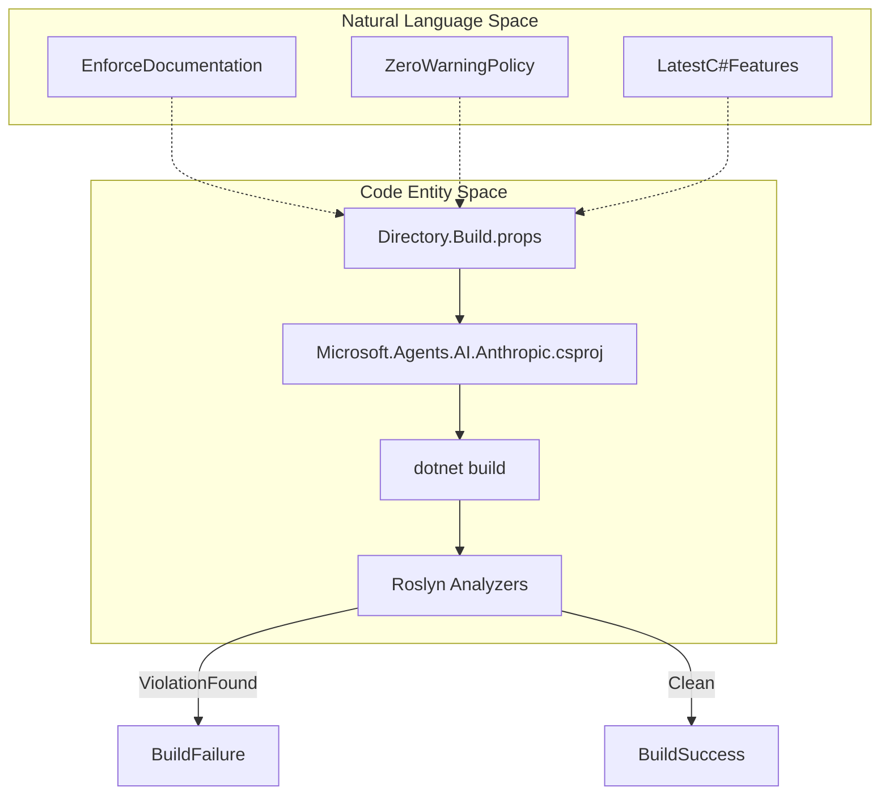
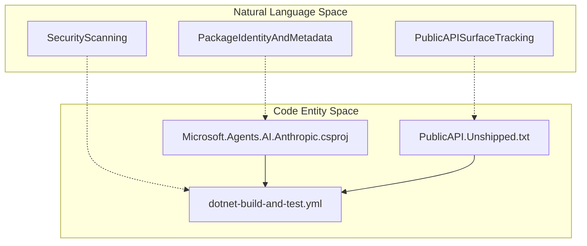

<!-- source: DeepWiki mcp.deepwiki.com · repo microsoft/agent-framework · extra page .NET Code Standards · fetched 2026-10-26 -->

# .Net Code Standards

Relevant source files

The following files were used as context for generating this wiki page:

- [.github/scripts/set_missing_issue_type.js](.github/scripts/set_missing_issue_type.js)
- [.github/scripts/stale_issue_pr_ping.py](.github/scripts/stale_issue_pr_ping.py)
- [.github/tests/test_set_missing_issue_type.js](.github/tests/test_set_missing_issue_type.js)
- [.github/tests/test_stale_issue_pr_ping.py](.github/tests/test_stale_issue_pr_ping.py)
- [.github/workflows/codeql-analysis.yml](.github/workflows/codeql-analysis.yml)
- [.github/workflows/devflow-pr-review.yml](.github/workflows/devflow-pr-review.yml)
- [.github/workflows/dotnet-build-and-test.yml](.github/workflows/dotnet-build-and-test.yml)
- [.github/workflows/dotnet-format.yml](.github/workflows/dotnet-format.yml)
- [.github/workflows/dotnet-integration-tests.yml](.github/workflows/dotnet-integration-tests.yml)
- [.github/workflows/github-automation-tests.yml](.github/workflows/github-automation-tests.yml)
- [.github/workflows/integration-tests-manual.yml](.github/workflows/integration-tests-manual.yml)
- [.github/workflows/issue-triage.yml](.github/workflows/issue-triage.yml)
- [.github/workflows/label-issues.yml](.github/workflows/label-issues.yml)
- [.github/workflows/label-pr.yml](.github/workflows/label-pr.yml)
- [.github/workflows/label-title-prefix.yml](.github/workflows/label-title-prefix.yml)
- [.github/workflows/python-api-compatibility.yml](.github/workflows/python-api-compatibility.yml)
- [.github/workflows/python-code-quality.yml](.github/workflows/python-code-quality.yml)
- [.github/workflows/python-docs.yml](.github/workflows/python-docs.yml)
- [.github/workflows/python-integration-tests.yml](.github/workflows/python-integration-tests.yml)
- [.github/workflows/python-lab-tests.yml](.github/workflows/python-lab-tests.yml)
- [.github/workflows/python-merge-tests.yml](.github/workflows/python-merge-tests.yml)
- [.github/workflows/python-release.yml](.github/workflows/python-release.yml)
- [.github/workflows/python-test-coverage.yml](.github/workflows/python-test-coverage.yml)
- [.github/workflows/python-tests.yml](.github/workflows/python-tests.yml)
- [.github/workflows/stale-issue-pr-ping.yml](.github/workflows/stale-issue-pr-ping.yml)
- [dotnet/Directory.Packages.props](dotnet/Directory.Packages.props)
- [dotnet/agent-framework-dotnet.slnx](dotnet/agent-framework-dotnet.slnx)
- [dotnet/samples/02-agents/AgentProviders/anthropic/Agent_Anthropic_Step04_UsingSkills/Program.cs](dotnet/samples/02-agents/AgentProviders/anthropic/Agent_Anthropic_Step04_UsingSkills/Program.cs)
- [dotnet/src/Microsoft.Agents.AI.Anthropic/AnthropicBetaServiceExtensions.cs](dotnet/src/Microsoft.Agents.AI.Anthropic/AnthropicBetaServiceExtensions.cs)
- [dotnet/src/Microsoft.Agents.AI.Anthropic/Microsoft.Agents.AI.Anthropic.csproj](dotnet/src/Microsoft.Agents.AI.Anthropic/Microsoft.Agents.AI.Anthropic.csproj)
- [dotnet/src/Microsoft.Agents.AI.Anthropic/PublicAPI/net10.0/PublicAPI.Shipped.txt](dotnet/src/Microsoft.Agents.AI.Anthropic/PublicAPI/net10.0/PublicAPI.Shipped.txt)
- [dotnet/src/Microsoft.Agents.AI.Anthropic/PublicAPI/net10.0/PublicAPI.Unshipped.txt](dotnet/src/Microsoft.Agents.AI.Anthropic/PublicAPI/net10.0/PublicAPI.Unshipped.txt)
- [dotnet/src/Microsoft.Agents.AI.Anthropic/PublicAPI/net472/PublicAPI.Shipped.txt](dotnet/src/Microsoft.Agents.AI.Anthropic/PublicAPI/net472/PublicAPI.Shipped.txt)
- [dotnet/src/Microsoft.Agents.AI.Anthropic/PublicAPI/net472/PublicAPI.Unshipped.txt](dotnet/src/Microsoft.Agents.AI.Anthropic/PublicAPI/net472/PublicAPI.Unshipped.txt)
- [dotnet/src/Microsoft.Agents.AI.Anthropic/PublicAPI/net8.0/PublicAPI.Shipped.txt](dotnet/src/Microsoft.Agents.AI.Anthropic/PublicAPI/net8.0/PublicAPI.Shipped.txt)
- [dotnet/src/Microsoft.Agents.AI.Anthropic/PublicAPI/net8.0/PublicAPI.Unshipped.txt](dotnet/src/Microsoft.Agents.AI.Anthropic/PublicAPI/net8.0/PublicAPI.Unshipped.txt)
- [dotnet/src/Microsoft.Agents.AI.Anthropic/PublicAPI/net9.0/PublicAPI.Shipped.txt](dotnet/src/Microsoft.Agents.AI.Anthropic/PublicAPI/net9.0/PublicAPI.Shipped.txt)
- [dotnet/tests/AnthropicChatCompletion.IntegrationTests/AnthropicSkillsIntegrationTests.cs](dotnet/tests/AnthropicChatCompletion.IntegrationTests/AnthropicSkillsIntegrationTests.cs)
- [dotnet/tests/Microsoft.Agents.AI.Anthropic.UnitTests/Extensions/AnthropicBetaServiceExtensionsTests.cs](dotnet/tests/Microsoft.Agents.AI.Anthropic.UnitTests/Extensions/AnthropicBetaServiceExtensionsTests.cs)
- [dotnet/tests/Microsoft.Agents.AI.Anthropic.UnitTests/Extensions/AnthropicClientExtensionsTests.cs](dotnet/tests/Microsoft.Agents.AI.Anthropic.UnitTests/Extensions/AnthropicClientExtensionsTests.cs)
- [python/PACKAGE_STATUS.md](python/PACKAGE_STATUS.md)

## Purpose and Scope

This document defines the coding standards, formatting conventions, and quality requirements for the .NET implementation of the Microsoft Agent Framework. It details the automated enforcement mechanisms, build configuration requirements, public API tracking via Roslyn analyzers, and code coverage metrics that maintain consistency across the codebase. These standards ensure that the framework remains robust, maintainable, and compatible across multiple .NET versions.

For Python coding standards, see [Python Code Standards](9.3.2). For information about the CI/CD infrastructure that enforces these standards, see [CI/CD Infrastructure](9.2). For local development setup, see [.NET Development Setup](9.1.1).

Sources: [dotnet/Directory.Build.props:1-16](), [dotnet/src/Microsoft.Agents.AI/PublicAPI/net10.0/PublicAPI.Unshipped.txt:1-19]()

---

## Formatting Standards

### dotnet format Tool

The repository uses `dotnet format` as the primary code formatter for all C# code. This tool enforces consistent code style, including spacing, indentation, naming conventions, and code organization.

**Enforcement Strategy:**
The formatter runs with the `--verify-no-changes` flag in the `dotnet-format` GitHub Action. The build fails if any formatting changes are required, ensuring all code is properly formatted before merging into the main branch [.github/workflows/dotnet-format.yml:92-102]().

**Key Configuration:**
- **Runtime Environment:** Runs inside the `mcr.microsoft.com/dotnet/sdk:10.0` Docker container to ensure environment parity [.github/workflows/dotnet-format.yml:88-102]().
- **Diagnostics:** Uses diagnostic verbosity to provide detailed feedback on formatting violations [.github/workflows/dotnet-format.yml:101]().
- **Workflow Trigger:** Triggers on pull requests to `main` or `feature*` branches when files in the `dotnet/` directory are modified [.github/workflows/dotnet-format.yml:7-12]().

### Changed File Detection

The formatting workflow intelligently detects changed C# files to optimize execution time. It identifies the nearest `.csproj` file for each modified file to format only the relevant projects [.github/workflows/dotnet-format.yml:54-85](). If the file detection step fails, it falls back to running the formatter on the entire solution (`.slnx`) [.github/workflows/dotnet-format.yml:80-82]().

Sources: [.github/workflows/dotnet-format.yml:54-102]()

---

## Build Configuration Requirements

### Directory.Build.props Configuration

The repository uses `dotnet/Directory.Build.props` to centrally define build settings that apply to all projects. This ensures that quality gates like nullable reference types and analyzer levels are consistent across the entire solution [dotnet/Directory.Build.props:1-16]().

| Property | Value | Purpose |
|----------|-------|---------|
| `TreatWarningsAsErrors` | `true` | Treats all compiler warnings as errors to maintain a zero-warning codebase [dotnet/Directory.Build.props:11](). |
| `RunAnalyzersDuringBuild` | `true` | Enables Roslyn analyzers during compilation [dotnet/Directory.Build.props:4](). |
| `EnableNETAnalyzers` | `true` | Enables built-in .NET code quality analyzers [dotnet/Directory.Build.props:5](). |
| `AnalysisLevel` | `10.0-all` | Enables all available analyzers for .NET 10.0 [dotnet/Directory.Build.props:6](). |
| `Nullable` | `enable` | Enables nullable reference type checking [dotnet/Directory.Build.props:9](). |
| `LangVersion` | `latest` | Ensures use of the most recent C# language features [dotnet/Directory.Build.props:8](). |

Sources: [dotnet/Directory.Build.props:1-16]()

### Target Framework Support

The framework supports multiple .NET target frameworks to ensure broad compatibility across modern cloud-native environments and legacy systems [dotnet/Directory.Build.props:12-13]().

| Framework Group | Target Frameworks | Use Case |
|-----------------|-------------------|----------|
| **Modern .NET** | `net10.0;net9.0;net8.0` | Primary targets for cloud-native AI agents [dotnet/Directory.Build.props:12](). |
| **Legacy/Standard** | `netstandard2.0;net472` | Support for existing .NET Framework and cross-platform libraries [dotnet/Directory.Build.props:13](). |

Note: Nullable reference type warnings are suppressed for `netstandard2.0` and `net472` as these frameworks do not fully support the feature [dotnet/Directory.Build.props:52-54]().

Sources: [dotnet/Directory.Build.props:12-15](), [dotnet/Directory.Build.props:52-54]()

### Build and Analysis Flow

The following diagram illustrates how source code is processed through the quality gates defined in the build configuration, mapping design requirements to underlying code entities.

**Build Quality Pipeline**

Sources: [dotnet/Directory.Build.props:4-11](), [dotnet/src/Microsoft.Agents.AI.Anthropic/Microsoft.Agents.AI.Anthropic.csproj:1-7]()

---

## Public API Tracking

To prevent accidental breaking changes in public APIs, the framework tracks public API surfaces across all target frameworks using specialized tracking files. 

### PublicAPI.Unshipped.txt Files

Every core project maintains explicit API tracking contracts located under the `PublicAPI/` directory for each target framework (e.g., `net10.0`, `net9.0`, `net8.0`, `netstandard2.0`, `net472`).
- **Unshipped APIs:** New or modified public APIs are recorded in `PublicAPI.Unshipped.txt` files during development, tracking attributes, parameters, and return types [dotnet/src/Microsoft.Agents.AI/PublicAPI/net10.0/PublicAPI.Unshipped.txt:1-19]().
- **Diagnostics:** Experimental annotations such as `[MAAI001]` and diagnostic suppression attributes are explicitly tracked to govern experimental feature exposure [dotnet/src/Microsoft.Agents.AI/PublicAPI/net10.0/PublicAPI.Unshipped.txt:2-19]().
- **API Review Workflow:** During the release lifecycle, unshipped files are promoted to shipped contracts to ensure strict versioning guarantees.

Sources: [dotnet/src/Microsoft.Agents.AI/PublicAPI/net10.0/PublicAPI.Unshipped.txt:1-19](), [dotnet/src/Microsoft.Agents.AI/PublicAPI/net472/PublicAPI.Unshipped.txt:1-19]()

---

## Code Coverage Requirements

### Coverage Thresholds

The framework enforces a minimum code coverage threshold for core library assemblies. The current global threshold is set to **80%** [.github/workflows/dotnet-build-and-test.yml:20](). Coverage is typically measured during CI pipeline execution for the latest stable .NET target, currently `net10.0` [.github/workflows/dotnet-build-and-test.yml:21]().

### Coverage Collection and Validation

Coverage is collected using standard .NET coverage collectors. Specific diagnostic warnings like `MEAI001` (Experimental) and `MAAI001` are occasionally suppressed within specific projects to allow usage of emerging `Microsoft.Extensions.AI` APIs without failing build standards. For example, `Microsoft.Agents.AI.Purview` and `Microsoft.Agents.AI.Declarative` must adhere to these centralized quality rules defined in `Directory.Build.props`.

Sources: [.github/workflows/dotnet-build-and-test.yml:19-21](), [dotnet/src/Microsoft.Agents.AI.Purview/Microsoft.Agents.AI.Purview.csproj:1-5](), [dotnet/src/Microsoft.Agents.AI.Declarative/Microsoft.Agents.AI.Declarative.csproj:1-5]()

---

## NuGet Package Standards

### Versioning and Packaging

The framework uses a centralized build system for NuGet packages. Projects like `Microsoft.Agents.AI.Anthropic` import common package properties to maintain consistency [dotnet/src/Microsoft.Agents.AI.Anthropic/Microsoft.Agents.AI.Anthropic.csproj:1-9]().

**Package Validation:**
The .NET projects use package validation to detect API breaking changes.
- **Enforcement:** Validation runs during `dotnet build` (Release) and `dotnet pack` [.github/workflows/dotnet-build-and-test.yml:138-141]().
- **Testing:** CI includes a "Package install check" step that creates a new console application to verify that generated packages can be correctly installed and resolved from local artifacts [.github/workflows/dotnet-build-and-test.yml:145-164]().

Sources: [dotnet/src/Microsoft.Agents.AI.Anthropic/Microsoft.Agents.AI.Anthropic.csproj:1-9](), [.github/workflows/dotnet-build-and-test.yml:138-164]()

### Project Structure and Metadata

The following diagram maps package metadata requirements and API tracking design concepts to concrete project files and CI pipelines.

**Public API Tracking and Package Metadata**

Sources: [dotnet/src/Microsoft.Agents.AI.Anthropic/Microsoft.Agents.AI.Anthropic.csproj:1-25](), [dotnet/src/Microsoft.Agents.AI/PublicAPI/net10.0/PublicAPI.Unshipped.txt:1-19](), [.github/workflows/dotnet-build-and-test.yml:6-17]()

---

## CI/CD Enforcement Flow

The build pipeline coordinates multiple checks to ensure standards are met before merging.

1. **Static Analysis:** All builds run with `TreatWarningsAsErrors=true` [dotnet/Directory.Build.props:11]().
2. **Multi-TFM Validation:** The framework is built across `net10.0`, `net9.0`, `net8.0`, and `net472` to ensure cross-platform compatibility [.github/workflows/dotnet-build-and-test.yml:106-109]().
3. **API Validation:** Public API diff checks run against `PublicAPI.Unshipped.txt` to catch breaking changes.
4. **Security Scanning:** GitHub CodeQL is used to automate security checks for both `csharp` and `python` codebases [.github/workflows/codeql-analysis.yml:27]().
5. **Documentation:** `GenerateDocumentationFile` is enabled globally to ensure API surface area documentation is generated during the build [dotnet/Directory.Build.props:7]().

Sources: [dotnet/Directory.Build.props:1-11](), [.github/workflows/dotnet-build-and-test.yml:106-109](), [.github/workflows/codeql-analysis.yml:24-31](), [dotnet/src/Microsoft.Agents.AI/PublicAPI/net10.0/PublicAPI.Unshipped.txt:1-5]()

---

