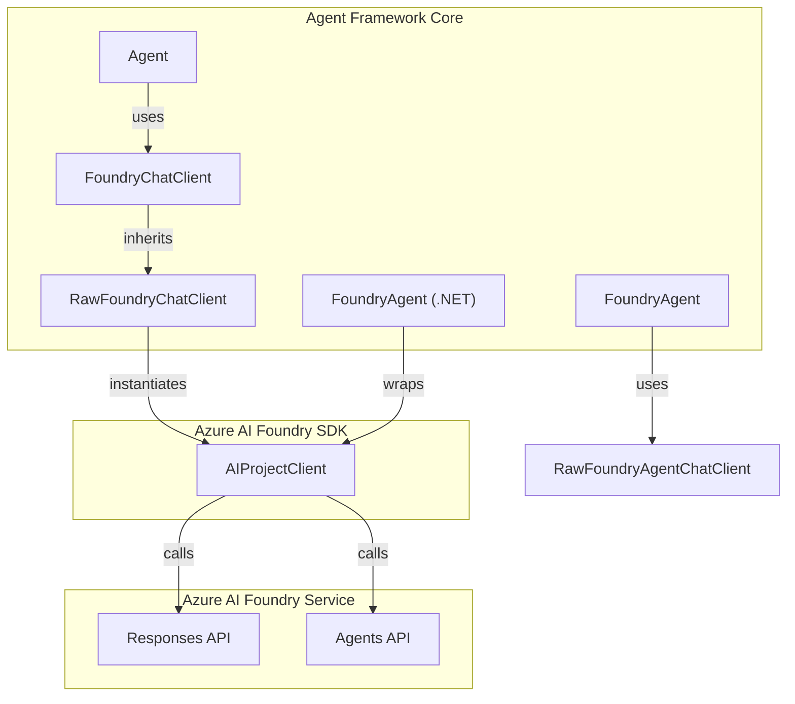
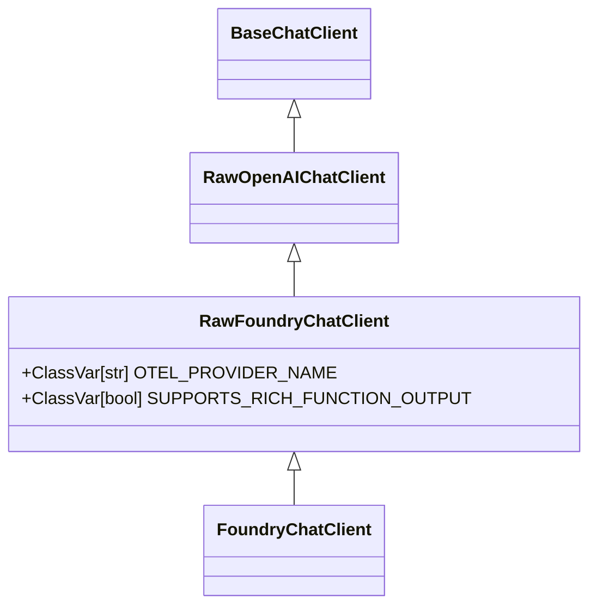

<!-- source: DeepWiki mcp.deepwiki.com · repo microsoft/agent-framework · extra page Azure AI Foundry Integration · fetched 2026-10-26 -->

# Azure AI Foundry Integration

Relevant source files

The following files were used as context for generating this wiki page:

- [dotnet/global.json](dotnet/global.json)
- [dotnet/samples/04-hosting/FoundryHostedAgents/responses/Using-Samples/SessionFilesClient/SessionFilesClient.csproj](dotnet/samples/04-hosting/FoundryHostedAgents/responses/Using-Samples/SessionFilesClient/SessionFilesClient.csproj)
- [dotnet/samples/04-hosting/FoundryHostedAgents/responses/Using-Samples/SimpleAgent/SimpleAgent.csproj](dotnet/samples/04-hosting/FoundryHostedAgents/responses/Using-Samples/SimpleAgent/SimpleAgent.csproj)
- [dotnet/samples/04-hosting/FoundryHostedAgents/responses/Using-Samples/UserIsolationAgent/Program.cs](dotnet/samples/04-hosting/FoundryHostedAgents/responses/Using-Samples/UserIsolationAgent/Program.cs)
- [dotnet/samples/04-hosting/FoundryHostedAgents/responses/Using-Samples/UserIsolationAgent/README.md](dotnet/samples/04-hosting/FoundryHostedAgents/responses/Using-Samples/UserIsolationAgent/README.md)
- [dotnet/src/Microsoft.Agents.AI.Foundry.Hosting/HostedAgentUserAgentPolicy.cs](dotnet/src/Microsoft.Agents.AI.Foundry.Hosting/HostedAgentUserAgentPolicy.cs)
- [dotnet/src/Microsoft.Agents.AI.Foundry/ClientHeadersAgent.cs](dotnet/src/Microsoft.Agents.AI.Foundry/ClientHeadersAgent.cs)
- [dotnet/src/Microsoft.Agents.AI.Foundry/ClientHeadersExtensions.cs](dotnet/src/Microsoft.Agents.AI.Foundry/ClientHeadersExtensions.cs)
- [dotnet/src/Microsoft.Agents.AI.Foundry/ClientHeadersPolicy.cs](dotnet/src/Microsoft.Agents.AI.Foundry/ClientHeadersPolicy.cs)
- [dotnet/src/Microsoft.Agents.AI.Foundry/ClientHeadersScope.cs](dotnet/src/Microsoft.Agents.AI.Foundry/ClientHeadersScope.cs)
- [dotnet/src/Microsoft.Agents.AI.Foundry/FoundryAgent.cs](dotnet/src/Microsoft.Agents.AI.Foundry/FoundryAgent.cs)
- [dotnet/src/Microsoft.Agents.AI.Foundry/FoundryChatOptionsExtensions.cs](dotnet/src/Microsoft.Agents.AI.Foundry/FoundryChatOptionsExtensions.cs)
- [dotnet/src/Microsoft.Agents.AI.Foundry/FoundryHostedRequestAgent.cs](dotnet/src/Microsoft.Agents.AI.Foundry/FoundryHostedRequestAgent.cs)
- [dotnet/src/Microsoft.Agents.AI.Foundry/UserIdentityScope.cs](dotnet/src/Microsoft.Agents.AI.Foundry/UserIdentityScope.cs)
- [dotnet/tests/Foundry.Hosting.IntegrationTests/HostedSessionAndUserIdentityTests.cs](dotnet/tests/Foundry.Hosting.IntegrationTests/HostedSessionAndUserIdentityTests.cs)
- [dotnet/tests/Microsoft.Agents.AI.Foundry.Hosting.UnitTests/HostedOutboundUserAgentTests.cs](dotnet/tests/Microsoft.Agents.AI.Foundry.Hosting.UnitTests/HostedOutboundUserAgentTests.cs)
- [dotnet/tests/Microsoft.Agents.AI.Foundry.UnitTests/ClientHeadersExtensionsTests.cs](dotnet/tests/Microsoft.Agents.AI.Foundry.UnitTests/ClientHeadersExtensionsTests.cs)
- [dotnet/tests/Microsoft.Agents.AI.Foundry.UnitTests/FoundryAgentTests.cs](dotnet/tests/Microsoft.Agents.AI.Foundry.UnitTests/FoundryAgentTests.cs)
- [dotnet/tests/Microsoft.Agents.AI.Foundry.UnitTests/Microsoft.Agents.AI.Foundry.UnitTests.csproj](dotnet/tests/Microsoft.Agents.AI.Foundry.UnitTests/Microsoft.Agents.AI.Foundry.UnitTests.csproj)
- [python/packages/core/agent_framework/_feature_stage.py](python/packages/core/agent_framework/_feature_stage.py)
- [python/packages/core/tests/core/test_feature_stage.py](python/packages/core/tests/core/test_feature_stage.py)
- [python/packages/foundry/README.md](python/packages/foundry/README.md)
- [python/packages/foundry/agent_framework_foundry/_agent.py](python/packages/foundry/agent_framework_foundry/_agent.py)
- [python/packages/foundry/agent_framework_foundry/_chat_client.py](python/packages/foundry/agent_framework_foundry/_chat_client.py)
- [python/packages/foundry/tests/foundry/test_foundry_agent.py](python/packages/foundry/tests/foundry/test_foundry_agent.py)
- [python/packages/foundry/tests/foundry/test_foundry_chat_client.py](python/packages/foundry/tests/foundry/test_foundry_chat_client.py)
- [python/packages/openai/agent_framework_openai/_chat_client.py](python/packages/openai/agent_framework_openai/_chat_client.py)
- [python/packages/openai/agent_framework_openai/_chat_completion_client.py](python/packages/openai/agent_framework_openai/_chat_completion_client.py)
- [python/packages/openai/tests/openai/test_openai_chat_client.py](python/packages/openai/tests/openai/test_openai_chat_client.py)
- [python/packages/openai/tests/openai/test_openai_chat_completion_client.py](python/packages/openai/tests/openai/test_openai_chat_completion_client.py)

## Purpose and Scope
This document details the integration between the Microsoft Agent Framework and **Azure AI Foundry** (formerly Azure AI Projects). Azure AI Foundry provides a managed service for deploying and running AI agents with built-in tools, versioning, and enterprise features through the **Azure AI Agent Service**, exposing capabilities via the **Foundry Agents API** and an OpenAI-compatible **Responses API**. 

This integration layer maps core abstractions such as `Agent`, `ChatClient`, `AgentSession`, and tools (`FunctionTool`, hosted tools) onto the `azure-ai-projects` SDK, enabling agent hosting, message transformation, citation enhancement, and memory integration.

Sources: [python/packages/foundry/README.md:1-10](), [python/packages/foundry/agent_framework_foundry/_chat_client.py:151-170]()

---

## Architecture Overview

The Azure AI Foundry integration bridges the Microsoft Agent Framework core abstractions with the underlying Azure AI project clients and remote endpoints.

### Diagram: Client and Service Architecture (Code Entity Space)

Sources: [python/packages/foundry/agent_framework_foundry/_chat_client.py:151-190](), [python/packages/foundry/agent_framework_foundry/_agent.py:158-175](), [dotnet/src/Microsoft.Agents.AI.Foundry/FoundryAgent.cs:19-50]()

---

## Python Client Implementation

### RawFoundryChatClient and FoundryChatClient

`RawFoundryChatClient` extends `RawOpenAIChatClient` to target the Azure AI Foundry project endpoint. It initializes an `AIProjectClient` from `azure.ai.projects.aio` and obtains an OpenAI-compatible client for requests.

- **Initialization**: Resolves configuration from environment variables `FOUNDRY_MODEL` and `FOUNDRY_PROJECT_ENDPOINT`, or explicit arguments [python/packages/foundry/agent_framework_foundry/_chat_client.py:173-188]().
- **Telemetry**: Integrates `FeatureUsagePolicy` to track usage via `FeatureIndex.FOUNDRY_CHAT_CLIENT` [python/packages/foundry/agent_framework_foundry/_chat_client.py:171-171](), [python/packages/foundry/tests/foundry/test_foundry_chat_client.py:143-145]().
- **FoundryChatClient**: Builds upon `RawFoundryChatClient` by adding the `FunctionInvocationLayer` and `ChatTelemetryLayer` for full middleware support [python/packages/foundry/agent_framework_foundry/_chat_client.py:10-25]().

### Diagram: Python Client Inheritance Hierarchy

Sources: [python/packages/foundry/agent_framework_foundry/_chat_client.py:151-172]()

---

## FoundryAgent Integration

`FoundryAgent` connects to pre-configured PromptAgents or HostedAgents in Foundry via the Responses API. 

- **Session Continuity**: Stores and retrieves the hosted agent session identifier using `AgentSession.state[FOUNDRY_HOSTED_AGENT_SESSION_ID_KEY]` [python/packages/foundry/agent_framework_foundry/_agent.py:44-44]().
- **Tool Ownership**: Supplied `tools` serve as local Python function declarations matching remote capabilities; the remote agent retains ownership of tool execution and policy [python/packages/foundry/README.md:11-23]().

Sources: [python/packages/foundry/agent_framework_foundry/_agent.py:3-179](), [python/packages/foundry/README.md:11-23]()

---

## Responses API and Message Transformation

The integration leverages the OpenAI-compatible Responses API for streaming events, tool calls, and structured outputs.

- **File ID Resolution**: `resolve_file_ids()` maps string IDs or hosted file content objects to formats accepted by code interpreters [python/packages/foundry/agent_framework_foundry/_chat_client.py:114-138]().
- **Reasoning Replay**: Manages provider-native reasoning items via internal keys like `_FOUNDRY_REASONING_REPLAY_ITEM_KEY` to preserve reasoning state across turns [python/packages/foundry/agent_framework_foundry/_chat_client.py:88-97]().

Sources: [python/packages/foundry/agent_framework_foundry/_chat_client.py:88-138]()

---

## Hosted Tools and Toolbox Integration

Foundry projects bundle hosted tools into versioned toolboxes or expose them directly via specialized parameter classes.

### Supported Hosted Tool Parameters

| Python Class / Parameter | Description | Azure SDK Mapping |
| :--- | :--- | :--- |
| `CodeInterpreterTool` | Containerized Python execution | `AutoCodeInterpreterToolParam` [python/packages/foundry/agent_framework_foundry/_chat_client.py:29-41]() |
| `ProjectsFileSearchTool` | RAG search over project files | `ProjectsFileSearchTool` [python/packages/foundry/agent_framework_foundry/_chat_client.py:54-54]() |
| `WebSearchTool` | Bing-powered web grounding | `WebSearchTool` [python/packages/foundry/agent_framework_foundry/_chat_client.py:51-51]() |
| `ImageGenTool` | DALL-E image generation | `ImageGenTool` [python/packages/foundry/agent_framework_foundry/_chat_client.py:44-44]() |
| `FoundryMCPTool` | Model Context Protocol integration | `FoundryMCPTool` [python/packages/foundry/agent_framework_foundry/_chat_client.py:55-55]() |

Sources: [python/packages/foundry/agent_framework_foundry/_chat_client.py:26-58](), [python/packages/foundry/README.md:110-140]()

---

## .NET Implementation

The .NET integration is delivered through the `Microsoft.Agents.AI.Foundry` package [dotnet/tests/Microsoft.Agents.AI.Foundry.UnitTests/Microsoft.Agents.AI.Foundry.UnitTests.csproj:19-19]().

- **FoundryAgent (.NET)**: Connects to pre-configured agents using `AIProjectClient` from the `Azure.AI.Projects` namespace [dotnet/tests/Microsoft.Agents.AI.Foundry.UnitTests/Microsoft.Agents.AI.Foundry.UnitTests.csproj:11-11]().
- **Session Management**: Uses `HostedSessionIdCapturePolicy` and `HostedSessionIdCaptureScope` to capture and persist session identifiers across service calls.

Sources: [dotnet/src/Microsoft.Agents.AI.Foundry/FoundryAgent.cs:1-132](), [dotnet/src/Microsoft.Agents.AI.Foundry/HostedSessionIdCapturePolicy.cs]()

---

